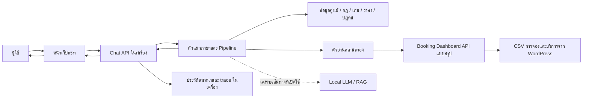
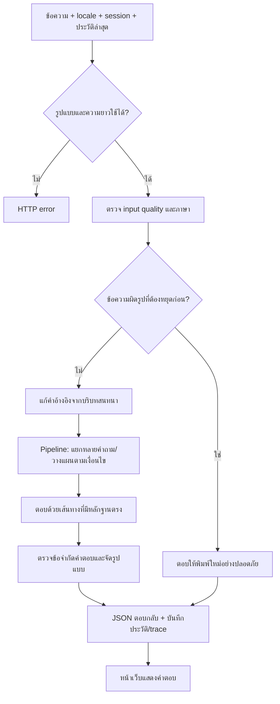

# Flow ระบบ PSU Esports Studio – Phuket Chatbot (ฉบับตรวจทาน 3 รอบ)

**วันที่ตรวจ:** 28 กันยายน 2026 (เวลาไทย)  
**ขอบเขต:** โค้ดใน `C:\Users\Chokhun\Downloads\Learn-LLM\18_PSU_Esports_Update_Route_Data`, Dashboard ที่ `D:\Download New\booking_dashboard_v26_slot_balanced_layout\booking_dashboard_v26_slot_balanced_layout`, แพ็กเกจ `owner_local_verified_20260925\PSU_Esports_Chatbot_Local` และรายงานผลทดสอบที่มีถึง 27 กันยายน 2026  
**สถานะเอกสาร:** อธิบายระบบที่ตรวจพบ ไม่ใช่การรับรองว่าข้อมูลบริการทุกข้อได้รับอนุมัติจากเจ้าของศูนย์

> **วิธีอ่านหลักฐาน** — `ยืนยันจากโค้ด` หมายถึงพบเส้นทางทำงานในไฟล์จริง; `ผ่านทดสอบอัตโนมัติ` หมายถึงผ่านเงื่อนไขของชุดทดสอบที่ระบุเท่านั้น; `รอคน/เจ้าของยืนยัน` หมายถึงยังไม่มีหลักฐานภายนอกเพียงพอ แม้โปรแกรมอาจตอบได้แล้ว

## 1. ภาพรวมและขอบเขตของระบบ

ระบบนี้เป็น **แชทบอทตอบข้อมูลศูนย์และสถานะการจอง** ผู้ใช้ส่งคำถามผ่านหน้าเว็บ แบ็กเอนด์เลือกแหล่งข้อมูลและสร้างคำตอบ แล้วส่งกลับพร้อมหมวดคำถาม แหล่งอ้างอิง และเวลาประมวลผล ระบบ **อ่าน** สถานะจองจาก Dashboard ที่ต่อข้อมูล WordPress; โค้ดเส้นทางแชทที่ตรวจไม่สร้าง ไม่ยืนยัน ไม่แก้ และไม่ยกเลิกการจองแทนผู้ใช้ ลิงก์หน้าจองเป็นทางให้ผู้ใช้ไปดำเนินการเอง

**แหล่งหลัก:** `web_chat/app.js`, `app/web_api/server.py`, `app/pipeline/engine.py`, `app/booking/live_status.py`, `booking_dashboard/server.py`, `app/session/chat_logger.py`.

### 1.1 สิ่งที่ระบบตอบได้ตามแบบที่ออกแบบ

| กลุ่มคำถาม | แหล่งที่ควรใช้ | ขอบเขตการตอบ |
|---|---|---|
| ราคา เวลาและเงื่อนไขบริการ | ตารางราคา กฎ และปฏิทินในโปรเจกต์ | ตอบตามกลุ่มผู้ใช้/โซน/ระยะเวลาที่ระบุ; ถ้าขาดตัวแปรสำคัญให้ถามเพิ่ม |
| รายชื่อเกม วิธีเล่น ปุ่มควบคุม | catalog และ facts ของเกม | ต้องจับชื่อเกม รุ่น/ภาค และแพลตฟอร์มให้ตรง; ข้อมูลรองที่ยังไม่ตรวจต้องไม่กล่าวเป็นข้อเท็จจริงแน่นอน |
| อุปกรณ์ สถานที่ ช่องทางติดต่อ | structured facts/เนื้อหาศูนย์ | แยกข้อมูลในโปรเจกต์จากสภาพเครื่องจริงที่ยังไม่ยืนยัน |
| กติกาการแข่งขัน | canonical content + หลักฐานต้นทาง | อ้างเฉพาะข้อและเกมที่ตรง; คำแปลอังกฤษต้องผ่านขั้นอนุมัติ |
| ศูนย์เปิดหรือปิดในวัน/เวลาหนึ่ง | service calendar และรายการปิดพิเศษ | คำว่า “เปิดศูนย์” ไม่ได้แปลว่าเครื่องใดเครื่องหนึ่งว่าง |
| PC/PS5/VR หรือโซนว่างไหม | Dashboard `/api/chatbot-status` + การตรวจปฏิทิน | เป็น snapshot ณ เวลาดึงข้อมูล; ไม่ใช่การจองหรือรับประกันว่ายังว่างตอนผู้ใช้ไปถึง |

## 2. Flow การเริ่มระบบ

### 2.1 เปิด Dashboard แยก (`start-dashboard.bat` ในชุดที่ผู้ใช้ใช้งาน)

1. Dashboard ต้องมีโปรเซสทำงานและรับคำขอ HTTP ในเครื่องจึงจะดึง CSV จาก WordPress และแสดงสถานะได้ ถ้าปิดโปรเซส หน้า Dashboard/คำถามจองสดจะใช้ไม่ได้
2. หน้า Dashboard ใช้ `/api/status` และอัปเดตหน้าจอเป็นระยะ (ในโค้ดหน้าเว็บตั้งประมาณ 10 วินาที) ส่วนแชทบอทใช้ `/api/chatbot-status` ซึ่งส่งข้อมูลรวมโดยไม่ส่งข้อมูลผู้จอง
3. Dashboard ที่ D: อ่าน `center_schedule.json` ซึ่งเจ้าของแก้ได้ และนำเวลาพัก 12:00–13:00 ออกจากช่วงที่จองได้ขณะคำนวณ; ค่าต้นฉบับยังอยู่ตามที่เจ้าของกรอก โค้ด Dashboard ใน source project ปัจจุบันทำเช่นเดียวกัน แต่ Dashboard ที่ฝังใน **แพ็กเกจ 25 ก.ย. ยังไม่มีขั้นตัดพักนี้**

### 2.2 เปิดชุด Chatbot (`Open-PSU-Esports-Chatbot.cmd` / สคริปต์ PowerShell ในแพ็กเกจ)

1. สคริปต์ตรวจ Python, Ollama และโมเดลที่ต้องใช้ตามการตั้งค่าชุดติดตั้ง
2. **ตัวเปิดแพ็กเกจ 25 ก.ย. ที่ผู้ใช้มีจริง** ตรวจเพียงว่า `http://127.0.0.1:8091/` ตอบ HTTP 200; หากไม่พบจะเริ่ม Dashboard ที่ฝัง **ในแพ็กเกจ** แบบหน้าต่างซ่อน แล้วตรวจซ้ำ การตรวจนี้ไม่ยืนยันว่าเป็น Dashboard เวอร์ชันที่ตัดพักเที่ยง
3. ตั้ง `PSU_LIVE_BOOKING_ENABLED=1` เมื่อ Dashboard พร้อม มิฉะนั้นตั้ง `0`; เปิดเว็บแชทในเครื่องผ่าน `127.0.0.1`
4. ในแพ็กเกจตั้งกรอบเวลาคำตอบแบ็กเอนด์ `20` วินาที และกรอบของ pipeline `19` วินาที; หากรัน API จาก source โดยตรง ค่าเริ่มต้นใน `app/web_api/server.py` คือ `9` วินาทีสำหรับแบ็กเอนด์ และ `9` วินาทีสำหรับ pipeline (อาจเปลี่ยนด้วย environment)
5. การเปิด chatbot แบบ source โดยตรงไม่ได้เริ่ม Dashboard ให้อัตโนมัติแบบ launcher จึงต้องตรวจสถานะก่อนสรุปว่าข้อมูลจองสดใช้งานได้

**ความต่างของตัวเปิด:** แพ็กเกจ 25 ก.ย. ตรวจเพียงหน้าแรก ส่วน source ก่อนแก้ตรวจ `/health` ซึ่ง Dashboard D: ไม่มี endpoint นี้ หลังลงมือทำใน §12 ตัวเปิด r7 ตรวจ `/health` สำหรับ Dashboard ใหม่ และตรวจ `/api/chatbot-status` พร้อมช่วงพักเที่ยงสำหรับ D: รุ่นเดิม Chatbot ใช้พอร์ตเริ่มต้น 8090 จึงไม่ชนกับ D: ที่ 8080 และทดสอบเปิดจริงทั้งสองลำดับแล้ว

**ข้อจำกัดการปฏิบัติงาน:** เครื่องที่รัน Dashboard ยังต้องมีโปรเซสทำงานตลอดเวลาที่ต้องการข้อมูลสด การซ่อนหน้าต่างช่วยการใช้งาน แต่ไม่ได้ทำให้เป็นบริการที่คงอยู่หลังปิดเครื่องหรือหลังโปรเซสล้ม หากต้องการให้เริ่มเองและฟื้นตัว ต้องกำหนดวิธีรันเป็นบริการ/งานตามเวลาใน Windows พร้อมการเฝ้าดูและนโยบายสิทธิ์เครื่อง; ยังไม่ได้ตั้งค่าเช่นนั้นในหลักฐานที่ตรวจ

## 3. Flow คำถามหนึ่งครั้ง ตั้งแต่รับข้อความจนแสดงผล

1. `web_chat/app.js` เก็บ session ฝั่งหน้าเว็บ, ภาษาที่เลือก และประวัติช่วงล่าสุด ส่ง `POST /api/chat` พร้อม `question`, `client_session_id`, `recent_history`, `locale`; ปุ่มล้างสนทนาเริ่ม session ใหม่
2. API ตรวจ JSON, ขนาด, ความยาวคำถาม และ session ID; คุมจำนวนคำขอพร้อมกันและล็อกคำขอใน session เดียวกัน หากเต็มตอบ `server_busy` หรือ `session_busy` ให้ลองใหม่ ไม่ควรตีความเป็น “ไม่มีข้อมูลศูนย์”
3. ตรวจข้อความที่ดูเหมือนพิมพ์ผิดแป้นพิมพ์/คุณภาพต่ำ, กำหนดภาษาไทย อังกฤษ หรือข้อความผสม และใช้ประวัติช่วยเติมการอ้างอิง เช่น “แล้วเครื่องนั้นล่ะ” การตรวจผิดพลาดในขั้นนี้อาจทำให้คำถามจริงถูกขอให้พิมพ์ใหม่
4. ส่งเข้า pipeline ผ่าน worker supervisor เมื่อเปิดใช้งาน มิฉะนั้นเรียกตรง; มี deadline ครอบคำขอ ผลลัพธ์มี `answer`, `mode`, `route_category`, `route_intent`, แหล่งข้อมูล, เวลา และ trace เมื่อ debug
5. หลังตอบ ระบบบันทึกประวัติใน SQLite และ log รายวันในเครื่องแบบ asynchronous; `/api/session-history` อ่านประวัติตาม session ID ส่วน `/health` รายงาน runtime/features โดยไม่ยืนยันว่าเนื้อหาคำตอบถูกต้อง

**จุดสังเกต:** `HTTP 200`, `/health` พร้อม หรือการเชื่อม API สำเร็จ เป็นคนละเรื่องกับคำตอบถูกและข้อมูลจองตรง WordPress ณ เวลาเป้าหมาย

## 4. Flow การเลือกคำตอบภายใน Pipeline

Pipeline มีหลายทางลัดและทางถอยกลับ ขั้นตอนด้านล่างเป็น **ลำดับเชิงเหตุผล** ไม่ได้หมายความว่าทุกข้อความจะวิ่งผ่านทุกกล่อง

1. **ทางลัด canonical (เฉพาะเมื่อเปิด flag):** ลองตอบจากเนื้อหาศูนย์ที่จัดทำเป็น canonical ก่อน หากได้คำตอบที่ใช้ได้จบได้ทันที
2. **แยกคำถามหลายเรื่อง:** ตรวจคำถามผสม/ต่อเนื่อง; บางกรณีใช้ planner แบ่งงาน หากแยกได้หลายข้อจะตอบแต่ละข้อแล้วรวมเป็นรายการ โดยทำขนานเฉพาะลูกที่ตรวจว่า deterministic
3. **เตรียมข้อความและล็อกเป้าหมาย:** normalize, ลดคำเกริ่น, จับชื่อเกม ภาค แพลตฟอร์ม อุปกรณ์ วันที่ เวลา และกลุ่มผู้ใช้; target lock ช่วยกันไม่ให้ alias ใกล้เคียงสลับเรื่อง
4. **Protected intent:** คำถามนโยบายหรือข้อมูลที่ต้องล็อกข้อเท็จจริงจะลองเส้นทางเฉพาะก่อน เพื่อลดการถูกหมวดเกม/จองแทรก
5. **สถานะจองสด:** หากคำถามต้องการว่าง/ถูกจองของทรัพยากรตามวันเวลา จะลอง `answer_live_booking_status` ก่อนคำตอบอังกฤษทั่วไป ถ้าใช้ข้อมูลสดไม่ได้ให้ตอบไม่ยืนยันสถานะหรือชี้ทางตรวจเอง
6. **ภาษาอังกฤษ:** English renderer พยายามตอบจากข้อมูล/คำแปลที่ใช้ได้ หากยังไม่ครอบคลุม อาจให้ domain recovery ต่อ ไม่ควรแปลนโยบายหรือกติกาที่ยังไม่ได้อนุมัติเป็นคำตอบแน่นอน
7. **Intent และคำตอบแบบกำหนดโครง:** สร้าง question frame, route, universal intent และ candidate จาก fast answers/structured tools ตรวจความกำกวม แหล่งข้อมูลและ answer contract ก่อนส่ง หากผิดเป้าหมายหรือหลักฐานไม่พอให้ถอยไปทางอื่น
8. **ค้นคืนข้อมูล/RAG และโมเดล:** ใช้เมื่อทางตรงไม่ตอบหรือเงื่อนไขเปิดไว้ ดึงหลักฐานและอาจให้ Local LLM เรียบเรียงภายใต้ deadline แล้วตรวจคำตอบ; ผลขึ้นกับ flag และชนิดคำถาม ไม่ได้เรียกโมเดลทุกครั้ง
9. **ปลายทาง:** ตอบข้อมูลพร้อมที่มา, ถามให้ระบุข้อมูลที่ขาด, หรือบอกว่าไม่พบหลักฐานยืนยัน; timeout/busy ต้องแยกจาก no-answer ด้านเนื้อหา

**ความเสี่ยงที่พบ:** target/route ผิดแม้ข้อมูลมีอยู่, validator ปฏิเสธคำตอบที่ถูก, retrieval ที่วิ่งหลังถูกปฏิเสธทำให้ช้า และคำถามไทยปนชื่อเกมอังกฤษถูกขอให้พิมพ์ใหม่ผิดเหตุผล

### 4.1 เส้นทางตามประเภทคำถามที่ควรตรวจแยก

| คำถามตัวอย่าง | งานที่ pipeline ต้องทำ | จุดตัดสินสำคัญ | หากหลักฐานไม่พอ |
|---|---|---|---|
| “PC 2 ชั่วโมง บุคคลทั่วไปเท่าไหร่” | แยก PC, 2 ชั่วโมง, ประเภทผู้ใช้ → อ่านตารางราคา → คำนวณ | อย่าให้ชื่อเกม fuzzy จากคำเกริ่นแย่ง route ราคา; ตรวจหน่วย/ส่วนลด | ถามกลุ่มผู้ใช้หรือระยะเวลาที่ขาด ไม่คิดราคาเกมแยกเอง |
| “วันนี้ 10 โมง PC1 ว่างไหม” | แยกวันที่ เวลา เครื่อง → live path ใน §5 | ต้องมี snapshot จริง วันที่ตรง slot ตรง และเปิดบริการ | แจ้งว่ายืนยันสดไม่ได้หาก Dashboard/CSV ไม่พร้อม |
| “วันศุกร์บ่ายเปิดไหม” | อ่านตารางบริการและ maintenance | ตอบเรื่องศูนย์เปิด ไม่ใช่สถานะเครื่อง | ถ้าเป็นวันพิเศษที่ไม่ระบุวันที่ ให้ขอวันที่ |
| “PS5 มีเกมอะไร” / “เกมนี้กดปุ่มอะไร” | แยกคำถามรายการกับรายละเอียดเกม/ปุ่ม และจับภาค/แพลตฟอร์ม | ชื่อคล้ายกันต้องไม่ยืม control facts ข้ามเกม | ถามชื่อเกมหรือบอกว่าไม่มีข้อมูลปุ่มที่ยืนยันได้ |
| “Gaming Headset คืออะไร” | อ่าน item detail ไม่ใช่ส่งทั้ง catalog | item target ต้องชนะ intent รายการเมื่อถามชิ้นเดียว | ระบุว่ารายละเอียดชิ้นนั้นยังไม่มี |
| “กติกา CS2 ทีมละกี่คน” | จับการแข่งขัน + เกม CS2 + ข้อจำนวนผู้เล่น | ห้ามสลับกับความจุเครื่องหรือกล่าวถึงตัวสำรองหากต้นทางไม่รองรับ | อ้างได้เฉพาะข้อที่มีหลักฐาน; อังกฤษที่ยังไม่อนุมัติเป็น pending |
| “ที่ตั้ง/อีเมลศูนย์” | อ่านช่องทางติดต่อที่บันทึก | validator ต้องรับคำตอบ contact แม้ข้อความมีคำว่า “ศูนย์” | ตอบไม่พบเฉพาะเมื่อไม่มีข้อมูลในแหล่งที่ใช้งานจริง |

คำถามหลายเรื่อง เช่น ราคา + เวลาเปิด + สถานะเครื่อง จะถูกแยกเป็นงานย่อยและรวมผล โดยต้องติดป้ายให้ชัดว่าส่วนใดเป็นข้อมูลคงที่และส่วนใดเป็น snapshot จองสด; ถ้างานย่อยหนึ่งล้มเหลว ไม่ควรเอาคำตอบของงานอื่นไปอ้างแทน

## 5. Flow สถานะจองสดและปฏิทิน (ลงรายละเอียด)

### 5.1 เส้นทางข้อมูล

`WordPress CSV appointments + services` → Dashboard `fetch_csv_pair(force_sample=False)` → parse/build สถานะตามวันและทรัพยากร → `/api/chatbot-status?date=YYYY-MM-DD` แบบข้อมูลรวม → `app/booking/live_status.py` ตรวจ payload → เลือกทรัพยากร/ช่วงเวลา → ตรวจปฏิทินบริการ → สร้างคำตอบไทย/อังกฤษ

Dashboard เรียก CSV ต้นทางพร้อมตัวตัด cache ที่ URL และ header ไม่ให้ cache; การเรียกแชทมี cache snapshot ในฝั่ง chatbot ตามวันที่ **ค่าเริ่มต้น 10 วินาที** และ timeout การดึง **ค่าเริ่มต้น 5 วินาที** ดังนั้น “ดึงทันที” หมายถึงเรียกเมื่อถามหรือใช้ snapshot อายุสั้น ไม่ใช่สตรีมไร้เวลาแฝง และไม่รับประกันว่าข้อมูลต้นทางอัปเดตทันทุกการเปลี่ยนแปลง

การรวมข้อมูล Dashboard ตัด appointment ที่มีสถานะยกเลิก/ลบ/ปฏิเสธ/failed ออกจากยอดจอง ส่วน `no-show` **ไม่คืนสิทธิ์ให้ว่าง** ตาม logic ที่บันทึกไว้; slot ที่ปิดหรือเลยเวลาต้องไม่ถูกนับว่าง แม้จำนวน booking เป็นศูนย์ ผลที่ส่งให้ chatbot เหลือเพียง resource ID/ชื่อ, capacity, สถานะ, จำนวนว่าง/จอง/no-show และเวลา slot โดยไม่ส่งชื่อผู้จอง เบอร์ อีเมล หรือ booking token

### 5.2 ลำดับตัดสินหนึ่งคำถาม เช่น “วันนี้ 10:00 PC1 ว่างไหม”

1. แปลง “วันนี้” ตามเวลาไทย, อ่านเวลา `10:00`, ระบุทรัพยากร `PC1` และระบุว่าเป็นการถามสถานะ ไม่ใช่สั่งจอง
2. ตรวจว่าเปิดฟีเจอร์ live และเรียก Dashboard สำหรับวันที่นั้น; ยอมรับเฉพาะ `ok=true`, `source=remote_csv_live`, วันที่ใน payload ตรงวันที่ถาม และรายการ resource ถูกต้อง แหล่ง sample หรือผลผิดวันไม่ถูกใช้ประกาศว่าว่าง
3. Dashboard คำนวณเวลาศูนย์เปิดตาม `center_schedule.json`: date override มาก่อน weekly; **รุ่น D: และ source ปัจจุบัน** ตัดช่วง 12:00–13:00 จากช่วงจองได้ แล้วรวม appointment/service เป็นสถานะราย slot; **รุ่นฝังในแพ็กเกจ 25 ก.ย. ยังไม่ตัด**
4. ฝั่ง chatbot ใน **source ปัจจุบัน** ตรวจช่วงบริการใน `service_calendar.py` รวม maintenance และวันปิดพิเศษ ถ้าตารางสองฝั่งขัดกัน ให้ถือว่าไม่อาจยืนยันว่างจากข้อมูลที่ขัดแย้ง แทนที่จะเดาว่าจองได้; โค้ด `app/booking/live_status.py` ในแพ็กเกจเก่ายังไม่มีตัวตรวจความขัดกันนี้ จึงต้องระวังคำตอบช่วงพัก
5. เลือก slot/ช่วงเวลาที่ถาม อ่านสถานะของเครื่อง/โซนที่ตรงชื่อ ถ้าถามเป็นช่วง ต้องครอบคลุมช่วงที่ถามตามกฎของฟังก์ชัน ไม่ใช้เพียงจุดเริ่มต้นมาสรุปทั้งช่วง
6. ตอบ “ว่าง/ไม่ว่าง” พร้อมวัน เวลา เครื่อง และความเป็น snapshot เมื่อหลักฐานครบ; หาก API ล่ม ข้อมูลไม่ครบ ชื่อทรัพยากรไม่มี หรือช่วงเวลานอกบริการ ให้ตอบเหตุที่ยืนยันไม่ได้/สถานะปิด ไม่สร้างสถานะสมมติ

**VR 30 นาที:** ข้อตกลงที่ผู้ใช้ยืนยันคือการจอง VR 09:00–09:30 ต้องกินสิทธิ์ slot 09:00–10:00 ทั้งชั่วโมง การรวม occupancy ใน Dashboard และชุดทดสอบ P0 ครอบคลุมกรณีนี้ ไม่ควรบอกว่า 09:30–10:00 ว่างจากการอ่านปลายการจอง 30 นาทีอย่างเดียว

### 5.3 ตารางเปิดบริการจาก source project และ Dashboard บน D: ณ วันที่ตรวจ

| วัน | ค่าในไฟล์ที่เจ้าของกรอก | ช่วงที่ Dashboard D:/source ให้จองได้หลังตัดพัก | ปฏิทินใน chatbot source | ความหมาย |
|---|---|---|---|---|
| จันทร์ | 12:00–16:00 | 13:00–16:00 | 13:00–16:00 | ช่วงเช้า maintenance, 12:00–13:00 พัก |
| อังคาร–พฤหัส | 09:00–16:00 | 09:00–12:00, 13:00–16:00 | เท่ากัน | พักเที่ยงไม่เปิดจอง |
| ศุกร์ | 09:00–13:00 | 09:00–12:00 | 09:00–12:00 | ช่วงบ่าย maintenance, 12:00–13:00 พัก |
| เสาร์–อาทิตย์ | ปิด | ปิด | ปิดตามตารางปกติ | อาจมี date override/วันพิเศษที่ต้องตรวจแยก |

**ข้อสรุปที่แก้จากเอกสารส่งต่อเก่า:** ตัวเลข `12:00`/`13:00` ในไฟล์เจ้าของกับ `service_calendar.py` ดูต่างกันเมื่อเทียบตัวอักษร แต่ **effective booking windows ของ source project และ Dashboard D: ปัจจุบันตรงกัน** เพราะ Dashboard ตัดพักเที่ยงระหว่างคำนวณ จึงไม่ควรแก้ `center_schedule.json` โดยเดา **แพ็กเกจ 25 ก.ย. ยังเป็นข้อยกเว้นที่เสี่ยงตอบ 12:00–13:00 ผิดถ้าเริ่ม Dashboard ที่ฝังในแพ็กเกจเอง** การเก็บกฎไว้สองแห่งยังมีโอกาส drift เมื่อเจ้าของแก้วันพิเศษหรือชั่วโมงใหม่

**หลักฐานทดสอบ:** รอบจัดทำเอกสารนี้รัน `tests.test_p0_calendar_booking_reconciliation_20260925` ผ่าน **11/11** ด้วย Python ที่มากับ Codex (`unittest`; ใช้เวลา 0.651 วินาที) ครอบคลุมขอบเวลา 12:00/13:00, maintenance, วันปิดพิเศษไทย/อังกฤษ และ VR ครึ่งชั่วโมงกินหนึ่ง slot; ผลนี้ทดสอบ source project ไม่รับรองแพ็กเกจเก่าหรือตารางในอนาคต

### 5.4 ระดับความมั่นใจของคำตอบจอง

| ระดับ | พิสูจน์อะไรได้ | ยังพิสูจน์ไม่ได้ |
|---|---|---|
| Dashboard `/health` ตอบ | โปรเซส/พอร์ตพร้อม | CSV ใช้ได้หรือสถานะถูก |
| `/api/chatbot-status` มี `remote_csv_live` | อ่าน CSV จริงและแปลงเป็น aggregate ได้ | คู่กรณีว่าง/ถูกจองแต่ละ slot ตรงหน้า WordPress 100% |
| Fixture สังเคราะห์ผ่าน | กฎที่จำลอง เช่น boundary/VR ทำงานตามที่ทดสอบ | ข้อมูลจริงปัจจุบัน |
| Fixture จริงที่จับคู่เวลาและเครื่องกับ WordPress | ตรวจความถูกของช่อง/เวลานั้น | ความถูกทุกวัน/ทุกทรัพยากรโดยอัตโนมัติ |

รายงาน 25 ก.ย. เคยเชื่อมแหล่ง `remote_csv_live` ได้และเห็น 18 resources พร้อมทดสอบสัญญา API 100 คำถาม แต่ยังไม่ใช่ oracle ของทุก slot ส่วน Master วันที่ 27 ก.ย. หมวด live booking ผ่าน 800/800 เพราะ **ปิด live** และตรวจ fallback เท่านั้น จึงห้ามรายงานว่า “ว่าง/ไม่ว่างถูก 800/800”

### 5.5 Flow การแก้ตารางโดยผู้ดูแล

หน้า admin ของ Dashboard อ่าน `/api/center-schedule`; เมื่อผู้ดูแลบันทึก จะส่งตารางและ PIN ไปยัง endpoint เดียวกันแบบ `POST` แล้ว `server.py` ตรวจ PIN และเขียน `center_schedule.json` ใหม่ จากนั้นคำขอ status ครั้งต่อไปอ่านตารางล่าสุดและใช้ date override ก่อน weekly ใน source/D: รุ่นที่ตรวจ ช่วงพักยังถูกตัดตอนคำนวณ แม้ผู้ดูแลใส่ช่วงกว้างในไฟล์ สำหรับแพ็กเกจเก่าไม่มีขั้นตัดพักนี้

เส้นทางนี้เป็น **การแก้ข้อมูลเจ้าของจริง** เอกสารฉบับนี้ไม่ได้ส่งคำขอ POST หรือแก้ไฟล์ดังกล่าว ค่า PIN เริ่มต้นในโค้ดคือ `1234` จึงต้องเปลี่ยนและจำกัดการเข้าถึงก่อนเปิดใช้นอกเครื่อง เมื่อบันทึกวันพิเศษใหม่ ควรตรวจคำตอบไทย/อังกฤษกับ `service_calendar.py` และหน้า Dashboard ในวันที่เดียวกัน

## 6. Flow ข้อมูล ความรู้ ภาษาอังกฤษ และการเผยแพร่

1. **ข้อมูลต้นทาง:** เนื้อหาไทย/กฎ/ข้อมูลอุปกรณ์/เกมอยู่ใน `data/` หลายชุด; canonical content ใช้ `content_id` และหลักฐานแหล่งที่มาเพื่อลดการคัดลอกข้อความขัดกัน
2. **การจัดทำข้อมูล:** เครื่องมือ `tools/rebuild_canonical_rag.py` สร้าง structured projection, ชุดค้นคืนภาษาไทย และชุดอังกฤษที่อนุมัติแล้ว พร้อมดัชนี; เป็นงาน build ไม่ใช่การแก้ข้อมูลเจ้าของอัตโนมัติ
3. **อังกฤษ:** draft แปลเป็นคิวตรวจ, ส่วน runtime ควรอาศัย `data/locales/en/approved_localizations.jsonl` พร้อมผู้ตรวจ วันที่ และ hash ต้นฉบับ หากต้นฉบับเปลี่ยนต้องทวนอนุมัติใหม่; ชื่อเฉพาะควรรักษาตามต้นฉบับ ไม่แปลเอง
4. **คำตอบ:** structured facts เหมาะกับราคา/รายการ/ติดต่อ; RAG เหมาะกับข้อความยาวและกติกา แต่ต้องตรวจเกม/ข้อ/เวอร์ชัน/ข้ออ้างก่อนส่ง; Local LLM เป็นผู้ช่วยเรียบเรียงหรือช่วยเลือก intent ตาม setting ไม่ใช่แหล่งยืนยันข้อเท็จจริงใหม่
5. **ปรับปรุง:** แก้ข้อมูลต้นทางหรือ localization ที่ได้รับอนุมัติ → build projection/index → ทดสอบชุดที่เกี่ยวข้อง → ตรวจผลมนุษย์ → ค่อยประกอบแพ็กเกจใหม่; การมี draft หรือผล build ผ่านยังไม่เท่ากับอนุมัติโดยเจ้าของ

## 7. Flow การวัดผลและการวินิจฉัย

หนึ่งกรณีทดสอบควรบันทึก **คำถาม, วัน/เวลาและ locale, โหมดเปิดฟีเจอร์, source version, คำตอบ, route, status, หลักฐานที่ถูกใช้, เวลา, expected ที่มีผู้รับรอง** แล้วแยกชนิดความผิด: (ก) ข้อมูลผิดจริง, (ข) จับ intent/target ผิด, (ค) มีข้อมูลแต่ตอบไม่ออก/validator ปฏิเสธ, (ง) คำตอบปลอดภัยแต่ gold เก่า, (จ) ยังไม่มีข้อเท็จจริงหรือคำแปลอนุมัติ, (ฉ) ระบบสด/เวลา/บริการล่ม

### 7.1 ผลที่มีและข้อจำกัด

| ชุด | ผลที่บันทึก | อ่านผลอย่างไร |
|---|---:|---|
| Master bilingual v2, 27 ก.ย. | 8,959/10,000 (ไทย 4,519/5,000; อังกฤษ 4,440/5,000) | snapshot ก่อนแก้โค้ดบางจุดวันที่ 27–28; มี 1,041 ข้อตก แต่ไม่ใช่ 1,041 ข้อเท็จทั้งหมด |
| กลุ่ม pass ที่เป็น pending/no-answer | 1,181 ข้อ | ผ่านเกณฑ์สถานะ แต่ไม่ได้แสดงว่าตอบสาระครบหรือยืนยันความว่างจริง |
| Intent trap v2 | 1,000/1,000 | พิสูจน์เฉพาะชุดกับ contract นั้น ไม่ใช่ความถูกทุกคำถาม |
| RAG robustness | 448/600 | ยังมีความเปราะต่อรูปคำถาม/การค้นคืน |
| English gold/shadow | 338/400 และ 1,223/1,600 | ยังมีช่องว่างภาษาอังกฤษ; บาง gold ต้องทวน |
| ตัวอย่าง Local LLM 40 ข้อ | 36/40; ชุดเดียวกันปิดโมเดล 32/40 | ผลเฉพาะตัวอย่าง ไม่แทน 1,600 ข้อหรือการใช้งานจริง |
| P0 calendar/booking, รันซ้ำ 28 ก.ย. | 11/11 | ยืนยันกฎใน source ที่ทดสอบอัตโนมัติ ไม่แทนการรับรองแพ็กเกจหรือตาราง/ข้อมูลจองจริง |

**ผล smoke test หลังแก้:** เคส Overcooked! 2 ใน `tests/smoke_test_structured_tools.py` ใช้ expected ที่ตรงข้อมูลปัจจุบันและระบุข้อจำกัดแหล่งข้อมูลรองแล้ว; รันทั้งไฟล์ผ่าน 28 ก.ย. คำตอบปุ่มจริงบนเครื่องศูนย์ยังรอเจ้าหน้าที่ตรวจ

## 8. จุดที่ยังผิด/เสี่ยง และแนวทางแก้ตามลำดับ

| ลำดับ | ปัญหาที่มีหลักฐาน | ผลกระทบ | แนวทางที่ทำได้ |
|---|---|---|---|
| P0 | ยังไม่มี fixture สถานะจอง **จริง** ที่รู้คำตอบจาก WordPress รายเครื่อง/ช่วงเวลา | ยังรับรอง “PC1 10:00 ว่าง” ไม่ได้ | เก็บคู่ตัวอย่างว่าง/ถูกจอง/ปิด/VR พร้อมวัน เวลา timezone และ snapshot ต้นทางเดียวกัน แล้วเทียบคำตอบแชทและ Dashboard; หลีกเลี่ยงข้อมูลส่วนบุคคล |
| P0 | แพ็กเกจ 25 ก.ย. ต่างจาก source ทั้งตัวเปิดและโค้ดตอบ; Dashboard ที่ฝังในแพ็กเกจไม่ตัดพัก 12:00–13:00 และ chatbot เก่าไม่มี calendar conflict guard | ถ้าเปิดแพ็กเกจเก่าโดยไม่มี D: รันอยู่ อาจรายงาน slot พักเที่ยงว่างผิด | **แก้ใน candidate r8 แล้ว** พร้อม test/hash และเปิดจริงทั้งสองลำดับกับโค้ดตัวเปิดก่อนหน้า r8; ยังต้องเทียบ slot จริงกับ WordPress ก่อนแทนชุดใช้งาน |
| P1 | ข้อมูลมีแต่ route/target/validator พาออกนอกเรื่อง เช่น ราคา PC มีคำเกริ่น, รายชื่อเกม PC/PS5, อีเมล/ที่ตั้ง, กฎจองวันเดียวกัน | ตอบไม่พบทั้งที่มีข้อมูล และบางเคสช้า | เพิ่ม regression จากคำถามจริง ตรวจ trace แล้วแก้ precedence/target/validator ทีละหมวด; วัดทั้งเนื้อหาและเวลา |
| P1 | อังกฤษแข่งขัน 104 chunks ยังไม่มี approved localization; อุปกรณ์ 16 รายการและ game summary 36 รายการมีช่องว่าง | คำตอบอังกฤษจำนวนมากเป็น pending แม้ไทยมีข้อมูล | ทำ draft ตรวจความหมายเทียบไทย/ต้นทาง ให้ผู้มีสิทธิ์อนุมัติพร้อม hash แล้ว rebuild และทดสอบใหม่ |
| P1 | บางคำถามผิดเป้าหมาย/คำตอบผิดจริง (ตัวอย่าง Mario Kart Live, GPU, รุ่นจอย PS5 ในผลเก่า) | เสี่ยงสื่อข้อมูลผิด | Source แก้ targeted 3 กรณีแล้ว แต่ต้องรัน regression และ rebuild แพ็กเกจก่อนเรียกว่าแก้ในชุดใช้งาน |
| P2 | ตารางบริการอยู่สองแห่ง และ date override อาจไม่ตรง | เกิดคำตอบขัดกันเมื่อแก้ตารางภายหลัง | ให้มีแหล่งตารางที่กำหนด authority ชัดเจน หรือเพิ่ม reconciliation test ทุก override; รักษาไฟล์เจ้าของตามเดิมจนมีการยืนยัน |
| P2 | คำถาม “วันหยุดราชการเปิดไหม” ไม่มีวัน อาจตอบรายชื่อวันหยุดแทนถามวันที่; ไทยปนชื่อเกมอังกฤษบางแบบถูกถือว่าพิมพ์แป้นผิด | สื่อสารผิดเจตนา | เพิ่มตัวอย่างกำกวม/สองภาษาและให้ถามวันที่หรือเกมที่หมายถึงเฉพาะเมื่อจำเป็น |
| P2 | Gold บางข้อคาด status/คำสำคัญเกินหลักฐานหรือเก่า | คะแนนบิดเบือนลำดับแก้ | ทำ review queue แยก `product_bug`, `oracle_bug`, `pending_owner`, `pending_localization`; ให้ผู้ตรวจรับรอง gold สำคัญ |
| P2 | Dashboard ต้องมีโปรเซสทำงาน และชุด source/แพ็กเกจจัดการต่างกัน | ปิดเครื่อง/โปรเซสแล้วตอบสดไม่ได้; การตั้งให้เริ่มเอง/ฟื้นตัวหลังล้มยังไม่มี | ตัวเปิด candidate r8 ผ่าน mock; โค้ดตัวเปิดเดียวกันก่อนเพิ่ม P1 ผ่านการเปิดจริงสองลำดับ; หากต้องให้บริการต่อเนื่องให้ตั้ง Windows service/scheduled task พร้อม restart, health check, log rotation และตรวจ CSV |
| P2 | การเปิดใช้นอกเครื่องยังไม่มีชั้นสิทธิ์และการดูแลข้อมูลครบ | เสี่ยงเปิดเผย log/API/admin | ก่อน public ต้องทวน auth, HTTPS, CORS, PIN/secrets, rate limit, retention/backup และสิทธิ์ดู log; ค่า local ปัจจุบันไม่ได้เป็นเกณฑ์ public deployment |

### 8.1 เรื่องที่เจ้าของศูนย์ต้องตอบก่อนกำหนดคำตอบเป็นนโยบาย

1. ใครเป็นผู้อนุมัติคำแปลกติกาแข่งขัน/ข้อมูลอุปกรณ์/ข้อมูลบุคลากรภาษาอังกฤษ และอนุมัติฉบับใด?
2. อนุญาตถ่ายหรืออัดวิดีโอในพื้นที่ใด ภายใต้เงื่อนไขใด? หากไม่มีนโยบาย ให้บอทตอบว่าไม่พบข้อกำหนดยืนยันได้
3. หากของหาย ผู้ใช้ต้องแจ้งใคร ผ่านช่องทางใด ภายในเวลาใด? ข้อความทั่วไปเรื่องความรับผิดไม่ใช่ขั้นตอนรับแจ้ง
4. ข้อมูลการนำอาหาร/เครื่องดื่มเข้าศูนย์ในโปรเจกต์ที่มาจากการตีความบริบท ตรงกับนโยบายเจ้าของหรือไม่?
5. GPU `NVIDIA GeForce RTX 5060 8GB` ในไฟล์ข้อมูลตรงกับ PC ที่ให้บริการปัจจุบันทุกเครื่องหรือไม่ และรุ่นจอย PS5 ที่เปิดเผยได้คืออะไร?
6. บอทควรตอบคำขอทั่วไปที่ไม่เกี่ยวศูนย์ (เช่น ช่วยเขียนข้อความ) หรือจำกัดขอบเขตไว้เฉพาะข้อมูลบริการ?
7. สำหรับการตรวจ booking จริง ขอ **ตัวอย่างที่ลบข้อมูลผู้จองแล้ว** อย่างน้อยหนึ่งช่องว่างและหนึ่งช่องถูกจอง พร้อมวันที่ เวลา เครื่อง และ snapshot จาก WordPress/Dashboard ณ เวลาเดียวกัน; ถ้ามี VR 30 นาทีด้วยจะตรวจชั่วโมงเต็มได้ดีที่สุด

## 9. เกณฑ์ก่อนเรียกว่า “พร้อมใช้งาน”

- **การตอบทั่วไป:** คำถามสำคัญไทย/อังกฤษผ่าน regression โดยคนตรวจคำตอบสาระ ไม่ดูแต่คะแนนรวม; ปัญหา target/route ที่ให้ข้อมูลผิดจริงต้องปิดก่อน
- **การจองสด:** Dashboard/CSV พร้อม, payload เป็น `remote_csv_live`, fixture จริงว่างและถูกจองตรงกันทั้งช่วงเวลาและทรัพยากร, ตรวจขอบ 12:00/13:00, maintenance, วันปิด และ VR 30 นาที; เมื่อ unavailable ต้องไม่บอกว่าว่าง
- **ข้อมูลอังกฤษ:** ข้อที่เป็นนโยบาย/กติกาเผยแพร่จากฉบับอนุมัติที่ยังตรง hash ต้นฉบับ; pending ระบุอย่างตรงไปตรงมา
- **แพ็กเกจ:** source และชุดที่ผู้ใช้เปิดตรง version/hash, เปิดได้ทั้งสองวิธีที่ผู้ใช้ใช้, ตรวจ health และคำถามตัวอย่างหลัง build
- **สาธารณะ:** เพิ่มมาตรการสิทธิ์และข้อมูลส่วนบุคคลก่อนเปิดให้เครื่องอื่น/อินเทอร์เน็ต; จัดการโปรเซสและ log ตามรอบการดูแลที่กำหนด

## 10. บันทึกการตรวจทานสามรอบ

| รอบ | สิ่งที่ตรวจเทียบ | ข้อแก้ในเอกสาร/ข้อสรุป |
|---|---|---|
| 1 — เส้นทางโค้ดและแหล่งข้อมูล | UI → API → Pipeline → Dashboard/WordPress; `center_schedule.json` กับ `service_calendar.py` | แยกสถานะจองจากการกดจอง, แยก `/api/status` จาก `/api/chatbot-status`, แก้ข้อสรุปเรื่อง 12:00/13:00 ให้ตรงกับ effective windows ใน source |
| 2 — ผลทดสอบและหลักฐาน | ผล P0, Master, live contract, Deep Dive, สถานะ source/package | แยก test pass/fallback จากคำตอบว่าง/ถูกจองจริง; ระบุว่าคะแนน 27 ก.ย. เป็น snapshot ก่อนแก้บางจุด; รัน P0 ซ้ำด้วย bundled Python ได้ 11/11 |
| 3 — ความพร้อมใช้งานและความหมายของคำตอบ | เทียบ Dashboard D:, source และแพ็กเกจ; ตรวจตัวเปิด/health/พักเที่ยง, สิทธิ์ข้อมูล, อังกฤษและ gold | พบแพ็กเกจเก่าไม่ตัดพักและไม่มี conflict guard; ตัวเปิดใหม่ตรวจ `/health` ซึ่ง D: ไม่มี จึงเพิ่ม blocker และเกณฑ์ทดสอบสองวิธีเปิด |

## 11. จุดอ้างอิงสำหรับตรวจต่อ

- Handoff: `C:\Users\Chokhun\Documents\Codex\2026-08-06\copy-paste-prompt-for-next-session\PSU_ESPORTS_CHATBOT_HANDOFF_20260925.md`
- โค้ดทางเข้า/Flow: `web_chat/app.js`, `app/web_api/server.py`, `app/pipeline/engine.py`, `app/session/context_resolver.py`
- จองและเวลา: `booking_dashboard/server.py`, `booking_dashboard/center_schedule.json`, `app/booking/live_status.py`, `app/calendar/service_calendar.py`, `tests/test_p0_calendar_booking_reconciliation_20260925.py`
- เนื้อหาและอังกฤษ: `data/content/README.md`, `data/locales/en/README.md`, `tools/rebuild_canonical_rag.py`
- ผลตรวจละเอียด: `C:\Users\Chokhun\Documents\Codex\2026-09-25\psu-esports-studio-phuket-chatbot-c-2\outputs\ground_truth_full_20260927\DEEP_DIVE_TH.md`

**หมายเหตุการรักษาหลักฐาน:** เอกสารนี้สร้างแยกในพื้นที่เอกสารของ Codex รอบลงมือทำถัดมาแก้ source เฉพาะจุดที่ระบุใน §12 และสร้างแพ็กเกจใหม่คนละโฟลเดอร์ โดยไม่ลบ Git changes, fixture หรือ log เดิม

## 12. ผลลงมือทำต่อจาก Flow (อัปเดต 28 กันยายน 2026)

หลังทำเอกสารฉบับนี้ มีการแก้ source ในโปรเจกต์จริงตามลำดับ P0/P1 และสร้าง **แพ็กเกจทดลองใหม่แยกจากแพ็กเกจ 25 ก.ย.** ฉบับล่าสุดที่ `owner_local_delivery_20260928_r8/PSU_Esports_Chatbot_Local` (version r8) พร้อม `.zip` ในโฟลเดอร์เดียวกัน โดยไม่แก้ไฟล์ตารางที่เจ้าของกรอก, โฟลเดอร์ Dashboard บน D:, log เดิม หรือแพ็กเกจเก่า (r7 เก็บไว้)

SHA-256 ของ ZIP ส่งมอบ r8: `A622BEC9CAF7F5DA6AFCA713A42D528ADAB1D15D8CAFA5BA36527F460397992B`

| งาน | ผลปัจจุบัน | ขอบเขตหลักฐาน |
|---|---|---|
| ตัวเปิดรองรับ Dashboard D: ที่ใช้พอร์ต 8080 | Chatbot ใช้พอร์ต 8090 ทั้งสองลำดับ; เมื่อเปิด D: ก่อนจะอ่าน D: ถ้ายืนยัน API รวมและช่วงพักเที่ยงได้; เมื่อเปิด D: ภายหลังต้องเริ่ม Chatbot ใหม่เพื่อสลับแหล่ง | Mock probe 6 กรณี; เปิดจริงทั้ง “D: ก่อน” และ “Chatbot ก่อน” โดยไม่มีพอร์ตชน; ไม่ได้แก้ไฟล์ D: |
| Dashboard ในแพ็กเกจ | แพ็กเกจ r8 คัดลอก `booking_dashboard/server.py` ล่าสุดที่ตัดพักเที่ยงและ chatbot ที่มี calendar conflict guard; hash ของไฟล์สำคัญตรง source | โค้ดตัวเปิดก่อนแก้ P1 เปิดจริงบน 8090/8091 และตรวจ `/health`; ทดสอบจากแพ็กเกจว่า 29 ก.ย. เปิด 09:00–12:00 และ 13:00–16:00; r8 ผ่าน probe จำลอง 6 กรณี |
| คำถามมีข้อมูลแต่ตอบผิดทาง | แก้ “ขออีเมลติดต่อศูนย์”, “วันหยุดราชการเปิดไหม” ที่ไม่มีวันที่, “วันนี้จองได้ไหม” ทั้งไทย/อังกฤษ, “Gaming Headset คืออุปกรณ์อะไร” และคำถามราคา Tekken 8 ที่มีคำเกริ่น “ยืนยันได้”; คำถาม PC1 10:00 ยังเข้าทาง live lookup | regression P0+P1 ผ่าน 20/20 (รวมคำถามกติกาแข่งขันและรายการอุปกรณ์กันถดถอย); master route regression 20/20; structured smoke ทั้งไฟล์ผ่าน; English target smoke ผ่าน; ทดลองสองคำถามใหม่จากแพ็กเกจ r8 แล้ว ไม่ใช่การวัด Master 10,000 ข้อซ้ำ |
| ปุ่ม Overcooked! 2 | ข้อมูลภาค 2 มีอยู่แล้วในแหล่งรอง จึงปรับ gold ที่เก่าและเพิ่มคำเตือนว่า mapping ยังไม่ยืนยันกับเครื่องศูนย์ทั้งไทย/อังกฤษ | `smoke_test_structured_tools.py` ผ่านทั้งชุด; English game target smoke ผ่าน; ยังรอเจ้าหน้าที่ตรวจปุ่มบนเครื่องจริง |
| คำแปลกติกาอังกฤษ | พบ draft สำหรับการแข่งขัน 312 แถว (104 text chunks); audit กลไก 0 errors/0 warnings และ semantic audit แยก 83 ผ่านเชิงเครื่องมือ/21 ต้องทวน | `approved_localizations.jsonl` ยังว่าง; ผล audit ไม่ใช่อนุมัติโดยคน จึงยังไม่เผยแพร่ draft เป็นข้อเท็จจริงภาษาอังกฤษ |
| เชื่อม Dashboard D: แบบสด | `/api/live-booking-status?date=2026-09-29` ตอบ `remote_csv_live`, 18 resources, ช่วง 09:00–12:00 และ 13:00–16:00; แชทถาม PC1 เวลา 10:00 ตอบว่าง และ 12:30 ตอบจองไม่ได้ ทั้งไทย/อังกฤษ | ยืนยันเส้นทาง API และ logic ช่วงพัก; **ยังไม่มี independent oracle** รับรองว่า PC1 10:00 ว่างตรงรายการจองต้นทาง |
| เปิดแพ็กเกจโดยไม่ใช้ D: | ตัวเปิดเริ่ม Dashboard ที่ฝังในแพ็กเกจได้; ระหว่างทดสอบรอบหนึ่ง WordPress fetch คืน `sample_fallback` และแชทปฏิเสธการยืนยันสถานะสด ต่อมาทดสอบดึงตรงจากแพ็กเกจ r8 ซ้ำได้ `remote_csv_live`, 18 ช่องบริการ, ศูนย์เปิด 09:00–12:00 และ 13:00–16:00 ในวันที่ 29 ก.ย. | การดึงสำเร็จรอบหลังยืนยันว่าแพ็กเกจเข้าถึง CSV ได้ในขณะนั้น แต่ยังต้องติดตามเหตุขัดข้องเป็นครั้งคราว และยังไม่มี oracle ว่าง/ถูกจองรายช่อง; ยังไม่ได้เปิดแชท r8 แบบเต็มอีกครั้ง |
| ความสะอาดแพ็กเกจ | ไม่มี `data/eval` หรือ log ผู้ใช้ติดไป; `data/logs` มีเพียง `.gitkeep` | ตรวจไฟล์ในแพ็กเกจส่งมอบ r8 และ hash source/package ของโค้ดที่แก้; log จากการทดสอบอยู่ใน candidate แยก ไม่อยู่ในชุดส่งมอบ |

**สิ่งที่ยังไม่ปิด:** (1) ความถูกของว่าง/ถูกจองรายช่องจาก WordPress เทียบ oracle จริง (เจ้าของขอพักไว้); (2) การรับรองคำแปลอังกฤษและนโยบายที่เจ้าของต้องอนุมัติ; (3) ข้อผิดที่พบจาก regression ใหญ่ตาม §13; (4) ความเสถียรของการดึง WordPress เมื่อเคยมี `sample_fallback` ชั่วคราว; (5) สถานะบริการเมื่อโปรเซสหยุดหรือเครื่องรีสตาร์ต แพ็กเกจ r8 จึงยังเป็น **candidate สำหรับตรวจ** ไม่ใช่ชุด Production

แบบข้อมูลที่ต้องใช้สำหรับตรวจข้อ (1) อยู่ใน `BOOKING_GROUND_TRUTH_TEMPLATE_20260928.md` ในโฟลเดอร์เอกสารเดียวกัน

รายงานคำแปลที่พร้อมให้ผู้รับผิดชอบตรวจต่อ: `reports/competition_rules_rag_eval/english_localization_audit_20260921_repaired_r2/report.md` และ `reports/competition_rules_rag_eval/english_semantic_audit_20260921_repaired_r2/semantic_audit.md` ในโปรเจกต์จริง

## 13. Ground Truth ใหญ่และภาษาอังกฤษของ r8 (28 กันยายน 2026)

ตามคำขอใหม่ เจ้าของขอพักการเก็บ fixture จองจริงไว้ก่อน จึงรัน Master bilingual v2 ครบ 10,000 ข้อจาก source ที่ไฟล์ runtime ตรงกับแพ็กเกจ r8 โดยปิด Local LLM/RAG fallback สำหรับการเทียบแบบ deterministic: **9,007/10,000** (ไทย **4,567/5,000**, อังกฤษ **4,440/5,000**), จาก snapshot ก่อนหน้า 8,959/10,000 เพิ่มสุทธิ 48 ข้อ ไม่มี evaluation exception. มี 60 ID กลับผ่านและ 12 ID กลับตก; 11 ข้อที่ตกเป็น gold วันหยุดไม่ระบุวันที่ซึ่งขัดกับ gold อีก 20 ข้อที่ให้ถามวันที่ และอีก 1 ข้อเป็น gold ปุ่ม Mario Kart Live ที่เคยผ่านด้วยข้อมูลของเกมอื่น

English Gold 400 ได้ **338/400** เท่าเดิม; English Shadow 1,600 ได้ **1,237/1,600** ตามตัวรันใหม่ แต่เมื่อคิด expected mode เหมือนรอบก่อนจะเป็น **1,223/1,600** เท่าเดิม. Master อังกฤษที่ผ่านมี 411 ข้อเป็น `localization_pending` และ 556 ข้อเป็น `no_answer`; ห้ามอ่าน 4,440 ว่าเป็นคำตอบสาระครบทั้งหมด ทะเบียนแปลปัจจุบันมี draft 615 แถว ผ่านการตรวจรูปแบบอัตโนมัติ 0 errors/0 warnings แต่ approved มี 0 แถว

รายละเอียดวิธีรัน, หลักฐาน, ตัวอย่างที่ควรแก้ระบบจริง (`book` ใน `rulebook`, `บาท` ใน `กากบาท`, กติกา CS2 ถูกตอบเป็นคำแนะนำตัว), ข้อจำกัดของ gold และลำดับแก้ต่ออยู่ใน `C:\Users\Chokhun\Documents\Codex\2026-09-25\psu-esports-studio-phuket-chatbot-c-2\R8_GROUND_TRUTH_10000_AND_ENGLISH_REVIEW_20260928.md` ผลดิบอยู่ที่ `reports/master_ground_truth_eval/r8_full_20260928/` และ `reports/bilingual_english/r8_*_20260928/` ไม่ทับผลเดิม
