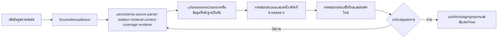

# Flow ลงมือพัฒนา format กลาง

สถานะ10ตุลาคม2026: research/designพร้อมต้นแบบ; ตารางด้านล่างเป็นงานintegrationต่อไป ยังไม่ได้แก้production

## 1. Definition of done ที่ตรงเป้าหมาย

เจ้าของเพิ่มข้อมูลใหม่ในชนิดที่รองรับผ่านฟอร์มเดียว มีsourceและrelationsครบ กดreview/publishแล้วบอทอ่านreleaseนั้นและตอบคำถามหลายรูปแบบทั้งTH/ENได้ โดยไม่เพิ่มชื่อrecordในcodeหรือเพิ่มQAต่อทุกparaphrase คำถามที่ไม่มีข้อมูลยังคงunknown การถาม “ทั้งหมด” ต้องตรงชุดIDทั้งหมดภายในscope

## 2. องค์ประกอบที่ต้องพัฒนาและลำดับ

| ลำดับ | งาน | Reuseจากของเดิม | ผลลัพธ์ที่ต้องได้ | Gate |
|---|---|---|---|---|
| P0.1 | Freeze inventoryและbackupmapping | data/content + SOURCE_HASHES | mappinglegacyID→stableID, hashต้นฉบับ, zerooverwrite | จำนวนต้นฉบับ/รายการย้าย/ช่องunknown/duplicateชัด |
| P0.2 | Single schema registry | app/knowledge/records.py + canonical_content.py | ข้อกำหนดlifecycle/kind/fieldตรงกัน พร้อมdescriptionsTH/ENและpublish-core | ทั้งschema/validator/form/toolเห็นregistryversionเดียว |
| P0.3 | Source authority registry | pilot source snapshots + core/source_registry | identity/authority/scope/locator/source lineage/public citation | quote/locatorตรง และsourceมีสิทธิ์ยืนยันfacet |
| P0.4 | Record schemaและsemantic validator | pilot validate_record | typedfields, unknown/conflict, references, dates, evidence | unit/negativecases+productionDraft2020-12validator |
| P0.5 | Revision/release migration | app/knowledge/store.py | ใช้storeเดิม เพิ่มrelation/indexmanifestและregversion | approvehashstale/expectedversionconflictถูกreject |
| P1.1 | ฟอร์มเกม/บริการเป็นwizard | trustedoperatorCLIเดิม | กรอกเกม, service dropdown, control rows,preview | เพิ่มdraftโดยไม่แก้code ไม่เผยแพร่ก่อนapprove |
| P1.2 | Generic read/list/compare | canonical answer/retrievalเดิม | มองfieldsจากregistry, filters+IDs,ครบรายการ | newrecordtitleไม่อยู่codeก็ตอบได้; no-top-k-all |
| P1.3 | QueryPlanและdialogue | session/context/resolver/compoundเดิม | pendingtaskและrequestedfields+scope/negation | service-onlyreplyไม่หลุดtopic/audience |
| P1.4 | Hybrid retrieval+entity resolver | multilingualembeddings/RRFเดิม | aliasesจริง+fuzzy/dense/lexical+metadatafilters | newnames/typos/editionnegativeเคสแยกได้ |
| P1.5 | Outputcoverageและfieldsourcebinding | answercontracts/claimvalidatorเดิม | EvidenceBundleรายobligation/field/ID | ตอบครบ/partialexplicit; numericfieldexact |
| P2.1 | Typedpricing/rental | calculator/zone_rentalเดิม | rates+audience+unit+currency+validityจากregistry | expiry/unknownhours/compound/negationถูกต้อง |
| P2.2 | Scopedpolicy/procedures | user_service_facts/policyclaimsเดิม | conditions_all+exceptions+procedure refs | ไม่ขยายkeyboardmouseไปจอย ไม่เดาrefund |
| P2.3 | Calendarcompiler | calendar/service_calendar+dashboard | source-backedเปิดพื้นที่/จองได้/lunch/maintenance/closure | intervalboundaries/overridepriorityตามหลักฐาน |
| P2.4 | Livebindings | WordPressadapter/cache/requestsnapshotเดิม | externalkey+physicalpool+statusmap+as_of | known fixture outcomes ≠ HTTPsuccess |
| P3.1 | Competitionadapter | canonicalcompetition/releases/facetsเดิม | game/event/division/release+sections/dependencies | no-crossgame fallback; truncatedเผยpartial |
| P3.2 | ENperfield/localization | localehashworkflowเดิม | source-language+translationrevision+glossary+numberpreservation | เปลี่ยนsourceแล้วENstale; ปฏิเสธ/ตัวเลขไม่กลับความหมาย |
| P3.3 | General/news/person/FAQ | inbox/content/membersเดิม | typedpublicfacts+eventsvalidity | out-of-scopeยังreject ไม่ใช้FAQทับprice/calendar |
| P4.1 | Atomicbuild/cutover | storepublish/projectionbuilder | stagingrecord+typed+textindexesในreleaseเดียว | buildfailไม่มีhalfnew; readpinsnapshot |
| P4.2 | Compatibilitybridgeและlegacyretirement | existingfastpaths | อ่านcanonicalprojectionกลาง ลดdualwrites | หมวดย้ายแล้วไม่ฟื้นlegacywithdrawnfacts |
| P4.3 | Productionreadiness | packaging/launchers/health/traceเดิม | DBschema/indexversions, migrator, cleanmachineprocedure | dataupdateใช้ได้หลังrestart/rollbackและแพ็กเกจ |

## 3. Production semantic checks ที่ต้องทำ

### Identityและrelations

1. UniqueID +revisionไม่ย้อน; อ้างคนละkindreject; เปลี่ยนชื่อไม่เปลี่ยนID
2. gameedition/platform/controlpresetตรง; installedresourcesต้องอยู่ในserviceresources
3. servicephysicalpool/bookingproduct/livebindingตรงกับAPIconfigที่ตรวจจริง
4. FK nested procedure.contact_id, competition.depends_on ต้องresolveและไม่มีcycle; จำกัดdepthตามข้อมูลจริง
5. Resources operational_statusกับavailabilityสดเป็นคนละfield; resourceหายจากAPIต้องunknown

### Evidenceและapproval

1. immutablebytes+hashถูก; locatorquote/cell/jsonpointerresolveได้
2. authorityถึงfacetและscope; secondaryไม่ยืนยันนโยบายเจ้าของ
3. ค่าที่parseหรือคำนวณมีderivationเช่น THBx100; LLMsummaryสื่อความหมายต้องreviewไม่อ้างexactexcerptปลอม
4. Source/revisionเปลี่ยนแล้วapproval/ENbindingเก่าถูกinvalidate
5. Approvalมาจากauthenticatedactorและสิทธิ์หมวด ไม่ใช่กรอกapproved_bystringก็พอ
6. Internalpathไม่เผยต่อผู้ใช้; citationdisplayใช้publicURLหรือชื่อเอกสารสาธารณะที่อนุญาต

### เวลาและเงิน

1. ISOค.ศ./timezoneaware; วันเจ้าของกรอกแบบพ.ศ.ให้UIแปลงพร้อมpreviewห้ามเดาจากเลขสี่หลัก
2. Validfrom<until, expired/futureแยกcurrent; nullunknownไม่ตีความunlimited
3. Open/bookable/maintenanceไม่ทับกันโดยไม่มีexceptionauthoritative; end-exclusive
4. closurepriorityมาก่อนweeklyตามpolicyจริง; closureบางโซนไม่ปิดทั้งศูนย์
5. ราคาinteger minorunits/currency/unit/audience/duration/persons/basisตรง
6. rateoverlapในscopeเดียวต้องreject/conflictจนownerตัดสิน; latestingestไม่แทนlatestapprovedeffective
7. extrapolation/rounding/timeextensionต้องมีruleที่ยืนยัน; rentalfull-dayไม่มีhoursยังquotepackagepriceได้แต่หารเป็นhourไม่ได้
8. pricecriticalenvelopeexpiryไม่หายระหว่างread_fields→LLM→renderer

### Coverageและmultilingual

1. การimportเอกสารครบจำนวนหน้า/ข้อที่sourceมี พร้อมmissingsectionmanifest
2. listallcountตรงIDsและpaginationไม่ซ้ำ/ตกหล่น; partialsourceไม่อ้างครบ
3. dependenciesของกฎ/exception/conditionดึงร่วม
4. requestedobligationทุกข้อมีanswered/unknown/conflicted/needsclarification ห้ามdiscardข้อที่LLMไม่เลือก
5. ENมีต้นทางเดิม/agenttranslated/reviewed/staleต่างกัน; machinevaluesไม่สร้างใหม่ระหว่างแปล
6. Translationchecknumbers/currency/durations/names/negation/modalmust/may/only/except; backtranslationเป็นตัวช่วยไม่ใช่proof

## 4. Milestoneเกมใหม่: วิธีพิสูจน์ว่าระบบไม่ต้องpatchชื่อรายการ

1. ใช้stagingDB, เปิดgenericadapterเฉพาะgame/service/controlก่อน
2. สร้างfixtureเกมชื่อใหม่ที่ไม่อยู่code/aliasesเดิม พร้อม2บริการที่มีสิทธิ์ต่างกันและ2controlpresets
3. Fixtureแยกจากproductionและsourceauthoritysynthetic ไม่มีคนอ่านเป็นข้อมูลศูนย์จริง
4. ownerflowdraft→review→publish, ได้releaseใหม่; ตรวจDB/lookup/textindexทุกตัวอ้างhashเดียวกัน
5. ถามcanonical, colloquial, misspelling, TH/EN,ทั้งหมด,เฉพาะPC1,เทียบPC3,ปุ่มjump,คำถามหลายส่วน
6. ถามเกมเดียวกันplatformอื่นที่ไม่มีข้อมูลต้องunknown/clarify ไม่หยิบปุ่มใกล้เคียง
7. ถาม“ราคา?”แล้วเติมserviceอย่างเดียว ดูaudienceและtopicคงอยู่
8. แก้sourceเกม/ถอนrelation/publishใหม่ ตรวจคำถามถัดไปเห็นฉบับใหม่และไม่ใช้draft/withdrawn
9. แยกfail: parsing/entity→queryplan→join/filter→retrieval→coverage→render/translation
10. ผ่านแล้วค่อยนำเกมจริงที่sourceครบเข้าด้วยownerreview; ไม่publishfixtureให้public

Milestoneนี้**ยังไม่ได้รันในรอบresearch** ต้นแบบ45checksตรวจformat ไม่ได้ทดสอบขั้นตอนนี้

## 5. Test bankที่ควรเริ่มแบบfocused

| กลุ่ม | จำนวนเป้าหมายเบื้องต้น | Oracle |
|---|---:|---|
| เกม/services/newIDs | 24 | IDs+source-backedrelations+fields |
| controls/platform/preset | 20 | action/button/gesture/context/source |
| ราคา/rental/validity | 24 | amount/unit/audience/date/calculationrule |
| policy/procedure/unknown | 20 | decision+conditions+exceptions+steps |
| calendar/livefixture | 24 | scheduleinterval+fixtureknownoccupancy |
| competition/releasedependencies | 20 | rulebookrelease+sectiontext+scope |
| contextual2–4turns | 20บทสนทนา | state slots/facets/selectedIDs |
| multilingual/typo mutations | เพิ่มจากกรณีฐานที่reviewแล้ว | sameintent/differententitynegative |

เป็นเป้าหมายcoverageสำหรับintegrationไม่ใช่จำนวนผลผ่านปัจจุบัน ใช้timebudgetและriskในการเลือกรัน; ownerpolicyunknownไม่สร้างexpectedallowedเอง

## 6. Loopปรับปรุงหลังแต่ละmilestone

เก็บก่อน/หลังเป็นrunใหม่ ห้ามทับlogเดิม ให้traceอธิบาย“เลือกrecordนี้เพราะfilter/IDs/facets/evidenceอะไร” ถ้าpaperเสนอวิธีเพิ่มretrievalreasoningที่ใช้LLMหลายcallให้วัดlatencyและqualitygainบนfixtureก่อน ไม่เพิ่มทุกวิธีพร้อมกัน

Stoprule: ปัญหาที่ตั้งใจแก้ผ่านcriticalและnear-negative/holdout ไม่มีfailureใหม่ในfocusedscope จบmilestone ไม่วนแก้aliasตามเคสทุกคำ; ถ้าsourceหรือpolicyขาดให้บันทึกquestionqueueแล้วทำส่วนอิสระต่อ

## 7. การเก็บไฟล์และการอนุมัติ

รอบนี้ไฟล์ทั้งหมดอยู่ในresearchfolderใต้workspaceที่เขียนได้ โปรเจกต์จริง/log/packageไม่ได้ถูกแก้; ก่อนintegrationที่ROOTให้ขอfilesystemwriteผ่านระบบตามsandbox แล้วสร้างsnapshot/diffและrunfoldersใหม่ ไม่มีคำสั่งreset/cleanหรือเขียนทับownerJSONโดยmigrationอัตโนมัติ

Ownerdatareviewเป็นขั้นตอนในผลิตภัณฑ์สำหรับยืนยันข้อเท็จจริง แตกต่างจากการขอpermissionใช้toolของagent ข้อมูลเก่าที่มีauthorityยืนยันแล้วนำเข้าdraftพร้อมlegacyapprovallineageได้ ไม่ถามเจ้าของซ้ำทุกข้อที่เคยยืนยัน แต่reviewscope/วันที่ที่ยังไม่ชัดคงไว้
