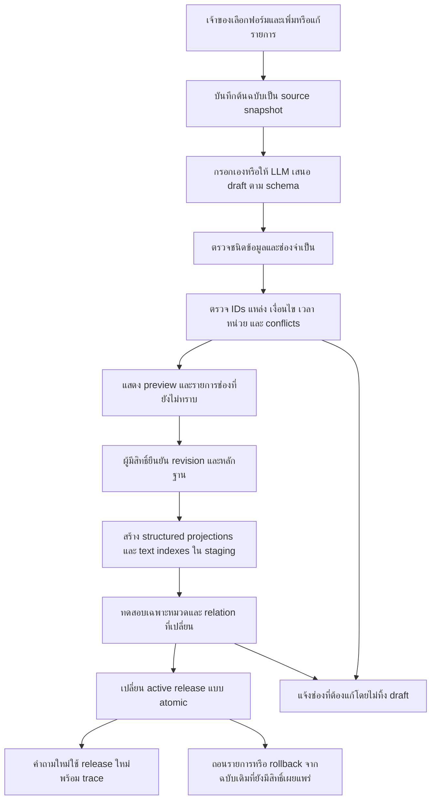
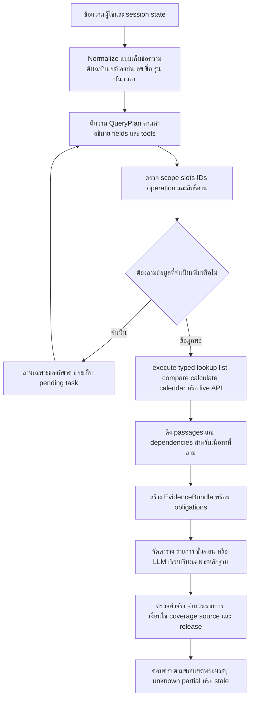

# Format กลางสำหรับ PSU Esports Studio - Phuket

วันที่ตรวจ: 10 ตุลาคม 2026 • สถานะ: ข้อเสนอพร้อม schema/แม่แบบ/ตัวอย่างและตัวตรวจต้นแบบ ยังไม่ได้เชื่อมเข้าระบบจริง

## 1. ข้อเสนอที่เหมาะกับระบบนี้

ให้เจ้าของใช้ **ฟอร์มแยกหมวด → ข้อมูลกลางที่มีชนิดและความสัมพันธ์ → เครื่องมืออ่านข้อมูล/คำนวณ → LLM ตีความคำถามและเรียบเรียงจากหลักฐาน**

ใช้ JSON Schema กำหนดโครงสร้างรับเข้า และ SQLite เก็บ revision, การอนุมัติ, ความสัมพันธ์ และ release ที่เผยแพร่ ส่วนข้อความอธิบาย/กติกาเก็บเป็นส่วนย่อยพร้อมต้นฉบับและดัชนีค้นภาษาไทย/อังกฤษ ใช้ของเดิมที่มีอยู่เป็นฐาน ไม่เพิ่มฐานข้อมูลเจ้าของอีกชุดที่ต้องแก้คู่กัน

ผลที่ต้องการคือ เมื่อเพิ่ม **เกมใหม่ในหมวดที่รองรับแล้ว** เจ้าของเพิ่มรายการเกม ผูกกับบริการที่ศูนย์มีจริง และกรอกวิธีเล่น/ปุ่มตามข้อมูลที่ยืนยัน จากนั้นผ่านการตรวจและ Publish ระบบค้นและตอบรายการใหม่ได้โดยไม่ต้องเพิ่ม `if ชื่อเกม == ...` หรือสร้างคำตอบตามรูปคำถามทีละแบบ

**ข้อจำกัด:** การกรอกข้อมูลอย่างเดียวจะได้ผลนี้ต่อเมื่อ runtime ถูกปรับให้อ่าน registry/เครื่องมือกลางแล้ว เพิ่มชนิดข้อมูลหรือการกระทำใหม่ที่ schema และเครื่องมือยังไม่รองรับยังต้องพัฒนา adapter หนึ่งครั้ง งานวิจัยไม่ได้รับรองว่ามี format แล้ว LLM จะเข้าใจทุกคำถามหรือไม่ผิดอีก

## 2. แยกหลักฐานของรายงาน

| สิ่งที่รายงาน | วิธีได้มา | ยืนยันได้ถึงไหน |
|---|---|---|
| ข้อมูลและข้อจำกัดโค้ดปัจจุบัน | อ่านไฟล์ในโปรเจกต์จริง | สภาพไฟล์ ณ เวลาตรวจ; ไม่ใช่ผลทดสอบเว็บทุกเส้นทาง |
| หลักการจาก paper | ค้นต้นฉบับ ACL/AAAI/arXiv/ผู้วิจัย และอ่านบทคัดย่อ/ส่วนที่เกี่ยวข้อง | ผลบนชุดทดลองของ paper; ไม่ใช่คะแนนของบอทเรา |
| สถาปัตยกรรม/24 record types | ออกแบบจากหลักฐานกับหมวดในโปรเจกต์ | ข้อเสนอทางวิศวกรรม |
| 45 checks ผ่าน | schema subset + source hash + selected semantic checks ของต้นแบบ | ตรวจโครงสร้างและข้อผิดพลาดที่ระบุ; ไม่ใช่ LLM accuracy หรือ production readiness |
| เจ้าของยืนยัน | อ้างเฉพาะคำตอบ/ไฟล์ที่ให้มา | ไม่ขยายไปยังนโยบายคล้ายกันที่ยังไม่ตอบ |

สกิล `paper-search-pro` ยังไม่มี OpenAlex/SS/NCBI/CrossRef configuration จึงหยุด pipeline อัตโนมัติตาม Setup แล้วใช้เว็บค้นงานต้นฉบับต่อ ไม่มีคะแนน RCS จาก classifier, ไม่มี citation-count ranking, ไม่มี saturation/coverage estimate และไม่มี PRISMA-compliant claim อ่านขอบเขตการค้นใน `RESEARCH_EVIDENCE_TH.md` และ `execution_log.json` ได้

## 3. สิ่งที่พบในโปรเจกต์จริง

โปรเจกต์: `C:\Users\Chokhun\Downloads\Learn-LLM\18_PSU_Esports_Update_Route_Data`

ตรวจ JSON/JSONL ที่เกี่ยวข้อง 488 ไฟล์ โดยไม่นับ log, vector, ground truth และผล eval; อ่าน parse ได้ทุกไฟล์ ตัวเลขรวมรวม schema, review, projection และภาษาอังกฤษย้อนหลังด้วย **ไม่ใช่จำนวนข้อเท็จจริงเฉพาะที่พร้อมใช้งาน**

โหลด canonical content รุ่นเดิมได้ **270 records / 10 categories**: booking 32, competition_rules 4, game_controls 38, games 36, knowledge 42, members 25, resources 24, rules 62, schedule 3, services 4 ตัวตรวจเดิมไม่พบ errors แต่ตัวตรวจนี้ไม่ได้ตรวจทุกความสัมพันธ์/ความจริงของเนื้อหา

ทั้ง270recordsเป็นpublished แต่metadataENของชุดนี้เป็นlegacy_unreviewed132และmissing138; controlmaps30ชุดเป็นsecondary_needs_manual_verifyกับ8ชุดpartial_official นี่คือสถานะตรวจข้อมูลในcanonicalv1 ไม่ใช่คำกล่าวว่าคำตอบอังกฤษทุกเส้นทางใช้ไม่ได้หรือผลทดสอบอังกฤษก่อนหน้าล้มเหลว

### 3.1 มีของเดิมที่นำมาต่อยอดได้

| ส่วนเดิม | ไฟล์ | สิ่งที่มี/สิ่งที่ขาด |
|---|---|---|
| Canonical content v1 | `data/content/schema/canonical_content.schema.json`, `app/knowledge/canonical_content.py` | มี lifecycle, source, ไทย/อังกฤษ, hash ภาษา; `facts` ยังเป็น object อิสระ และไม่ได้กำหนด game/service/rate เป็นชนิดเฉพาะ |
| SQLite knowledge pilot | `app/knowledge/records.py`, `store.py`, `answer.py`; `tools/manage_canonical_knowledge.py` | มี save/approve/publish/withdraw/rollback, revision และ optimistic version; รองรับเพียง `game`, `rule`, predicates `genre`, `service_availability`, `available_at`; จำกัด 100 records |
| Pilot runtime entry | `app/pipeline/engine.py`; `app/knowledge/answer.py` | feature flag `PSU_CANONICAL_KNOWLEDGE` ปกติค่า default เป็น 0; เห็น entry ในโค้ดไม่ได้แปลว่า service ที่เปิดอยู่ใช้ฐานนี้แล้ว |
| Knowledge inbox | `data/knowledge_inbox/document.schema.json`, `tools/ingest_rag_documents.py` | รับเอกสารและตรวจ snapshot/excerpt ก่อนเผยแพร่; category ที่รับมี knowledge/events_news/about_us/games/equipment ยังไม่ครอบคลุม pricing/calendar/policy relation ทั้งหมด |
| Projections | `tools/build_canonical_projections.py` | มีสร้างข้อมูล structured/RAG/EN; mapping บางส่วนเปลี่ยน `resources` เป็น runtime `games` จึงต้อง audit ความหมายระหว่างชั้น |
| เกม/บริการ/ปุ่ม | `game_item_details.jsonl`, `service_game_availability.jsonl`, `game_control_facts.jsonl` | ข้อมูลแยกอยู่หลายชุด ใช้ชื่อ/โซนเป็นข้อความหลายแห่ง; จำเป็นต้องมี stable IDs และแหล่งที่เป็นเจ้าของแต่ละความสัมพันธ์ |
| ราคาเหมา | `data/curated/zone_rental_fees_20261006.json` | มีต้นทาง workbook/hash/cells และราคาจริง; ระยะเวลาครึ่งวัน/เต็มวันกับวันมีผลยัง null ต้องคง unknown |
| นโยบายเจ้าของ | `data/curated/user_service_facts_20261008.json` | มี claims ที่ตอบแล้ว กับ pending; บางเงื่อนไขเปลี่ยนวัน/คืนเงินยังไม่ชัด ห้ามเหมารวม |
| กติกาแข่งขัน | `data/competition_rules/canonical/` | มี registry/releases/facets/review/projections อยู่แล้ว; active release manifest ที่อ่านมี active IDs ว่าง ต้องดู release/approval ต่างหาก ไม่ถือว่าทุกไฟล์คือกติกาปัจจุบัน |

### 3.2 เหตุที่เพิ่มข้อมูลแล้วปัจจุบันยังต้องดักเคส

1. การมี record ไม่เท่ากับมี relation ที่ query ใช้ได้ เช่น รายละเอียดเกมบอก PC Zone แต่บริการ PC #01–#02 กับ PC #03–#10 มีเกมต่างกัน
2. เครื่องมือเฉพาะหมวดมีรายการ/ตัวเลือกฝังในโค้ด เช่น `zone_rental.py` มี TARGETS และตรวจลำดับแถวเทียบกับรายการนี้ การเพิ่มโซนใน JSON อย่างเดียวจึงยังไม่พอ
3. ชื่อหมวดไม่สม่ำเสมอ เช่น booking/reservation, resources/games และข้อมูลภาษาอังกฤษมี workflow แยก
4. รูปแบบแหล่งข้อความยังไม่สื่อการคำนวณ เช่น “1 ชั่วโมง 1–2 คน 150 บาท” หากไม่แยก duration, persons, unit, group จะตอบจำนวนเงินจริงผิดได้
5. ค้น top-k เหมาะกับค้นข้อความ แต่ไม่รับประกันรายการ “ทั้งหมด” จึงมีทั้งการตกหล่นและข้อความไม่เกี่ยวข้อง
6. Context แบบ “PC” หลังระบบถามเลือกเครื่องต้องเป็นการเติม service ในงานราคาที่ยังค้างอยู่ คำว่า PC เดี่ยว ๆ ไม่ควรถูกเริ่มเป็นงานใหม่
7. ข้อมูลบางส่วนยังไม่ได้ยืนยันจริง เช่น control maps บางชุดระบุ secondary_needs_manual_verify; format ไม่ทำให้ความจริงที่ขาดเกิดขึ้น
8. schema lifecycle กับตัวตรวจ Python เดิมมี enum ต่างกัน: schema มี expired/archived ส่วน Python มี approved/withdrawn ต้องรวมข้อกำหนดให้ใช้ registry เดียวก่อน migration

## 4. ทำไมแนวทางนี้มีหลักฐานรองรับ

งาน SGD ใช้คำอธิบาย service/intents/slots เพื่อให้ระบบรองรับ schema ใหม่; D3ST พบประโยชน์ของคำอธิบายที่สื่อความหมาย ส่วน SGD-X และงาน grounding แสดงว่าระบบยังไวต่อรูปแบบคำอธิบาย จึงควรมีคำอธิบายช่องและตัวอย่างบทสนทนาที่หลากหลาย พร้อมทดสอบชื่อรายการใหม่จริง [SGD](https://arxiv.org/abs/1909.05855), [D3ST](https://arxiv.org/abs/2201.08904), [SGD-X](https://ojs.aaai.org/index.php/AAAI/article/view/21341), [Grounding D3ST](https://aclanthology.org/2023.sigdial-1.42/)

RAG ใช้หลักฐานภายนอกประกอบคำตอบ แต่การแนบเอกสารมากหรือใส่ไว้กลาง context ไม่รับประกันว่าโมเดลใช้ครบ ควรเลือกหลักฐานตามสิ่งที่ถามและตรวจรายการที่ต้องตอบ [RAG](https://arxiv.org/abs/2005.11401), [Lost in the Middle](https://aclanthology.org/2024.tacl-1.9/)

Structured decoding ช่วยให้ output ถูกโครงสร้าง; PICARD เน้นการกัน SQL ที่ผิดรูป ส่วน XGrammar/XGrammar 2 ช่วย generation ตาม grammar ใช้หลักนี้กับ QueryPlan ได้ แต่ยังต้องตรวจว่าเลือกเกม บริการ กลุ่มราคา และ source ถูกจริง [PICARD](https://aclanthology.org/2021.emnlp-main.779/), [XGrammar](https://arxiv.org/abs/2411.15100), [XGrammar 2](https://arxiv.org/abs/2601.04426)

การเชื่อมข้อมูลมีประโยชน์กับโจทย์หลายส่วน งาน subgraph retrieval ทดลองดึงกราฟตามบริบทบทสนทนา แต่มีชุดข้อมูลและ user study ขนาดเล็ก โดยผลผู้ใช้บางการเปรียบเทียบไม่ถึงนัยสำคัญทางสถิติ จึงใช้เป็นแรงสนับสนุนการออกแบบและต้องทดสอบกับศูนย์เอง [Task-oriented subgraphs](https://aclanthology.org/2025.sigdial-1.42/)

MS-RAG และ KG²RAG สนับสนุนการผสมโครงสร้างกับ chunks; ใน MS-RAG การสกัดกราฟด้วย LLM มีปัญหา node/edge ตกหล่น ดังนั้นระบบเราควรให้เจ้าของเลือกความสัมพันธ์สำคัญผ่านฟอร์ม และสร้าง relation จาก ID ที่ตรวจได้ [MS-RAG](https://aclanthology.org/2025.emnlp-main.1151/), [KG²RAG](https://aclanthology.org/2025.naacl-long.449/)

ALCE แยก correctness, citation support และคุณภาพภาษา; RAGAs แยกส่วน retrieval กับ generation ข้อเสนอสำหรับบอทนี้คือวัดทั้ง “ตอบครบสิ่งที่ถาม” และ “แต่ละข้ออ้างมีหลักฐานตรง” ไม่ใช้เพียงคะแนนคล้ายคำตอบหรือจำนวนเคสผ่าน [ALCE](https://aclanthology.org/2023.emnlp-main.398/), [RAGAs](https://aclanthology.org/2024.eacl-demo.16/)

ทั้งหมดข้างต้นเป็น paper evidence ส่วนการเลือก SQLite, typed tools และ 24 record types ด้านล่างเป็นข้อเสนอที่ปรับตามขนาดและโค้ดของโปรเจกต์นี้

## 5. เลือกวิธีเก็บและใช้ข้อมูล

| ทางเลือก | เหมาะกับอะไร | ข้อจำกัดสำหรับศูนย์ | ข้อเสนอ |
|---|---|---|---|
| PDF/Markdown แล้วยัดลง prompt | เอกสารอธิบายขนาดเล็ก | ค้นตกหล่น/เงื่อนไขถูกตัด/คำนวณราคาไม่แน่นอน | เก็บเป็น source และ passages เท่านั้น |
| FAQ ถาม–ตอบจำนวนมาก | ตัวอย่างภาษาและ regression | ข้อมูลเดียวซ้ำหลายคำตอบ อัปเดตไม่ทั่ว | ใช้เสริมและทดสอบ; ข้อเท็จจริงหลักเก็บครั้งเดียว |
| JSON/ตาราง + vector อย่างเดียว | ค้นรายละเอียดเกมหรือเอกสาร | joins/รายการทั้งหมด/วันมีผลไม่แน่นอน | มีเป็นดัชนีเสริม |
| LLM เขียน SQL อิสระ | ฐานข้อมูลวิเคราะห์เปิดกว้าง | เลือกเงื่อนไขผิดแม้ SQL รันผ่าน; scope ร้านนี้จำกัด | เริ่มจาก typed read tools ที่ allowlist |
| GraphRAG เต็มชุด | สรุปภาพรวมคลังเอกสารขนาดใหญ่ | มีต้นทุนสกัดและสรุปหลายขั้น; relation อาจหาย | ยังไม่ต้องเริ่มด้วย community summaries; ใช้ IDs/joins ก่อน |
| Typed records + SQLite relations + hybrid retrieval + bounded LLM | ราคา บริการ เกม กติกา และหลายเทิร์น | ต้องสร้าง registry/adapter/validators ให้ครบ | **แนะนำ** |

GraphRAG ต้นฉบับทดลอง global sensemaking บนคลังประมาณล้าน tokens ข้อดีนั้นไม่ใช่หลักฐานว่าเหมาะที่สุดกับคำถาม “PC1 ว่างไหม” หรือ lookup ราคา [GraphRAG](https://arxiv.org/abs/2404.16130)

JSON Schema ใช้กำหนดชนิด ช่องที่ต้องมี enum และเงื่อนไขโครงสร้าง; ความสัมพันธ์ข้าม record/การทับช่วงเวลา/สิทธิ์การยืนยันต้องมี semantic validator เพิ่ม [JSON Schema](https://json-schema.org/draft/2020-12/json-schema-validation) แนวคิด source/กิจกรรมตรวจ/ผู้รับผิดชอบยึดการแยก Entity–Activity–Agent ของ [W3C PROV-O](https://www.w3.org/TR/prov-o/) ถ้าในอนาคตใช้ RDF จึงพิจารณา [SHACL](https://www.w3.org/TR/shacl/) ไม่ต้องเพิ่ม RDF เพื่อให้ใช้ format นี้ได้

## 6. โครงสร้างร่วมของทุก record

เจ้าของไม่ต้องพิมพ์ metadata ทั้งหมดเอง ฟอร์มสร้าง ID/revision/hash และเลือกข้อมูลอ้างอิงให้อัตโนมัติ

| ส่วน | ความหมาย | คนกรอก/ระบบทำ |
|---|---|---|
| `record_id`, `kind`, `branch_id` | รหัสคงที่/ชนิด/สาขา | ระบบสร้าง; เปลี่ยนชื่อแล้ว ID เดิม |
| `revision` | ฉบับข้อมูล | เพิ่มเมื่อแก้ไข; ไม่เขียนทับฉบับเก่า |
| `lifecycle` | draft → in_review → approved → published; withdrawn/archived | ระบบควบคุมตามสิทธิ์ |
| `fields` | ช่องที่มีชนิดชัดตามหมวด | เจ้าของกรอก |
| แต่ละ field `status/value` | known/unknown/not_applicable/conflicted | คนเลือก/ตัวนำเข้าช่วยเสนอ |
| `evidence_refs` | source_id + locator ของแต่ละช่อง | เลือกแหล่ง/หน้า/ข้อ/เซลล์; LLM เสนอได้แต่ไม่ยืนยันแทน |
| `validity` | วันมีผล/สิ้นผลแยกจากวันบันทึก | คนกรอกตามประกาศ; ไม่ทราบ = unknown |
| `aliases` | ชื่อจริง/ชื่อเรียกที่มีประโยชน์ | เป็นตัวช่วย entity resolution; ไม่สร้าง alias ทุก typo |
| `localization` | source language, สถานะ EN, hash ของฉบับที่แปล | ระบบ+ผู้ตรวจภาษา |
| `review` | ผู้ตรวจ เวลา hash ฉบับ | ระบบบันทึกเมื่อยืนยันจริง |

### 6.1 ค่าที่ต้องแยกให้ได้

- `unknown`: ยังไม่มีข้อมูลยืนยัน `value:null`; บอทตอบว่าไม่ทราบเฉพาะช่องนี้
- `known false`: ยืนยันว่าไม่มี/ไม่อนุญาตตามชนิด field; ต้องมี evidence
- `known 0`: เช่น ราคาฟรีหรือไม่มีจำนวน ต้องมี evidence; ไม่ใช้แทนข้อมูลขาด
- `known []`: ยืนยันว่าชุดรายการว่าง; ยังต้องมีหลักฐานและ semantic meaning ใน registry
- `not_applicable`: ช่องนี้ไม่เกี่ยวกับ record พร้อมเหตุผล ไม่ใช่ไม่ทราบ
- `conflicted`: หลักฐานให้คำตอบต่างกัน คงทั้งแหล่งและเหตุผล; ไม่เลือกเอง
- `retired/withdrawn`: ข้อมูลเคยมีแต่ไม่เปิดใช้งานแล้ว แยกจากหาไม่พบ

`known` ในไฟล์ draft หมายถึงมีค่าพร้อมแหล่งเสนอไว้ **ยังไม่ใช่ owner-approved** การรับเข้าได้กับการเผยแพร่ได้เป็นคนละ gate

### 6.2 เก็บหลักฐานแบบแยก registry

Source ต้องมีต้นฉบับ immutable, checksum, ประเภทต้นทาง, authority ว่ายืนยันเรื่องใดได้, locator, วันที่สังเกต, วันมีผลจากต้นทาง และช่องทางอ้างอิงสาธารณะ ถ้าเป็นข้อมูลเจ้าของให้เก็บ audit identity ตามสิทธิ์ ข้อมูลเฉพาะในศูนย์ใช้หลักฐานเจ้าของได้โดยไม่บังคับ HTTPS สาธารณะเหมือน pilot ปัจจุบัน

ตัวอย่าง: คู่มือผู้พัฒนาเกมยืนยันปุ่ม/โหมดของเกมได้ แต่ยืนยันไม่ได้ว่าศูนย์ติดตั้งเกมนั้นหรืออนุญาตบัญชีส่วนตัว เว็บศูนย์ยืนยันบริการได้แต่ไม่แทนเอกสารกติกาของคนละ tournament

Source hash พิสูจน์ว่า bytes ไม่เปลี่ยน ไม่พิสูจน์ว่าเจ้าของพูดถูกหรือ locator รองรับค่าอย่างมีความหมาย ต้องมี claim review เพิ่ม; locator ตัวอย่างต้นแบบยังไม่ได้ตรวจ entailment อัตโนมัติ

## 7. หมวดที่เจ้าของใช้กรอก

รายละเอียดทั้ง 155 ช่องและสถานะช่องที่ต้องทราบก่อน Publish อยู่ใน `OWNER_FIELD_GUIDE_TH.md` และ `FIELD_CATALOG.json`

| ฟอร์มเจ้าของ | record types | ต้องกรอกแกนหลัก | นำไปตอบอะไร |
|---|---|---|---|
| ข้อมูลศูนย์/ติดต่อ/การเดินทาง | center, contact, facility | ชื่อผู้ดำเนินการ ที่อยู่ ช่องทาง แผนที่ ที่จอด/ที่นั่งตามหลักฐาน | อยู่ไหน เป็นของใคร ติดต่อ/นั่งรอที่ไหน |
| โซนและอุปกรณ์ | zone, equipment_model, resource | ชื่อโซน รุ่นสเปก เครื่องจริง pool เครื่อง | มีกี่เครื่อง สเปกอะไร PC1 ต่าง PC3 อย่างไร |
| บริการที่จองได้ | service | เครื่อง/แพลตฟอร์ม ระยะเวลา ความจุ API product key | จองอันไหน ใช้เครื่องอะไร รอบละเท่าไร |
| เกม | game | ชื่อ/edition และรายละเอียดที่ทราบ | เกมคืออะไร วิธีเล่น/แนวเกม |
| เกมที่ให้บริการจริง | game_service | เกม + บริการ + มีให้เล่นหรือไม่; ติดตั้งเครื่องใด | เกมนี้เล่นเครื่องไหนได้; เกม PC1 ทั้งหมด |
| เล่นกับเพื่อน | game_mode | เกม/โหมด/แพลตฟอร์ม ผู้เล่น เงื่อนไขออนไลน์ ศูนย์รองรับหรือไม่ | มาสอง/สี่คน เล่นพร้อมกันอะไรได้ |
| ปุ่มและคู่มือ | control_set | เกม/แพลตฟอร์ม/input/preset/actions/context/version | วิ่ง/กระโดด/เปิดแผนที่กดอะไร; ชุดปุ่มทั้งหมด |
| กลุ่มสิทธิ์และราคา | audience, rate | กลุ่ม บริการ เงิน หน่วย duration จำนวนคน วันมีผล | บุคคลภายนอกราคาเท่าไร ทั้งหมด/เปรียบเทียบ/งบเท่านี้ |
| เหมาโซน/ห้อง | rental_package | กลุ่มองค์กร โซน ครึ่ง/เต็มวัน เงิน อุปกรณ์ เงื่อนไข | ราคาเหมาเท่าไร รวมอะไร จำนวนที่นั่ง |
| เวลาเปิดและวันปิด | schedule, closure | time zone เปิดพื้นที่/จองได้/maintenance วันเฉพาะ/ขอบเขต | วันไหนเปิด จอง12:30ได้ไหม ปิดพิเศษไหม |
| นโยบาย/ขั้นตอน/ช่วยเหลือ | policy, procedure | เรื่อง เงื่อนไข ข้อยกเว้น กฎ ผล และขั้นตอนติดต่อ | walk-in จ่าย ยกเลิก เช็กอิน เครื่องค้าง ติดตั้งเกม |
| การแข่งขัน | competition, competition_rule | เกม รายการ ปี division ฉบับกฎ แต่ละข้อ/facet/dependencies/source | กฎแข่งเกมนั้น เฉพาะหมวดหรือทั้งหมด |
| บุคลากร/ข่าว/เนื้อหาเสริม | person, news, faq | เฉพาะข้อมูลเปิดเผยได้ วันมีผล ข่าว/คำตอบที่มีหลักฐาน | ทีมงาน กิจกรรม ข้อมูลบริการทั่วไป |
| เชื่อมข้อมูลสด | live_binding | service → external key → physical pool → status map/timezone | เครื่องไหนว่าง จำนวนว่าง/ทั้งหมด |

24 types เป็นการแยกความหมายของ 10 หมวดเดิมและ relation ที่จำเป็น ไม่ใช่บังคับเจ้าของเห็น 24 เมนู เริ่มต้นทำ wizard เกม, บริการ, ราคา, นโยบาย, เวลา, การแข่งขัน และข้อมูลทั่วไปก่อน

### 7.1 แบบเกมที่ต้องกรอกให้ครบตามที่ต้องการ

1. เกม: ชื่อ canonical, ภาค/edition, ชื่อเรียก, แนว, สรุป, เป้าหมายและวิธีเล่น
2. ให้บริการจริง: เลือกบริการจาก dropdown เช่น PC #01–#02; ใส่ “มีให้เล่น” พร้อมต้นทาง จากนั้นเลือกเครื่องที่ตรวจจริงถ้าไม่ใช่ทุกเครื่อง
3. โหมด: local/online/co-op, จำนวนคนต่อโหมด, account/network requirements, ศูนย์รองรับจริงหรือยังไม่ทราบ
4. ปุ่ม: เลือก platform/input/preset/game version; แต่ละแถว action–button(s)–gesture–context เช่น press กับ hold หรือในเมนูกับระหว่างเล่น
5. ราคาจะใช้ relation จาก service + audience + rate ไม่คัดลอกใส่คำอธิบายเกม
6. สถานะวันนี้ใช้ live binding ไม่กรอก “ว่าง” ใน game record
7. ตรวจตัวอย่างคำตอบ preview เช่น overview, controls, devices, list all, คำถามไทย/อังกฤษ และ multi-turn; ถ้าขาดหลักฐานแสดงช่องที่ยังตอบไม่ได้

อย่าเก็บแค่ `button:'A'` เพราะหมายถึงคนละปุ่มระหว่าง Nintendo/Xbox หรือ `L` ที่อาจเป็น left stick/shoulder ต้องมี platform/input/physical control identifier หาก controls แต่ละแถวใช้คนละ source ให้แยก control_set หรือยกระดับเป็น per-binding evidence ใน production schema

### 7.2 ขอบเขตที่ต้องระวังเป็นพิเศษ

- PC #01–#02 มีรายการเกมต่างจาก PC #03–#10 ตาม service availability เดิม ต้องผูกที่ service/resource
- VR 30 และ 60 นาทีใช้เครื่องจริงร่วมกัน ต้องมี pool key และ occupancy minutes; ใช้นโยบายที่ผู้ใช้ยืนยันว่า 30 นาทีกิน slot เต็มชั่วโมง แต่ API adapter ต้องทดสอบ mapping จริง
- ราคาเหมาเต็มวันไม่แปลว่าจำนวน 8 ชั่วโมง และที่นั่ง 43 ใน rental PC ไม่แปลว่าเล่น PC พร้อมกัน43คน
- Service Fee 2026 ของอุปกรณ์บางรายการมีช่วง1ก.พ.–31มี.ค.2026 ต้องเก็บเป็น historical ไม่ประกาศเป็น current rate จากวันที่ ingest
- ปุ่มจากเว็บภายนอกไม่กลายเป็นปุ่มที่ศูนย์ตรวจแล้วเพียงเพราะ record published ใน legacy
- แข่ง Tekken ไม่ควรยืมกฎ VALORANT มาเติม; RoV source ที่ตัดท้ายต้องคง truncated/partial
- ข่าว/ข้อเสนอใหม่ยังอยู่ในขอบเขตศูนย์ ข้อมูลร้านเกมทั่วไปที่ไม่ได้ยืนยันไม่ใช้เพิ่มนโยบาย

## 8. ตัวอย่างที่จัดเตรียมให้

`examples/actual_source_drafts.bundle.json` มี 6 drafts จากข้อมูลจริง: ศูนย์, VALORANT profile, กฎคีย์บอร์ด/เมาส์ส่วนตัว, กลุ่มหน่วยงานภายนอก, PC Zone, และเหมา PC เต็มวันของหน่วยงานภายนอก

ตัวอย่าง rental: **4,000 บาท = 400000 สตางค์**, ที่นั่งในชีต43, PC10เครื่อง ระยะเวลาจริงและวันมีผลคง unknown; schema ไม่ยอมให้เติม0แทนวัน/เวลาที่ไม่มีข้อมูล ตัวอย่างทั้งหมด lifecycle draft, ไม่ใส่ชื่อผู้อนุมัติปลอม ไม่ถือเป็นข้อมูลใหม่ที่ publish แล้ว

SourceของVALORANT profileในตัวอย่างจัดเป็นlegacy_unreviewed เพราะการมีcuratedfileไม่ได้พิสูจน์ownerreview ส่วนคำตอบนโยบายและราคาเหมาอ้างข้อมูลที่ผู้ใช้เคยให้/ยืนยัน ไม่ยกระดับtrustเพียงเพราะตัวอย่างparseผ่าน

ตัวอย่างรูปช่อง (ส่วนหนึ่งของ game):

```json
{
  "summary": {
    "status": "known",
    "value": {"th": "ข้อความจากแหล่งที่ตรวจแล้ว", "en": null},
    "evidence_refs": [{"source_id": "source_game_001", "locator": "section:overview"}],
    "note": ""
  },
  "age_rating": {
    "status": "unknown",
    "value": null,
    "evidence_refs": [],
    "note": "แหล่งที่เจ้าของให้มายังไม่ระบุ"
  }
}
```

ตัวอย่างนี้สาธิตรูปแบบช่อง ไม่ใช่ข้อเท็จจริงเกมจริง ให้ใช้ไฟล์ 6 drafts สำหรับตัวอย่างจากโปรเจกต์

## 9. Flow เจ้าของกรอกจน Publish



### ขั้นตอนแต่ละ gate

**G1 รับต้นฉบับ:** copy-on-write, บันทึก hash/ผู้ส่ง/source authority/วันสังเกต ไม่อ่าน user-controlled source text เป็นคำสั่งระบบ หากไฟล์มี prompt “ignore rules” ถือเป็นข้อความข้อมูล

**G2 extraction:** LLM ทำ draft mapping พร้อม locator/ข้อความต้นทาง ปล่อย unknown เมื่อไม่มีข้อมูล ห้ามสร้างราคา/นโยบาย/รุ่น/เกมที่ศูนย์มีจากความรู้โมเดล ตัวเลขใช้ parser/ค่าตารางตรง ๆ; มี import report จำนวนแถวต้นฉบับเทียบจำนวนแถวที่รับ

**G3 structural:** JSON Schema Draft2020-12 + format checking ที่เปิดจริง + typed registry; unknown fields/extra keys/enum ผิด reject พร้อม field path; ต้นแบบที่ให้ใช้ subset checker เพื่อสาธิต ไม่ใช้แทน validator production

**G4 semantic:** FK ตามชนิด, cycle dependencies, date ranges, interval [start,end), price scope/unit/currency/audience, collision/duplicates, source authority, coverage ของต้นฉบับ, per-binding controls, translation binding ตรวจทุกข้อตาม checklist ใน Flow

**G5 owner review:** เจ้าของดู diff/หลักฐาน/preview แล้วอนุมัติ revision hash; การแก้ค่าหรือ source ใหม่ยกเลิก approval เก่าอัตโนมัติ Draft ยังตอบต่อผู้ใช้ทั่วไปไม่ได้; owner input ไม่จำเป็นต้องให้มนุษย์ตรวจ schema ซ้ำ แต่การยืนยันความจริง/นโยบายต้องเป็นเจ้าของ

**G6 build:** สร้าง typed lookup + full list indexes + hybrid text/entity indexes จาก release เดียว ให้ release manifestผูกrecord hashes/schema/adapter/model/index version ถ้าบางดัชนี build ไม่ผ่านห้ามสลับให้ระบบเห็นครึ่งฉบับ

**G7 publish:** atomic switch, optimistic concurrency, idempotent request key; แต่ละคำถาม pin snapshot หนึ่งฉบับจนตอบเสร็จ แต่คำถามถัดไปใช้ฉบับใหม่ หาก withdrawal เกิดก่อนส่งคำตอบต้อง finalizer ตรวจอีกครั้ง

**G8 observable:** logเก็บquery slots/field IDs/evidence IDs/filterเหตุผล/confidenceแบบคะแนนจัดอันดับ/coverage/elapsed/release; ไม่logข้อมูลลูกค้า/สลิป/token API โดยไม่จำเป็น คะแนนretrieval ไม่แปลว่าเปอร์เซ็นต์ความจริง

## 10. Flow ตอบคำถามจาก format กลาง



### 10.1 QueryPlan กลาง

เป็น format อีกชั้นหนึ่งสำหรับ **ความต้องการผู้ใช้** แยกจาก format ข้อมูลเจ้าของ กำหนด operation (`read`, `list`, `compare`, `calculate`, `schedule`, `availability`), target IDs/candidates, requested fields/facets, filters, rejected targets, user group, time/date/timezone, detail level, locale, pending-task action และ completeness obligations

ตัวอย่าง “บุคคลภายนอกราคาเท่าไร” → operation=list/read, kind=rate, audience=general adult (ถ้ายังคลุมเครือกับ external organization ให้ถามเรื่องกลุ่ม), service=all หากต้องการตารางรวม **การไม่มี service ไม่จำเป็นต้องบังคับถามเมื่อสามารถแสดงทั้งหมดได้**

คำถาม “ราคาเหมา” ต้องเลือก rental_package; “มีงบ200เล่นอะไรได้” ใช้ rate ที่ currentและคำนวณได้ + service/game availability, ไม่เดาชั่วโมงจาก linear เมื่อไม่อนุญาต extrapolation

### 10.2 เครื่องมือกลางที่ควรมี

| Tool | Input | Output/สิ่งที่ห้ามอนุมาน |
|---|---|---|
| `resolve_entity` | kind, text, locale, context IDs | candidates+คะแนนจัดอันดับ+เหตุผล; ชื่อภาค/รุ่นไม่แก้เป็นของอื่นอัตโนมัติ |
| `read_fields` | IDs, field paths, release | ค่า+สถานะ+source+วันมีผล ไม่คืนข้อความเดาสำหรับ unknown |
| `list_records` | kind, typed filters, pagination | count + all matching IDs + known/missing fields; all ไม่ใช้top-kแทน |
| `compare_records` | IDs, fields | ตาราง field-aligned; unknown ยังแสดง |
| `quote_price` | service/package, audience, duration, persons, date | amount/unit/calculation/rate revision/currentness; คิดเงินด้วยโค้ด |
| `get_calendar` | date, timezone, target resource | เปิดพื้นที่/จองได้/ปิด/maintenance+source ตาม priorityที่ยืนยัน |
| `get_live_availability` | service/resources, date/time/duration | fresh/as_of/timezone/status/per-resource source; API unavailable→unknown |
| `retrieve_sections` | entity/facet/event/platform/edition, dependencies | ข้อความพร้อม source path/section; ไม่ข้ามเกมหรือ tournament |

เครื่องมือเหล่านี้เป็นคำอธิบายการพัฒนา ยังไม่ได้เพิ่มให้ runtime ในรอบ research นี้ Ollama รองรับ `format` เป็น JSON Schema สำหรับ output [เอกสาร Ollama](https://docs.ollama.com/capabilities/structured-outputs) แต่ต้องลด schema ให้เป็น subset ที่ backendรองรับและทดสอบจริง ไม่ส่ง schemaไฟล์ออกแบบที่ซับซ้อนทั้งหมดให้โมเดลทุกคำถาม

### 10.3 ช่วงบทสนทนาและ “ทั้งหมด”

เก็บ pending task: topic=price, audience=general adult, missing=service, options=stable service IDs พร้อม turn provenance ผู้ใช้ตอบ “PC” ต้องเติม serviceโดยคงกลุ่มเดิม; “ทั้งหมด” เลือกทุกserviceในscope; “ไม่เอาVR” ทำ filter; การถามเรื่องใหม่ชัดเจน resetเฉพาะtaskที่เปลี่ยน ไม่เอาประวัติรุ่น/เกมเก่าปน

“ทั้งหมด” ขยาย **ในหมวด/facetที่ผู้ใช้ต้องการ** เช่น ปุ่มทั้งหมดของTekkenบนPS5 ไม่ดึงกฎแข่งหรือราคาทั้งศูนย์มาปน หากข้อมูลยาวให้แสดงจำนวนทั้งหมดและแบ่งหน้า/cursorที่ผูกreleaseและfilters ชี้ว่าหน้านี้กี่รายการ รวมทั้งหมดเท่าไร; ไม่เขียนว่าครบถ้ามีข้อกฎที่sourceตัดท้าย

### 10.4 คำตอบที่ควรเป็น

- ราคา: ตารางบริการ/กลุ่ม/ระยะเวลา/จำนวนคน/จำนวนเงิน/วันมีผล; ถ้าขาดช่วง validityให้บอกตามไฟล์ยังไม่ยืนยันราคาปัจจุบัน
- เกม: ชื่อ+สรุป+แนว+วิธีเล่น+บริการที่ศูนย์มีจริงเฉพาะที่ถาม
- ปุ่ม: action–button–gesture/context; ไม่ตอบแค่ชื่อหัวข้อ
- การจองสด: วันเวลาไทย/as_ofและเฉพาะเครื่องว่างเมื่อถามเครื่องว่าง; ถ้าถามทั้งหมวดแสดงจำนวน free/total พร้อมunknown/maintenanceแยก ไม่รวมunknownเป็นfree
- นโยบาย: ข้อสรุป+เงื่อนไข+ขั้นตอน; ห้ามขยายห้ามคีย์บอร์ดเมาส์เป็นห้ามจอยทั้งหมด
- กติกา: เกม/รายการ/ฉบับ+ข้อที่เกี่ยวข้อง+conditions/dependencies+source; ถามรวมแสดงสารบัญและเนื้อหาที่มีจริงตามลำดับ
- หลายหัวข้อ: จัดหัวข้อย่อยให้ครบแต่ละคำถาม บางส่วนไม่มีหลักฐานยังตอบส่วนที่มีได้

## 11. ภาษาไทย อังกฤษ และการพิมพ์ผิด

เก็บ identity/ราคา/เวลา/IDเป็นค่ากลาง ใช้ชื่อไทยและอังกฤษเป็น labels และคำอธิบาย ไม่ทำฐานข้อเท็จจริงใหม่สำหรับ EN บทแปลต้องผูกrevisionของข้อความต้นทางและเป็นstaleเมื่อsourceเปลี่ยน รายชื่อเกม/เครื่อง/sectionnumberไม่แปลIDsหรือเปลี่ยน edition

ใช้ multilingual embedding/lexical searchร่วมกันและประเมินแยกภาษา งาน MIRACLมีภาษาไทยและวัด multilingual retrieval แต่ไม่ได้ทดสอบชุดคำถามศูนย์/การแปลนโยบายเรา [MIRACL](https://aclanthology.org/2023.tacl-1.63/)

คำค้นผิดให้ทำ candidate retrievalจากทะเบียนentityด้วยfuzzy/keyboard-aware/characterและembeddingตามบริบท จากนั้นตรวจambiguity; normalize ห้ามทำลาย PC1→PC2, PS4→PS5, 30→60 หรือคำปฏิเสธ เก็บ raw inputและresolved targetในtrace ใช้aliasesเฉพาะชื่อเรียกจริง เช่น วาโล ไม่สร้าง typoเป็นข้อมูลเจ้าของทุกแบบ

สร้างตัวอย่าง paraphraseที่ระดับfield/tool เช่น “ราคา”, “กี่บาท”, “how much” และตัวอย่างเติมslotย้อนหลัง เพื่อให้นำไปใช้กับเกม/เครื่องใหม่ได้ ประเด็นนี้ยังต้องทดสอบโมเดลขนาดจริง; schema descriptionsยาวทุกหมวดในpromptเดียวเพิ่มภาระcontext ให้เลือกเฉพาะหมวดที่เกี่ยวข้องก่อน

## 12. ย้ายข้อมูลเดิมแบบรักษาหลักฐาน

| ต้นทางเดิม | ปลายทางกลาง | วิธี/จุดตรวจ |
|---|---|---|
| `curated_facts*.jsonl`, owner service claims | center/contact/facility/policy/procedure/faq | แยกค่าจากข้อความ; คงpending; reviewขอบเขตที่กล่าวจริง |
| `game_item_details.jsonl`, raw/scraped games | game | dedupตามชื่อ+edition; เปรียบเทียบความขัดแย้ง; ไม่เอาprofilecountเป็นcatalogcount |
| `service_game_availability.jsonl` | resource/service/game_service | explodeรายการตามบริการและเครื่อง; ตรวจชื่อและnumbersกับWPkeys |
| `equipment_item_details.jsonl` | equipment_model/zone/resource | แยกรุ่นกับเครื่องจริง/quantity; ข้อมูลdisplay/furnitureไม่กลายเป็นเครื่องจอง |
| `control_game*`, `game_control_facts.jsonl` | control_set | ดูplatform fieldและต้นฉบับ ไม่ถือว่าfolderชื่อnintendoคือplatformของทุกไฟล์; คงsecondary review state |
| services/ราคาบุคคล | audience/rate | เซลล์/กลุ่ม/นาที/คน/หน่วย/validityครบ; เก็บประวัติราคา |
| rental workbook/curated JSON | rental_package/audience/zone | คง source_cells; period_hoursnullไม่เติม; separateองค์กรกับบุคคล |
| schedule dashboard/calendar/closures | schedule/closure | mergeด้วยdecisionจากหลักฐาน; แยกเปิดพื้นที่/จองได้; overridepriorityได้รับยืนยัน |
| competition registry/releases/records | competition/competition_rule | เก็บเกม/รายการ/division/release/section/dependencies; คงgaps/conflicts |
| members/profile | person | เฉพาะ public metadataที่มีสิทธิ์เผยแพร่ |
| news/inbox/document | news/faq หรือ kindที่ตรง |ไม่ใช้ genericFAQ overridetyped facts; time-sensitiveหมดอายุได้ |
| locales EN/releases | localization bindings | approval/tranlsationstatusคงเดิม ไม่ยกระดับอัตโนมัติ |
| routing/intent/style/no-answer | capability metadata + language examples + output policy | เป็น runtime configuration/evaluation ไม่ใช่ข้อมูลเจ้าของ; no-answerบางข้อเก่าเมื่อมีข้อมูลใหม่ต้องไม่บังrecord |
| logs/eval/vector/projections | เก็บเดิม; projectionsสร้างใหม่ในstaging | ไม่ย้ายlogเป็นข้อเท็จจริงและไม่ทำGTเป็นsource |

### ลำดับลงมือที่แนะนำ

**P0 ตั้งฐานเดียว:** inventoryและhash, สรุปfield/source ownership, ข้อกำหนดlifecycleเดียว, importเฉพาะdraft, mappingtableจากlegacy IDs→new IDs; reuseknowledge storeและapprovalเดิม ยืนยันschema registryrevision

**P1 เกมกับบริการ:** owner wizardgame/service/game_service/control; ทำgeneric lookup/list/compare; publishเกมชื่อใหม่ที่ไม่อยู่ในcodeแล้วถามTH/EN/typo/two-turn ทดสอบว่าข้อมูลใหม่ตอบได้จริง นี่คือmilestoneพิสูจน์เป้าหมายลดpatch

**P2 ราคา/นโยบาย/เวลา:** typed rateและrental calculator, scopedpolicyconditions, schedule/live adapterที่แยกstatic/live; fixtureเคสknown outcomes ทุกผลเงิน/ช่วงเวลา/ความขัดแย้ง

**P3 แข่ง/ข่าว/บุคลากร:** adaptercompetitionpreservecoverage/release; localizedsectionsและpublicfacts; source incompletenessแจ้งตรงคำตอบ

**P4 เปลี่ยนtrafficและเลิกdualwrites:** shadowเฉพาะหมวดที่ย้าย, compareclaims, compatibilityadapterให้runtimeเดิมอ่านprojectionใหม่; ถ้าหมวดย้ายแล้วfailห้ามfallbackไปดึงราคาหรือกฎlegacyที่ถอน ไม่เปิดcanonical pilotครอบทุกคำถามก่อนregistryครบ

แต่ละขั้นจบด้วยrelated regression, publish staging, monitor; มีrollbackที่ไม่คืนข้อมูลwithdrawn ไม่ต้องรัน20,000เคสทุกครั้งที่แก้ชื่อเกม แต่เปลี่ยนschema/executorต้องรันข้ามหมวดตามrisk

## 13. สิ่งที่ทดสอบ/ตรวจแล้วในรอบนี้

ไฟล์ `VALIDATION_RESULTS.json`: **45/45 checks ผ่าน** ได้แก่24drafttemplates, bundle6draftsพร้อมreferences/sourcebytes, และกรณีrejectunknownถือค่า0, typeผิด, negativeprice, missingfield, extrafield, unsupportedkind, missing source, sourceauthorityผิด, hashผิด, duplicateID, orphanFK, FKwrongkind, publishไม่มีreview, stale ENbinding, validityผิดและเวลา24:00/9:00/12:60

นี่เป็นตัวตรวจเฉพาะsubsetที่schemaชุดนี้ใช้และsemanticchecksบางส่วน ไม่มีjsonschema/ajvพร้อมใช้งานในruntimeที่ตรวจ จึงไม่ติดตั้งdependencyเพิ่มหรืออ้างว่าได้certifyDraft2020-12ทั้งหมด ยังไม่ได้ทดสอบLLMplanner/runtime/chat/APIกับschemaใหม่ และไม่ได้ย้ายข้อมูล270records

**ต้องเสริมก่อนนำเข้า production:** source locator/entailment, nestedFKในprocedure, rateoverlap/currentness policy, conditionalpolicyconflict, physicalpoolmapping, game/controlplatformcrosschecks, dependencycycles, releaseatomicityintegration, authoritativeEnglishsourcehandling, translationperfieldapproval, permissions และ UIownerforms เป็นrequirementsที่ระบุในFlow ไม่ใช่ผลผ่านของต้นแบบ

## 14. แผนทดสอบความสามารถหลัง integration

ใช้ expected IDs/fields/values/units/conditionsจากsourceเป็นoracle ไม่สร้างexpectedจากคำตอบบอทเอง ใช้คำถามไม่ซ้ำกับalias/ตัวอย่างprompt แบ่งอย่างน้อย:

1. เพิ่มรายการใหม่ในexistingkindโดยไม่แก้code: game/service/rate/policy/rule และชื่อใหม่TH/EN
2. read/listทั้งหมด/compare/multi-part บนrecordเดียวและcross-record
3. พิมพ์ซ้ำ/ขาด/ผิดหลายตำแหน่ง พร้อมnegativeที่ใกล้เคียงแต่เป็นเกมหรือรุ่นอื่น
4. รอบถามเลือก → ตอบชื่ออย่างเดียว/ทั้งหมด/ไม่เอาอันนี้/เปลี่ยนกลุ่ม/เปลี่ยนtopic
5. unknown vsfalse vszero vsnotapplicable, evidencegap, partial/truncated/conflicted
6. historical/expired/futureeffective/sourcechanged/translationstale
7. bookingavailableจริง/occupiedจริง/maintenance/closed/APIunavailable; ตอบสดถูกกับเชื่อมAPIสำเร็จวัดแยก
8. ราคาtime/unit/person/group/duration/rounding & rentalhoursunknown
9. controlsเกมเดียวคนละplatform/preset/context และ tournamentsเกมเดียวคนละปี/division
10. concurrentpublish/read/withdrawal และsessionisolationในserviceexisting; indexbuildfailต้องactiveoldreleaseครบฉบับ

Metrics: factualfieldmatch, requiredfieldcoverage, listedIDrecall/countagreement, evidenceprecision/support, unsupportedclaims, correctclarification, contextcarryover, staleexclusion, TH/ENnumbers/negationagreement, ingestion→publishlatency, answerp50/p95 และrecordcount/indexbuildtime

เป้าหมายที่เสนอ: missing/unknownไม่ถูกตอบเป็นknown, เงิน/เวลา/IDcriticalchecksและunitfixturesต้องผ่าน100%ในgate; รายการทั้งหมดIDcoverage100%; กำหนดเกณฑ์paraphraseจากbaselineจริงภายหลัง ไม่ตั้งคะแนนรวม95/99แล้วกลบความผิดเรื่องราคา งบ latencyต้องวัดบนเครื่องที่ใช้งานจริง ไม่มีตัวเลขpaperแปลงเป็นเวลาเครื่องผู้ใช้

## 15. การตรวจทานแบบออกแบบและการแก้ที่ทำแล้ว

| รอบตรวจ | ประเด็นพบ | ปรับในฉบับนี้ |
|---|---|---|
| 1 หมวดจากrepo | มีcanonical/pilotเดิมแล้ว | วางreuse/migration ไม่เสนอเริ่มระบบใหม่จากศูนย์ |
| 2 ownerUX | commonJSONเดียวใหญ่เกินไป | แยกฟอร์มตามงาน ใช้24typesภายใน +dropdownrelations |
| 3 datarelations | gameplatformอาจถูกตีความว่าinstalledจริง | แยกgame/game_service/resource/service |
| 4 policy/unknown | ค่าnull/0/falseและเงื่อนไขถูกเหมารวม | เพิ่มfieldstatus/conditions/sourceauthority |
| 5 time/money | วันที่บันทึกถูกใช้แทนวันมีผล; halfdayเดาhours | เพิ่มvalidityunknown/amountminor/units/noextrapolation |
| 6 translation/controls | ENและbuttonsเปลี่ยนmeaning/version | source-revisionbinding + platform/input/preset/context |
| 7 answering/context | top-kตอบทั้งหมดไม่ครบ; PCลืมงานเก่า | full listtool/obligations/pendingtask/cursors |
| 8 prototype sourcecheck | locatorworkbookheaderบางส่วนไม่ได้ตรวจ | เปลี่ยนตัวอย่างไปอ้างcuratedJSONpointerและค่าที่ตรวจได้ คงworkbookเป็นlineage |
| 9 automaticvalidation | validatorlibrariesไม่มี และschemaไม่ตรวจdomainเอง | ตัวตรวจsubsetระบุscopeชัด +45cases + productionchecklist |
| 10 finalscope | formatอาจถูกอ้างว่าแก้accuracy/runtimeแล้ว | ระบุdesign/prototypeเท่านั้น และmilestoneเกมใหม่ก่อนdeployment |

รอบเหล่านี้เป็นการตรวจทานแบบออกแบบ ไม่ใช่10รอบfullchatbotbenchmark รายงานแยกงานที่ทำแล้วจากrequirementsต่อไป

## 16. เจ้าของยังต้องตัดสินใจอะไร

ไม่ต้องขอเจ้าของคิดschemaหรือกฎเทคนิคเอง ระบบทำได้ ส่วนที่ต้องถามเป็นค่าจริง/สิทธิ์/ความหมายของต้นทาง:

- ราคาเหมา: ครึ่งวันและเต็มวันครอบคลุมช่วงไหน/กี่นาที? วันที่เริ่มมีผลและวันสิ้นผลของแต่ละแพ็กเกจคือเมื่อไร? จำนวนที่นั่งในชีตหมายถึงรูปแบบจัดห้องอะไร?
- ราคาบุคคลที่ภาพหมดอายุ: ปัจจุบันยังใช้ตัวเลขเดิมหรือมีประกาศใหม่? มีเงื่อนไขคูณหลายชั่วโมง/คิดต่อคนอย่างไร?
- การเปลี่ยนวันหลังจ่าย: “จองผิดวันเปลี่ยนได้” ต่างจาก “เลื่อนแทนคืนเงินไม่ได้” ในกรณีไหน? ใครมีสิทธิ์อนุมัติและติดต่อช่องใด?
- เวลา: สำหรับข้อมูลที่ต้นทางไม่ตรงกัน เจ้าของยืนยันช่วงเปิดพื้นที่กับจองได้แยกกันอย่างไร? lunchและmaintenanceในregistryใหม่ต้องถอดตามหลักฐานเดิมที่ยืนยัน ไม่เปลี่ยนนโยบายเอง
- Controls: preset/defaultและversionใดใช้อยู่จริง? รายการsecondaryที่ศูนย์ตรวจแล้วคือชุดใด? controllerส่วนตัวอนุญาตหรือไม่ยังแยกจากkeyboard/mouse
- เกม/โหมด: บริการใดติดตั้งจริงและใช้บัญชีใด; เกมเล่นหลายคนที่ศูนย์พร้อมรองรับมีอะไรบ้าง? unknownไม่ถือว่าห้ามหรือทำได้
- Competitions: tournament/division/releaseใดเป็นactive? sourceRoVส่วนตัดท้ายฉบับเต็มอยู่ที่ใด? กฎTekkenที่ขัดกันฉบับไหนมีผล?
- เจ้าของข้อมูล: ใครapproveราคา/นโยบาย/กติกา/ภาษาได้; ข้อมูลpersonใดอนุญาตเผยแพร่? ระบบสร้างroles/validationให้ได้ แต่ไม่กำหนดผู้มีอำนาจแทนศูนย์

คำถามเหล่านี้ไม่ขวางการทำregistry/forms/importdraft/genericreadtools ส่วนที่ยืนยันแล้วเริ่มทำและทดสอบได้เลย

## 17. วิธีอ่านและใช้ชุดไฟล์นี้

- เริ่ม `OWNER_FIELD_GUIDE_TH.md` หากต้องการดูว่าแต่ละหมวดต้องกรอกอะไร
- อ่าน `RESEARCH_EVIDENCE_TH.md` หากต้องการpaper/เหตุผล/ขอบเขตหลักฐาน
- ใช้ `templates/` เป็นdraftและ `schemas/` เป็นcontractออกแบบ; ไม่วางแทนschemaเก่าหรือimportเข้าบอทเดิมโดยตรง
- เปิด `examples/actual_source_drafts.bundle.json` ดูค่าจริงและunknownที่คงไว้
- `validate_design.py` เป็นตัวตรวจต้นแบบรันจากโฟลเดอร์นี้ด้วยPython; เขียนเฉพาะผลในชุดresearch ไม่มีคำสั่งpublishโปรเจกต์จริง
- `PROJECT_DATA_INVENTORY.json`, `SOURCE_HASHES_BEFORE.json`, `SOURCE_PRESERVATION_CHECK.json` ใช้ตรวจสภาพข้อมูลและการคงไฟล์
- `FLOW_IMPLEMENTATION_TH.md` เป็นรายการลงมือและacceptancegatesต่อจากแบบนี้

**ขั้นตอนถัดไปที่คุ้มที่สุด:** ทำwizardเกมพร้อมadapterกลางหนึ่งหมวด ให้เจ้าของเพิ่มเกมใหม่แล้วบอทตอบoverview/device/controls/list/TH/EN/contextได้จากrecordนั้นจริง ก่อนขยายไปราคาและนโยบาย การเพิ่มfieldที่ยังไม่มีevidenceคงunknown และไม่แก้ตามคำถามรายเคส
