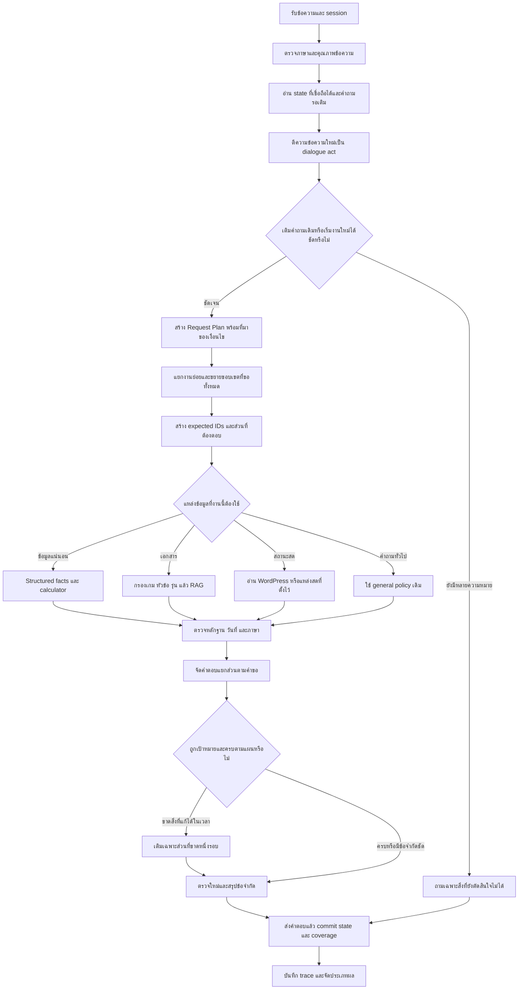

# Flow ปรับการเข้าใจคำถามต่อและการตอบให้ครบตามขอบเขต

**PSU Esports Studio – Phuket Chatbot**  
วันที่: 5 ตุลาคม 2026 / Asia Bangkok  
ฉบับ: 3 หลังตรวจทานด้านบริบท การตัดสินใจ และการนำไปพัฒนา

## 0. สถานะและวิธีอ่าน

เอกสารนี้เป็น Flow สำหรับพัฒนาต่อจากระบบ r37.2 ที่ตรวจพบ เป็น **การออกแบบที่เสนอและตรวจทานแล้ว** ยังไม่ได้ติดตั้งกลไกใหม่ลงในเว็บ ยังไม่ได้รันชุดทดสอบตาม Flow และไม่ได้รับรองความถูกต้องของทุกหมวด

หลักฐานตั้งต้น:

- [รายงานสาเหตุจากภาพ](../analysis_20261005_screenshot_diagnosis/ANALYSIS_TH.md)
- [ผลตรวจองค์ประกอบและ hash](../analysis_20261005_screenshot_diagnosis/component_findings.json)
- [ร่างก่อนตรวจทาน](FLOW_CONVERSATION_RELIABILITY_v1.md)
- [บันทึกการตรวจทานและปรับปรุง](FLOW_REVIEW.md)

แยกสถานะตลอดเอกสาร: **พบในโค้ด/ตรวจแยกส่วนแล้ว**, **เสนอให้พัฒนา**, **ต้องทดสอบหลังพัฒนา**, **รอเจ้าของยืนยัน** คะแนนจริงของคำตอบในภาพยังไม่พบใน log จึงไม่ใช้คะแนนสร้างซ้ำแทนคะแนนคำขอนั้น

## 1. เป้าหมายที่ต้องวัดได้

1. ผู้ใช้เปลี่ยนสำนวนได้ เช่น PC, เอาคอมก่อน, แล้ว VR ล่ะ, ขอทุกเครื่อง โดยระบบยังทราบว่าถามราคา เกม กติกา หรือสถานะจอง
2. คำตอบสั้นเติมส่วนที่บอทถามไว้ได้ ไม่กลับไปถามเรื่องที่ผู้ใช้ระบุแล้ว
3. “ทั้งหมด” ขยายเฉพาะส่วนที่ผู้ใช้ขอ เช่น ทุกบริการแต่เฉพาะกลุ่มบุคคลทั่วไป หรือทุกหัวข้อของกติกา CS2
4. เงื่อนไขที่ผู้ใช้ระบุ เช่น กลุ่มผู้ใช้ วัน เวลา ระยะเวลา ข้อยกเว้น เกมและปี ต้องคงอยู่จนกว่าจะถูกเปลี่ยนหรือหมดบริบทจริง
5. หลายประเด็นในประโยคเดียวได้รับคำตอบครบทุกส่วนที่ตอบได้ พร้อมระบุส่วนที่ขาด
6. คำถามทั่วไปครบถ้วนไม่ถูกถามกลับเป็นรายการเกม/ราคา/การจองของศูนย์
7. ไม่เลือกข้อเท็จจริงใหม่จากการเดาของโมเดล และไม่เรียกข้อมูลเก่าว่าเป็นราคาหรือสถานะสด
8. ภาษาไทย อังกฤษ และข้อความผสมมีข้อเท็จจริงและขอบเขตเทียบกันได้

“รองรับหลายรูปแบบ” หมายถึงผลดีขึ้นในเคสและชุดคำถามใหม่ที่ตรวจ ไม่ใช่รับรองว่าจะเข้าใจทุกประโยคโดยไม่ถามกลับ

## 2. ปัญหาเดิมและการแก้ตรงสาเหตุ

| ปัญหาที่ตรวจพบ | ผลต่อคำตอบ | ส่วนที่เสนอให้เพิ่ม |
|---|---|---|
| pending clarification จำเฉพาะรูปข้อความบางแบบ | PC/ทั้งหมดไม่เติมคำถามราคา | pending request แบบมี schema |
| คำตอบสั้นถูกจัดหมวดใหม่ทันที | สูญเสีย price operation และ customer filter | resolve dialogue act ก่อน route |
| อ่านชื่อบริการจากรายการตัวเลือกของผู้ช่วย | state อาจเป็น PS5 ทั้งที่ยังไม่เลือก | provenance และ offered option IDs |
| บุคคลภายนอกไม่เป็น group filter | อาจแสดงราคา PSU ฟรีรวมมา | group set ที่มีความหมายและเงื่อนไขชัด |
| fee catalog วนทุกกลุ่ม | คำตอบเกินขอบเขตแม้ระบุกลุ่ม | filter-aware catalog |
| unknown route ถูกจัด risk=medium และ veto general LLM | คำถามไก่กับไข่ถูกถามเรื่องศูนย์ | แยก general / ambiguous in-domain / unresolved |
| clarification/no-answer ยอมรับเป็น safe type | safety ผ่าน แต่ตอบโจทย์ไม่ได้ | adequacy และ completeness contract เพิ่ม |
| ข้อมูลภาพค่าบริการมีช่วงสิ้นสุดเดิม | ตัวเลขมีแต่สถานะปัจจุบันไม่ยืนยัน | temporal status แยกจาก fact coverage |

## 3. Flow หลัก



คำว่า “เติมหนึ่งรอบ” เป็นขอบเขตที่เสนอเพื่อลดวงวนใน runtime ต้องอยู่ภายใน deadline เดิม ไม่เริ่มเวลาประมวลผลใหม่หลัง repair

## 4. โครงสร้าง Request Plan

ต้องแยก **ความต้องการของผู้ใช้** ออกจาก **ข้อเท็จจริงที่ดึงมาได้** และ **ข้อความที่แสดงแล้ว**

### 4.1 ข้อมูลระดับ session

| Field | ใช้ทำอะไร |
|---|---|
| session_id | แยกบทสนทนา |
| schema_version, state_revision | ตรวจ compatibility และป้องกันผลเก่าทับ state ใหม่ |
| active_request_id, active_turn_id | ผูกงานกับข้อความที่ทำให้เกิดงาน |
| active_tasks | เก็บหลายงานย่อยในคำขอเดียว |
| pending | ช่องที่ต้องเติม พร้อมตัวเลือกและขอบเขตที่ถาม |
| last_successful_request | รองรับ “แล้ว VR ล่ะ” หลังตอบคำถามเดิมจบแล้ว |
| continuation | source release, detail level, delivered IDs และ remaining IDs |
| locale | ภาษาสำหรับจัดคำตอบ; ไม่ใช้เปลี่ยนข้อเท็จจริง |
| expires_at / invalidation_reason | ป้องกันใช้บริบทค้างโดยไม่มีข้อจำกัด |

### 4.2 ข้อมูลระดับงานย่อย

```json
{
  "task_id": "fee-task-1",
  "domain": "service_fee",
  "operation": "price_lookup",
  "targets": [],
  "scope": {
    "entity_selection": "unresolved",
    "facet_selection": "requested_only",
    "detail_level": "package_rates"
  },
  "filters": {
    "customer_scope": "external_unspecified",
    "customer_group_ids": ["general_student", "general_adult"],
    "duration_minutes": null,
    "people_count": null
  },
  "pending_slots": ["service"],
  "offered_option_ids": ["pc", "ps5", "nintendo_switch", "cockpit", "vr"],
  "source_release": null,
  "provenance": {
    "operation": "explicit_user",
    "customer_scope": "explicit_user",
    "service": "unresolved"
  }
}
```

ตัวอย่างนี้เป็น schema ที่เสนอ ไม่ใช่ payload ที่รองรับอยู่แล้ว `external_unspecified` หมายถึงยังไม่ทราบอัตรารายบุคคล จึงแสดงกลุ่มอัตราที่มีเงื่อนไขเกี่ยวข้อง ไม่ใช่ยืนยันว่าผู้ถามมีสิทธิ์ใช้ทั้งสองอัตรา

หากตอบ “PC” ให้ targets เป็น PC และ entity selection เป็น explicit หากตอบ “ทั้งหมด” ให้ entity selection เป็น all ในชุดบริการที่ pending ถาม ส่วนกลุ่มผู้ใช้และ operation คงเดิม

ใช้ operation เดิมที่รองรับ เช่น price_lookup, price_calculate, rule_lookup ผ่าน adapter ที่ชัดเจน กรณี price_lookup + scope all ต้องเลือก catalog path ไม่ส่งให้ calculator ที่รับเครื่องเดียว หากเพิ่ม operation ใหม่ ต้องปรับ frame, selector, preconditions, contract และ log ร่วมกัน

เวลาใช้ทั้งค่า absolute ที่ตีความได้และ anchor ของคำเดิม เช่น now/today/tomorrow พร้อม reference time และ timezone Bangkok ของแต่ละ turn คำว่า “วันนี้” ที่ระบุใหม่ต้องคำนวณจาก turn ใหม่ แต่ “แล้ว VR ล่ะ” ของคำถามวันที่ระบุชัดคงวันที่นั้น ส่วนคำขอชนิด “ตอนนี้” ต้องดึงสถานะปัจจุบันใหม่ การ replay ต้องตรึง clock เพื่อเทียบผลและตรวจข้ามเที่ยงคืน

### 4.3 ที่มาของค่าและลำดับรวมข้อมูล

1. เงื่อนไขที่ผู้ใช้ระบุหรือแก้ในข้อความปัจจุบัน
2. ค่าจากตัวเลือกที่ผู้ใช้เลือกจริงใน pending ที่ยังใช้ได้
3. เงื่อนไขผู้ใช้เดิมที่ยังเกี่ยวข้องกับงานนี้
4. ผลตีความที่โมเดลเสนอและผ่าน guard
5. ค่าเริ่มต้นที่มีนโยบาย/หลักฐานรองรับ และต้องแสดงว่าเป็นค่าเริ่มต้นเมื่อมีผลต่อคำตอบ

ข้อเท็จจริงที่บอทแสดง เช่น “PC รองรับ 1 คน” ไม่ใช่หลักฐานว่าผู้ใช้เลือกเล่น 1 คน รายการตัวอย่างที่บอทเสนอไม่ใช่ target ที่ผู้ใช้เลือก ข้อความคำตอบไม่ควรถูกอ่านย้อนหลังเพื่อสร้าง filter ใหม่โดยไม่มี provenance

## 5. State อยู่ที่ใดและอัปเดตเมื่อไร

### 5.1 จุดเก็บที่เสนอ

ให้ HTTP parent process เป็นผู้ถือ session state ภายใต้ session lock ที่ระบบมีอยู่ ส่งสำเนา Request Plan ให้ worker ทำงาน วิธีนี้ทำให้ worker timeout/recycle ไม่ลบความหมายของบทสนทนา

เริ่มด้วย state store ใน memory สำหรับ local runtime ปัจจุบัน พร้อม interface ที่ทดสอบได้ หากจะคง state ข้ามการ restart ให้เพิ่ม persistence แบบ additive หรือไฟล์ state แยก ไม่เปลี่ยน/ล้าง SQLite log เดิมเพื่อใช้เป็น state โดยทันที

memory state ไม่รับประกันข้าม restart หลัง restart จึงต้อง rebuild จากประวัติที่ระบบบันทึกและตรวจ version ได้ หรือถามบริบทเพิ่มอย่างตรงจุด ห้ามอ้างว่ากู้ state ได้แล้วก่อนพัฒนาและทดสอบ

### 5.2 ลำดับต่อหนึ่ง turn

1. รับ turn ID ที่คงเดิมเมื่อ retry; client รุ่นเก่าที่ไม่มี field นี้ยังเข้า legacy path ได้
2. เข้าคิว/ล็อก session ตามกลไกเดิม แล้วอ่าน revision
3. สร้าง proposed state และ plan โดยยังไม่เปลี่ยน delivered ledger
4. ทำงานใน worker ภายใต้ deadline ที่เหลือจริง
5. parent ตรวจ request ID, turn ID, revision และผล validation
6. commit การตีความที่ยืนยันได้เป็น revision ใหม่ และเก็บคำตอบสถานะ prepared จากนั้นส่ง response ภายในลำดับของ session เดิม การสร้างคำตอบยังไม่เพิ่ม delivered ledger
7. หลังส่ง ให้บันทึก server_written หรือ delivery_uncertain แล้วปลดล็อก หน้าเว็บยืนยัน last_seen_response_id ในคำขอถัดไปหรือ acknowledgment ที่ออกแบบให้ idempotent จึงเลื่อนส่วนที่เห็นแล้วเป็น client_acknowledged; ส่ง state summary เท่าที่หน้าเว็บต้องใช้

การเขียน HTTP สำเร็จยังไม่ใช่หลักฐานว่า browser render แล้ว เก็บ prepared/server_written/client_acknowledged/uncertain แยกกัน Cursor ใช้ส่วนที่ client ยืนยันว่าเห็น หรือ last response ID ที่ผูกกับข้อความ “ต่อ” จาก client รุ่นใหม่ ไม่ใช้จำนวน bytes ที่ server เขียนเป็นหลักฐานการอ่าน

ถ้าการส่งขาดกลางทางหรือไม่ทราบว่าผู้ใช้ได้รับ ให้ mark delivery uncertain และแสดงส่วนเดิมซ้ำได้ พร้อม label ไม่ข้ามไปส่วนถัดไปโดยคิดว่าผู้ใช้เห็นแล้ว client รุ่นเก่าที่ไม่มี acknowledgment ต้องใช้ fallback แบบ conservative และยังส่งคำถามปกติได้

Cache ของ retry ต้องผูก session + client turn ID + canonical request fingerprint; turn ID เดียวแต่ข้อความต่างกันเป็น conflict ไม่คืนคำตอบเก่าคนละคำถาม Cache และ acknowledgment มี TTL และ revision check ไม่มีการใช้ request ID ของคนละ session แทนกัน

### 5.3 เมื่อมีปัญหาระหว่างประมวลผล

| เหตุการณ์ | State ที่ควรเหลือ |
|---|---|
| ตอบ clarification สำเร็จ | เก็บ pending พร้อมตัวเลือกและ task ที่ถาม |
| ผู้ใช้เติม PC ได้แต่ดึงข้อมูล timeout | เก็บ PC และเงื่อนไขที่เติมได้ สถานะ retryable; delivered ยังไม่เพิ่ม |
| บริการสด unavailable | เก็บวันที่/เครื่องของคำขอ ไม่เก็บว่าเครื่องว่าง |
| input guard ให้พิมพ์ใหม่ | ไม่ใช้ข้อความที่ถูกปฏิเสธเปลี่ยน active task |
| input guard เตือนแต่ให้ประมวลผลต่อ | หาก plan ผ่านการตรวจ ให้ commit เจตนาที่ตรวจได้ คำเตือนอย่างเดียวไม่ล้าง state และไม่ทำให้คำถามต่อสูญบริบท |
| เปลี่ยนหัวข้อชัด | ปิด pending เดิมก่อนทำงานใหม่ แม้แหล่งของงานใหม่ล่ม |
| ส่งคำตอบแล้วมี log error | ไม่ถือว่าคำตอบที่แสดงไม่เคยเกิด; บันทึก diagnostic ตามช่องทางเดิม |
| response เก่ามาหลัง revision ใหม่ | ไม่ทับ state ใหม่หรือเพิ่ม delivered IDs ให้ turn ใหม่ |

กำหนด TTL/จำนวน turn ที่สืบทอดผ่าน config มีเพดาน memory และล้างทั้ง state/lock ที่ไม่ใช้งานเมื่อปลอดภัย ค่า TTL และ threshold เป็นค่าทดลอง ต้องปรับจากเคสจริง ไม่ถือเป็นนโยบายศูนย์

## 6. ตีความข้อความใหม่ให้รองรับสำนวนต่างกัน

### 6.1 Dialogue acts

| Act | ตัวอย่าง | กติกา |
|---|---|---|
| fill_slot | PC, เอาคอมก่อน, the PC one | เติมเฉพาะช่องที่ pending ถามและรองรับตัวเลือกนี้ |
| expand_scope | ทั้งหมด, ทุกเครื่อง, all of them | ขยายมิติที่ข้อความ/คำถามก่อนหน้าระบุ |
| update_filter | แค่คนทั่วไป, two hours instead | เปลี่ยน filter ที่ระบุ ไม่รีเซ็ตส่วนอื่นโดยไม่มีเหตุ |
| replace_target | แล้ว VR ล่ะ, what about Tekken 8 | คง operation/facets เฉพาะที่ยังเข้ากับ target ใหม่ |
| add_task | แล้วขอวิธีจองด้วย | เพิ่มงานย่อย เก็บงานเดิมที่ยังไม่ตอบ |
| continue | ต่อ, ที่เหลือ, the remaining rules | ใช้ ledger/detail level/release ของงานเดิม |
| new_task / topic_shift | ไม่เอาราคาแล้ว มีเกมอะไรบ้าง | เริ่มคำขอใหม่ ปิด pending ที่ไม่เกี่ยวข้อง |
| explicit_correction | ไม่ใช่ PS5 หมายถึง PC | เปลี่ยน target ตามผู้ใช้ และห้ามใช้ผล PS5 ต่อ |
| ambiguous | เอาอันนั้น, ขอดูอันแรก โดยไม่มีรายการที่ระบุได้ | ถามเฉพาะ target/ส่วนที่อ้างถึง |

คำสั้นอาจเป็นคำถามใหม่ได้ เช่น “VR คืออะไร” เป็นงานอธิบาย ไม่ใช้ความยาวสั้นตัดสินว่าสืบทอดราคา “ได้” หลังคำถามเลือกบริการไม่ใช่ชื่อบริการ จึงไม่ควรเติม target แบบสุ่ม

### 6.2 ชั้นการตีความ

1. ใช้ normalization และ typo recovery ที่มีอยู่ เก็บข้อความดิบ/ข้อความที่เสนอแก้แยกกัน
2. ตรวจ explicit task shift, negation, วัน/เวลา/ตัวเลข/ชื่อเกมและบริการก่อนรวม state
3. ใช้ catalog/entity resolver ตรวจตัวเลือกที่อยู่ใน pending และ target ของงานเดิม
4. จัด dialogue act พร้อม candidate plans เมื่อแยกได้ชัดให้ใช้ทันที
5. หากยังไม่ชัด ใช้ local LLM หนึ่งคำขอเพื่อเสนอ structured patch ต่อ plan ไม่ให้สร้างคำตอบราคา/สถานะสดในขั้นนี้
6. ตรวจผลโมเดลด้วย schema, allowed IDs, policy และ compatibility ของ filter หากไม่ผ่านให้ถามเฉพาะสิ่งที่ขาด

ผลโมเดลต้องมี act, slot updates, preserved fields และเหตุอิงข้อความ ไม่มี field สำหรับแต่งราคา กฎ หรือสถานะว่าง คำตอบจากโมเดลไม่ข้าม catalog ไปสร้างเครื่อง/เกมใหม่ และไม่เปลี่ยนตัวเลขหรือวันที่ที่ผู้ใช้ระบุชัด

alias ของชื่อจริงและคำย่อที่ยืนยันยังใช้ได้ร่วมกับ semantic interpretation/typo recovery การเพิ่ม alias สำหรับทุกประโยคใหม่ไม่ใช่กลไกหลักของ Flow นี้

### 6.3 การตัดสินความมั่นใจ

อย่าใช้ค่า 0.62 ของ clarification เดิมเป็นความน่าจะเป็นว่าคำตอบถูก หรือใช้ candidate ranking score เป็น probability โดยตรง

ตัดสินจากความสอดคล้องหลายชั้น: operation กับ pending ตรงกันหรือไม่, target อยู่ใน catalog หรือไม่, filter ชัดหรือไม่, มีอีก interpretation ที่ทำให้ราคาหรือวันที่เปลี่ยนหรือไม่ ใช้ threshold ที่ตรวจจาก holdout และแยกตาม act โดยยังไม่กำหนดตัวเลขถาวรในเอกสารนี้

โมเดล timeout/ตอบ schema ผิด/ให้หลายความหมายต้องกลับสู่ deterministic resolution หรือ targeted clarification ภายใต้ deadline เดิม

Dialogue interpretation และ intent review/facts composition ต้องใช้ call budget เดียวตลอด request ข้าม parent/worker ส่ง used/remaining calls และเวลาที่เหลือจริงใน supervisor payload ไม่ให้ worker เริ่ม budget ใหม่หลัง parent เรียกโมเดลแล้ว หาก plan ชัดและผ่าน guard ให้ downstream ใช้ plan ไม่เรียก intent LLM ซ้ำเพื่อเดาเงื่อนไขที่มีอยู่แล้ว

## 7. ความหมายของ “ทั้งหมด” และ “ต่อ”

### 7.1 เลือกมิติที่จะขยาย

| สถานการณ์ | มิติของ “ทั้งหมด” |
|---|---|
| บอทถามว่าราคาของบริการใด | services ใน offered option set |
| ผู้ใช้ถามทุกแพ็กเกจของ VR | packages ของ VR |
| บอทถามว่าต้องการดูหัวข้อกฎ CS2 ใด | facets/sections ของ CS2 rulebook รุ่นที่ใช้อยู่ |
| ผู้ใช้ถามรายชื่อเกมของ Nintendo | games ภายใน Nintendo |
| ขอราคาและวิธีจองทั้งหมด | งานราคาและงานจองที่ผู้ใช้ขอ ไม่ขยายหมวดอื่น |
| ขาดทั้งบริการและกลุ่ม แล้วบอทถามสองอย่างพร้อมกัน | ยังระบุไม่ได้ว่าทั้งหมดขยายบริการ กลุ่ม หรือทั้งสอง ต้องถามมิติที่ขาด |
| ไม่มี state และไม่มีสิ่งที่อ้างถึง | ถามว่าอยากทราบทั้งหมดของเรื่องใด |

ปรับ UX ให้คำถามเติมแต่ละครั้งระบุช่องชัด เช่น “ต้องการราคาของบริการใดครับ? เลือกเครื่องเดียวหรือทุกบริการได้” ลดการถามหลายช่องในประโยคที่ทำให้คำตอบ “ทั้งหมด” กำกวม

คำว่า “ทั้งหมด” เพียงคำเดียวไม่เปลี่ยนกลุ่มผู้ใช้ วัน เวลา หรือ edition ของเกม หากผู้ใช้พูด “ทุกกลุ่มทุกเครื่อง” จึงขยายสองมิตินั้นอย่างชัดเจน

### 7.2 รายการที่ต้องตอบมาจากไหน

ใช้ requested scope และ source manifest/catalog ที่ตรวจ version ได้ สร้าง expected IDs **ก่อน**อ่านผล retrieval อย่าสร้าง denominator จากเฉพาะเอกสารที่ retrieval หาเจอ เพราะถ้าหายครึ่งหนึ่งก็จะดูเหมือนครบ 100%

แยกสามรายการ:

- requested items: ส่วนที่ผู้ใช้ร้องขอ รวมส่วนที่แหล่งไม่มี
- documented items: ส่วนที่ manifest ระบุว่ามีในแหล่ง/รุ่นนั้น
- usable evidence: ส่วนที่ผ่านสถานะ publish, วันที่, locale และ target ในคำขอนี้

กรณี scope all จำนวนที่แท้จริงต้องมาจาก manifest รุ่นนั้น หาก manifest ยังไม่มีหรือไม่ครบ ให้ระบุว่าระบบตรวจความครบทั้งหมดไม่ได้ ห้ามใช้จำนวนที่ค้นได้เป็นจำนวนครบของเอกสารจริง

### 7.3 Ledger สำหรับคำตอบยาว

เก็บ coverage key = task + target + operation + facets + detail level + source release + filters ที่มีผลต่อข้อเท็จจริง มี answered summary IDs แยกจาก answered detail/claim IDs

การสรุปหัวข้อ “พักเกม” หนึ่งบรรทัดไม่ถือว่าแสดงข้อกำหนดพักเกมครบทุก clause เมื่อผู้ใช้ขอรายละเอียดทั้งหมด “ต่อ” จึงต้องรู้ว่าต่อในระดับสรุปหรือรายละเอียด

แบ่งคำตอบยาวเฉพาะเมื่อข้อจำกัด UI/response มีหลักฐานว่าจำเป็น แสดง “ส่วน 1/3” เมื่อคำนวณจำนวนส่วนได้จริง พร้อมรายการที่เหลือหรือแนบเอกสารครบที่เหมาะสม ถ้ายังไม่ทราบจำนวนส่วนให้แสดง “ส่วน 1” พร้อมสิ่งที่ยังไม่ตอบ ไม่ตัดโดยเงียบ ๆ และไม่บังคับแบ่งตารางราคา 7 แพ็กเกจที่แสดงได้ครบในครั้งเดียว

ถ้า source release เปลี่ยนระหว่าง “ต่อ” ให้ตรวจ rebase ledger และแจ้งว่าข้อมูลเปลี่ยน ไม่ใช้ cursor เก่าข้าม clause ในฉบับใหม่

Ledger ใช้ได้เฉพาะคำตอบ static/source-bound สำหรับ live availability ต้อง fetch ใหม่เมื่อถาม “ตอนนี้” หรือ “ต่อ” ที่ต้องการสถานะปัจจุบัน เก็บ fetched_at และ snapshot/date/time ที่ใช้ทุกครั้ง รายการที่เคยว่างไม่ใช่รายการที่ยังว่างใน turn ใหม่

## 8. เงื่อนไขราคาและคำว่า “บุคคลภายนอก”

- บุคคลทั่วไปที่ระบุชัด: group=General Adult
- นักศึกษา/นักเรียนต่างสถาบันที่ระบุชัด: ใช้กลุ่มตาม source ที่ระบบบันทึก
- บุคคลภายนอกกว้าง ๆ: แสดงกลุ่มอัตราที่เกี่ยวข้องพร้อมเงื่อนไข ยังไม่เลือกอัตรารายบุคคล
- “ไม่ใช่นักศึกษา”: ห้ามให้อัตรานักศึกษาจากคำว่า “นักศึกษา” ในประโยคปฏิเสธ
- “ไม่ใช่ PSU”: ยังไม่ทราบว่ามีคุณสมบัติเป็นนักศึกษาต่างสถาบันหรือบุคคลทั่วไป แสดงทางเลือกหรือถามจุดนี้เมื่อจะคำนวณยอดเฉพาะบุคคล
- ไม่ระบุเวลาแต่ขอราคา: แสดงราคาต่อแพ็กเกจและหน่วย ไม่เดาระยะเวลาที่ต้องการเล่น
- ขอคำนวณยอดแน่นอน: ต้องมีบริการ กลุ่มอัตราที่เลือกได้ และตัวแปรที่ส่งผลต่อยอด ถ้าไม่ครบแสดงอัตราที่มีแล้วถามตัวแปรคำนวณที่ขาด

expected fee package IDs จากข้อมูลปัจจุบันมี PC, PS5, Nintendo 1–2/3–4 คน, Cockpit, VR 30/60 นาที จำนวน 7 เป็น snapshot ปัจจุบัน ไม่ hardcode จำนวน 7 เป็นจำนวนถาวรของระบบ

หน่วยราคาและ capacity ตามแพ็กเกจไม่ถูกแปลงเป็นราคาต่อหัวเอง VR แพ็กเกจ 30 นาทีและ occupancy การจองเต็มหนึ่งชั่วโมงเป็นคนละเงื่อนไข ใช้ข้อกำหนดที่ยืนยันแล้วของแต่ละส่วน

ราคา PC ใช้ local update 27 กรกฎาคม 2026 พร้อม source ของ PC โดยตรง ส่วนภาพราคาเดิมที่ระบุถึง 31 มีนาคมต้องแยก historical จาก current validity ห้ามแก้ expiry เพื่อทำให้ contract ผ่าน

## 9. หลายงาน หลายเครื่อง และหลายหมวดในคำถามเดียว

“ขอราคา PC กับ VR ของบุคคลทั่วไป แล้วบอกวิธีจองด้วย” ต้องสร้างอย่างน้อย:

1. งานราคา: targets PC และ VR, filter General Adult, แสดงแพ็กเกจตามเวลาที่ถามหรือทุกแพ็กเกจที่เกี่ยวข้อง
2. งานจอง: how-to ตามบริการที่เลือก โดยไม่แปลว่าต้องตรวจสถานะว่างสดหากยังไม่ได้ถามว่าว่างหรือไม่

เก็บ filter ระดับ task และระดับ target เมื่อจำเป็น เช่น “PC 2 ชั่วโมง VR 30 นาที” ต้องไม่เอา duration ของ PC ไปคำนวณ VR

คำว่า “กฎ” ต้องแยกกฎศูนย์กับกติกาเกม และกติกาคนละเกมต้องมี target/rulebook/source แยก ห้ามปล่อยให้คะแนนเอกสารเกมหนึ่งสูงกว่าทำให้เปลี่ยนเกมที่ผู้ใช้ระบุ

เมื่อบางงานล่ม ให้ตอบงานที่มีหลักฐานได้โดยแสดงสถานะของแต่ละส่วน ไม่ทิ้งคำตอบทั้งหมดเป็น no-answer เพียงเพราะงานหนึ่งไม่พร้อม

งานเปรียบเทียบต้องมี constraint ของชุดงานด้วย เช่น เปรียบเทียบสถานะ PC และ VR ในเวลาเดียวกันต้องใช้ snapshot ที่สอดคล้องกัน งานที่ขึ้นต่อกันไม่ถูกแบ่งเป็นคำตอบอิสระที่สร้างข้อสรุปไม่ได้ หากแหล่งหนึ่งขาด ให้แสดง facts ที่มีและระบุว่าข้อสรุปเปรียบเทียบยังไม่ยืนยัน

## 10. การเลือกเครื่องมือและข้อมูล

| งาน | เส้นทางที่ใช้ | ข้อกำหนด |
|---|---|---|
| ราคาเครื่องเดียวพร้อมเงื่อนไข | calculator / structured price | ค่า group/duration/people จาก plan ไม่ parse ใหม่จนทำเงื่อนไขหล่น |
| ตารางหลายบริการ/ทั้งหมด | fee catalog | กรองบริการ แพ็กเกจ กลุ่ม และ units ตาม plan |
| กติกาส่วนเฉพาะ/ทั้งหมด | rulebook manifest + structured claims/RAG | เกม รายการ ปี หัวข้อ source hash และ approval ตรง |
| รายชื่อเกม/อุปกรณ์/สมาชิก | structured catalog | ใช้ stable IDs และ filter; locale ใช้แหล่งที่อนุมัติ |
| ตารางปกติ | calendar/policy | ไม่แสดงเป็นสถานะจองสด |
| สถานะว่างตามวันเวลา | live source ที่ตั้งไว้ | date/zone/machine/time/source freshness ตรงและ read-only |
| คำถามทั่วไป | general policy เดิม | ไม่ใช้ source PSU รับรองคำตอบทั่วไป ไม่สร้าง facts PSU |

ใน runtime ที่ตรวจ live fetch mode เป็น WordPress และ dashboard_required=false จึงไม่เพิ่มเงื่อนไขว่าทุกคำถามจองต้องเปิด Dashboard เสมอ ให้ใช้ configuration และแหล่งที่ตรวจได้จริง

Live summary ต้องแยก free/booked/closed/unknown; fetch สำเร็จไม่เท่ากับสถานะรายเครื่องถูกต้อง coverage ของเครื่องเป็นคนละตัวชี้วัดกับ independent booking oracle

## 11. การแยกคำถามทั่วไปและการถามเพิ่ม

ให้ classification เป็นอย่างน้อย complete PSU task, complete general task, ambiguous PSU task, incomplete follow-up และ unresolved ไม่เปลี่ยน unknown ทุกกรณีเป็น general low risk และไม่เรียกคำถามทั่วไปทั้งหมดเป็น PSU medium risk

คำถาม “ไก่กับไข่อะไรเกิดก่อนกัน” เป็นตัวอย่าง complete general task ให้ใช้ general capability ถ้านโยบายเดิมเปิด หากปิดจึงแจ้งขอบเขตบอทอย่างตรงไปตรงมา ไม่ถามว่าจะดู PC หรือราคาอะไร

ก่อนส่ง clarification ต้องตรวจ:

1. ช่องที่ขาดมีผลต่อคำตอบจริงหรือไม่?
2. pending/active user context เติมช่องนั้นได้แล้วหรือไม่?
3. มีคำตอบแบบหลายอัตรา/หลายแพ็กเกจที่ตรงคำขอและไม่ต้องเดาหรือไม่?
4. หากยังต้องถาม ให้ถามเฉพาะช่องที่ขาด พร้อมตัวเลือกที่สร้างจาก catalog

ราคาหลายแพ็กเกจที่ตอบได้ไม่ควรถูกปฏิเสธเพียงเพราะผู้ใช้ยังไม่ได้เลือกระยะเวลา แต่การคำนวณยอดเฉพาะอาจต้องถามระยะเวลา

## 12. Contract ของคำตอบ

ตรวจและรายงานแยกกัน:

| มิติ | เงื่อนไขที่ต้องตรวจ |
|---|---|
| interpretation | act, domain, operation, target และ filters ตรงคำขอที่รวมบริบทแล้ว |
| factual grounding | แต่ละ claim/ราคา/สถานะมี evidence และไม่มี facts ที่แต่งเพิ่ม |
| completeness | expected items/facets เทียบกับ returned items/facets ในระดับรายละเอียดที่ขอ |
| scope precision | ไม่เพิ่มบริการ/กลุ่ม/เกมที่ผู้ใช้ไม่ได้ขอหรือถูกยกเลิก |
| temporal validity | วันมีผล/หมดอายุ/เวลาที่ดึงสด/วันที่ถามตรง |
| locale parity | ตัวเลข units IDs และความหมายตรงข้ามภาษา; translation status ถูกต้อง |
| clarification adequacy | คำถามกลับจำเป็นจริงและถามเฉพาะสิ่งที่ขาด |
| delivery | คำตอบ/ส่วนที่กล่าวว่าส่งแล้วมีผลการส่งที่ตรวจได้ |

`safe_no_answer` หรือ `safe_clarification` แปลว่าไม่สร้างข้อเท็จจริงเสี่ยง ไม่แปลว่า answered_complete ถ้าข้อมูลมีครบและอ่านได้แต่ตอบไม่พบข้อมูล ให้จัดเป็น false_no_answer ไม่ใช่ semantic pass

หาก coverage ขาดเพราะตัว formatter ตัดรายการ ให้เติม formatter ถ้าขาดเพราะ retrieval ไม่เจอทั้งที่ manifest มี ให้ค้นเฉพาะ missing IDs ถ้าขาดเพราะแหล่งไม่มีจริง ให้ระบุช่องว่าง ไม่สร้าง claim เพิ่ม

แยก `fact_coverage` ของข้อมูลที่อ่านได้จาก `current_validity` ข้อมูลย้อนหลังอาจครบทุกอัตรา แต่ยังไม่ควรได้สถานะ verified_current_price

## 13. ผลลัพธ์ที่ต้องแยกใน log และรายงาน

| Outcome | ความหมาย |
|---|---|
| answered_complete | ครบคำขอและผ่านหลักฐานตามชนิดงาน |
| answered_partial | ตอบได้บางส่วน พร้อมรายการที่ขาดและเหตุ |
| clarification_required | มีความกำกวมที่เปลี่ยนคำตอบจริง |
| unnecessary_clarification | ข้อมูล/บริบทพอแต่ถามซ้ำ |
| false_no_answer | หลักฐานใช้ได้แต่ระบบบอกไม่มี |
| source_missing | ส่วนที่ขอไม่มีในแหล่งที่ตรวจได้ |
| source_not_current | มีข้อมูลบันทึก แต่สถานะปัจจุบันไม่ยืนยัน |
| localization_pending | facts มี แต่คำแปลที่ต้องใช้ยังไม่พร้อม |
| live_unavailable | ต้องใช้ข้อมูลสดแต่ดึง/ตรวจไม่ได้ |
| timeout / schema_rejected | ปัญหาประมวลผลหรือตีความตาม contract ไม่ได้ |
| general_answer / out_of_scope | ผลตาม general policy เดิม |
| delivery_uncertain | ไม่ยืนยันว่าคำตอบส่วนนี้ถูกส่งครบ |

Owner review เป็นสถานะอีกแกนหนึ่ง ไม่เปลี่ยน source_not_current ให้เป็น complete เพียงเพราะ formatter/route ผ่าน

## 14. Trace ที่ช่วยอธิบายว่าทำไมจึงตอบแบบนี้

เพิ่มแบบ additive ใน log schema เดิมหรือไฟล์ผลใหม่ เก็บข้อมูลจำเป็น:

- request ID/turn ID/state revision/schema version และ runtime/source release
- original input, normalization/recovery และเหตุที่รับหรือปฏิเสธการแก้คำ
- state ก่อน/หลังและ pending slot ที่เลือกใช้ โดยไม่ dump ประวัติทั้งหมดซ้ำทุก turn
- delivery status, response ID ที่ client ยืนยัน และ remaining model-call budget ที่ส่งข้าม process
- act candidates, competing interpretations, slot provenance และเหตุ invalidate
- merged request plan และ expected IDs/facets/detail level
- selected capability, candidate scores, selection.status, veto reasons, execution_allowed
- executed capability และเหตุที่ต่างจาก selected ถ้ามี
- evidence IDs/source hash/validity, returned IDs, missing IDs และเกณฑ์ locale
- outcome แต่ละมิติ, clarification adequacy, repair attempt และ latency ต่อ stage

แยก `abstain_low_score` จาก `review_required_low_margin` แม้ใช้ formatter clarification เดียวกัน และไม่เรียกค่าคะแนน heuristic ว่าความน่าจะเป็นความถูกต้อง

## 15. จุดเชื่อมกับโค้ดและลำดับพัฒนา

ฐานโปรเจกต์: `C:\Users\Chokhun\Downloads\Learn-LLM\18_PSU_Esports_Update_Route_Data`

### ระยะ A — แก้กรณีภาพให้ครบก่อน

| งาน | จุดเชื่อม | หลักฐานเสร็จที่ต้องมี |
|---|---|---|
| A1 typed request/pending + store interface | โมดูลใหม่ใน app/session; schemas แบบ optional | unit/state transition ที่แยก offered กับ selected ได้ |
| A2 pending price choices ไทย/อังกฤษ | protected_intents.py, context_resolver.py | PC/all เติม task/filter จาก turn เดิม |
| A3 parent ownership/plan transfer | web_api/server.py, pipeline_supervisor.py, engine.py | worker recycle ไม่ลบ context; state/version ส่งครบ |
| A4 price scope/group contract | closed_query_improvements.py, calculator/service_fee.py, question_frame.py, capability_registry.py | ทุกแพ็กเกจตาม scope และไม่มี group หลุด |
| A5 adapter legacy/default PS5 | context_resolver.py, web_chat/app.js | ไม่มี target จากตัวเลือก assistant; client เก่ายังเข้าได้ |
| A6 trace และ semantic outcome | decision_artifact.py, validator.py, answer_contracts.py, chat_logger.py | false no-answer/ถามซ้ำไม่ถูกนับเป็น answered |

ระยะ A ควรใช้ deterministic slot fill ก่อนเพื่อยืนยัน state semantics ไม่เพิ่ม model calls ให้ทุกคำถามราคาที่ชัดอยู่แล้ว

### ระยะ B — รูปคำถามใหม่และหลายหมวด

1. เพิ่ม dialogue-act interpreter ที่มี deterministic route และ bounded model patch
2. แยก general/unknown/ambiguous ก่อน generic clarification
3. ขยายหลาย task และ per-target filters โดย reuse competition resolver/negation/year guards เดิมผ่าน adapter ไม่สร้างตัวอ่านกติกาซ้ำที่แย่ง ownership
4. เพิ่ม manifest-based coverage และ summary/detail ledger สำหรับ rules/catalogs
5. ตรวจ multilingual/typo/topic-shift holdout ที่ไม่ใช้ประโยคจากชุดพัฒนา

### ระยะ C — เว็บจริงและแพ็กเกจ

1. ขอสิทธิ์ผ่านระบบก่อนแก้โปรเจกต์ที่อยู่นอก writable roots
2. บันทึกสถานะ Git/hash ก่อนแก้ สำรองเฉพาะไฟล์ที่แก้ และไม่ reset งานเดิม
3. ทดสอบเว็บแยก session/port ที่ระบุ runtime version ได้ เก็บ log ในโฟลเดอร์ใหม่
4. ปรับข้อผิดพลาดจากหลักฐาน แล้วรัน regression ที่เกี่ยวข้อง
5. สร้างโฟลเดอร์/ZIP รุ่นใหม่ ตรวจไฟล์ที่แตกและ smoke conversation ใหม่ ไม่ทับแพ็กเกจ/log ของผู้ใช้
6. อัปเดต flow พร้อม known limitations จากผลจริง ไม่เปลี่ยน Gold เพื่อให้ pass

## 16. แผนตรวจหลังพัฒนา

### 16.1 ชั้นการตรวจ

1. Pure state tests: history → plan/act/filter/pending/ledger โดยไม่เรียกโมเดลหรือ WordPress
2. Component tests: selectors, catalog filter, calculator, source validity และ coverage
3. Model interpretation tests: schema/IDs/negation/typos และ ablation เปิด/ปิดโมเดล
4. HTTP conversation tests: ประวัติจริงจากหน้าเว็บ, worker timeout/retry, session lock, delivery และ runtime version
5. Regression: competition context, scope ของราคา, live fixture ที่รู้สถานะจริง และ TH/EN
6. Human review: ความเข้าใจและความครบที่คนอ่านยืนยัน; owner sign-off แยกนโยบาย/ราคาปัจจุบัน

### 16.2 กลุ่มสถานการณ์ขั้นต่ำ

| ID | ประวัติ/ข้อความใหม่ | ผลที่คาด |
|---|---|---|
| C01 | ถามราคา external → PC | ราคา PC ของกลุ่มที่เกี่ยวข้อง ไม่ถามราคา/เกมใหม่ |
| C02 | ถามราคา external → ทั้งหมด | ครบ service/package ตาม manifest ไม่เพิ่ม PSU ฟรี |
| C03 | same → เอาคอมก่อน / the PC one | ผล plan เทียบกับ C01 |
| C04 | same → ทุกเครื่องเลย / all of them | ผล scope เทียบ C02 |
| C05 | บอทเสนอห้าบริการ → Nintendo | เลือก Nintendo ไม่หยิบ PS5 |
| C06 | ราคา General Adult → all services | มีเฉพาะกลุ่ม Adult |
| C07 | ราคานักศึกษาต่างสถาบัน → ทั้งหมด | มีเฉพาะอัตราของกลุ่มนั้น |
| C08 | ราคาบุคคลทั่วไป PC → แล้ว VR ล่ะ | เปลี่ยนบริการ คง group และ operation |
| C09 | ราคา PC 2 ชั่วโมง + VR 30 นาที | per-target duration ไม่ปน |
| C10 | ราคา external → ไม่ใช่นักศึกษานะ | ไม่เลือกอัตรานักศึกษา; resolve กลุ่มให้ตรง |
| C11 | ราคา external → ไม่เอาราคาแล้ว มีเกมอะไร | เปลี่ยนงานเป็น games แม้งานราคาเดิมยัง pending |
| C12 | ราคา PC → VR คืออะไร | อธิบาย VR ไม่ยึด operation ราคา |
| C13 | ไม่มี state → ทั้งหมด | targeted clarification ของขอบเขต |
| C14 | ขาด service และ group → ทั้งหมด | ไม่เดาว่าขยายสองมิติ |
| C15 | กติกา CS2 → ทุกหัวข้อ | CS2 edition เดิม ครบ documented scope/แจ้ง gap |
| C16 | กติกา CS2 สรุป → ขอรายละเอียดทั้งหมด | ไม่ถือ summary ledger เป็น full clauses |
| C17 | กติกา CS2 → ต่อ → ต่อ | ไม่ซ้ำส่วนที่ส่งสำเร็จ ไม่ข้ามส่วนที่เหลือ |
| C18 | rules source เปลี่ยนขณะต่อ | ตรวจ release/cursor และแจ้งการเปลี่ยน |
| C19 | ราคาและวิธีจอง PC/VR → ทั้งสองอย่าง | มีทั้งสอง tasks ไม่ตกไป task เดียว |
| C20 | task A สำเร็จ task B timeout | ตอบ A และระบุ B; ไม่ all-or-nothing |
| C21 | เติม PC แล้ว worker timeout → ลองอีกที | PC/filter คงอยู่ แต่ไม่ mark answered ก่อนสำเร็จ |
| C22 | retry turn ID เดิม / late response | ไม่ commit ซ้ำ ไม่ทับ revision ใหม่ |
| C23 | input guard ปฏิเสธ → PC | state เดิมไม่ถูกข้อความที่ปฏิเสธทำลาย |
| C24 | clear/new session หรือ session คนอื่น → ทั้งหมด | ไม่ข้าม session |
| C25 | ราคาเดิมหมดช่วงมีผล → ขอราคาวันนี้ | ไม่รับรอง current; แยก recorded price |
| C26 | ถามสถานะว่าง → แหล่งสดล่ม / ถามวันนี้ใหม่ข้ามเที่ยงคืน | ไม่ตอบว่างจากตารางปกติ; relative date ใช้ clock ของ turn ที่ถูกต้อง |
| C27 | VR package 30 นาที | ราคาแพ็กเกจและ occupancy slot ไม่ปน |
| C28 | ไก่กับไข่ / complete general paraphrases | ไม่ถามเลือกเกม/ปุ่มของศูนย์ |
| C29 | เรื่องทั่วไปที่มีคำว่า PC แต่ไม่มี operation PSU | จำแนกจาก request ไม่ใช้ชื่ออุปกรณ์คำเดียวล็อกหมวด |
| C30 | slang/ซ้ำ/ขาดหลายคำแต่ตัวเลขชัด | recover act/target โดยตัวเลขไม่ถูกแก้ |
| C31 | ภาษาอังกฤษยังไม่มี approved claim | localization_pending เฉพาะส่วนที่ขาด ไม่แต่งแปล source |
| C32 | UI ส่ง failed/partial delivery → ต่อ | ไม่ข้ามส่วนที่ยังไม่ยืนยันการส่ง |

ทำคู่ TH/EN สำหรับสถานการณ์ที่ใช้ภาษาได้เทียบกัน และเพิ่ม code-mix/typo variations แยกจาก clean base รักษา target/facts/Gold เดิมเมื่อทำ mutation แยกกลุ่ม development กับ holdout ตามเจตนา/บทสนทนาต้นทาง เพื่อไม่ให้ประโยคแปลงจาก base เดียวกระจายข้ามสองชุด

ตารางนี้เป็น test specification ไม่ใช่รายงาน 32/32 ผ่าน

### 16.3 เกณฑ์ผ่านและการรายงาน

- Critical cases: ไม่มี wrong tariff, wrong game, wrong date, cross-session หรือ live status ที่แต่งขึ้นในชุด gate ที่ระบุ
- C01/C02/C05/C06/C11 ต้องได้ plan และข้อเท็จจริง/ขอบเขตที่คาดโดยไม่ถามซ้ำไม่จำเป็น
- completeness คำนวณจาก expected item IDs และ detail level; scope precision รายงาน extra IDs ด้วย
- TH/EN parity เทียบ facts/units/IDs/source ไม่เทียบเพียงว่ามีภาษาอังกฤษ
- รายงาน clarification rate และ unnecessary clarification rate แยก; no-answer เป็น safety pass ได้แต่ไม่ semantic pass
- รายงาน latency P50/P95/Max, model-call count, timeout และ coverage แยกตาม act/path และบอกว่า serial หรือ concurrent
- ทำงานใน global deadline เดิม 20 วินาทีที่ runtime ระบุ ไม่กล่าวว่าทุกกรณี/หลายคนพร้อมกันผ่าน SLA ก่อนตรวจจริง
- Current price approval และ independent live oracle แยกจากผลอัตโนมัติ

ไม่จำเป็นต้องรัน Ground Truth ทั้งหมดทุกครั้ง เริ่มเฉพาะข้อผิดที่เกี่ยวข้อง แล้วขยาย regression เพื่อแก้ความเสี่ยงที่ตรวจพบ การรันชุดใหญ่ควรเกิดหลังกลไกพื้นฐานผ่านและเก็บ baseline ที่เทียบได้

## 17. วงรอบวิเคราะห์และพัฒนา

ต่อหนึ่งรอบ:

1. เก็บ failure ที่มี original input, history/plan, actual answer, source และ expected facts
2. แยกชั้นผิด: normalization → context → act → filter → scope → selection → evidence → formatting → contract → delivery
3. ระบุสมมติฐานพร้อมหลักฐาน เช่น pending ไม่ถูกอ่าน หรือ catalog ไม่ใช้ group filter
4. แก้ชั้นที่เป็นเหตุ เลือกวิธีร่วมสำหรับหลายสำนวน
5. ตรวจเคสเดิมและ negative controls เช่น topic shift/ไม่มี state/กลุ่มคนละอัตรา
6. ตรวจ holdout ที่ยังไม่เคยใช้ปรับเงื่อนไข วิเคราะห์ข้อผิดใหม่และผลถอยหลัง
7. ปรับ Flow/implementation mapping/known limitations แล้วเก็บผลใหม่ไม่ทับ baseline

หยุดการวนปรับเมื่อเคส critical ผ่านตามหลักฐานและ regression ไม่ถอยหลัง ส่วนที่เหลือเป็น source/owner/locale gap ให้เก็บสถานะแยก ไม่เพิ่ม alias หรือเดานโยบายเพื่อดันคะแนน

## 18. สิ่งที่ทำได้เองและสิ่งที่ยังต้องการข้อมูล

**ทำได้จากหลักฐานที่มี:** state/pending, dialogue acts, group/scope filtering, completeness contracts, trace, TH/EN paired tests และ adapter เชื่อมกับโมดูลเดิม

**ต้องยืนยันก่อนรับรองราคาปัจจุบัน:** อัตราภาพราคาเดิมที่ระบุถึง 31 มีนาคม 2026 ต่ออายุหรือเปลี่ยนอย่างไร ขอเอกสารใหม่พร้อมวันที่ และยืนยัน PC local update 27 กรกฎาคมว่ายังใช้หรือไม่ ไม่ต้องหยุดพัฒนา context เพื่อรอข้อมูลนี้

**ต้องมีหลักฐานเพิ่มเมื่อตรวจคำขอในภาพจริง:** session export หรือชุด/พอร์ตที่สร้างคำตอบ เพื่ออ่าน actual scores, model trace และ stage timings ที่ยังไม่พบ

**ยังไม่ต้องเปลี่ยนนโยบายคำถามทั่วไป:** ใช้ general capability ตาม config เดิม ถ้าจะให้บอทตอบนอกขอบเขตมากขึ้นหรือปิดโหมดนี้ถาวรจึงเป็นการตัดสินใจผลิตภัณฑ์เพิ่มเติม

## 19. สิ่งที่ปรับปรุงจากร่างแรก

1. ระบุ state owner ที่ parent และ lifecycle เมื่อ timeout/retry/recycle
2. เพิ่ม server state revision, turn identity และ delivery uncertainty เพื่อป้องกันการข้ามคำตอบ
3. แยก external scope จากสิทธิ์อัตรารายบุคคลและ group filter
4. แยกมิติของ “ทั้งหมด” และกรณีที่ยังต้องถาม
5. สร้าง expected scope จาก manifest ก่อน retrieval พร้อม source/locale/date gaps
6. แยก summary coverage จาก detailed clause coverage และ source-release cursor
7. เพิ่ม multi-task/per-target filters และ partial outcomes
8. ใช้ legacy adapter และ existing competition guards ร่วมกัน
9. จำกัด model interpretation/repair ใน deadline พร้อม structured-output guards
10. เพิ่มเกณฑ์ที่วัด semantic adequacy, coverage, scope precision, TH/EN parity และ human/owner approval แยก
11. เพิ่ม client acknowledgment, retry fingerprint และ fallback ของ client เก่า เพื่อไม่ข้ามส่วนที่ผู้ใช้ยังไม่เห็น
12. รวมโควตาโมเดลตลอด request และแยก static continuation จากสถานะสดที่ต้อง fetch ใหม่
13. รักษา accepted state เมื่อมีเพียงคำเตือน typo และเพิ่มข้อกำหนด snapshot ของงานเปรียบเทียบ

## 20. งานถัดไปที่พร้อมเริ่ม

เริ่มระยะ A จาก A1–A2 ด้วยบทสนทนาในภาพทั้งไทย/อังกฤษ แล้วทำ A3–A6 ให้ครบก่อนขยาย semantic interpretation ระยะ B เก็บทุกผลในโฟลเดอร์ใหม่ และสร้างแพ็กเกจรุ่นใหม่เมื่อมีผลเว็บจริงรองรับ

เอกสารนี้พร้อมใช้เป็นแผนพัฒนาและเกณฑ์ตรวจ แต่สถานะความสำเร็จของแต่ละงานต้องเติมจากการแก้โค้ดและผลทดสอบจริงภายหลัง
