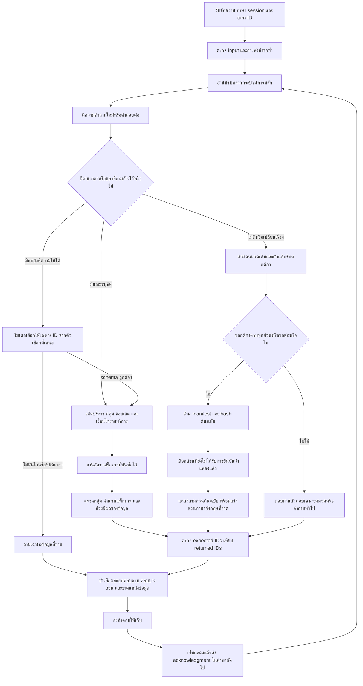

# Flow ที่นำไปพัฒนาแล้ว — r38.5

วันที่ 5 ตุลาคม 2026 / เวลาไทย

เอกสารนี้ต่อจาก [Flow ฉบับออกแบบ](C:/Users/Chokhun/Documents/Codex/2026-09-25/psu-esports-studio-phuket-chatbot-c-2/conversation_reliability_flow_20261005/FLOW_CONVERSATION_RELIABILITY_FINAL.md) โดยคงฉบับเดิมไว้ และปรับตามผลพัฒนา/ทดสอบจริง อ่านผลและข้อจำกัดใน [รายงานรอบนี้](C:/Users/Chokhun/Documents/Codex/2026-09-25/psu-esports-studio-phuket-chatbot-c-2/conversation_reliability_implementation_20261005/IMPLEMENTATION_AND_TEST_REPORT_R38_5_TH.md)

**สถานะ:** ติดตั้งกลไกหลักและทดสอบกรณีในภาพทั้งไทย/อังกฤษแล้ว ยังไม่รับรองทุกสถานการณ์ C01–C32 ว่าผ่านการทดสอบเว็บครบถ้วน โดยเฉพาะการล่มจริง การข้ามเที่ยงคืน และข้อความที่ไม่เคยพบ

## 1. Flow ที่ระบบใช้

## 2. กติกาสำคัญของแต่ละจุด

### 2.1 ก่อนเลือกคำตอบ

- แยก `offered options` จาก `selected targets`: รายการ PC/PS5/VR ในคำตอบของบอทไม่ถือว่าผู้ใช้เลือกแล้ว
- อ่านคำถามสั้นจากงานที่ถามค้างก่อน เช่น “PC” หลังถามราคา เติมบริการให้กับงานราคาเดิม
- คำถามครบประเด็นใหม่ เช่น “VR คืออะไร” หรือ “ไก่กับไข่…” ออกจากบริบทราคาที่ค้าง
- คำว่า “ทั้งหมด” ต้องมีขอบเขต: ไม่มีบริบทให้ถามขอบเขต; อยู่ในคำถามเลือกบริการให้เลือกทุกบริการ; เลือก PC แล้วให้แสดงแพ็กเกจของ PC เว้นแต่ระบุทุกบริการ
- ถ้าไม่ได้ระบุกลุ่มผู้ใช้ การแสดงตารางอัตราที่มีพร้อมชื่อกลุ่มไม่ใช่การตัดสินคุณสมบัติผู้ใช้ กรณีคำนวณยอดเฉพาะบุคคลยังต้องเลือกสิทธิ์ให้ชัด
- รักษาตัวเลข วัน เวลา และข้อยกเว้น ไม่ใช้ fuzzy matching เปลี่ยนค่าพวกนี้

### 2.2 การเข้าใจสำนวนและพิมพ์ผิด

1. ใช้ normalization และบริการที่ระบุชัดก่อน
2. ใช้ fuzzy match แบบมี threshold/margin สำหรับชื่อบริการสั้นที่ไม่มีตัวเลข เช่น `cockpik`
3. ถ้าคำตอบต่อยังไม่ชัด ใช้โมเดลหนึ่งครั้งภายใน deadline เพื่อเลือก **ID บริการที่บอทเสนอไว้เท่านั้น**
4. รับเฉพาะ schema ที่อนุญาต โมเดลเพิ่มราคา กลุ่มผู้ใช้ หรือบริการใหม่ไม่ได้
5. โมเดลตอบ null / schema ผิด / หมดเวลา ให้ถามจุดที่ยังขาด

โมเดลช่วยตีความคำตอบต่อ ไม่ได้เป็นแหล่งข้อมูลราคา การเลือก ID สำเร็จไม่ใช่หลักฐานว่าราคาใช้อยู่ในปัจจุบัน

### 2.3 ราคา

- บุคคลภายนอกที่ไม่ระบุคุณสมบัติ: แสดง General Student และ General Adult พร้อมเงื่อนไข
- บุคคลทั่วไปที่ระบุชัด: แสดง Adult เท่านั้น
- นักศึกษาต่างสถาบันที่ระบุชัด: แสดง Student เท่านั้น
- “ไม่ใช่นักศึกษา” หลังบริบทบุคคลภายนอก: เปลี่ยนเป็น Adult ไม่จับคำว่า “นักศึกษา” เป็นด้านบวก
- คำนวณ PC 2 ชั่วโมง และ VR 30 นาทีจาก duration ของแต่ละ target
- ไม่คูณราคาแพ็กเกจเป็นราคาต่อหัวเอง และไม่เอาระยะเวลาคิดราคาของ VR มาปนกับการครอง slot จอง
- ใช้รายการแพ็กเกจจากข้อมูลที่มี: PC, PS5, Nintendo 1–2/3–4 คน, Cockpit, VR 30/60 นาที
- ตรวจ coverage จาก `package_id:group_id`; แสดงข้อจำกัดของแพ็กเกจที่จำนวนคนไม่ตรง
- แยก `temporal_validity` จาก `outcome`: ตอบครบอัตราที่บันทึกไว้ได้ แต่ราคาปัจจุบันยังไม่ยืนยัน

### 2.4 กติกา “ทั้งหมด” และ “ต่อ”

- แยก summary จาก full sections: ส่งสรุปแล้วไม่ถือว่าส่งทุกข้อแล้ว
- ใช้ source manifest, section IDs, game/year guard และ source hash
- ส่งตามลำดับเนื้อหาเป็นหน้า จำกัด 8 หน่วย/ประมาณ 12,000 ตัวอักษร เพื่อให้ตอบภายในเวลาของเว็บ
- หน่วยเนื้อหาอาจรวมตาราง แผนที่ และรายการลงโทษ ไม่ตัดบรรทัดที่มีความหมายเพราะสั้นหรือไม่ใช่ภาษาไทย
- หน้าที่สำเร็จสะสม coverage แยกจาก window ของ chat history
- acknowledgment จาก session เดียวกันเท่านั้นทำให้ส่วนที่แสดงแล้วเดินหน้าได้
- ถ้าการส่งไม่แน่ชัด ให้ส่งส่วนเดิมซ้ำอย่างระมัดระวัง
- source hash เปลี่ยนต้องเริ่ม ledger ตามฉบับใหม่และแจ้งการเปลี่ยน
- ภาษาอังกฤษที่ไม่มีเนื้อหาครบให้แจ้ง gap เฉพาะส่วน ไม่เอากติกาเกมอื่นมาทดแทน

### 2.5 การส่งคำขอและความจำ

- กระบวนการหลักเป็นผู้เก็บ session และ typed plan ก่อนส่งให้ worker
- เก็บบริบท 30 นาที จำกัดจำนวน session/turns; การเปลี่ยน worker ไม่ล้างบริบทใน parent
- turn ID เดิมและข้อความ/ภาษาคำขอเดิมคืนคำตอบเดิม ไม่เพิ่มประวัติซ้ำ
- turn ID เดิมแต่ข้อความเปลี่ยนเป็น conflict; ไม่รับผลล่าช้าทับ revision ใหม่
- เว็บสร้าง turn ID หนึ่งครั้งต่อข้อความ และใช้เดิมเมื่อ retry
- Auto language ใช้ภาษาจากบริบท parent แต่ fingerprint ของ retry ยึดภาษาที่ร้องขอเดิม
- การล้างแชทเริ่ม session ใหม่ การหยุด server ไม่เก็บ ledger ทั้งหมดถาวร

## 3. การปรับ Flow หลังพบปัญหาในรอบนี้

| พบระหว่างทำ | ปรับ Flow/โค้ด | ผลที่ตรวจ |
|---|---|---|
| “ทุกเครื่องเลย” ถูก fuzzy match เป็นบริการเดียว | ให้ all scope มาก่อน fuzzy matching | ได้ครบทุกบริการตามกลุ่ม |
| คำถามกติกาเริ่มจากรายละเอียดทั้งหมด แล้ว “ต่อ” ไม่มีชื่อเกม | ใช้ metadata ของคำตอบที่แสดงจริงประกอบบริบท | ต่อหน้า TH/EN ผ่านเว็บ |
| coverage เดินหน้าก่อนรู้ว่าผู้ใช้เห็นคำตอบ | รับ acknowledgment ก่อนอ่าน history | ไม่ข้ามหน้าในเคสตรวจ |
| รายการแผนที่/แบนถาวรหายจาก manifest | เก็บหน่วยเนื้อหาที่มีความหมาย ไม่กรองจากภาษา/ความยาวอย่างเดียว | เดินครบ manifest ทั้ง 4 เกมใน unit tests |
| คำถามทั่วไป EN ติด token limit แม้มีสองประโยคสมบูรณ์แล้ว | รับ prefix สมบูรณ์ที่ผ่านข้อกำหนดคำตอบสั้น; fragment ยังถูกปฏิเสธ | ผ่าน unit และโมเดลจริง |
| Auto → PC → เปลี่ยนภาษา → retry ผิด fingerprint | แยก requested locale จาก effective locale | replay ID/ภาษาเดิมผ่านเว็บ |
| เปิดชุดใหม่แล้วอาจได้บอทเก่าที่ 8090 | ตรวจ runtime version และ installation hash; เลือกพอร์ตว่าง | r38.5 ที่ 8093; เปิดซ้ำ reuse ตัวเดิม |

พบเพิ่มจากการแตก ZIP และเว็บรอบท้าย:

- ประโยคราคาใหม่ที่ยังอยู่ในบริบทราคาเดิม เช่น “I'd like the cockpit rate instead” ต้องคงกลุ่มผู้ใช้ที่ไม่ได้เปลี่ยน แม้ไม่มีคำว่า and/what about; คำสั่ง reset/new question ออกจากการสืบทอดกลุ่มได้ และค่าที่ผู้ใช้ระบุใหม่มีสิทธิ์แทนค่าเดิม
- `every/each section/clause/rule` เป็น full scope โดยผูกกับคำขอกติกา ไม่ตีความ “Every PC is available” เป็นกติกาฉบับเต็ม
- คำว่า rulebook/tournament/competition ต้องส่งให้ตัวจัดหมวดกติกาเดิมก่อน all-scope clarification ของราคา
- การตรวจตัวตอบแยกส่วนยังไม่พอ: เพิ่ม assertion ผ่าน pipeline และเว็บสำหรับเคสที่เคยถูกดักก่อนถึงตัวตอบ

## 4. สถานะตรวจตาม C01–C32

“ผ่านเคสตรวจ” หมายถึงมี assertion ตามกรณีที่บันทึก ไม่ใช่รับรองทุกสำนวนในครอบครัวนั้น

| ID | สถานะรอบนี้ | ขอบเขตหลักฐาน |
|---|---|---|
| C01–C05 | ผ่านเคสตรวจ | PC/all/คำเลือกบริการหลายแบบ/Nintendo TH/EN; บางสำนวนผ่านเว็บด้วย |
| C06–C08 | ผ่านเคสตรวจ | filter Adult/Student และเปลี่ยนบริการโดยคงกลุ่ม |
| C09–C10 | ผ่านเคสตรวจ | duration ราย target และ negation/correction |
| C11–C12 | ผ่านเคสตรวจ | เปลี่ยน topic จากราคา; ไม่ติดงานเดิม |
| C13 | ผ่านเคสตรวจ | all ไม่มีบริบทถาม scope |
| C14 | ตรวจพฤติกรรมบางส่วน | ไม่เดาสิทธิ์รายบุคคล; แสดงตารางกลุ่มที่บันทึกเมื่อถามทุกบริการ; ยังไม่มีเว็บครบทุกความกำกวมสองมิติ |
| C15–C17 | ผ่านเคสตรวจ | full sections/summary/continuation; เดินครบ manifest ด้วย unit tests และต่อหน้า TH/EN บนเว็บ |
| C18 | ผ่าน unit | เปลี่ยน source release จำลอง; ยังไม่แก้ต้นฉบับจริงขณะเว็บใช้งาน |
| C19 | ผ่านเคสตรวจ | ราคา + วิธีจองสอง tasks TH/EN รวมเว็บ |
| C20 | ตรวจบางส่วน | ส่วนวิธีจองไม่มีผลลัพธ์จำลองแล้วราคายังอยู่; ไม่ได้ฉีด timeout จริงทุก adapter |
| C21 | ตรวจบางส่วน | parent เก็บ PC ก่อนสำเร็จ; เว็บมี worker recycle; ยังไม่ได้บังคับ worker crash/hang จริงทุกจังหวะ |
| C22 | ผ่านเคสตรวจ | same-turn replay/conflict, stale revision unit และ Auto retry เว็บ |
| C23 | ตรวจบางส่วน | history/schema guards; ยังไม่มีการฉีดข้อความถูกปฏิเสธครบทุก guard บนเว็บ |
| C24 | ผ่าน unit | session isolation, TTL และ clear logic; ไม่มี multi-device persistence |
| C25 | ผ่านเคสตรวจ | recorded expiry ไม่รับรอง current; เจ้าของยังต้องยืนยันอัตรา |
| C26 | regression เดิมผ่านบางขอบเขต | fixture/calendar เดิม; ยังไม่มีหลักฐาน WordPress จริงหรือการข้ามเที่ยงคืน E2E รอบนี้ |
| C27 | ตรวจแยกส่วน | ราคา VR 30 นาทีและ booking fixture; ยังไม่ทำ E2E เชื่อมยอดราคา+slot ทุกเคส |
| C28 | ผ่านคำถามที่ตรวจ | ไก่กับไข่ TH/EN ไม่ตกไป clarification ของศูนย์; ไม่ใช่ human evaluation คำถามทั่วไปทั้งหมด |
| C29 | ยังไม่ครอบคลุมครบ | general ที่มีชื่อ PC และคำศัพท์ PSU หลายสำนวนยังควรเก็บชุดใหม่ |
| C30 | ตรวจบางส่วน | cockpik/สำนวนเลือกบริการ; ไม่ได้รัน noise corpus ไทย/อังกฤษทั้งหมดใหม่ |
| C31 | ผ่านกลไกแจ้ง gap | RoV EN ยังมีหนึ่งส่วนขาดจริง ต้องแก้ข้อมูลก่อนนับ full English complete |
| C32 | ผ่าน unit + ack เว็บ | uncertain delivery ย้อนส่งส่วนเดิม; ไม่ได้ตัด network/browser จริงทุกจังหวะ |

## 5. ลำดับพัฒนาที่เหลือ

1. **ข้อมูล:** ยืนยันช่วงราคาใช้งานปัจจุบัน แก้ต้นฉบับ RoV ส่วนบทลงโทษ และตัดสินข้อขัดแย้ง pause ของ Tekken
2. **ความทนทาน:** fault tests เฉพาะ C20/C21/C23/C32 ที่ยังขาด พร้อมเก็บ state ก่อน/หลังและผลที่ผู้ใช้เห็น
3. **ความหมาย:** เพิ่มชุดคำถามไม่เคยใช้พัฒนา โดยเน้น general ที่มีชื่อบริการ การกำกวมสองมิติ และ typo หลายส่วน ไม่ปรับ threshold เพื่อผ่านเฉพาะคำถามเก่า
4. **แหล่งสด:** เมื่อเก็บข้อมูลจริงได้ จับคู่ snapshot WordPress กับสถานะจองที่รู้ผลจริงและเวลาไทยของคำขอ การเชื่อม API ผ่านไม่ถือว่าตอบว่างถูกต้อง
5. **ความจำถาวร:** เพิ่ม storage เมื่อมีความต้องการข้าม restart/อุปกรณ์จริง พร้อมกำหนดอายุข้อมูลและสิทธิ์เข้าถึงก่อน
6. **Generalized plan:** ขยาย schema/coverage ไปยังหลายงาน games/rules/availability โดยรักษาขอบเขตและ snapshot ร่วมกัน ชุดนี้พัฒนา typed plan ราคา+วิธีจองและ ledger กติกาก่อน

## 6. Gate ของชุดส่งมอบ

- Functional suite ใหม่ฉบับสุดท้าย 23 methods ผ่าน
- Regression ที่เลือก 70 tests ผ่าน; smoke ราคา/booking 4 checks และ PC 5 checks ผ่าน
- Smoke สองตัวที่มี expectation เดิมไม่ผ่านเหมือน baseline แยกไว้ในรายงาน
- เว็บ r38.2 30/30 เงื่อนไขจาก 36 requests ผ่าน; ชุดสุดท้าย r38.5 10/10 จาก 15 requests ผ่าน; ไฟล์แตก ZIP ตรวจ 10/10 เคสผ่านทั้ง pipeline
- หน้าจอเว็บ r38.5 แสดงคำตอบ PC ของบุคคลภายนอกจริง
- ตัวเปิดตรวจรุ่น/โฟลเดอร์ถูกต้องและ reuse instance เดิมผ่าน
- ZIP ตรวจ CRC และ hash โค้ด app/web ที่เปลี่ยนเทียบ source ผ่าน; ไม่ใส่ log ของผู้ใช้ลง ZIP
- ยังไม่ผ่าน owner confirmation/ชุดตรวจข้อเท็จจริงทุกหมวด/ข้อมูลจองจริงตามรายการข้างบน
