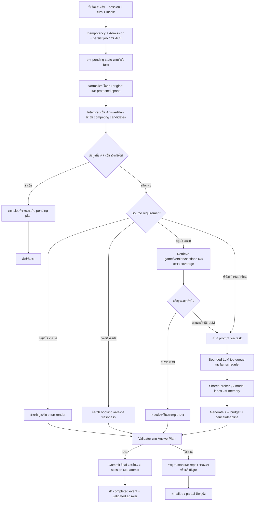

# Flow พัฒนา: ตอบตรงคำถามและรองรับหลายคำขอ

วันที่ 2026-10-09 · แผนจากหลักฐาน r51 และ literature review · ยังไม่ได้ลงโค้ดในรอบวิจัยนี้

## 0. เป้าหมายและกติกาตัดสินใจ

ผู้ใช้ถามได้หลายสำนวน พิมพ์ผิด และตอบคำถามต่อเนื่องด้วยข้อความสั้น ระบบต้องคงเจตนา/slots เลือกข้อมูลที่ตรง และตอบครบตามส่วนที่ขอ เมื่อคนถามพร้อมกันต้องรับงานภายใน capacity แจ้งความคืบหน้า และไม่ให้ข้อความผิดผ่านเพียงเพื่อทำเวลาสวย

เริ่มจาก source จริงในโปรเจกต์ ทดลองใน candidate แยกชื่อรุ่น เก็บ Git status, hash ไฟล์ที่แก้, source snapshot และผลก่อน/หลังในโฟลเดอร์ใหม่ ขอสิทธิ์เขียน ROOT ผ่านระบบก่อนแก้หากสิทธิ์ยังไม่ครอบคลุม ไม่ copy candidate ทับ release หรือ log เดิม

### นิยามความสำเร็จ

- transport_success: ส่ง HTTP/events ได้
- model_done: provider จบ stream
- plan_correct: intent/entities/slots/scope ถูกตาม fixture
- answer_complete: ครบส่วน/จำนวน/ความยาวที่ตกลงรองรับ
- fact_supported: ข้อเท็จจริงศูนย์มีหลักฐานและ source version
- semantic_correct: ตอบประเด็นถูกตาม oracle/rubric
- within_slo: จบใน deadline ที่กำหนดโดยนับคิวด้วย
- validated_goodput: จำนวนงานที่ผ่านเกณฑ์ทั้งหมดที่ใช้กับงานนั้นและทัน SLO ต่อวินาที

HTTP 200 หรือ done=true ไม่แทนเกณฑ์อื่น score แบบคงที่ 0.58/0.30 ในรุ่นเดิมไม่ใช่ probability ของความถูกต้อง

## 1. ภาพรวมเส้นทางใหม่



Progress event queued/running/validating อยู่ข้างเส้นทางนี้และส่งได้โดยไม่ต้องรอ final ข้อเท็จจริงของศูนย์ Admission ชั้นหน้าและคิวของ LLM เป็นคนละชั้น: งานต้อง persist ก่อน ACK แล้วทุกการเรียกโมเดลระหว่าง interpretation/retrieval/repair ต้องผ่าน shared broker ด้วย ไม่ปล่อย intent assist ใช้ GPU นอกคิวที่กำหนดในภาพ

## 2. P0 — สร้างหลักฐานที่ตามคำขอได้

**ไฟล์เริ่มตรวจ:** app/web_api/server.py, app/web_api/pipeline_supervisor.py, app/pipeline/llm_health.py, app/pipeline/experimental_fallback.py, web_chat/chat_request.js

1. สร้าง request_id/job_id/session_id แบบไม่บันทึกข้อมูลส่วนตัวเกินจำเป็น และ turn_sequence
2. เวลาใช้ monotonic: arrived, admitted, queue_enter, worker_start, interpretation_end, retrieval_end, model_enter, first_token, model_done, validation_end, final_sent
3. เก็บ task/domain/slots พร้อมเหตุผลว่า slot มาจากข้อความปัจจุบันหรือบริบทก่อนหน้า
4. เก็บ candidate ที่ชนะและรอง พร้อม lexical/semantic/rule evidence แยก ไม่สร้าง probability รวมแบบไม่มี calibration
5. เก็บ prompt token count/output count, requested length, effective cap, profile, source IDs/versions, finish_reason และ validation reason
6. exception ต้องคืน metadata เท่าที่มี timeout_stage/elapsed/queue/model endpoint/attempt; ไม่ทิ้ง llm_call เป็นว่างทั้งหมด
7. error reason codes: admission_full, queue_expired, model_timeout, provider_unavailable, source_missing, evidence_conflict, contract_failed, output_incomplete, cancelled, worker_lost
8. health ต้องรายงาน configured และ effective timeouts ให้ตรงกับ trace ระบุที่มาของ setting

**เกณฑ์ผ่าน:** fixture timeout/source missing/contract reject มี reason คนละตัวและ UI คนละข้อความ trace ครบแม้ provider ไม่ส่ง token; health ไม่แสดง 4s เป็นเวลาจริงขณะที่ใช้งาน 15s โดยไม่มีคำอธิบาย

## 3. P0 — เข้าใจเจตนาและบริบทก่อนเปิด guard

**ไฟล์เริ่มตรวจ:** app/session/conversation_plan.py, app/pipeline/protected_intents.py:173 และ :274, app/pipeline/zone_rental.py, app/pipeline/query_signals.py, engine ที่เรียก English direct renderer, pending state ของ session

### AnswerPlan

```json
{
  "domain": "service_price",
  "task": "list",
  "entities": {"service": "PC", "game": null},
  "slots": {"user_group": "external", "date": null, "time": null},
  "scope": "selected_service",
  "requested_sections": ["fees"],
  "requested_length": {"kind": "default", "value": null},
  "source_requirement": "owner_confirmed",
  "pending": null,
  "provenance": {"user_group": "previous_turn", "service": "current_turn"}
}
```

เป็น schema ข้อเสนอ ต้องปรับให้เข้ากับโครงสร้างจริง ห้ามนำ null/date ตัวอย่างไปเปลี่ยน policy

### วิธีตัดสิน

1. อ่าน pending question ที่ยังไม่หมดอายุของ session เดียวกัน
2. ถ้าคำตอบสั้นเติม slot ที่ถามได้ ให้ resolve plan เดิมก่อน standalone routing เช่น external price → PC
3. “ทั้งหมด/all” รับได้เมื่อผูกกับ topic จาก turn ปัจจุบันหรือ pending plan เท่านั้น
4. “each box/each protocol/both TCP and UDP” ให้ scope เป็น entity set ของงานนั้น
5. price candidate ต้องมี payment/fee meaning ไม่ให้ rate เดี่ยวชน frame rate/refresh rate/data rate ตรวจทุก detector: protected_intents.py ใช้ rate เป็นทั้ง price และ usage จึงไม่ควรนับคำเดียวเป็นหลักฐานอิสระสองด้าน การแก้ conversation_plan.py จุดเดียวไม่ครอบคลุม guard นี้
6. translation/quoted source-language text มาก่อน wrong keyboard-layout guard; layout check ต้องมีหลักฐาน conversion ที่สมเหตุสมผลและ margin
7. general tasks ใช้ definition/explanation/comparison/steps/translation/writing/reasoning ร่วมไทยอังกฤษ ไม่ใช้ whitelist ชื่อเรื่องอย่างเดียว
8. การแก้ typo เสนอ candidate หลายตัวด้วย edit cost/context; คง original และ protected spans ได้แก่ PC1/PC2, เกม, วันที่ เวลา ราคา และข้อความที่จะให้แปล
9. ถ้าไม่มี candidate ที่น่าเชื่อถือ ให้ถามเฉพาะจุด เช่น “หมายถึง Cockpit ใช่ไหม” เมื่อเสี่ยงสับสนชื่อเครื่อง ไม่ถามหมวดทุกเรื่องเสมอ
10. topic switch ชัดเจนต้องสร้าง plan ใหม่; negation เช่น “ไม่ใช่ PC เป็น PS5” แทน slot เก่าโดยคง user group ถ้ายังเป็นคำถามราคาเดิม

**Regression ต้องครอบคลุม:** frame rate/fees; each box/each service; study session/booking session; intended mixed translation/wrong keyboard; ข้อความ “ทั้งหมด” โดยมี/ไม่มีบริบท

**เกณฑ์ผ่าน:** plans ถูกในชุด fixture และ negative controls ห้ามทำให้ fee จริงหลุดเพราะกัน frame rate; แยกภาษาไทย/อังกฤษรายงานผล

หลักการทดสอบ: [CheckList](https://aclanthology.org/2020.acl-main.442/); schema intent/slots หลายภาษา: [MASSIVE](https://aclanthology.org/2023.acl-long.235/); correction ใช้บริบท: [NeuSpell](https://aclanthology.org/2020.emnlp-demos.21/)

## 4. P0 — ใช้ contract เดียวตั้งแต่สร้างถึงส่งคำตอบ

**เริ่มจาก:** generation contract, downstream answer validator, renderer ของคำตอบ English และ experimental_fallback

1. ให้ validator อ่าน AnswerPlan เดิม ห้ามคำนวณ expected answer type ใหม่จาก keyword ของข้อความ final
2. แยก hard checks: ราคา/วันที่/เครื่องตรง source, game/version ตรง, ภาษา output, slots ไม่หาย, content ที่จำเป็น, source requirement
3. แยก soft checks: รูปแบบอ่านง่าย redundancy tone คำอธิบายสั้นมีขั้นตอนเสริมได้ถ้าคำตอบหลักตรง
4. generic fact/explanation สามารถมีสรุปและคำแนะนำประกอบ ไม่ปฏิเสธเพียงเพราะคำศัพท์ how_to/list
5. ถ้า contract ล้มเหลว เก็บ draft/reason ใน artifact ที่เหมาะสม แต่ไม่เผยเป็น final ข้อเท็จจริงของศูนย์
6. deterministic shape repair ได้เมื่อคงเนื้อหา เช่น bullet numbering; semantic repair เรียก LLM ได้จำกัดหนึ่งครั้งภายใน budget เมื่อมีหลักฐานเพียงพอ
7. ข้อเท็จจริงที่ไม่มีใน source ห้าม repair โดยให้โมเดลแต่ง; ตอบส่วนที่มีและระบุส่วนที่ไม่มี

**เกณฑ์ผ่าน:** network latency ที่มีคำอธิบายตรงประเด็นไม่ถูกทิ้งด้วย mismatch เก่า แต่ answer ที่เอา VALORANT มาตอบ CS2 หรือให้ fee ผิด user group ยังถูกกัน

แนวแยก retrieval กับ generation: [Ragas](https://arxiv.org/abs/2309.15217); answerability ที่มี/ไม่มีข้อมูล: [AbstentionBench](https://arxiv.org/abs/2506.09038)

## 5. P1 — ดึงข้อมูลเท่าที่จำเป็นและตอบครบ sections

1. structured fee/booking answers ใช้ reader + renderer เมื่อพอ ไม่ส่งทุกงานไป generate
2. studio rules retrieval filter game/tournament/version ก่อน ranking; section selector อ่าน requested_sections
3. broad “ทั้งหมดของกฎเกม X” ให้ sections จาก manifest ของ source X และ report coverage; ไม่ใช้ top-k คงที่แล้วเรียกครบ
4. source ยังไม่ตรวจจริงต้องอ่านก่อนวาง manifest; จำนวน sections ห้ามเดาจากจำนวน chunks
5. คำถามทั่วไป/แปล/เขียนชัดเจน bypass studio RAG โดยเก็บ route reason; facts ภายในศูนย์ไม่ bypass source requirement
6. context เก็บคำถาม ข้อจำกัด และหลักฐานสำคัญ รวมข้อยกเว้น/เงื่อนไข ลบเอกสารไม่เกี่ยว ไม่บีบตัวเลขราคา/วันเวลา
7. วัด retrieved relevant sections/required sections, source coverage, generated unsupported claims แยกกัน
8. cache มี 3 ชนิดแยก: prompt prefix cache, immutable owner source version cache, live booking snapshot cache มี fetched_at/TTL และกฎ freshness เดิม

แนวคิด [Self-RAG](https://arxiv.org/abs/2310.11511), [CRAG](https://arxiv.org/abs/2401.15884), [Lost in the Middle](https://arxiv.org/abs/2307.03172), [LLMLingua](https://arxiv.org/abs/2310.05736) ใช้เป็นเหตุผลออกแบบ ไม่ลง trained critic/compressor ใหม่ทันที

**เกณฑ์ผ่าน:** scope=all ไม่หาย section ที่ fixture กำหนด; source missing ตอบช่องว่างตรงเกม; booking freshness ไม่ถอยหลัง; general ไม่ได้ source ราคาหรือกฎที่ไม่เกี่ยวข้อง

## 6. P1 — คำตอบยาวไม่ถูกลดเหลือสองประโยค

1. สร้าง profiles ตาม task + requested length + locale เป็นคำตอบสั้น, list/steps, comparison, long explanation
2. จำนวน token วัดจาก tokenizer/provider จริง ไม่เอา 500 คำเท่ากับ 500 token และไม่ใช้ช่องว่างนับคำไทยโดยอัตโนมัติ
3. “สามขั้นตอน” required items=3 พร้อมเนื้อหาแต่ละขั้น; “ทั้งหมด” required coverage มาจาก source manifest
4. คำตอบยาวทำ outline ตามหัวข้อแล้วใช้ budget ที่วัดพอสำหรับโมเดลนี้; quote/source ที่ต้องคงตัวเลขเป็น protected content
5. done_reason=length เป็น warning ให้ completion evaluator ตรวจ ไม่รายงานครบจาก transport; ห้าม continuation แบบไม่จำกัด
6. ถ้า supported cap ไม่พอ ให้สรุปและระบุว่าเป็นสรุป พร้อมตัวเลือกดูรายละเอียดเมื่อทำได้ อย่าบันทึกเป็น request fulfilled สำหรับคำขอ 500 คำ
7. validation ครบก่อน final; ไม่ post-truncate คำตอบยาวเหลือ 2 ประโยคเงียบ ๆ

**เกณฑ์ผ่าน:** จำนวนขั้น/ประโยคตาม fixture; สรุปสั้นที่ผู้ใช้ไม่ได้ขอไม่ผ่าน long instruction; core facts ไม่หายจาก adaptive budgeting

แนวการตรวจคำสั่งอัตโนมัติ: [IFEval](https://arxiv.org/abs/2311.07911)

## 7. P1 — job queue และ protocol ที่ตรวจสถานะได้

### ออกแบบ incremental

คง /api/chat เดิมระหว่างพัฒนา เพิ่ม /api/chat/jobs ที่ candidate และ feature flag เส้นทางใหม่ก่อน เป้าหมายต่อไปนี้เป็น API ข้อเสนอ ยังไม่ได้มีอยู่ในรุ่นจริง

- POST jobs: validate request, idempotency key, persist job, ตอบ 202 + job_id/status_url/event_url
- GET job: แสดงสถานะของ session ที่เป็นเจ้าของ
- GET events: SSE queued/running/validating/completed/failed; event sequence เพื่อ reconnect
- DELETE job: cancel queued หรือส่ง cancel signal ให้ running และรอ provider หยุดจริงก่อนคืน lane
- completed event: validated answer + locale + sources + semantic/completeness status ที่ประเมินได้

### การควบคุมคิว

1. job record เก็บ input, plan/version, session/turn, source version และ timestamps; durable storage แบบ SQLite เป็นตัวเลือกเริ่มต้น ต้องวัด lock contention
2. ACK หลัง persist สำเร็จ ไม่ใช้ 202 ถ้า queue จริงเต็ม; busy มี retry_after และไม่สร้างงานซ้ำ
3. คิวมี global cap และ per-session cap; cap ตัวเลขจากทดลอง ใช้ config มีขอบเขต
4. แยก wait budget/execution deadline/total lifetime; ใช้ absolute deadline ไม่ reset งบทุก retry
5. scheduler มี fairness ต่อ session/client และ aging กัน long starvation การเร่ง short เป็น policy ทดลอง ไม่รับรองว่าไม่มี head of line blocking ของ running request
6. ไม่มี token preemption ถ้า provider ไม่รองรับ; short ที่มาทีหลังยังต้องรอ running long ได้
7. ต่อ session ต้อง serial interpretation/commit หรือใช้ version check เพื่อไม่ให้คำตอบ “PC” ไปเติม clarification ของอีก turn
8. worker restart: job ที่ยังไม่เสร็จเป็น interrupted/retryable เฉพาะงานอ่าน/สร้างที่ปลอดภัย ยืนยัน input/source version และ max attempts; ไม่ทำ side effects ซ้ำ
9. user refresh/retry เชื่อม job เดิม ไม่สั่ง generate ซ้ำผ่าน browser retry
10. คำตอบ final session update เป็น atomic เฉพาะ job/turn/version ที่ยังตรง; cancel/topic-switch ไม่ commit late answer ทับ state ใหม่
11. กำจัด expired result ตาม retention แต่ไม่ลบ research/runtime log เดิม; policy retention ต้องแยกจากการนำงานรอบนี้ไปทดลอง

**เกณฑ์ผ่าน:** งาน queued ไม่หลุดตอน refresh; duplicate request คืน job เดิม; session ไม่ปน; cancel คืน slot หลังหยุดจริง; overload แจ้งตรง ไม่ซ่อนอยู่ใน no_answer

เหตุผล fairness: [VTC](https://arxiv.org/abs/2401.00588); length-aware scheduling/preemption: [FastServe](https://arxiv.org/abs/2305.05920) — ขั้นนี้ประยุกต์ในระดับ request ไม่อ้างว่า implement ทั้ง paper

## 8. P1 — progress และ streaming

ก่อนทำ token streaming ให้ queued/running/validating แสดงได้จริงก่อน เพราะแก้ความรู้สึกเว็บค้างโดยไม่ส่ง facts ที่ยังตรวจไม่ผ่าน

- structured/source facts: สามารถ render ข้อความที่ตรวจครบแล้ว ส่ง final ในครั้งเดียว
- general generated text: ทดลอง preview โดย label ชัด หากนโยบายผลิตภัณฑ์เลือกใช้; final ผ่านตรวจเท่านั้น
- stream events ต้องส่งผ่าน worker IPC ถึง web supervisor ซึ่งรุ่นเดิม result queue รอ final ค่า maxsize=1 ไม่ใช่ stream channel
- รองรับ backpressure, event coalescing, disconnect และ worker watchdog ห้าม token events ทำให้ deadlock/retention โตไม่จำกัด
- client รอ terminal event แยกจาก provider done อย่าเปลี่ยนปุ่มหรือ feedback เป็น completed ตอนยัง validating
- validator ปฏิเสธ preview ให้ UI แทนที่/แจ้งเหตุชัด ไม่เก็บ rejected draft เป็น trusted history

**เกณฑ์ผ่าน:** event order ถูก; disconnect ไม่สร้างงานเพิ่ม; final เท่ากับคำตอบที่ validator ยอมรับ; queue time และ TTFT จริงไม่ถูกแทนด้วย ACK latency

รายละเอียด provider NDJSON: [Ollama Streaming](https://docs.ollama.com/api/streaming)

## 9. P2 — ทดลอง parallel 2 บนเครื่องนี้

**เงื่อนไขก่อนเริ่ม:** P0 ผ่าน; baseline 1 lane รันชุด targeted ได้; มี memory headroom ที่วัดขณะทดลอง

1. แยก CPU/I/O executor จาก shared LLM broker ไม่ปล่อย /api/chat ทั้งหมดล็อครอ GPU ตัวเดียว
2. ทั้ง intent assist/generation/repair ผ่าน broker เดียวและนับจำนวน actual provider calls
3. สร้าง owned Ollama runtime พอร์ตแยก ตรวจพอร์ตว่างและ process ownership ห้ามหยุด user Ollama ที่ 11434
4. ตั้ง server OLLAMA_NUM_PARALLEL ก่อนเริ่ม และตรวจ runtime ใช้จริง; app/client env อย่างเดียวไม่มีผลกับ server เก่า
5. A baseline parallel=1, B parallel=2 โดย model/version/ctx/temp/output budget/workload เดียวกัน ไม่เปิดสอง runtime benchmark ทับกัน
6. ไม่เพิ่ม BGE/LLM replica เพียงเพื่อเพิ่ม worker; วัดโมเดลที่โหลดจริงจาก API ไม่เชื่อชื่อ alias ของ quantization
7. warmup/cache policy เหมือนกัน; randomized or alternating runs หลังยืนยัน memory ไม่ใกล้เต็ม; บันทึก load duration และ first-observed effect
8. ctx เริ่มค่าที่ระบบใช้อยู่ 3072; หากลดเพื่อเทียบ memory เป็น experiment แยกที่ต้องตรวจ context truncation
9. ทดลอง KV cache q8 หรือ Flash Attention แยกจาก parallel change ทีหลัง โดยตรวจ support/คุณภาพ ไม่เปลี่ยนสามอย่างพร้อมกัน
10. เกณฑ์หยุด: OOM, CPU fallback ที่ทำเวลาแย่, timeout เพิ่ม, quality regression, resource pressure ต่อโปรแกรมอื่น; rollback candidate profile ทันที

**เกณฑ์เลือก B:** validated_goodput เพิ่ม โดยไม่ทำให้ quality/within_slo และ p95 งานสั้นแย่เกินเกณฑ์ที่กำหนดก่อนวัด peak memory อยู่ในงบจริง หากไม่ผ่านคง 1 lane และใช้ queue/service capacity ที่วัดได้

หลักการ engine: [Orca](https://www.usenix.org/system/files/osdi22-yu.pdf), [PagedAttention](https://arxiv.org/abs/2309.06180), [Sarathi-Serve](https://www.usenix.org/system/files/osdi24-agrawal.pdf), [Fluid-Guided Scheduling](https://arxiv.org/abs/2504.11320)

**หมายเหตุ:** OLLAMA_MAX_QUEUE ไม่เพิ่ม GPU throughput; ตัว limiter ใน llm_health.py เป็น per-process ต้องไม่อ้างว่า limit=2 ในหลาย processes เป็น global=2

## 10. P3 — เมื่อจำเป็นต้องเปลี่ยน engine/เครื่อง

พิจารณา vLLM/SGLang เป็น candidate แยก เมื่อการทดลองพบกำลังประมวลผลไม่พอและมี hardware/deployment ที่รองรับ ตรวจ model format/quantization, Windows/package dependencies, startup, endpoint compatibility, structured output และ quality ก่อน

DistServe ต้องแยก GPU จึงเป็นแนวทาง server หลาย GPU อนาคต ไม่ใช่การแก้เล็กใน Windows folder ปัจจุบัน Prefix cache ช่วย prefill แต่ไม่ทำให้ decode 512 token หายไป

เรื่อง speculative decoding ยังไม่อยู่ในลำดับแรก เพราะเพิ่ม draft model/ความซับซ้อน และยังไม่มีผลวัดตรงกับระบบนี้ เปรียบเทียบ engine ด้วย workload ของศูนย์ ไม่ใช้ benchmark multiplier ในบทความมาเป็นผลของเรา

## 11. ชุด targeted tests และการวิเคราะห์

### A. Functional families ที่ต้องมี oracle

| Family | ตัวอย่าง positive | negative / สิ่งที่ต้องรักษา |
|---|---|---|
| Fee vs technical rate | ราคา PC ภายนอก / PC hourly fee | high frame rate / refresh rate / data rate ไม่เป็นราคา |
| All/each/both | ราคาแต่ละอุปกรณ์ / fees for every service | each box / each protocol ไม่เป็น scope บริการ |
| Pending fee | external fee → PC | user group ไม่หาย; ไม่ดึง intent เกมแทน |
| Pending all | external fee → ทั้งหมด / all | ครบ service IDs จากข้อมูลจริง; ไม่มีบริบทถามว่าหมวดไหนได้ |
| Correction | external PC → ไม่ใช่ PC เอา PS5 | slot replace; ราคาของหมวดเก่าไม่หลง |
| Translation | Translate “ข้อความไทย” into English | quoted text ไม่โดน layout correction |
| General steps | Give 3 touch typing steps / ขอ 3 ขั้นตอน | จำนวนครบ + ไม่ใช้การคลิกปุ่มแทนฝึกพิมพ์ |
| Writing | Write a 2-sentence study invitation | study session ไม่เป็น reservation; ไม่แต่งกิจกรรมศูนย์ |
| Explanation | Explain latency with one brief tip | คำแนะนำเสริมไม่ทำให้ expected/actual mismatch |
| Simple reasoning | A3 B5 move2 B→A | A5 B3; each box ไม่ scope service |
| Rules identity | กฎเกม X section Y / all sections | game/version ตรง; missing source ไม่ยืมเกมอื่น |
| Booking fresh | อุปกรณ์ว่างตอนเวลา X | oracle fixture known available/booked; fetched successfully ≠ status correct |
| Completion | short vs 3 steps vs long | done=length ไม่ผ่านโดยอัตโนมัติ |
| Operational error | timeout / queue full / source absent | คนละ reason และคนละข้อความ UI |

ต่อ family ทำไทยอังกฤษและสำนวนใหม่ 4–6 แบบ พร้อม typo/double/delete/transpose บางส่วนที่คงความหมายได้ รวมหลาย turn แยก from single turn จำนวนรวมคำนวณจาก fixture ที่สร้างจริง ไม่อ้างว่ารันแล้วหรือจำเป็นต้อง 20,000

แบ่ง clean vs noisy และ seen template vs held-out wording ห้าม variant ของ source เดียวกันกระจาย train/test จนผลสูงเพราะ leakage Noise ที่เปลี่ยน PC1→PC2 หรือ 10:00→11:00 ไม่ใช่ label-preserving typo; เป็น slot-change test ที่ควรเปลี่ยนคำตอบ

### B. Load workloads

1. router-only deterministic answers เพื่อวัดการปิดกั้นงานเร็วโดย LLM
2. direct model short128/medium256/long512+ตาม budget ใหม่ ยืนยันความครบด้วย ไม่เรียก 512 ว่า 500 คำ
3. actual web ไทยอังกฤษสมดุล ใช้ fixtures ที่เข้า generation จริง ไม่มีการนับ intent LLM เป็น answer generation
4. mixed short/long, long input, repeated prefix, unique prefix, booking + LLM
5. 1/2/3/4/6 concurrent แบบ burst จากนั้น sustained arrival แยกอัตราตามกำลัง baseline
6. ทดสอบ duplicate/cancel/reconnect/worker restart แยกจาก capacity measurement เพื่อไม่ทำให้ผล latency ปน
7. บันทึก attempted/admitted/completed/rejected/failed/cancelled/within_slo และ all latency ไม่รายงานแต่ผู้รอด

แต่ละ candidate เปลี่ยนตัวแปรหลักหนึ่งอย่าง ทำซ้ำให้พอเห็น tail และ variability แล้วหยุด optional testing เมื่อความเสี่ยงเฉพาะแก้ครบ อย่าใช้ full regression 20k แทนการหาสาเหตุ

### C. Metrics

- p50/p95/p99 เมื่อ sample พอ; sample น้อยระบุ nearest rank/max และไม่สรุป capacity ระยะยาว
- admission ACK latency, queue wait, TTFT, TPOT, end-to-end final, validation time แยก
- tokens/s รวมและต่อคำขอ, validated_goodput, output truncation, semantic/content pass
- TH/EN/mixed language, task/scope/length ตามกลุ่ม; average เดียวอาจซ่อนปัญหา
- CPU/GPU/RAM peak, spill/fallback, modelload/cache effects, process recycle

เป้าหมายทดลองเบื้องต้น: ACK p95 ≤1s; ไม่มี session contamination/duplicate execution ที่ไม่ควรเกิด; fixture P0 ทุกแบบต้องผ่านก่อนทดลอง capacity ค่า final SLO กำหนดแยก short/long หลัง baseline ไม่ใช้ 20s ครอบทุกงานโดยเดา

## 12. Loop ที่ทำต่อได้จริง

1. Freeze evidence / candidate
2. Reproduce family ที่ผิดและเก็บ oracle
3. Classify stage: interpret / source / generation / validation / queue / UI
4. แก้จุดเดียวจากหลักฐาน
5. Run targeted positive + negative + held-out paraphrase
6. Compare correctness และเวลาตาม denominator เดียวกัน
7. ถ้ายังผิด อ่าน trace ใหม่และอัปเดต Flow พร้อมเหตุผล ไม่เพิ่ม alias แบบรายประโยคให้ผ่าน fixture
8. ถ้าระบุ cause ไม่ได้ เพิ่ม observation ก่อนเปลี่ยน threshold
9. เมื่อ family ผ่าน และ neighboring tasks ไม่ถอย ทำ candidate ถัดไป
10. Release ด้วย changelog, rollback profile, artifacts; ยังต้องแยก owner-confirmed facts กับ automatic pass

## 13. ตรวจทาน Flow ก่อนส่ง

- แก้การจับคำผิดก่อนเพิ่ม throughput
- scope/negation/pending state อยู่ใน schema เดียว
- same-session ordering และ late commit ถูกคิดไว้
- global model admission ไม่พึ่ง threading semaphore หลาย process
- คิว bounded และ overloaded behavior ชัด
- cancel ปล่อย lane หลัง provider หยุดจริง
- streaming final หลัง validation, progress ไม่ใช่ final
- cache freshness ไม่แอบเปลี่ยน booking policy
- long answer นับ completeness แยกจากความเร็ว
- วิธีวิจัย datacenter ไม่สรุปใช้ได้ทันทีบน GPU 6GB
- เพิ่ม worker queue wait ต้องตรวจ clamp5s และ parent/child deadlines
- ทุกข้อที่ยังไม่มี source ต้องระบุ gap ไม่สร้างนโยบายเอง

**ผลตรวจทาน:** แผนก่อนหน้าที่เน้นเพิ่มคิว/worker ถูกเสริมด้วย task/slot correctness, shared broker, output completion, fairness, cancellation และ validated goodput แล้ว ผลหลังลงมือยังต้องวัดจริง
