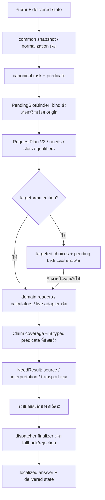

# R100 — Flow ที่ลงมือจาก R97 ของ Astra และข้อเสนอ R99

สถานะ: candidate แยกจาก R98 และระบบติดตั้งจริง ไม่ใช่การประกาศว่า Flow R97 ย้ายครบทุกหมวดแล้ว

## 1. ทางเดินที่เปลี่ยนจริง

ชั้นรับคำถามนอก migrated dispatcher เช่น input-quality/scope guard บางทางของ engine ยังไม่ได้ย้ายเป็น business NeedResult ในรอบนี้ และ generic semantic planning ทุก domain ยังไม่ได้แทนของเดิมทั้งหมด

## 2. Canonical vocabulary และผลราย Need

### โค้ดใหม่

- `intent_contracts.py`: ใช้ task IDs ของ `task_contracts.TASKS` และ predicates ที่แยกความหมาย
- `result_contract.py`: finalizer/status adapter สำหรับ common dispatcher รวม rejection/fallback
- `claim_coverage.py`: ตรวจ typed predicate แยกจากความถูกต้องของ source pointers

### ความแตกต่างจาก R98

R98 มี plan wrapper แต่ยัง map `response_type=answer` เป็น supported ได้ทันที R100 แยก:

- `supported`: typed predicate contract ที่ implemented มีหลักฐานตรงชนิด/subject ตามที่ตรวจได้
- `scope_unverified`: compatibility reader ยังไม่ได้ผ่าน predicate contract ใหม่ ไม่ตีความว่าผิดหรือไม่มีข้อมูล
- `partial_supported`: คำตอบบางส่วนที่ระบุข้อจำกัด
- `needs_user_slot`, `ambiguous_interpretation`, `missing_source`, `broken_relation`, `not_current`, `live_unavailable`, `temporary_failure`

**supported ในที่นี้ไม่เท่ากับ independent human/LLM adjudication** ทุก receipt ยังตั้ง `semantic_correctness_verified=false` / ไม่อ้างพิสูจน์ความหมายทุกประโยค

Typed checks ที่ทำแล้ว: game summary, center location, game-mode count relation, current rate/effective period, service schedule/closing/bookable predicates, booking steps และ game-service offering relation

เมื่อนำหลาย child results มารวม จะ remap need_id ใน receipts ทั้งชั้นบนและ coverage ไปเป็น Need ID ของ parent request ไม่ปล่อย child-local n1 ของหลายส่วนปะปนกัน

ตัวอย่าง guard ที่ทดสอบ: source FAQ วิธีจองมี pointers ถูกต้อง แต่เมื่อฉีดเป็นคำตอบของ “What times can I book?” ต้องถูกปฏิเสธ ไม่ปล่อยให้ citation ที่ถูกใช้รับรองคำตอบคนละเรื่อง

### ข้อจำกัด

- Receipts ยังเน้น field/revision/validity/source reference พร้อม predicate binding ไม่ใช่ typed claim packet เต็มรูปแบบสำหรับทุกข้อความและหน่วย
- FAQ/policy prose ที่ยังไม่มี declared predicate support คงเป็น scope_unverified หรือ partial ตาม reader ไม่ถูกทำให้ supported โดยเดา
- Status counts ใหม่เทียบ R98 แบบตรงจำนวนไม่ได้ เพราะ R100 เลิกเรียก compatibility answer ทุกชนิดว่า supported อัตโนมัติ

## 3. PendingSlotBinder และ provenance

ไฟล์ใหม่ `pending_bindings.py` ใช้ `followup_scope.delivered_state` เป็นทางเข้าบริบท และ `dialogue.previous_state` เปลี่ยนมาใช้ trusted latest state เดียวกัน

### ราคา service

- PC/ชื่อบริการ/all/option 2 ต้อง match pending service selector จริง
- service ที่ผู้ใช้เลือกมี origin=current_user; task/audience/duration ที่สืบทอดมี origin=delivered_state
- ordinal ใช้ลำดับรายการที่เคยส่ง หากสมาชิกถูกถอนจะไม่เลื่อนให้หมายถึงคนละรายการ
- คำถามใหม่สั้น ๆ ว่า “ศูนย์อยู่ไหน” ไม่ถูกติด origin ว่าสืบทอดเพราะความยาวสั้นกว่า 35 ตัวอักษร
- ข้อความ assistant ที่ยังส่งไม่สำเร็จใช้ bind ไม่ได้
- latest delivered assistant ที่ไม่มี pending state ทำให้ไม่ขุด pending เก่ากลับมาจากหลาย turns ก่อน

### ราคาเหมา

ใช้ rental parser เดิมเป็น adapter ก่อนตีความคำว่า price แบบทั่วไป เก็บ origin แยก zones/audiences/periods ตามส่วนที่ผู้ใช้เลือกใหม่จริง

นี่แก้ regression ที่พบระหว่างลงโค้ด: “price again” หลังคุยราคาเหมาถูกตีความเป็น current hourly rate แล้ว predicate guard ไปปฏิเสธราคาเหมาที่มี source

### ยังเหลือ

pending contracts ของการแข่งขัน/profile บางชนิดยังใช้ adapter เดิม ไม่ได้รวบทุก state machine มาไว้ใน binder ใหม่ทั้งหมด และ validation ของ state จาก client ต้องรักษา delivery trust boundary ของ API เดิม

## 4. หลาย edition และ unknown game

ไฟล์ `target_selection.py` หา ambiguity จากชื่อ/aliases/title prefixes ใน snapshot ปัจจุบัน ไม่ฝังรายชื่อ franchise ในโค้ด

1. ถ้าชื่อยังตรงหลาย edition ให้ถามตัวเลือกจริงและเก็บ task + original qualified query
2. ผู้ใช้พิมพ์ชื่อ edition อย่างเดียว → แทนเฉพาะ ambiguous mention ด้วยชื่อที่เลือก
3. รักษา original year/conditions/negation จากคำถามแรก ไม่สร้างคำถามสั้นใหม่แล้วทำเงื่อนไขหาย
4. เก็บ raw text ของชื่อที่เลือก พร้อม task origin จาก pending state
5. กรณีระบุ game called/named หรือเกมชื่อ แต่ไม่พบ record ให้สะท้อนชื่อนั้นและบอกขอบเขต catalog ไม่กล่าวว่าเกมไม่มีอยู่ในโลก

Catalog miss มี public kind=no_answer และ mode unknown_target พร้อม source status=missing_source เพื่อไม่ให้ public protocol แปลข้อความปฏิเสธว่าเป็นคำตอบยืนยัน

### Bug ที่จับได้และแก้ระหว่างทำ

- shared alias “call of” เคยชนะชื่อ “Call of Duty”;การแทน alias สั้นทำให้มีคำว่า duty ซ้ำ → รวม title-prefix candidates และเลือก mention ที่ครบกว่า โดยรองรับ colon ของชื่อ edition
- เมื่อเลือก edition แล้ว reader เดิมยังตอบ current offering ให้คำถาม “in 2027” → เพิ่ม temporal applicability rejection ถ้ายังไม่ได้ bind ปีที่ถามกับ read plan

**ขอบเขต temporal guard:** เป็นการป้องกันการอ้าง current inventory/rate ข้ามปีโดยไม่มี temporal read contract ยังไม่ใช่ future-year inventory/price solver; แม้ owner มีข้อมูลอนาคต ก็ต้องมี reader ที่ตรวจ applicability ตรงปีนั้นก่อนตอบยืนยัน

## 5. Booking semantics และ policy actions

### การจอง

แยก predicate ก่อนเลือก reader:

- “How do I book?” → booking_steps
- “Can I use VR without booking?” → booking_required policy ไม่ใช่ขั้นตอนจอง
- “What times can I book?” / “จองได้ช่วงไหน” → bookable_period
- เกม + “ต้องจองอะไร” → game/service offering เป็นคำถามเลือกบริการ ไม่ใช่ขั้นตอนจอง
- live availability ใช้ live adapter เดิม พร้อมสถานะไม่พร้อมที่แยกจาก static procedure

Purpose frame “ถ้าจะเล่น [เกม] ต้องจองอะไร” ยอมรับเมื่อ whole frame ตรง ไม่ใช้การลบ if/ถ้า ทุกกรณีเพื่อให้ผ่าน

คำถามตำแหน่งอุปกรณ์ เช่น Where is the [ชื่อ] located ใช้ equipment_location ตามชนิด subject และยอมรับ determiner ที่เหลือหลัง strip ชื่อ ไม่ส่งไป center_location หรือพึ่งโมเดลเลือก fields โดยไม่จำเป็น

### Policy

`policy_actions.py` อ่าน FAQ consumption ที่ตรง object จาก common เพื่อให้คำตอบบางส่วนได้ แต่ระบุว่า source นี้ยังไม่ยืนยัน bring permission

ตัวอย่าง alcohol: แสดงกฎห้าม consume ที่ source มี พร้อมบอกว่าการนำเข้าเป็นอีก action ไม่อนุมานเองว่าห้ามนำเข้าหรืออนุญาตให้นำเข้า

**ยังไม่ใช่ universal policy entailment:** currently consumption/bring slice และ language object cues ที่ระบุไว้ ไม่ได้แปลงทุก prose policy เป็น structured rules หรือเติม permission fields แทน owner

ระหว่างอ่าน saved outputs พบ bug เดิมอีกข้อ: renderer แสดงคำเตือน quota ต่อวันเมื่อ `scope_limits` มีค่าใด ๆ ทำให้คำตอบ alcohol มีประโยคเรื่องจำนวนรอบจองที่ไม่มี source เกี่ยวข้อง แก้ให้ note นี้แสดงเฉพาะ scope limit ที่ระบุ per_day เทียบ per_booking จริง พร้อม regression check แยก

## 6. Deadline และ model budget

ใช้ `request_deadline` / `reserve_llm_call` / admission เดิม มีการแก้ nested explicit timeout:

- child timeout ไม่ขยาย deadline ของ outer request
- child ที่สั้นลงยังใช้ model-attempt ledger เดิม
- nested call ไม่ reset งบ model เพียงเพราะส่ง timeout ใหม่

default model-call cap เดิมยังเป็น 2 ตาม config ที่มีอยู่ **ยังไม่เปลี่ยนเป็น semantic planning ครั้งเดียวสำหรับทุก Needs** เพราะ generic whole-request semantic planner ของ R97 ยังไม่เสร็จ ไม่สร้าง counter อีกชุดมาซ้อน

## 7. สถานะเทียบ R99

| ประเด็น | สิ่งที่ทำแล้ว | ส่วนที่ยังเหลือ |
|---|---|---|
| P01 shared result | common dispatcher returns/fallback/rejection มี V3 results | outer engine guards/ทุก compatibility contract ยังไม่ครบ |
| P02 canonical tasks | canonical task IDs ใช้ registry เดิม,แยก predicates | task families ที่ต้อง refine จาก implicit context เพิ่ม |
| P03 intent before fields | predicate gate สำหรับ slices สำคัญ | generic grounded semantic RequestPlan ทุก domain |
| P04 slot origins | price/rental/edition selection ใช้ binding จริง | pending kinds อื่นย้ายต่อ |
| P05 qualifiers | เก็บ original query และ guard ปี,แยก purpose frame | generic qualifier coverage/semantic acceptance ยังมีเดิม |
| P06 NeedResult meaning | typed predicate/source checks + scope_unverified | full claim packet/entailment ทุก task |
| P07 read graph | reuse relations และตรวจ game-mode/game-service | generic all_of/any_of graph/dependencies ทุก policy |
| P08 policy actions | bring vs consumption partial source answer | action/actor/condition ครบทุก policy |
| P09 ambiguity | edition choices และ unknown explicit mention | fuzzy/transliterated ambiguity ทุกแบบ |
| P10 complete sets | คง exhaustive price set จาก R98 | universal eligibility claims ยังไม่ครบ |
| P11 reason provenance | source error/store failure/rejection statuses แยก | stage errors ของ adapters ทุกตัว |
| P12 budget | nested deadline/ledger share ตรวจแล้ว | single semantic attempt policy และ whole-request planner |
| P13 owner data | keep forms/registry; lifecycle fixtures ตรวจ | ไม่ได้เปลี่ยน owner UI/task readiness ใหม่ทั้งระบบ |
| P14 verification | เก็บ first-fail/fixes/source manifests และ focused runs | untouched holdout/full test/production rollout |

Semantic proposer เดิมยังมี exact-quote validation ที่อาจปฏิเสธ quote เมื่อโมเดลคัดชื่อด้วยตัวพิมพ์ต่างจาก normalized question นี่เป็นจุดที่ต้องปรับ span binding ของ generic semantic path ต่อ ไม่ใช้การแก้ grammar ของ task หนึ่งเป็นหลักฐานว่า semantic path ทั้งหมดสมบูรณ์แล้ว

ผลตัวเลขและคำตอบที่ยังผิดจริงอยู่ใน `RESULTS_TH.md` ไม่ใช้เอกสารนี้แทนหลักฐาน runtime
