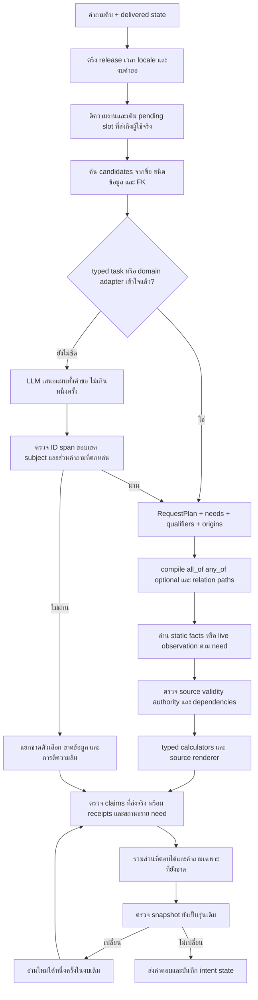

# R101 — ลงมือพัฒนา Flow กลางจาก R97 Flow V2 ของ Astra

## 1. ขอบเขตและความหมายของความครบ

ใช้ R97 Flow V2 ตามที่ผู้ใช้ยืนยันเป็นข้อกำหนด เพิ่มแกนร่วมที่ใช้กับทุก task ใน registry และทุกหมวดฟอร์มทั้ง 24 หมวด ไม่เพิ่มชื่อเกมหรือราคาจริงลงในโค้ดเพื่อให้เคสเดียวผ่าน

ความครบของโค้ดไม่เท่ากับคำถามทุกภาษาและทุก paraphrase จะถูกตีความถูก 100% และไม่ใช่การรับรองข้อเท็จจริงที่ต้นฉบับไม่มี รายงานผลทดสอบแยกจากเอกสารนี้ใน [RESULTS_TH.md](RESULTS_TH.md)

ยังใช้ domain adapters ที่มีอยู่สำหรับการคำนวณราคา ราคาเหมา ข้อกติกาพ่วง การเลือกฉบับ และการติดต่อระบบจอง เพราะ R97 กำหนดให้นำ logic ที่พิสูจน์แล้วกลับมาใช้ผ่านสัญญาร่วม การมี adapter จึงไม่ใช่หลักฐานว่าใช้ข้อมูล Legacy ตอบแทน common ข้อมูลคำตอบทุกทางยังต้องอยู่ใน common snapshot หรือ provider สดที่อนุญาต

## 2. Flow ที่เชื่อมใน runtime

### จุดเชื่อมจริง

- `CommonAnswerer.answer` เข้า [complete_flow.py](system/app/knowledge/common/complete_flow.py)
- dispatcher และ owner preview ใช้ทางเดียวกัน ไม่แยกสมองตอบร่างอีกชุด
- `flow_context.py` เก็บ request ID, snapshot/time/locale, audit, semantic attempts, corrective reads และ provider cache
- `grounded_plan.py` ค้น candidates ก่อนขอแผน; โมเดลไม่สร้างราคา ปุ่ม กฎ หรือข้อความตอบ
- `read_graph.py` เป็น registry และ executor ของกราฟอ่านข้อมูล ไม่ได้มีเฉพาะภาพ diagram
- `request_plan.py` รวม needs โดยคง subject, slots, qualifiers และ dependency ของแต่ละส่วน
- `result_contract.py` แยก missing_source, needs_user_slot, not_current, broken_relation, temporary_failure และ live_unavailable

## 3. สัญญาของแผนและการตีความ

1. ชื่อและ IDs มาจาก release ปัจจุบัน ไม่มาจากรายชื่อเกมที่เขียนในโค้ด
2. Task IDs ใช้ registry เดียวกับ typed executors
3. คำถามปกติหนึ่ง proposition จำกัด output array ให้มีหนึ่ง need; เพิ่มจำนวนได้เมื่อพบ coordination นอกชื่อรายการ
4. Span binding รองรับความต่างของตัวพิมพ์และ Unicode แต่คืน span จากข้อความต้นฉบับ
5. หลาย needs ห้ามใช้ quote ช่วงเดียวกันซ้ำเพื่อสร้างงานที่ผู้ใช้ไม่ได้ถาม
6. ทุกช่วงคำถามต้องมี need หรือเป็นคำเชื่อมที่ตรวจได้ ห้ามทิ้งเงื่อนไขเพื่อให้แผนผ่าน
7. เกม อุปกรณ์ ฉบับ และขอบเขตราคาที่ระบุ ต้องผูกกับ named subject หรือ trusted context ไม่เลือกเกมสุ่มจาก retrieval
8. คำถามที่เข้าใจแล้วแต่ไม่มีแพ็กเกจตามชั่วโมงที่ขอ ไม่ส่ง LLM ไปเดาแพ็กเกจใหม่
9. Accepted semantic task เข้าตัว execute โดยตรง ไม่ถูก fullmatch ของประโยคเดิม veto อีกรอบ
10. Model JSON/transport failure เป็นปัญหาการตีความหรือการประมวลผล ไม่สรุปว่าฐานไม่มี facts

## 4. Read graph และหลักฐาน

`all_of` บังคับข้อมูลที่จำเป็นจริง, `any_of` เลือก proof branch ที่ครบ, `optional` ไม่ทำให้คำตอบหลักล้มเมื่อไม่มี context เสริม, `not_applicable` แยกจาก unknown

FK traversal ใช้ catalog และทิศทางที่ประกาศ มี inverse index และ cycle/depth bound ไม่เดินจาก service ร่วมไปเอาโหมดของอีกเกม จำนวนผู้เล่นมาจาก game_mode ไม่มาจากที่นั่งห้อง

Receipt มี need ID, subject/record/field, ค่าจริง, units เมื่อเกี่ยวข้อง, revision, validity, release/epoch และ source locator/hash/authority ไม่ใช้เพียงคำว่า citation ถูกเพื่อรับรองว่าตอบตรงโจทย์

Claim packet เป็น typed source claim ไม่ใช่เครื่องพิสูจน์ความหมายภาษาไทยทั่วไป จึงไม่ตั้ง semantic entailment=true ให้ prose ทุกประโยค การอนุญาตที่ยังไม่มี conditions จะไม่ถูกส่งเป็นคำอนุญาตแบบไม่มีเงื่อนไขแล้วตามด้วยคำเตือน

กรณีเกมอยู่โซนไหน มีสอง proof branches: game.venue_zone_ids → zone.name หรือ game_service → service.resource_ids → resource.zone_id → zone.name ไม่มีการสมมุติ FK เพื่อให้ได้ชื่อโซน

## 5. บริบทสนทนาและคำถามสองรอบ

ใช้เฉพาะ `common_read_state` ของ assistant turn ล่าสุดที่มี delivery_status ยืนยัน ไม่อ่าน assistant prose เป็นแหล่ง facts และไม่ขุด pending เก่าหลังเปลี่ยนหัวข้อ

- ราคา → “PC”/“ทั้งหมด”: ใช้ service binding เดิมพร้อม audience/duration origins
- ชื่อเกมหลายฉบับ → ชื่อฉบับ: ใช้ edition adapter ที่เก็บ original qualified query; generic selector ห้ามแย่ง slot นี้
- “ปุ่มยิงคืออะไร” → ชื่อเกม: เติม game slot และรักษางาน controls ถ้าไม่มีปุ่มจะบอก source gap ไม่เปลี่ยนเป็นเล่าเกม
- วันพรุ่งนี้ว่างไหม → “15:00”: เก็บ service/date แล้วเติมเวลาใหม่จากผู้ใช้
- ordinal หมายถึงลำดับที่แสดงจริง รายการที่ถูกถอนจะไม่เลื่อนหมายเลขไปเป็นอีกอัน
- intent/IDs อยู่ใน state ส่วนค่าราคา กฎ และสถานะสดอ่านใหม่ทุก request

## 6. เวลา ข้อมูลสด และราคา

เปิดบริการ, จองได้, maintenance และเครื่องว่างเป็นคนละ predicate การมี booking period ไม่พิสูจน์ physical opening; zone scope ที่ยัง unknown ไม่ถูกสมมุติเป็นทั้งศูนย์

ราคาคิดจากค่า/หน่วย/กฎ/กลุ่ม/ช่วงมีผลที่มีหลักฐาน ราคาเหมาคือ rental_package ไม่ใช่เอารายชั่วโมงคูณเป็นวัน Formula ที่ระบบไม่รองรับไม่ถูกโมเดลสร้างขึ้น

Live reader ใหม่อ่าน `live_binding` ของ common ได้โดยไม่ฝังชื่อเครื่อง: service/provider/external key/physical pool/status mapping/timezone/freshness policy และอายุข้อมูลสูงสุดเป็นตัวเลข `freshness_max_age_seconds`

- ฟิลด์ตัวเลขอายุข้อมูลเป็น optional schema extension สำหรับความเข้ากันได้ของ record เก่า แต่ต้องมีค่าจริงก่อนยืนยันสถานะผ่าน binding ใหม่นี้ ไม่มี TTL ธุรกิจที่สร้างให้เอง
- provider/date เดียวกันอ่านครั้งเดียวต่อ request; คำขอถัดไปมี context ใหม่
- ต้องตรง target date, timestamp ไม่อยู่อนาคตและไม่เก่าเกินที่อนุญาต
- at 15:00 อ่าน slot 15:00; ช่วงเวลาอ่านครอบคลุมทุก slot และห้ามมีช่องว่าง
- unknown mapping/ช่องว่าง/ข้อมูลหมดอายุไม่ใช่ free หรือ occupied
- ผลสดมี observation receipts แยกจาก static source receipts และไม่ดึงข้อมูลรายบุคคล

## 7. Owner workflow และ publication

```mermaid
flowchart LR
 A[เพิ่มหรือเปิดรายการเดิม] --> B[ฟอร์มจาก catalog/schema]
 B --> C[ตรวจชนิดข้อมูล ความสัมพันธ์ และ task readiness]
 C --> D[ทดสอบร่างด้วย runtime เดียวกับแชท]
 D --> E[บันทึก immutable source snapshot]
 E --> F[ผู้ดูแลตรวจและอนุมัติ revision นี้]
 F --> G[publish records + index + FK graph ใน transaction เดียว]
 G --> H[Published chat อ่าน release ใหม่]
 H --> I[แก้ร่างครั้งถัดไปยังไม่เปลี่ยนคำตอบที่เผยแพร่]
```

เพิ่ม `runtime_tasks` ใน readiness API และแผงฟอร์ม ใช้กราฟเดียวกับแชท ข้อมูลครบสำหรับ overview ไม่ได้แปลว่าครบสำหรับจำนวนผู้เล่นหรือ controls

แก้ index builder ให้ record เก่าที่ไม่มี optional field รุ่นหลังยังเผยแพร่ได้ โดยมอง cell ที่ไม่มีเป็น unknown ระหว่างสร้างดัชนี ไม่แก้ approved payload หรือ hash เดิม

Publish/withdraw/revision optimistic concurrency และ source approvals เดิมยังอยู่ การถอนต้องถอน referring records ก่อน ไม่ปิด FK guard เพื่อให้ทดสอบผ่าน

มี profile แยกชัดเจน: `r69-migration-preview` อ่านข้อมูลร่างชุดย้าย; `common-r101-published` อ่าน active release ที่อนุมัติแล้วและไม่ fallback Legacy ฐาน published ว่างตอบว่าไม่มีชุดเผยแพร่ ไม่รายงานผิดว่าฐานเสีย

## 8. Registry ของทุก task

ตารางนี้สร้างจาก executable registry จริง ไม่ใช่รายการที่วาดเพิ่มในเอกสาร Required alternatives แปลว่าเลือกหนึ่ง branch ที่ครบ ไม่บังคับทุก branch พร้อมกัน

| Task | Kinds | Required alternatives |
|---|---|---|
| `game_overview` | game | summary |
| `game_how_to_play` | game | how_to_play |
| `game_platforms` | game | supported_platforms |
| `game_at_studio` | game | offered + service_id |
| `game_players` | game, game_mode | players_min + players_max |
| `game_controls` | game, control_set | bindings OR limitations |
| `game_account` | game, game_service | decision + conditions_all + details |
| `game_version` | game, game_service, control_set | game_version |
| `equipment_explain` | equipment_model | name + device_type |
| `equipment_specs` | equipment_model, resource, service | specifications |
| `equipment_location` | equipment_model | zone_id OR specifications |
| `equipment_list` | zone, service, resource | name |
| `resource_capacity` | resource, service | capacity_min + capacity_max OR capacity_persons |
| `service_duration` | service | session_minutes |
| `center_operator` | center | operator |
| `center_location` | center | address OR building + floor OR map_url |
| `center_overview` | center | name + description |
| `contact` | contact | channel + value |
| `facility` | facility | name + location |
| `people` | person | display_name + role + public_scope |
| `audience` | audience | name + eligibility + required_proofs |
| `price` | zone, service, resource, audience, rate | amount_minor + currency + unit + duration_minutes + calculation_rule |
| `rental` | rental_package, zone, audience | amount_minor + currency + duration_minutes + terms |
| `policy` | policy, faq | decision + conditions_all + exceptions + details OR answer |
| `procedure` | procedure, faq | steps + preconditions OR answer |
| `faq_content` | faq | answer |
| `competition_rules` | competition, competition_rule | text + completeness |
| `competition_metadata` | competition | event_name + rulebook_release |
| `schedule` | schedule, closure | open_periods |
| `news` | news | title + body |
| `live_status` | live_binding, service, resource, zone | service_id + provider + external_resource_key + status_mapping + freshness_policy + freshness_max_age_seconds |
| `schema_attributes` | center, contact, facility, zone, equipment_model, resource, service, game, game_service, game_mode, control_set, audience, rate, rental_package, schedule, closure, policy, procedure, competition, competition_rule, news, person, faq, live_binding | ตาม explicit attributes ที่ผู้ใช้เลือก |

## 9. การตรวจทานสามรอบที่ทำจริง

### รอบ 1 — ขอบเขตสถาปัตยกรรมและ lifecycle

ตรวจ R97/R99/R100, ทำ shared request context/whole-request proposer/read graph, เพิ่ม readiness และ publication profile, ทดสอบ new/edit/withdraw ทุกหมวด พบแล้วแก้การเผยแพร่ old optional cells และ all-details ที่เคยหลุดไปเป็น policy.details

### รอบ 2 — ตรวจ counterexamples และคำตอบที่คะแนนหลอก

ตรวจคำตอบจริงใน saved subset พบ model เลือก Mario มาตอบ server/client ทั้งที่ไม่ได้ระบุเกม แม้ literal checker นับว่าดีขึ้น จึงเพิ่ม anchored subject และ non-overlapping spans ไม่เก็บ “คะแนนดีขึ้น” นั้นเป็นความสำเร็จ

ตรวจ generic pending แย่ง edition repair, custom rental ถูกส่งไป LLM และตอนถามปุ่มแล้วเลือกเกมกลายเป็น overview แก้ ownership ของ pending slot และไม่ใช้ semantic retry กลบ source gap ที่ typed parser เข้าใจแล้ว

### รอบ 3 — ตรวจ LLM จริงและ temporal live

ทดสอบกับเกมสมมุติที่เพิ่มใหม่ผ่าน owner form พบ JSON ไม่ครบจาก cardinality ที่กว้างเกิน และเลือก overview แทนกิจกรรมการเล่น ปรับ constrained output และความหมายของ task registry จากงานที่ผู้ใช้ต้องการ ไม่ใส่ชื่อเกมหรือคำตอบใน prompt

เพิ่ม live fixtures ที่ available_now เป็น free แต่ 15:00 occupied, ช่วงเวลามี gap, date ไม่ตรง และถามเวลาต่ออีกหนึ่งรอบ ป้องกันการตอบ now แทนเวลาที่ถาม

## 10. ข้อจำกัดที่รายงานอย่างตรงไปตรงมา

- ไม่มีการรับรองว่า LLM 4B ตีความ paraphrase ทุกแบบถูก; เก็บ proposal/rejection/transport/schema audit สำหรับวิเคราะห์
- Typed receipts ไม่ใช่ independent human adjudication ของทุกภาษา และ field-ready ไม่ใช่ source approval
- ราคาปัจจุบัน/eligibility/จำนวนผู้เล่น/นโยบายที่ไม่มีในต้นฉบับยังต้องได้ข้อมูลจริง ไม่ขยายวันมีผลหรือเพิ่มข้ออนุญาตให้ผ่าน test
- ชุดทดสอบ 91 requests เป็น development regression subset ไม่ใช่ full accuracy หรือ untouched holdout
- ยังไม่ได้ติดตั้งทับ R78; โค้ดและ launchers อยู่ใน candidate นี้ ข้อมูลและ approvals จริงไม่ถูกแก้
