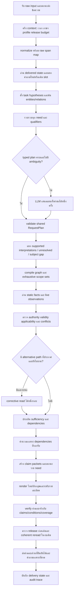

# R102 — แผน Flow ทั้งระบบก่อนพัฒนาและทดสอบรวม

วันที่: 20 ตุลาคม 2026 เวลาไทย

สถานะ: **แผนรวม ยังไม่ได้ลงมือเปลี่ยน runtime และไม่ได้รัน chatbot tests ในรอบวางแผนนี้**

## 1. เหตุผลที่เปลี่ยนวิธีทำ

R101 เชื่อมแกนร่วมและวงจรข้อมูลหลายหมวดแล้ว แต่พัฒนาและเพิ่มกรณีตรวจไปพร้อมกัน จึงทดสอบชุดย่อยหลายครั้งก่อนปิดขอบเขต R97 ทั้งหมด การผ่าน 24 หมวดหรือชุดตรวจแกนไม่ได้ยืนยันว่างานย่อยและ acceptance scenarios ครบ เป็นข้อบกพร่องของลำดับงานที่ผ่านมา

วิธีรอบนี้: **ปิดข้อกำหนดทั้งระบบ → ปิดสัญญาระหว่างส่วน → ตรวจทาน Flow → พัฒนาครบตามขอบเขต → ตรึงรุ่นและชุดตรวจ → รันชุดรวมหนึ่งรอบ → วิเคราะห์ทุกผลร่วมกัน**

ระหว่างพัฒนาใช้การอ่านโค้ด ตรวจ syntax/schema/import และความสอดคล้องของ interfaces ได้ แต่ไม่เริ่มรันแชททีละหมวดหรือรัน 91 คำถามซ้ำเพื่อปรับ Flow ไปทีละจุด หากรวมแล้วพบข้อผิดพลาด ให้จัดรายการแก้ทั้งกลุ่มก่อนทำ candidate ถัดไป ไม่ใช้การรันวนจนได้คะแนนที่ชอบ

คำว่า “ทดสอบทีเดียว” หมายถึงหนึ่ง batch บน source/config/model/data ที่ตรึงแล้ว batch ภายในยังแยกหมวดเพื่อวิเคราะห์ได้ ไม่ได้หมายความว่าระบบตอบพร้อมกันทุก request โดยไม่ควบคุมทรัพยากร และไม่รับรองว่าจะไม่ต้องมีรอบแก้หลังทราบผล

## 2. เป้าหมายและขอบเขตที่ต้องปิด

1. ข้อมูลเดิมที่อยู่ใน common และข้อมูลใหม่ผ่าน owner form ใช้ runtime และ source contracts เดียวกัน
2. รองรับทุก task ปัจจุบัน 32 tasks และทุกหมวดข้อมูล 24 kinds โดยมีรายการ fields/relations/claims ที่งานนั้นต้องใช้
3. คำถามหลายเรื่อง หลายรายการ และคำถามต่อเนื่องมีผลราย need ไม่ให้งานเดียวกลบส่วนอื่น
4. ใช้ LLM สำหรับส่วนการตีความที่ยังไม่ชัดในงบเดียวกัน ไม่ใช้โมเดลเติมราคา สิทธิ์ กติกา หรือสถานะที่ไม่มีหลักฐาน
5. “ทั้งหมด” หมายถึง scope ที่นับสมาชิกได้ครบจากฐาน ไม่ใช่รายการ semantic top-K
6. แยกข้อมูลขาด ผู้ใช้ยังไม่เลือก ข้อมูลหมดอายุ ข้อมูลขัดกัน และระบบชั่วคราวล้มออกจากกัน
7. เพิ่ม/แก้/ถอนข้อมูลชนิดที่รองรับได้โดยไม่เพิ่มชื่อเกมหรือ regex รายรายการในโค้ด
8. มี log ที่ทำให้ตรวจว่าทำไมตอบหรือไม่ตอบแต่ละส่วนได้หลัง batch เดียว

การเพิ่มสูตรธุรกิจใหม่ที่ไม่มี executor ยังต้องพัฒนา capability ไม่ถือว่าการกรอกข้อความทำให้สูตรใหม่ใช้ได้เอง ข้อเท็จจริงที่ยังไม่ให้มาเป็น data issue ระบบต้องอธิบายได้ แต่แผนไม่สร้างคำตอบธุรกิจให้เอง

## 3. แหล่งอ้างอิงและ baseline

- R97: `../r97_flow_reassessment_20261019/02_FLOW_V2_TH.md`, `03_IMPLEMENTATION_AND_ACCEPTANCE_TH.md`, `FLOW_SPEC.json`
- สิ่งที่เชื่อมจริง: `../r101_complete_flow_20261019/IMPLEMENTED_FLOW_TH.md`
- ช่องว่างที่ยอมรับแล้ว: `../r101_complete_flow_20261019/R97_CONFORMANCE_TH.md`
- ผลคงไว้: `../r101_complete_flow_20261019/release_subset09/ANALYSIS.json`, `RESULTS_TH.md`, `REMAINING_CONTENT_CASES.json`
- ผล R100 retained ใช้เปรียบเทียบตาม request keys เดิม ไม่รันระบบเก่าซ้ำและไม่ถือคำตอบเก่าเป็น source of truth

R101 subset ล่าสุดมี 91 requests/162 grades, positive literal content 65/72, strict 19/162, content failure reasons 8 ใน 7 requests สองคะแนนนี้ไม่ใช่สิ่งเดียวกันและไม่ใช่ full production accuracy

## 4. Flow แชทครบตั้งแต่รับคำถามจนส่งคำตอบ

### S00–S17: สัญญาแต่ละขั้น

| ขั้น | Input → Output | สิ่งที่ห้ามหาย/เกณฑ์จบ |
|---|---|---|
| S00 รับ | raw text, locale preference, conversation/delivery IDs → input envelope | ไม่อ่าน assistant prose เป็น facts |
| S01 context | envelope → request ID, Bangkok reference time, profile/release/epoch/index, shared deadline | ไม่มี reset budget ระหว่าง repair; static snapshot เดียว |
| S02 normalize | raw → normalized text + reversible offsets | ชื่อ รุ่น ตัวเลข หน่วย ปฏิเสธ เงื่อนไข อ้างกลับ raw ได้ |
| S03 state | latest delivered state + input → new intent หรือ slot binding | ไม่ขุด pending เก่าหลังเปลี่ยนเรื่อง; เปลี่ยน subject แล้ว invalidate slots ที่ขึ้นต่อกัน |
| S04 discovery | cues/entities/schema → candidates หลาย kinds + explicit constraints | top-K ใช้เสนอ candidates ไม่ใช่ exhaustive answer set |
| S05 plan | ทุก input spans → needs/tasks/subjects/slots/qualifiers/dependencies/unresolved | ทั้งประโยคมี mapping; planner ไม่ได้รับสิทธิ์เปลี่ยนเรื่องเพื่อหาคำตอบ |
| S06 validate | typed/LLM proposals → accepted plan + rejection reasons | ID จริง, origins จริง, subject/platform/event ตรง, ไม่เพิ่มหรือลบ need โดยไม่มีเหตุ |
| S07 compile | needs → required/optional/any_of graphs + executable set filters | แต่ละ task มี graph; ambiguous need ไม่ขวาง independent clear needs |
| S08 read | graphs → facts/observations + receipts | FK ถูกชนิด, cycle/depth bound, live cache ต่อ request/provider/date |
| S09 correction | missing claim + declared alternatives → เพิ่ม read ได้หนึ่งรอบ | ไม่เปลี่ยนเกม/งาน/กลุ่มเพื่อให้เจอคำตอบ; ไม่เรียก model planner ซ้ำ |
| S10 evidence | read results → source/currentness/applicability/conflict results | citation ตรงไฟล์ไม่พอ ต้องตรง claim/action/actor/condition |
| S11 dependencies | supported operands → derived claims | ไม่มีคำนวณชั่วโมงจากราคา unknown/expired; decimal/minor units ตามสูตรที่รองรับ |
| S12 resolve gaps | need results → user slot / owner data gap / conflict / unavailable | ผู้ใช้ไม่ถูกถามให้กรอก facts ที่เจ้าของยังไม่มี |
| S13 render | verified claim packet → localized draft answer | ตอบตรงที่ถาม, ไม่แสดง schema keys เป็นข้อความลูกค้า, ข้อเว้นไม่ถูกตัดเพราะขอสั้น |
| S14 verify | draft + packets → accepted output หรือ safe partial | ไม่มี assertion ที่ไม่ได้รองรับนำหน้าคำเตือน; ตรวจสาระหลังแปลจริง |
| S15 finalizer | all need states → final answer + public outcome | ไม่มี early return ที่ทำ independent need หาย; finalizer มีเวลาเหลือ |
| S16 snapshot/delivery | final + current revisions → send/retry/temporary failure | เปลี่ยนข้อมูลต้องอ่าน coherent รุ่นใหม่หรือแจ้ง ไม่ผสม releases |
| S17 state/audit | delivery outcome → references/task/options + trace | เก็บ intent และ IDs; ราคา/กฎ/สถานะอ่านใหม่; ไม่อ้าง visible หากรู้แค่ server_written |

## 5. Contracts ที่ต้องใช้ร่วมกันทุกทาง

### 5.1 RequestContext

request_id, conversation_id, raw input, normalized input, span map, requested/effective locale, reference_time/timezone, data_profile, release/epoch/index version, deadline/finalizer reserve, model attempts, corrective-read ledger และ provider observations cache

ทุก direct call, owner preview, public chat และ specialized adapter ต้องใช้ contract นี้ด้วย ไม่มีตัวทดสอบสร้างทางลัดที่ใช้งานจริงไม่มี

### 5.2 RequestPlan และ Need

need_id, task, predicate, subject selector, selected IDs หรือ scope expression, source spans, slots พร้อม origins, qualifiers, required claims, hard dependencies, output style และ unresolved items

Origins อนุญาต current_user, latest_delivered_state, declared_schema_default และ derived_with_supported_rule เท่านั้น ไม่ใช้ retrieval hit เป็นหลักฐานว่าผู้ใช้ระบุ subject นั้น

เมื่อมีหลาย needs ให้เสนอมุมมองทั้งคำขอก่อนแบ่ง execution หาก parser รู้แค่บางส่วน ต้องไม่ปิด semantic planning ของส่วนที่เหลือเพราะ recursive children ถูกตั้ง planner=None ส่วนที่ยืนยันแล้วล็อกไว้และเรียก LLM ทั้งคำขอได้หนึ่งครั้งสำหรับส่วนที่ยัง unresolved

### 5.3 ReadPlan และ EvidenceReceipt

แต่ละ claim มี graph แบบ all_of/any_of/optional/not_applicable, relation paths, complete scope proof และ filters ของตน

Receipt ระบุ need/subject/predicate/value/unit, record/revision/field, source ID/hash/locator, validity, authority/applicability และ release/epoch; live receipt เพิ่ม provider, target date/window, observed_at, freshness/mapping version

### 5.4 NeedResult

supported, partial_supported, needs_user_slot, ambiguous_interpretation, missing_source, broken_relation, not_current, conflict, live_unavailable, temporary_failure, unsupported เป็นผลคนละชนิด ต้องมี reason codes ไม่อนุมานจากคำในคำตอบเพียงอย่างเดียว

ต้องแยก **capability missing**, **fact missing**, **uncertain interpretation** และ **integration not configured** ให้ owner dashboard เห็นได้ ห้ามโยนทุกกรณีเป็น “ไม่พบข้อมูล”

## 6. กฎเลือก task และป้องกันตอบคนละเรื่อง

1. Explicit subject/edition/platform/date/time/audience/negation เป็น hard constraints ของทุก proposer
2. Recognized live predicate ต้องไป provider/live executor; unavailable ไม่ใช่เหตุให้ค้น FAQ อื่นมาตอบ
3. เกมชื่อที่ไม่อยู่ catalog ต้องคงชื่อนั้นและระบุว่าชุดข้อมูลยังยืนยันไม่ได้ ไม่เลือกเกมใกล้เคียงหรือ policy แทน
4. Source gap ที่ typed interpretation เข้าใจแล้วไม่ใช่ trigger เรียก LLM สุ่ม task ใหม่
5. แต่ละ meaningful span อยู่ใน need/qualifier/unresolved อย่างใดอย่างหนึ่ง; ลบได้เฉพาะ discourse ที่ไม่เปลี่ยนเจตนา
6. Task ที่ตีความชัดแล้วล็อก predicate แต่ไม่ล็อกข้อมูลที่ผิด: field/relation/source ยังต้องผ่าน validation
7. Ambiguity ถามเมื่อ choice เปลี่ยนคำตอบจริง หากหลาย candidates ให้สาระเดียวกันจาก scope เดียวกันไม่ถามโดยไม่จำเป็น
8. Catalog name มีคำ and/และ หรือชื่อเกมตรงกับ service/control alias ไม่ถูกแยกเป็นคนละ need หรือเปลี่ยน root kind ผิด

## 7. อ่านครบและจัดการความขัดแย้ง

### 7.1 ไม่หยุดที่ summary เมื่อคำถามต้องการข้อย่อย

แตก policy question ตาม action/topic ที่ถาม เช่น food, noise, damage เป็น claims ของ need เดียวหรือ subneeds ที่ตรวจ coverage ได้ ค้นและตาม related_ids ได้ แต่ related_ids เป็นเพียงเส้นทางอ่าน ไม่ใช่หลักฐานว่าเงื่อนไขและจำนวนเงินของทุก record ใช้แทนกันได้

ข้อความสรุปที่ไม่กล่าวค่าปรับไม่ถือว่าครบ claim เรื่องค่าปรับ หากต้นฉบับมี clause ที่ action/actor/scope/conditions ตรง ให้แนบ clause พร้อมขอบเขต หากไม่มี ให้ระบุว่าไม่ทราบจำนวน ไม่หยิบ 100–500 THB จากหัวข้ออื่นมาเติมเพื่อให้ checker ผ่าน

การแข่งขันต้องตาม required clause dependencies และ exceptions เช่นก่อน/หลัง First Blood โดยคง game/event/division/edition เดียวกัน “ทั้งหมด” อ่านครบภายใน rulebook scope หรือแบ่งหน้า ไม่อ้าง selected clauses เป็นกฎทั้งหมด

### 7.2 Claim index ที่ใช้ร่วมกับ owner และ runtime

แผนเพิ่ม metadata ของ **claim mapping** แบบมี revision/source evidence:

- subject reference, predicate/action, actor/audience scope
- value/decision/unit หรือ text clause reference
- conditions/exceptions, applicable interval, venue/service/game/event scope
- supports/depends_on/supersedes ที่มีหลักฐานและ source refs ของตัวเอง
- authority scope ที่เจ้าของอนุมัติ ไม่ใช้ record ใหม่กว่าเป็นผู้ชนะอัตโนมัติ

ตัดสินใจใช้ optional **record-level `claim_bindings`** ใน schema revision ถัดไป โดยคง 24 kinds เดิม ไม่เพิ่มฐาน sidecar ที่เผยแพร่แยกหรือ kind ใหม่ Registry ต้องรับ schema เก่าและ schema ใหม่ตาม version จริง; record เก่าที่ไม่มี bindings หมายถึงยังไม่มี explicit mapping ไม่ใช่ยืนยันว่าไม่มี claims

แต่ละ binding มี `binding_id`, `predicate`, `subject_ref`, `actor_scope`, `value_ref`, `condition_refs`, `exception_refs`, `applicability`, `authority_refs`, `dependency_refs`, `supersedes_refs`, `evidence_refs` ส่วนที่ไม่ทราบต้องเป็น unknown อย่างชัดเจน ไม่ใช้ empty list แทน unknown ค่า decision/จำนวนเงินอ้าง typed field หรือ source clause ที่มี locator/hash ไม่คัดลอกเป็นราคาอีกชุด `value_ref` ที่อ้าง prose ต้องมี source hash และตำแหน่งข้อความต้นฉบับที่ตรวจกลับได้ การเชื่อมแค่ related_ids ไม่เพียงพอ

เริ่มจาก typed facts ที่มีอยู่สร้าง index แบบ deterministic และให้ FAQ prose อ้าง claim ที่มี structured source ได้โดยไม่ทำซ้ำราคา Bindings อยู่ใน approved revision/hash เดียวกับ record; publish สร้าง claim index พร้อม release/index version ใน transaction เดียว ไม่แก้ approved payload/hash เก่าย้อนหลัง และไม่ยกระดับ unreviewed mappings ให้ตอบแทนหลักฐานที่อนุมัติแล้ว

LLM ช่วยเสนอ mapping ของข้อความเก่าได้ใน draft แต่ proposal ไม่ใช่การอนุมัติ facts หรือ authority เอง หากยังไม่มี mapping อ่าน prose เป็นข้อความจาก source ได้เฉพาะขอบเขตที่พิสูจน์ได้ ห้ามยกระดับเป็น structured price/permission/สูตรใหม่

### 7.3 ตัดสิน conflict

1. รวม claims ที่ subject/predicate/unit/applicability ทับกันจริง
2. คนละ actor/date/service ไม่ใช่ contradiction โดยอัตโนมัติ
3. ค่าเดียวกันรวมแหล่งอ้างอิงได้ ค่าต่างกันตรวจ explicit supersession/authority ที่ใช้กับ claim นี้
4. ไม่มีลำดับอำนาจที่พิสูจน์ได้ → conflict พร้อมระบุ claim และ sources ที่ขัดกัน ไม่เลือกค่าที่ใหม่กว่า/คะแนน retrieval สูงกว่าเอง
5. FAQ ไม่มี mapping แต่มีสัญญาณว่ากำลังกล่าว claim เดียวกัน → unresolved applicability/possible conflict สำหรับ owner; ไม่รายงานว่า “ยืนยันว่าขัดกัน” โดยไม่มีหลักฐาน
6. ความไม่แน่นอนของ unrelated prose ไม่ควรปิดทุกคำตอบของศูนย์ จำกัดผลกระทบตาม claims/needs ที่เกี่ยวข้อง

ระบบไม่รับรอง universal semantic contradiction detector แต่ต้องจัดการ C23 ที่กำหนด fixture claims/authority ชัดได้ และมี safe path สำหรับข้อความที่ยังพิสูจน์ไม่ได้

## 8. การถามเพิ่มและตอบข้อมูลที่ขาด

| สถานการณ์ | วิธีตอบ/ถาม |
|---|---|
| ราคา PC แต่หลาย audience ให้ราคาต่างกัน | ถามกลุ่มที่มีจริง ไม่แสดงทุกอัตราเหมือนทุกกลุ่มใช้แทนกันได้ |
| user audience ชัด แต่ rate validity unknown | บอกยังยืนยันราคาปัจจุบันไม่ได้เพราะวันมีผลขาด ไม่ถามกลุ่มซ้ำ |
| คนนอกเล่นได้ทุกเกมไหม | ตรวจ universal set และ eligibility ทุกสมาชิก; ถ้าไม่ครบ บอกยังยืนยัน “ทุกเกม” ไม่ได้ พร้อมระบุ scope ที่ตรวจได้ |
| ข้อมูลนอกเว็บ/นอกฐานของศูนย์ | ตอบขอบเขตแหล่งข้อมูลตรงคำถาม ไม่โยนเมนูทั่วไปเมื่อรู้แล้วว่าปัญหาคือ source scope |
| ถาม bring แต่ source ระบุ consume | อธิบายว่ายืนยันข้อห้ามบริโภคได้ แต่การนำเข้ายังไม่มีข้อกำหนดที่ยืนยัน ไม่เปลี่ยน action |
| ส่วนหนึ่งชัด อีกส่วนต้องเลือก | ตอบส่วนที่ชัดก่อน แล้วถาม slot เดียวที่แก้ ambiguity ได้ |
| provider unavailable | บอกตรวจสดไม่ได้ พร้อม static booking procedure หากมี independent need ไม่สรุป free/closed |
| model timeout/invalid JSON | บอก interpretation ชั่วคราวไม่พร้อม และคง supported needs ไม่รายงานว่าไม่มี facts |

สองรอบ: pending เก็บ task/subject/options/qualifiers/origins ที่ส่งจริง → ข้อความ “PC”, ชื่อเกม, “ทั้งหมด”, “อันที่สอง”, “15:00” เติม slot นั้น → อ่าน release ใหม่ → ตรวจ availability ของ IDs → execute task เดิม ไม่เอาค่าจากคำตอบเก่ากลับมาใช้

## 9. Owner Flow ครบทุกหมวด

```mermaid
flowchart LR
 A[เพิ่ม/แก้ record เดิม] --> B[กรอกฟอร์มและแนบ source]
 B --> C[ตรวจ schema/FK/validity/claim mappings]
 C --> D[readiness ราย task และ missing-data issues]
 D --> E[บันทึก draft revision]
 E --> F[preview ด้วย dispatcher เดียวกัน]
 F --> G[ผู้มีสิทธิ์อนุมัติ revision]
 G --> H[publish records/index/claim graph เป็น release เดียว]
 H --> I[invalidate affected fact/set caches]
 I --> J[แชทอ่าน release ใหม่]
 J --> K[แก้/ถอนภายหลังตรวจ referring records และ translation staleness]
```

Readiness บอกทั้ง “ถามอะไรได้” และ “ยังขาดอะไร” ไม่ใช้ครบทุกช่องแบบทั่วไปเป็นนิยามว่าทุก task พร้อม

หมวด center/contact/facility/person ต้องคง public scope; game/game_mode/control_set แยกภาพรวม ผู้เล่น ปุ่ม; service/resource/game_service แยกมีให้บริการ ติดตั้งแล้ว และจำนวนที่นั่ง; rate/rental_package แยกหน่วย สูตร ราคาเหมา กลุ่มและวันมีผล; schedule/closure แยกเปิดจริง/จอง/maintenance; policy/procedure/faq แยก decision/ขั้นตอน/คำอธิบาย; competition/competition_rule แยก event/edition/clauses; news ตรวจวันและเงื่อนไข; live_binding ต้องมี mapping/freshness ที่เจ้าของยืนยัน

ข้อมูลเดิมไม่หายเมื่อเพิ่ม optional metadata ใหม่ อนุญาต preview ของ old records ที่ unknown อย่างชัดเจน การ publish ค่าใหม่ไม่สร้าง approvals ให้ source เก่าโดยอัตโนมัติ Draft และ published ใช้ runtime เดียวกันแต่ profile แยก

## 10. เวลา ราคา และ live integration

- เปิดวันนี้เป็น day-level predicate ตอบวันที่+สถานะสั้น ๆ เมื่อมีหลักฐาน physical opening; ไม่ใช้ booking empty เท่ากับปิดศูนย์
- เปิดตอนนี้ต้องมีช่วง opening ที่ใช้กับเวลานั้นหรือ provider ที่ contract ยืนยัน opening ได้ ถ้ามีเพียง bookability/occupancy ให้บอกเฉพาะสิ่งที่ยืนยัน
- ราคา: tuple service+audience+duration+unit+validity แยกต่อ need; ไม่มี cross-product PC 2 ชั่วโมง/VR 30 นาที
- เหมาอ่าน package โดยตรง Budget derive เมื่อราคา/rounding/minimum duration มี evidence ครบเท่านั้น
- อ่านสดต้องตรง target date/time window และ pool scope; timestamp/freshness/status mapping ถูกต้อง ช่วงมี gaps ไม่สรุปว่าง
- provider config/credential/integration outage แยกจาก content quality; read-only ไม่สร้าง/แก้รายการจองเพื่อทดสอบบนระบบจริง
- concurrency ใช้ shared admission/queue/deadline เดิม ป้องกัน request หนึ่ง reset model quota ผ่าน children; คำตอบ static ไม่ต้องรอคิว model
- corrective path และ coherent reread หลัง snapshot เปลี่ยนใช้ corrective ledger ร่วม **รวมได้ไม่เกินหนึ่งครั้งต่อ request** หากใช้สิทธิ์ไปแล้วต้องคืนสถานะจำเพาะภายใน budget ไม่เปิดโควตารอบใหม่

## 11. ภาษาและการแสดงผล

ใช้ claim packet เดียวเป็นฐาน Thai/English/Auto ตรวจ amount/unit/time/negation/decision/exceptions หลัง render ไม่เปลี่ยนความหมายเพื่อให้ได้คำศัพท์ของ GT เก่า

เกม/เครื่องชื่อจริงแสดงจาก source หรือ raw span ที่ bind ได้ ไม่แปลชื่อเอง รูปแบบ summary/details/all แตกต่างตามคำถามแต่ไม่ตัดข้อเว้นที่เปลี่ยนข้อสรุป Meta เช่น confidence/source status ไม่ต้องแสดงเป็นชื่อ field ในคำตอบลูกค้า

ความถูกต้องของ output templates/typed critical slots ตรวจอัตโนมัติได้ ความลื่นไหลและความหมายของร้อยแก้วทุกประโยคยังไม่เท่ากับมีผู้เชี่ยวชาญรับรอง ระบบต้องไม่ตั้ง semantic_verified=true เพียงเพราะ citation valid

## 12. Log ที่ทำให้วิเคราะห์จาก batch เดียวได้

แต่ละ request เก็บ input/raw spans, previous delivered state ID, snapshot/config/model IDs, hypotheses/proposal/rejection, accepted plan, per-need slots/origins/qualifiers, compiled paths, candidates/read results, source and scope receipts, conflicts, unmet dependencies, final claims/answer/need statuses, model admission/queue/body/schema timings, snapshot check และ delivery result

Root-cause labels ขั้นต่ำ:

1. input_normalization / state_binding / task_interpretation / candidate_discovery
2. plan_validation / scope_enumeration / relation_read / source_pointer
3. authority_conflict / applicability_validity / evidence_insufficient
4. dependency_calculation / localization / rendering_undercoverage
5. live_transport / live_mapping_freshness / model_queue_transport / model_body_schema
6. deadline / snapshot_delivery / protocol_mismatch / literal_clause_mismatch
7. owner_data_missing / capability_missing / integration_not_configured / adjudication_uncertain

แยก first failing stage กับ downstream symptoms ไม่ใช้คำว่า no_answer เป็นสาเหตุทุกเรื่อง และไม่สรุป content failures จาก strict route mismatch อย่างเดียว

## 13. วิธีพัฒนาให้ครบก่อนทดสอบรวม

| ลำดับ | งานที่ต้องปิด | สิ่งส่งมอบก่อน freeze |
|---|---|---|
| P0 | ตรึง baseline R101 และข้อกำหนด R97/C01–C37/32 tasks/24 kinds | manifests, scope matrix, case manifest ไม่มีการแก้คำตอบต้นแบบเพื่อให้ผ่าน |
| P1 | ปิด contracts/context/whole-request planning/adapter boundaries | interface เดียวพร้อม slot/qualifier origins, ไม่มี early-return ที่กลบ independent need |
| P2 | ปิด read graphs/sets/claim mappings/conflict semantics | graph ทุก task, safe legacy-record behavior, authority/applicability rules ที่ execute ได้ |
| P3 | ปิดทุก domain รวม policy clause coverage/fees/calendar/live | missing-data terminal, exact scope, typed executors และ capability errors |
| P4 | ปิด follow-up/lifecycle/publish/index/cache | new/edit/withdraw ไม่คืน facts เก่า; preview/public path เดียวกัน |
| P5 | ปิด localization/render/finalizer/delivery/audits | need coverage และ trace ทุก terminal branch |
| P6 | ตรวจเอกสาร/โค้ด/fixtures แบบไม่เรียกแชท | ตรวจ syntax/import/schema/FK และ requirement→implementation→case mapping |
| P7 | freeze candidate/model/config/fixtures/jobs/oracles | run manifest, source/data hashes, exact case counts, real-vs-simulated labels |
| P8 | รัน integrated batch ครั้งเดียว | append-only raw outputs และ per-case traces ครบตาม manifest |
| P9 | วิเคราะห์รวมทุกผลและตรวจ regression ทั้ง strict/content | รายงานรวม + รายหมวด + failure table + ขั้นแก้ถัดไป |

ห้ามเริ่ม P8 ถ้า P1–P6 ยังมี implementation work ที่รู้ว่าจะต้องเปลี่ยนกลาง batch ถ้าระหว่างรันโค้ดเปลี่ยน ให้ตัดสิน run_invalid ไม่ใช้เป็นคะแนน final และไม่ลบผลรอบนั้น

## 14. ตรวจทาน Flow ก่อนลงมือสามรอบ

### Review A — Coverage

จับคู่ทุก C01–C37 กับ stage และ acceptance fixture; จับคู่ทุก 32 tasks และ 24 kinds กับ read/render/lifecycle; ไม่มีรายการ “ครบเพราะมี enum” งานที่ไม่มี code path หรือ fixture ตรงต้องอยู่ใน TODO ที่ต้องปิดก่อน freeze

### Review B — Failure paths

ไล่ unknown/known empty/expired/conflicted/broken FK/model unavailable/live stale/withdrawal/deadline สำหรับทุก contract ที่เกี่ยวข้อง ตรวจว่าบาง need ล้มแล้ว independent need ยังตอบได้ และไม่มีค่าที่อนุมานจาก source คนละ action/scope

### Review C — Integration และการใช้จริง

ไล่เจ้าของเพิ่มชื่อใหม่→save→preview→approve→publish→ถามต่อ→แก้→ถอน โดยไม่แก้ regex ชื่อรายการ ตรวจ actual imports/profile/model config/launchers ไม่ใช้ path ที่มีแต่ใน test harness ตรวจ API/public outcome mapping และ trace ก่อนเปิด batch

เอกสารนี้กำหนด checklist ของการ review ไม่อ้างว่าการเขียนสามหัวข้อนี้เท่ากับ implementation review ผ่านแล้ว

## 15. ชุดทดสอบรวมหนึ่ง batch

### 15.1 หน่วยการทดสอบ

- **R97 exact acceptance:** C01–C37 ทุกข้อ สร้าง fixture preconditions ตรง spec ไม่แค่คำถามเหมือนกัน
- **Language/wording:** ไทย อังกฤษ Auto และสี่รูปแบบต่อ scenario ได้แก่ตรงความหมาย ภาษาพูด/สลับคำ พิมพ์ผิดเล็กน้อย และ wrapper/คำขอสั้น โดยคง intent/qualifiers; เป้าหมาย design 37×3×4 = 444 scenario variants แต่จำนวนจริงหลังตรวจ semantic equivalence และ dedup ต้องอยู่ใน frozen manifest
- **32 tasks:** positive source-backed path และ missing/invalid/ambiguous path ที่เกี่ยวข้อง; ใช้ชื่อใหม่ที่ไม่มีใน legacy aliases; ทุก task ต้องมี evidence ว่า executor ถูกเรียกจริง
- **24 kinds lifecycle:** create/edit/withdraw และ Thai/English queries; ตรวจ refs/index/cache/profile พร้อมกัน ไม่ถือ all-details เป็นหลักฐานแทนทุก task
- **Retained regression:** 91 keys จาก R101 เดิมโดยคงวันที่/fixtures/GT เดิม เปรียบเทียบผลเก่าโดยไม่ rerun legacy
- **Multi-turn:** ทุกชนิด pending slot, all/ordinal/reset, revision/withdrawal ระหว่าง turn และ unrelated epoch change
- **Cross-domain:** price+booking, live+procedure, game overview+price, same-task two games, supported+unresolved needs และหลาย durations/audiences
- **Failure injection:** transport/body/schema/semantic rejection, stale live/unmapped statuses/gaps, snapshot change, exhausted shared budget และ admission contention บน fixture แยก
- **Real LLM:** เปิด LLM บน candidate จริง บันทึก actual calls; intent ที่ deterministic เข้าใจแล้วอาจไม่เรียกโมเดล ต้องไม่เรียกสิ่งนี้ว่า LLM inference ของทุกคำถาม
- **Live integration:** simulated lane ครอบคลุม invariants และ read-only real provider lane เมื่อเชื่อมได้; real lane ไม่พร้อมให้ integration_blocked ไม่กลืนเป็น content pass/fail

หนึ่ง orchestrator จัด fixture setup/reset, sequences, model admission และ case scheduling; มีหลาย lanes ใน run เดียวและไม่แก้ source ระหว่าง lanes ไม่ใช้ concurrency สูงจนเกิด transport failures แล้วเหมาว่าความรู้ผิด

### 15.2 Oracle และการนับ

Expected facts/decisions/conditions มาจาก source fixture พร้อม predicates ไม่ใช้คำตอบของระบบเดิมเป็นเฉลยอัตโนมัติ เก็บ old literal/protocol grades แยกและไม่แก้ย้อนหลัง

รายงานจำนวน scenario instances, unique request keys, HTTP requests/turns, grades/assertions และ actual model calls แยกกัน ห้ามบวกเป็นคะแนน accuracy ก้อนเดียว ตัวเลข 444 เป็นขนาดออกแบบของ lane หนึ่ง ไม่ใช่จำนวนที่รันผ่านแล้ว

แยก development variants กับ held-out variants ก่อน implementation freeze ไม่ใช้ held-out เพื่อดักวลีรายข้อ เมื่อเปิดดูผลแล้วไม่เรียกชุดนั้นว่า untouched ในรอบถัดไป

### 15.3 เกณฑ์รับรอง

1. ไม่มี unsupported price/permission/rule/live claims ใน source-backed critical fixtures
2. ทุก C01–C37 มี runtime result ที่ตรวจตาม preconditions และยังเก็บ raw result ถ้าไม่ผ่าน
3. เพิ่ม/แก้/ถอน 24 kinds และ task-specific new-data paths ครบตาม frozen manifest
4. ไม่มี critical wrong-subject, dropped exception, stale withdrawn fact, invented formula หรือ live/static substitution
5. Known source gaps ได้ terminal ที่ตรงเรื่อง ไม่แต่ง fact ให้ทดสอบผ่าน; possible conflict ไม่ถูกยืนยันเป็น contradiction เอง
6. Localization critical slots/units/conditions ไม่เปลี่ยน; unsupported prose claims ไม่ผ่านเพียงเพราะ citation valid
7. วิเคราะห์ strict protocol/content/evidence/validity/transport/performance แยกกัน เปรียบเทียบทุก grade ไม่เฉพาะ positive content
8. กรณีไม่แน่ใจมี adjudication_uncertain และเหตุผล ไม่ถูกนับเป็นถูกเอง

ไม่กำหนด “ต้องได้คะแนน 100% จึงถือว่า Flow ถูก” โดยใช้การแก้เฉลยหรือขยายขอบเขตข้อมูล ยืนยันความครบได้จาก mapping และ invariants ที่ทดสอบจริง พร้อมบอกข้อผิดพลาดที่ยังมี

## 16. แยกงานโค้ดกับข้อมูลและการเปิดจริง

| ประเภท | ทำอัตโนมัติได้ | ผลที่ต้องแสดงหากยังไม่ครบ |
|---|---|---|
| Implementation | orchestration, readers, mappings support, scoped rendering, lifecycle, logging, batch runner | capability issue พร้อม stage ไม่ใช่ source missing |
| Source migration | อ่าน/เชื่อมข้อมูลเดิมที่มี evidence; เสนอ mapping ใน draft | unmapped หรือ ambiguous source ไม่สร้าง approvals เอง |
| Business facts | ใช้ข้อมูลที่ผู้ใช้ยืนยันแล้วต่อได้ | ถ้ายังไม่มีวันมีผล/eligibility/physical-opening scope ให้ระบุ owner_data_missing อย่างจำเพาะ |
| Live connection | ตรวจ endpoint/provider contract แบบ read-only เมื่อ config มี | integration_not_configured/unavailable แยกจาก content failures |
| Publication | เตรียม owner preview/review/publish workflow | ฐานปัจจุบันไม่มี active approved release; ไม่แอบ publish แทนเจ้าของ |
| Rollout | เตรียม launcher/config/release/rollback จาก candidate ที่ตรวจแล้ว | production activation เป็นสถานะแยกจาก implementation complete |

## 17. สิ่งส่งมอบเมื่อจบ implementation และ batch

1. FULL_FLOW_TH.md และ coverage matrix ที่อัปเดตตามโค้ดจริง
2. VERSIONED_CONTRACTS/SCHEMAS และ migration note ที่รักษา approved history
3. candidate source manifest และ model/config/data manifests
4. exact R97 cases + task/kind/lifecycle matrices และ frozen jobs/oracles
5. raw per-request/turn results, traces, received model outputs/rejections และ transport logs
6. coverage completeness/source-unchanged receipts และทุก unexecuted/blocked case ที่ระบุเหตุ
7. รายงานเทียบ retained R101/R100 ตาม keys เดียวกัน พร้อม regressions ทุกชนิดและข้อจำกัด
8. คู่มือเจ้าของเพิ่ม/แก้/ถอน/อนุมัติ/เผยแพร่ ข้อเท็จจริงที่ยังต้องยืนยัน และคู่มือเปิด candidate

**ลำดับถัดไปของงานคือปิด implementation ทั้งขอบเขตตาม P1–P6 แล้วจึงเปิด P8 ชุดรวม ไม่กลับไปเริ่มวงจร chatbot tests ทีละหมวดระหว่างที่ยังวาง Flow ไม่ครบ**
