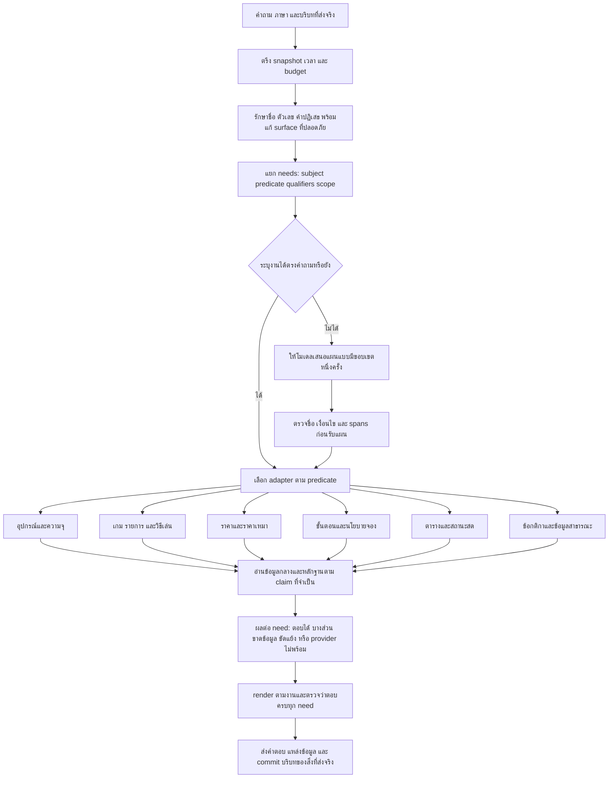
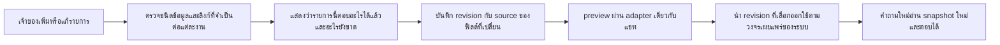

# R111 — แผนให้ Flow กลางตอบใกล้ Flow เดิมด้วยตัวอ่านเฉพาะหมวด

วันที่จัดทำ: 21 ตุลาคม 2026 (Asia/Bangkok)

สถานะ: **วิเคราะห์โค้ดและผลที่เก็บไว้ / ข้อเสนอสำหรับพัฒนา ยังไม่แก้ runtime และไม่รันทดสอบใหม่**

## 1. ข้อสรุปที่เสนอ

ควรใช้ฐานข้อมูลกลางหนึ่งชุด และมีวิธีอ่าน/คำนวณ/แสดงคำตอบแยกตามงาน เหมือนจุดแข็งของระบบเดิม โดยเก็บการควบคุม source, revision, scope และการแก้ข้อมูลของระบบกลางไว้

อย่างไรก็ตาม R106 มี task registry และตัวอ่านหลายหมวดอยู่แล้ว จึงไม่ใช่งานเพิ่มชื่อหมวดหรือเขียน router ใหม่ทับของเดิมทั้งหมด จุดที่ต้องเปลี่ยนคือ **สัญญาของแต่ละงาน การจัดลำดับตัวอ่าน การผูกขอบเขตกับข้อมูล และการยอมตอบเมื่อมีหลักฐานพอเฉพาะเรื่องที่ถาม**

ไม่ควรถอยกลับทั้งระบบไป R95 หรือยก engine Legacy ทั้งก้อน เพราะ R106 มีส่วนที่ดีขึ้นจริง เช่นการอ่านรายละเอียดเกม แต่ต้องนำพฤติกรรมที่ Legacy ตีความราคา อุปกรณ์ การจอง และตารางได้ดีกว่ามาทำเป็น adapter ที่อ่านข้อมูลกลางเท่านั้น

### สิ่งที่ต้องยอมรับก่อน

- ข้อมูล R108/R109 ที่เจ้าของเพิ่งตอบยังเป็น **ชุดรับเข้า** ไม่ใช่ข้อมูลที่ runtime R106 อ่านแล้ว การมีไฟล์คำตอบครบไม่ได้ทำให้ field ในฐานใช้งานได้รับค่าใหม่เอง
- ฐานกลางมีข้อมูลจำนวนมากอยู่แล้ว แต่ field ที่อ่าน, relation ที่ใช้, metadata ที่ gate ต้องการ และ semantics ของคำถามยังอาจไม่ตรงกัน
- ข้อมูลบางอย่างยังไม่ทราบจริง เช่นหน่วยโทษ Pause Tekken ที่เจ้าของให้ข้าม และผังปุ่มที่ยังยืนยันไม่ได้ ต้องเก็บสถานะนี้ไว้
- เป้าหมายคือพฤติกรรมตอบที่ตรงงานและหลักฐาน ไม่ใช่ทำให้ทุก gate ผ่านหรือทำให้หน้ารายงานมีแต่ช่อง known

## 2. หลักฐานแยกหมวดจากผลเดิม

| หมวดจาก corpus | Legacy | R95 | R106 ตาม metric ของรายงานรุ่นนั้น |
|---|---:|---:|---:|
| equipment | 98.21% (2,142/2,181) | 84.23% (1,837/2,181) | 78.53% (1,712/2,180) |
| games_catalog_availability | 98.28% (2,569/2,614) | 81.37% (2,127/2,614) | 89.98% (2,352/2,614) |
| game_detail | 98.25% (3,140/3,196) | 68.21% (2,180/3,196) | 93.27% (2,981/3,196) |
| game_controls | 96.09% (5,140/5,349) | 95.81% (5,125/5,349) | 89.82% (4,801/5,345) |
| service_fee | 95.84% (2,234/2,331) | 30.24% (705/2,331) | 27.21% (634/2,330) |
| reservation_policy | 97.05% (1,415/1,458) | 72.70% (1,060/1,458) | 66.85% (972/1,454) |
| schedule_calendar | 97.59% (1,134/1,162) | 70.57% (820/1,162) | 58.02% (673/1,160) |
| booking_days_hours | 100.00% (200/200) | 21.00% (42/200) | 46.00% (92/200) |
| competition_rules | 19.08% (29/152) | 73.68% (112/152) | 82.24% (125/152) |
| compound_context_boundary | 68.11% (598/878) | 58.09% (510/878) | 57.44% (502/874) |
| members_overview_contact | 97.29% (1,362/1,400) | 92.29% (1,292/1,400) | 4.57% (64/1,400) |

Legacy/R95 ใช้ positive literal checker ชุดเดียวกันในหลักฐานที่อ้าง ส่วน R106 เป็น metric ที่คัด content/evidence/validation/grader partitions และมี taxonomy defect ที่บันทึกไว้แล้ว จึงใช้คอลัมน์ R106 เป็นสัญญาณวินิจฉัยร่วมกับคำตอบจริง ไม่ใช้เป็นการพิสูจน์ว่า semantic accuracy เพิ่ม/ลดตามเปอร์เซ็นต์ทุกจุด ตัวหารไม่ใช่จำนวนคำถามอิสระ และหมวดการแข่งขันมี positive assertions น้อยกว่าคำถามจริงมาก

### สิ่งที่ตัวเลขช่วยตัดสิน

1. **ราคาและตาราง:** เป็นช่องว่างหลักของ common หลายรุ่น ไม่ควรใช้เวลาเพิ่มเฉพาะคำอธิบายเกมแล้วหวังให้คะแนนรวมดีขึ้นเอง
2. **รายละเอียดเกม:** R106 ทำได้ดีขึ้นมากตามเกณฑ์ที่เก็บไว้ จึงควรเก็บตัวอ่านนี้แล้วแก้การเลือกงาน/ภาษา/ความสัมพันธ์ ไม่รีเซ็ตทั้งหมวดไป R95
3. **บุคลากร:** R106 ถอยลงมาก โดย source/code ชี้ gate public_scope เป็นปัจจัยหนึ่ง ขณะที่เจ้าของยืนยันชื่อและตำแหน่งเดิมใน R108 แล้ว ต้องผูกคำยืนยันนั้นกับ field ที่เปิดเผยได้ ไม่ปิดทั้งหมวดและไม่ขยายไปถึงเบอร์ส่วนตัว
4. **กฎการแข่งขัน:** ห้ามคิดว่า Legacy ดีกว่าทุกหมวด กลุ่ม positive clause checks นี้ common เคยทำได้ดีกว่า Legacy; ควรแก้ common clause reader และ completeness ไม่ใช้คำตอบ Legacy เป็นความจริงทุกข้อ
5. **คำถามหลายเรื่อง:** ทั้งเก่าและใหม่ยังมีปัญหา ต้องทำ coverage ระดับคำขอย่อย ไม่คัดลอกพฤติกรรมเดิมอย่างเดียว

## 3. สาเหตุที่มีข้อมูลแต่ตอบไม่ได้

### 3.1 ยังติดอยู่ในชั้นรับข้อมูล ไม่ถึงช่องที่ runtime อ่าน

R109 มี duration ราคาเหมา 180/420 นาที, จำนวนจอย, กลุ่มราคาผสม, เงื่อนไขผู้โอน และ Pause ที่เจ้าของเลือกแล้ว แต่ฐาน frozen R106 ไม่ถูกแก้ ดังนั้นงานแรกต้องเป็น mapping + evidence + candidate revision ที่อ่านได้จริง

**วิธีแก้:** ทำทะเบียนว่า owner statement แต่ละข้อเปลี่ยน record/field/predicate ใด เก็บค่าก่อน–หลังและ source answer ID ห้าม append ทุกอย่างเป็น FAQ ก้อนเดียวหรือใส่คำสั่ง “ข้ามไม่ต้องเทส” ลงใน answer

### 3.2 คำถามถูกจัดหมวดผิด แล้วคำตอบที่ผิดหมวดจบก่อน

ตัวอย่างจริง key `b2b74ca1a21678a1f5b550fdd4e65441e060d83d52975df0b6a876312eb8ce95` ถาม `hWich zone has the Nintendo Switch OLED` แต่ได้รายชื่อเกมจาก `r103_offering_catalog` แทนที่ตั้งอุปกรณ์ นี่ไม่ใช่เพราะไม่มีรายชื่อเกม แต่เพราะ task/subject ผิด

**วิธีแก้:** resolve subject kind กับ predicate ร่วมกัน ถ้าผู้ใช้กล่าวถึง equipment_model และถามที่ตั้ง candidate ที่ตอบ catalog เกมต้องถูกปัดออกก่อนตอบ ถ้าตีความไม่ลงตัวให้เสนอแผนใหม่ได้หนึ่งครั้งภายใต้ budget เดียว ไม่ถือว่าผล non-None ใด ๆ จบงานได้แล้ว

### 3.3 ข้อมูลถูก แต่สัญญาบังคับข้อมูลมากกว่าคำถาม

ใน read_graph มี required fields ระดับ task เช่น rental ต้องมี terms ด้วย และ competition text ถูกผูก completeness. ผู้ใช้ถามราคา/อุปกรณ์ที่ผู้จัดให้ แต่ค่า metadata บางช่องไม่ครบ ทำให้คำตอบเฉพาะส่วนหาย

**วิธีแก้:** required claims ต้องเป็นระดับ predicate เช่น `rental_amount` ต่างจาก `rental_cancellation_terms`; `rule_provided_equipment` ต่างจาก `entire_rulebook_complete`. ถ้าข้อความข้อที่ถามยังขาดเงื่อนไขสำคัญต้องหยุดเฉพาะ claim นั้น ไม่ใช่อนุญาตอ่านข้อความใดก็ได้โดยไม่ตรวจ

### 3.4 เกณฑ์ความสด/ความครบ/ความเปิดเผยเป็นคนละเรื่อง

ราคาเก่ามีช่วงกุมภาพันธ์–มีนาคม 2026 จึงไม่ควรถูกอ้างว่าเป็น current ก่อนมีคำยืนยันใหม่ แต่คำยืนยัน “ใช้ราคาเดิม” เมื่อ 20 ตุลาคม 2026 เป็นหลักฐานใหม่ที่ใช้ทำ current-price confirmation ได้ โดยไม่แก้วันเริ่มราคาเก่าย้อนหลังหรือแต่งวันหมดอายุ

ชื่อและตำแหน่งที่เจ้าของยืนยันให้แสดงได้ควรมี field-level public scope; การยังไม่รู้เบอร์ส่วนตัวไม่ควรทำให้ชื่อ/ตำแหน่งที่มีสิทธิ์แสดงหายไป

### 3.5 มี relation แต่ไม่ได้อ่านตามความหมายของคำถาม

อุปกรณ์เชื่อมผ่าน resource/model/zone; เกมที่ให้เล่นผ่าน game_service; player count ผ่าน game_mode. การคืน zone label หรือชื่อเกมอย่างเดียวไม่ใช่คำตอบจำนวนอุปกรณ์หรือรายชื่ออุปกรณ์

**วิธีแก้:** ใช้ read paths ต่อ predicate และตรวจหน่วย/ตัวตนของสิ่งที่ถูกนับ ไม่ใช้กราฟทั่วไปเดินได้ถึงอะไรก็ตอบสิ่งนั้น

### 3.6 การแยกคำถามและถามต่อยังพึ่ง surface มาก

split_needs ป้องกันชื่อเกมที่มี and ได้แล้ว แต่มีเงื่อนไขจำนวน conjunction และ request cue; การตอบที่เหลือคำเดียวหรือการถามหลายเรื่องอาจไม่สร้าง needs ครบ ขณะเดียวกันหลาย branch เปลี่ยน task ใหม่จนกลืนประเด็นเดิม

**วิธีแก้:** เก็บสิ่งที่ผู้ใช้ขอเป็นรายการ needs พร้อม source spans และ relation ของเงื่อนไข ตั้งแต่ก่อนเลือกแหล่ง ตัวอ่านเปลี่ยน predicate เองไม่ได้ ถ้าต้องแก้แผนต้องมี reason และ audit ว่าแก้อะไร

## 4. Flow เป้าหมายรวม

ตัวอ่านหลายแบบใช้ **ฐานเดียว snapshot เดียว และ budget เดียว** ไม่ใช่แชทหลายตัวหรือระบบที่ลองทุก Flow จนเจอตัวตอบได้

## 5. สัญญากลางที่ทุก adapter ต้องใช้

### Input: Need

- subject IDs/kinds และ mention span ของผู้ใช้
- predicate เฉพาะ เช่น `equipment_location`, `booking_cancellation`, `rental_amount`, `catalog_offered_games`
- qualifiers: แพลตฟอร์ม/ฉบับ/เวลา/กลุ่มคน/จำนวน/คำปฏิเสธ/ข้อยกเว้น
- ขอบเขต: ทั้งหมดหรือเฉพาะรายการ; static source หรือ live; ประวัติหรือข้อมูลที่ยืนยันล่าสุด
- required claims และ dependencies ที่เป็นเหตุจำเป็นจริง
- ที่มาของ slot: ผู้ใช้พูดเอง, ตัวเลือกที่เคยส่ง, หรือ derived rule ที่ระบุชื่อได้

### Output: AnswerPacket

- need_id และ `answered / partial / missing_input / missing_source / conflict / not_current / unavailable / unsupported`
- claims มี subject + predicate + value + unit + qualifiers + revision + evidence refs
- รายการ unknown แยกจาก no/false และแยกจาก provider failure
- ผลการเลือกชุด: matched/returned/omitted IDs กับเหตุผลของแต่ละรายการ
- safe rendering data; adapter ไม่พ่น record ทั้งก้อนเพื่อให้ renderer เดาเอง

ป้าย predicate ที่แปะบน receipt ยังไม่ใช่การพิสูจน์ว่าตอบคำถามนั้น ต้องตรวจ value/relation/scope ของ claim ด้วย การมี source pointer ถูกต้องอย่างเดียวไม่พอ

### เงื่อนไขก่อนคืนคำตอบ

1. subject ไม่เปลี่ยนไปเป็นคนละเกม/อุปกรณ์/รายการ
2. predicate ที่ตอบตรงกับสิ่งที่ถาม
3. ตัวเลข หน่วย ผู้ใช้ วันที่ และ negation ไม่หาย
4. ทุก need มีผลหรือระบุส่วนที่ยังไม่ทราบ
5. คำตอบที่ตอบได้ไม่ถูกล้างเพราะ optional field ของอีกส่วนหนึ่งขาด

## 6. Flow ของอุปกรณ์

แยก `รายการ / สเปก / จำนวนเครื่อง / จำนวนจอย / ที่ตั้ง / จำนวนคนเล่นพร้อมกัน / ที่นั่งห้อง` เป็นคนละ predicate

1. เลือก model/resource/service/zone ที่ผู้ใช้พูดจริง
2. เลือก read path ตามงาน: zone→resource→model สำหรับรายการ; model→resource→zone สำหรับที่ตั้ง
3. ถ้าถามจำนวนเครื่อง ให้นับ distinct physical resource หรือ quantity ที่ source ระบุ ไม่ใช้จำนวน model rows และไม่บวก quantity ทั้งสองทางซ้ำ
4. ถ้าถามจอย PS5 ให้อ่าน controllers_per_console = 2 จากเจ้าของ ไม่ใช้จำนวน PS5 ทั้งห้องแทนจำนวนจอย
5. ถ้าถามคนเล่น ใช้ capacity ของ service/resource และ game mode ตามคำถาม ไม่เอาที่นั่งเช่าห้อง 37 ที่นั่งไปตอบ PS5 เล่นได้ 37 คน
6. ตอบเฉพาะชื่อ/รุ่น/จำนวน/โซนที่ถาม; สเปก GPU ที่ไม่มีข้อมูลไม่ทำให้ตอบที่ตั้งไม่ได้

**ตัวอย่าง:** “Nintendo Switch OLED อยู่โซนไหน” → model→physical resource→zone; ต้องได้โซน ไม่ได้รายชื่อเกม

**reuse:** นำการแยก device/zone/capacity และภาษาคำถามจาก Legacy มาเป็น pure interpretation; ใช้ common equipment graph และ R106 typed fields เป็น facts

## 7. Flow ของเกม

### 7.1 รายชื่อเกมที่ศูนย์มี

1. แยก scope ศูนย์/โซน/แพลตฟอร์ม/เครื่อง และตัวกรองคนเล่น
2. enumerate game_service ที่ offered=true และอยู่ใน scope ไม่ใช้ search top-K เป็นรายการทั้งหมด
3. `ไม่มี scope` กับ `ผู้ใช้ระบุ scope แต่ join ไม่พบ` ต้องแยกกัน ห้ามกรณีหลังทำให้ filter ว่างแล้วกลายเป็นคืนทุกเกม
4. รวมเกมซ้ำโดยรักษา edition/platform และแสดงการให้บริการหลายโซนได้
5. ถ้าถาม “ทั้งหมด” ต้องครบตาม snapshot; ใช้ pagination ได้แต่แจ้งจำนวนรวม/แสดงแล้ว ไม่ตัดเงียบ
6. “เกมเล่นสองคน” ต้อง filter modes ที่ศูนย์รองรับ ไม่เดาจากเกมแนวเดียวกัน

### 7.2 คำอธิบาย/วิธีเล่น/ที่เล่น

- “เกมอะไร” → summary + genre; “เล่นยังไง” → how_to_play; “มีให้เล่นที่ไหน” → offering→service→resource/venue zone
- รักษา R106 task reader ที่ทำ game_detail ดีขึ้น ไม่ย้อนใช้ FAQ matcher ทั่วไปเป็น default
- game record ใหม่ที่มี summary และ offering ต้องตอบสองอย่างนี้ได้ แม้ยังไม่มี controls หรือข้อมูล online subscription

### 7.3 ปุ่มควบคุม

- bind game + edition + platform + preset + mode + action; exact binding read ก่อนการสรุปภาษา
- ถ้า platform มีหลายแบบและปุ่มต่างกัน ให้ถามเฉพาะ platform หรือแสดงแยก; ไม่ถามสิ่งที่ชื่อบริการระบุไว้แล้ว
- ไม่ใช้ปุ่ม PC แทน PS5, ปุ่มภาคอื่นแทนภาคนี้ หรือ limitations text เป็นหลักฐานว่ารู้ปุ่มเฉพาะทุกปุ่ม
- ส่วนที่ยังไม่มีหลักฐานตามงานค้น R108 คง unknown; การยืนยันผังเดิมไม่ใช่การเติมผังที่ไม่เคยมี

## 8. Flow ของราคาและราคาเหมา

### 8.1 ค่าบริการรายคน

1. ตีความว่าอยากดู “ตารางราคา” หรือ “ยอดรวมของกรณีนี้”
2. ดูตารางราคา: เลือกบริการและแสดงกลุ่มที่มีพร้อมหน่วย ไม่ต้องถามกลุ่มก่อนถ้าตอบเป็นตารางได้
3. คำนวณยอด: ต้องรู้ service + audience ต่อคน + ระยะ/รอบ + จำนวนคนที่เข้ากฎ + unit/calculation rule
4. คนคนละกลุ่มคิดตามกลุ่มตนเองที่เจ้าของยืนยัน; ไม่คูณ rate ของคนแรกให้ทั้งกลุ่ม
5. ใช้ตัวคำนวณ deterministic เดิมกับ rate facts ใน common และตรวจ tuple ต่อส่วน เช่น PC ของนักศึกษาสองชั่วโมง กับ VR ของคนนอกหนึ่งรอบ
6. ถ้าไม่ทราบ rounding/ขั้นต่ำ ให้ระบุส่วนนี้หรือถามเฉพาะการคำนวณที่ขึ้นกับมัน ไม่แต่งสูตรใหม่
7. แสดงบริการ กลุ่ม ระยะ จำนวน อัตรา และยอดโดยย่อ จึงตรวจย้อนกลับได้

### 8.2 ราคาเหมา

- ใช้ตาราง rental_package ไม่ extrapolate จากราคาต่อคนรายชั่วโมง
- ครึ่งวัน 180 นาที ช่วง 09:00–12:00 หรือ 13:00–16:00; เต็มวัน 420 นาที 09:00–16:00 รวมเที่ยง ตาม R109
- เงิน/หน่วยงาน/โซน/period มาจาก 24 package rows เดิมที่เจ้าของยืนยัน ชั่วโมงมาจากคำตอบใหม่ แยก evidence ต่อ field
- อยากทราบราคา: terms การยกเลิกที่ไม่ทราบไม่ควรกั้น amount ที่ยืนยันได้; ถ้าถามคืนเงินค่อยใช้ terms ที่เกี่ยวข้อง
- ที่นั่งห้องกับอุปกรณ์และผู้เล่นพร้อมกันแสดงแยกหน่วย
- การจัดช่วงอื่นหรือนอกเวลาให้ประสานเพจตามคำตอบเดิม ไม่ยืนยันค่าบริการปกติครอบคลุมทุกเวลาหรือไม่มีค่าเจ้าหน้าที่เพิ่ม

### 8.3 แก้ปัญหา validity โดยไม่ทำข้อมูลเก่าเสีย

เก็บช่วงมีผลของอัตราเดิมไว้ และเพิ่มหลักฐานเจ้าของ “ยังใช้ราคาเดิม” พร้อม observed_at, source answer ID, exact amount references และ scope. แยก `business_effective_period` จาก `owner_confirmed_as_of` ไม่ใส่วันเริ่มย้อนหลังหรือยืด expiry ของประวัติเงียบ ๆ

กรณีไม่มีวันเริ่มทางธุรกิจแต่เจ้าของยืนยันตารางล่าสุด สามารถแสดง “ตามตารางราคาที่ศูนย์ยืนยันล่าสุด...” พร้อมวันยืนยัน ไม่ใช้ metadata วันที่ไม่ครบเป็นเหตุให้ปิดข้อมูลราคาที่เจ้าของรับรองทั้งหมด. คำถามอดีต/อนาคตต้องประเมิน applicability แยก ไม่อ้างคำยืนยันปัจจุบันครอบคลุมทุกปี

## 9. Flow ของการจองและนโยบาย

ต้องแยกอย่างน้อย 5 งาน: **ต้องจองไหม / จองอย่างไร / เปลี่ยนหรือยกเลิก / เช็กอินและหลักฐาน / สถานะรายการสด**

1. เลือก action ก่อนหา FAQ; คำว่า “จอง” อย่างเดียวไม่ทำให้ทุกคำถามกลายเป็น booking_steps
2. เลือก policy ที่ตรงสถานการณ์ เช่นจ่ายแล้ว/ยังไม่จ่าย, ก่อนถึงรอบ/ระหว่างเล่น, update/crash, ผู้มีชื่อ/คนนอกชื่อ
3. นำคำตอบ R108/R109 เข้าฟิลด์ action/conditions/exceptions/consequence พร้อมแหล่งเดิม ไม่ใช้คำตอบต่างสถานการณ์แทนกัน
4. “ยกเลิกได้ไหม” ตอบได้/ไม่ได้พร้อมเส้นตายตรงเรื่อง ไม่พ่นขั้นตอนจองใหม่ทั้งหมด ถ้าคำถามขอวิธีทำด้วยจึงเพิ่มขั้นตอน
5. “เกมอัปเดตเปลี่ยนเครื่องได้ไหม” แยกจาก “เกมเปิดไม่ได้เพราะเหตุอื่น”; “แก้รายการจ่ายแล้ว” ต้องคงยกเลิกก่อน 1 ชั่วโมงและใช้สลิปเดิมตามคำตอบเจ้าของ
6. สถานะตรวจยอดประมาณ 30 นาทีเป็นคำบอกช่วงปกติ ไม่ใช่ผลว่าอนุมัติเงินจริงแล้ว
7. การรับจองจริง/แก้/ยกเลิกรายการเป็น action capability ต่างจากการตอบคำถาม ครั้งนี้ออกแบบส่วนตอบและอ่านสถานะ ไม่เพิ่มสิทธิ์ทำธุรกรรมแทนผู้ใช้

FAQ เป็นถ้อยคำประกอบของ policy/procedure ที่ scope ตรงกัน ไม่เป็นตัวเลือกที่ชนะทุกหมวดเพราะคำคล้าย

## 10. Flow ของเวลาเปิด จองได้ และสถานะว่าง

| คำถาม | Predicate | หลักฐานที่ต้องใช้ |
|---|---|---|
| วันนี้เปิดไหม | วันเปิดของศูนย์/โซน | ปฏิทินเปิดจริง + วันปิดพิเศษ + ขอบเขต |
| ตอนนี้เปิดไหม | เปิด ณ เวลา | วันที่และเวลาปัจจุบัน Asia/Bangkok + ช่วงเปิด |
| วันศุกร์ช่วงบ่ายเล่นได้ไหม | ช่วงให้จองเล่น | bookable/maintenance ของวันและบริการ |
| ตอนบ่าย PC2 ว่างไหม | occupancy สด | resource binding + provider + freshness |
| เหมาเต็มวันกี่ชั่วโมง | ระยะ package | rental ไม่ใช่ตารางรายชั่วโมง |

1. ตรวจวันปิดพิเศษก่อนตารางสัปดาห์ และอย่านำการปิดโซนหนึ่งไปปิดทั้งศูนย์
2. ใช้คำยืนยันจันทร์–ศุกร์ 16:00–18:00 ปิด เฉพาะช่วงที่ยืนยัน ไม่แปลงเป็นเปิดทุกนาที 09:00–16:00
3. มีรอบจองไม่ได้เท่ากับมีหลักฐานว่าพื้นที่เปิดให้เข้าทั้งวัน; ไม่มีรอบว่างไม่ได้เท่ากับศูนย์ปิด
4. คำถามวันเปิดสั้น ๆ ให้รูปแบบ “วันนี้วันที่ ... เปิด/ไม่เปิดให้บริการ” เมื่อ source ยืนยันได้ ไม่พ่น timezone/maintenance metadata แทนคำตอบ
5. ถ้า provider ใช้ไม่ได้ ต้องบอกว่ายังตรวจว่างไม่ได้ ไม่บอกว่ามีที่ว่างหรือเต็ม; ห้าม fallback ไป FAQ แล้วถือว่าตอบสถานะสดแล้ว
6. เวลาเหมาทั้งวันรวมเที่ยงไม่เปิดรอบจองเครื่อง 12:00–13:00 ตามไปด้วย

## 11. Flow ของกติกาการแข่งขัน

1. ล็อก game/event/year/edition ก่อนเลือกข้อ; ถ้าหลายงานและเงื่อนไขต่างจริงจึงถามรายการ
2. เลือก predicate เช่นจำนวนผู้เล่น, อุปกรณ์ที่นำมาได้, technical pause, การประท้วง ไม่เทียบแค่ heading สั้น ๆ
3. เลือก source clauses พร้อมเงื่อนไข/ข้อยกเว้นและ dependencies ที่มีผลจริงในงานเดียวกัน
4. แยกความครบเป็น `selected_clause_complete`, `dependency_complete`, `whole_book_coverage` แทน flag เดียวที่กั้นทุกอย่าง
5. ข้อหนึ่งที่ข้อความครบและอ้างอิงครบตอบได้ แม้ทั้งเล่มยังไม่ยืนยันว่าครบทุกข้อ; ข้อที่ตัดค้างหรือโทษคลุมเครือต้องคง unknown เฉพาะจุด
6. Tekken ใช้เงื่อนไข Pause ที่เจ้าของเลือก; หน่วยโทษที่เจ้าของให้ข้ามไม่เดา และติด exclusion เฉพาะหัวข้อนั้นสำหรับ test อนาคต
7. RoV เติมท้าย 6.1.5.1 ด้วยคำตอบเจ้าของ; 6.1.5 คงคำเดิมที่ส่งซ้ำ ไม่อ้างว่าแก้สำนวนกำกวมแล้ว
8. ไม่เอาข้ออุปกรณ์แข่งขันไปห้ามอุปกรณ์ส่วนตัวในการใช้ศูนย์ทั่วไป และไม่เอาคุณสมบัตินักศึกษา CS2 ไปห้ามคนนอกใช้ศูนย์
9. ถ้าถามข้อเฉพาะ ตอบข้อเฉพาะ; ถ้าถามทั้งเล่ม จัดลำดับตาม source และระบุส่วนที่ยังขาด ห้าม fallback เป็น overview ของทุกข้อเมื่อไม่เข้าใจคำถามย่อย

ไม่ mark complete ให้ competition_rule ทั้ง 104 รายการอัตโนมัติจากการได้รับ DOCX ต้องตรวจขอบเขตและ dependencies ของข้อที่ใช้งานจริง และมีสถานะความครบของเอกสารแยก

## 12. บุคลากร ข้อมูลศูนย์ และภาษา

- ขอบเขตข้อมูลสาธารณะเป็นราย field: ชื่อ/ตำแหน่งที่เจ้าของยืนยันอ่านได้ แต่ไม่ปลด scope ของข้อมูลติดต่อส่วนตัวทั้งหมด
- คำถามสถานที่/แผนที่อ่าน center/facility ไม่หลุดไปหาเครื่องหรือเกมที่ชื่อมี Phuket
- กฎภาษาอยู่ใน renderer ของแต่ละ task: labels และ nested specifications ต้อง localize ด้วย ไม่แปลเฉพาะข้อความระดับ root
- proper names ที่ไม่มีชื่ออังกฤษทางการคงชื่อที่ยืนยันได้ ไม่เดาการสะกด; ถ้าคำแปลข้อกฎไม่มี ต้องคง qualifiers/ตัวเลข/ปฏิเสธและแสดงสถานะแปล ไม่ให้คำตอบไทยยาวทั้งชุดแทน English โดยเงียบ

## 13. คำถามหลายเรื่องและถามต่อ

ตัวอย่าง “PS5 มีกี่จอย มีเกมเล่นสองคนอะไรบ้าง แล้วสองคนคนละกลุ่มจ่ายยังไง” ต้องได้ 3 needs: controllers count, offered two-player games, pricing by audience. การตอบได้อย่างเดียวไม่ผ่านคำว่าตอบครบ

- slots ผูกกับแต่ละ need ไม่ทำ cross product ของทุกบริการ × ทุกกลุ่ม × ทุกช่วงโดยไม่ตั้งใจ
- ถ้าราคาอีกคนยังขาด group ให้ตอบจอยและเกมได้ก่อน แล้วถามเฉพาะ group ของส่วนนั้น
- “แล้ว VR ล่ะ” ใช้ task เดิมเฉพาะเมื่อสัมพันธ์กับสิ่งที่ส่งจริง; “เปลี่ยนเป็นคนนอก” เปลี่ยน audience ไม่เปลี่ยนเกม/เวลาเอง
- เก็บ IDs/slot origins/สิ่งที่ส่งแล้ว ไม่เก็บค่าราคาเก่าไว้ใน state จน owner แก้แล้วคำตอบยังไม่เปลี่ยน
- ถ้า release เปลี่ยนให้ re-read facts และตรวจว่า IDs ยังอยู่; ไม่ใช้ตัวเลือกจาก draft เก่าที่ถูกถอน

## 14. บทบาท LLM ที่เหมาะกับ Flow นี้

LLM ช่วยตีความภาษาที่หลากหลาย แยก needs และจับคู่เนื้อหาข้อกฎ/FAQ ใน candidate scope ได้ แต่ราคา จำนวนเครื่อง วันเวลา และสิทธิ์ต้องมาจากข้อมูลที่เลือกพร้อมหลักฐาน

- ไม่จำเป็นต้องเรียก LLM ทุกข้อเพราะเปิด LLM ON; exact controls/count/math/calendar ใช้ deterministic ได้
- ไม่มีข้อมูลจริงไม่ให้ LLM เติม; model transport failure ไม่ทำให้ fact ที่อ่านแบบ deterministic ได้หายไป
- มีหนึ่ง shared planning budget และ corrective quota ตาม infrastructure เดิม ไม่เพิ่มงบแยกทุก adapter
- semantic proposal ที่ผ่าน schema ต้องยังตรง explicit entity/negation/qualifiers และปิด needs ครบ ไม่ย้อน veto ด้วย grammar เดิมซ้ำโดยไม่มีเหตุใหม่
- ไม่ใช้ความมั่นใจตัวเลขที่ยังไม่สอบเทียบเป็นเปอร์เซ็นต์ความถูกต้อง หรือใช้ LLM เลือกคำตอบที่ดูดีจากหลาย Flow

## 15. เส้นทางเพิ่มข้อมูลให้เจ้าของใช้จริง

เจ้าของไม่ต้องกรอกทุกฟิลด์ของทั้งระบบก่อนเกมหนึ่งจะมีชื่อในรายการ เช่นเพิ่มเกม + summary + service link แล้ว catalog/overview ต้องใช้งานได้ทันทีใน revision ที่ออกใช้ ส่วน controls ยังบอกว่าไม่มีข้อมูลได้

รองรับ “เพิ่มข้อมูลอย่างเดียวแล้วตอบได้” สำหรับชนิดข้อมูลและ task ที่ระบบรองรับแล้ว หากเพิ่มความสามารถชนิดใหม่ทั้งประเภท ต้องมี schema/task adapter เพิ่ม ไม่รับปากว่าข้อความอิสระทุกแบบจะสร้างเครื่องยนต์คำนวณใหม่เอง

## 16. ขอบเขตงานรอบนี้

- อ่านโค้ดจริง R106 และรายงาน Legacy/R85/R90/R97 พร้อม source intake R108/R109
- stream ผล R106 ที่บันทึกไว้ 20,554 keys เพื่อแยกคะแนนและตัวอย่างตามหมวด ตรวจยอดตรงกับรายงานเดิม 17,238/24,891 positive checks
- ไม่แก้ frozen system, ฐานจริง, approvals, log เก่า หรือผลทดสอบเดิม
- ยังไม่ติดตั้งแผนนี้ และยังไม่รันทดสอบใหม่; แผน implementation และเกณฑ์ตรวจอยู่ในเอกสารถัดไป

## 17. หลักฐานอ้างอิงโค้ด

- [การอนุมาน task/predicate](C:/Users/Chokhun/Documents/Codex/2026-09-25/psu-esports-studio-phuket-chatbot-c-2/r106_complete_flow_20261020/system/app/knowledge/common/intent_contracts.py:13)
- [การแยกหลายความต้องการ](C:/Users/Chokhun/Documents/Codex/2026-09-25/psu-esports-studio-phuket-chatbot-c-2/r106_complete_flow_20261020/system/app/knowledge/common/request_plan.py:51)
- [ลำดับทางออกและ fallback](C:/Users/Chokhun/Documents/Codex/2026-09-25/psu-esports-studio-phuket-chatbot-c-2/r106_complete_flow_20261020/system/app/knowledge/common/complete_flow.py:280)
- [ชุดฟิลด์บังคับตาม task](C:/Users/Chokhun/Documents/Codex/2026-09-25/psu-esports-studio-phuket-chatbot-c-2/r106_complete_flow_20261020/system/app/knowledge/common/read_graph.py:25)
- [การตรวจฟิลด์และ dependency](C:/Users/Chokhun/Documents/Codex/2026-09-25/psu-esports-studio-phuket-chatbot-c-2/r106_complete_flow_20261020/system/app/knowledge/common/read_graph.py:124)
- [gate ข้อกติกา](C:/Users/Chokhun/Documents/Codex/2026-09-25/psu-esports-studio-phuket-chatbot-c-2/r106_complete_flow_20261020/system/app/knowledge/common/rules_reader.py:62)
- [การเลือก catalog จาก scope](C:/Users/Chokhun/Documents/Codex/2026-09-25/psu-esports-studio-phuket-chatbot-c-2/r106_complete_flow_20261020/system/app/knowledge/common/catalog_reader.py:19)
- [การตรวจ predicate coverage](C:/Users/Chokhun/Documents/Codex/2026-09-25/psu-esports-studio-phuket-chatbot-c-2/r106_complete_flow_20261020/system/app/knowledge/common/claim_coverage.py:9)
- [renderer ฟิลด์ทั่วไป](C:/Users/Chokhun/Documents/Codex/2026-09-25/psu-esports-studio-phuket-chatbot-c-2/r106_complete_flow_20261020/system/app/knowledge/common/source_rows.py:5)
- [การกั้นราคาจาก validity](C:/Users/Chokhun/Documents/Codex/2026-09-25/psu-esports-studio-phuket-chatbot-c-2/r106_complete_flow_20261020/system/app/knowledge/common/financial_scope.py:18)
- [ตัวจำแนกวันเปิด/ปิด](C:/Users/Chokhun/Documents/Codex/2026-09-25/psu-esports-studio-phuket-chatbot-c-2/r106_complete_flow_20261020/system/app/knowledge/common/open_day.py:20)
- [adapter ราคาเหมาที่อ่าน common อยู่แล้ว](C:/Users/Chokhun/Documents/Codex/2026-09-25/psu-esports-studio-phuket-chatbot-c-2/r106_complete_flow_20261020/system/app/knowledge/common/rental_bridge.py:11)
- [public_scope ของบุคลากร](C:/Users/Chokhun/Documents/Codex/2026-09-25/psu-esports-studio-phuket-chatbot-c-2/r106_complete_flow_20261020/system/app/knowledge/common/read_graph.py:145)
- [ตัวอ่านข้อกติกาที่ใช้ภาษาเดิมกับข้อมูลกลาง](C:/Users/Chokhun/Documents/Codex/2026-09-25/psu-esports-studio-phuket-chatbot-c-2/r106_complete_flow_20261020/system/app/knowledge/common/competition_bridge.py:10)
- [budget และ snapshot ร่วมที่มีแล้ว](C:/Users/Chokhun/Documents/Codex/2026-09-25/psu-esports-studio-phuket-chatbot-c-2/r106_complete_flow_20261020/system/app/knowledge/common/flow_context.py:10)
