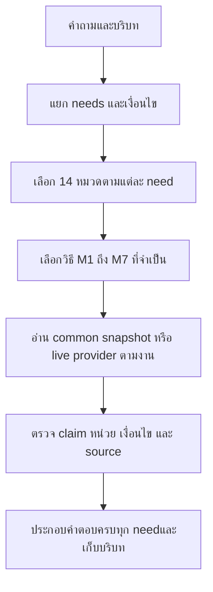

# R112 — หมวดคำถามและวิธีตอบสำหรับ Flow กลาง

วันที่ 21 ตุลาคม 2026 · สถานะ: ข้อเสนอการจัดหมวด ยังไม่ได้แก้ runtime หรือรัน test ใหม่

## ข้อเสนอหลัก

**แบ่ง 14 หมวดคำถาม ใช้วิธีตอบพื้นฐาน 7 แบบร่วมกัน และเก็บข้อเท็จจริงในฐานกลางชุดเดียว**

ตัวเลขแต่ละชุดทำหน้าที่ต่างกัน: 24 คือชนิดข้อมูลใน schema ปัจจุบัน; 14 คือเรื่องที่ผู้ใช้ถาม; 7 คือวิธีอ่าน/คิดคำตอบ. ไม่จำเป็นต้องมี 24 Flow ตามตารางข้อมูล และ 14 หมวดไม่ได้หมายถึง 14 chatbot/LLM ที่ทำงานแยกกัน

แผน R111 ก่อนหน้าจัด 10 กลุ่ม adapter ระดับกว้าง รอบนี้ทำแผนผังคำถามให้ละเอียดขึ้นโดยแยกบุคลากร, การเงินหลังการจอง, กฎการใช้บริการ และข่าว/กิจกรรมออกจากกลุ่มรวม เพื่อไม่ให้คำว่า booking หรือ public information ครอบหลายเจตนาจนเลือกผิด. สามารถใช้ shared code เดิมร่วมกันได้ แม้ business domains แยก

## 1. มีวิธีทำระบบแบบใดบ้าง

| แนวทาง | เหมาะเมื่อ | ข้อจำกัดกับงานนี้ |
|---|---|---|
| ค้นเอกสารแล้วให้ LLM สรุปเป็นหลัก | คำบรรยายหรือคำถามข้อความหลากหลาย | ไม่พอสำหรับหน่วยราคา ช่วงเวลา รายการทั้งหมด หรือสถานะสด ต้องมีตัวตรวจและตัวคำนวณ |
| ใช้กฎ/ตัวอ่านแบบกำหนดแน่นอนเป็นหลัก | ปุ่ม สเปก ราคา และปฏิทินที่มีโครงสร้าง | ภาษาหลากหลายและข้อความเงื่อนไขที่ owner เพิ่มอาจไม่เข้า grammar ถ้าไม่มีกลไกตีความที่มีขอบเขต |
| **ผสมตามประเภทงาน — เสนอให้ใช้** | ระบบนี้มีทั้งค่าตายตัว รายการ สูตร นโยบาย และ API สด | ต้องนิยามสัญญาของแต่ละงานและจุดส่งต่อให้ชัด ใช้ข้อมูล snapshot เดียวและตรวจว่าตอบตรง need |

การเลือกใช้วิธีผสมไม่ได้แปลว่าทุกคำถามเรียกทุกวิธี โมเดลช่วยเข้าใจภาษา/เลือกข้อความในขอบเขต ส่วนการคำนวณ/สถานะ/ข้อเท็จจริงอ่านจากตัวรับผิดชอบโดยตรง ไม่ใช้เปอร์เซ็นต์คะแนนเก่าเป็นกลไกสุ่มเลือก engine ขณะตอบ

## 2. วิธีตอบพื้นฐาน 7 แบบ

| วิธี | ใช้อย่างไร | ข้อจำกัด |
|---|---|---|
| M1 อ่านค่าที่ระบุตรง | หา entity/field ที่ตรงแล้วอ่านค่าพร้อม source เช่นจอย 2 จอย ที่อยู่ หรือบทบาทบุคลากร | ค่าที่ไม่มีหรือไม่อยู่ใน scope ต้องไม่เติมจากความรู้ทั่วไป |
| M2 เชื่อมรายการ กรอง และนับ | เดิน relation ตามงาน เลือกชุดที่ตรง filter นับ distinct และแสดงให้ครบ เช่นเกมใน PS5 หรืออุปกรณ์ในโซน | scope ที่ระบุแต่ไม่พบ relation ไม่ใช่ไม่มี scope; ห้าม fallback เป็นทุกโซน |
| M3 คำนวณจากกฎและหน่วย | คำนวณยอด ระยะ/รอบ จำนวน และกลุ่มราคาจากข้อมูลที่ยืนยันแล้ว | ไม่ให้ LLM เดาราคา สูตรปัดเศษ หรือแปลงราคาเหมาห้องเป็นราคาต่อคน |
| M4 พิจารณาเงื่อนไขและขั้นตอน | เลือก action/scenario ตรวจเงื่อนไขและข้อยกเว้น แล้วตอบอนุญาต/ห้าม/วิธีทำตาม source | รักษาคำปฏิเสธ ลำดับขั้น และเงื่อนไข; ไม่เปลี่ยน unknown เป็นอนุญาต |
| M5 ประเมินวัน เวลา และช่วงมีผล | คำนวณวันจริง Asia/Bangkok ตารางสัปดาห์ วันปิดพิเศษ และ applicability ของข้อมูล | แยกวันเปิด ช่วงจอง maintenance และสถานะว่าง; ไม่เดาจากไม่มีรายการจอง |
| M6 ค้นและประกอบข้อความเฉพาะเรื่อง | เลือก summary/how-to/clause ที่ตอบ predicate พร้อมเงื่อนไข แหล่งข้อมูล และขอบเขต ใช้ LLM ช่วยเมื่อจำเป็น | ไม่ให้ความคล้ายข้อความชนะ subject/edition/negation; ไม่สรุปข้ามข้อยกเว้นหรือเติม facts |
| M7 อ่านสถานะจากระบบสด | เรียก provider แบบอ่านอย่างเดียวตาม resource/date/time ตรวจ freshness แล้วแปลสถานะตาม mapping | provider ใช้ไม่ได้แปลว่าตรวจไม่ได้ ไม่ใช่ว่างหรือเต็ม; ไม่เพิ่มสิทธิ์จอง/ยกเลิกแทนผู้ใช้ |

## 3. หมวดคำถามหลัก 14 หมวด

| หมวด | ครอบคลุม | วิธีหลัก | ตัวอย่าง |
|---|---|---|---|
| C01 ข้อมูลศูนย์ สถานที่ และช่องทางติดต่อ | ศูนย์คืออะไร/ใครดำเนินการ; ที่อยู่/อาคาร/ชั้น; แผนที่และการเดินทาง; ที่จอดรถ/จุดรอ/สิ่งอำนวยความสะดวก; ช่องทางติดต่อสาธารณะ | M1, M2, M6 | ศูนย์อยู่ตึกไหน มีลิงก์แผนที่ไหม |
| C02 บุคลากรและหน้าที่ | รายชื่อที่เปิดเผยได้; ตำแหน่ง/หน้าที่; ทีม/กลุ่มงาน; ข้อมูลติดต่อในหน้าที่ที่ยืนยันให้เผยแพร่ | M1, M2 | คนนี้มีหน้าที่อะไร |
| C03 อุปกรณ์ เครื่อง และความจุ | รายการอุปกรณ์; รุ่น/สเปก; จำนวนเครื่องจริง; ที่ตั้ง/โซน; จำนวนจอยต่อเครื่อง; จำนวนผู้เล่นพร้อมกันของบริการ; ที่นั่งห้อง | M1, M2 | PS5 หนึ่งเครื่องมีกี่จอย |
| C04 เกมที่มี ข้อมูลเกม และรูปแบบเล่น | เกมที่ศูนย์มีทั้งหมด; เกมตามโซน/แพลตฟอร์ม; เกมหนึ่งมีให้เล่นที่ไหน; คำอธิบาย/แนวเกม; วิธีเล่น; เกมเล่นสองคน/สี่คนและโหมดที่ศูนย์รองรับ; แพลตฟอร์ม/ฉบับ; เวอร์ชันที่ติดตั้งเมื่อมีหลักฐาน | M1, M2, M6 | มีเกม Nintendo ที่เล่นด้วยกันสี่คนได้อะไรบ้าง |
| C05 ปุ่มควบคุมและการใช้อินพุต | ปุ่มของ action ที่ถาม; ผังปุ่มของเกม; platform/preset/mode ที่ตรงกัน; ข้อจำกัดหรือปุ่มที่ยังไม่ทราบ | M1, M2 | เกมนี้บน PS5 กดปุ่มไหนเพื่อกระโดด |
| C06 ราคาใช้บริการรายคนและการคำนวณ | ตารางราคาแต่ละกลุ่ม; หน่วยราคา/ช่วงเวลาต่อรอบ; ยอดรวมตามบริการและจำนวนคน; ผู้เล่นต่างกลุ่มราคา; งบประมาณ/ตัวเลือกที่คำนวณได้ | M1, M2, M3, M5 | นักศึกษา PSU กับคนนอกมาเล่นด้วยกันเสียเท่าไร |
| C07 เช่าเหมาโซน ห้อง และกิจกรรมส่วนตัว | ราคาเหมาภายใน/ภายนอก; ครึ่งวัน/เต็มวันและช่วงเวลา; สิ่งที่รวม/อุปกรณ์/ที่นั่ง; ช่องทางประสานเช่า; เงื่อนไขแพ็กเกจเฉพาะ; การเช่านอกเวลาที่ต้องประสาน | M1, M2, M3, M4, M5 | เหมา PC เต็มวันของหน่วยงานภายนอกราคาเท่าไร รวมอะไร |
| C08 การจอง การมาถึง และการเปลี่ยนรายการ | ต้องจองก่อนหรือไม่; ขั้นตอนจอง; ชื่อและรายชื่อผู้เล่น; ยกเลิก/เปลี่ยนวัน/เปลี่ยนเครื่อง; มาสาย/มาถึงก่อนเวลา; เช็กอิน/เอกสาร; ต่อเวลา | M1, M4, M6 | จองผิดเครื่องแก้อย่างไร |
| C09 การชำระเงิน สลิป เอกสาร และเงินคืน | ช่องทาง/ผู้มีสิทธิ์โอน; เต็มจำนวน/มัดจำ/กำหนดจ่าย; ตรวจยอดและเวลาปกติ; โอนขาด/เกิน; สลิปผิด/หลักฐานชำระ; คืนเงิน/เครดิตคงเหลือ; ใบเสร็จ/ใบเสนอราคา/ใบกำกับภาษี | M1, M4, M6 | โอนเกินไปต้องทำอย่างไร |
| C10 สิทธิ์ใช้บริการ กฎศูนย์ และปัญหาระหว่างใช้ | คนนอก/สมาชิก/เด็ก/ผู้ปกครอง; อุปกรณ์ส่วนตัว; ติดตั้งเกม/โปรแกรม/mod; บัญชีเกมและการออกจากบัญชี; capture/ถ่ายภาพ/สตรีมตาม scope ที่ให้มา; อาหาร/เครื่องดื่ม/พฤติกรรมตามข้อมูลที่ยืนยัน; เครื่องเสีย/อัปเดต/ชดเชยเวลา; ความเสียหายและความรับผิด | M1, M4, M6 | เอาคีย์บอร์ดตัวเองมาได้ไหม ต้องแจ้งใคร |
| C11 ตารางเปิด ช่วงจอง และวันปิดพิเศษ | เปิดวันไหน; เปิด ณ วัน/เวลาที่ถาม; เวลาปิด; ช่วงที่อนุญาตจอง; maintenance; วันหยุด/วันปิดเฉพาะ | M1, M5 | วันนี้เปิดไหม |
| C12 สถานะเครื่องหรือรายการจองจากระบบสด | เครื่องที่ถามว่างหรือไม่; ช่วงว่างตามวันเวลา; หลายเครื่อง/หลายโซน; สถานะรายการจอง/ตรวจชำระเมื่อ provider อนุญาตให้อ่าน | M2, M5, M7 | พรุ่งนี้บ่ายสอง PC2 ว่างไหม |
| C13 รายการแข่งขันและข้อกติกา | เกม/งาน/ปี/ฉบับ; รูปแบบแมตช์และคุณสมบัติ; ข้อกติกาเฉพาะเรื่อง; เงื่อนไข/ข้อยกเว้น/dependencies; บทลงโทษที่ยืนยันได้; ประท้วง/ผู้ตัดสิน; ขอเอกสารหรือกติกาทั้งหมด | M1, M2, M4, M5, M6 | กติกา CS2 ผู้จัดเตรียมอุปกรณ์อะไรให้ |
| C14 ข่าว กิจกรรม ประกาศ และโปรโมชัน | ข่าวหรือกิจกรรมที่มีข้อมูล; วันจัด/ช่วงสมัคร; ช่องทางสมัครหรือรายละเอียด; ประกาศเปลี่ยนแปลง; โปรโมชันและช่วงมีผล | M1, M4, M5, M6 | มีกิจกรรมอะไรที่ยังสมัครได้อยู่ |

## 4. ขอบเขตและสิ่งที่นำกลับมาใช้จาก Flow เดิม

### C01 — ข้อมูลศูนย์ สถานที่ และช่องทางติดต่อ

**แบ่งงานย่อย:** ศูนย์คืออะไร/ใครดำเนินการ / ที่อยู่/อาคาร/ชั้น / แผนที่และการเดินทาง / ที่จอดรถ/จุดรอ/สิ่งอำนวยความสะดวก / ช่องทางติดต่อสาธารณะ

**อ่านชนิดข้อมูล:** center, zone, facility, contact, faq

**วิธีตอบ:** M1, M2, M6

**ขอบเขตที่ต้องรักษา:** ถามเวลาเปิดส่ง C11; ถามชื่อผู้จัดการส่ง C02; การเปิดเผยข้อมูลใช้ขอบเขตที่ยืนยัน

**แนวทางพัฒนา:** ใช้ direct field + ตัวจัดสถานที่เดิมกับข้อมูลกลาง ไม่ใช้ keyword Phuket เลือก record ใดก็ได้

### C02 — บุคลากรและหน้าที่

**แบ่งงานย่อย:** รายชื่อที่เปิดเผยได้ / ตำแหน่ง/หน้าที่ / ทีม/กลุ่มงาน / ข้อมูลติดต่อในหน้าที่ที่ยืนยันให้เผยแพร่

**อ่านชนิดข้อมูล:** person, contact, faq

**วิธีตอบ:** M1, M2

**ขอบเขตที่ต้องรักษา:** สิทธิ์แสดงชื่อ/ตำแหน่งไม่ขยายไปถึงเบอร์ส่วนตัว; public scope เป็นราย field

**แนวทางพัฒนา:** คง directory renderer ที่ตอบสั้นตรง role และ map คำยืนยันเจ้าของเข้า public fields ของ common

### C03 — อุปกรณ์ เครื่อง และความจุ

**แบ่งงานย่อย:** รายการอุปกรณ์ / รุ่น/สเปก / จำนวนเครื่องจริง / ที่ตั้ง/โซน / จำนวนจอยต่อเครื่อง / จำนวนผู้เล่นพร้อมกันของบริการ / ที่นั่งห้อง

**อ่านชนิดข้อมูล:** equipment_model, resource, service, zone, faq

**วิธีตอบ:** M1, M2

**ขอบเขตที่ต้องรักษา:** เกมที่ติดตั้งส่ง C04; นำอุปกรณ์ส่วนตัวได้ไหมส่ง C10; ห้อง 37 ที่นั่งไม่ใช่ PS5 เล่น 37 คน

**แนวทางพัฒนา:** ยืมการแยก device/zone/unit ของ Legacy; ใช้ common graph และ typed values เป็น facts

### C04 — เกมที่มี ข้อมูลเกม และรูปแบบเล่น

**แบ่งงานย่อย:** เกมที่ศูนย์มีทั้งหมด / เกมตามโซน/แพลตฟอร์ม / เกมหนึ่งมีให้เล่นที่ไหน / คำอธิบาย/แนวเกม / วิธีเล่น / เกมเล่นสองคน/สี่คนและโหมดที่ศูนย์รองรับ / แพลตฟอร์ม/ฉบับ / เวอร์ชันที่ติดตั้งเมื่อมีหลักฐาน

**อ่านชนิดข้อมูล:** game, game_service, game_mode, service, resource, zone, faq

**วิธีตอบ:** M1, M2, M6

**ขอบเขตที่ต้องรักษา:** ปุ่มส่ง C05; ราคาเกมที่ศูนย์ให้เล่นส่ง C06; ไม่เอาเกมที่รองรับแพลตฟอร์มทั่วโลกมาอ้างว่าศูนย์ติดตั้งแล้ว

**แนวทางพัฒนา:** รักษา R106 game detail ที่ดีขึ้น; catalog ต้อง enumerate offerings ตาม scope ไม่ใช่ retrieval top-K

### C05 — ปุ่มควบคุมและการใช้อินพุต

**แบ่งงานย่อย:** ปุ่มของ action ที่ถาม / ผังปุ่มของเกม / platform/preset/mode ที่ตรงกัน / ข้อจำกัดหรือปุ่มที่ยังไม่ทราบ

**อ่านชนิดข้อมูล:** control_set, game, game_service, faq

**วิธีตอบ:** M1, M2

**ขอบเขตที่ต้องรักษา:** ต้องแยกภาค/แพลตฟอร์ม; limitations ไม่เป็นหลักฐานปุ่มทุกปุ่ม; hardware compatibility ไม่เท่ากับปุ่มในเกม

**แนวทางพัฒนา:** ใช้ action parser เดิมและ exact binding lookup จาก common; ไม่ให้ LLM สร้างผัง

### C06 — ราคาใช้บริการรายคนและการคำนวณ

**แบ่งงานย่อย:** ตารางราคาแต่ละกลุ่ม / หน่วยราคา/ช่วงเวลาต่อรอบ / ยอดรวมตามบริการและจำนวนคน / ผู้เล่นต่างกลุ่มราคา / งบประมาณ/ตัวเลือกที่คำนวณได้

**อ่านชนิดข้อมูล:** rate, audience, service, resource, game_service, faq

**วิธีตอบ:** M1, M2, M3, M5

**ขอบเขตที่ต้องรักษา:** เงินที่ต้องจ่ายใช้ C06; ช่องทางจ่าย/สลิปส่ง C09; ราคาต่อคนไม่ใช้คูณราคาเหมาโซน

**แนวทางพัฒนา:** ย้ายตรรกะ tuple/slots/calculator ที่ Legacy ทำดีมารับ rate จาก common พร้อม current confirmation

### C07 — เช่าเหมาโซน ห้อง และกิจกรรมส่วนตัว

**แบ่งงานย่อย:** ราคาเหมาภายใน/ภายนอก / ครึ่งวัน/เต็มวันและช่วงเวลา / สิ่งที่รวม/อุปกรณ์/ที่นั่ง / ช่องทางประสานเช่า / เงื่อนไขแพ็กเกจเฉพาะ / การเช่านอกเวลาที่ต้องประสาน

**อ่านชนิดข้อมูล:** rental_package, audience, zone, resource, equipment_model, policy, procedure, contact, faq

**วิธีตอบ:** M1, M2, M3, M4, M5

**ขอบเขตที่ต้องรักษา:** ใช้แพ็กเกจ ไม่ extrapolate hourly; เงื่อนไขจองทั่วไปไม่ครอบคลุมเหมาโดยอัตโนมัติ

**แนวทางพัฒนา:** คง common rental bridge ที่ใช้ภาษาของ Legacy; เติมชั่วโมง 180/420 นาทีจาก owner โดยไม่บล็อกราคาเพราะ terms อื่นยังขาด

### C08 — การจอง การมาถึง และการเปลี่ยนรายการ

**แบ่งงานย่อย:** ต้องจองก่อนหรือไม่ / ขั้นตอนจอง / ชื่อและรายชื่อผู้เล่น / ยกเลิก/เปลี่ยนวัน/เปลี่ยนเครื่อง / มาสาย/มาถึงก่อนเวลา / เช็กอิน/เอกสาร / ต่อเวลา

**อ่านชนิดข้อมูล:** procedure, policy, audience, service, contact, faq

**วิธีตอบ:** M1, M4, M6

**ขอบเขตที่ต้องรักษา:** การจองเชิงนโยบายไม่ใช่สถานะว่าง; เวลาไหนจองได้ส่ง C11; ยอดเงิน/สลิปส่ง C09; ไม่เพิ่ม write action ในระบบจริง

**แนวทางพัฒนา:** ใช้ action/scenario resolver ตามจุดแข็งเดิม แล้วอ่าน conditions/steps ของ common ไม่หยิบ FAQ booking รวมทุกเรื่อง

### C09 — การชำระเงิน สลิป เอกสาร และเงินคืน

**แบ่งงานย่อย:** ช่องทาง/ผู้มีสิทธิ์โอน / เต็มจำนวน/มัดจำ/กำหนดจ่าย / ตรวจยอดและเวลาปกติ / โอนขาด/เกิน / สลิปผิด/หลักฐานชำระ / คืนเงิน/เครดิตคงเหลือ / ใบเสร็จ/ใบเสนอราคา/ใบกำกับภาษี

**อ่านชนิดข้อมูล:** policy, procedure, contact, faq, audience

**วิธีตอบ:** M1, M4, M6

**ขอบเขตที่ต้องรักษา:** ไม่อนุมานสิทธิ์คืนเงินจากข้อความให้ติดต่อเพจ; ตรวจยอดประมาณ 30 นาทีไม่เท่ากับสถานะรายการอนุมัติแล้ว; ถ้าขอสถานะจริงใช้ C12

**แนวทางพัฒนา:** แยก action ชำระออกจาก booking_steps และ pricing; รักษาคำปฏิเสธและหลักฐานที่เจ้าของให้

### C10 — สิทธิ์ใช้บริการ กฎศูนย์ และปัญหาระหว่างใช้

**แบ่งงานย่อย:** คนนอก/สมาชิก/เด็ก/ผู้ปกครอง / อุปกรณ์ส่วนตัว / ติดตั้งเกม/โปรแกรม/mod / บัญชีเกมและการออกจากบัญชี / capture/ถ่ายภาพ/สตรีมตาม scope ที่ให้มา / อาหาร/เครื่องดื่ม/พฤติกรรมตามข้อมูลที่ยืนยัน / เครื่องเสีย/อัปเดต/ชดเชยเวลา / ความเสียหายและความรับผิด

**อ่านชนิดข้อมูล:** policy, procedure, audience, game_service, game, service, resource, faq

**วิธีตอบ:** M1, M4, M6

**ขอบเขตที่ต้องรักษา:** กฎการแข่งขันไป C13; Steam ไม่ยืนยัน console; อัปเดตกับ crash แยกบริบท; คำถามกำกวมที่เจ้าของให้เอาออกไม่ใช้เป็นเหตุแต่งนโยบายที่ไม่มี

**แนวทางพัฒนา:** ใช้ scoped policy/decision+conditions แทน keyword permission ทั่วไป และไม่ให้ policy คล้ายกันข้ามสถานการณ์

### C11 — ตารางเปิด ช่วงจอง และวันปิดพิเศษ

**แบ่งงานย่อย:** เปิดวันไหน / เปิด ณ วัน/เวลาที่ถาม / เวลาปิด / ช่วงที่อนุญาตจอง / maintenance / วันหยุด/วันปิดเฉพาะ

**อ่านชนิดข้อมูล:** schedule, closure, service, zone, news, faq

**วิธีตอบ:** M1, M5

**ขอบเขตที่ต้องรักษา:** ตารางไม่ยืนยัน occupancy; เหมาเต็มวันรวมเที่ยงไม่เปิด hourly slot เที่ยง; ประกาศต้องตรงวันและ scope

**แนวทางพัฒนา:** ใช้ calendar semantics แบบเดิมพร้อม closure priority; แยก physical opening/bookability/maintenance ตาม typed predicate

### C12 — สถานะเครื่องหรือรายการจองจากระบบสด

**แบ่งงานย่อย:** เครื่องที่ถามว่างหรือไม่ / ช่วงว่างตามวันเวลา / หลายเครื่อง/หลายโซน / สถานะรายการจอง/ตรวจชำระเมื่อ provider อนุญาตให้อ่าน

**อ่านชนิดข้อมูล:** live_binding, service, resource, zone

**วิธีตอบ:** M2, M5, M7

**ขอบเขตที่ต้องรักษา:** ต้องมีวัน/ช่วงเวลา/resource และข้อมูลสด; provider ไม่พร้อมไม่ตอบว่าง/เต็ม; ตรวจสิทธิ์ข้อมูลรายการเฉพาะบุคคล

**แนวทางพัฒนา:** ใช้ live provider และ freshness mapping; คงการแยก transport จากเนื้อหา ไม่ใช้ static FAQ แทนผลสด

### C13 — รายการแข่งขันและข้อกติกา

**แบ่งงานย่อย:** เกม/งาน/ปี/ฉบับ / รูปแบบแมตช์และคุณสมบัติ / ข้อกติกาเฉพาะเรื่อง / เงื่อนไข/ข้อยกเว้น/dependencies / บทลงโทษที่ยืนยันได้ / ประท้วง/ผู้ตัดสิน / ขอเอกสารหรือกติกาทั้งหมด

**อ่านชนิดข้อมูล:** competition, competition_rule, game, contact, faq

**วิธีตอบ:** M1, M2, M4, M5, M6

**ขอบเขตที่ต้องรักษา:** ล็อก event; ข้อเดียวครบตอบได้แม้ทั้งเล่ม unknown; Tekken penalty unit ที่ให้ข้ามยัง unknown; ไม่เอากฎแข่งเป็นกฎศูนย์ทั่วไป

**แนวทางพัฒนา:** ใช้ common clause reader กับ proposition vocabulary เดิม ตรวจเฉพาะ completeness ที่จำเป็น ไม่ยกคำตอบ Legacy เป็น truth ทุกข้อ

### C14 — ข่าว กิจกรรม ประกาศ และโปรโมชัน

**แบ่งงานย่อย:** ข่าวหรือกิจกรรมที่มีข้อมูล / วันจัด/ช่วงสมัคร / ช่องทางสมัครหรือรายละเอียด / ประกาศเปลี่ยนแปลง / โปรโมชันและช่วงมีผล

**อ่านชนิดข้อมูล:** news, contact, competition, policy, faq

**วิธีตอบ:** M1, M4, M5, M6

**ขอบเขตที่ต้องรักษา:** ต้องมี source และช่วงเวลา; ข่าวเก่าไม่ใช่เปิดรับสมัครปัจจุบัน; ราคาโปรโมชันต้องเชื่อม rate/conditions ที่ยืนยัน ไม่อ่าน headline แล้วลดราคาเอง

**แนวทางพัฒนา:** ใช้ event/date reader จาก common; เพิ่มหมวดเพื่อไม่ให้ข่าวไปแข่งกับคำตอบกฎหรือเวลาปกติ

## 5. ลำดับเลือก Flow ที่ต้องใช้

1. รับ raw question, locale, เวลาที่ใช้อ้างอิง และบริบทที่ส่งจริง พร้อมตรึง common snapshot
2. แยกสิ่งที่ผู้ใช้ถามเป็น needs ไม่บังคับเลือกหมวดเดียวทั้งประโยค
3. แต่ละ need มี subject + action/predicate + เงื่อนไข + ขอบเขต เช่นไม่เอา VR, เฉพาะ PS5, ในงาน CS2
4. จับเข้าหมวดด้วยความหมายและชนิดเป้าหมายร่วมกัน ไม่ให้ keyword เดียวอย่าง “จอง/เกม/เงิน” ชนะทั้งหมด
5. เลือกวิธี M1–M7 เฉพาะที่ need ต้องใช้ เช่น catalog ใช้ M2; ยอดรวมใช้ M3; ว่างจริงใช้ M7
6. ตรวจ required claims เฉพาะงาน ถ้าเป็นข้อมูลเสริมที่ไม่เกี่ยวกับคำถามให้คง unknown โดยไม่บล็อกคำตอบที่ยืนยันได้
7. ส่งผลต่อ need พร้อมหลักฐาน/หน่วย/revision และสถานะตอบได้/บางส่วน/ขาด input/ขาด source/ขัดแย้ง/ไม่ current/provider unavailable
8. รวมคำตอบและตรวจทุก need ครบ รักษา citation กับชื่อรายการ เก็บ context ของสิ่งที่ส่งแล้วเท่านั้น

ถ้าตีความไม่ได้จึงใช้ LLM เสนอแผนภายใต้ budget เดียว ถ้าขาดข้อมูลจริงไม่ใช้ LLM เติมแทน; หาก data provider ล้มไม่เปลี่ยนไปตอบ static แล้วนับว่าได้สถานะสด

## 6. ตัวอย่างที่ช่วยป้องกันการส่งผิดหมวด

| คำถาม | หมวด | วิธี | เหตุผล |
|---|---|---|---|
| วันนี้เปิดไหม | C11 | M5 | ประเมินวันเปิด ไม่เรียกข้อมูลจองสดเพื่อเดาว่าเปิด |
| วันนี้ PC2 บ่ายสองว่างไหม | C12 | M2, M5, M7 | ต้องอ่าน provider ตาม resource และช่วงเวลา |
| ต้องจองก่อนไหม | C08 | M4 | ตอบกฎ walk-in/booking-required ไม่ตอบรายชื่อ slot |
| วันศุกร์จองช่วงไหนได้บ้าง | C11 | M5 | อ่าน bookable/maintenance ไม่พ่นขั้นตอนจอง |
| มีเกมอะไรบ้าง | C04 | M2 | enumerate offerings ใน snapshot ตาม scope |
| เกมนี้คืออะไร เล่นยังไง | C04 | M1, M6 | สอง needs ภายในหมวดเดียว: summary กับ how_to_play |
| PS5 มีกี่จอย เล่น Overcooked ได้กี่คน | C03, C04 | M1, M2 | จอยต่อเครื่องกับโหมดผู้เล่นคนละ claim |
| เอาจอยตัวเองมาได้ไหม | C10 | M4 | ถาม permission ไม่ใช่จำนวนจอย |
| แข่ง CS2 นำคีย์บอร์ดมาเองได้ไหม | C13 | M4, M6 | event-specific policy มี scope แคบกว่ากฎใช้ศูนย์ทั่วไป |
| ค่าใช้ PC สองคนกลุ่มต่างกันเท่าไร | C06 | M2, M3 | คิดตาม audience รายคน ถ้า slot ที่มีผลต่อยอดขาดให้ถามเฉพาะนั้น |
| โอนขาดไปทำยังไง | C09 | M4 | เป็น payment-resolution ไม่ใช่เครื่องคิดราคา |
| เหมาเต็มวันรวมพักเที่ยงไหม | C07 | M1, M5 | duration package 7 ชั่วโมงไม่เปลี่ยนกฎจองทั่วไป |
| PS5 มีเกมอะไร ราคาเท่าไร แล้วจองยังไง | C04, C06, C08 | M2, M3, M4 | สร้างสาม needs ใช้ adapters ที่ตรงแล้วรวมคำตอบ |

### กฎตัดสินเมื่อหมวดใกล้กัน

- **ข้อมูลที่ต้องการเป็นตัวตั้ง:** “ราคา” กับ “โอนเกิน” ต่างกัน แม้ทั้งคู่มีเงิน; “มีเกม” กับ “เครื่องว่าง” ต่างกัน แม้มีคำว่ามี/available
- **ขอบเขตเฉพาะชนะทั่วไปเมื่อผู้ใช้ระบุ:** อุปกรณ์ในการแข่งใช้ C13 ส่วนอุปกรณ์ส่วนตัวในการใช้บริการปกติใช้ C10
- **คำตอบหลายงานใช้หลายหมวด:** ชื่อเกมไม่ได้บังคับว่าราคาหรือกฎการจองของเกมนั้นต้องตอบด้วย game_overview
- **หลายหมวดไม่เท่ากับซ้ำข้อมูล:** ข้อเท็จจริงเดียวเก็บใน record ต้นทางแล้วมีหลาย read paths ไม่คัดลอกนโยบายคนละก้อนให้เปลี่ยนไม่ตรงกัน
- **FAQ ไม่เป็นหมวดที่ 15 สำหรับสิ่งที่ยังจัดไม่ได้:** ต้องมี domain/predicate/scope จึงใช้ตอบ หรือระบุว่ายังตีความไม่ได้. ห้าม FAQ ทั่วไปแย่งคำถามราคา/เวลา/กฎแข่ง
- **ข้อความผิดหรือคลุมเครือแยกจากข้อมูลไม่ครบ:** ถามเพิ่มเฉพาะสิ่งที่มีผลจริง ไม่ใช้การถามทุก slot เป็นทางออกมาตรฐานของทุกหมวด

## 7. ตัวอย่างการรวมหลาย Flow

คำถาม “PS5 มีกี่จอย มีเกมเล่นสองคนอะไรบ้าง แล้วถ้ามาคนละกลุ่มคิดเงินยังไง” ประกอบด้วย:

1. C03 + M1: อ่านจอย 2 จอยต่อเครื่องจาก owner clarification
2. C04 + M2: filter เกมที่มีให้บริการบน PS5 และมี mode สองคนที่ศูนย์รองรับ ไม่เอา supported_platforms อย่างเดียวมายืนยัน installed
3. C06 + M2/M3: ตีความกลุ่มรายคนและกฎราคา ถ้ายังไม่ระบุว่าจะเล่นกี่รอบ ไม่แต่งยอดรวม แต่บอกหลักคิดหรือถามส่วนที่ขาด
4. รวม 3 ส่วน หากยังคำนวณยอดไม่ได้ต้องยังตอบจำนวนจอยกับรายชื่อเกมได้ โดยใช้ snapshot/revision เดียวกัน

## 8. ของที่ทุกหมวดใช้ร่วมกัน

- การจำชื่อ/บริบท/ตัวเลือกที่เคยส่งและการแยกหลาย needs
- source authority, visibility ราย field, validity และ revision เดียวกัน
- readiness ของข้อมูลเฉพาะความสามารถ ไม่บังคับทุก field ของ record ก่อนตอบได้อย่างใดอย่างหนึ่ง
- ภาษาและรูปแบบคำตอบ: ถามสั้นตอบตรง ถ้าขอทั้งหมดต้องมี enumeration/pagination ที่แสดงขอบเขต
- deadline/model budget/cache ตาม snapshot ไม่ให้แต่ละหมวดเรียก LLM ของตัวเองซ้ำ
- trace ที่บอกว่าตอบไม่ได้เพราะตีความ/source/expiry/conflict/provider อะไร และการประเมิน protocol แยก content

สิ่งเหล่านี้เป็นชั้นร่วม ไม่เพิ่มเป็นหมวดคำถามของลูกค้า และไม่ควรถูกนับเพิ่มจนกลายเป็นหลายสิบ Flow ที่ดูแลแยกกัน

## 9. ผูกข้อมูล 24 ชนิดเข้ากับ 14 หมวด

ตารางนี้ตรวจความครอบคลุม schema เท่านั้น การมีชื่อ kind อยู่ในหมวดไม่ได้รับรองว่า field/relations/ข้อกติกาของ runtime ตอบได้ครบแล้ว

| ชนิดข้อมูลใน schema ปัจจุบัน | หมวดที่ใช้ |
|---|---|
| audience | C06, C07, C08, C09, C10 |
| center | C01 |
| closure | C11 |
| competition | C13, C14 |
| competition_rule | C13 |
| contact | C01, C02, C07, C08, C09, C13, C14 |
| control_set | C05 |
| equipment_model | C03, C07 |
| facility | C01 |
| faq | C01, C02, C03, C04, C05, C06, C07, C08, C09, C10, C11, C13, C14 |
| game | C04, C05, C10, C13 |
| game_mode | C04 |
| game_service | C04, C05, C06, C10 |
| live_binding | C12 |
| news | C11, C14 |
| person | C02 |
| policy | C07, C08, C09, C10, C14 |
| procedure | C07, C08, C09, C10 |
| rate | C06 |
| rental_package | C07 |
| resource | C03, C04, C06, C07, C10, C12 |
| schedule | C11 |
| service | C03, C04, C06, C08, C10, C11, C12 |
| zone | C01, C03, C04, C07, C11, C12 |

schema kind อย่าง policy/procedure/faq ใช้ได้หลายหมวดเพราะขึ้นกับ action/predicate/context. จึงต้องมี indexing ตาม scope ของเนื้อหา ไม่ route จากชนิดตารางอย่างเดียว

## 10. ควรเริ่มทำตรงไหน

1. ทำ need/method contract และ mapping ข้อมูล R108/R109 เข้าชุด candidate ก่อน ทุกหมวดต้องอ่าน field ที่อัปเดตจริง
2. ทำ C06/C07 ราคาและเหมา, C11 ตาราง และ C02 public directory ซึ่งมีช่องว่างจาก gate/source metadata ชัดเจน
3. ทำ C08/C09/C10 แยกการจอง–จ่าย–สิทธิ์ใช้บริการ ให้เงื่อนไขและคำปฏิเสธตรงเจ้าของ
4. ทำ C03/C04/C05 อุปกรณ์–เกม–ปุ่ม พร้อม scope filter, complete sets และ unknown bindings
5. ทำ C13 clause readiness และ C01/C14 direct/event readers; ตรวจการประกอบหลายหมวดและ followup ตลอดเส้นทาง
6. ทำ C12 provider contract และการคืน unavailable ให้ชัดแยกจากคำตอบผิด; การตรวจจริงต้องใช้ provider/fixture ที่ระบุไว้
7. หลังทุกหมวดและการแก้ข้อมูลพร้อม จึงทำ full test ตามแผน R111 พร้อมเก็บ raw results และ exclusion ledger ตามคำสั่งเจ้าของ ไม่ใช้คะแนนเฉพาะส่วนยืนยันว่าครบระบบ

ลำดับนี้เป็นลำดับพัฒนา ไม่ใช่การเรียกทุกหมวดตามลำดับขณะตอบ และไม่ได้เริ่มรันทดสอบในรอบนี้

## 11. จุดที่ควรระวังเมื่อต้องการเพิ่มข้อมูลอย่างเดียว

- ชนิดข้อมูลที่รองรับแล้ว เช่นเกม/อุปกรณ์/ราคาใหม่ ต้องแสดงและตอบผ่าน metadata และ links ได้ ไม่เพิ่ม if ชื่อรายการใน code
- ฟอร์มเจ้าของควรบอก “ตอบอะไรได้แล้ว” เช่นมีชื่อ+offering จึงอยู่ใน catalog แม้ยังไม่มีปุ่ม; มีราคาแต่ rounding ไม่ทราบยังแสดงตารางได้แต่ไม่คำนวณเศษเวลา
- ไม่ให้เจ้าของป้อน alias ของคำถามทุกประโยคเพื่อให้ระบบเข้าใจ; alias สำหรับชื่อเรียกสิ่งเดียวกันต่างจากการเพิ่มกฎตีความรายข้อ
- แก้/ถอน source ต้อง invalidate snapshot cache และ context ที่อ้าง revision เก่า
- ความสามารถใหม่ทั้งประเภทอาจต้องเพิ่ม task/schema/adapter; จำนวน 14 เหมาะกับขอบเขตปัจจุบันและ schema 24 ชนิด ไม่ใช่รับประกันทุกธุรกิจในอนาคต

## 12. สิ่งที่ส่งมอบและสถานะ

- CATEGORY_AND_METHOD_SPEC.json: 14 หมวด, 7 วิธี, งานย่อย, ขอบเขต และตัวอย่าง routing
- SCHEMA_COVERAGE.json: ตรวจว่าชนิดข้อมูล 24 ชนิดมี mapping ครบ ไม่มี kind หายหรือ invent kind เพิ่ม
- วิเคราะห์ต่อจาก R111 ด้วย source schema/ผลเดิม ไม่รันคำถาม ไม่เรียก LLM ไม่แก้ production/frozen database/approvals/log เก่า
- ยังเป็นแผน ไม่ใช่การยืนยันว่า runtime ใหม่ถูก implement หรือคะแนนเพิ่มแล้ว
