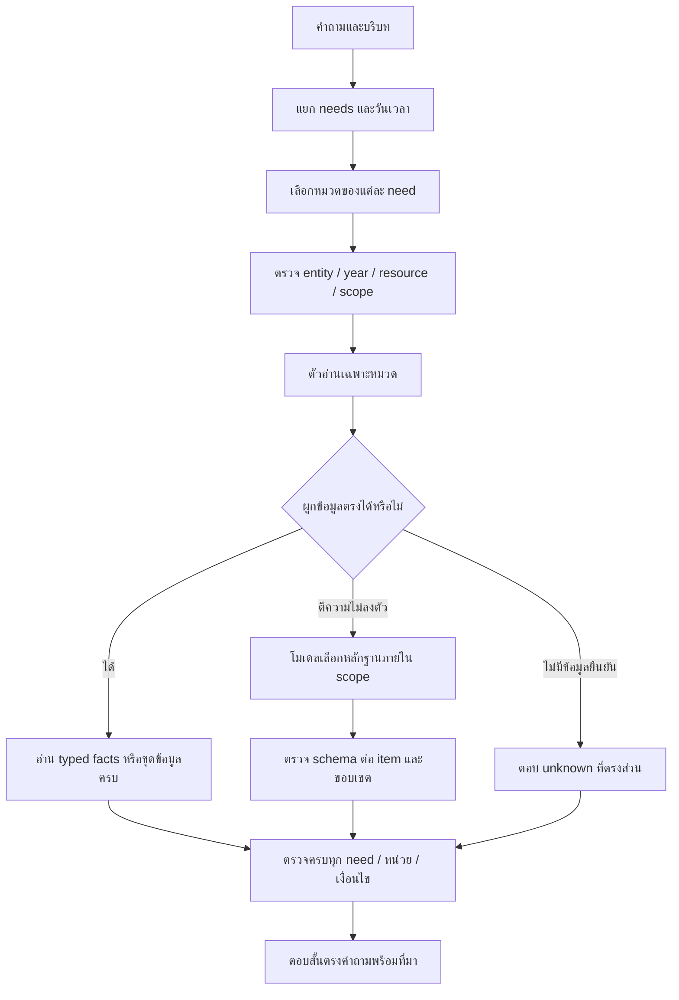

# R113 — วิเคราะห์ผลและ Flow ที่ควรประกอบจากหลักฐาน

วิเคราะห์จากไฟล์ผลที่รันเสร็จแล้วเท่านั้น ไม่มีการส่งคำถามทดสอบเพิ่ม เอกสารนี้เป็นผลตรวจและแผนพัฒนาต่อจาก prototype ไม่ได้ติดตั้งทับ R78

## 1. ผลตรวจความครบ

ครบ 4,200 executions / 42 configurations / 14 หมวด / 100 ข้อร่วมกันต่อ Flow ไม่มีคู่ Flow–คำถามขาดหรือซ้ำ และ original frozen files/source database hashes ตรงเดิม ตรวจได้ใน AUDIT_FINAL.json

## 2. แยกสิ่งที่ผิดก่อนนับเป็นความถูกต้องของคำตอบ

คะแนน strict ผ่านเมื่อ claim IDs/ค่า/ที่มา/ขอบเขต/answer state ตรงครบ เป็น source-contract accuracy ของชุดพัฒนา ไม่ใช่คะแนน semantic accuracy จากมนุษย์ ข้อที่มี claim อื่นไม่ได้ผิดความหมายทุกข้อ เช่น เพิ่มชนิดอุปกรณ์ขณะถามสเปกอาจให้ข้อมูลถูกแต่เกินขอบเขต ในทางกลับกันเลือกเครื่องคนละตัวหรือกฎคนละปีเป็นความผิดขอบเขตที่ยืนยันได้

| กลุ่มหลักที่ไม่ซ้ำกัน | จำนวนผล | วิธีอ่าน |
|---|---:|---|
| ขาด claim ที่ขอและมี claim อื่น | 191 | เปรียบเทียบ contract; รายละเอียด semantic ยังต้อง review ตาม source |
| ขาด claim ที่ขอ | 783 | เปรียบเทียบ contract; รายละเอียด semantic ยังต้อง review ตาม source |
| มี claim อื่น/เกินขอบเขต | 312 | เปรียบเทียบ contract; รายละเอียด semantic ยังต้อง review ตาม source |
| ต่างเฉพาะ answer-state protocol | 147 | เปรียบเทียบ contract; รายละเอียด semantic ยังต้อง review ตาม source |
| โมเดลส่งแผนไม่ครบ/ไม่ผ่าน schema | 176 | ตรวจพบจาก raw model event |

ผ่าน strict 2,591/4,200 จากทุกตัวทดลองรวมกัน ค่านี้รวมทั้งแนวทางที่ดีและไม่ดี ไม่ใช่คะแนนของระบบที่ประกอบผู้ชนะแล้ว

โมเดลมีบันทึก HTTP 308 ครั้ง สำเร็จด้าน transport 308 ครั้ง; มี 60 batches / 176 คำถามที่แผนไม่ครบจน parser ปฏิเสธชุด ผลเหล่านี้เป็น schema/planning failures ไม่ใช่ข้อยืนยันว่า source ไม่มีหรือโมเดลติดต่อไม่ได้

ข้อผิด answer_state_only ต้องแยกจากคำตอบผิดเนื้อหา: เมื่อ oracle คาด missing_source แต่ตัวอ่านคืน missing_input พร้อมข้อความว่ายังไม่มีข้อมูล ระบบไม่ได้สร้างข้อเท็จจริงผิด เพียงตอบ protocol คนละ state ส่วน expected=answer แต่คืน missing_input และไม่มี claim เป็นการตอบไม่ได้ทั้งที่ oracle มี source

การรันต่อใช้ batch label บางชื่อซ้ำใน C10 แต่ question IDs ของแต่ละ event ไม่ซ้ำ การโยง trace จึงใช้คู่ (model_event_id, question_id) แทน event_id เดี่ยว ตรวจครบทั้ง 903 model-attempted question results ใน AUDIT_FINAL.json โดยไม่เปลี่ยน event logs เดิม ข้อบกพร่องนี้เป็นเรื่องตัวระบุ trace ของ recovery control และไม่ทำให้คู่ Flow–คำถามรันซ้ำ

## 3. โครง Flow ที่เสนอให้ประกอบต่อ

ความสามารถ router/graph/decision table/การใช้ provider จริงในแผนนี้ยังไม่ได้รับการพิสูจน์จาก benchmark ตัวอ่านแยกหมวดรอบนี้

## C01 ข้อมูลศูนย์ สถานที่ และช่องทางติดต่อ

**ผลสามแบบ:** C01-F01 = 77/100; C01-F02 = 60/100; C01-F08 = 82/100
**คะแนนสูงสุดในชุดนี้:** C01-F08 — ยังไม่ใช่การรับรองพร้อมใช้จริง

**สาเหตุจากผลและ code path:** คำถามข้อมูลศูนย์ใช้คำว่าเรื่อง/รายละเอียดแทน label ใน projection ทำให้ typed ไม่ bind facet; lexical บางข้อเลือกที่อยู่แทนคำถามอื่น

**Flow ที่ควรพัฒนาต่อ:** location/contact intent → center/facility identity → direct field; semantic ช่วยเลือก field เมื่อจำเป็น → ตรวจว่าไม่มี contact/time ปน

**จุดเสริมที่จำเป็น:** เพิ่ม aliases ของ overview/operator/contact ตาม field และแยกคำถามศูนย์ออกจากกิจกรรม ไม่ให้คำว่า Phuket เลือกทุก record

### ตัวอย่าง C01-F01 / C01-Q007

คำถาม: ถามจากข้อมูลที่ศูนย์ให้ไว้ งาน PSU Esports Studio - Phuket คือกิจกรรมอะไร

คำตอบจริง:

> PSU Esports Studio - Phuket — ชั้น: 1 [S1]

กลุ่ม: ขาด claim ที่ขอและมี claim อื่น; expected state=answer, actual state=answer

สิ่งที่ oracle กำหนดจาก source:

- `C01:center_psu_phuket:description`: PSU Esports Studio - Phuket เป็นศูนย์ของมหาวิทยาลัยสงขลานครินทร์ครับ
  - Evidence: `[{"locator": "/mapped_fields/description", "source_id": "r68_9a0af5d7515b5231c69d4008408a"}]`

### ตัวอย่าง C01-F02 / C01-Q006

คำถาม: รบกวนเช็กให้หน่อย อยากหา ที่นั่งพัก ต้องไปบริเวณใด

คำตอบจริง:

> ยังไม่มีข้อมูลยืนยันสำหรับส่วนที่ถาม

กลุ่ม: ขาด claim ที่ขอ; expected state=answer, actual state=missing_source

สิ่งที่ oracle กำหนดจาก source:

- `C01:facility_rest_seating:location`: โซนกลางห้อง
  - Evidence: `[{"locator": "/mapped_fields/location", "source_id": "r68_079c050fc072e211dae9f4403483"}]`

### ตัวอย่าง C01-F08 / C01-Q029

คำถาม: ขอรายละเอียดของงาน PSU Esports Studio - Phuket

คำตอบจริง:

> ยังไม่มีข้อมูลยืนยันสำหรับส่วนที่ถาม

กลุ่ม: ขาด claim ที่ขอ; expected state=answer, actual state=missing_source

สิ่งที่ oracle กำหนดจาก source:

- `C01:center_psu_phuket:description`: PSU Esports Studio - Phuket เป็นศูนย์ของมหาวิทยาลัยสงขลานครินทร์ครับ
  - Evidence: `[{"locator": "/mapped_fields/description", "source_id": "r68_9a0af5d7515b5231c69d4008408a"}]`

## C02 บุคลากรและหน้าที่

**ผลสามแบบ:** C02-F01 = 43/100; C02-F04 = 79/100; C02-F09 = 74/100
**คะแนนสูงสุดในชุดนี้:** C02-F04 — ยังไม่ใช่การรับรองพร้อมใช้จริง

**สาเหตุจากผลและ code path:** source มีตำแหน่งแล้ว แต่สำนวน “ใครดูแลงานอะไร” ไม่ตรง role aliases; hybrid เสียคะแนน schema เพิ่มจาก typed ที่อ่านตรงได้

**Flow ที่ควรพัฒนาต่อ:** public entity resolver → name/team/role → public-field allowlist → typed read → semantic เฉพาะชื่อ/หน้าที่ไม่ลงตัว

**จุดเสริมที่จำเป็น:** เพิ่ม role paraphrases ที่เป็น data/config; ห้าม fallback ไปเบอร์ส่วนตัวเมื่อไม่มี field และไม่ส่ง typed success ให้ LLM ซ้ำ

### ตัวอย่าง C02-F01 / C02-Q004

คำถาม: อยากรู้ว่า นางสาวกมลวรรณ นวลสาย ทำหน้าที่อะไร

คำตอบจริง:

> นางสาวกมลวรรณ นวลสาย — ชื่อ: นางสาวกมลวรรณ นวลสาย [S1]

กลุ่ม: ขาด claim ที่ขอและมี claim อื่น; expected state=answer, actual state=answer

สิ่งที่ oracle กำหนดจาก source:

- `C02:member_18a751d710b9b30c:role`: กรรมการ
  - Evidence: `[{"locator": "/mapped_fields/role", "source_id": "r66_person_review_2f81ce5b9ffc69ed803bc905"}]`

### ตัวอย่าง C02-F04 / C02-Q006

คำถาม: รบกวนเช็กให้หน่อย ใครดูแลงานอะไรในกรณีของ ผศ.ดร.นิวัติ แก้วประดับ

คำตอบจริง:

> ยังไม่มีข้อมูลยืนยันสำหรับส่วนที่ถาม

กลุ่ม: ขาด claim ที่ขอ; expected state=answer, actual state=missing_source

สิ่งที่ oracle กำหนดจาก source:

- `C02:member_ce4590ddc09c0f4e:role`: อธิการบดี
  - Evidence: `[{"locator": "/mapped_fields/role", "source_id": "r66_en_729b1f3a4d618a458a949006"}]`

### ตัวอย่าง C02-F09 / C02-Q006

คำถาม: รบกวนเช็กให้หน่อย ใครดูแลงานอะไรในกรณีของ ผศ.ดร.นิวัติ แก้วประดับ

คำตอบจริง:

> ผศ.ดร.นิวัติ แก้วประดับ — ชื่อ: ผศ.ดร.นิวัติ แก้วประดับ [S1]
> ผศ.ดร.นิวัติ แก้วประดับ — ทีม: Members [S2]
> ผศ.ดร.นิวัติ แก้วประดับ — หน้าที่และตำแหน่ง: อธิการบดี [S3]

กลุ่ม: มี claim อื่น/เกินขอบเขต; expected state=answer, actual state=answer

สิ่งที่ oracle กำหนดจาก source:

- `C02:member_ce4590ddc09c0f4e:role`: อธิการบดี
  - Evidence: `[{"locator": "/mapped_fields/role", "source_id": "r66_en_729b1f3a4d618a458a949006"}]`

## C03 อุปกรณ์ เครื่อง และความจุ

**ผลสามแบบ:** C03-F01 = 64/100; C03-F05 = 61/100; C03-F10 = 78/100
**คะแนนสูงสุดในชุดนี้:** C03-F10 — ยังไม่ใช่การรับรองพร้อมใช้จริง

**สาเหตุจากผลและ code path:** entity ถูกแต่บางคำตอบรวมชนิดอุปกรณ์ที่ไม่ได้ขอ หรือเลือกข้อมูล quantity/location แทน spec; ตัวเลขหน่วยอาจถูกแต่ field ผิด

**Flow ที่ควรพัฒนาต่อ:** device/resource/zone resolution → requested predicate+unit → relation lookup → aggregate เฉพาะหน่วยที่ถาม → claim scope check

**จุดเสริมที่จำเป็น:** แยกจำนวนเครื่อง จำนวนผู้เล่น และที่นั่ง; semantic เลือก requested facet เพียงที่จำเป็น และ renderer ซ่อน None/internal keys

### ตัวอย่าง C03-F01 / C03-Q002

คำถาม: ขอสอบถามหน่อยครับ อยากดูรายละเอียดฮาร์ดแวร์ Sony PlayStation VR2

คำตอบจริง:

> Sony PlayStation VR2 — ที่ตั้ง: VR Zone [S1]

กลุ่ม: ขาด claim ที่ขอและมี claim อื่น; expected state=answer, actual state=answer

สิ่งที่ oracle กำหนดจาก source:

- `C03:equipment_sony_playstation_vr2:specifications`: key: zone; unit: None; value: VR Zone; key: quantity; unit: None; value: 1 Unit
  - Evidence: `[{"locator": "/mapped_fields/specifications", "source_id": "r63_1dc5af180d92a866489f54c007f0"}]`

### ตัวอย่าง C03-F05 / C03-Q002

คำถาม: ขอสอบถามหน่อยครับ อยากดูรายละเอียดฮาร์ดแวร์ Sony PlayStation VR2

คำตอบจริง:

> ยังไม่มีข้อมูลยืนยันสำหรับส่วนที่ถาม

กลุ่ม: ขาด claim ที่ขอ; expected state=answer, actual state=missing_source

สิ่งที่ oracle กำหนดจาก source:

- `C03:equipment_sony_playstation_vr2:specifications`: key: zone; unit: None; value: VR Zone; key: quantity; unit: None; value: 1 Unit
  - Evidence: `[{"locator": "/mapped_fields/specifications", "source_id": "r63_1dc5af180d92a866489f54c007f0"}]`

### ตัวอย่าง C03-F10 / C03-Q002

คำถาม: ขอสอบถามหน่อยครับ อยากดูรายละเอียดฮาร์ดแวร์ Sony PlayStation VR2

คำตอบจริง:

> Sony PlayStation VR2 — ชนิดอุปกรณ์: vr [S1]
> Sony PlayStation VR2 — สเปก: key: zone; unit: None; value: VR Zone; key: quantity; unit: None; value: 1 Unit [S2]

กลุ่ม: มี claim อื่น/เกินขอบเขต; expected state=answer, actual state=answer

สิ่งที่ oracle กำหนดจาก source:

- `C03:equipment_sony_playstation_vr2:specifications`: key: zone; unit: None; value: VR Zone; key: quantity; unit: None; value: 1 Unit
  - Evidence: `[{"locator": "/mapped_fields/specifications", "source_id": "r63_1dc5af180d92a866489f54c007f0"}]`

## C04 เกมที่มี ข้อมูลเกม และรูปแบบเล่น

**ผลสามแบบ:** C04-F01 = 41/100; C04-F05 = 44/100; C04-F10 = 68/100
**คะแนนสูงสุดในชุดนี้:** C04-F10 — ยังไม่ใช่การรับรองพร้อมใช้จริง

**สาเหตุจากผลและ code path:** คำอธิบายเกม แนวเกม วิธีเล่น และ offering ถูกใช้แทนกัน; top1 ทำให้หลาย needs ตกหล่น

**Flow ที่ควรพัฒนาต่อ:** game/service resolution → catalog/overview/how-to/platform intent → offering enumeration หรือ detail field → completeness check

**จุดเสริมที่จำเป็น:** catalog ต้อง enumerate source set; overview ไม่ตอบแค่ genre และ supported platforms ไม่เท่ากับเกมที่ติดตั้งศูนย์

### ตัวอย่าง C04-F01 / C04-Q002

คำถาม: ขอสอบถามหน่อยครับ Super Mario Odyssey มีให้เล่นที่ไหนในศูนย์

คำตอบจริง:

> Super Mario Odyssey — แนวเกม: เกม Platformer 3D [S1]

กลุ่ม: ขาด claim ที่ขอและมี claim อื่น; expected state=answer, actual state=answer

สิ่งที่ oracle กำหนดจาก source:

- `C04:game_detail_super_mario_odyssey:studio_services`: Nintendo Switch (1-2 Persons); Nintendo Switch (1-4 Persons)
  - Evidence: `[{"source_id": "migrated_link_availability_nintendo_1_2_game_detail_super_mario_odyssey", "locator": "/fields/offered", "path_kind": "common_relation"}, {"source_id": "migrated_link_availability_nintendo_1_4_game_detail_super_mario_odyssey", "locator": "/fields/offered", "path_kind": "common_relation"}]`

### ตัวอย่าง C04-F05 / C04-Q001

คำถาม: Hogwarts Legacy จัดเป็นเกมประเภทใด

คำตอบจริง:

> ยังไม่มีข้อมูลยืนยันสำหรับส่วนที่ถาม

กลุ่ม: ขาด claim ที่ขอ; expected state=answer, actual state=missing_source

สิ่งที่ oracle กำหนดจาก source:

- `C04:game_detail_hogwarts_legacy:genre`: เกม Open-world Action RPG
  - Evidence: `[{"locator": "/mapped_fields/genre", "source_id": "r66_en_d5b44564bddd93c84e17c534"}]`

### ตัวอย่าง C04-F10 / C04-Q006

คำถาม: รบกวนเช็กให้หน่อย เล่าเกี่ยวกับเกม Monster Hunter Rise ให้ฟังที

คำตอบจริง:

> Monster Hunter Rise — แนวเกม: เกม Action RPG ล่ามอนสเตอร์ [S1]

กลุ่ม: ขาด claim ที่ขอและมี claim อื่น; expected state=answer, actual state=answer

สิ่งที่ oracle กำหนดจาก source:

- `C04:game_detail_monster_hunter_rise:summary`: Monster Hunter Rise คือเกมล่ามอนสเตอร์ที่ผู้เล่นเลือกอาวุธ ทำภารกิจ และเก็บวัตถุดิบมาสร้างอุปกรณ์
  - Evidence: `[{"locator": "/mapped_fields/summary", "source_id": "r66_en_review_4a2941aad9a66289beba95fd"}]`

## C05 ปุ่มควบคุมและการใช้อินพุต

**ผลสามแบบ:** C05-F01 = 80/100; C05-F04 = 100/100; C05-F08 = 80/100
**คะแนนสูงสุดในชุดนี้:** C05-F04 — ยังไม่ใช่การรับรองพร้อมใช้จริง

**สาเหตุจากผลและ code path:** typed ได้ 100/100 ในชุดนี้; hybrid ส่ง unknown binding ไปโมเดลแล้วทั้ง 20 ข้อได้รับ schema failure จึงลดเหลือ80

**Flow ที่ควรพัฒนาต่อ:** game+platform+preset → normalized action/context → exact binding → confirmed unknown/clarification → deterministic renderer

**จุดเสริมที่จำเป็น:** เก็บ typed เป็นเส้นหลัก; ถ้า action ไม่มี source ให้ยืนยันว่าไม่มีข้อมูล ไม่ส่งโมเดลเดา; ยังต้องตรวจคนละ preset/ภาคก่อนรับรองใช้งานจริง

### ตัวอย่าง C05-F01 / C05-Q081

คำถาม: รบกวนเช็กให้หน่อย ใน Animal Crossing: New Horizons / Nintendo Switch กดปุ่มใดเพื่อสร้างด่านใหม่อัตโนมัติ

คำตอบจริง:

> Animal Crossing: New Horizons / Nintendo Switch — หยิบไอเทม: Y — หยิบไอเทมที่อยู่บนพื้น [S1]

กลุ่ม: มี claim อื่น/เกินขอบเขต; expected state=missing_source, actual state=answer

สิ่งที่ oracle กำหนดจาก source:

- ไม่มี source ยืนยันรายละเอียดที่ถามใน snapshot นี้ ไม่ควรยืมข้อมูล subject/ปี/field อื่นมาตอบ

### ตัวอย่าง C05-F08 / C05-Q081

คำถาม: รบกวนเช็กให้หน่อย ใน Animal Crossing: New Horizons / Nintendo Switch กดปุ่มใดเพื่อสร้างด่านใหม่อัตโนมัติ

คำตอบจริง:

> ระบบตีความไม่พร้อมใช้งาน จึงยังยืนยันส่วนนี้ไม่ได้

กลุ่ม: โมเดลส่งแผนไม่ครบ/ไม่ผ่าน schema; expected state=missing_source, actual state=unavailable

สิ่งที่ oracle กำหนดจาก source:

- ไม่มี source ยืนยันรายละเอียดที่ถามใน snapshot นี้ ไม่ควรยืมข้อมูล subject/ปี/field อื่นมาตอบ

## C06 ราคาใช้บริการรายคนและการคำนวณ

**ผลสามแบบ:** C06-F01 = 79/100; C06-F04 = 75/100; C06-F10 = 78/100
**คะแนนสูงสุดในชุดนี้:** C06-F01 — ยังไม่ใช่การรับรองพร้อมใช้จริง

**สาเหตุจากผลและ code path:** การเลือกตัวเลขจาก record ใกล้เคียงทำให้ตอบราคาเฉพาะบริการแทนคำถามหน่วยคิดเงิน; regex ปีไม่รองรับช่องว่างและบาง subject เป็น internal ID

**Flow ที่ควรพัฒนาต่อ:** service+audience+date+persons+sessions → validity → rate/unit lookup → deterministic arithmetic → units/rounding check

**จุดเสริมที่จำเป็น:** ตรวจปีแบบ date slot ก่อน retrieval; หากไม่มีราคาอนาคตห้ามยืมปัจจุบัน; แยก policy ต่อคนจากจำนวนเงิน และแทน internal IDs ด้วย display names

### ตัวอย่าง C06-F01 / C06-Q034

คำถาม: รบกวนเช็กให้หน่อย คิดค่าบริการรายชั่วโมงเป็นต่อคนหรือต่อเครื่อง

คำตอบจริง:

> VR Station 1 ชั่วโมง / General Adult — ค่าบริการต่อคนต่อรอบ: 1050 บาทต่อคนต่อรอบ [S1]

กลุ่ม: ขาด claim ที่ขอและมี claim อื่น; expected state=answer, actual state=answer

สิ่งที่ oracle กำหนดจาก source:

- `C06:Q049:owner_policy`: ผู้ตอบระบุทั้งหมดคิดต่อคน; ไม่ขยายไปเป็นการคูณราคาเหมาห้องต่อหัว เพราะ Excel ระบุราคาต่อวัน/ครึ่งวันของโซน
  - Evidence: `[{"source_id": "owner108:Q049", "locator": "/answer_th", "source_path": "r109_owner_answers_20261020/MERGED_SERVICE_STATEMENTS.json"}]`

### ตัวอย่าง C06-F04 / C06-Q019

คำถาม: กำลังวางแผนไปใช้บริการ เลยขอถามว่า ราคาที่แจ้งรวมภาษีหรือยัง

คำตอบจริง:

> ยังไม่มีข้อมูลยืนยันสำหรับส่วนที่ถาม

กลุ่ม: ขาด claim ที่ขอ; expected state=answer, actual state=missing_source

สิ่งที่ oracle กำหนดจาก source:

- `C06:Q050:owner_policy`: ราคาในตารางรวมภาษีแล้ว; ไม่ได้ยกเลิกหมายเหตุค่าเจ้าหน้าที่นอกเวลาใน Excel
  - Evidence: `[{"source_id": "owner108:Q050", "locator": "/answer_th", "source_path": "r109_owner_answers_20261020/MERGED_SERVICE_STATEMENTS.json"}]`

### ตัวอย่าง C06-F10 / C06-Q082

คำถาม: ถามจากข้อมูลที่ศูนย์ให้ไว้ ราคา Nintendo Switch (1-2 Persons) / PSU Student and Staff ในปี 2028 จะเท่าไร

คำตอบจริง:

> Nintendo Switch (1-2 Persons) / PSU Student and Staff — ค่าบริการต่อคนต่อรอบ: 0 บาทต่อคนต่อรอบ [S1]

กลุ่ม: มี claim อื่น/เกินขอบเขต; expected state=not_current, actual state=answer

สิ่งที่ oracle กำหนดจาก source:

- ไม่มี source ยืนยันรายละเอียดที่ถามใน snapshot นี้ ไม่ควรยืมข้อมูล subject/ปี/field อื่นมาตอบ

## C07 เช่าเหมาโซน ห้อง และกิจกรรมส่วนตัว

**ผลสามแบบ:** C07-F01 = 52/100; C07-F04 = 32/100; C07-F09 = 72/100
**คะแนนสูงสุดในชุดนี้:** C07-F09 — ยังไม่ใช่การรับรองพร้อมใช้จริง

**สาเหตุจากผลและ code path:** terms ที่ไม่มีข้อมูล เช่น ค่าปรับเกินเวลา ถูกตอบด้วย duration เพราะชื่อแพ็กเกจตรงแต่ facet ไม่ตรง; typed ไม่เข้าใจสำนวนแพ็กเกจพอ

**Flow ที่ควรพัฒนาต่อ:** zone+audience+half/full day → package tuple → duration/equipment/price/terms → known/unknown per field

**จุดเสริมที่จำเป็น:** แยกราคา ระยะเวลา มัดจำ overtime และอุปกรณ์; ครึ่งวัน3ชั่วโมง/เต็มวัน7ชั่วโมงตาม owner overlay ไม่ใช้ค่า duration ตอบจำนวนเงิน

### ตัวอย่าง C07-F01 / C07-Q003

คำถาม: ช่วยตอบสั้น ๆ ว่า ถ้าเช่า PSU Esports Studio - Phuket - VR Zone / ภายนอก / ครึ่งวัน ต้องจ่ายกี่บาท

คำตอบจริง:

> PSU Esports Studio - Phuket - VR Zone / ภายนอก / ครึ่งวัน — ที่นั่งห้อง: 34 [S1]

กลุ่ม: ขาด claim ที่ขอและมี claim อื่น; expected state=answer, actual state=answer

สิ่งที่ oracle กำหนดจาก source:

- `C07:package_9:amount_thb`: 3000 บาทต่อแพ็กเกจ
  - Evidence: `[{"source_id": "r109:rental", "locator": "ค่าบริการเช่าห้อง PSU Esports S!C5", "source_path": "D:\\Download New\\ค่าบริการครึ่งวันและเต็มวัน PSU Esports Studio - Phuket (1).xlsx"}]`

### ตัวอย่าง C07-F04 / C07-Q001

คำถาม: ห้อง PSU Esports Studio - Phuket - VR Zone / ภายนอก / เต็มวัน มีที่นั่งกี่ที่

คำตอบจริง:

> ยังไม่มีข้อมูลยืนยันสำหรับส่วนที่ถาม

กลุ่ม: ขาด claim ที่ขอ; expected state=answer, actual state=missing_source

สิ่งที่ oracle กำหนดจาก source:

- `C07:package_8:room_seats`: 34
  - Evidence: `[{"source_id": "r109:rental", "locator": "ค่าบริการเช่าห้อง PSU Esports S!B5", "source_path": "D:\\Download New\\ค่าบริการครึ่งวันและเต็มวัน PSU Esports Studio - Phuket (1).xlsx"}]`

### ตัวอย่าง C07-F09 / C07-Q083

คำถาม: ถามจากข้อมูลที่ศูนย์ให้ไว้ ถ้าเหมา PSU Esports Studio - Phuket - All Zones / ภายนอก / เต็มวัน เกินเวลาจะปรับกี่บาทต่อนาที

คำตอบจริง:

> PSU Esports Studio - Phuket - All Zones / ภายนอก / เต็มวัน — ระยะเวลาเป็นนาที: 420 [S1]

กลุ่ม: มี claim อื่น/เกินขอบเขต; expected state=missing_source, actual state=answer

สิ่งที่ oracle กำหนดจาก source:

- ไม่มี source ยืนยันรายละเอียดที่ถามใน snapshot นี้ ไม่ควรยืมข้อมูล subject/ปี/field อื่นมาตอบ

## C08 การจอง การมาถึง และการเปลี่ยนรายการ

**ผลสามแบบ:** C08-F01 = 69/100; C08-F06 = 7/100; C08-F10 = 74/100
**คะแนนสูงสุดในชุดนี้:** C08-F10 — ยังไม่ใช่การรับรองพร้อมใช้จริง

**สาเหตุจากผลและ code path:** typed7/100 เพราะ subject นโยบายชื่อ “extend session” ไม่อยู่ในคำถามธรรมชาติ; hybrid หลาย need ตอบไม่ครบ

**Flow ที่ควรพัฒนาต่อ:** action classifier → booking/payment/attendance condition slots → decision table → required procedure clauses → per-need checklist

**จุดเสริมที่จำเป็น:** compile นโยบายเป็น action/conditions โดยคง source; เปลี่ยนชื่อ/วัน/เครื่องแยก branches และตรวจ clause ครบทั้งสอง need

### ตัวอย่าง C08-F01 / C08-Q003

คำถาม: ช่วยตอบสั้น ๆ ว่า ถ้าศูนย์ปิดหลังจากจองแล้วทางศูนย์จะแจ้งอย่างไร

คำตอบจริง:

> ยังไม่มีข้อมูลยืนยันสำหรับส่วนที่ถาม

กลุ่ม: ขาด claim ที่ขอ; expected state=answer, actual state=missing_source

สิ่งที่ oracle กำหนดจาก source:

- `C08:Q010:owner_policy`: ศูนย์ติดต่อผ่านอีเมล Gmail ที่ใช้สมัคร; ยังไม่ใช่ข้อยืนยันวิธีคืนเงินหรือเปลี่ยนรอบ
  - Evidence: `[{"source_id": "owner108:Q010", "locator": "/answer_th", "source_path": "r109_owner_answers_20261020/MERGED_SERVICE_STATEMENTS.json"}]`

### ตัวอย่าง C08-F06 / C08-Q001

คำถาม: กำลังเล่นอยู่แล้วอยากต่อเวลา ต้องทำยังไง

คำตอบจริง:

> ยังไม่มีข้อมูลยืนยันสำหรับส่วนที่ถาม

กลุ่ม: ขาด claim ที่ขอ; expected state=answer, actual state=missing_source

สิ่งที่ oracle กำหนดจาก source:

- `C08:Q003:owner_policy`: หากรอบถัดไปยังว่างและอยู่ในเวลาบริการปกติ สามารถจองต่อผ่านขั้นตอนปกติได้
  - Evidence: `[{"source_id": "owner108:Q003", "locator": "/answer_th", "source_path": "r109_owner_answers_20261020/MERGED_SERVICE_STATEMENTS.json"}]`

### ตัวอย่าง C08-F10 / C08-Q061

คำถาม: How do I correct a wrong name on my booking? and also How can I extend my play session while I am already playing?

คำตอบจริง:

> extend session — conditions and procedure: You may book the next session through the normal process if it is available and within service hours. [S1]

กลุ่ม: ขาด claim ที่ขอ; expected state=answer, actual state=answer

สิ่งที่ oracle กำหนดจาก source:

- `C08:Q011:owner_policy`: Cancel through email at least 1 hour in advance, then book again using the original payment slip.
  - Evidence: `[{"source_id": "owner108:Q011", "locator": "/answer_th", "source_path": "r109_owner_answers_20261020/MERGED_SERVICE_STATEMENTS.json"}]`
- `C08:Q003:owner_policy`: You may book the next session through the normal process if it is available and within service hours.
  - Evidence: `[{"source_id": "owner108:Q003", "locator": "/answer_th", "source_path": "r109_owner_answers_20261020/MERGED_SERVICE_STATEMENTS.json"}]`

## C09 การชำระเงิน สลิป เอกสาร และเงินคืน

**ผลสามแบบ:** C09-F01 = 68/100; C09-F04 = 8/100; C09-F09 = 72/100
**คะแนนสูงสุดในชุดนี้:** C09-F09 — ยังไม่ใช่การรับรองพร้อมใช้จริง

**สาเหตุจากผลและ code path:** typed8/100 จากการ bind subject ไม่ได้; hybrid บางคำถามโอนขาดดึงกฎโอนเกินมาด้วยแม้ source ทั้งสองถูก

**Flow ที่ควรพัฒนาต่อ:** payment scenario → payer/amount_delta/slip/document/payment state → exact policy → required evidence/contact → no transaction execution

**จุดเสริมที่จำเป็น:** สร้าง delta>0/delta<0 branches และ document type แยกกัน; ถามหลักฐานเฉพาะที่กฎต้องใช้ ไม่รวมทุกเรื่องที่มีคำว่าโอน

### ตัวอย่าง C09-F01 / C09-Q003

คำถาม: ช่วยตอบสั้น ๆ ว่า สามารถแบ่งจ่ายหรือวางมัดจำก่อนใช้บริการได้ไหม

คำตอบจริง:

> ยังไม่มีข้อมูลยืนยันสำหรับส่วนที่ถาม

กลุ่ม: ขาด claim ที่ขอ; expected state=answer, actual state=missing_source

สิ่งที่ oracle กำหนดจาก source:

- `C09:Q016:owner_policy`: ต้องจ่ายเต็มจำนวน
  - Evidence: `[{"source_id": "owner108:Q016", "locator": "/answer_th", "source_path": "r109_owner_answers_20261020/MERGED_SERVICE_STATEMENTS.json"}]`

### ตัวอย่าง C09-F04 / C09-Q001

คำถาม: ขอใบเสร็จ ใบเสนอราคาหรือใบกำกับภาษีได้ไหม

คำตอบจริง:

> ยังไม่มีข้อมูลยืนยันสำหรับส่วนที่ถาม

กลุ่ม: ขาด claim ที่ขอ; expected state=answer, actual state=missing_source

สิ่งที่ oracle กำหนดจาก source:

- `C09:Q018:owner_policy`: ออกใบกำกับภาษีไม่ได้; คำตอบก่อนหน้าแยกระบุใบเสนอราคาและใบเสร็จออกไม่ได้เช่นกัน
  - Evidence: `[{"source_id": "owner108:Q018", "locator": "/answer_th", "source_path": "r109_owner_answers_20261020/MERGED_SERVICE_STATEMENTS.json"}]`

### ตัวอย่าง C09-F09 / C09-Q002

คำถาม: ขอสอบถามหน่อยครับ ยอดที่โอนขาดไป ต้องส่งหลักฐานเพิ่มอย่างไร

คำตอบจริง:

> โอนเพิ่มเมื่อยอดขาด — เงื่อนไขและวิธีปฏิบัติ: ติดต่อเพจ Facebook พร้อมสลิปและหลักฐานการจอง [S1]
> เงินโอนเกิน — เงื่อนไขและวิธีปฏิบัติ: ติดต่อเพจ Facebook พร้อมสลิปและหลักฐานการจอง; คำตอบก่อนหน้าระบุเก็บใช้ session อนาคต ไม่คืนเงิน [S2]

กลุ่ม: มี claim อื่น/เกินขอบเขต; expected state=answer, actual state=answer

สิ่งที่ oracle กำหนดจาก source:

- `C09:Q015:owner_policy`: ติดต่อเพจ Facebook พร้อมสลิปและหลักฐานการจอง
  - Evidence: `[{"source_id": "owner108:Q015", "locator": "/answer_th", "source_path": "r109_owner_answers_20261020/MERGED_SERVICE_STATEMENTS.json"}]`

## C10 สิทธิ์ใช้บริการ กฎศูนย์ และปัญหาระหว่างใช้

**ผลสามแบบ:** C10-F02 = 94/100; C10-F05 = 0/100; C10-F10 = 75/100
**คะแนนสูงสุดในชุดนี้:** C10-F02 — ยังไม่ใช่การรับรองพร้อมใช้จริง

**สาเหตุจากผลและ code path:** lexical94/100 สูงสุดในชุดนี้ แต่ยังตอบไม่ได้บาง policy ที่มี source; typed0/100 ไม่ใช่ไม่มีข้อมูล เป็น subject/facet contract ไม่รับสำนวนสถานการณ์

**Flow ที่ควรพัฒนาต่อ:** action+actor+condition → permission enum → exception/remedy → scoped answer + source

**จุดเสริมที่จำเป็น:** ต้อง implement condition decision table จริงแทนเรียก flat matcher ว่า graph; unknown อายุ/ค่าปรับต้องไม่ขยายข้ออนุญาตทั่วไป

### ตัวอย่าง C10-F02 / C10-Q012

คำถาม: กำลังวางแผนไปใช้บริการ เลยขอถามว่า เล่นเสร็จแล้วศูนย์เก็บข้อมูลล็อกอินผู้เล่นไว้ไหม

คำตอบจริง:

> ยังไม่มีข้อมูลยืนยันสำหรับส่วนที่ถาม

กลุ่ม: ขาด claim ที่ขอ; expected state=answer, actual state=missing_source

สิ่งที่ oracle กำหนดจาก source:

- `C10:Q022:owner_policy`: เจ้าของระบุว่าออกจากระบบและไม่เก็บข้อมูลไว้; ยังไม่ได้ตรวจทางเทคนิคว่าไม่มีข้อมูลหลงเหลือทุกชนิด
  - Evidence: `[{"source_id": "owner108:Q022", "locator": "/answer_th", "source_path": "r109_owner_answers_20261020/MERGED_SERVICE_STATEMENTS.json"}]`

### ตัวอย่าง C10-F05 / C10-Q001

คำถาม: อินเทอร์เน็ตหรือระบบขัดข้องระหว่างเล่นต้องทำยังไง

คำตอบจริง:

> ยังไม่มีข้อมูลยืนยันสำหรับส่วนที่ถาม

กลุ่ม: ขาด claim ที่ขอ; expected state=answer, actual state=missing_input

สิ่งที่ oracle กำหนดจาก source:

- `C10:Q028:owner_policy`: ใช้หลักการเดียวกับเหตุเครื่องขัดข้องและแจ้งเจ้าหน้าที่ตรวจสอบ
  - Evidence: `[{"source_id": "owner108:Q028", "locator": "/answer_th", "source_path": "r109_owner_answers_20261020/MERGED_SERVICE_STATEMENTS.json"}]`

### ตัวอย่าง C10-F10 / C10-Q038

คำถาม: ช่วยตอบสั้น ๆ ว่า เล่นเสร็จแล้วศูนย์เก็บข้อมูลล็อกอินผู้เล่นไว้ไหม

คำตอบจริง:

> บัญชี Steam — เงื่อนไขและวิธีปฏิบัติ: ศูนย์มีบัญชี Steam ให้ใช้ที่ศูนย์ และใช้บัญชีส่วนตัวได้ [S1]

กลุ่ม: ขาด claim ที่ขอและมี claim อื่น; expected state=answer, actual state=answer

สิ่งที่ oracle กำหนดจาก source:

- `C10:Q022:owner_policy`: เจ้าของระบุว่าออกจากระบบและไม่เก็บข้อมูลไว้; ยังไม่ได้ตรวจทางเทคนิคว่าไม่มีข้อมูลหลงเหลือทุกชนิด
  - Evidence: `[{"source_id": "owner108:Q022", "locator": "/answer_th", "source_path": "r109_owner_answers_20261020/MERGED_SERVICE_STATEMENTS.json"}]`

## C11 ตารางเปิด ช่วงจอง และวันปิดพิเศษ

**ผลสามแบบ:** C11-F01 = 81/100; C11-F04 = 46/100; C11-F09 = 79/100
**คะแนนสูงสุดในชุดนี้:** C11-F01 — ยังไม่ใช่การรับรองพร้อมใช้จริง

**สาเหตุจากผลและ code path:** source วันและช่วงเวลามี แต่สำนวนเวลา 16–18 ไม่ bind owner policy และ typed แยกช่วงจอง/maintenance ไม่ครอบคลุมภาษาคน

**Flow ที่ควรพัฒนาต่อ:** reference date+Asia/Bangkok → dated closure/owner override → weekday schedule → open/bookable/maintenance interval → short date/status

**จุดเสริมที่จำเป็น:** ใช้ interval resolver จริงและแยกช่วงเปิดกับช่วงจอง; หากถามเปิดวันนี้ให้ตอบวันที่+สถานะที่ยืนยันได้ ไม่แสดง metadata ทั้งก้อน

### ตัวอย่าง C11-F01 / C11-Q012

คำถาม: กำลังวางแผนไปใช้บริการ เลยขอถามว่า วันธรรมดาช่วงสี่โมงถึงหกโมงเย็นศูนย์เปิดอยู่ไหม

คำตอบจริง:

> ยังไม่มีข้อมูลยืนยันสำหรับส่วนที่ถาม

กลุ่ม: ขาด claim ที่ขอ; expected state=answer, actual state=missing_source

สิ่งที่ oracle กำหนดจาก source:

- `C11:R108_OPEN_16_18:weekday_closing`: ปิดแล้ว
  - Evidence: `[{"source_id": "owner109:R108_OPEN_16_18", "locator": "/answer_th"}]`

### ตัวอย่าง C11-F04 / C11-Q001

คำถาม: วันอังคารมีช่วงซ่อมบำรุงเมื่อไหร่

คำตอบจริง:

> ยังไม่มีข้อมูลยืนยันสำหรับส่วนที่ถาม

กลุ่ม: ขาด claim ที่ขอ; expected state=answer, actual state=missing_source

สิ่งที่ oracle กำหนดจาก source:

- `C11:migrated_schedule_1:maintenance_periods`: ไม่มี / None
  - Evidence: `[{"locator": "/mapped_fields/maintenance_periods", "source_id": "r66_79ad8fe1d8fdf571be9dd857a9b4"}]`

### ตัวอย่าง C11-F09 / C11-Q082

คำถาม: ถามจากข้อมูลที่ศูนย์ให้ไว้ วันนี้เปิดพื้นที่ทั้งวันแน่นอนกี่โมงถึงกี่โมง

คำตอบจริง:

> schedule_closure_2026-07-28 — วันที่ปิดพิเศษ: 2026-07-28 [S1]

กลุ่ม: มี claim อื่น/เกินขอบเขต; expected state=missing_source, actual state=answer

สิ่งที่ oracle กำหนดจาก source:

- ไม่มี source ยืนยันรายละเอียดที่ถามใน snapshot นี้ ไม่ควรยืมข้อมูล subject/ปี/field อื่นมาตอบ

## C12 สถานะเครื่องหรือรายการจองจากระบบสด

**ผลสามแบบ:** C12-F01 = 94/100; C12-F04 = 0/100; C12-F10 = 75/100
**คะแนนสูงสุดในชุดนี้:** C12-F01 — ยังไม่ใช่การรับรองพร้อมใช้จริง

**สาเหตุจากผลและ code path:** lexicalได้94/100จาก fixtures แต่มีกรณีเครื่อง PhantomStation77 กลับตอบ PlayStation5ว่าว่าง; typed0/100 เพราะไม่ bind live_status จากสำนวน

**Flow ที่ควรพัฒนาต่อ:** exact resource+time binding → read-only provider → freshness/status → requested slot answer → no fallback to a different resource

**จุดเสริมที่จำเป็น:** resource/time mismatch ต้องหยุดก่อน retrieval; provider unavailable/stale ตอบยืนยันไม่ได้ ห้ามใช้ lexical winner โดยไม่มี guard นี้

### ตัวอย่าง C12-F01 / C12-Q082

คำถาม: ถามจากข้อมูลที่ศูนย์ให้ไว้ เครื่อง PhantomStation77 พรุ่งนี้เที่ยงว่างไหม

คำตอบจริง:

> PlayStation 5 #01 / 2026-10-21 12:00 — สถานะว่างสด: ข้อมูลเก่า ยืนยันสถานะไม่ได้ [S1]

กลุ่ม: มี claim อื่น/เกินขอบเขต; expected state=missing_source, actual state=unavailable

สิ่งที่ oracle กำหนดจาก source:

- ไม่มี source ยืนยันรายละเอียดที่ถามใน snapshot นี้ ไม่ควรยืมข้อมูล subject/ปี/field อื่นมาตอบ

### ตัวอย่าง C12-F04 / C12-Q001

คำถาม: Cockpit #01 / 2026-10-21 10:00 ว่างอยู่ไหม

คำตอบจริง:

> ยังไม่มีข้อมูลยืนยันสำหรับส่วนที่ถาม

กลุ่ม: ขาด claim ที่ขอ; expected state=answer, actual state=missing_source

สิ่งที่ oracle กำหนดจาก source:

- `C12:resource_cockpit_01_1:live_status`: ถูกจอง
  - Evidence: `[{"source_id": "fixture:live_provider", "locator": "resource_cockpit_01/1"}]`

### ตัวอย่าง C12-F10 / C12-Q002

คำถาม: ขอสอบถามหน่อยครับ ช่วยเช็กว่าจอง PC #05 / 2026-10-21 12:00 ได้หรือยัง

คำตอบจริง:

> PC #05 / 2026-10-21 09:00 — สถานะว่างสด: ว่าง [S1]

กลุ่ม: ขาด claim ที่ขอและมี claim อื่น; expected state=unavailable, actual state=answer

สิ่งที่ oracle กำหนดจาก source:

- `C12:resource_pc_05_3:live_status`: ข้อมูลเก่า ยืนยันสถานะไม่ได้
  - Evidence: `[{"source_id": "fixture:live_provider", "locator": "resource_pc_05/3"}]`

## C13 รายการแข่งขันและข้อกติกา

**ผลสามแบบ:** C13-F02 = 32/100; C13-F05 = 80/100; C13-F10 = 90/100
**คะแนนสูงสุดในชุดนี้:** C13-F10 — ยังไม่ใช่การรับรองพร้อมใช้จริง

**สาเหตุจากผลและ code path:** hybrid90/100 แต่ยังเอาแผนที่รายการเดิมไปตอบ CS2 ปี2028ที่ไม่มี source; typed80/100 เก็บ unknown ได้ครบแต่รายละเอียดบางข้อพลาด

**Flow ที่ควรพัฒนาต่อ:** event+year+game → exact section/dependency clauses → semantic selector within event → full condition/penalty validation

**จุดเสริมที่จำเป็น:** year/event guard ต้องมาก่อน semantic; สร้าง dependency graph ที่จำเป็นและรักษาข้อยกเว้น; เคารพหัวข้อที่เจ้าของงดทดสอบ

### ตัวอย่าง C13-F02 / C13-Q002

คำถาม: ขอสอบถามหน่อยครับ ตามกติกา กฎระเบียบและรูปแบบการแข่งขัน VALORANT เรื่องข้อห้ามสำคัญกำหนดไว้อย่างไร

คำตอบจริง:

> กฎระเบียบและรูปแบบการแข่งขัน VALORANT — กฎระเบียบและรูปแบบการแข่งขัน VALORANT: รายการ PSU Phuket VALORANT 2026 Tournament [S1]

กลุ่ม: ขาด claim ที่ขอและมี claim อื่น; expected state=answer, actual state=answer

สิ่งที่ oracle กำหนดจาก source:

- `C13:valorant_11:rule_clause`: ห้ามใช้มาโคร (Macros) ทั้งที่ตั้งค่าผ่านซอฟต์แวร์หรือฮาร์ดแวร์
  - Evidence: `[{"source_id": "doc108:valorant", "locator": "document.xml/paragraph[11]", "source_sha256": "a824f58e0fb4dcd1db4ea1097fd02e4d6f5d147822d88dc36a69db5518dbf8d7"}]`
- `C13:valorant_13:rule_clause`: ห้ามเข้าโซเชียลมีเดียหรือเว็บไซต์สื่อสารใด ๆ บนคอมพิวเตอร์แข่งขันนอกจากโปรแกรมที่ทางผู้จัดจัดเตรียมไว้ให้
  - Evidence: `[{"source_id": "doc108:valorant", "locator": "document.xml/paragraph[13]", "source_sha256": "a824f58e0fb4dcd1db4ea1097fd02e4d6f5d147822d88dc36a69db5518dbf8d7"}]`
- `C13:valorant_12:rule_clause`: ห้ามติดตั้งโปรแกรมเองบนคอมพิวเตอร์ที่จัดไว้ให้
  - Evidence: `[{"source_id": "doc108:valorant", "locator": "document.xml/paragraph[12]", "source_sha256": "a824f58e0fb4dcd1db4ea1097fd02e4d6f5d147822d88dc36a69db5518dbf8d7"}]`

### ตัวอย่าง C13-F05 / C13-Q081

คำถาม: รบกวนเช็กให้หน่อย การแข่งขัน CS2 ปี 2028 ใช้แผนที่อะไรแน่นอน

คำตอบจริง:

> ยังไม่มีข้อมูลยืนยันสำหรับส่วนที่ถาม

กลุ่ม: ต่างเฉพาะ answer-state protocol; expected state=missing_source, actual state=missing_input

สิ่งที่ oracle กำหนดจาก source:

- ไม่มี source ยืนยันรายละเอียดที่ถามใน snapshot นี้ ไม่ควรยืมข้อมูล subject/ปี/field อื่นมาตอบ

### ตัวอย่าง C13-F10 / C13-Q081

คำถาม: รบกวนเช็กให้หน่อย การแข่งขัน CS2 ปี 2028 ใช้แผนที่อะไรแน่นอน

คำตอบจริง:

> กฎระเบียบและรูปแบบการแข่งขัน Counter-Strike 2 — แผนที่ในการแข่งขัน: ANCIENT, ANUBIS, DUST 2, INFERNO, MIRAGE, NUKE, TRAIN [S1]

กลุ่ม: มี claim อื่น/เกินขอบเขต; expected state=missing_source, actual state=answer

สิ่งที่ oracle กำหนดจาก source:

- ไม่มี source ยืนยันรายละเอียดที่ถามใน snapshot นี้ ไม่ควรยืมข้อมูล subject/ปี/field อื่นมาตอบ

## C14 ข่าว กิจกรรม ประกาศ และโปรโมชัน

**ผลสามแบบ:** C14-F01 = 55/100; C14-F04 = 0/100; C14-F09 = 73/100
**คะแนนสูงสุดในชุดนี้:** C14-F09 — ยังไม่ใช่การรับรองพร้อมใช้จริง

**สาเหตุจากผลและ code path:** typed0/100 แม้มีfixture เพราะคำถาม closed/open ใช้ facet “status” ไม่ตรง aliases; hybridยังเสียschemaและไม่พบ field

**Flow ที่ควรพัฒนาต่อ:** date+event identity → applicability/status → announcement fields+registration link → source timestamp → no-source answer

**จุดเสริมที่จำเป็น:** เพิ่ม status paraphrases และ temporal filter; ต้องมีข้อมูลข่าวจริงที่เจ้าของยืนยันก่อนใช้ให้บริการ ไม่ยก synthetic events เป็นข่าวจริง

### ตัวอย่าง C14-F01 / C14-Q007

คำถาม: ถามจากข้อมูลที่ศูนย์ให้ไว้ งาน กิจกรรมจำลองทดสอบ 01 ยังสมัครได้ไหม

คำตอบจริง:

> กิจกรรมจำลองทดสอบ 01 — วันที่จัด: 2026-10-22 [S1]

กลุ่ม: ขาด claim ที่ขอและมี claim อื่น; expected state=answer, actual state=answer

สิ่งที่ oracle กำหนดจาก source:

- `C14:fixture_event_1:status`: เปิดรับสมัคร
  - Evidence: `[{"source_id": "fixture:news", "locator": "1/status"}]`

### ตัวอย่าง C14-F04 / C14-Q001

คำถาม: งาน กิจกรรมจำลองทดสอบ 06 ยังสมัครได้ไหม

คำตอบจริง:

> ยังไม่มีข้อมูลยืนยันสำหรับส่วนที่ถาม

กลุ่ม: ขาด claim ที่ขอ; expected state=answer, actual state=missing_source

สิ่งที่ oracle กำหนดจาก source:

- `C14:fixture_event_6:status`: ปิดรับสมัครแล้ว
  - Evidence: `[{"source_id": "fixture:news", "locator": "6/status"}]`

### ตัวอย่าง C14-F09 / C14-Q060

คำถาม: Based on the studio sources, Has registration closed for Synthetic test event 07?

คำตอบจริง:

> No confirmed source for the requested detail.

กลุ่ม: ขาด claim ที่ขอ; expected state=answer, actual state=missing_source

สิ่งที่ oracle กำหนดจาก source:

- `C14:fixture_event_7:status`: Registration open
  - Evidence: `[{"source_id": "fixture:news", "locator": "7/status"}]`

## 4. ลำดับแก้ที่ได้จากผลจริง

1. **P0 — ป้องกันตอบผิด entity/วัน/ปี:** C06 ราคาอนาคต, C12 เครื่องที่ไม่มีจริง, C13 กติกาคนละปี ต้อง guard ก่อนค้นและก่อนโมเดล แม้ตัวค้นได้คะแนนรวมสูงก็ไม่ผ่านเงื่อนไขนี้
2. **P0 — แก้ model protocol:** ใช้ JSON schema กำหนดจำนวน plans และ indices ไม่ซ้ำ; รับแผนที่ตรวจผ่านเป็นราย item และเก็บข้อที่ขาดเป็น unavailable ไม่ทิ้งแผนถูกทั้ง batch; แยก protocol failure ออกจาก missing_source
3. **P1 — เปลี่ยน policy reader:** C08/C09/C10 ต้อง action/condition decision table ที่อ่าน owner facts ได้ ไม่บังคับให้ลูกค้าพูดชื่อ subject ภายใน
4. **P1 — เพิ่ม completeness checks:** หลาย needs ต้องมี checklist, game catalog ต้องครบ offering set, กติกาต้อง clauses/dependencies ครบ; ลด extra facets และ renderer ที่แสดง internal IDs
5. **P1 — เพิ่ม data lifecycle:** owner เพิ่มข้อมูลใน schema พร้อม aliases/validity/relations → compile index/typed projection อัตโนมัติ → withdraw/update มีผลในตัวอ่าน โดยยังรักษา source evidence; รอบนี้ยังไม่พิสูจน์ data-only additions ของระบบแชทจริง
6. **P2 — ปรับการวัดให้แทนผู้ใช้จริง:** 100 ข้อต่อหมวดนี้เป็น development paraphrases; เพิ่ม human/independent semantic review, unknown ภาษาอังกฤษ, router ข้ามหมวด, ข่าวจริงและ provider contracts ก่อนเปรียบคะแนน Legacy อย่างเป็นธรรม

## 5. ขอบเขตข้อสรุป

Hybrid สูงสุด 8 หมวด / typed 2 / lexical 4 ในชุดพัฒนานี้ เป็นหลักฐานว่าควรเลือกตัวอ่านตามชนิดงาน แต่ lexical ที่ชนะ C12 ยังตอบเครื่องผิด จึงห้ามใช้ winner score เป็นเหตุให้ข้าม entity guard หรือปล่อยขึ้นระบบจริง ทั้ง42ตัวเป็น adapters ของ3families และยังไม่ใช่การพัฒนา production-complete ตามชื่อ graph/solver ทั้งหมด

ค่าที่เป็นเจ้าของตอบ/compiled source ไม่ใช่ผลตรวจเชิงเทคนิคทุกข้อ เช่นนโยบายไม่เก็บ login เป็นคำยืนยันเจ้าของ ไม่ใช่ privacy audit เครื่องจริง; จำนวนคำถามและคะแนนไม่พิสูจน์ว่า data migration ทั้ง schema ครบแล้ว

ไฟล์ประกอบ: 01_DESIGNS_AND_SELECTION_TH.md, 01B_ALL_FLOW_STEPS_AND_IMPLEMENTATION_SCOPE_TH.md, 02_BENCHMARK_REPORT_TH.md, AUDIT_FINAL.json, FAILURE_EXAMPLES_WITH_EXPECTED.json และ main_natural/RESULTS.jsonl
