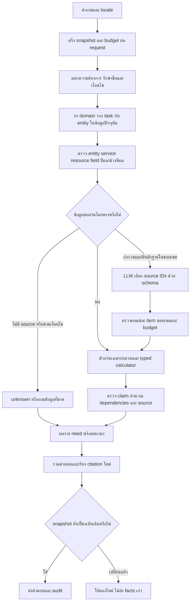

# Flow กลาง R114 — การทำงานครบทั้งห้าขั้น

## เป้าหมายและวิธีใช้ของเดิม

R114 ใช้ CommonStore, schema, revision/approval/publish, snapshot, API และตัวอ่านที่พิสูจน์แล้วจาก candidate R106 เป็นฐาน เพิ่มตัวอ่านข้อมูลตามงานและ router ที่ใช้ชื่อจาก snapshot ปัจจุบัน การแก้ครั้งนี้ไม่คัดลอกคำตอบรายข้อจากข้อสอบเข้าโค้ด และไม่ย้อนกลับไปเอาข้อเท็จจริงจากระบบ legacy เมื่อตัวอ่านกลางหาคำตอบไม่ได้

ตัวอ่านที่มีสัญญาข้อมูลดีอยู่แล้ว เช่น วันเปิด/ปิด การตรวจช่วงเวลาและสถานะ provider ถูกนำมาใช้ต่อ การตีความคำถามและการยืนยันข้อเท็จจริงเป็นคนละหน้าที่: LLM ช่วยเลือกหลักฐานได้ แต่ไม่เปลี่ยน unknown เป็น permission/ราคา/สถานะว่าง

## สัญญาร่วม

1. **Entity/field ก่อนเนื้อหา:** PC1 ไม่ใช่ PC10; จำนวนจอยไม่ใช่จำนวนที่นั่ง; เกมที่รองรับแพลตฟอร์มไม่ได้ยืนยันว่าศูนย์ติดตั้งบนเครื่องนั้น
2. **ปี/เวลา:** ปีรายการแข่งแยกจากปีที่อยู่ในชื่อเกม; ราคาอนาคตต้องมีช่วงมีผลหรือคำยืนยันตรงรุ่น; ข่าวจำลองแยกจากข่าวจริง
3. **Unknown ไม่เท่ากับ false:** ข้อมูลไม่ระบุ เงื่อนไขไม่ครบ provider ไม่พร้อม และปิดบริการเป็นคนละสถานะ
4. **ไม่มีสูตรจาก prose ที่คลุมเครือ:** ค่าราคา หน่วย จำนวนคน ระยะเวลา กฎปัดเศษและเงื่อนไขแพ็กเกจต้องมีหลักฐาน
5. **ข้อมูลแก้ได้:** index ที่ cache มี key จาก path/release/epoch/draft/withdrawn; บันทึก revision ใหม่ทำให้คำถามถัดไปอ่านข้อมูลใหม่
6. **หลักฐานแยกจากการเรียบเรียง:** เก็บ typed claims และตัวชี้ source ใน audit; ไม่ถือว่า citation มีอยู่แล้วหมายถึงตอบถูกความหมายทุกกรณี

## Flow เฉพาะ 14 หมวด

| หมวด | ขั้นตอนหลัก | การหยุด/ถามเพิ่ม |
|---|---|---|
| C01 ที่ตั้ง/ติดต่อ | bind ศูนย์หรือ facility/contact → ระบุ address/map/contact/location → อ่าน field | ไม่ใช้ที่จอดรถแทนที่ตั้งศูนย์; field ไม่มีให้ระบุว่ายังไม่ยืนยัน |
| C02 บุคลากร | bind คน → public scope → role/team/name | เงินเดือน ที่อยู่ส่วนตัวหรือข้อมูลที่ไม่มี source ต้องไม่ดึงหน้าที่มาตอบแทน |
| C03 อุปกรณ์ | bind zone/resource/model → field และหน่วย → อ่าน relation/spec/count | ไม่ยืมจำนวนคนจากห้องเป็น capacity เครื่อง; อุปกรณ์ใหม่ต้องสัมพันธ์กับโซน |
| C04 เกม/รายการเกม | bind game/service/platform → offerings หรือ game detail/mode → enumerate สมาชิกทั้งหมด | catalog ไม่ใช้ top-K; offered relation ที่ถอนต้องหายไป; ไม่อ้าง DLC/version ที่ไม่ได้ระบุ |
| C05 ปุ่มเกม | bind game/platform/control set → action ที่ถาม → exact binding | ไม่เอาปุ่มทั้งชุดหรือต่างเกมมาแทน action ที่ไม่ระบุ |
| C06 ราคาปกติ | service + audience → rate ที่ใช้ได้ → unit/duration/calculation rule → คำนวณจำนวนคน/รอบ | ไม่เดากลุ่มผู้ใช้; per_group ไม่คูณรายคน; เศษเวลา/สตางค์ที่ไม่มีกฎห้ามปัดเอง |
| C07 เหมาจ่าย | zone + audience องค์กร + half/full-day → package → amount/equipment/seats/terms | ไม่ใช้รายชั่วโมงแทนค่าเหมา; เงื่อนไขยกเลิก/มัดจำที่ไม่ระบุไม่อนุมาน |
| C08 จอง/เปลี่ยน/ยกเลิก | แยก action และสถานการณ์ → procedure/owner policy → เก็บเงื่อนไขครบ | เปลี่ยนวันหลังจ่ายแล้วไม่รวมกับการคืนเงินหรือเปลี่ยนเครื่องโดยอัตโนมัติ |
| C09 ชำระเงิน | แยกเงินเกิน/ขาด/ผิดสลิป/ผู้โอน/หลายเครื่อง → policy ตรง predicate | กฎเครดิตเงินเกินไม่ยืนยันวันหมดอายุเครดิต; ข้อมูลวันคืนเงินไม่มีก็ต้องเว้น |
| C10 กฎ/อุปกรณ์ขัดข้อง | ระบุ scenario → decision + conditions_all + exceptions/consequence | ไม่สรุปอนุญาตถ้าเงื่อนไขไม่ครบ; ปัญหาจากเครื่องและจากผู้ใช้แยกกัน |
| C11 วันเปิด/ปิด | Bangkok date/day → closure → schedule open/bookable/maintenance | วันนี้เปิดไหมตอบวันที่และเปิด/ปิดให้สั้น; รายการจองว่างไม่ยืนยันว่าเปิด/ปิด |
| C12 สถานะสด | exact scope → live binding → provider/date/window → mapping + freshness + coverage | stale/unmapped/missing slot ไม่ใช่ว่าง; วันอนาคตไม่มีเวลาต้องถามเพิ่ม |
| C13 กติกาแข่ง | game/event/year/edition → clause → recursive declared dependencies ในรายการเดียวกัน | dependency ขาดหรือชี้คนละรายการไม่ยืนยันคำตอบครบ; ไม่มีปีที่ถามไม่ยืมฉบับเก่า |
| C14 ข่าวกิจกรรม | bind event → date/applicability → body/register/status | ข้อมูล synthetic ใช้ได้เฉพาะคำถาม fixture ที่ระบุ ไม่แทนกิจกรรมจริง |

## LLM protocol

- โมเดล local เดิม Typhoon 2.5 Qwen3 4B ใช้ JSON schema และเลือก ID จากหลักฐานที่ส่งให้เท่านั้น
- ตรวจ item identity และตัวเลือกแยกแต่ละข้อ: item ที่หาย/ซ้ำ/ผิด ไม่ทำให้ข้อที่ถูกทั้ง batch ถูกทิ้ง
- ปฏิเสธ boolean ที่แอบเป็น integer และ ID นอกชุด; unknown ใช้ตัวเลือกว่างได้
- จำกัดไม่เกิน 2 selector calls ต่อ request และใช้ admission/deadline ของระบบ
- ข้อที่ typed reader อ่านได้ไม่ต้องเสียเวลาเรียกโมเดล; การเปิด LLM ไม่ได้หมายถึงทุกคำถามต้องเรียก LLM
- log แยก transport, schema, response model, เวลา และผลการเลือกหลักฐานออกจากคะแนนคำตอบ

## การทดสอบและขอบเขตผล

ดูรายงานผลรอบสุดท้ายควบคู่กัน: การเทียบ R113 ใช้ frozen read model เดียวกัน ส่วน API/lifecycle ทดสอบการทำงานกับ native CommonStore จริงบนฐานข้อมูลจำลองแยก ข้อมูล import candidate ใหม่ไม่ถูกปนเข้า score ที่อ้างว่า source เดียวกัน

คะแนน exact source contract ยังไม่ใช่เปอร์เซ็นต์ความถูกต้องเชิงความหมายของผู้ใช้จริง การมีข้อความเพิ่มที่เกี่ยวข้องหรือการตอบ partial เมื่อ provider บางส่วนไม่พร้อม อาจไม่ผ่าน oracle เดิม ต้องเก็บผลเดิมและวิเคราะห์แยก ไม่เปลี่ยน oracle เพื่อยกคะแนน
