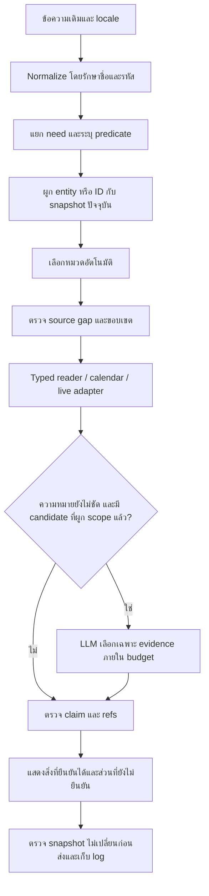

# R115 — ขั้น 1–3: แผนแก้จากหลักฐาน API จริง

## ขอบเขตที่ผู้ใช้อนุญาต

ใช้ข้อความและ locale เดิม 1,400 ข้อจาก R113 เท่านั้น เปิด LLM ผ่าน `/api/chat` จริง ใช้ native CommonStore ที่ย้ายแล้วและเลือกหมวดอัตโนมัติ ไม่เพิ่มคำถาม ไม่ทดสอบเต็ม 20,554 ข้อ ไม่ติดตั้งแทน R78 ไม่แก้ข้อมูลต้นฉบับหรือ approvals

## ขั้น 1 — ตรวจ source ก่อน

อ่าน `01_SOURCE_REVIEW_TH.md`, `SOURCE_REVIEW.json`, `SOURCE_ALIGNMENT.json` และ `NATIVE_EXPECTATIONS.json` ซึ่งจัดทำก่อน HTTP รอบแรก

- ข้อมูล nonfixture ในชุดอ้างอิง 1,164 facts จับคู่กับ native ได้ครบ ไม่มี projection/mapping gap ในขอบเขตนี้ ไม่ใช่ข้อพิสูจน์ว่าข้อมูลธุรกิจทุกเรื่องในโลกครบ
- อีก 104 facts เป็น fixture; คำถาม positive 160 ข้ออ้าง fake live/news ที่ไม่มีใน native DB จึงแยกจากความสามารถตอบเนื้อหาจริง ห้ามใส่ข้อมูลจำลองให้กลายเป็นข้อมูลร้านเพื่อให้คะแนนผ่าน
- ราคา 24 fields เปลี่ยนรูปแบบการแสดง แต่ค่าเงินไม่เปลี่ยน ตรวจตัวเลขและหลักฐานแยกจากข้อความ
- เวลาเปิดวันธรรมดาขัดแย้ง โซนและช่วงมีผลยังไม่ยืนยัน คำยืนยันปิด 16:00–18:00 ไม่เท่ากับเปิดเต็มช่วงอื่น
- VR มีหลักฐานคิดต่อคน แต่ไม่ยืนยันสิทธิ์จองเกินขอบเขตจำนวนคน ส่วนลด หรือวิธีปัดเศษ
- กติกา 6 ข้อที่เคยไม่ผ่านจาก oracle เลือกหนึ่งย่อหน้า อ่าน source และ log เก่าอย่างเดียว ไม่ยิงคำถามเพิ่ม

## ขั้น 2 — รอบก่อนแก้

`runs/http01` เก็บ response JSON เต็ม, model events, runtime log, hash freeze และ health ก่อน/หลัง ทุกคำถามแยก session ไม่มีประวัติหรือ category hint

ห้ามแก้ candidate ที่กำลังรัน หลังครบและ server หยุด จึงเก็บสำเนา `runs/http01/frozen_system` ก่อนเปลี่ยนโค้ด ข้อมูล/expected/log ของรอบแรกยังอยู่เดิม

## ขั้น 3 — สิ่งที่ต้องแก้

### A. คำถามชื่อบุคลากรถูกกลืนเป็นการแนะนำตัวบอท

ตัวตรวจ identity มีคำกว้าง “ชื่ออะไร” และ regex ชื่อไทยที่ไม่ครอบคลุมสระ/วรรณยุกต์ จึงตัดสินคำถามชื่อบุคคลบางคนก่อนเข้าระบบข้อมูล

แก้ให้คำว่า “ชื่ออะไร” แบบทั่วไปเข้าทาง identity ได้เมื่อเป็นคำถามสั้นที่ไม่มีเป้าหมายอื่น หรือมีประธานบอทชัดเจน ตรวจคำนำหน้าชื่อไทยพร้อมอักขระไทยครบช่วง ไม่ใส่รายชื่อบุคคลลงโค้ด

### B. คำถาม predicate เฉพาะถูกเลือกผิดหมวดแล้วข้าม guard

ตัวอย่างเดิม: ถามสิทธิ์พิเศษเมื่อจองชื่อบริษัท แต่คำว่า “ประกาศ” พาไปหมวดข่าว แล้ว fallback ตอบขั้นตอนจอง ถามถ่ายใบหน้าคนอื่นกลับได้คำตอบเรื่องผู้ใช้ภายนอก ส่วนคำถามคริปโตหลุดไปถามให้ระบุชื่อเกม

รวม predicate frames ที่ router และ source guard ใช้เป็นชุดเดียว ได้แก่สิทธิ์บริษัท ประกัน อัตราโอที คริปโต วันหมดอายุเครดิต อายุขั้นต่ำ สิทธิ์ถ่ายบุคคล และค่าปรับที่ยังไม่มีหลักฐาน การมีข้อมูลหัวข้อใกล้เคียงไม่เพียงพอสำหรับตอบ predicate ใหม่ เมื่อเพิ่ม source ที่ประกาศ predicate นั้นจริง guard ต้องเปิดให้อ่านได้

### C. รหัส rate ถูกตีความเป็นคำธรรมดา

`staff` และ `availability` ภายในรหัสทำให้ไปตอบรายชื่อเจ้าหน้าที่หรือสถานะเครื่อง ทั้งที่ผู้ใช้ถามระยะเวลาของ rate

ตรวจรหัส native ที่มีอยู่จริงทั้งรหัสก่อน ใช้ identity และความสัมพันธ์จากฐานข้อมูลปัจจุบัน จำกัด rate pool ด้วย record ID ที่ถาม ไม่เลือกเรตข้างเคียง ไม่แปลงเลขใน ID เป็นจำนวนคนหรือเวลา และไม่ฝัง ID ของข้อสอบลงโค้ด

คำถามที่ใช้รหัสเทคนิคต้องรายงานแยกจากภาษาผู้ใช้ทั่วไป แต่ส่งทุกข้อและคง denominator เดิม

### D. ตารางจองหลุดไปใช้ FAQ ตารางเก่าที่กว้างกว่า

เมื่อมี field ตารางรายวันและคำถามขอ bookable/maintenance periods ให้อ่าน field นั้นโดยตรงก่อน fallback FAQ ทั้งสัปดาห์ ไม่ใช้ FAQ เก่าแก้ความขัดแย้งแทนเจ้าของ

แสดงว่าเป็นตารางที่บันทึกไว้ ระบุ scope/effective period ที่ยังไม่ยืนยัน หากถามช่วงจองและการใช้ได้จริงยังยืนยันไม่ได้ ให้ `partial` พร้อมข้อมูลที่มี แม้ oracle เก่าคาด `answer` ก็ต้องคงความไม่แน่นอนตาม source ไม่ปรับ expected เพื่อเพิ่มคะแนน

คำถามวันนี้/พรุ่งนี้/สถานะจริงยังใช้ typed calendar/live adapter และ freshness checks

### E. Booking reference ที่ไม่รู้จักต้องไม่ถูกกลบเป็น provider unavailable

ตรวจ unknown exact resource และ opaque booking reference ก่อนส่ง live adapter หากไม่มีหลักฐานผูกกับรายการจริง ให้ missing source โดยไม่เลือกเครื่องใกล้เคียง การมี provider ตอบกลับไม่ใช่หลักฐานว่าผูกกับรายการจองถูกต้อง

### F. ภาษาอังกฤษของกติกา

บางย่อหน้าเก็บภาษาไทยไว้ในช่องอังกฤษเพราะยังไม่มีคำแปลที่ยืนยัน เพิ่มคำชี้แจงก่อนแสดงข้อความไทย ไม่ให้ข้อความไทยในคำตอบภาษาอังกฤษถูกอ้างว่าเป็นความสามารถแปลครบแล้ว

สามกรณีที่มีทั้ง summary เดิมและย่อหน้าใหม่ต้องอ่านหลักฐานเทียบกันก่อนสรุปว่า extra claim คือเนื้อหาผิด ห้ามลบ source ที่ถูกต้องเพียงเพื่อให้ตรงจำนวน claims ใน oracle

### G. ตัววิเคราะห์ต้องอ่าน packet ทุกแบบ

เวอร์ชันแรกอ่านเฉพาะ packets ที่มี `fact_id` แต่ compatibility reader ใช้ `record_id`/`field`/`evidence_refs` จึงเคยมองไม่เห็นคำตอบผิดเรื่อง

`regrade_saved.py` ตรวจ root และ per-need packets ทุกแบบ จับคู่กับ source ที่ freeze ไว้ตาม record/ref และตรวจค่าที่ตอบจริง ไม่แทนค่าคำตอบด้วย expected เก็บ `review_v2` แยกจาก original grade แล้วตรวจสองรอบด้วยเวอร์ชันเดียวกัน

## Flow หลังปรับ

## การยืนยันผล

1. ตรวจแผนจากคำถามเดิมที่ผิดและ regression ของ classifier โดยไม่สร้าง corpus ใหม่
2. รันคำถามเดิมครบ 1,400 ข้อผ่าน HTTP หลังแก้ เพราะเปลี่ยน router/dispatcher ที่หลายหมวดใช้ร่วมกัน
3. คง strict, source claim coverage, actual wrong scope, fixture gaps, applicability gaps, oracle granularity, English gaps และ model transport แยกกัน
4. ตรวจ hash ว่า source เดิม, ข้อมูล, approvals, input และ expected ไม่เปลี่ยน พร้อม build/model identity ก่อนและหลังรอบ
5. หาก final ยังมีข้อบกพร่องจริง ให้แก้และรันเฉพาะข้อเดิมที่เกี่ยวข้อง เก็บ revision และ log แยกรอบ ไม่เขียนทับผล

## ช่องโหว่ที่พบเมื่ออ่าน raw packets ต่อจนครบ

- พบ C12 positive fixture 21 ข้อคืนข้อมูล static ของเครื่อง เช่น ที่ตั้ง/จำนวนคน แทนการเช็กจองตามวันเวลา และ C14 positive fixture 6 ข้อคืนกติกาคนละงานหรือช่องทางติดต่อ แม้ fixtures จะไม่มีใน native ก็ต้องนับการแทนข้อมูลผิดเรื่องเป็นปัญหาจริง ไม่ใช่ตัดกลุ่มนี้ออกแล้วจบ
- เพิ่มการตีความคำถามจองชื่อเครื่องพร้อมวันที่/เวลาและถามว่าได้หรือยังเป็น live task รวมชื่อเครื่องแบบตัวอักษรตามด้วย #หมายเลข โดยตรวจ binding กับ resource จริงก่อน provider
- ไม่ใช้ความว่างของ fact snapshot หมวด live ตัดสินว่า resource จริงไม่มี เพราะ resource identity และ provider observations เป็นคนละชั้นกัน
- ปิด compatibility fallback ของข่าว/กิจกรรมเมื่อผูก event ไม่ได้ ข้อมูล contact หรือ rulebook ของรายการอื่นไม่ตอบคำถาม activity status
- ขยาย checks จาก 141 เป็น 301 รายการด้วยคำถามเดิมของสองหมวดนี้ รอบกลาง http02 หยุดโดยตั้งใจและเก็บหลักฐานครบ ไม่เรียกว่า complete; รอบยืนยันคือ http03
