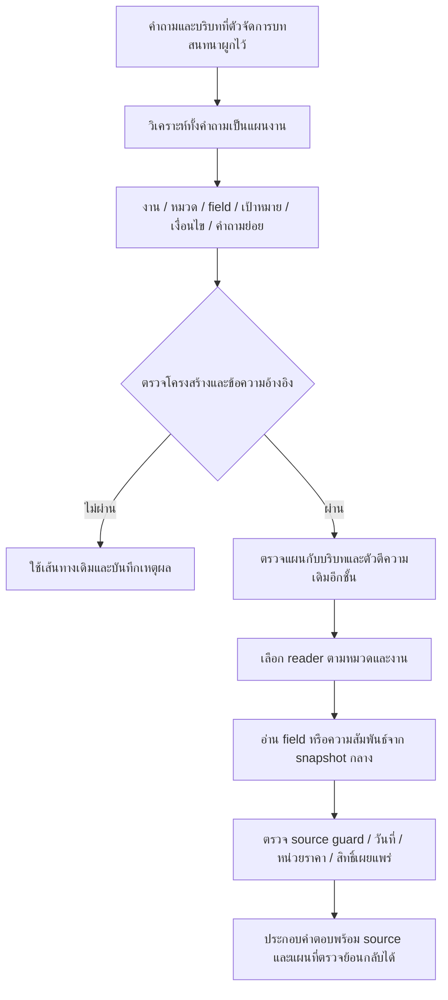

# R117 — เข้าใจคำถามก่อนเลือกหมวดและข้อมูล

## เป้าหมาย

ปรับ candidate R115 โดยใช้ผล R116 เป็นหลักฐาน ไม่แก้ source data, approvals, คลังคำถาม, ผลเก่า หรือ R78 เป้าหมายคือแยก **งานที่ผู้ใช้ต้องการ** ออกจากชื่อเกม/เครื่องที่ปรากฏเป็นเพียงบริบท และรักษาเงื่อนไขก่อนเลือกตัวอ่าน

## Flow ที่ลงมือทำ

## 1. วิเคราะห์อะไรบ้าง

| ส่วน | ตัวอย่างความหมาย | ใช้ตัดสินอะไร |
|---|---|---|
| operation | detail, list, count, group_list, compare, price_calculate | ต้องอ่านหนึ่งค่า ดึงทั้งชุด หรือคำนวณ |
| domain | games, game_controls, service_fee, schedule ฯลฯ | เลือกตัวอ่านที่รับผิดชอบ |
| facet | zone, summary, input_bindings, maintenance_periods | ค่าที่จะตอบจริง ไม่ใช่แค่หัวข้อใกล้เคียง |
| target | ข้อความชื่อเกม/เครื่องที่ผู้ใช้ระบุ | ผูก entity กับข้อมูลปัจจุบัน |
| constraints | กลุ่มผู้ใช้ คน ระยะเวลา รอบ วันที่ แพลตฟอร์ม คำปฏิเสธ เงื่อนไข | ป้องกันตอบผิดขอบเขต |
| quote | ช่วงข้อความคำถามเดิม | ตรวจว่าแผนมาจากสิ่งที่ผู้ใช้ถาม |
| ambiguous | ยังระบุความหมายไม่ได้ | ไม่เดาเป้าหมายแทนผู้ใช้ |

ทำการวิเคราะห์ก่อน route ของ domain reader เมื่อเปิด LLM และมีงบเรียกโมเดล ส่วนคำทักทายและบทสนทนาสั้นที่มีตัวจัดการเฉพาะยังใช้เส้นทางเดิม ไม่เรียก LLM เพื่อวิเคราะห์ใหม่โดยไม่จำเป็น

## 2. นำอะไรจาก Flow เดิมมาใช้

- ใช้ชุด operation และตัวตรวจ `QueryPlanTask` / `parse_query_plan` ของ `app.pipeline.query_planner`
- ใช้ `_heuristic_intent` เป็นข้อเสนอเปรียบเทียบ และใช้ control/competition intent frames ของ router เดิมตรวจกรณีที่มีเจตนาชัด โดย target ของ controls ต้องผูกกับ source ปัจจุบันได้
- เพิ่มข้อกำหนด quote/slot/domain-facet binding รอบนอก เพราะการผ่าน JSON schema ของเดิมอย่างเดียวไม่รับรองว่ารักษาเงื่อนไขผู้ใช้ครบ
- ใช้โครงสร้างแผนงานและตัวตีความบางส่วนของเดิมเป็นฐาน แต่ไม่ได้ยก legacy answer engine หรือ knowledge payload เดิมมาตอบ และไม่ได้อ้างว่าย้าย legacy heuristics/planner มาครบทั้งระบบ
- โมเดลสร้างเฉพาะแผนความหมาย การตอบราคาหรือข้อเท็จจริงต้องมาจาก Common snapshot เช่นเดิม

## 3. การตรวจแผน

1. คำถามย่อยไม่เกิน 4 ข้อและไม่มี quote ซ้ำ
2. quote, target และ constraint ต้องอ้างข้อความที่อยู่ในคำถามปัจจุบันจริง ไม่ยอมรับการแปลหรือแก้ชื่อที่โมเดลแต่งขึ้น
3. domain/operation/facet ต้องอยู่ในรายการที่อนุญาตและ facet ต้องเข้ากับ domain
4. ตัวเลข วันที่ และเครื่องหมายปฏิเสธที่ตรวจได้ต้องยังอยู่ในคำถามย่อยหรือ constraints
5. แผนเป็นเพียงข้อเสนอความหมาย ไม่เพิ่มสิทธิ์อ่าน ไม่เปลี่ยน source state ไม่ยืนยันว่าความหมายถูกแล้ว
6. ตรวจ model identity, JSON/schema, network error และงบเรียกแยกกัน บันทึก artifact `understanding`
7. ตรวจแผนกับกรอบเจตนาอิสระ: ปุ่มทั้งหมดต้องไม่เป็น catalog เกม; กติกาในบริบทแข่งขันต้องไม่เป็นกฎใช้ศูนย์; สถานะเครื่องตามวันเวลาต้องไม่เป็นรายชื่อเกม การ recovery แบบนี้มาจากคำถามและกฎที่ตรวจได้ ไม่ได้แปลว่า model JSON ผ่าน

เก็บคำถามก่อน `explicit_request_focus` จาก current-turn context มาวิเคราะห์ด้วยเมื่อมี เพื่อไม่ทิ้งชื่อเกม/งานแข่ง/กลุ่มผู้ใช้ที่อยู่ในประโยคเกริ่น แผนที่ใช้ fallback จะยังแนบ diagnostic ให้ตรวจย้อนกลับได้เมื่อมีผลลัพธ์ ไม่ใช้การไม่มี artifact สรุปว่าระบบไม่ได้เรียกโมเดล

การตรวจข้อ 4 เป็น structural coverage ของรูปแบบที่ระบุ ไม่ใช่ semantic coverage ของทุกประโยค ยังอาจตรวจไม่เจอเงื่อนไขที่แฝงในภาษาธรรมชาติ

## 4. ตัวอ่านที่เสริมเพื่อให้แผนนำไปใช้งานได้

### รายการปุ่มทั้งหมด

เมื่อแผนเป็น list/input_bindings และขอบเขตเกม/แพลตฟอร์มชัด อ่าน binding set ครบจาก index โดยตรง ไม่ส่งแค่ top-8 ไปเลือก ถ้ามีหลายแพลตฟอร์มจริงต้องให้ผู้ใช้ระบุ ไม่เอาปุ่มต่างแพลตฟอร์มมาปน

### โซนที่มีเกม

เพิ่ม derived projection จาก graph ปัจจุบัน:

`game → offered game_service → service.resource_ids → resource.zone_id → zone`

ทุก edge ต้องมี evidence refs และ offered=true จึงแสดงได้ ไม่มีการเขียน zone ใหม่ลงฐาน หรืออนุมานว่ารองรับ platform เท่ากับมีให้เล่นที่ศูนย์

คำถามหลายโซนสามารถคืน confirmed subset ของเกมที่มีหลาย zone edges ได้ โดยติดป้ายว่าไม่รับรอง completeness ของ graph ทั้งศูนย์ ไม่ถือ edge ที่ไม่พบเป็นการยืนยันว่าไม่มีบริการ

### Field ที่ระบุในความหมาย

ให้ target/facet ช่วยเลือก field ของ entity ที่ผูกกับคำถามได้จริง และยังตรวจ locked guards เดิมก่อนเสมอ ตัวอ่านราคา การจอง การชำระเงิน กฎ และสถานะสดยังรับผิดชอบเงื่อนไขธุรกิจของตน

กลุ่มผู้ใช้ที่ผู้ใช้บอกสามารถผูกกับ audience ID จาก directory ของ snapshot ปัจจุบัน โดยยังเก็บคำอ้างต้นฉบับและคำปฏิเสธไว้ ส่วน one hour / two hours เป็นการปรับหน่วยภาษาทั่วไปก่อนให้ตัวอ่านราคา ไม่ใช่การเติมราคา/ส่วนลด/กฎคำนวณ ถ้าทราบอัตราแต่ยังไม่มีกฎคำนวณระยะเวลาที่ขอ จะตอบ unit rates แบบ partial พร้อมระบุว่าไม่ใช่ยอดรวม แทนถามระยะเวลาซ้ำ

เมื่อมีแผนเจตนาที่ตรวจแล้วแต่ไม่มี target/source รองรับ จะจบอย่างมีขอบเขต ไม่ให้ compatibility retrieval เปลี่ยนไปตอบเรื่องอื่น ส่วนโมเดลที่ตอบ general/ไม่ผ่านยังมีเส้นทางเดิมอยู่ จึงไม่ได้อ้างว่าปิด relevance gaps ได้ทุกแบบ

### ตารางเวลา

แยก open / close / bookable / maintenance; อ่าน recorded periods ที่ยืนยันได้โดยไม่ประกาศเป็นสิทธิ์เข้าอาคารหรือสถานะปัจจุบัน คำถาม dated/current ยังคงใช้ calendar/live adapter เดิม

### ข้อมูลบุคลากร

แผนใหม่อาจทำให้คำถามไปถึง domain reader โดยไม่ผ่าน compatibility guard จึงนำ guard `public_scope` แบบเดียวกับ complete_flow มาใช้ก่อนส่ง claims ด้วย ไม่เปิด unknown/private scope เพื่อเพิ่มคะแนน

## 5. สิ่งที่ยังไม่ครบ

- ไม่ได้อ้างว่า context understanding แก้ปัญหาทั้งหมด: relation edges ที่ขาด, unknown/conflicted data, unit arithmetic และ provider unavailable ยังมีผล
- count/group/compare/recommendation บางงานยังไม่มีตัวคำนวณครบ ต้องรายงาน unsupported แทนส่งรายละเอียดใกล้เคียงให้ดูเหมือนตอบแล้ว
- ความหมายจากโมเดลยังผิดได้แม้ schema ผ่าน ต้องวัดจากคำตอบจริงและตรวจตัวอย่าง ไม่ใช้จำนวน accepted plans เป็น accuracy
- การ fallback ไปตัวอ่านเดิมเมื่อแผนไม่ผ่านยังอาจมีข้อจำกัดเดิม ต้องอ่าน diagnostic ไม่ซ่อนความล้มเหลว
- ขั้นตอนก่อนเข้า domain integration เช่น profile confirmation และ explicit-target guard ยังมีอยู่ ไม่อ้างว่าทุก HTTP request ผ่าน interpreter ใหม่นี้
- การผูกบริบทย้อนหลังใช้ตัวจัดการ trusted state เดิม ไม่ได้ให้โมเดลยึดคำตอบก่อนหน้าหรือข้อความผู้ใช้เป็นข้อเท็จจริง

## 6. วิธีตรวจรอบนี้

- Contract checks 22 จุดใช้โจทย์ Full ที่เก็บไว้ รวม malformed model output, independent context frames, explicit duration ที่โมเดลลืมส่ง และการไม่ยอมข้าม source guard ไม่เขียนคำถาม benchmark ใหม่
- ทดสอบ HTTP จริงเฉพาะ 48 keys เดิม: 40 seeded regressions จาก 10 หมวดหลัก หมวดละ 4 พร้อม 8 known failures
- เทียบ R117 กับ saved R115 ของ keys เดียวกัน ไม่รัน Legacy/R115 ซ้ำ
- ชุดนี้เป็น development regression ซึ่งเลือกบางข้อจากข้อผิดพลาดที่รู้แล้ว ไม่ใช่ random Full accuracy estimate หรือ blind holdout
- เก็บคำตอบแรก ไม่ retry เพื่อซ่อนผลไม่ดี ตรวจ source/code/input hashes และ model identity ก่อน/หลัง
- ตรวจ 3 revisions แรกด้วย 48 keys เดิม ผลอยู่ full01/http02/http03 จากนั้น revision04 แก้การรับระยะเวลาจากข้อความจริงและข้อความถามเพิ่ม ตรวจซ้ำเฉพาะ 8 keys ที่เกี่ยวข้องใน http04 โค้ดสามรอบแรกเก็บ FROZEN_SYSTEM พร้อมตรวจ hash ก่อนแก้รอบต่อไป รวม 152 HTTP attempts แต่มี 48 คำถามไม่ซ้ำ

ผลจริงและข้อจำกัดหลังทดสอบอ่าน `REPORT_TH.md` เมื่อพร้อม ไม่ใช้ contract test แทนคะแนนจาก API
