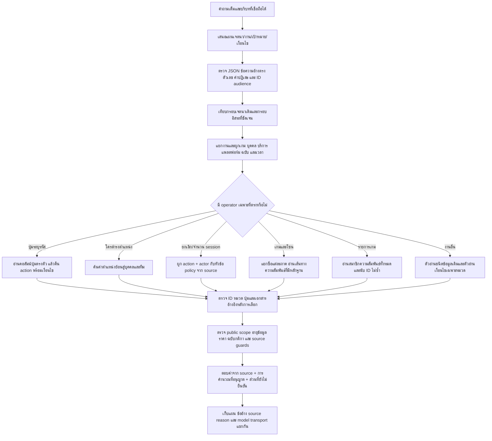

# R118 — แผนและการเสริมความแม่นยำจาก R117 revision04

## 1. เป้าหมายและขอบเขต

แก้เส้นทางที่มีหลักฐานอยู่แต่เลือกไม่ตรงคำถาม เพิ่มการอ่านย้อนกลับ ตรวจตัวตนก่อนแสดงคำตอบ และบอกส่วนที่ตอบไม่ได้ให้เฉพาะเจาะจงขึ้น ใช้คำถามเดิมเท่านั้น ไม่ติดตั้งทับ R78 ไม่แก้ฐานข้อมูล ความยินยอม การอนุมัติ หรือผลทดสอบเดิม

R118 เป็น candidate แยกจาก R117 revision04 ฐานข้อมูลคัดลอกด้วย SQLite backup และเก็บ SHA256 อ้างอิงไฟล์ต้นทาง การมีข้อมูลใน draft ไม่เท่ากับพร้อมเผยแพร่ ระบบ preview ยังต้องตรวจสถานะข้อมูลบุคคลและช่วงเวลาของราคา

## 2. Flow ที่ใช้

LLM ยังช่วยตีความและเลือกหลักฐานที่ผูกขอบเขตแล้ว แต่ไม่ได้เป็นผู้สร้างราคา กฎ รหัส source หรือสิทธิ์เผยแพร่ และไม่ได้รับหมวด/คำตอบคาดหวังจากตัวทดสอบ

## 3. ตรวจปัญหาและสิ่งที่แก้แต่ละส่วน

| ส่วน | ปัญหาที่พบ | การเสริม R118 | ขอบเขตที่ยังต้องระวัง |
|---|---|---|---|
| ความเข้าใจ | แผนถูกหมวดได้แต่ผิด facet/operation | เพิ่มกรอบคำถามโซนและยกเลิก ผูกกับ source ปัจจุบัน; กรอบนับเกมแยกจากจำนวนเกมรอบชิง | กรอบอิสระใช้กับคำถามงานเดียวที่ชัดเจน ไม่แทนความเข้าใจทุกถ้อยคำ |
| รหัสปุ่ม | R2 ถูกตอบด้วย R3 แม้มีข้อมูล R2 | เก็บ button_label แยกจาก notes, อ่านย้อน button→action แบบตรงตัว, ล็อกผลและตรวจซ้ำท้ายทาง | รูปแบบ chord อิสระทุกชนิดยังไม่ครอบคลุม; ห้ามตีความปุ่มใน notes เป็นคอลัมน์ปุ่ม |
| Platform | เกมเดียวกันอาจมีหลาย control sets | กรอง PC/PlayStation/Switch ก่อนเลือก ถ้าหลายชุดให้ถาม platform | ไม่เดาแพลตฟอร์มจากความนิยมของเกม |
| ยกเลิกจอง | มี FAQ แต่คำถามทั่วไปได้ entity_not_bound | เพิ่ม action customer_cancel กับ studio_cancel แยกกัน, อ่านหัวข้อแต่ละภาษาไม่เอามาต่อแล้วใช้ anchored regex | ยกเลิกโดยผู้ใช้ ≠ ศูนย์ยกเลิกเพราะผิดกฎ ≠ ระงับสิทธิ์ ≠ คืนเงิน |
| Policy ซ้ำ | หลักฐานสามรายการข้อความเหมือนกันทำให้ถูกส่งไป disambiguation | รวมการตัดสินเฉพาะเมื่อข้อความ source ภาษาเดียวกันตรงกันหลัง normalize เก็บ ID corroborating facts | ข้อความเพียงคล้ายกันหรือมีเงื่อนไขไม่ตรงกันยังไม่รวม |
| จำนวน session จอง | ถามจำนวน session แล้วไม่ผูกหัวข้อ | เพิ่ม predicate booking_session_limit ที่อ่านคำตอบและเงื่อนไขจาก source | ไม่ตัดคำเตือนการชำระ/ยกเลิกที่อยู่ในข้อเดียวกันทิ้ง |
| ตำแหน่งบุคคล | รองรับบุคคล→ตำแหน่ง แต่ไม่รองรับตำแหน่ง→บุคคล | อ่านค่า role ย้อนกลับ เลือกข้อความยาวที่สุดที่ถามจริง กรองทีมที่ระบุ แล้วผ่าน public scope guard | ประธานไม่เท่ากับรองประธาน; ไม่มีการเพิ่ม public approval เอง |
| ชื่อหลายภาค | ชื่อ Part I / Part II ไม่ตรงชื่อ subject ทั้งก้อน | ขยาย shared prefix เฉพาะ grammar Part/Chapter/Episode ที่มี source ชื่อตรงตัว | ไม่เอา Part II (Remastered) มาแทน Part II; ไม่ fuzzy match เลขภาค |
| ความสัมพันธ์โซน | บางเกมมี game→offer→service→resource→zone แต่บาง service ไม่มี resource_ids | ตอบเส้นทางที่ยืนยันได้; หลายเป้าหมายมีบางส่วนขาดให้ partial พร้อมชื่อส่วนที่ขาด | ชื่อ Nintendo Switch Zone กับ platform เหมือนกันไม่ใช่หลักฐานความสัมพันธ์ |
| ตอบหลาย field | Meaning facet เดียวอาจทับ field ที่ typed reader จับได้แล้ว | คง explicit facets ที่ typed reader เลือกจาก entity เดียวกัน | การอนุมาน facet ที่ไม่ได้ถามเพิ่มเองไม่ใช่เป้าหมาย |
| List/count | top-K และข้อความรายการไม่เหมาะกับการนับ | catalog เก็บ member_ids จาก offered relations, นับ distinct game IDs และแยก service groups | completeness เป็นขอบเขตข้อมูลที่บันทึก ไม่ใช่พิสูจน์ว่ารายการโลกจริงครบ; ยังไม่ยืนยันคุณภาพ count จาก HTTP corpus รอบนี้ |
| ตรวจท้ายทาง | เลือก source ถูกหมวดแต่ปุ่มผิดยังผ่าน | ตรวจปุ่มที่ถามกับ ID หลังเลือก, ปฏิเสธ source ไม่มี refs, ตรวจ permission/validity ต่อ | เป็นการตรวจตัวตนและหลักฐาน ไม่ใช่ semantic verifier ครอบคลุมทุกประโยค |
| ข้อความเมื่อขาด | ใช้ no source เหมือนกันทุกกรณี | แยกพบข้อมูลแต่ public scope ไม่ยืนยัน / ปุ่มไม่บันทึก / ต้องระบุ platform / เกมบางชื่อยังขาด zone | ยังต้องพัฒนาข้อความเฉพาะเหตุผลสำหรับหมวดอื่นต่อ |

## 4. ทบทวนจุดเสี่ยงก่อน HTTP

### 4.1 ตัวตนที่คล้ายกัน

R2/R3, L1/L2, Part I/Part II, Part II/Remastered และประธาน/รองประธานต้องไม่รวมด้วย semantic similarity ใช้ค่าตรงตัวหรือขอรายละเอียดเพิ่ม การค้นปุ่มอ่านจาก button_label ไม่อ่านจากคำอธิบายที่มีรหัสปุ่มอื่นประกอบ

### 4.2 คำถามเหมือนกันแต่ actor ต่างกัน

การที่ผู้ใช้ขอยกเลิกกับการที่ศูนย์ยกเลิกรายการเพราะผิดกฎต้องคนละ predicate ถ้ามีเหตุผลศูนย์/ข้อมูลผิด/ไม่แจ้งให้ใช้ studio_cancel ก่อน generic customer_cancel ส่วนกฎคืนเงินหรือเปลี่ยนวันจ่ายแล้วต้องไม่ดึงจากกฎยกเลิกทั่วไป

### 4.3 ความกำกวมของ source

ใช้ความเท่ากันของข้อความจริงเพื่อยุบข้อมูลซ้ำเท่านั้น ไม่ใช้ค่าความคล้ายกันมาอ้างว่ากฎเท่ากัน หากมีหลายคำตอบต่างกันและยังไม่มี precedence ให้คงขั้น disambiguation/conflict ไม่เลือกตามคะแนนความคล้ายสูงสุดอย่างเดียว

### 4.4 ข้อมูลส่วนบุคคล

การค้นพบคนที่ดำรงตำแหน่งได้ยังต้องตรวจ public_scope ก่อนคืนชื่อ เหตุผลกรณีนี้เปลี่ยนจากหาไม่พบเป็นพบข้อมูลแต่สถานะเผยแพร่ไม่ยืนยัน โดยไม่เปิดเผย ID/ชื่อที่ถูก guard

### 4.5 ข้อมูลเพิ่ม แก้ และถอนในอนาคต

อ่าน records/facts ของ snapshot ปัจจุบันทุกครั้ง และ cache ผูก epoch/release/withdrawals การตรวจถอน binding ใช้ข้อมูลสำเนาในหน่วยความจำ ต้องไม่กลับไปหยิบปุ่มใกล้เคียงมาแทน ไม่ฝัง request key หรือ business answer ลง runtime

## 5. สิ่งที่ไม่ได้ถือว่าแก้สำเร็จจากการมี Flow ใหม่

- ความแม่นยำ semantic ทั้งระบบยังต้องวัด ไม่สามารถใช้ JSON ผ่านหรือ HTTP 200 แทนได้
- สูตรราคาหลายช่วงเวลาที่ source ยังไม่ประกาศจะไม่อนุมานยอดรวมเอง
- แหล่งราคาแต่ละรุ่น/confirmation และเวลาปัจจุบันยังเป็นข้อจำกัดที่ต้องระบุ
- provider สดที่ตั้ง unavailable ในการทดสอบไม่ใช่หลักฐานว่าศูนย์จริงว่างหรือปิด
- public_scope ไม่ยืนยันและ service.resource_ids ไม่ยืนยันยังเป็น source gaps
- compare/recommendation หลายเงื่อนไขและ semantic paraphrase ที่ไกลจากหัวข้อยังไม่ครอบคลุมทั้งหมด
- ไม่เพิ่มคำถาม benchmark ใหม่ ไม่ rerun baseline เก่า และไม่ทำ Full ใหม่ในรอบนี้

## 6. หลักฐานตรวจ

- `PRECISION_CONTRACTS.json`: ตรวจการอ่านรหัสปุ่ม คำถามยกเลิก role inverse หลายภาค source withdrawal และป้องกันการคืนผิดตัวตน ใช้คำถามจาก retained Full
- `CONTRACT_CHECKS.json`: สัญญาเดิม R117 รวม budget, model identity, constraints, audience/duration และ complete controls
- `http01`: การถามผ่าน API จริง เปิด LLM ไม่มี category hints ไม่มี expected answers ใน runtime
- รายงานผลหลังรันจะอยู่ใน `REPORT_TH.md` โดยแยก literal/strict/source guards/model transport

## 7. สิ่งที่เสริมหลังตรวจ HTTP รอบแรก

คะแนน literal ที่ดีขึ้นยังซ่อนปัญหาบางชนิดอยู่ จึงอ่านคำตอบทั้ง 48 ข้อแล้วเสริมอีกขั้น:

1. **เช็กอินก่อนเล่นเกม**: ให้ action เช็กอินมาก่อนชื่อเกม อ่าน C08 check-in policy ที่มีหลักฐาน ไม่ตอบ C04 service catalogue แม้มีชื่อ VALORANT ในประโยค
2. **Map pool ในกติกา CS2**: ให้บริบทกติกาและคำว่า map pool เลือก C13 เพิ่มการเชื่อมชื่อหัวข้อไทย/อังกฤษโดยไม่ใส่ชื่อแผนที่เป็นคำตอบในโค้ด อ่านค่าจาก source และรักษา dependency ที่ประกาศไว้
3. **วิธีจองทั่วไป**: ผูกหัวข้อ booking_steps จาก source ได้แม้คำถามไม่ใช้หัวข้อของเอกสารตรงตัว ถ้าคำถามมี action เฉพาะ เช่น เปลี่ยน/ยกเลิก ไม่ให้ generic booking_steps กลบ action นั้น
4. **GPU/CPU/RAM**: อ่านองค์ประกอบจาก specifications ที่เป็น structured fields ผูกกับชนิดอุปกรณ์ใน source รองรับ PCs→pc เฉพาะการ bind ชนิดอุปกรณ์ ไม่เปลี่ยนตัวตน record ID ไม่สร้างสเปกใหม่จากชื่อรุ่น
5. **คำเกริ่นสุภาพ**: ตัดออกจากรายการ task เฉพาะเมื่อเป็น general task ที่ target/constraints ว่าง มี sibling factual task และข้อความทั้งชิ้นตรงกับกรอบคำเกริ่นแคบ ๆ ไม่ตัดตัวเลข คำปฏิเสธ หรือ factual clause ทิ้ง
6. **ข้อความภายในของ FAQ**: routing topic, intent_key, scope_note และคำถามตั้งต้นไม่ควรถูกนำไปเป็นคำตอบของลูกค้า เก็บสถานะ/หลักฐานใน audit ต่อไป

HTTP revision02 ตรวจคำถามเดิมครบอีก 48 keys ไม่ใช่คำถามใหม่ ผลนี้ใช้ทบทวนทั้งความเข้าใจและตัวอ่าน ไม่ใช้เฉพาะค่า keyword score

หลัง HTTP พบว่า schema ใช้ชื่อช่อง `topic` อีกช่องหนึ่งด้วย จึงมี revision03 เปลี่ยนรายการซ่อนช่องใน renderer เพียงจุดเดียวและตรวจด้วยแผนเดิมผ่าน renderer จริง ไม่รัน LLM/Full ใหม่ คะแนนตารางเป็น revision02 ส่วน source ของทั้งสองรอบ HTTP เก็บใน FROZEN_SYSTEM พร้อมตรวจ hash
