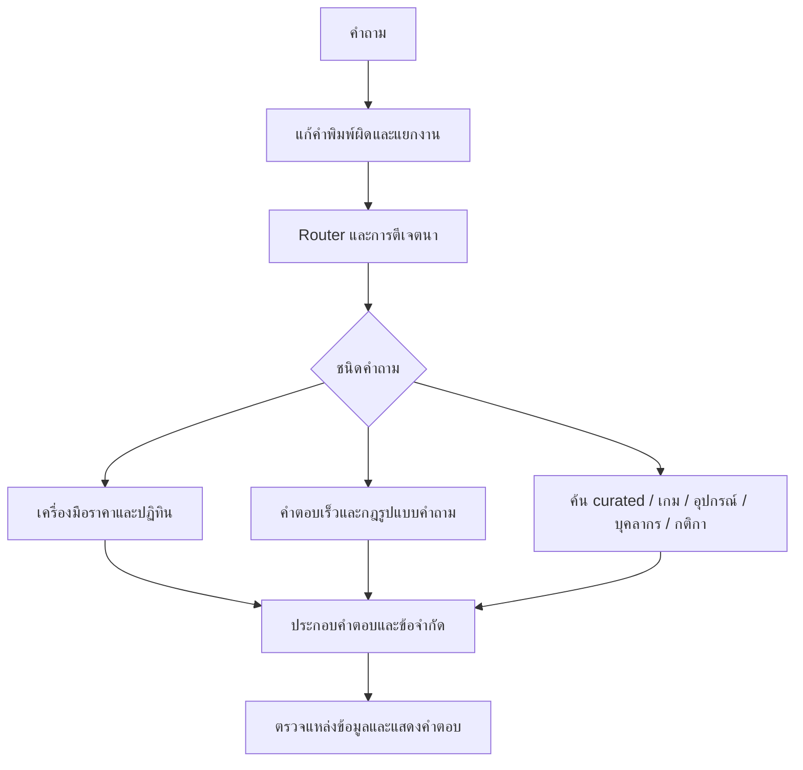
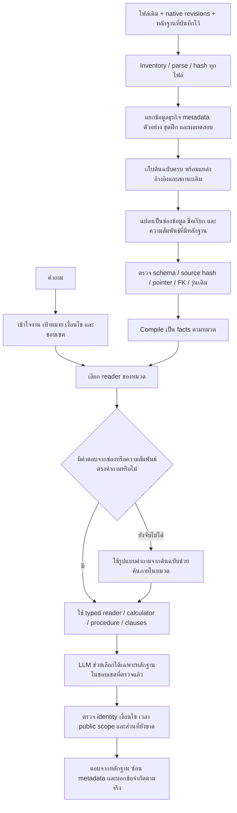

# R119 — Flow การย้ายข้อมูลและการใช้ตอบ พร้อมแผนที่ช่องข้อมูล

## 1. สาเหตุที่ต้องตรวจใหม่

คำอธิบายก่อนหน้าที่รวมหลายปัญหาไว้ในคำว่า “ข้อมูลไม่ครบ” กว้างเกินไป ต้นฉบับมีข้อมูลบางส่วนจริง แต่การย้ายครั้งแรกและตัวอ่านของ Common ไม่เก็บหรือไม่ใช้ความหมายบางช่อง ตัวอย่างสำคัญคือ `facts.zones` ของเกม ส่วน public scope ของโปรไฟล์ และกฎปัดจำนวนรอบในโค้ดคำนวณเดิม

จึงต้องแยกการตรวจออกเป็นสี่ชั้น:

1. **เก็บต้นฉบับครบหรือไม่** — ตรวจไฟล์และค่าเดิมตาม hash/JSON pointer
2. **แปลงเป็นชนิดข้อมูลที่ถูกหรือไม่** — ชื่อเกมไม่ใช่เครื่องจริง, กลุ่มผู้เล่นไม่ใช่จำนวนเล่นพร้อมกัน, เวลาจองไม่ใช่เวลาเปิดอาคาร
3. **ตัวอ่านเข้าถึงข้อมูลหรือไม่** — มีอยู่ใน SQLite แต่ไม่ถูก compile/index/reader ใช้ ก็ยังตอบไม่ได้
4. **เข้าใจและตอบคำถามถูกหรือไม่** — มีข้อมูลและตัวอ่านแล้ว แต่ LLM ตีความผิดหรือทิ้งบริบท ก็ยังพลาดได้

การผ่านชั้นแรกไม่รับรองอีกสามชั้น จึงมีทั้งรายการตรวจข้อมูลและผล API แยกกัน

## 2. Flow เดิมที่ใช้อ้างอิง

จุดที่ช่วยให้ Legacy ตอบได้คือข้อมูลไม่ได้อยู่เฉพาะฐานเอกสาร แต่กระจายอยู่ในไฟล์ canonical, curated, aliases, ตารางในโค้ด และฟังก์ชันคำนวณ/ปฏิทิน หากย้ายเฉพาะข้อความบทสรุป จะเสียความสัมพันธ์และกฎเหล่านี้

คำตอบเร็วที่เขียนไว้ในโค้ดบางส่วนเป็นข้อความสรุป/ตัวอย่างหรือคำตอบว่าไม่พบข้อมูล ไม่ใช่หลักฐานธุรกิจอิสระ ต้องตรวจกลับกับต้นฉบับ ไม่ยกระดับทุกข้อความใน cache เป็นนโยบายที่เจ้าของยืนยัน

## 3. Flow ของ R119

ใน revision02 ช่องข้อมูล/ความสัมพันธ์ที่ตรงคำถามและ guard ที่ล็อกไว้ทำงานก่อนรูปแบบค้นหากว้างของ Legacy แก้กรณีคำถามว่าเก้าอี้อยู่โซนไหนแล้วได้รายการอุปกรณ์ทั้งโซน

### ข้อกำหนดการย้าย

- แก้ใน candidate แยกจากระบบที่ใช้อยู่
- เพิ่ม revisions และ sources; ไม่แก้ revision/source เดิม ไม่สร้าง approval แทนเจ้าของ
- ไม่ใช้คำตอบในชุดทดสอบหรือข้อความ assistant ในชุดฝึกเป็นหลักฐานตอบ
- ไม่สร้าง resource ID จากชื่อโซน และไม่เอาเกมคนละ edition มารวมกัน
- เก็บคำตอบเจ้าของที่ใหม่กว่า หากต้นฉบับเก่าเป็นเพียงข้อความสั้นกว่าหรือมีสถานะไม่เท่ากัน
- โปรไฟล์ที่เคยเผยแพร่ยืนยันได้เฉพาะข้อมูลสาธารณะที่อยู่ในโปรไฟล์ที่บันทึกไว้ ไม่รับรองว่าปัจจุบันยังดำรงตำแหน่งเดิม
- เก็บสถานะ translation/review เดิม; ชื่อภาษาอังกฤษจาก draft ใช้เป็น search alias ได้ แต่ไม่ถือว่าเป็นชื่อแสดงผลที่ผ่านการยืนยันแล้ว

## 4. Mapping ของ canonical ทั้ง 10 ชนิด

| ชนิดต้นฉบับ | จำนวน | ช่องหรือความสัมพันธ์ใน Common | การใช้ตอบและขอบเขต |
|---|---:|---|---|
| policy_rule | 94 | FAQ.answer + metadata รูปแบบคำถาม | 73 รายการมี active root; อีก 21 เป็น guard/no-answer เดิม เก็บเป็นต้นฉบับ ไม่แปลงการไม่พบข้อมูลในอดีตให้เป็นข้อห้ามถาวร |
| competition_document | 4 | competition และ competition_rule | เก็บ section/heading/text; ตรวจข้อความทุก section เทียบ native clauses การย้ายครบไม่รับรองว่า reader เลือกทุก clause ที่เกี่ยวข้องได้ครบ |
| control_map | 38 | control_set.bindings และ limitations | เก็บปุ่ม action คำอธิบาย และแพลตฟอร์ม; ตรวจจำนวนแถว และข้อความเดิม ไม่แต่ง gesture/context ที่ต้นฉบับไม่ยืนยัน |
| game_profile | 36 | game.title/summary/how_to_play/genre/studio_zone_ids | อ่านโซนจากความสัมพันธ์ที่ต้นฉบับระบุโดยตรงได้ ไม่ต้องมีเครื่องจริงก่อน |
| knowledge_fact | 42 | FAQ.question/answer/topic | เก็บข้อความเต็ม ไม่ใช้คำถามต้นฉบับเป็นส่วนหนึ่งของคำตอบเพื่อให้ผ่าน keyword |
| member | 25 | person.display_name/role/team/affiliation/period/public_scope | ตอบจากโปรไฟล์สาธารณะที่บันทึกไว้ และค้นกลับจากตำแหน่งได้; ข้อมูลส่วนตัวนอก scope ยังถูก guard |
| service_availability | 8 | service + game_service + direct zone | ช่วงเวลา กลุ่มจำนวนผู้ใช้ รายชื่อเกม และเครื่องที่ต้นฉบับระบุชัด; ไม่เติมเครื่องที่ไม่ได้ระบุ |
| equipment | 16 | equipment_model.name/usage/specifications | เก็บคำอธิบาย วิธีใช้ use cases หมายเหตุ จำนวน และโซน; ข้อมูลฮาร์ดแวร์ที่ยืนยันใหม่กว่าไม่ถูกแทนด้วยข้อความเก่า |
| service_closure | 3 | closure.local_date/state/reason | เก็บวันที่และเหตุผลตามประกาศเดิม ไม่ใช้เป็นข้อพิสูจน์ว่าบริการเปิดจริงทุกวันอื่น |
| service_fee_policy | 4 | ข้อความนโยบาย และ native rate/calculator ที่มีขอบเขต | ไม่ใช้ FAQ ราคาเก่าเลี่ยงการตรวจอัตราปัจจุบัน กลุ่มผู้ใช้ หน่วยราคา และระยะเวลา |

## 5. Mapping ของแต่ละกลุ่มข้อมูล

### 5.1 เกมและโซน

เส้นทางที่ใช้ได้มีสามแบบ:

1. `game.studio_zone_ids` จาก `facts.zones` ที่ต้นฉบับระบุโดยตรง
2. `game → game_service → service.studio_zone_ids`
3. `game → game_service → service.resource_ids → resource.zone_id`

ข้อมูล `venue_zone_ids` ที่ย้ายมาก่อนหน้านี้เชื่อมเข้าการฉาย facts ด้วย ตรวจแล้วไม่มี zone เพิ่มที่ขัดกับชุด direct zone ที่ย้ายในรอบนี้ ชื่อโซนทุกตัวต้องอ้าง native zone จริง

จุดบกพร่องเดิมคือบังคับใช้เส้นทางที่สามเท่านั้น ทำให้ Nintendo/VR บางบริการตอบโซนไม่ได้ทั้งที่ต้นฉบับมีโซนชัดเจน

ข้อความ `facts.text` ของ game profile เป็นข้อความรวมจาก summary/genre/how-to/zone จึงตรวจทั้งการเก็บข้อความเดิมและค่าที่แยกเข้าช่อง ไม่จำเป็นต้องนำข้อความรวมซ้ำมาเป็นคำตอบแข่งกับ typed fields

คำบรรยายต้นทางฉบับเต็ม 31 เกมที่อยู่ใน native แล้ว เชื่อมเป็น `official_description` พร้อมวันที่บันทึกและข้อจำกัดของคำบรรยาย ข้อมูลนี้ไม่รับรอง patch, DLC, online entitlement หรือจำนวนผู้เล่นจริงของเครื่องในศูนย์

### 5.2 จำนวนผู้ใช้กับจำนวนเล่นพร้อมกัน

`service.capacity_min/max` เป็นช่วงจำนวนผู้ใช้ตามรายการบริการ ส่วน `resource.capacity_persons` เป็นอีกชนิดข้อมูล ห้ามนำช่วงการจองหรือช่วงผู้ใช้ไปอ้างเป็นจำนวนเล่นพร้อมกันโดยอัตโนมัติ

เพิ่ม fact `service_capacity` สำหรับทั้ง 8 บริการ โดยระบุความหมายนี้ไว้ชัดเจน ตัวอย่าง VR มีขอบเขตผู้ใช้ตามรายการ แต่การยืนยันจำนวนเล่นพร้อมกันยังต้องมีหลักฐานของอุปกรณ์/รูปแบบการใช้จริง

### 5.3 บุคลากร

ข้อมูลชื่อ/ตำแหน่ง/ทีมอยู่ใน native ก่อนแล้ว แต่ public_scope ของ 25 รายยัง unknown จึงถูกบล็อกทั้งที่ต้นฉบับเป็น published profile รอบนี้ย้ายขอบเขตการเผยแพร่จากหลักฐานเดิม พร้อมข้อความกำกับว่าตอบตามโปรไฟล์ที่บันทึกไว้

สังกัด 12 รายและ period 5 รายมีค่าใน native อยู่แล้ว จึงไม่อ้างว่าเป็นข้อมูลที่เพิ่งสร้างใหม่ ต่อ reader ให้ใช้ช่องเหล่านี้ได้ เก็บค่าภาษาอังกฤษที่ native มีเพิ่มเติม ไม่ลดกลับเป็นภาษาไทยอย่างเดียว

เพิ่ม role aliases 22 รายและชื่อเรียกจากต้นฉบับ การกู้การสะกดชื่ออังกฤษยอมรับเฉพาะกรณีนามสกุลตรง ชื่อคลาดเล็กน้อย และได้คนเดียว หากกำกวมหรือถอน public scope จะไม่เลือกคนใกล้เคียงมาแทน

### 5.4 ราคา

เดิม calculator ใช้การปัดขึ้น `ceil(duration/session)` แต่การย้ายเก็บเฉพาะราคา/ระยะเวลา ทำให้ 18 จาก 24 rates ไม่มีกฎคำนวณ รอบนี้ถ่ายกฎได้เฉพาะแถวที่ service, กลุ่มผู้ใช้, ราคา และระยะเวลาตรงกับกฎเดิมจริง

ไม่ได้แปลงหน่วยราคาเก่ามาทับหน่วย/ข้อยืนยันเจ้าของที่ใหม่กว่า อัตราที่มี owner reaffirmation ยังแสดงวันที่ยืนยันล่าสุด และไม่แต่งช่วง effective date ใหม่

สิ่งที่ยังต้องแยกเมื่อใช้ตอบคือ service duration, เวลารวม, persons, sessions, audience, per-person/per-group และ rental package การมีข้อมูลครบไม่ได้แก้ปัญหา LLM ทิ้ง slot เหล่านี้โดยอัตโนมัติ

### 5.5 ตารางบริการ

ย้ายผลของฟังก์ชัน `regular_service_slots` เดิมทั้ง 7 วันเป็น `service_slots` และ `service_closed` ใน native:

- จันทร์: เช้าบำรุงรักษา บ่ายให้เล่น
- อังคาร–พฤหัส: เช้าและบ่ายให้เล่น
- ศุกร์: เช้าให้เล่น บ่ายบำรุงรักษา
- เสาร์–อาทิตย์: ไม่มีช่วงให้บริการเล่นในตารางประจำ

ค่าเวลาใช้ค่าจริงจากต้นฉบับ ไม่พิมพ์ซ้ำเป็น venue facts ใน reader ใหม่ Runtime อ่าน native fields

`open_periods` บางรายการยัง conflicted และไม่ได้ล้าง conflict ทิ้ง เพราะเป็นข้อมูลพื้นที่/เวลาเปิดอีกขอบเขตหนึ่ง แยกจาก play-service schedule และ live occupancy การถามวันนี้ต้องใช้วันที่/เขตเวลาอ้างอิง และตรวจประกาศปิดพิเศษที่มีบันทึกด้วย

### 5.6 กติกาและปุ่มควบคุม

ตรวจต้นฉบับทุก section และทุกแถวของปุ่มกับ text/bindings/limitations ใน native ไม่ถือว่ามีแค่ไฟล์แนบแล้วจบ

อย่างไรก็ดี การย้ายครบไม่ทำให้คำถามกว้างอย่าง “บทลงโทษ” เลือกทุกย่อหน้าที่สัมพันธ์กันเอง การรวม parent/child clauses และการเก็บ game/event context ในแผนยังต้องพัฒนาต่างหาก

### 5.7 ภาษากับสถานะการตรวจ

- aliases และ regex เป็นเครื่องมือช่วยค้น ไม่ใช่ข้อความตอบหรือหลักฐานธุรกิจ
- draft translation ใช้ช่วยค้นได้ตามขอบเขต แต่ไม่ถูกเปลี่ยนเป็น owner-approved
- source provenance, locale status, source hash และ lifecycle เดิมเก็บใน `legacy_context` เพื่อไล่ตรวจ
- ไม่แสดง `legacy_context`, `legacy_search`, role aliases หรือ regex title ต่อผู้ใช้เป็นคำตอบ
- `legacy_context` เป็นหลักฐานการเก็บข้อมูลครบ ไม่ใช่หลักฐานว่าทุก intent อ่านทุกค่าข้างในได้แล้ว

## 6. เมื่อเจ้าของเพิ่มข้อมูลในอนาคต

1. ใส่ข้อมูลลงชนิดที่ถูก เช่น game, service, rate, policy, procedure, competition_rule
2. ใส่ aliases สำหรับชื่อที่ผู้ใช้เรียก และผูก game/service/zone/event ด้วย ID จริง
3. ระบุสถานะ known/unknown/conflicted และหลักฐานของค่าที่ known
4. ข้อมูลราคา/ตาราง/กิจกรรมต้องระบุเวลาและขอบเขตที่มีผล; ถ้าไม่ทราบให้คง unknown
5. แก้ผ่าน revision ของ native store; epoch ทำให้การอ่านครั้งต่อไปเห็นข้อมูลใหม่
6. เมื่อต้องเผยแพร่จริง ยังใช้กระบวนการ review/approval ปกติ รอบนี้ไม่ได้สร้าง approval หรือสลับ production

การเพิ่มแถวข้อมูลในชนิดที่ reader รองรับไม่ต้องเขียนเงื่อนไขรายชื่อเกมหรือคำตอบรายคำถามในโค้ดใหม่ แต่การเพิ่ม **ชนิดคำถาม/การคำนวณ/ความสัมพันธ์ชนิดใหม่** อาจยังต้องเพิ่ม reader/operator และตรวจเงื่อนไขของมัน ไม่ใช่เพียงเพิ่มข้อความยาวในช่องกลางแล้วรับรองว่าตอบได้ทุกแบบ
