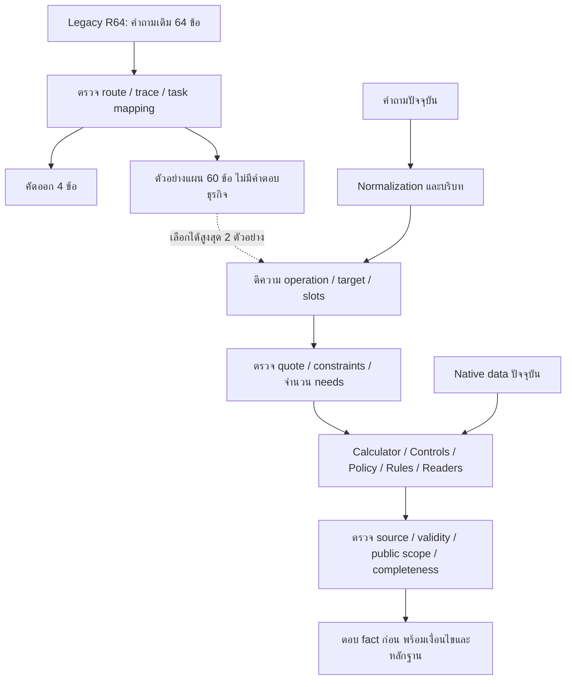

# R120 — Flow เดิมสอนวิธีทำงานให้ Flow กลาง

## วิธีที่ทดลองจริง

เป็นการใช้ **retrieved demonstrations ร่วมกับการถ่ายทอดพฤติกรรมของระบบเดิมมาเป็นโค้ดที่ตรวจสอบได้** ยังไม่มีการฝึกน้ำหนักโมเดล ทั้ง teacher และ student ใช้ Typhoon รุ่นและ digest เดียวกัน แต่เป็น pipeline คนละรุ่น จึงเรียก teacher ว่า “ระบบที่ใช้เป็นต้นแบบ” ไม่ใช่โมเดลขนาดใหญ่กว่า

รัน teacher 64 คำถามเดิมจริง เก็บคำตอบ, route, mode และ trace แล้วตรวจแผนที่แปลงมาสำหรับ Common พบ 4 ตัวอย่างที่ไม่ควรสอน ได้แก่คำถามราคา+การจองสองข้อ, ระยะเวลาทางเลือกที่แปลงเป็นค่าเดียวไม่ได้หนึ่งข้อ และคำถามกติกา CS2 ที่ teacher ส่งไป contact/map อีกหนึ่งข้อ หลังแก้ mapping หมวด/operation/facet แล้วใช้ตัวอย่าง 60 ข้อ

การตรวจแผนนี้ไม่ใช่การรับรองความจริงของคำตอบ teacher ทั้ง 64 ข้อ และจะไม่ย้ายราคา/โทษ/ข้ออนุญาตจากคำตอบ teacher มาเป็น facts

## หลักที่เห็นจาก Flow เดิม

| พฤติกรรมที่เห็นใน code/trace | สิ่งที่ถ่ายทอด | สิ่งที่ยังต้องใช้จาก Common ปัจจุบัน |
|---|---|---|
| เส้นทาง structured service fee | แยกงานคำนวณราคาออกจากชื่อเกม | service/rate/audience/หน่วยราคาและกฎคำนวณ |
| structured controls / source operation lookup | จับเกม แพลตฟอร์ม และปุ่มที่ถามอย่างเจาะจง | binding ของปุ่มและคำอธิบาย |
| competition rule detail source | เก็บชื่อเกม/รายการแข่งขัน และอ่านหัวข้อกฎ | ฉบับการแข่งขัน clause และ dependencies |
| calendar/structured schedule | แยกช่วงเล่น บำรุงรักษา และข้อมูลที่บันทึก | วันเวลา เขตเวลา ความขัดแย้งและขอบเขตยืนยัน |
| protected policy/source lookup | คงเงื่อนไขของคำตอบและขอบเขตสิทธิ์ | published record/evidence/approval/withdrawal |

teacher เปิด LLM ได้ แต่หลายข้อจบที่เครื่องมือและเส้นทาง structured จึงห้ามตีความว่าคำตอบทั้ง 64 ข้อเกิดจากการใช้ LLM ทุกข้อ

## Flow ที่ติดตั้งใน candidate

1. **รับคำถามและบริบทเดิม** — ใช้ normalization และ dialogue binder ที่มีอยู่ ไม่ใช้คำตอบ teacher เป็นประวัติผู้ใช้
2. **เลือกตัวอย่างวิธีจัดการที่เกี่ยวข้อง** — similarity ของคำและอักขระ เลือกได้สูงสุด 2 ตัวอย่างจาก 60 ข้อ มีคำถามกับ task plan เท่านั้น
3. **เสนอแผนด้วย LLM** — เลือก domain, operation, facet, target และ constraints โดย target/quote ต้องมาจากคำถามปัจจุบัน ข้อมูลบุคคล/ราคาไม่ได้สร้างจากตัวอย่าง
4. **ตรวจ schema และการอ้างคำถาม** — ปฏิเสธ target/constraint ที่แต่งขึ้น ตรวจการไม่ทำตัวเลข/การปฏิเสธตกหล่น ลบได้เฉพาะ empty general placeholder ที่ไม่บรรทุกคำถามจริง
5. **รักษาบริบทของคำถามหนึ่งงาน** — หากมีเพียงงานเดียวและ splitter ไม่พบหลายความต้องการ ใช้คำถามทั้งประโยคแทน quote บางช่วง เพื่อไม่ทิ้งเกม/รายการ/เงื่อนไขประกอบ ยังคงมีข้อจำกัดของ splitter
6. **ตรวจ requested operation อย่างอิสระ** — เช่น ราคาเกมต้องไป C06 เมื่อมีความสัมพันธ์เกม→บริการ→อัตราใน native และไม่ใช่ค่าเสียหาย/มัดจำ/คืนเงิน/เหมา ไม่สร้างราคาเมื่อ relation ไม่มี
7. **เลือก reader ตามชนิดงาน** — calculator, game controls, event rules, calendar, policy, equipment, people ฯลฯ การเพิ่มตัวอย่างไม่ได้แทน reader เหล่านี้
8. **ตรวจว่าข้อมูลที่มีถูก compile เข้าตัวอ่านจริง** — แก้ FAQ ที่มี topic/route_category ชัดเจนแต่ intent key ไม่ตรง prefix เดิม เช่น temporary suspension ให้เข้า C10 ข้อมูลและหลักฐานเดิมไม่ถูกแก้
9. **อ่านหัวข้อให้ครบตามคำถาม** — บทลงโทษกว้างอ่าน parent และ numbered sibling ตามโครงสร้าง source, อุปกรณ์แข่งขันเชื่อมคำถามกับ heading ที่มีใน event เดียวกัน เมื่อมี primary heading เดียว จึงใช้ได้ ไม่สร้างข้ออนุญาตเอง
10. **ตรวจ scope แล้วตอบจาก native** — กลไก event edition, validity, public scope และ withdrawals เดิมยังทำงาน ราคาใช้ duration ที่ถาม รวมคำอังกฤษอย่าง one hour; ไม่แสดงชื่อกฎภายใน เช่น session_ceil ในประโยคตอบราคา แต่ยังเก็บไว้ใน computation evidence

### เสริมหลัง initial pilot

- revision02: คืน scope ของ bring vs consumption, ใช้ source role suffix กรองคน และตรวจ multi-zone set operation จากคำถามชัดเจน
- revision03: นิยามอุปกรณ์อ่าน usage แทนการทวนชื่อ, policy ตอบเนื้อหาก่อนโดยไม่ใช้ internal intent slug เป็นหัวข้อ, heading/ข้อความที่เหมือนกันไม่แสดงซ้ำ ทั้งหมดยังคง clauses และ citations ของ source
- เก็บ source snapshot และผลแต่ละรุ่นแยกกัน ชุด 27 ข้อถูกอ่านและใช้ปรับระบบแล้ว จึงไม่เรียกผลหลังปรับว่า holdout ใหม่

## ข้อจำกัดที่ยังมี

- 60 ตัวอย่างครอบคลุมบางลักษณะคำถาม ไม่ใช่ทุกหมวด/ทุก intent ของระบบ
- ตัวอย่างใกล้เคียงอาจชักนำผิดหมวดได้ ต้องวัดผลทั้งก่อนและหลังจริง
- candidate ยังพยายามเรียก LLM ตีความคำถามก่อนเป็นส่วนใหญ่ ต่างจาก Legacy ที่หลายกรณีจบใน gated structured fast path จึงยังรับผลจาก model transport/deadline และไม่ได้ถ่ายทอดการเปิด/ข้าม LLM ครบทั้งระบบ
- ตัวตรวจ single need ยังพึ่ง splitter; คำถามหลายงานที่ splitter ไม่พบอาจตกหล่น
- การโยง synonym ไปยังหัวข้อกฎแก้เฉพาะกรณีที่ผูก source ได้ ไม่ใช่ semantic search สมบูรณ์ทุกหัวข้อ
- source มีข้อมูลไม่ได้แปลว่ามี fact/reader/facet สำหรับตอบทุกคำถาม ข้อที่ compile ไม่ขึ้นต้องแก้ทางข้อมูลเข้า reader
- reference checker ของ Legacy คาด protocol เก่า strict score จึงใช้แทน semantic accuracy ไม่ได้
- ไม่มีการวัดแยก ablation ของ demonstrations อย่างเดียว ผลก่อน/หลังเป็นผลรวมของ prompt และ code changes
- ยังไม่ train weights, ไม่ Full Test และยังไม่ติดตั้งทับ production/R78

## หลักฐานตรวจสอบ

- `teacher01/RESULTS.jsonl`: คำตอบและ trace ของ teacher ที่รันจริง
- `TEACHER_MAPPING_REVIEW.json`: การแก้ mapping และคัดออก 4 ตัวอย่าง
- `TEACHER_LESSONS.json`: ตัวอย่างแผนที่ผ่านการตรวจ 60 ข้อ
- `STUDENT_CONTRACTS.json`: source/code contracts ไม่เรียกโมเดล ไม่สร้างคำถามใหม่
- `baseline01`, `student01`, `regression01`: ผล API และ freeze ของแต่ละรอบ
- `PER_REQUEST_COMPARISON_TH.md`: คำตอบก่อน/หลังพร้อม evidence จากการทำงานจริง

