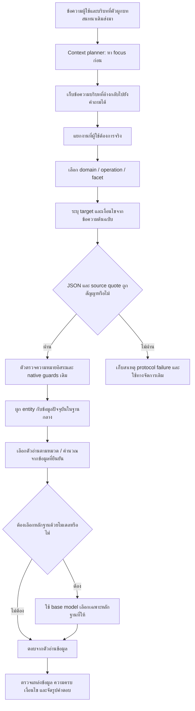

# R121 — ฝึกการตีโจทย์ก่อนเลือกข้อมูล

## เป้าหมายและขอบเขต

ฝึก adapter ของโมเดลให้แยกสิ่งที่ผู้ใช้ต้องการออกจากชื่อเกม/เครื่องที่เป็นเพียงบริบท ไม่ฝึกราคา กฎอนุญาต หรือคำตอบธุรกิจไว้ในน้ำหนัก ข้อมูลเจ้าของยังอยู่ในฐานข้อมูลกลางและเปลี่ยนได้ตามเดิม ผลของโมเดลเป็นข้อเสนอในการตีความ ซึ่งต้องผ่านตัวตรวจและตัวอ่านข้อมูลอีกชั้น

รอบนี้เป็น candidate แยกจากระบบเดิม ไม่ติดตั้งทับ R78 ไม่ย้ายหรือแก้ข้อมูลจริง ไม่เพิ่มคำถามใหม่ และไม่รัน Full Test

## ลำดับที่ใช้งานใน candidate

### 1. หาสิ่งที่ถามก่อน

ผลลัพธ์เริ่มด้วย `focus` เช่น eligibility, booking_procedure, price, game_availability, equipment_inventory, competition_rules หรือ multiple จากนั้นจึงแจกแจงงาน `tasks` ไม่ตัดสินหมวดจากคำว่า PS5 หรือชื่อเกมเพียงคำเดียว

### 2. เก็บบริบทที่ตรวจย้อนกลับได้

`context_quotes` และ constraints ต้องเป็นข้อความย่อยที่มีอยู่จริงในคำถาม เก็บการปฏิเสธ กลุ่มผู้ใช้ จำนวนคน ระยะเวลา วันเวลา รุ่นเครื่อง รุ่นเกม และบริบทการแข่งขัน เท่าที่ถามมา ไม่แต่งข้อมูลแหล่งอ้างอิงขึ้นเอง

ทุก constraint มี `source_record_id` ว่างในขั้นตีความ ตัวผูกข้อมูลภายหลังเป็นผู้เลือก record จริง วิธีนี้ไม่ฝังรหัสแหล่งข้อมูลเก่าหรือคำตอบธุรกิจไว้ใน adapter

### 3. แยกหลายงานเมื่อมีความต้องการต่างกัน

คำถามเรื่องปุ่มเกมและราคา PC เป็นสองงาน คำว่า “ตอบสั้น ๆ” เป็นรูปแบบการตอบ ไม่ใช่งานใหม่ เงื่อนไขที่ใช้ร่วมกันถูกส่งต่อให้ตัวประกอบ execution query ของ native engine

### 4. เลือกตัวอ่านที่ตรงกับความต้องการ

| ความต้องการ | ตัวอ่านหลัก |
|---|---|
| สิทธิ์ใช้บริการ ข้อห้าม อาหาร ความเสียหาย | rules |
| วิธีจอง การยืนยันตัวตน เปลี่ยน/ยกเลิก | reservation |
| ชำระเงิน สลิป คืนเงิน | payment |
| เครื่อง อุปกรณ์ จำนวน ความจุ สเปก | equipment |
| รายการเกม เกมอยู่บริการใด รุ่นเกม | games |
| ปุ่มและวิธีควบคุม | game_controls |
| ราคาบริการปกติและการคำนวณ | service_fee |
| แพ็กเกจเช่าพื้นที่/เหมาจ่าย | rental |
| เวลาเปิดและเวลาที่จองได้ | schedule |
| สถานะว่างตามวันเวลาจริง | live |
| กติกาแข่งขันตามรายการ | competition_rules |
| คนและตำแหน่ง | members |
| ที่ตั้ง ช่องทางติดต่อ ตัวตนศูนย์ | contact |
| ข่าวและประกาศ | news |

adapter เปลี่ยนขั้นตีความ ไม่ได้เขียนตัวอ่านทั้ง 14 หมวดใหม่ ตัวอ่านและข้อจำกัดที่ยังเหลือจาก R120 จึงยังต้องตรวจแยก

### 5. ตรวจข้อเสนอของโมเดล

ตรวจโครง JSON, vocabulary, facet ที่เข้ากับ domain, จำนวนงาน, task quote ซ้ำ, target ที่แต่งขึ้น, constraints ที่ไม่มีในคำถาม และตัวเลข/การปฏิเสธที่หลุดออกจากงาน จากนั้นใช้ independent review และ guards ของ R120 ต่อ

ตัวตรวจเหล่านี้พิสูจน์ความถูกต้องเชิงโครงสร้างได้ แต่ไม่ได้พิสูจน์ว่าเข้าใจความหมายครบทุกประโยค

### 6. เลือกหลักฐานและตอบ

ใช้ข้อมูลกลางเดิมสำหรับข้อเท็จจริง ปิด adapter ที่สอนงานตีโจทย์เมื่อเรียก evidence selector เพราะตัวเลือกหลักฐานมี output contract คนละแบบ ทุกรอบเรียกเก็บ provenance ว่า adapter เปิดจริงหรือไม่ พร้อม revision ของ base และ hash ของ adapter

## สิ่งที่ฝึกจริง

- QLoRA/NF4 บน Typhoon2.5 Qwen3 4B ที่ pin revision ไว้
- LoRA rank 8 ที่ q/k/v/o projection: 5,898,240 พารามิเตอร์ที่ฝึก
- completion-only loss: สอน focus และแผนงาน ไม่คิด loss กับ system prompt
- ฝึก 244 คำถามเดิม, validation 15, ทดสอบแยก 30
- กลุ่มคำถามเดียวกันและข้อความแกนซ้ำถูกกันออกระหว่าง train กับ held-out
- ตั้งใจฝึก 3 epochs / 93 optimizer steps; ต้องดู `OPTIMIZATION_PROOF.json` เพื่อยืนยันจำนวนที่ทำสำเร็จจริง
- เลือก checkpoint ด้วย validation loss ไม่เลือกด้วยคะแนน test

## วิธีตรวจผล

1. เปรียบเทียบ HF NF4 base เดียวกันก่อนและหลัง adapter ด้วย prompt/decoding เดียวกัน 30 คำถาม
2. วัด focus, domain, domain+facet, task signature, จำนวนงาน และข้อจำกัดแยกกัน
3. API candidate เดียวกัน 8 คำถามต่อแขน: base เทียบ trained context planner ใช้ฐานข้อมูลและตัวอ่านชุดเดียวกัน
4. แยกความผิดตีโจทย์ออกจาก source gap, reader failure, protocol และ transport
5. ตรวจ hash ของข้อมูล/โค้ดต้นทางและ base weights ก่อนสรุป

## ข้อจำกัดที่ต้องรายงาน

- gold labels เป็นการตรวจและจัดทำโดย agent ยังไม่ใช่คำตัดสินจากเจ้าของทุกข้อ
- จำนวน held-out 30 ข้อยังเล็ก บางโจทย์มีความกำกวมเรื่องขอบเขต การให้คะแนน exact อาจลงโทษแผนที่ยอมรับได้อีกแบบ
- typed-constraint precision/recall ในตัววัดหลักรวมเป็นชุดทั้งคำถาม ไม่ยืนยันว่าเงื่อนไขถูกผูกกับ task ที่ถูกต้องทุกตัว กรณีหลายงานจึงต้องเปิดดูแผนรายข้อเพิ่มเติม
- rental/news มีตัวอย่างใน train แต่ไม่มี fresh test ในรอบนี้ ข่าวบางส่วนเป็นคำถาม fixture จาก benchmark เดิม
- ทดสอบการตีความคำถามที่ส่งเข้า planner ยังไม่ใช่การยืนยันบทสนทนาหลาย turn ครบทุกสถานการณ์
- ก่อน/หลังในรอบนี้ใช้ HF NF4 เหมือนกัน ไม่ใช่การเปรียบเทียบตรงกับ Ollama GGUF ของ R120 ซึ่งมี runtime/quantization ต่างกัน
- ความเร็วของ HF NF4 บน GPU 6GB ต้องรายงานจากเวลาจริง ยังไม่ถือว่าพร้อมใช้เป็น production
- live provider ถูกควบคุมให้ unavailable ใน workload นี้ จึงไม่ยืนยันสถานะการใช้งานศูนย์จริง
- ไม่ควรสรุปว่าแก้ครบทุกหมวด หรือใช้คะแนน planner แทนความถูกต้องของคำตอบทั้งหมด
