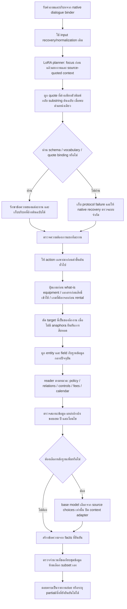

# R121 candidate revision 04 — ฝึกการตีโจทย์และตรวจบริบทก่อนอ่านข้อมูล

## เหตุผลของ Flow นี้

การฝึก LoRA จริงช่วยให้เลือก domain และสร้างแผนตาม schema ได้ดีขึ้น แต่ผล API ยืนยันว่าการตีโจทย์ถูกยังไม่พอ: บางครั้ง source quote ต่างเพียงตัวพิมพ์ทำให้แผนถูกทิ้ง บางครั้งตัวตรวจเดิมเลือกหมวดตามคำขึ้นต้น และบางครั้งข้อมูลมีอยู่แต่ reader ไม่รู้ว่าเจตนานั้นตรงกับ policy ใด จึงต้องตรวจทั้งลำดับก่อนตอบ

## Full Flow ของ candidate รุ่นนี้

## 1. ส่วนที่ฝึกน้ำหนักจริง

ใช้ adapter จาก `train02/adapter` ของ R121 ทุก revision ใช้ไฟล์เดียวกัน ไม่ได้ฝึกเพิ่มระหว่างแก้ Flow หลักฐาน 93 optimizer steps, 732 micro steps, adapter hash เปลี่ยน และ base parameter hash ไม่เปลี่ยนอยู่ใน `train02/OPTIMIZATION_PROOF.json` และ `TRAINING_VERIFICATION.json`

การฝึกเป็น structured-plan SFT/behavior transfer ไม่ใช่การเรียนรู้ hidden chain of thought หรือการคัดลอกคำตอบธุรกิจของ Legacy ทั้งระบบ

## 2. Source quote binding

โมเดลอาจคืน `Nintendo Switch` แต่ input recovery ส่งคำถามเป็น `nintendo switch` การปฏิเสธเพราะต่างเฉพาะตัวพิมพ์ทำให้แผนที่ถูกต้องหาย แล้ว fallback ไปหมวดผิด

รุ่นนี้ยอมผูกกลับเฉพาะเมื่อข้อความนั้นตรงกับ substring ต้นฉบับแบบไม่สนตัวพิมพ์ **เพียงตำแหน่งเดียว** จากนั้นใช้ข้อความต้นฉบับจริงเข้า validator เดิม ไม่แก้คำสะกด ไม่เติมชื่อ entity ไม่สร้าง source ID และไม่ผ่อน validator ให้รับ target ที่ไม่มีในคำถาม เก็บ model quote และ source quote ใน `source_quote_repairs`

## 3. ตรวจแยกงานโดยไม่ยุบคำถามหลายเรื่อง

ตัวตรวจเดิมข้าม independent review ทั้งชุดเมื่อมีหลายงาน ทำให้ “ปุ่มเกม + ราคา PC” มีโอกาสเหลือเพียงราคา หรือได้ gameplay แทนปุ่ม

รุ่นนี้ตรวจแต่ละ task ด้วย source/intent frame เดิมแล้วรวมกลับตามจำนวนงานเดิม ไม่เรียก LLM เพิ่ม และไม่อ่านคำตอบ Legacy เป็นคำตอบของ candidate

การถาม “What are … buttons” ไม่ถูก override เป็น equipment definition เพราะคำขึ้นต้น “What are” อีกต่อไป

## 4. เป้าหมายและบริบทต้องเป็นของงานนั้น

การที่ target อยู่ในคำถามทั้งประโยคไม่ได้รับรองว่าเป็นของทุก task เช่น `Tekken 8` ไม่ใช่ target ของ task “what is the PC price”

เมื่อ target ไม่อยู่ใน task quote และไม่มีคำสืบทอด เช่น it/its/same/เกมนั้น/เครื่องนั้น จะตัด target ที่รั่วข้ามงานออก แล้วให้ native reader ผูกจากข้อความท้องถิ่นของงาน การสืบทอดที่มี anaphora ยังไม่ถูกตัดทิ้งเงียบ ๆ

ชั้นนี้ยังไม่ใช่ตัวแก้ shared constraints ทุกแบบ ข้อบกพร่องการทำ label ด้วย whole-question constraints ต้องแก้ชุดสอนใน revision ใหม่ต่างหาก

## 5. อ่านตาม action ที่ขอ

| คำถามขออะไร | วิธีเลือก source |
|---|---|
| บุคคลที่ไม่ใช่นักศึกษา PSU เล่นได้ไหม | C10 external-visitor policy ที่มีอยู่ ไม่อนุมานจากราคากลุ่มผู้ใช้ |
| บุคคลภายนอกต้องแสดง ID อะไร | C08 check-in documents ไม่ใช้คำตอบเพียงว่าเข้าใช้ได้ |
| ต้องจองอะไรเพื่อเล่นเกมหนึ่ง | ผูกเกมจริงใน C04 แล้วอ่าน studio_services ไม่อ่านแพ็กเกจ rental |
| ปุ่มของเกมและราคาเครื่อง | แยก C05 กับ C06 ไม่ปล่อย target หรือ field ข้ามกัน |
| กินอาหารได้ที่ไหน | เลือก consumption policy ที่มีอยู่ |
| ถือขวดน้ำเข้าศูนย์ แต่ไม่ได้ถามเรื่องกิน | ไม่เอา consumption policy ไปยืนยันสิทธิ์นำเข้า |

ทุกข้อใช้ record และ value เดิม ข้อมูล/approvals/withdrawals/lifecycle ไม่ถูกแก้ ขอบเขต candidate ยังเป็น migration preview

## 6. จำนวนที่ขอต้องไม่ถูกเพิกเฉย

เมื่อผู้ใช้ระบุชุดปุ่มจำนวนหนึ่ง แต่ source เป็นรายการควบคุมอีกจำนวนหนึ่ง รุ่นนี้จะไม่เลือก subset ตามใจ และไม่ประกาศว่าได้ชุดครบตามที่ขอ

คำตอบระบุจำนวน source control entries ที่มีจริง ความต่างจากจำนวนที่ขอ และขอให้ระบุกลุ่มปุ่ม ขณะเดียวกันเก็บรายการที่ยืนยันได้ไว้ในสถานะ partial การนับ entries ไม่เท่ากับนับปุ่มกายภาพ เพราะปุ่มเดียวอาจมีหลาย action ตามสถานะเกม

## 7. การวัดผลและขอบเขต

- การวัดผลของน้ำหนัก: before/after 30 คำถาม เก็บก่อนแก้ Flow integration
- การวัด API เดียวกันก่อน/หลัง adapter: 8 คำถามต่อแขน
- หลังเห็นปัญหา: revision02 ตรวจ 14 คำถามเดิม (8 ปัญหา + 6 known training regressions)
- revision03 ตรวจเฉพาะ 4 เส้นทางที่ได้รับผลจากการแก้
- revision04 ตรวจเฉพาะจำนวนปุ่ม การบริโภค และการนำเข้า 3 คำถามเดิม

สามรอบหลังเป็น development/regression ที่ใช้ปรับ Flow แล้ว ไม่ใช่ fresh holdout หรือ accuracy ของ Full ระบบ candidate revision04 **ยังไม่ได้รันทั้ง 14 ข้อหรือ Full ใหม่ทั้งหมดในรุ่นเดียวกัน** จึงห้ามรวมคำตอบต่าง revision แล้วเรียกว่า Full Test ผ่าน

## 8. สิ่งที่ยังต้องทำก่อน production

1. แก้ annotation ให้ผูก local/shared context ถูกงาน และเพิ่มความครอบคลุมของ critical slots/ambiguity จากคำถามเดิม
2. ตรวจ live status แยกจาก regular timetable และการส่งต่อบริบทระหว่าง task ของ calendar ให้ครบ
3. ตรวจ subset/cardinality และการถามกลับด้วย fresh retained families แยกจากชุด development ที่เห็นแล้ว
4. ตรวจความเร็วบน runtime ที่จะใช้จริง HF NF4 ในรอบนี้ช้ากว่าเกณฑ์ latency ของ benchmark เดิม
5. ทดสอบ coverage ที่กว้างขึ้นเมื่อเลือก Flow/ชุดสอนพร้อมแล้ว โดยเก็บผลเดิมเทียบจาก keys เดียวกัน และไม่เปลี่ยน protocol mismatch ให้กลายเป็น semantic failure
6. วัด paired API ใหม่ด้วย unified model-profile configuration: การวัดเดิมพบ generic fallback 3 ครั้งใช้ชื่อโมเดลที่ backend ทดลองไม่รองรับ ตัวเปิดใหม่ตั้ง `PSU_KNOWLEDGE_LLM_MODEL` พร้อม model variables อื่นแล้ว แต่ตรวจเฉพาะ config ยังไม่ใช่การยืนยัน runtime เส้นทางนั้นครบทั้งหมด

โค้ด candidate อยู่ใน `revision04_system` ยังไม่ติดตั้งทับ R78 หรือ server เดิม
