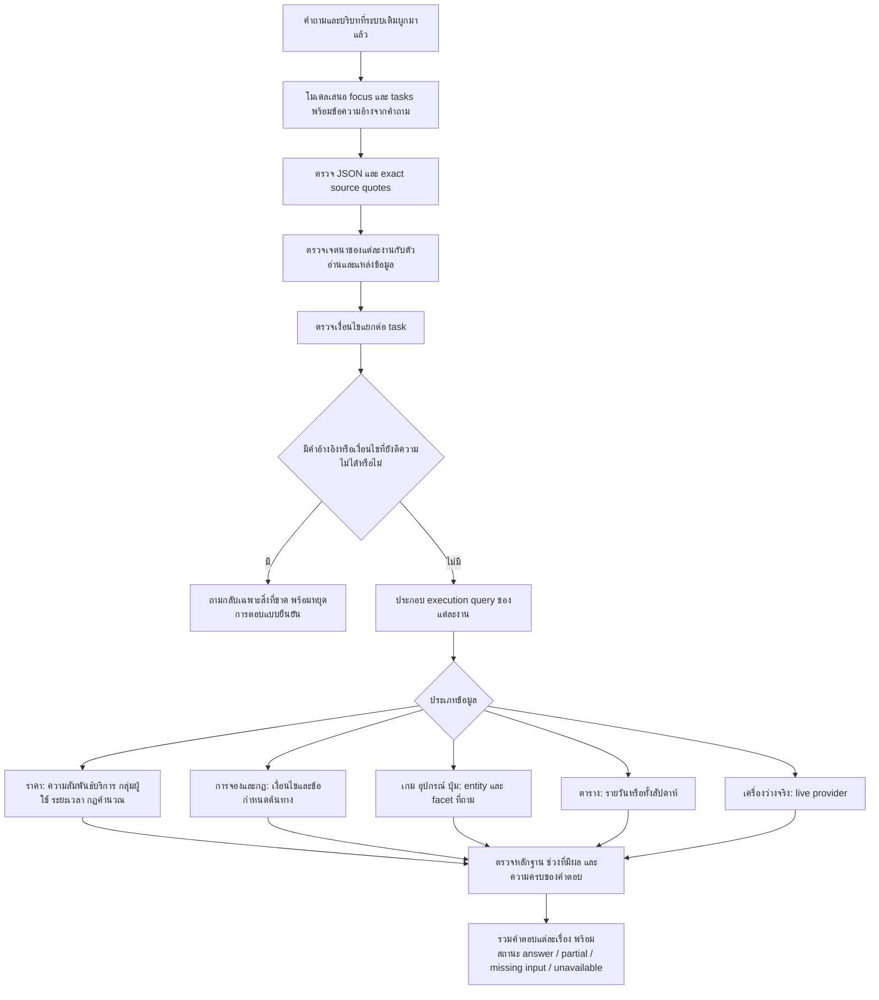

# R122 revision04 — ผูกบริบทกับงานย่อย และอ่านตารางรายสัปดาห์

## 1. ขอบเขตงานรอบนี้

พัฒนาต่อจาก R121 revision04 โดยใช้ฐานข้อมูลและ LoRA checkpoint เดิม ไม่ฝึกน้ำหนักเพิ่มในรอบนี้ และยังไม่ติดตั้งทับระบบ R78 ที่ใช้อยู่ ผลรอบนี้เป็นการพัฒนาและตรวจซ้ำด้วยคำถามเดิม ไม่ใช่ Full Test หรือคะแนนความถูกต้องของทุกหมวด

น้ำหนักที่ใช้ผ่านการฝึกจริงแล้วใน R121 จำนวน 93 optimizer steps ส่วนกฎที่เพิ่มใน R122 เป็นโค้ดตรวจแผนและตัวอ่านข้อมูล ต้องแยกผลของทั้งสองอย่างออกจากกัน

## 2. Flow ที่นำไปใช้งาน

## 3. การผูกเงื่อนไขกับงานย่อย

### 3.1 ปัญหาเดิมที่ตรวจพบ

ตัวสร้าง annotation ใน R121 เรียก `constraints(whole_question, domain)` ให้ทุกงานของคำถามหลายเรื่อง ทำให้คำถาม “What are the 8 buttons in Tekken 8, ans what is the PC price” มี PC ไหลเข้า task ปุ่ม และมี “8 buttons” ไหลเข้า task ราคา

นี่เป็นปัญหาการกำหนดขอบเขตแผนและป้ายสอน ไม่ใช่หลักฐานว่าขาดข้อมูลราคา หรือจำเป็นต้องเติมคำตอบใหม่ลงฐานข้อมูล

### 3.2 การแก้

1. เก็บ constraint ที่อ้างอยู่ภายในข้อความของ task นั้น
2. เอา target และ constraint ที่เป็นของอีก task ออก พร้อมเก็บ audit
3. เมื่อมีคำว่า it / its / same / เครื่องนั้น / เกมนั้น / เดียวกัน จึงพิจารณาสืบทอดชื่อจาก task ก่อนหน้า
4. ชื่อต้องปรากฏจริงในคำถามเดิม และต้องตรง label หรือ alias ของ entity ใน index ปัจจุบัน
5. ถ้าพบชื่อที่อ้างได้เพียงชื่อเดียว จึงผูก target นั้น โดยเก็บข้อความเดิมของผู้ใช้
6. การอ้างถึงเครื่องเดียวกันไม่ทำให้สืบทอดราคา จำนวนคน ระยะเวลา หรือเงื่อนไขอื่นไปด้วยโดยอัตโนมัติ
7. เติม slot รูปแบบชัดเจนจากข้อความเฉพาะงาน เช่น ชั่วโมง นาที จำนวนคน วัน เวลา แพลตฟอร์ม และการปฏิเสธบางรูปแบบ
8. เมื่อไม่พบสิ่งอ้างอิงชัดเจน ให้ถามกลับ

9. revision03 เพิ่มกรณีละชื่อบริการใน task รายชื่อเกม: ต้องมีชื่อเดียวใน task ก่อนหน้า ไม่มีชื่อใหม่ใน task นี้ อยู่ในคู่หมวดที่รองรับ และ index ต้องมีความสัมพันธ์บริการ→เกมจริง จึงนำเฉพาะชื่อนั้นมาเป็น target พร้อม audit `source_related_service_game_ellipsis`

โค้ดนี้รองรับรูปภาษาแบบจำกัด ยังไม่ใช่ตัววิเคราะห์ syntax หรือ shared prefix ทุกรูปแบบ เช่น audience ที่ใช้ร่วมหลายประโยค เงื่อนไขซ้อน และการอ้างอิงไกลหลาย task ยังต้องพัฒนาต่อ การเอาเงื่อนไขข้ามงานออกอาจทำให้ต้องถามกลับมากขึ้น ซึ่งต้องวัดกับชุดคำถามเดิมที่กว้างขึ้นก่อนใช้จริง

## 4. แยกตารางเวลาออกจากเครื่องว่างจริง

- “เปิดวันไหนบ้าง” ขอ regular play-service timetable
- “PC #03–#10 ว่างตอนนี้ไหม” ขอ live occupancy
- “มี free slot 14:00–15:00 ไหม” แต่ไม่ระบุบริการ/วัน ต้องถามกลับให้ครบ

ตัวตรวจใหม่เปลี่ยนเฉพาะคำถามสถานะว่างที่มีหลักฐานด้านเวลาและอยู่ในหมวด schedule/live ไม่เปลี่ยนคำถามราคา “free” ให้กลายเป็นเครื่องว่าง

ใน workload ที่วัด API ยังควบคุม live provider เป็น unavailable ตาม benchmark เดิม ดังนั้นผลนั้นไม่ยืนยันสถานะว่างของศูนย์จริง

## 5. ตารางทั้งสัปดาห์

แหล่งข้อมูลมี `service_periods` ครบ 7 วัน ตัวอ่านเดิมต้องจับได้หนึ่งวันจึงทำงาน ทำให้ “How to book Cockpit and what days is it open?” ตอบขั้นตอนการจองได้ แต่ส่วนวันเปิดไม่ถูกอ่าน

ตัวอ่านใหม่:

1. ตรวจว่าเป็นคำถามรายสัปดาห์
2. รวบรวม facts ของ `service_periods` ตาม weekday 0–6
3. ต้องมีหนึ่ง fact ต่อหนึ่งวัน ถ้าขาดหรือซ้ำให้หยุดและระบุช่องว่าง
4. แสดงช่วงเวลาและ maintenance จาก fact จริงแต่ละวัน ไม่มีเวลาเปิดที่เขียนตายตัวในโค้ด
5. ใช้สถานะ partial เพราะความใช้ได้กับ resource เฉพาะและช่วงที่มีผลยังไม่ยืนยัน
6. บอกว่าเป็นตารางให้บริการเล่นที่บันทึกไว้ ไม่ใช่การยืนยันว่าอาคารเปิด เครื่องว่าง หรือจองได้จริงในวันนั้น

การแก้ช่วยให้ข้อมูลที่มีอยู่ถูกอ่าน แต่ไม่ได้สร้างความสัมพันธ์ว่า Cockpit ใช้ทุกช่วงในตารางนี้โดยไม่มี source ยืนยัน

## 6. การถามกลับต้องมีผลจริง

เดิม `meaning_reader.apply` คืน plan เดิมทันทีเมื่อ `original.locked` ทำให้แผนที่ตีความว่ากำกวมอาจไม่ได้รับการจัดการ

ใหม่ตรวจ `meaning.ambiguous` ก่อน แล้วสร้าง missing_input ที่ไม่มี fact IDs พร้อมคำถามกลับ จากนั้นล็อกแผนนี้เพื่อไม่ให้ evidence selector เลือกคำตอบแทนผู้ใช้ ตัวอย่างที่ตรวจจากคำถามเดิม ได้แก่ pronoun ไม่มีสิ่งอ้างอิง และระยะเวลา 30 นาที / 3 ชั่วโมงที่ยังไม่แยกบทบาท

ยังต้องแยกกรณี “30 นาทีต่อรอบ รวม 3 ชั่วโมง” ออกจากระยะเวลาสองค่าที่ขัดกัน ตัวตรวจปัจจุบันใช้คำบอกต่อรอบ/per/each และคำเปรียบเทียบที่ชัดเจน จึงมีข้อจำกัดด้าน paraphrase

## 7. ตั้งค่าโมเดลให้เหมือนกันทุก caller

การเทียบ API ของ R121 มี base fallback สามครั้งที่เรียกชื่อโมเดลค่า default เดิม ซึ่ง backend ทดลองไม่รองรับ จึงไม่ควรอ่านผลนั้นเป็นผลของน้ำหนักอย่างเดียว

การวัด R122 กำหนด `PSU_CHATBOT_OLLAMA_MODEL`, `PSU_KNOWLEDGE_LLM_MODEL`, `PSU_QUERY_PLANNER_MODEL`, `PSU_TOOL_ROUTER_MODEL` และ `PSU_INTENT_LLM_MODEL` ให้เป็นโปรไฟล์แขนเดียวกันทั้งหมด และบันทึก environment ต่อการเปิด API แต่ละครั้ง

Context stage เปิด adapter เฉพาะแขน trained; evidence selection และ generic fallback ใช้ base weights ทั้งสองแขน โดยเก็บ stage/adapter_active/profile digest ทุกครั้ง ชื่อโปรไฟล์ยังเป็น R121 เพราะอ้าง checkpoint เดิม ไม่ได้หมายความว่า candidate code เป็นรุ่นเก่า

## 8. ข้อมูลสอนฉบับแก้ขอบเขต

สร้าง draft ล่าสุดใน `annotation_draft03` จากคำถามเดิม 244 train / 15 validation / 30 test แยกจากไฟล์ที่ใช้ฝึกจริงทั้งหมด ผลต่างต้องตรวจ semantic ก่อนใช้สอน ไม่ใช่ gold reference ใหม่ที่ยืนยันแล้ว ส่วน `annotation_draft01` และ `annotation_draft02` เก็บการลองก่อนแก้ pronoun/ellipsis

ไม่ได้ใช้ draft นี้ฝึก adapter ที่กำลังวัด และไม่เอาคะแนนเก่ามาคำนวณใหม่ด้วยป้ายใหม่อย่างเงียบ ๆ

## 9. สิ่งที่ยังค้าง

1. การเข้าใจเงื่อนไขซ้อนและ shared context ที่ไม่ใช่การอ้างอิงชื่อชัดเจน
2. ขอบเขตและลำดับความน่าเชื่อถือของ owner draft เทียบกับ legacy facts
3. ความหมายคำถามนำสิ่งของเข้า เทียบกับบริโภคสิ่งนั้น ต้องมี source สิทธิ์แยก
4. กรณีขอปุ่ม 8 ปุ่ม แต่ source มี 12 control entries ยังต้องถามว่าหมายถึงชุดใด
5. Runtime บน GPU 6GB ยังมี latency ต้องวัดจาก actual API
6. Native compatibility readers และ fallback ยังอยู่ ไม่ใช่การย้ายทุกหมวดเป็น typed semantic parser สมบูรณ์แล้ว
7. การวัดซ้ำ 8 ข้อเป็น development check ต้องไม่ตีเป็นความแม่นยำรวม หรือความสามารถทั่วไปที่ไม่เคยเห็นมาก่อน

### ตัวอย่างบริบทร่วมที่ยังต้องตรวจต่อ

คำถามเดิม “What is the price of Cockpit and what games are available” ไม่มี it ในเรื่องที่สอง แต่ผู้ใช้อาจหมายถึงเกมของ Cockpit revision02 พบความเสี่ยงอ่านรายการเกมกว้างเกินบริบทจากการเอา service constraint ออก จึงพัฒนาต่อเป็น revision03

revision03 ผูก shared target ที่มี provenance แยกจาก local slots: ตรวจว่ามี entity เดียวในเรื่องก่อนหน้า ไม่มี entity ใหม่ในเรื่องหลัง และ reader มีความสัมพันธ์ service→game ที่ตรงจริง จากนั้นสืบทอดเฉพาะชื่อ ไม่คัดลอก audience/duration/price ไปทั้งก้อน การตรวจ offline กับข้อมูลจริงยืนยันว่าเกมที่ตอบมี scope Cockpit ทั้งหมด ส่วนกรณีหลายชื่อและ shared prefix รูปอื่นยังไม่ครอบคลุม

จึงยังไม่ควรเอา draft labels ที่แก้ด้วยกฎนี้ไปฝึกเพิ่มโดยอัตโนมัติ และไม่อ้างว่ารอบนี้แก้ปัญหาบริบทครบทุกแบบแล้ว

## 10. รุ่นที่วัดและรุ่นล่าสุด

- การเทียบ API 8 ข้อต่อแขนวัด `revision02_system` แบบ freeze
- `revision03_system` เพิ่มเฉพาะการผูก service→game ellipsis และมีชุดตรวจ API อีก 2 คำถามเดิมแยกต่างหาก
- ผลตรวจ 11 จุดจาก saved plans และ 6 regression questions ถูกทำซ้ำกับ revision03 แล้ว
- ตรวจ 5 เงื่อนไขเพิ่มจาก 2 คำถาม compound: target Cockpit, claims ของเกม, scope Cockpit, target VR และการไม่เอาระยะเวลาไปปน task จอง
- การนับจุดตรวจไม่ใช่เปอร์เซ็นต์ความถูกต้องของคำตอบทั้งหมด

## 11. Revision04 — ทำ compare ให้ครบและรักษางบงานจอง

API probe ของ revision03 พบว่าข้อ VR ถูกตีเป็นสอง tasks ถูกต้องแล้ว แต่ compare reader เลือกเฉพาะ 30 นาที และต้องใช้ evidence selector หนึ่งครั้ง เมื่อถึงงานจองจึงพบ `request_model_budget_exhausted` Source review ยืนยันว่ามีทั้ง 30/60 นาทีและขั้นตอนจองอยู่จริง

ตัวแก้:

1. สำหรับ C06 operation compare / facet duration_minutes ที่มีระยะเวลาอย่างน้อยสองค่า แยกตัวเลือกจาก source quotes
2. เอาระยะเวลาออกจาก service scope ก่อนดึง rate pool เพื่อไม่ให้ตัวเลือกแรกกรองอีกตัวเลือกทิ้ง
3. เลือก source rate records ของแต่ละระยะเวลาโดยตรง และคง audience ของแต่ละบรรทัด
4. ตรวจอายุราคาและคำนวณเฉพาะระยะเวลาของบรรทัดนั้น ห้ามรวมยอดทุกทางเลือกเป็นยอดซื้อรวม
5. ถ้าขาดตัวเลือก ให้ตอบ partial และระบุระยะเวลาที่ไม่มี exact source rate
6. ขั้นตอนจองหลาย records ของ intent เดียวกัน: รวมเฉพาะข้อความที่เหมือนกันตรงตัว แล้วแสดงแต่ละข้อความที่เหลือแยกกันในสถานะ partial พร้อมบอกว่ามีหลายฉบับ ไม่ให้โมเดลเลือก authority โดยไม่มีเกณฑ์
7. ไม่เพิ่มเพดาน model calls เพื่อซ่อนปัญหา กรณีนี้ใช้โมเดลเฉพาะ context stage จากนั้นอ่านข้อมูลแบบ deterministic

ตรวจ 6 เงื่อนไขเพิ่มเติมและ API คำถาม VR เดิม 1 ข้อบน revision04 แล้ว พบทั้ง 30/60 นาทีและ booking claims โดยไม่เกิด budget failure ส่วนผล revision03 ที่ยังตอบไม่ครบถูกเก็บไว้

ข้อจำกัด: comparison ใหม่นี้จำกัด facet ระยะเวลาและอัตราที่บันทึก ไม่ครอบคลุมการเทียบประสบการณ์เล่น จำนวนคน/จำนวนรอบผสม หรือ normalization ของระยะเวลาที่เขียนเป็นคำทุกแบบ ส่วน procedure variants ยังต้องมี authority rule และการจัดคำตอบที่อ่านง่ายก่อนรวมเป็นข้อความฉบับเดียว
