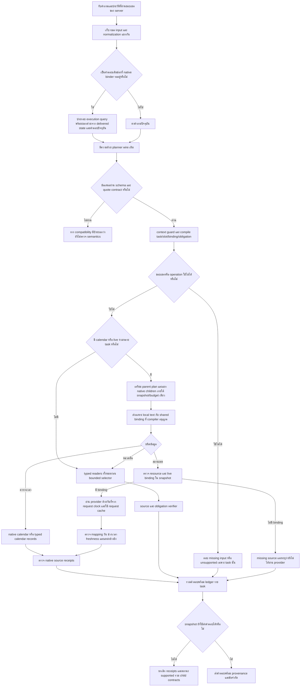

# R123 revision05 — Flow ที่เชื่อม calendar/live และที่มาของบริบท

เอกสารนี้อธิบายโค้ดที่ทำแล้วใน `revision05_system` ส่วนสถาปัตยกรรม R123 ฉบับเต็มยังอยู่ใน `../r123_plan_distillation_architecture_20261023/FLOW_MAIN_TH.md` ไม่ใช่การประกาศว่าทำครบ P0–P8

## 1. ภาพรวมที่ใช้งานใน candidate

เส้นทางหลาย task ที่ผ่าน native adapters **ยังทำ child ตามลำดับ** แม้ใช้ snapshot, request cache และงบเดียวกัน จึงกำหนด `typed_reads_before_fallback=false` ไว้ตรง ๆ ต่างจาก Engine ปกติที่อ่าน typed ทุก task ก่อน selector

## 2. การแบ่ง input ที่ต้องรักษา

| Input | หน้าที่ | ข้อห้าม |
|---|---|---|
| raw question | ข้อความปัจจุบันจากขอบเขตรับคำขอ | ไม่แทนที่ด้วยข้อความประกอบจาก history |
| normalized question | ข้อความหลังตัวปรับรูปแบบเดิม | ไม่อ้างว่าเหมือน raw ทุกอักษร |
| task source span | ช่วงข้อความที่ planner เสนอใน execution input | ไม่อ้างว่าอยู่ใน raw หากเป็นข้อความสังเคราะห์ |
| derived execution query | local task + referent ที่อนุญาต หรือ pending query + slot reply | ต้องบันทึกที่มาของแต่ละส่วน |
| delivered state | ขอบเขต/เจตนาที่เคยส่งสำเร็จตาม native gate | ไม่รับข้อเท็จจริงจาก prose ของ assistant มาเป็น source |
| current DB snapshot | ข้อมูลธุรกิจที่อ่านจริงในรอบนี้ | ไม่ใช้คำตอบเก่าเป็นฐานข้อเท็จจริง |

`request_provenance.py` เก็บ receipt สำหรับ raw/normalized/derived input และเพิ่ม raw mapping ราย task/target/slot ใน contract โดยสถานะสำคัญคือ:

- `exact_current_raw`: ข้อความและตำแหน่งตรงกับ raw ที่เก็บไว้
- `normalized_raw_range`: ช่วง raw ที่สัมพันธ์กับข้อความหลัง normalization ไม่ใช่ exact quote และไม่รับรอง semantic equivalence
- `derived_source_basis`: ข้อความที่ประกอบจาก parent/history ไม่อ้างตำแหน่งว่าเป็นคำพูดปัจจุบัน
- `invalid_execution_span` / `unmapped_normalization`: ไม่ยืนยัน mapping

การแปลง Unicode/NFC และการแทนอักษรหลายตัวด้วยตัวเดียวอาศัย offsets จาก normalizer เดิม การตรวจ round-trip ให้ครอบคลุม Unicode ทุกกรณียังเป็นงานต่อก่อนใช้ mappings เหล่านี้เป็น gold labels อัตโนมัติ

## 3. ประวัติสนทนา

1. ประวัติทั่วไปไม่ทำให้ Engine ข้าม compiled executor อีกต่อไป เพราะ `_legacy_answer` ไม่ได้ใช้ argument history ในการอ่านอยู่แล้ว
2. การเติมช่องราคา/ราคาเหมาใช้ `resume_financial` เดิม เฉพาะ delivered pending state ที่ native gate รับ
3. บันทึกว่า original pending query กับ current reply เป็นคนละแหล่งข้อความ รวมกฎที่เพิ่ม `per session` หากเป็นการเติม billing period
4. อ่านราคาจาก snapshot ปัจจุบันใหม่ ไม่สืบทอดราคา/จำนวนเงินจากคำตอบเก่า
5. ประวัติชนิดอื่นยังเป็น native dialogue flow ตามเดิม ไม่ได้มี typed history binder ครบทุกหมวดแล้ว
6. เครื่องหมาย `server_written` ไม่ใช่ลายเซ็นดิจิทัล ผู้เรียกต้องส่ง history ที่ server คัดกรองแล้ว การตรวจในโมดูลนี้ไม่ใช่ขอบเขตยืนยันตัวตนของ client

## 4. สถานะสด

1. จับชื่อ resource จากข้อมูลปัจจุบัน ไม่เลือกเครื่องที่ไม่มีจริง
2. ค้น `live_binding` ที่เชื่อม service/resource กับ provider
3. หากไม่พบ ให้ `missing_source` ใน execution ledger พร้อม `provider_read_attempted=false` ไม่กล่าวโทษ model transport
4. หากพบ ใช้วันที่อ้างอิงจาก `at` ของคำขอในการแปล today/tomorrow/weekday
5. อ่าน observation ผ่าน native reader และใช้ cache ภายในคำขอเดียว
6. native reader ตรวจ target date, requested window, slot coverage, mapping, timestamp และ TTL
7. bridge ตรวจ source pointers และทวน binding/mapping/TTL/อายุข้อมูลตามนาฬิกาคำขอเพิ่ม
8. เมื่อ provider อ่านไม่ได้ ข้อมูลเก่า ผิดวัน หรือ map ไม่ได้ ให้คงสถานะไม่ยืนยัน ไม่เดาว่าว่าง

ฐานข้อมูล candidate ปัจจุบันมี `live_binding=0` การเปิดเส้นทางนี้ใน verification จึงใช้ snapshot จำลองในหน่วยความจำเท่านั้น ไม่ใช่การยืนยันสถานะเครื่องจริง และไม่เพิ่ม binding ลง SQLite

## 5. เวลาเปิดและตารางจอง

- เวลาเปิดเข้าอาคาร, ช่วงจอง และช่วงบำรุงรักษายังคงเป็นคนละ predicate
- typed records ที่มีข้อจำกัดด้านโซน/ช่วงมีผลไม่ถูกยกระดับเป็นการยืนยันเปิดวันนี้
- native opening reader ยังมีหน้าที่ตอบสถานะรายวันให้กระชับเมื่อมีหลักฐานที่ตรง predicate
- source receipt ที่ผ่านไม่ใช่หลักฐานว่าการตีความภาษาธรรมชาติถูกทั้งหมด ledger ของ native obligations จึงยังไม่กำหนด fulfilled=true แบบเหมารวม

## 6. การยกเลิกคำตอบเมื่อ snapshot เปลี่ยน

ตรวจทั้งเมื่อออกจาก domain integration และที่ dispatcher ก่อนส่งจริง หากต้อง retry:

1. ไม่ใช้ receipts หรือ claim packets ของคำตอบรอบนั้นส่งต่อ
2. ล้าง coverage receipts ของแต่ละ need
3. เปลี่ยน top-level task ledger เป็น `not_current`
4. ล้าง receipts/live observations ใน nested child contracts
5. ทำเครื่องหมาย `delivery_invalidated=true`

บันทึก execution ที่เกิดขึ้นยังใช้ตรวจสอบเส้นทางได้ แต่ไม่ใช้เป็นหลักฐานยืนยันคำตอบที่ส่งสำเร็จ

## 7. งานถัดไปตาม Flow เต็ม

1. เพิ่ม shared-prefix และ typed history bindings ที่แยก scope ของ audience/date/condition อย่างครบถ้วน
2. ทำ operator/authority/collection adapters ที่ยังขาด โดยคงข้อมูลขัดแย้งหรือไม่มี authority เป็นสถานะที่เห็นได้
3. semantic-review labels ทั้งชุดก่อนเปลี่ยน planner wire และฝึก adapter ใหม่
4. กัน question families ที่ยังไม่ใช้ปรับโค้ด แล้วเปรียบเทียบ base / adapter ปัจจุบัน / adapter ใหม่ด้วย engine และข้อมูลเดียวกัน
5. ตรวจคำตอบปลายทางและ readiness ก่อน Full Test ขั้นต่อไป
