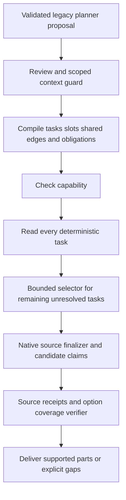

# R123 foundation revision03 — ผลลงมือทำตาม Flow

## สถานะที่ทำได้จริง

เริ่ม implement แล้วใน candidate แยก `revision03_system` ต่อจาก R122 revision04 รอบนี้ทำฐานของ P0/P1 และ adapter ของ reader เดิม ไม่ใช่ทำ R123 ทั้งแผนจบแล้ว ไม่ได้ฝึกเพิ่ม ไม่ได้รันโมเดลใหม่ และไม่ได้ติดตั้งทับ production

## 1. สิ่งที่เพิ่มใน runtime

1. **Compiled request/task graph**: มี task IDs, spans, slot owners, normalized duration roles, shared bindings และ obligations ต่อ task/option
2. **Capability registry**: ครอบคลุมชื่อหมวด C01–C14 และระบุ operator/field combinations ที่มี native adapter; unsupported operation ถูกแสดงตรง ไม่เปลี่ยนเป็น detail เงียบ ๆ
3. **Typed-first scheduling**: วางแผนและอ่านด้วย native readers ของทุกงานก่อน แล้วค่อยใช้งบ evidence selector กับงานที่ยังจำเป็น
4. **Obligation verifier**: ตรวจ field/ตัวเลือกของ comparison และหลักฐานความครบของ collection ก่อนถือว่าตอบครบ
5. **Source receipts**: ตรวจ fact/record/category/ref ให้ตรง pinned snapshot และคำนวณตัวเลขใหม่จาก source รวมทั้งตรวจรูปข้อความราคาที่อนุญาต
6. **Terminal reason mapping**: budget หมดแยกจากบริการ/model transport ล้ม และคงคำตอบของงานอิสระที่อ่านได้
7. **Public artifact audit**: package ของ domain-reader path ส่ง compiled plan, per-need obligations, receipts และ schedule ไปกับ decision artifact

Source เป็น schema/business operators ทั่วไป ไม่ใส่ question keys หรือ expected answers ของ benchmark ลงในโค้ดใหม่

## 2. Flow ที่ runtime ใหม่ทำจริง



ยังใช้ planner wire/schema และ checkpoint R121 เดิม การ enrich slots/context ของ compiler ไม่ใช่สิ่งที่โมเดลเพิ่งเรียนรู้มา ผลแต่ละขั้นถูกแยกใน audit

## 3. ตรวจอะไรแล้ว

- จุดตรวจหลัก 35 จุด ผ่านทั้งหมด และ package/artifact อีก 5 จุดผ่านทั้งหมด
- ตรวจ compile ป้ายเดิม 289 แถว: train 244 / validation 15 / test 30 เป็น structural audit ไม่ใช่การ review semantic ของป้ายครบแล้ว
- Replay saved proposals 40 รายการ จาก 32 question keys: raw planner outputs 30 รายการ และ actual API proposals ที่เก็บไว้ 10 รายการ มีคำถามซ้ำข้ามแหล่ง จึงไม่เรียกว่า 40 คำถามอิสระ
- ไม่เรียก LLM ใหม่ ไม่รัน original legacy baseline inference และไม่ตี replay results เป็นคะแนน generalization

### Fault injection ที่ตรวจแล้ว

- เอา 60 นาทีออกจากคำตอบ compare แล้วต้องถูกจับว่าตัวเลือกหาย
- เปลี่ยนตัวเลขแต่ใช้ source ID เดิม ต้องถูกปฏิเสธ
- เปลี่ยนข้อความราคาเป็น permission ที่แต่งขึ้นทั้งที่ numeric ยังเดิม ต้องถูกปฏิเสธ
- ลบ numeric ของราคา หรืออ้าง evidence ref ที่ไม่มี ต้องถูกปฏิเสธ
- แก้ข้อความ policy ที่ยังใช้ refs เดิม ต้องถูกปฏิเสธ
- สร้าง shared-reference cycle ต้องไม่ผ่าน contract
- บังคับงานราคาแรกให้ pending และ budget=0 แต่ task จองต้องอ่านได้ก่อน selector และยังมี claims
- ขอ compare ที่ไม่มี adapter ต้องได้ unsupported_operation แต่ส่วนจองไม่หาย
- quote ที่ไม่อยู่ในคำถามต้องจบแบบ bounded missing_input ไม่ส่ง facts และไม่ crash

## 4. สิ่งที่พบและแก้ระหว่างตรวจ

- ตัวตรวจแรกมอง input_bindings ไม่ตรงกับ native binding_3 จึงเตือน false gap แก้ด้วยการจับคู่ native controls projection ใหม่จาก source
- contact value บางรายการเป็น FAQ owner_policy แก้ด้วย declared-query-profile adapter ที่ตรวจ query/source ซ้ำ ไม่อนุญาต owner_policy ทุก record แบบเหมารวม
- count ของ capacity/quantity field ต้องเป็น field lookup ไม่บังคับ proof แบบการ enumerate ชุดอุปกรณ์
- การตัด duration ออกจาก comparison scope ต้องตัดทั้ง raw และ normalized form เพื่อไม่ให้คำว่า one hour ที่ normalize แล้วกรอง source ผิด
- trusted history/raw offset mapping ยังไม่ครบ จึงคง native compatibility path ที่มีป้ายบอก แทนการอ้างว่า compiler ผูก current-user spans ครบแล้ว

เก็บ candidate และผลการตรวจแต่ละ revision แยกกัน ไม่เขียนทับผลรอบก่อน

## 5. เทียบการ execute กับ parent R122

เทียบด้วย source/เวลา/คำถามและ saved proposals เดียวกัน 40 รายการ พบข้อความหรือสถานะเปลี่ยน 3 รายการ claims ที่หาย 0 และ claims เพิ่ม 0 ตัวเลขนี้บอกความต่างของ execution เท่านั้น ไม่ใช่ correct/incorrect accuracy

รายการที่ต่าง:

### API คืออะไร ตอบเป็นภาษาไทย

สถานะ missing_source → missing_source; removed claims 0; added claims 0

ตัวอ่านข้อมูลยังไม่รองรับวิธีประมวลผลที่คำถามนี้ต้องการ จึงยังยืนยันคำตอบส่วนนี้ไม่ได้

### นายเปนคัยแล้วทำไรไดบ้าง

สถานะ missing_source → missing_source; removed claims 0; added claims 0

ตัวอ่านข้อมูลยังไม่รองรับวิธีประมวลผลที่คำถามนี้ต้องการ จึงยังยืนยันคำตอบส่วนนี้ไม่ได้

### nintendo switch zone มีอะไรให้ใช้บ้าง

สถานะ answer → partial; removed claims 0; added claims 0

ตอบได้เฉพาะส่วนที่มีหลักฐาน ความครบตามรูปแบบที่ขอยังยืนยันไม่ได้
Nintendo Switch OLED — การใช้งาน: เครื่องเกม Nintendo Switch รุ่น OLED สำหรับเล่นเกมคอนโซลแบบกลุ่มหรือครอบครัว
จอง Nintendo Switch Zone แล้วเล่นผ่าน TV 86 นิ้วและจอยที่ศูนย์จัดไว้ตามรอบบริการ
เล่น Mario Kart 8 Deluxe
เล่น Overcooked 2
เล่น Super Smash Bros Ultimate
เล่น Nintendo Switch Sports [S1]

Nintendo usage ที่ถูกเสนอเป็น list ยังเป็น partial เมื่อไม่มี proof ว่ารายการครอบคลุมทั้งหมด ข้อความที่มี source ยังแสดงอยู่ การเตือนนี้ตั้งใจรักษาความต่างระหว่างข้อมูลที่มี กับการยืนยันว่า list ครบทุกอย่าง ไม่ใช่ข้อมูลหาย

## 6. สิ่งที่ยังไม่ครบตาม R123

| ส่วน | สถานะจริง |
|---|---|
| Internal task/slot/binding/obligation contracts | เชื่อม Engine แล้ว ผ่าน structural/source gates |
| Planner output wire R123 ใหม่ | ยังไม่ได้ implement; ใช้ legacy wire adapter |
| Shared-prefix audience/date และเงื่อนไขซ้อน | ยังไม่ครบ ใช้ guard/ambiguity ขอบเขตเดิม |
| Trusted history และ raw→normalized span mapping | ยังอยู่ native compatibility ที่มีเครื่องหมายบอก |
| All operations ของ 14 หมวด | ยังไม่ครบ registry แสดง adapter combinations กับ unsupported โดยไม่อ้างว่ารองรับทั้งหมด |
| Calendar/live special paths ใน public API | ยังใช้ native adapters เดิม ไม่ได้ผ่าน scheduler ใหม่ทั้งเส้น |
| Authority/supersession/compiler สำหรับข้อมูลใหม่ | ยังต้องทำต่อ ไม่แก้ approvals/ข้อมูลเอง |
| Numeric/reference/value receipts | เพิ่มแล้ว; registered calendar/spec transformations ยังไม่เป็น semantic entailment proof ทุกกรณี |
| Labels ที่ semantic-review ครบ | ยังไม่มี ชุด 289 ข้อรอบนี้ตรวจ compile เท่านั้น |
| New distillation/three-arm heldout evaluation | ยังไม่ได้เริ่ม |
| Actual new-model API / Full Test | ยังไม่ได้ทำใน foundation turn |

แม้ gates ผ่านทั้งหมด ยังไม่ประกาศเปอร์เซ็นต์ความถูกต้องหรือความพร้อม production เพราะยังไม่ได้วัดความหมายปลายทางด้วยชุดที่กันไว้

## 7. ข้อมูลและ source เดิม

```json
{
  "files_checked": 5723,
  "changed": [],
  "database_sha256": "029119eaa24e53b4110c6c8cc7f650674f68e03ee605929cea8f23857a6429d3",
  "same_r121_adapter_sha256": "e6a342902a0e469181094c05f412b355cef8cb1f57ce03aa78b6705b67f9b0d8",
  "production_installed": false,
  "new_training": false,
  "new_model_calls": 0
}
```

## 8. การรัน candidate และลำดับถัดไป

มี launch_candidate.py สำหรับ candidate แยก ใช้ checkpoint R121 เดิมและ model profile ทั้งห้าตัวตรงกัน ตรวจ --check-config แล้วเท่านั้น ยังไม่ได้เปิดเซิร์ฟเวอร์เพื่อทำ inference ในงานนี้ live provider ของ launcher คง fixture unavailable จึงไม่ยืนยัน occupancy จริง

ขั้นถัดไปตามแผนคือปิดช่องว่าง P1/P2 โดยเชื่อม native calendar/live และ trusted RequestContext, ขยาย operator/authority adapters และตรวจ labels ทั้งชุด ก่อนฝึก planner ต่อ การมี contracts ผ่านไม่ใช่เหตุให้ข้ามไปฝึกจาก draft labels โดยตรง

ไฟล์หลัก:

- IMPLEMENTATION_STATUS.json: สถานะเฟสและงานที่เหลือ
- CAPABILITY_MATRIX.json: adapter combinations และข้อจำกัดรายหมวด
- REGRESSION_REVIEW.json: ความต่างจาก parent รายข้อ
- FINAL_VERIFICATION.json: hash/source/model preservation
- verification_*/VERIFICATION.json และ replay JSON: หลักฐานการตรวจแต่ละรอบ
- PACKAGE_VERIFICATION_*.json: การส่ง audit ใน native packaging unit check

Source ใหม่อยู่ใต้ revision03_system/app/knowledge/common/domain_flow/: plan_contract.py, capabilities.py, task_execution.py, obligation_verifier.py และจุดเชื่อม engine.py/integration.py
