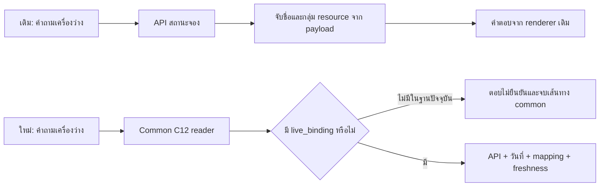

# รายการองค์ประกอบและช่องว่างเทียบ Flow เดิม — R123 revision05

ตรวจวันที่ 23 ตุลาคม 2026 ตามเวลาไทย จากโค้ดและฐานข้อมูลที่มีอยู่จริง อ่านอย่างเดียว ไม่เรียกโมเดล ไม่รันคำถามใหม่ ไม่เรียกสถานะจองจริง ไม่เปลี่ยนข้อมูล/approvals/ระบบเดิม

Candidate ที่ตรวจ: `../r123_contract_execution_20261023/revision05_system`  
Legacy ที่อ่านเทียบ: `C:/Users/Chokhun/Downloads/Learn-LLM/18_PSU_Esports_Update_Route_Data`

## 1. คำตอบตรง ๆ เรื่อง live_binding

**ยังไม่ได้ใส่ records ของ live_binding เข้ามาจริง** มี schema, reader, provider transport และตัวตรวจแล้ว แต่ฐานข้อมูลมี records ชนิดนี้ 0 รายการ การสร้างให้ใช้ได้จริงเป็นส่วนหนึ่งของงานเชื่อมระบบที่ยังไม่เสร็จ ไม่ควรสรุปว่าผู้ใช้ไม่ได้ให้ข้อมูลทั้งหมด

### ทำไม Flow เดิมทำได้โดยไม่มี record ชนิดนี้

Flow เดิมเรียก `get_live_booking_status()` แล้วให้ renderer จับชื่อ/กลุ่ม resource จาก payload ของ Dashboard/WordPress ด้วยโค้ดและ aliases ของเดิม ไม่ต้องมี record live_binding ในฐานกลาง

Flow กลางใหม่ให้ `common/live_reader.py` ค้น binding จาก snapshot ก่อน เพื่อรู้ว่าบริการในฐานกลางตรงกับ external resource ใด เมื่อไม่มี binding จึงคืนคำตอบไม่ยืนยัน และ dispatcher รับผล common นั้นกลับไปเลย เส้นทาง fallback เดิมที่อยู่ด้านล่างจึงไม่ได้ถูกเรียกในกรณีนี้

ดังนั้นปัญหาที่ตรวจยืนยันได้คือ **การแปลง/เชื่อม mapping จากระบบเดิมเข้าสู่ contract ใหม่ยังไม่ครบ** ไม่ใช่ไม่มีโค้ด API อยู่ในโปรเจกต์ การคง workload ที่ provider เป็น fixture unavailable ช่วยเทียบการทดสอบเดิม แต่ไม่ได้ทำให้ข้อกำหนดเชื่อมระบบจริงเสร็จไปด้วย

สิ่งที่ควรทำต่อคืออ่าน service catalogue/การจับคู่เดิม แล้วสร้าง binding ที่ตรวจสอบย้อนกลับได้ ใช้สิ่งที่มีอยู่ก่อน ไม่ขอให้เจ้าของกรอกข้อมูลเดิมใหม่ทั้งหมด ไม่ใช้ sample CSV เป็นข้อยืนยันรหัสจริง ณ ปัจจุบัน

## 2. ข้อมูลมีแค่ไหนตอนนี้

ตรวจ active heads ในฐาน SQLite ปัจจุบันได้ **806 records / 3,001 source snapshots / 6,428 fields**:

| ชนิด | จำนวน | ชนิด | จำนวน |
|---|---:|---|---:|
| FAQ | 394 | กติกาย่อยการแข่งขัน | 104 |
| game_service | 70 | game | 51 |
| control_set | 43 | person | 25 |
| rate | 24 | rental_package | 24 |
| equipment_model | 16 | resource | 14 |
| service | 8 | schedule | 7 |
| zone | 6 | audience | 5 |
| competition | 4 | closure | 3 |
| procedure | 3 | facility | 2 |
| center/contact/policy | อย่างละ 1 | live_binding/game_mode/news | อย่างละ 0 |

มี fields ที่ known 4,444, unknown 1,979, conflicted 5 ช่อง แต่ **unknown 1,979 ไม่ใช่ข้อมูลที่ลืมย้าย 1,979 ข้อ** บางช่องเป็น optional, บางเรื่องมีคำตอบใน FAQ/ต้นฉบับแต่ยังไม่แปลงเป็นช่อง typed และบางเรื่องต้นฉบับไม่ได้ยืนยัน ต้องแยกด้วย source review

R119 เคยตรวจต้นฉบับ canonical 270 records / 11,693 leaf values และเก็บต้นฉบับ 488 ไฟล์แบบ byte ตรง รวมทั้งตรวจราคาเหมา 24/24 แถว การเก็บ source ครบในขอบเขตนั้นไม่ได้หมายความว่า runtime mapping, API binding และ operator ทุกแบบถูกนำมาใช้ครบแล้ว คำว่า “ย้ายครบ” ก่อนหน้าควรจำกัดขอบเขตให้ชัดเจนกว่านี้

ข่าวและโหมดผู้เล่นไม่มี dedicated typed records ไม่ได้แปลว่าข้อความข่าว/จำนวนผู้เล่นทั้งหมดไม่มีใน FAQ หรือ source archive ต้องตรวจการเข้าถึงข้ามชนิดข้อมูลก่อนนับว่าเป็น missing fact

## 3. API วันที่และการคำนวณ ใส่แล้วหรือยัง

| องค์ประกอบ | สถานะจริง | ยังต้องทำอะไร |
|---|---|---|
| เวลาปัจจุบัน Asia/Bangkok | มี `now_bangkok/today_bangkok` | ตรวจว่า request ทุก adapter ใช้นาฬิกาเดียวกัน; runtime overrides ต้องไม่ค้างจาก test |
| แปลวันนี้/พรุ่งนี้/ชื่อวัน/วันที่ | มี shared date parser และ live resolver | ยังไม่รับรอง parity ของทุกรูปประโยค/ทุกเส้นทาง |
| เดือน/ปี/พ.ศ. และ formatting ไทย | helper มีอยู่ | Common profile return ก่อน legacy flow หลายส่วน จึงต้องตรวจการเชื่อมคำถามปฏิทินเต็มเดือน/ปีเป็นราย capability |
| ตารางจอง/บำรุงรักษา | มี 7 วันครบ | แยก physical access, play-service และ booking availability ให้ตรงคำถาม |
| วันปิดพิเศษ | มี 3 closure records และไฟล์ calendar เดิม | ขอบเขตโซน/นโยบายจัดการจองยังไม่ชัด; ไม่ยืนยันว่าเป็นประกาศล่าสุด |
| วันหยุดไทย | มี helper/ไฟล์ที่ระบบเดิมใช้ | ตรวจอายุข้อมูลและทางเรียกใน common; วันหยุดราชการไม่ได้แปลว่าศูนย์ปิดอัตโนมัติ |
| คำนวณราคา | มี deterministic `financial.unit_calculation` ใช้ Decimal, กฎรอบ และหน่วยเวลา | ไม่ใช่ calculator API ที่ต้องสร้างใหม่; ยังต้องรักษา audience/unit/quantity ทุก task ให้ถึง calculator |
| กฎปัดรอบ | rate calculation_rule known 24/24 | ความถูกของการเลือก rate/ช่วงเวลา/กลุ่มยังแยกจากสูตรคำนวณ |
| ราคาเหมา | rental_package มี 24 แถว; ราคา/โซน/กลุ่ม/ครึ่งวันเต็มวันมี | terms ยัง unknown 24; อย่าคูณแพ็กเกจหรือแต่งสิทธิ์เหมารวมที่ไม่มี rule |
| เปรียบเทียบ 30/60 นาที | มี reader และ option verifier | เปรียบเทียบอื่นไม่ได้รองรับทั้งหมด; ไม่รวม alternatives เป็นยอดเดียว |
| Dashboard status API | client/server code มี | ค่า default `127.0.0.1:8091/api/chatbot-status`; ไม่ได้ตรวจ health จริงใน inventory นี้ |
| WordPress แบบอ่านตรง | มี `fetch_wordpress_status` | ใช้ exports ของ appointments/services และต้องอ่านสำเร็จทั้งคู่; ไม่ได้ตรวจเครือข่ายจริงรอบนี้ |
| Live common reader | มี | ไม่ทำงานกับบริการจริงจนกว่าจะมี binding ที่ตรง |
| Freshness/cache/วันที่ของ observation | native checks มี; bridge เพิ่ม receipt checks | ยังไม่ใช่หลักฐานว่า endpoint จริงให้ข้อมูลถูก; ต้องทำ live contract check แยกจาก benchmark |
| Launcher ล่าสุด | มี แต่ยัง override provider เป็น unavailable fixture | สำหรับทดสอบจริงต้องมี profile เชื่อมจริงแยกจาก benchmark fixture |

วันที่พื้นฐานและการคำนวณไม่จำเป็นต้องมี API ภายนอกเพิ่ม ใช้ code ภายในเครื่องได้ ส่วน occupancy ต้องอาศัยข้อมูลปัจจุบันจากระบบจอง

## 4. รายการสิ่งที่ยังขาด/ยังไม่ครบทั้งหมดที่ตรวจพบ

สถานะที่ใช้: **ขาด** = ไม่มีส่วนที่ต้องมี, **บางส่วน** = มีแต่ยังไม่ครบเส้นทาง/ขอบเขต, **ต้องยืนยัน** = มีข้อมูล/โค้ดแต่ยังไม่มีหลักฐานปัจจุบันพอ, **ต้องวัด** = ยังไม่มีผลทดสอบขอบเขตนั้น

### A. การเชื่อมข้อมูลจริงและ Live API

| ID | รายการ | สถานะ | ผลกระทบ/สิ่งที่ต้องเติม |
|---|---|---|---|
| A01 | live_binding records | ขาด | ฐานกลาง 0 records; ต้องแปลง mapping จาก provider เดิม |
| A02 | internal service → external resource key | ขาดใน binding | ต้องตรวจรหัสที่ API ใช้จริง ไม่ผูกด้วยชื่อคล้ายกันอย่างเดียว; booking_product_key ใน service ยัง unknown 8/8 |
| A03 | physical pool ของบริการที่ใช้เครื่องร่วมกัน | บางส่วน | field มีใน schema/receipt แต่ยังไม่มี records และยังไม่ได้ merge/dedup pool ให้ครบ; VR 30/60 ไม่ควรถูกนับเป็นเครื่องคนละชุดโดยปริยาย |
| A04 | status mapping ที่ตรง payload จริง | ขาดใน binding | ต้องแยก available/busy/partial/closed/unknown และรักษา available_count; ห้ามแปลง partial เป็นทุกเครื่องว่าง |
| A05 | TTL/timezone/วันที่มีผลของ binding | ขาดใน binding | ตรวจ clock/freshness ได้เมื่อมี policy ที่ถูกต้อง ไม่เดาค่า production จาก fixture |
| A06 | profile เชื่อม live จริง | ยังไม่ได้เปิดใน launcher ทดสอบ | `serve_revision05.py` ยังคง controlled unavailable; มี API code ไม่เท่ากับ launcher ใช้ provider จริง |
| A07 | provider health/schema/identity ปัจจุบัน | ต้องยืนยัน | ยังไม่อ่าน endpoint จริงใน inventory นี้ ไม่ทราบว่าเปิดอยู่หรือ IDs เปลี่ยนหรือไม่ |
| A08 | calendar ของ Dashboard กับ common snapshot | บางส่วน | มี `center_schedule.json` และ common schedule เป็นคนละแหล่ง ต้องมี precedence/sync ที่ชัด; ค่าเวลาแต่ละแหล่งไม่ตรงทุกช่อง |
| A09 | จำนวนเครื่องว่าง/ความจุ/ช่วงเวลาต่อเนื่อง | บางส่วน | native มี slot coverage แต่ R123 ยังไม่รับรอง count/group/physical-pool semantics ครบเท่า renderer เดิม |
| A10 | การแยก failure ของ API กับไม่มี binding | ทำบางส่วนแล้ว | revision05 แยกได้ใน ledger; ต้องคงเหตุนี้ถึง UI/log/metric ทุกช่องทาง ไม่รวมเป็น content failure |

Dashboard กับ WordPress เป็นทางเลือก transport ไม่จำเป็นต้องเปิดทั้งสองแบบ แต่ต้องมีอย่างน้อยหนึ่งแบบที่ตรวจสัญญาข้อมูลแล้ว ไม่จำเป็นต้องเอาข้อมูลส่วนบุคคลของการจองมาใส่ common DB

### B. ข้อมูล/ความสัมพันธ์/ขอบเขตที่ยังต้องจัดการ

| ID | รายการ | สถานะ | หลักฐาน/สิ่งที่ต้องเติม |
|---|---|---|---|
| B01 | ความขัดแย้ง physical opening hours | ต้องแยก scope/authority | open_periods conflicted 5/7 วัน; ไม่ใช่ไม่มีตารางจอง |
| B02 | โซนที่ตารางเวลาใช้บังคับ | ยังไม่ยืนยัน | schedule.zone_ids unknown 7/7 |
| B03 | ช่วงมีผลของตาราง | ยังไม่ยืนยัน | schedule.validity unknown 7/7; ห้ามอ้างว่าเป็นตารางประกาศล่าสุดทุกปี |
| B04 | ขอบเขตวันปิดพิเศษ | ยังไม่ยืนยัน | closure.zone_ids unknown 3/3; ต้องตรวจว่าปิดทั้งศูนย์หรือบางโซน |
| B05 | ปิดพิเศษแล้วจัดการ booking อย่างไร | ยังไม่ยืนยัน/ยังไม่ project | closure.resolution_policy_id unknown 3/3; ต้องค้น owner policy ที่มีอยู่ก่อนขอข้อมูลใหม่ |
| B06 | หน่วยราคาที่ตรงกับ rate | บางส่วน | rate.unit unknown 18/24 แต่มี owner per-person confirmations ใน projection บางส่วน; ต้องรวมเป็น contract เดียว ไม่ถือว่า 18 แถวนั้นคิดราคาไม่ได้ทั้งหมด |
| B07 | วันมีผล/คำยืนยันราคา | บางส่วน | rate validity unknown 6/24; คำยืนยันล่าสุดกับ effective interval คนละเรื่อง |
| B08 | เงื่อนไขราคาเหมา | บางส่วน | ราคา 24 แถวมีแล้ว แต่ rental terms unknown 24/24; ห้ามอนุมานรวมบริการ/คืนเงินจากราคาแพ็กเกจ |
| B09 | Service → physical resource | บางส่วน | resource_ids known 4/8 services; อีก 4 unknown เช่น Switch/VR ที่มี service แต่ยังไม่ระบุ physical members ครบ |
| B10 | Game → เครื่องที่ติดตั้ง | บางส่วน | game_service.installed_resource_ids unknown 42/70; ตอบโซน/บริการได้ไม่ได้แปลว่าตอบหมายเลขเครื่องได้ |
| B11 | โหมดและจำนวนผู้เล่นพร้อมกัน | typed representation ยังไม่ครบ | game_mode 0; ต้องตรวจข้อมูลเดิม/FAQ ว่ามีและแปลงได้เท่าไร ไม่เดาจากจำนวนจอย/ที่นั่ง |
| B12 | แพลตฟอร์มที่เกมรองรับ | ยังไม่ยืนยันใน field นี้ | game.supported_platforms unknown 51/51; ต่างจาก platform ของ service ที่ศูนย์มี |
| B13 | รายละเอียดเกมที่เหลือ | ต้อง source review | summary/genre/how_to_play unknown 15/51; บาง record เป็นชื่อที่ใช้ประกอบการควบคุม/รายการ ต้องแยกไม่มี source กับยังไม่ project |
| B14 | เกมเวอร์ชัน/edition/อายุผู้เล่น | ยังไม่ยืนยัน | game_version unknown 70 relations, edition/age_rating unknown 51 เกม; ไม่ใช้ความรู้โมเดลเติมเป็นข้อเท็จจริงของศูนย์ |
| B15 | เอกสาร check-in/กำหนดเวลาใน procedure | representation บางส่วน | typed required_documents/deadline unknown 3 procedures แต่เอกสารมีคำตอบ owner ใน FAQ; ต้องเชื่อม ไม่ขอให้กรอกซ้ำก่อนค้น |
| B16 | ข่าว/กิจกรรมเป็น typed records | บางส่วน | news 0 แต่ยังมี FAQ/source อื่น ต้องตรวจ mapping วันที่/registration/validity |
| B17 | นโยบายหลายฉบับและข้อมูลบุคลากร | ต้อง authority review | scope/currentness/วันมีผลไม่เท่ากับเก็บ record ได้; อย่ารวมข้อความขัดกันเป็นนโยบายเดียว |
| B18 | Completeness และ English ของ clauses | บางส่วน | ต้องเช็กเป็นรายฉบับ/ข้อ ไม่ใช้จำนวน records หรือ source refs เป็นหลักฐานว่าแปล/ตอบครบทุกส่วน |

### C. ความเข้าใจคำถามและการส่งต่อบริบท

| ID | รายการ | สถานะ | สิ่งที่ยังต้องทำ |
|---|---|---|---|
| C01 | ระบุ factual needs ครบทั้งคำถาม | บางส่วน | compile ตรวจสิ่งที่ planner เสนอได้ แต่ยังไม่มีตัวตรวจอิสระว่ามันไม่ละทั้ง task |
| C02 | Shared-prefix audience/date/condition | บางส่วน | ปัจจุบันมี local slots/shared target บางกฎ ยังไม่ครบกรณี prefix/ท้ายประโยค/หลาย task |
| C03 | Pronoun/anaphora/“อันเดิม/เครื่องนั้น” | บางส่วน | ใช้ unique previous referent ได้บางรูป ต้องเก็บ ambiguity เมื่อมีหลาย antecedents |
| C04 | History binding ทุกหมวด | บางส่วน | มี native delivered-state financial/selection adapters ไม่ใช่ generic typed history binder ครบแล้ว |
| C05 | Negation/conditions/exceptions | บางส่วน | ต้องรักษาว่าขยาย task ใด แยก bring/consume, eligibility/booking และ scope การแข่งขัน |
| C06 | ตัวเลขในชื่อกับจำนวนจริง | บางส่วน | PC2, Tekken 8, FC24 ต้องไม่กลายเป็นจำนวนคน/เวลา/edition โดยผิดบริบท |
| C07 | Duration roles | บางส่วน | compare options, session period, total play time ต้องแยกครบ ทั้งคำอ่านอังกฤษ/ไทยและหลายบริการ |
| C08 | Alias/typo และหลาย entity | บางส่วน | aliases เดิมย้ายมาแล้ว แต่ต้องเลือกตาม context ไม่เลือก entity จากคำร่วมโดยอัตโนมัติ |
| C09 | Planner wire ใหม่ตาม R123 | ยังไม่ได้ทำ | ยังใช้ R121 focus/context_quotes/tasks ผ่าน adapter; graph/shared refs ใหม่ยังไม่ใช่ผลที่ model เรียนโดยตรง |
| C10 | Raw/normalized Unicode alignment | บางส่วน | มี provenance receipts แต่ยังไม่ตรวจ round-trip ทุก NFC/replacement ก่อนทำ gold labels |
| C11 | ถามกลับเฉพาะช่องที่ขาด | บางส่วน | ต้องแยก input ไม่พอ, source ไม่พอ, ambiguous และ operation ไม่รองรับ ไม่ถามกว้างซ้ำโดยไม่จำเป็น |

### D. ตัวอ่านและการประกอบคำตอบ

| ID | รายการ | สถานะ | สิ่งที่ยังต้องทำ |
|---|---|---|---|
| D01 | Operation coverage ทุกหมวด | บางส่วน | registry รองรับเฉพาะคู่ operation/facet ที่ระบุ ไม่ใช่ compare/list/count ของทุกหมวด |
| D02 | Set/list/count/group completeness | บางส่วน | แยก confirmed subset กับ complete set และ dedup จาก identity ไม่ใช่ข้อความชื่อ |
| D03 | Global typed-first ของ native compounds | ยังไม่ได้ทำครบ | Engine ปกติทำแล้ว; calendar/live compounds ยังเรียง child ตามลำดับ |
| D04 | Dependency graph และ partial success | บางส่วน | independent tasks ต้องไม่หยุดตาม task ที่หมดงบ/ขาดข้อมูล; dependency ที่ต้องรอจริงต้องชัด |
| D05 | Arithmetic ครบตาม billing semantics | บางส่วน | calculator มี แต่ต้องส่ง audience/quantity/session/rounding ถูกและคง uncertainty เมื่อหน่วยยังไม่ยืนยัน |
| D06 | Rule dependency/complete clause | บางส่วน | ต้องรวมข้อกำหนด ข้อยกเว้น บทลงโทษ และฉบับที่ตรง ไม่ใช้ keyword-hit เดียวตอบทุกกติกา |
| D07 | Authority/supersession/dedup | บางส่วน | มี source guards แต่ยังไม่มี compiler/authority resolution ครบตามแผน R123 |
| D08 | Semantic answer completeness verifier | ยังไม่ครบ | pointer/value/numeric gates มีแล้ว แต่ไม่พิสูจน์ entailment และความครบของ native text ทุกประโยค |
| D09 | ภาษา/ความกระชับ/first answer | บางส่วน | ต้องตอบประเด็นก่อนแล้วเก็บเงื่อนไขจำเป็น การโชว์ source text ทั้งก้อนไม่ใช่คำตอบที่ดีที่สุดทุกเจตนา |
| D10 | Calendar capabilities เต็มชุดเดิม | ต้องตรวจการเชื่อมให้ครบ | helper วัน/เดือน/ปีมี แต่ common profile ไม่ผ่าน legacy fast path ทั้งหมดโดยอัตโนมัติ |
| D11 | Reason codes ไปถึง API/UI/log/metric | บางส่วน | ต้องรักษา protocol mismatch, content failure, missing source, budget และ transport แยกกันตลอดทาง |

### E. Distillation/โมเดล/การประเมิน

| ID | รายการ | สถานะ | สิ่งที่ยังต้องทำ |
|---|---|---|---|
| E01 | Semantic review labels ทุกแถว | ยังไม่ครบ | 289 แถว compile ผ่าน ไม่ใช่ gold ที่ review ครบ |
| E02 | Teacher plans ที่แก้ scope แล้ว | บางส่วน | ต้อง quarantine teacher ผิด/source เก่า ไม่สอน business facts ที่เปลี่ยนได้เป็นคำตอบตายตัว |
| E03 | ฝึก adapter สำหรับ wire/graph ใหม่ | ยังไม่ได้ทำ | runtime ล่าสุดใช้ R121 adapter เดิม; ไม่ใช่ R123-trained adapter |
| E04 | Family split ที่ยังไม่ปนการพัฒนา | ยังต้องตรึง | test30/API8 ที่ใช้แก้ระบบแล้วไม่ใช่ fresh holdout อีกต่อไป |
| E05 | เปรียบเทียบ base/current/new แบบคุมตัวแปร | ยังไม่ได้ทำครบ | ต้อง engine/data/prompt/schema/budget/clock/provider fixture เดียวกัน |
| E06 | วัด semantics แยก strict/literal | ยังไม่มีผลใหม่ครบ | gates 67/67 ไม่ใช่ 100% accuracy; protocol fail ไม่เท่ากับเนื้อหาผิด |
| E07 | Latency/budget/actual model calls | ยังต้องวัดในขอบเขตใหม่ | ต้องตรวจ model identity/transport กับคำตอบแยกกัน และคงผล task ที่ตอบได้เมื่อ fallback ช้า |

### F. เจ้าของเพิ่มข้อมูลแล้วแชทใช้ได้จริง

| ID | รายการ | สถานะ | สิ่งที่ยังต้องทำ |
|---|---|---|---|
| F01 | Schema/editor/source refs | มีแล้วบางส่วน | ตรวจ input validation, locale และ relations ที่ required ต่อ operation จริง |
| F02 | Data compiler/capability readiness ตรง runtime ใหม่ | บางส่วน | มี native readiness graphs เดิม แต่ยังไม่ได้พิสูจน์ว่าตรงทุก R123 operator |
| F03 | Add/update → index refresh → reader ใช้ข้อมูลใหม่ | โครงสร้างมี ต้องตรวจ parity ให้ครบ | มี epoch/snapshot cache keys ไม่ใช่หลักฐานว่าทุกหมวดเพิ่มแล้วตอบโดยไม่แก้ parser |
| F04 | การแก้/ถอนข้อมูลและ conversation scope เก่า | บางส่วน | ต้องไม่ใช้ binding จาก state ที่ไม่ตรง record ปัจจุบัน; มี snapshot retry แต่ไม่ใช่ทุก history scenario |
| F05 | Deployment จริงและ end-to-end readiness | ยังไม่ประกาศพร้อม | candidate ยังแยกจาก R78; benchmark fixtures ไม่ใช่ production connections |

รายการ A01–F05 รวมทั้งส่วนที่แก้แล้วบางระดับและส่วนที่ยังต้องยืนยัน ไม่ใช่ทุกแถวเป็น missing code ทั้งหมด ตัวเลข field gaps อยู่ในไฟล์ตรวจทั้งหมดเพื่อไม่ปะปนกับรายการงานเชิงระบบ

## 5. รายหมวดทั้งหมด 14 หมวด

| หมวด | ของที่มีแล้ว | สิ่งที่ยังจำเป็นต่อคุณภาพเทียบเดิม |
|---|---|---|
| C01 ข้อมูลศูนย์/ติดต่อ/สถานที่ | center/contact/facility และ FAQ | field/intent ตรงคำถาม, currentness, ไม่ใช้ contact กลบคำถามที่หา source ไม่เจอ |
| C02 บุคลากร | 25 records, role aliases/public-scope projection | inverse lookup ครบ, period/currentness, ambiguity และขอบเขตเผยแพร่ |
| C03 อุปกรณ์ | 16 models, 14 resources, services/zones | distinguish model/physical units/service capacity/room seats; collection proof และเครื่องที่ยังไม่ผูก |
| C04 เกม | 51 game, 70 offering relations | modes/players/platforms/installed devices/edition และ catalogue completeness |
| C05 ปุ่มควบคุม | 43 control sets | game-platform-preset/input device, exact action/chord/subset และ limitations |
| C06 ราคาปกติ | 24 rates, rules/calculator, owner confirmations | audience/unit/time/person roles, arithmetic/compare option และ effective scope |
| C07 ราคาเหมา | 24 packages, zone/audience/duration/equipment | terms, conditions, package selection; ไม่ใช้ hourly rate คิดเหมา |
| C08 จอง/เช็กอิน/เปลี่ยน/ยกเลิก | 3 procedures และ FAQ เจ้าของ | action/condition matching, documents/deadline cross-source, policy variants |
| C09 ชำระเงิน/สลิป/คืนเงิน | FAQ/policy | payer/participant scope, over/underpayment, cancellation/reschedule distinctions และ authority |
| C10 กฎศูนย์ | policy/FAQ เจ้าของ | permission vs recommendation, bring vs consume, conditions/exceptions, child age ambiguity |
| C11 วันเวลา/ตาราง | date helpers, schedule 7 วัน, closure 3 วัน | physical/play/bookable แยกกัน, conflict/scope/effective period และ calendar query capabilities |
| C12 สถานะจองสด | transport, native reader, TTL/cache/date checks | live bindings จริง, resource/status/pool mapping, actual provider profile/health และ quantity semantics |
| C13 กติกาการแข่งขัน | 4 competitions / 104 clauses / เอกสารต้นทาง | correct event/edition, dependency/penalty/complete-clause และ translation coverage |
| C14 ข่าว/กิจกรรม | source/FAQ บางส่วน, reader vocabulary | dedicated typed news mapping หรือ source-backed adapter, dates/registration/status/currentness |

## 6. ต้องทำอะไรก่อนจึงเข้าใกล้ Flow เดิม

1. **ปิดช่องโหว่ของการเชื่อมของเดิมก่อน:** binding importer/adapter และ live runtime profile โดยอ่าน mapping/catalogue เดิม ไม่เริ่มจากสมมติว่า owner ต้องกรอกใหม่
2. **ตรวจทุก legacy capability ว่ามี entry point ใน common จริง:** วันที่/เดือน/ปี, calculator, catalogue, controls, booking และ rule dependencies มี code ที่คัดลอกอยู่ไม่ได้แปลว่าถูกเรียกถึง
3. **ย้าย/เชื่อมข้อมูลที่มีอยู่ก่อน แล้วค่อยตัดสิน missing source:** โดยเฉพาะ documents, player modes, direct zone/offering, source authority และ effective scope
4. **แก้บริบทและ operator contracts:** whole-question needs, shared prefix/history, quantities/negation/conditions และ operation-specific executors
5. **review labels แล้วค่อย distill planner:** โมเดลมีหน้าที่ช่วยเข้าใจโจทย์ ไม่ควรแบกราคาหรือสถานะเครื่องจริงลงน้ำหนัก
6. **วัดคำถามเดิมบน engine/data/provider state เดียวกัน:** แยก semantic/literal/protocol/performance; จะอ้างว่าเทียบเท่า Legacy ได้เมื่อผลจริงสนับสนุน

สำหรับคำถามข้อมูลทั่วไป live_binding ไม่ใช่สาเหตุของความผิดทั้งหมด มันกระทบ C12 โดยตรง ส่วน C01–C11/C13–C14 ยังมีปัญหาการเข้าใจบริบท การเลือก field/operator และความครบของคำตอบที่ต้องแก้แยก

## 7. หลักฐานและรายการดิบ

- [DATA_INVENTORY.json](DATA_INVENTORY.json): จำนวน records/fields/validity และสถานะรายชนิด/field
- [ALL_FIELD_STATUSES.jsonl](ALL_FIELD_STATUSES.jsonl): ทุก field ของ active records รวม 6,428 แถว
- [PRIORITY_FIELD_GAPS.json](PRIORITY_FIELD_GAPS.json): 483 ช่องที่เลือกมาตรวจตามกลุ่มสำคัญและยังไม่ known; ยังไม่ adjudicate ว่ามีคำตอบใน FAQ/source อื่นหรือไม่
- [RATE_RULE_INVENTORY.json](RATE_RULE_INVENTORY.json): rules/durations/validity ของ rate ทั้ง 24 แถว
- [CODE_EVIDENCE.json](CODE_EVIDENCE.json): ไฟล์/เลขบรรทัด/sha256 ของ symbols ที่อ่านเทียบ old/current
- [R119 source audit](../r119_complete_source_audit_20261021/REPORT_TH.md)
- [R123 สถานะ implementation](../r123_contract_execution_20261023/NATIVE_CONTEXT_STATUS.json)
- [R123 native/context report](../r123_contract_execution_20261023/NATIVE_CONTEXT_REPORT_TH.md)
- [แผน R123 เต็มและลำดับพัฒนา](../r123_plan_distillation_architecture_20261023/IMPLEMENTATION_EVALUATION_TH.md)

ตัวอย่างหลักฐานในโค้ด:

- Legacy `app/runtime/fast_answer.py:1352`: live API → renderer โดยไม่ค้น live_binding record
- Candidate `app/knowledge/common/live_reader.py:16`: ต้องพบ records ชนิด live_binding ก่อนอ่าน provider
- Candidate `app/knowledge/common/domain_flow/integration.py:189`: no binding → missing_source contract / no provider read
- Candidate `app/pipeline/engine.py:890`: common/migration profile return เข้าทาง migrated_chat ก่อน legacy branches
- Candidate `app/pipeline/migrated_chat.py`: common result ที่ไม่ใช่ None ถูก return ก่อน legacy live fallback
- Candidate `app/booking/live_status.py:23`: default Dashboard endpoint และ WordPress transport ยังมี
- Candidate `app/knowledge/common/domain_flow/financial.py:150`: deterministic price calculation ยังมี
- Candidate `app/knowledge/common/domain_flow/projection.py:262`: owner per-person confirmation ใช้ได้โดยมี source/hash scope แม้ unit field บางแถว unknown

ฐานข้อมูล SHA256 ก่อน/หลังตรวจตรงกัน: `029119eaa24e53b4110c6c8cc7f650674f68e03ee605929cea8f23857a6429d3` ไม่แก้ candidate ที่ตรึงไว้หรือผลทดสอบเดิม ไม่มี network/API/model calls ในงาน inventory นี้

ขอบเขตคำว่า “ทั้งหมด” ในรายงานนี้คือทุกองค์ประกอบ/ช่องว่างที่ตรวจพบจาก source, data inventory และแผนปัจจุบัน ไม่ใช่การรับรองว่าได้ค้นพบ semantic bug ทุกกรณี หรือพิสูจน์ health ของระบบภายนอก ณ ตอนนี้แล้ว
