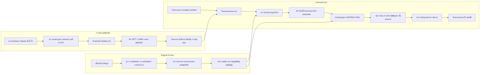
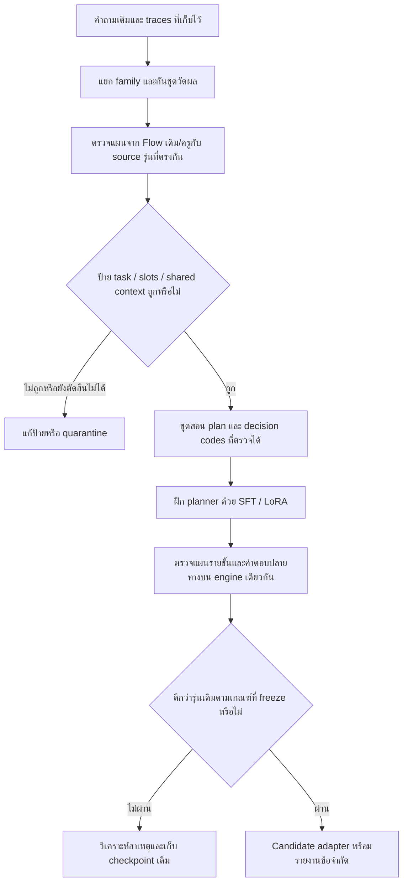

# R123 — Flow หลักสำหรับตีความ วางแผน อ่านข้อมูล และตรวจความครบ

วันที่: 23 ตุลาคม 2026  
สถานะ: **แบบออกแบบสำหรับพัฒนาต่อ ยังไม่ได้ implement ฝึกโมเดล หรือทดสอบ runtime รุ่นนี้**  
ฐานอ้างอิง: R122 revision04 และหลักฐานการฝึก R121

## 1. เป้าหมายและสิ่งที่ต้องแก้ให้ตรงจุด

ให้ผู้ใช้ถามได้ตามบริบท ให้ระบบแยกสิ่งที่ต้องการออกเป็นงานที่ตรวจได้ แล้วใช้ข้อมูลปัจจุบันตอบครบ โดยเจ้าของเพิ่มหรือแก้ข้อมูลผ่าน schema ที่รองรับได้โดยไม่ต้องฝึกโมเดลใหม่ทุกครั้ง

สาเหตุที่ใช้เป็นฐานออกแบบ:

| หลักฐานที่พบ | ข้อกำหนดของ Flow ใหม่ |
|---|---|
| โมเดลแยก VR compare + booking ถูก แต่ reader อ่านเพียง 30 นาที | ตรวจว่า executor รองรับ operation และอ่านครบทุกตัวเลือก |
| task จองเจอ request_model_budget_exhausted | อ่านงานที่ทำด้วยโค้ดได้ทั้งหมดก่อนจัดสรร model fallback |
| constraints ของทั้งคำถามถูกคัดลอกเข้าแต่ละ task ในป้ายสอน | มีเจ้าของ slot และ shared-context edge แยกชัดเจน |
| เอาบริบท Cockpit ออกแล้วกลายเป็นรายการเกมกว้าง | ผูกบริบทร่วมผ่าน entity/relation และ provenance |
| มีตารางครบ 7 วัน แต่ reader เดิมบังคับให้ระบุวันเดียว | executor แยก single date / weekday / weekly calendar |
| มีหลายข้อความขั้นตอนจอง | แยก literal duplicate, authority และ conflict โดยไม่ให้โมเดลเลือกนโยบายเอง |
| score strict ผิดจาก route/source IDs/คำตรงตัว/เวลา | เก็บ strict เดิมและ semantic review เป็นคนละรายงาน |

R121 มีหลักฐานว่าการฝึกช่วยบางส่วนของการเลือกหมวด แต่ยังไม่ยืนยันความถูกต้องปลายทางโดยรวม R122 แสดงว่าการแก้โค้ดสำคัญแม้โมเดลตีโจทย์ถูกแล้ว แผนนี้จึงพัฒนาทั้ง **planner, executor, ข้อมูลสอน และการวัดผล** เป็นงานแยกที่ตรวจผลได้

## 2. ภาพรวมสาม Flow ที่ต้องทำงานร่วมกัน

รายละเอียด contract อยู่ใน [DATA_CONTRACTS_TH.md](DATA_CONTRACTS_TH.md) และลำดับพัฒนา/การวัดอยู่ใน [IMPLEMENTATION_EVALUATION_TH.md](IMPLEMENTATION_EVALUATION_TH.md)

## 3. Flow ข้อมูล: เจ้าของเพิ่มข้อมูลแล้วระบบใช้ได้อย่างไร

### D01 — รับข้อมูลเป็น record ที่มีชนิดและขอบเขต

แต่ละ record มี identity, ชนิดข้อมูล, fields, aliases, source evidence, revision, สถานะเผยแพร่ และขอบเขตที่มีผล ข้อมูลเกมต้องเชื่อมไปบริการที่มีเกมนั้น ราคาเชื่อมบริการ/กลุ่มผู้ใช้/ระยะเวลา กติกาเชื่อมรายการและฉบับการแข่งขัน

การเพิ่ม aliases หรือ records ภายใต้ชนิดและ operation ที่รองรับต้องไม่ต้องแก้ prompt รายชื่อทั้งหมดหรือฝึกโมเดลใหม่ ส่วนการเพิ่มชนิดข้อเท็จจริง/operation ใหม่ต้องเพิ่ม reader contract และแจ้งว่า capability นั้นยังไม่รองรับจนกว่าจะพัฒนาเสร็จ

### D02 — ตรวจข้อมูลก่อนสร้าง index

- ตรวจ type, currency, unit, duration และ foreign keys
- แยก unknown / not applicable / conflicted / known; ช่องว่างไม่แปลว่าไม่มีหรือไม่ได้รับอนุญาต
- เก็บภาษาไทยและคำแปลพร้อมสถานะการตรวจ ไม่ใช้คำแปลสร้างสิทธิ์หรือเงื่อนไขใหม่
- ตรวจการลบ/ถอนข้อมูลและ revision เพื่อไม่ให้ index เก่าแสดงข้อมูลที่ถูกถอน
- รายงาน relation ที่ขาดให้เจ้าของแก้ เช่น มีชื่อเกมแต่ยังไม่รู้ว่าบริการใดมีเกมนี้
- บันทึกเนื้อหาเอกสารเป็นข้อมูลอ้างอิง คำสั่งที่อยู่ในเอกสารไม่เปลี่ยนนโยบายการทำงานของระบบ

### D03 — แยกความถูกต้องเชิงโครงสร้างจากสิทธิ์เผยแพร่

ผ่าน schema ไม่เท่ากับอนุมัติเผยแพร่ การสร้าง draft และการใช้ published view ต้องเป็นไปตามกระบวนการเดิม แผนนี้ไม่ให้ระบบแก้ approvals หรือเลื่อน draft เป็น published เอง

### D04 — Compile snapshot และ capability catalog

snapshot หนึ่งชุดผูก records, relations, aliases, validity และ revision เข้าด้วยกัน capability catalog บอกว่า reader ใดรับ operation/field/เงื่อนไขอะไรได้ ใช้ข้อมูลชุดเดียวตลอดคำขอ และเปลี่ยน index เมื่อ revision เปลี่ยนอย่างตรวจสอบได้

**ผลที่ต้องได้:** เพิ่มราคา/เกม/อุปกรณ์ในรูปแบบที่รองรับแล้วถามได้จากข้อมูลใหม่ โดยน้ำหนัก planner เดิมยังใช้ได้ ต้องตรวจคุณสมบัตินี้ก่อนถือว่าระบบรองรับการเพิ่มข้อมูลจริง

## 4. Flow Runtime แบบละเอียด

### R00 — รับคำถามและ pin request context

เก็บ raw question แบบแก้ไขไม่ได้ พร้อม request ID, locale, เวลา Asia/Bangkok, snapshot ID, source revision และ runtime/model identity แยกข้อความที่ normalize แล้วออกจาก raw text พร้อม offset mapping เพื่อยังอ้างข้อความเดิมได้

ประวัติสนทนาที่ใช้ได้ต้องมาจาก session ที่ถูกต้องและบอกที่มาว่าผู้ใช้ระบุอะไร ไม่ใช้คำตอบก่อนหน้าของแชทเป็นข้อเท็จจริงใหม่ ไม่ใช้บริบทจากผู้ใช้คนอื่น และเมื่อผู้ใช้เปลี่ยนเงื่อนไขต้องมีรายการ superseded slots

### R01 — โมเดลเสนอแผนงานที่มีโครงสร้าง

planner รับคำถาม บริบทที่อนุญาต และรายการ operation ที่ runtime รองรับ แล้วส่ง tasks, spans, เป้าหมายที่กล่าวถึง, slots, ความสัมพันธ์บริบทร่วม และสิ่งที่ยังไม่ทราบ

planner ไม่สร้างราคา เวลาเปิด สิทธิ์ใช้บริการ หรือคำตอบทางธุรกิจจากความจำ ไม่เลือก source ที่มีอำนาจเหนืออีก source เอง หมวด C01–C14 เป็นข้อเสนอเพื่อเลือก reader ต้องตรวจความสอดคล้องของ operation/target/field ก่อนตัดช่องทางอ่านอื่นทิ้ง

ผลที่โมเดลบอกว่า confident ไม่ใช่หลักฐานว่าตีความถูก ถ้า backend รองรับ constrained decoding ให้บังคับ schema ระหว่างสร้างผลลัพธ์ พร้อมตรวจความหมายอีกชั้นเสมอ

### R02 — ตรวจโครงสร้างและข้อความอ้าง

ตรวจ task IDs, schema version, operation, field, spans, normalized units และขีดจำกัด payload เป้าหมาย/slot ต้องชี้ raw source span หรือ trusted context ref ได้

ชื่อ operation ที่ไม่มีใน capability catalog ส่งสถานะ unsupported_operation ไม่เปลี่ยนเป็น detail หรือ top-K เงียบ ๆ JSON ถูกต้องยังไม่ผ่านขั้นนี้หาก target หรือเงื่อนไขอ้างสิ่งที่ผู้ใช้ไม่ได้ระบุ

ถ้า planner ใช้งานไม่ได้ ให้ใช้ compatibility path เฉพาะที่มี contract ชัดและตรวจ scope ได้ บันทึกเส้นทางนั้น หากยังตีความไม่ชัดให้ถามกลับหรือแจ้งส่วนที่ตอบไม่ได้ ไม่ซ่อนความล้มเหลวด้วยคำตอบทั่วไป

### R03 — ผูก local slots และ shared context

ทุก slot ต้องมีเจ้าของ task หรือมี scope ครอบคลุม tasks ที่ระบุชัดเจน แยก service, audience, total duration, session duration, persons, date, time, event edition, negation และ condition

รองรับบริบทร่วมสามแบบ:

1. **ระบุชัด:** เครื่องเดิม / it / same service โดยมี antecedent ที่ตรวจได้
2. **คำนำร่วม:** กลุ่มผู้ใช้หรือวันที่นำหน้าหลายงาน โดยต้องมี scope และตรวจว่าไม่มีข้อความ override ในงานใด
3. **ละชื่อแต่มี relation รองรับ:** ชื่อบริการเดียวตามด้วยถามเกม ไม่มีชื่อใหม่ และมี service→game relation จริง

การคัดลอกทั้ง constraint array ไปทุกงานเป็นสิ่งที่ห้ามทำ การลบทุก slot ที่อยู่นอก local span ก็ไม่ถูกเช่นกัน เพราะจะทิ้งบริบทร่วมที่ถูกต้อง ให้เก็บ shared edge แยกพร้อมเหตุผลและ source span

กรณีหลาย antecedents ที่ทำให้คำตอบต่างกันให้ถามกลับ ประโยคขอให้ตอบสั้นหรือ “ตอบเฉพาะประเด็นนั้น” ต้องไม่ถูกตีเป็น factual referent ใหม่ ตัวเลขในชื่อเกม/เครื่องต้องไม่กลายเป็นจำนวนคนหรือระยะเวลา

### R04 — Resolve entities และตรวจ semantics

ใช้ aliases/relations ของ snapshot ปัจจุบันเปลี่ยนข้อความเป้าหมายเป็น candidate entities พร้อมหลักฐานการจับคู่ ไม่เลือก entity ด้วยความใกล้ของข้อความเพียงอย่างเดียวเมื่อมีหลายตัวเลือกที่เปลี่ยนคำตอบ

ตรวจความหมายที่ทำให้คำตอบต่างกัน เช่น ราคากับเวลาเล่น ตารางประจำกับเครื่องว่างจริง ขอนำของเข้ากับขอบริโภค กติกาเกมกับกติกาทัวร์นาเมนต์ รวมถึง audience ที่ถูกปฏิเสธซึ่งห้ามอนุมานเป็นอีกกลุ่มโดยไม่มีข้อมูลรองรับ

จุดที่ไม่แน่ชัดต้องเก็บ ambiguity ที่อธิบายได้ ไม่ใช้ boolean ตัวเดียวลบ uncertainty ทั้งหมดเมื่อกฎตรวจเจตนาแก้หมวดสำเร็จ

### R05 — สร้าง obligation ledger และ task graph

สร้างรายการที่คำตอบต้องครอบคลุมก่อนอ่านข้อมูล เช่น compare VR ต้องมีตัวเลือก 30/60 นาทีครบ งานวิธีจองเป็นอีก obligation และต้องรักษาชื่อบริการเดียวกัน

task graph แยก dependency จริงจากงานอิสระ ผูก shared service ไม่เท่ากับต้องรอให้ตอบราคาสำเร็จก่อนจึงตอบขั้นตอนจองได้ งานที่ไม่ขึ้นต่อกันต้องอ่านต่อได้แม้อีกงานขาดข้อมูล

ตรวจว่าข้อความที่เป็น factual need ทั้งหมดมี task รองรับ และทุกเงื่อนไขที่มีผลต่อคำตอบถูกใช้ หรือมีเหตุผลที่แสดงว่าขาด/ขัดกัน การจับคำหรือตัวเลขครบอย่างเดียวไม่ถือว่าครบความหมาย

### R06 — ตรวจว่า executor ทำ operation นี้ได้จริง

capability registry จับคู่ domain + operation + field + slot requirements + response contract ต้องเลือก executor ที่ตอบรูป operation นั้น เช่น compare ไม่ใช่ detail, count ไม่ใช่รายชื่อบางส่วน, weekly calendar ไม่ใช่ reader วันเดียว

operation ที่ยังทำไม่ได้ต้องมี capability gap ชัดเจน ห้ามให้ evidence selector แปลง operation ให้โดยไม่มีสัญญาว่าคำตอบจะครอบคลุมอะไร

### R07 — อ่านทุกงานที่ทำแบบ deterministic ได้ก่อน

executor อ่าน facts/relations คำนวณตามกฎต้นทาง และส่ง receipts พร้อมผลต่อ obligation ใช้จำนวนเงื่อนไขและรายการเป้าหมายเป็นตัวกำกับการอ่าน ไม่หยุดที่ผลลัพธ์แรกที่ดูใกล้เคียง

สำหรับ comparison: อ่านแต่ละตัวเลือกแยกกัน จับคู่ audience/service เดียวกัน แสดงว่าตัวเลือกใดไม่มี source และไม่บวกยอดทางเลือกเป็นยอดซื้อรวม สำหรับ list/count: ต้องมีนิยามชุดและหลักฐานความครบ ไม่ใช้จำนวนแถว top-K เป็นจำนวนทั้งหมด

### R08 — จัดการช่องว่างและ model fallback แบบจำกัด

หลังงาน typed reads เสร็จแล้วจึงพิจารณาว่ามีงานใดจำเป็นต้องใช้โมเดลเพิ่มจริง จัดงบจากคำขอทั้งชุดตามผลต่อคำตอบ ไม่ใช้ลำดับ task เป็นตัวตัดสินว่าข้อหลังจะมีงบหรือไม่

fallback เห็นเฉพาะ candidate pool ที่ผ่าน scope/source filters แล้ว ใช้ช่วยจับคู่ข้อความกับ clause หรือแผนที่รองรับเท่านั้น ไม่สร้าง facts ไม่เลือก authority ไม่คำนวณราคาเอง และไม่ทำให้ข้อมูลที่ยังไม่ยืนยันกลายเป็น confirmed

เมื่อ budget หมด ให้ระบุ budget_exhausted แยกจาก transport_unavailable และยังตอบส่วนที่มีหลักฐานได้ ไม่เพิ่มจำนวน retries แบบไม่มีขอบเขตเพื่อกลบปัญหา

### R09 — ตรวจหลักฐาน ขอบเขต และความครบ

แยก verifier สองส่วน:

- **Evidence verifier:** claim ทุกข้อมี record/field/revision/locator รองรับ ตรงเครื่อง เกม event edition กลุ่มผู้ใช้ และช่วงที่มีผล การคำนวณย้อนกลับได้
- **Obligation verifier:** ทุกงานและทุกตัวเลือกได้รับคำตอบ หรือมีสถานะ missing/ambiguous/conflicted/unsupported ที่ตรงสาเหตุ ไม่มีการทิ้งข้อหลัง ไม่มีการเอาข้อมูลใกล้เคียงมาปิดช่องว่าง

หาก corrective read จำเป็น ให้ระบุว่าจะเติม obligation ไหนและใช้ capability อะไร ภายในงบและเวลาที่กำหนด ไม่วน “คิดใหม่” แบบไม่มีเกณฑ์หยุด

### R10 — เลือกสถานะต่อ task และต่อคำตอบ

ผลต่อ task แยก supported, partial, missing_input, missing_source, conflict, not_current, provider_unavailable, budget_exhausted และ unsupported_operation

partial ไม่ใช้เป็นถังรวมทุกปัญหา ต้องบอกว่าอะไรตอบได้และอะไรยังไม่ได้ คำถามหลายเรื่องที่ตอบได้บางส่วนต้องรักษาคำตอบส่วนที่ถูก และถามกลับเฉพาะสิ่งที่ทำให้ส่วนที่เหลือตอบต่างกัน

### R11 — จัดคำตอบจาก claims ที่ผ่านแล้ว

ใช้ template ตาม operation เพื่อให้ขึ้นต้นตอบสิ่งที่ถาม เรียงตามงานของผู้ใช้ ตัด metadata ภายในออกจากหน้าคำตอบ และคงคำชี้แจงที่จำเป็นต่อความถูกต้อง เช่น ช่วงมีผลหรือความเป็นตารางประจำ

หลักการตัวอย่าง:

- ถามวันนี้เปิดไหม: แสดงวันที่และเปิด/ปิดบริการเมื่อมีหลักฐานเพียงพอ ระบุฐานการยืนยันสั้น ๆ หากเป็นเพียงตารางหรือยังมีข้อจำกัด
- เปรียบเทียบ: แสดงตัวเลือกข้างกัน ไม่เอามาต่อเป็นคำตอบ detail ยาว ๆ หรือรวมยอด
- หลายงาน: แยกหัวข้อสั้นตามคำถาม ไม่ส่งรายการข้อมูลที่ไม่เกี่ยวข้องมาทั้งก้อน
- หลาย source ข้อความซ้ำ: รวมเฉพาะที่พิสูจน์ว่าเป็น claim เดียวกันและ scope/conditions/validity ตรงกัน ไม่รวมความขัดแย้งให้หายไป

เริ่มด้วย renderer ที่ตรวจย้อนกลับได้ หากเพิ่มโมเดลเรียบเรียงภายหลังต้องรักษา claim IDs และตรวจว่าไม่เพิ่ม/เปลี่ยน facts หรือเงื่อนไข จึงยังไม่เป็น dependency จำเป็นของ Flow หลัก

### R12 — เก็บ audit และ regression case

เก็บ raw input, normalized mapping, plan ที่โมเดลเสนอ, plan หลังตรวจ, shared bindings, entity candidates, capability ที่ใช้, source receipts, model calls จริง, budget, verifier findings และคำตอบสุดท้าย แยกข้อมูลภายในจากข้อความให้ผู้ใช้

failure ที่ตรวจยืนยันแล้วเข้าสู่คิวแก้โค้ด/แก้ข้อมูล/แก้ป้ายสอนตามสาเหตุ ไม่ส่งทุก failure ไปฝึกโมเดลโดยอัตโนมัติ

## 5. Executor ทั้ง 14 หมวด

| หมวด | งานหลัก | กฎความครบ/ข้อห้ามสำคัญ |
|---|---|---|
| C01 ข้อมูลศูนย์/ติดต่อ | identity, address, map, contact | ตรงหน่วยงานและช่องทาง ไม่ใช้ข้อมูลใกล้เคียงแทน |
| C02 บุคลากร | person→role, role→people | ตรวจ public scope และช่วงดำรงตำแหน่ง ไม่เดาคนจากชื่อใกล้กัน |
| C03 อุปกรณ์ | specs, inventory, location, capacity | แยกจำนวนเครื่อง จำนวนที่นั่ง จำนวนคนเล่น และจำนวนจอย |
| C04 เกม | catalog, description, players, offered service/zone | ใช้ game→service/zone ที่ยืนยัน แยก supported platform จากของที่ศูนย์มี |
| C05 การควบคุม | action lookup, binding list, requested subset | แยก platform และ control entries จาก physical buttons; ไม่เลือกชุดย่อยเอง |
| C06 ราคาปกติ | unit rate, duration, total, compare | audience/service/session/total/persons มีบทบาทชัด ไม่รวม alternative totals |
| C07 ราคาเหมา | package, duration, zone, organization, inclusions | แยกเหมากับค่าเล่นปกติ ไม่เทียบ package ข้ามเงื่อนไขโดยไม่บอก |
| C08 การจอง | procedure, check-in, change, cancellation | action/condition ตรงกัน แยก variants และ authority; ไม่เพิ่มธุรกรรมจองจริงใน read-only answer |
| C09 การชำระเงิน | payer, slip, over/underpayment, refund, receipt | ไม่รวม permission ของคนละสถานการณ์ ไม่เปลี่ยน refund เป็น credit เอง |
| C10 กฎศูนย์ | eligibility, permission, restriction, exception | แยก bring/consume, ผู้จอง/ผู้เล่น และข้อยกเว้น; ไม่มีข้อมูลไม่แปลว่าทำได้ |
| C11 ตาราง | weekday, dated, weekly, maintenance, closure | timezone/date/exception มีที่มา ตารางไม่ยืนยัน occupancy และไม่เท่ากับอาคารเปิด |
| C12 สถานะจริง | exact resource/time availability | ต้องมี provider/source freshness; provider offline ไม่แปลว่าเครื่องว่างหรือถูกจอง |
| C13 กติกาแข่งขัน | event edition, clause, dependency, compare rules | ไม่ข้ามเกม/รายการ/ปี และอ่าน dependencies ของ clause ให้ครบ |
| C14 ข่าว/กิจกรรม | event details, date, registration, status | แยกประกาศเก่า กำหนดการ และสถานะปัจจุบันตาม validity |

ทุกหมวดใช้ contract ร่วมเรื่อง provenance/status/completeness และมี operation เฉพาะหมวด จึงไม่ต้องสร้างโมเดลหนึ่งตัวต่อหมวดในระยะแรก

## 6. Flow Distillation ที่ใช้เป็นแกนฝึก planner

### สิ่งที่สอน

intent, operation, task boundaries, entity mentions, slot roles, local/shared/history scope, negation, ambiguity, required answer components และการเลือก capability ใน vocabulary ที่รองรับ

### สิ่งที่อ่านจาก source ตอนตอบ

ราคา กฎ ตาราง รายชื่อเกม อุปกรณ์ รายการแข่ง และสิทธิ์จริง รวมถึง authority/validity ของข้อมูล ไม่ใส่ข้อเท็จจริงที่เปลี่ยนแปลงเหล่านี้เป็นเป้าหมายหลักของ planner training

### สิ่งที่ต้องระวัง

ป้ายจากครูไม่เป็น gold อัตโนมัติ คำตอบเก่าอาจถูกตาม source คนละรุ่น และครูอาจตีโจทย์ผิดเช่นกัน ต้องสอนด้วยแผนสั้นและหลักฐานที่ตรวจได้ ไม่ใช้คำอธิบายยาวที่ฟังมีเหตุผลเป็นเครื่องยืนยัน

ตรวจ labels เดิมทั้งหมดก่อนฝึกต่อ ไม่ถือว่า draft 11 ข้อที่เปลี่ยนคือข้อผิดทั้งหมด และไม่ใช้ความผิดของ reader เป็นเหตุให้สอนโมเดลสร้างคำตอบลัดข้าม reader

## 7. ตัวอย่างจากคำถามเดิม: เป้าหมายของ Flow นี้

| คำถามเดิม | แผนที่ต้องได้ | การอ่านและคำตอบที่ต้องตรวจ |
|---|---|---|
| What are the 8 buttons in Tekken 8, ans what is the PC price | controls task ของ Tekken + rate task ของ PC | PC ไม่ไหลเข้า controls; 8 ไม่เป็นจำนวนคน; ถ้า subset ยังไม่ชัดให้บอกขอบเขตและตอบราคาที่รองรับ |
| What is the price of Cockpit and what games are available | ราคา Cockpit + เกมที่สัมพันธ์ Cockpit | target ร่วมมี provenance; ไม่ดึง catalog ทั้งศูนย์ |
| How is VR for 30 minutes different from VR for 1 hour, and how do I book it? | compare 30/60 นาที + วิธีจอง VR | อ่านทั้งสอง rate options; ไม่ส่ง duration ไปเปลี่ยน procedure; งานจองไม่ starve เพราะ model budget |
| How to book Cockpit and what days is it open? | procedure + weekly play-service timetable | แสดงแต่ละงานครบ พร้อมข้อจำกัด applicability ของตาราง |
| Is PC #03-#10 available right now | live resource range + เวลา request | ใช้ provider; ถ้า unavailable ให้บอกสถานะการตรวจ ไม่อ้างตารางว่ามีเครื่องว่าง |
| ถือขวดน้ำเข้าไปได้หรือเปล่า ไม่ได้ถามเรื่องกิน | bring permission, exclude consume interpretation | ถ้ามีเฉพาะ consumption policy ให้ระบุช่องว่าง ไม่สร้าง permission |

ตารางนี้เป็น acceptance scenarios จากคำถามที่มีอยู่แล้ว ไม่ใช่ผลทดสอบของ R123

## 8. จุดที่ต้องผ่านก่อนถือว่า Flow พร้อม

1. contracts อธิบาย local/shared slots, task dependencies และ source receipts ได้โดยไม่พึ่ง free-form explanation
2. ทุก operation ที่ประกาศว่ารองรับมี executor และกรณี unsupported ไม่ถูกเปลี่ยนเป็นคำตอบใกล้เคียง
3. คำถามหลายงานไม่ทิ้งงานหลังเพราะลำดับหรือ budget โดยไม่มีสถานะที่ตรงสาเหตุ
4. ข้อมูลที่เพิ่มภายใต้ schema เดิมถูกนำไปตอบได้หลังเปลี่ยน snapshot โดยไม่ฝึก adapter ใหม่
5. แผนที่ผ่าน schema ยังถูกตรวจ entity, condition, completeness และ evidence ต่อ
6. score รายขั้นและคำตอบปลายทางแยกกัน รวมทั้ง unnecessary refusal, latency และ transport
7. รายงานผลแยก code version, data version, adapter และชุดคำถาม ไม่มีการอ้างคะแนนจากรุ่นก่อนเป็นคะแนนรวมรุ่นล่าสุด

เกณฑ์เชิงตัวเลขต้อง freeze ก่อนทดลองตามเอกสารแผนวัดผล ไม่ตั้งเปอร์เซ็นต์ความแม่นยำที่ยังไม่มีหลักฐาน และไม่ถือว่าผ่านทุกหมวดจากตัวอย่างไม่กี่ข้อ

## 9. สิ่งที่ได้ในงานวาง Flow รอบนี้

- เอกสาร Flow หลักฉบับนี้
- data contracts และสถานะที่ต้องส่งระหว่างชั้น
- แผนพัฒนา ตรวจป้ายสอน ฝึก และวัดผลแบบแยกสาเหตุ
- รายการ migration จาก R122 โดยรักษา source/data/approvals/results เดิม

ยังไม่มีการเปลี่ยน source ของ candidate หรือ production ไม่มีการฝึกเพิ่ม และไม่มีการรันคำถามหรือ Full Test ในงานออกแบบนี้
