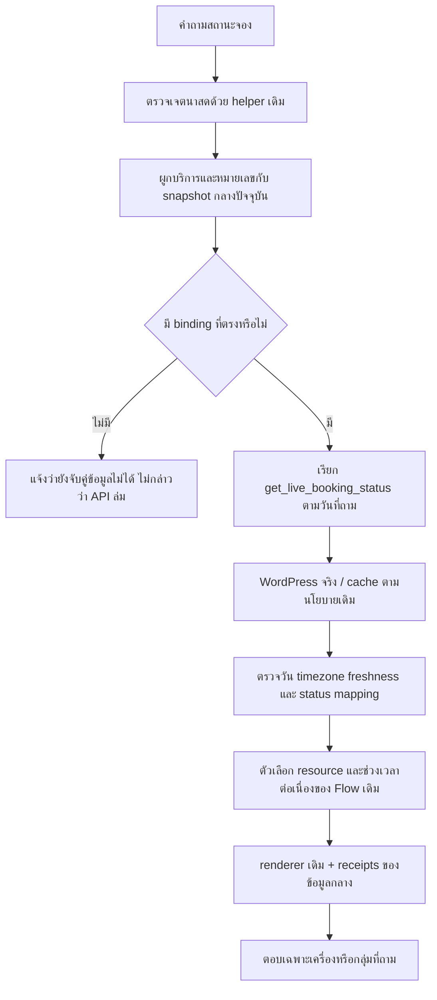
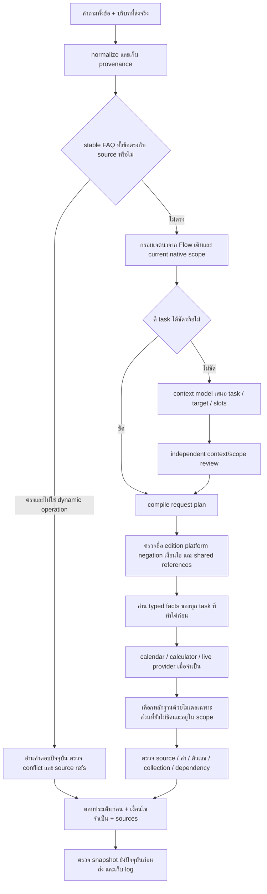

# R124 — เชื่อมสถานะจองจริงและแก้ Flow กลางด้วยหลักฐานจาก Flow เดิม

วันที่ดำเนินการ: 23 ตุลาคม 2026  
ตัวใช้งานใหม่: `revision05_system` ในโฟลเดอร์งานนี้  
สถานะ: candidate แยกจาก R78, ใช้ข้อมูลร่างใน migration preview, ไม่สร้าง approvals และไม่ติดตั้งทับ production

## 1. สาเหตุที่ก่อนหน้านี้แก้แล้ววนกลับมาพบปัญหาเดิม

ปัญหาหลักที่ตรวจยืนยันรอบนี้อยู่ที่ **เส้นทางใช้งานข้อมูล** หลายจุด ข้อมูลที่เก็บไว้ในฐานหรือ source archive ไม่ได้กลายเป็นข้อมูลที่ตัวตอบค้นพบและใช้ได้โดยอัตโนมัติ การตรวจว่า schema มี field, archive เก็บต้นฉบับครบ หรือการทดสอบบาง lane ผ่าน จึงยังไม่เพียงพอที่จะสรุปว่าระบบใช้งานได้เท่า Flow เดิม

สิ่งที่ขาดในงานก่อนหน้าคือการตรวจต่อเนื่องตั้งแต่คำถามจริง → การตีเจตนา → ตัวอ่าน → ข้อมูลที่ถูกเลือก → การเรียกเครื่องมือ → คำตอบและตัวตรวจท้ายทาง การเชื่อมบางส่วนยังไม่เสร็จ แต่รายงานก่อนหน้าให้น้ำหนักกับจำนวนข้อมูลและ gate มากไป

รอบนี้จึงรัน pipeline เดิมจริงกับคำถามที่เก็บไว้ แล้วเก็บ source hits, trace, function-call counts และคำตอบมาเทียบ การอธิบายวิธีตอบในรายงานนี้หมายถึงข้อมูลที่สังเกตได้จากโค้ด/trace/tool calls ไม่ใช่การอ้างว่าอ่านความคิดภายในโมเดลได้

## 2. วิธีทำงานและหลักฐาน

1. สำเนา Flow เดิมจาก `C:/Users/Chokhun/Downloads/Learn-LLM/18_PSU_Esports_Update_Route_Data` มาเป็น teacher แยกต่างหาก
2. สำเนา candidate R123 revision05 มาพัฒนาเป็น R124 ไม่แก้ frozen รุ่นก่อนหน้า
3. เลือกคำถามเดิมจากชุด development/API/guard ที่เคยเก็บไว้ รวม 61 unique keys ไม่สร้าง benchmark คำถามใหม่
4. เรียก `answer_question_pipeline_debug` จริงทั้งสองแขน เก็บผลใน `teacher02` และ `candidate02`
5. ตรวจกรณีที่ต่างกันกับ source จริง แยกปัญหาตัวใหม่ออกจาก teacher ที่เลือกผิดหมวด/ตอบตกหล่น/ใช้ข้อมูลต่างรุ่น
6. แก้การเชื่อมและตัวอ่าน แล้วตรวจซ้ำด้วย retained proposals, fault injection และการรัน pipeline จริง R03ครบชุด61ข้ออยู่ใน `candidate04_final`; R04ตรวจเฉพาะ14ข้อ และ R05ตรวจ APIล่าสุด13ข้อ ตาม RUN_RESULTS_TH.md
7. ตรวจ API ที่เปิดจริงบน `http://127.0.0.1:12422` โดยใช้ WordPress จริงและนาฬิกาปัจจุบัน ไม่แทน provider ด้วย unavailable fixture

ผลรันและการตรวจที่เสร็จแล้วทั้งหมดถูกรวมโดยสคริปต์ใน [RUN_RESULTS_TH.md](RUN_RESULTS_TH.md) พร้อมการเทียบรายข้อใน [CASE_COMPARISON_TH.md](CASE_COMPARISON_TH.md) และข้อมูลเครื่องอ่านใน [CASE_COMPARISON.json](CASE_COMPARISON.json)

**ข้อจำกัดการเปรียบเทียบ:** teacher ใช้ base Typhoon NF4 ส่วน candidate ใช้ R121 context adapter และข้อมูลกลางมีคำยืนยัน/ข้อมูลที่เพิ่มภายหลัง เช่น สเปก GPU จึงไม่ใช่การทดลองที่แยก causal effect ของ Flow ล้วน ๆ และไม่ใช่การรัน Ollama GGUF เดียวกับ Full Test เก่าทุกอย่าง

## 3. Live binding เชื่อมแล้วอย่างไร

### 3.1 สิ่งที่ตรวจจากระบบจริง

- อ่าน WordPress service catalogue และ aggregate booking status สำเร็จ
- พบ 18 external service/resource entries และสร้าง draft binding ที่ตรวจย้อนกลับได้ 18 รายการ
- จับคู่ PC, Cockpit และ PS5 ด้วย family/หมายเลขกับ native resource ที่มีอยู่
- จับคู่ Nintendo Switch ด้วยช่วงจำนวนผู้ใช้ และ VR ด้วยระยะเวลาบริการที่ประกาศใน catalogue
- รหัสภายนอกมาจาก payload จริง ไม่เอารหัสจาก sample CSV มายืนยันแทน
- ไม่เก็บรายชื่อผู้จอง เบอร์โทร อีเมล หรือแถวการจองส่วนบุคคลไว้ในฐานกลาง
- คงกระบวนการ approvals เดิม ไม่สร้าง owner approval ให้ข้อมูล engineering mapping

18 entries คือรายการบริการ/ผลิตภัณฑ์ใน provider ไม่ใช่หลักฐานว่ามีเครื่องจริง 18 เครื่อง โดยเฉพาะบริการช่วงเช้า/บ่ายหรือ 30/60 นาที ต้องไม่เอาจำนวน binding มาบวกเป็นจำนวนเครื่อง

หลักฐาน: [LIVE_CONNECTION_PROBE.json](LIVE_CONNECTION_PROBE.json), [LIVE_BINDING_MIGRATION.json](LIVE_BINDING_MIGRATION.json)

### 3.2 เส้นทางเมื่อมีคนถาม

ใช้ `_resource_groups_for_query`, `requested_time_window`, `render_live_booking_answer` และการตรวจช่วงเวลาต่อเนื่องของเดิมจริง ไม่ให้ LLM เดาว่าเครื่องว่าง

การถามคำถามใหม่เข้าฟังก์ชันอ่านสถานะใหม่ แต่ transport ใช้ cache อายุไม่เกินนโยบายเดิม ซึ่งค่าเริ่มต้นคือ 10 วินาที ภายในคำตอบหนึ่งจะใช้ snapshot เดียวกันต่อวันที่ถาม เพื่อไม่ให้แต่ละส่วนตอบจากคนละสถานะ

### 3.3 ปัญหาที่พบและแก้ระหว่างต่อของจริง

| ปัญหา | สาเหตุ | สิ่งที่แก้ |
|---|---|---|
| มีโค้ด API แต่ common ไม่เรียก | ไม่มี live_binding และ common return ก่อน legacy fallback | นำ mapping จาก catalogue จริงมาใช้ใน candidate |
| PS5 #01 กับ PS5 #1 ไม่ตรงกัน | การ normalize เลขศูนย์นำหน้าผิดเมื่อ family มีเลข 5 อยู่แล้ว | normalize family และ station ordinal แยกกัน |
| provider สำเร็จแต่ freshness ไม่ผ่าน | timestamp เดิมไม่มี offset เช่น `2026-10-23 16:46:34` | ผูกกับ timezone ที่ binding ประกาศว่า Asia/Bangkok |
| คำถามย้อนหลังทำให้ snapshot ดูมาจากอนาคต | ใช้นาฬิกา semantic ของวันที่ถามตรวจอายุ HTTP observation | แยก wall clock สำหรับ freshness ออกจากวันที่ใช้ตีคำถาม |
| ผูกชื่อไม่ได้แต่ข้อความกล่าวว่าเชื่อมต่อไม่พร้อม | เอา configuration gap ไปรวมกับ provider failure | แยก mapping/source gap, payload/date/freshness และ transport |
| ถามหลายกลุ่มแล้วต้องระบุหมายเลขเสมอ | guard มอง broad scope เป็น ambiguous | ใช้ scope/list helpers เดิมโดยยังป้องกันหมายเลขเครื่องที่ไม่มีจริง |

`partial` ของ provider รักษาจำนวนที่ว่าง ไม่แปลว่าใช้ได้ครบทุกหน่วย การอ่านได้จาก API ไม่ได้แปลว่าเล่นได้ ถ้าตารางบริการปิดหรือช่วงที่ขอไม่ครอบคลุมตลอด ระบบยังคงใช้การตรวจของ renderer เดิม

## 4. open_periods ขัดกัน 5 จาก 7 วันอย่างไร

แหล่งที่เก็บความขัดแย้งไว้ระบุ `booking_dashboard/center_schedule.json` กับ `app/calendar/service_calendar.py` ค่าแตกต่างมีดังนี้:

| วัน | Dashboard open periods | ปฏิทินบริการเล่น/จองที่ Flow เดิมใช้ | ความต่าง |
|---|---|---|---|
| จันทร์ | 12:00–16:00 | 13:00–16:00 | Dashboard รวม 12:00–13:00 เข้ามา |
| อังคาร | 09:00–16:00 | 09:00–12:00 และ 13:00–16:00 | Dashboard รวมช่วงพักเที่ยง |
| พุธ | 09:00–16:00 | 09:00–12:00 และ 13:00–16:00 | เช่นเดียวกัน |
| พฤหัสบดี | 09:00–16:00 | 09:00–12:00 และ 13:00–16:00 | เช่นเดียวกัน |
| ศุกร์ | 09:00–13:00 | 09:00–12:00 | Dashboard รวม 12:00–13:00 เข้ามา |
| เสาร์–อาทิตย์ | ไม่มีรอบประจำ | ไม่มีรอบประจำ | ไม่ใช่ 5 วันที่ขัดกันข้างต้น |

จันทร์ 09:00–12:00 และศุกร์ 13:00–16:00 เป็น maintenance ตามตารางเดิม ส่วน 12:00–13:00 ไม่มีรอบเล่น/จอง ข้อมูล `service_slots`, `bookable_periods`, `maintenance_periods` มีครบทั้ง 7 วัน

ดังนั้นนี่คือความต่างของ **ช่วงเวลาและความหมายของ field** ไม่ใช่ไม่มีข้อมูลตารางเวลาเลย และยังใช้ตารางนี้พิสูจน์เวลาเดินเข้าอาคารหรือการเข้าพื้นที่ระหว่าง maintenance ไม่ได้

สิ่งที่แก้คือให้คำถามเปิดเล่น/ช่วงบริการใช้ `service_slots` ที่ย้ายมาจากฟังก์ชันเดิม ไม่เอา `open_periods` ที่ conflicted มาบล็อกทุกคำถาม คงค่า conflicted เดิมไว้ ไม่แก้เป็น known ด้วยการเดา และไม่เอาตารางเล่นไปอ้างว่าเครื่องว่าง

หลักฐานทุก field/source: [CALENDAR_SOURCE_CONFLICTS.json](CALENDAR_SOURCE_CONFLICTS.json)

## 5. ข้อมูลมีอยู่ในฐาน แต่ทำไมไม่ถูกนำมาตอบ

### 5.1 ตัวอย่างที่พิสูจน์ได้: ถือขวดน้ำเข้าไป

คำถามเดิมที่ใช้รันเทียบ:

> ก่อนเดินทางไปใช้บริการ อยากทราบว่า ถือขวดน้ำเข้าไปได้หรือเปล่า ไม่ได้ถามเรื่องกิน

Flow เดิมใช้ protected intent `food_bring_permission` อ่าน claim `food_bring` จาก `data/curated/service_policy_answers.json` มี source `food_bring_reviewed_20260924` ซึ่งบันทึกการทบทวนว่าเอาอาหาร/เครื่องดื่มเข้าได้ แต่บริโภคเฉพาะพื้นที่กำหนด

ฐานกลางมี record `migrated_policy_text_food_bring_general` และคำตอบไทย/อังกฤษนั้นอยู่แล้ว แต่ projection ไม่รับ topic `service_policy` และไม่สามารถเอา label เชิง metadata เช่น `food_bring / general` ไป route เหมือนคำถามธรรมชาติได้ ตัวตอบจึงหา source ไม่พบ

แก้ทั้งสองชั้น:

1. แปลง declared claim/variant เข้าดัชนีได้โดยคง source refs
2. ใช้ `_food_facet` ของเดิมจับ “ขวดน้ำ/น้ำเปล่า/พก/เข้าไป” แล้วอ่านคำตอบปัจจุบันจาก native record
3. แยก bring กับ consume ต่อไป ไม่ให้กฎเรื่องกินในพื้นที่ยืนยันสิทธิ์นำเข้าด้วยตัวมันเอง
4. หลังถอน source ต้องหยุดที่คำตอบไม่ยืนยัน ไม่ย้อนกลับไปตอบค่าคงที่ของ legacy

ไม่ได้ฝังประโยคคำตอบใน router และไม่ได้ให้โมเดลจำคำตอบแทนฐานข้อมูล

### 5.2 FAQ ที่หลุดจาก projection เพิ่มเติม

ตรวจทุก active record แล้วพบ FAQ ที่เก็บคำตอบไว้ แต่หัวข้อ/หมวดเดิมไม่ถูกแปลงเข้าดัชนี เช่น reservation, knowledge, penalty, about_us และ equipment บางรายการ

เชื่อม scope/query metadata กลับเพิ่ม 28 records โดยใช้คำถาม หัวข้อ และกฎค้นเดิมที่ตรวจว่าตรงกับคำตอบนั้น ไม่เปลี่ยน answer values ไม่สร้าง approvals

ผลตรวจล่าสุด:

- active records 824 รายการ รวม live bindings ใหม่ 18 รายการ
- source snapshots 3,047 รายการ
- records ที่มี fact projection โดยตรง 671 รายการ
- relation/native-only nodes 97 รายการ
- source records ที่ถูกรวมเป็น clause เดียวกันแบบ full-body/event ตรงกัน 43 รายการ
- confirmation metadata ที่แนบกับอัตราอยู่แล้ว 1 รายการ
- 12 records ที่ไม่มี standalone fact เป็น zone/ชื่อเกมประกอบ/ชุดปุ่มที่ยังไม่มี binding ไม่ใช่ FAQ ที่ทำคำตอบหาย
- FAQ ที่มี known answer แล้วหลุดจาก projection: 0 รายการในการตรวจขอบเขตนี้

**ตัวเลขนี้ไม่ใช่การรับรองว่า paraphrase ทุกแบบจะตอบถูก** เป็นการตรวจว่าคำตอบไม่ถูกทิ้งระหว่างแปลงข้อมูล และแต่ละ node มีบทบาทอย่างไร

หลักฐาน: [FAQ_SCOPE_RESTORATION.json](FAQ_SCOPE_RESTORATION.json), [REVISION03_PROJECTION_AUDIT.json](REVISION03_PROJECTION_AUDIT.json)

### 5.3 เจ้าของเพิ่ม Q&A แล้วต้องไม่รอเพิ่ม parser ใหม่

เพิ่มเส้นทางสำหรับ stable FAQ ที่คำถามทั้งข้อเท่ากับคำถามในข้อมูลปัจจุบัน ใช้คำตอบจาก snapshot โดยตรง มี source receipts และตรวจการเปลี่ยน/ถอนข้อมูล ถ้ามีคำตอบต่างฉบับสำหรับคำถามเดียวกัน จะเก็บเป็น conflict ไม่เลือกฉบับหนึ่งเอง

การจับคู่นี้ไม่ใช้ keyword สั้น ๆ หรือ substring ที่ทิ้งคำถามอีกส่วน และไม่รับหน้าที่แทนเครื่องมือวันที่/สถานะสด/คำนวณราคา/กติกาที่มี dependency ข้อความที่ถาม “ตอนนี้/ล่าสุด/งานถัดไป” ยังต้องผ่านเส้นทางที่ตรวจเวลาและขอบเขต

ตรวจ literal stable questions ไทย/อังกฤษที่เข้าเงื่อนไขได้ 54 question-language pairs ในข้อมูลปัจจุบัน นี่เป็นการตรวจ data accessibility ไม่ใช่คะแนน semantic accuracy 54 ข้อ

## 6. ความเข้าใจคำถาม: ใช้วิธีเดิมตรงไหน

| เจตนา | วิธีที่ใช้ | ข้อมูลคำตอบ |
|---|---|---|
| นำอาหารเข้า/กินในพื้นที่ | protected intent เดิม แยก bring/consume | native policy/FAQ ปัจจุบัน |
| เครื่องว่าง | helper เดิมแยก resource/time/list | provider จริง + native bindings |
| ศูนย์เปิดตอนนี้ | schedule/date intent เดิมก่อน live occupancy | recorded play calendar + request clock |
| มีเกมนี้ที่โซนไหน/ต้องจองอะไร | game-presence intent เดิม + graph offering | game → service → resource/zone ของ native data |
| ปุ่มเฉพาะ/ใช้จอยอย่างไร | control intent + exact button/action + platform | control bindings ปัจจุบัน |
| ที่อยู่ศูนย์ | อ่าน canonical center address ก่อน FAQ กว้าง | address ที่มีอาคาร 5 ชั้น 1 ครบ |
| หัวข้อนโยบายชัดเจน | original query profiles/declared source headings | FAQ ปัจจุบัน |
| รูปประโยคที่ยังตีไม่ได้ชัด | R121 context model และ independent review | โมเดลเสนอ task/slot เท่านั้น |

เรื่องที่แก้เพิ่มจากการทดสอบจริง:

- “ตอนนี้ศูนย์เปิดไหม” เคยถูก model ส่งเป็น C12/detail ทั้งที่ต้องเป็น C11/calendar
- “เล่น Beat Saber ใน VR ได้ไหม” เคยไปเลือกรายการเกมของทั้งโซน แทนขอบเกม→บริการ→โซน
- “X button” กับ “button X” ต้องจับปุ่มเดียวกัน แต่ห้ามเอา 8 ใน Tekken 8 ไปเป็นปุ่ม/จำนวนคน
- generic controller question ที่มีเกมชัดเจน ใช้รายการ binding ของเกม/แพลตฟอร์มนั้น และยังถามแพลตฟอร์มเมื่อมีหลายชุดที่ตัดสินไม่ได้
- presence helper ต้องไม่มาทับคำถามปุ่ม กติกา หรือราคา แม้มีชื่อเกมและคำว่า “มีอะไรบ้าง”
- ที่อยู่ของ entity ที่ไม่มีในข้อมูลต้องไม่ถูกแทนด้วยที่อยู่ศูนย์
- บริบทประกอบ ชื่อเกม audience เวลา เงื่อนไข และคำปฏิเสธต้องยังอยู่กับ task ที่ถูกต้อง

กรอบที่ชัดและมีหลักฐานเพียงพอถูกตรวจได้ก่อนเรียก context model จึงไม่เสียเวลาเรียกโมเดลแล้วค่อยแก้ route เดิมซ้ำภายหลัง ถ้ายังต้องตีความหรือเลือกหลักฐานจริง จึงใช้โมเดลภายใน pool ที่ผูก scope แล้ว

## 7. ตัวตรวจทำให้ดูเหมือนตอบไม่ครบ ทั้งที่คำตอบมีแล้ว

### 7.1 ปุ่มครบแต่ field ไม่ผ่าน

คำถาม Warzone และ God of War ขอรายการปุ่มทั้งหมด ตัวอ่านส่ง `binding_0…N` มาครบ แต่ verifier เคยยอมรับ projection เหล่านี้เฉพาะ reverse lookup ของปุ่มเดียว ทำให้ `input_bindings` ถูกมองว่าไม่ถูกส่งมา

แก้ให้พิสูจน์จาก game/platform-bound control record ว่ารายการที่ส่งเท่ากับชุดที่บันทึกไว้ทั้งชุด แล้วจึงรับว่าเป็น input bindings ไม่ได้ปิด completeness check ทิ้ง

ถ้าผู้ใช้ขอ 8 ปุ่ม แต่ source มี 12 entries และไม่ระบุว่าชุด 8 ปุ่มคืออะไร ยังคงเป็น partial/ขอขยายความ ไม่หยิบ 8 แถวแรกให้คะแนนผ่าน

### 7.2 กติกาซ้ำและ English warning ที่ผิดบริบท

พบ clause เดียวกันใน typed competition rule และ FAQ เก่า ฉบับหนึ่งมี English แล้ว อีกฉบับมีแต่ Thai ตัวเลือกเคยส่งทั้งสองและขึ้น warning เหมือนยังไม่มี English

รวมได้เฉพาะเมื่อ event เดียวกันและเนื้อหา Thai ทั้งข้อเท่ากัน โดยยอมต่างเพียง enumerator/whitespace เก็บ evidence ของทั้งสองไว้และเลือก representation ที่มี English ไม่ใช้หัวข้อคล้ายกันมาตัดสินว่ากติกาเหมือนกัน

### 7.3 เงื่อนไขจากแหล่งรอง

รายการปุ่มต้องแสดง `source_coverage` และ `verification_note` ที่มีอยู่แล้ว โดยเฉพาะ controls ที่ยังไม่ตรวจเทียบกับ installed version/preset ของศูนย์ การมีคำตอบทุกปุ่มไม่ได้พิสูจน์ว่าเครื่องของศูนย์ตั้งค่าเหมือนแหล่งรอง

## 8. Flow กลางที่ใช้งานหลังแก้

คำถามหลายหมวดที่มี calendar/live ใช้สองช่วงเช่นกัน: อ่านข้อมูลของทุก child ให้เสร็จก่อน แล้วค่อยใช้ evidence-selector budget กับ ordinary child ที่ยัง unresolved เพื่อไม่ให้ราคา/semantic fallback ส่วนแรกทำส่วนปฏิทินหรือ live ที่ตอบได้อยู่แล้วหายไป

## 9. ขอบเขตข้อมูลที่ต้องแยกให้ถูก

| ข้อมูล | สิ่งที่ตอบได้จากแหล่งเดิม/ข้อมูลกลาง | สิ่งที่ไม่ควรสร้างขึ้นจากข้อมูลข้างเคียง |
|---|---|---|
| เวลา | service slots, maintenance, relative dates, recorded closures | เวลาเดินเข้าอาคาร/สถานะเปิดจริงทุกพื้นที่จาก bookable slots |
| อัตราปกติ | 24 rates, duration/rounding และ owner per-person confirmation ที่ตรง scope | effective interval ใหม่หรือราคาในปีอื่นที่ไม่มีหลักฐาน |
| ราคาเหมา | 24 package rows, ระยะเวลาและอุปกรณ์ที่ระบุ | เงื่อนไขคืนเงิน/OT/สิทธิ์ที่ราคาแพ็กเกจไม่ได้ประกาศ |
| เกม | offering และโซนที่ source ยืนยัน, FAQ ของเจ้าของ | หมายเลขเครื่องติดตั้ง/เวอร์ชัน/ทุกแพลตฟอร์มจากการมีชื่อในรายการ |
| ผู้เล่น | คำตอบสองคน/สี่คนและคำแนะนำที่เจ้าของให้ | maximum ของทุก mode จากจำนวนจอยหรือจำนวนที่นั่ง |
| ปุ่ม | bindings, platform, modifier ที่ source ระบุ | default preset ของเครื่องจริงเมื่อ source บอกว่ายังไม่ตรวจ |
| บุคลากร | ข้อมูลตาม profile/period และ public scope ที่มี | ยืนยันตำแหน่งปัจจุบันทุกคนจาก record เก่าโดยไม่มีขอบเขตเวลา |
| ข่าว | รายละเอียด/วันจาก source ที่มี | อ้างว่างานเก่าเป็นกิจกรรมถัดไปหรือเป็น feed สด |

เช่น alias เดิมของ Overcooked 2 มีคำว่า `overcooked` ด้วย ซึ่งต้องแยกจาก Overcooked! อีกฉบับ การย้าย alias ครบจึงไม่ได้พิสูจน์ว่าชื่อย่อทุกคำมีความหมายเดียวกัน หรือว่าเกมฐานกับ Remastered เป็น installed edition เดียวกัน

## 10. Teacher เดิมไม่ได้ถูกใช้เป็นคำตอบมาตรฐานทุกกรณี

กรณีที่พบจากการรันจริง เช่น:

- Nintendo Switch Zone มีอะไรให้ใช้: teacher ตอบเกมแนว Sports แทนอุปกรณ์
- คำถาม Tekken buttons + PC price: teacher ตอบราคาอย่างเดียว
- ต้องจองอะไรเพื่อเล่น FINAL FANTASY XVI: teacher ตอบขั้นตอนจอง แต่ไม่ได้ชี้บริการที่ต้องเลือก
- check-in ก่อนเล่น VALORANT: teacher ไปตอบกติกาเตรียมแข่งขัน ทั้งที่คำถามไม่ได้ระบุการแข่งขัน
- VALORANT penalties: teacher เลือกเพียงบางบทลงโทษ แต่ source มีหมวดเต็มที่ควรอ่านให้ครบ

กรณี GPU/ข้อมูลที่เพิ่มภายหลังต้องแยกเป็น source-version difference การตอบได้มากขึ้นจากข้อมูลใหม่ไม่ใช่หลักฐานว่า Flow ดีขึ้นล้วน ๆ

## 11. Distillation ที่ใช้และสิ่งที่ไม่ได้อ้าง

รอบนี้ใช้ teacher เพื่อเรียนรู้ **การจำแนกเจตนา วิธีผูก source เครื่องมือที่ต้องเรียก และลักษณะคำตอบ** แล้วแก้ runtime/reader โดยตรง ใช้ R121 adapter ที่ฝึกไว้แล้ว ไม่ได้ฝึกน้ำหนักใหม่ในรอบ R124 และไม่ได้อ้างว่าโมเดลถูกฝึกด้วย graph wire ใหม่ทั้งหมด

เหตุผลคือ bug ที่ตรวจยืนยัน เช่นไม่มี binding, dropped projection, numeral normalization, clock และ verifier ไม่ใช่สิ่งที่ควรแก้ด้วยการให้โมเดลจำธุรกิจลงน้ำหนัก การเปลี่ยนข้อมูลต้องสะท้อนในการตอบทันทีจากฐาน ไม่ต้อง train ใหม่ทุกครั้ง

หากจะฝึกต่อ ควรใช้ source-checked plans และแยก teacher ที่ตอบผิด/ข้อมูลเก่าออกก่อน คำถาม 61 ข้อและชุด retained ที่ใช้แก้ระบบแล้วเป็น development evidence ไม่ใช่ fresh holdout

## 12. การอ่านผลตรวจอย่างถูกต้อง

- Gate ผ่านหมายถึง invariant ที่ระบุผ่าน ไม่ใช่ semantic accuracy 100%
- model transport สำเร็จไม่ได้แปลว่า model schema/เจตนาถูก เช่น domain `identity` ที่ไม่มีใน wire
- source/keyword/complete-clause mismatch ต้องตรวจเนื้อหาเป็นรายกรณี ไม่เหมารวมว่าเป็นคำตอบผิดจริงทั้งหมด
- saved-proposal replay ไม่ได้รัน context model ใหม่ และไม่ใช้ saved live observation เป็นคำตอบปัจจุบัน
- `partial` บางข้อถูกต้องตาม source เช่นความครบของรายการที่ยังพิสูจน์ไม่ได้ หรือ subset 8 ปุ่มที่ไม่ได้ระบุ
- ผล 61 ข้อเป็นชุดคัดเลือกที่เคยใช้พัฒนา ไม่ใช่ Full Test 20,554 keys / 55,811 grades และไม่ใช้แทนคะแนนทั้งระบบ

รายละเอียดจำนวนผลรัน/การตรวจและรายการรายข้ออยู่ใน [RUN_RESULTS_TH.md](RUN_RESULTS_TH.md) และ [CASE_COMPARISON_TH.md](CASE_COMPARISON_TH.md)

## 13. ใช้งาน candidate

เว็บ/API: [เปิด R124 live candidate](http://127.0.0.1:12422/)  
Runtime config: [LIVE_API_PROCESS.json](LIVE_API_PROCESS.json)  
ตัวเริ่มระบบ: `start_model.py` สำหรับ isolated model server และ `start_api.py` สำหรับ chat API  
`start_api.py --check-config` ตรวจ configuration โดยไม่เรียกคำถามทดสอบ

ตัว launcher ตั้ง WordPress mode จริง ไม่ patch provider เป็น fixture และถอด test-clock overrides ออก logs อยู่ในโฟลเดอร์ `live_api_*` แยกจากข้อมูล/ผลทดสอบเดิม

Candidate นี้ยังเป็น draft preview ไม่ได้ติดตั้งทับ R78 และไม่มีการเผยแพร่ข้อมูล/สร้าง approvals แทนเจ้าของ

## 14. ไฟล์สำคัญ

- [SOURCE_PROJECTION_AUDIT.json](SOURCE_PROJECTION_AUDIT.json): การตรวจ gap ก่อนคืน query profiles เพิ่ม 28 รายการ
- [REVISION03_PROJECTION_AUDIT.json](REVISION03_PROJECTION_AUDIT.json): ทุก active record หลังเชื่อม
- [LIVE_BINDING_MIGRATION.json](LIVE_BINDING_MIGRATION.json): mappings 18 รายการและที่มา
- [CALENDAR_SOURCE_CONFLICTS.json](CALENDAR_SOURCE_CONFLICTS.json): ช่วงเวลา/หลักฐานต้นฉบับที่ขัดกัน
- [FINAL_SOURCE_REVISION05.json](FINAL_SOURCE_REVISION05.json): candidate code/data hashes
- [FINAL_PACKAGE_REVISION05.json](FINAL_PACKAGE_REVISION05.json): protected source checks และจำนวนข้อมูล
- [IMPLEMENTATION_CHECKLIST_TH.md](IMPLEMENTATION_CHECKLIST_TH.md): ติดตามรายการจาก inventory ก่อนหน้าโดยไม่ปะปน missing field กับ missing fact
- [RUN_RESULTS_TH.md](RUN_RESULTS_TH.md): ผลตรวจที่เสร็จจริง
- [CASE_COMPARISON_TH.md](CASE_COMPARISON_TH.md): คำถาม คำตอบ แหล่งข้อมูล และ observable paths ของทั้งสอง Flow

## 15. การแก้หลังเทียบครบ61ข้อ

- Map pool CS2: จัดลำดับบริบทกติกาก่อนคำว่า “คืออะไร” ของอุปกรณ์ แล้วอ่านหัวข้อพร้อม child clause ที่มี7แผนที่ ไม่รับหัวข้อเปล่าเป็นคำตอบครบ
- Binding controls: ให้ชื่อ compound ทั้งชุดมีลำดับก่อนตัว R ท้ายข้อความ “Shift + Q / W / E / R button”
- เวลา: binding validity และความสด provider ใช้ wall clock แยกจากวันที่ต้องการตรวจbooking
- Partial official controls: ส่งครบแถวที่มีไม่ได้หมายถึงมี full layout; คงสถานะ partial และ source warning
- ถามมีเมาส์ไหม: อ่าน inventory detail ที่sourceรองรับ ไม่ตีเป็นรายการทั้งหมดและเตือนความครบเกินจำเป็น
- Alias edition: Overcooked! และ Overcooked2มีชื่อย่อชนกัน; R05ถามให้เลือกeditionจากsource แทนตอบNintendocatalogueหรือเดาedition

ทั้งหมดมี retained/source regression และ HTTP API evidence แยกรุ่นไว้ในรายงานผล ไม่ใช่คำยืนยันว่าแก้semanticทุกparaphraseได้แล้ว
