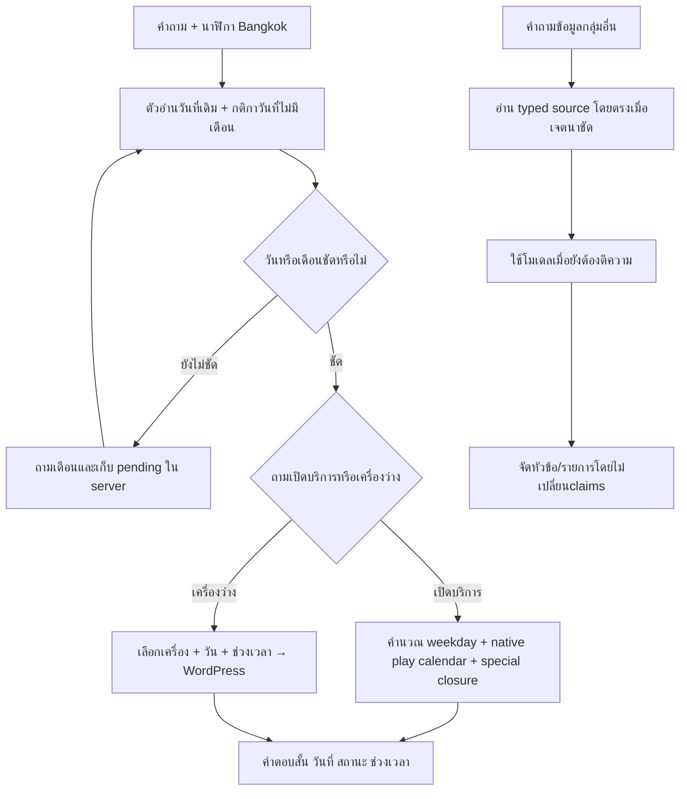

# R125 — วันที่ บริบทเดือน ความเร็ว และรูปแบบคำตอบ

## 1. สาเหตุจากคำถามจริง

คำถาม `วันที่ 26 ตุลาเปิดไหม` ใช้ 17.402 วินาที โดย context model ใช้17.079วินาทีและตีC11ถูกแล้ว แต่ตัวอ่าน `service_calendar.plan` รองรับเฉพาะISO/วันนี้/พรุ่งนี้/ชื่อวัน ยังไม่ต่อ Thai month resolver จึงจบ `entity_not_bound` ไม่ใช่เพราะไม่มีตารางวันจันทร์

มี `/api/calendar` และ `app.calendar.service_calendar` อยู่แล้ว รอบนี้ใช้ resolver เดิมกับนาฬิกา Asia/Bangkok ใน backend โดยตรง ไม่ต้อง HTTP เรียก API ของตัวเองเพื่อคำนวณวันในสัปดาห์ ส่วนเครื่องว่างยังเรียก WordPress จริงตามวัน/เครื่องที่ถาม

[คำถามและtraceก่อนแก้](<C:/Users/Chokhun/Documents/Codex/2026-09-25/psu-esports-studio-phuket-chatbot-c-2/r125_date_context_presentation_20261023/BEFORE_DATE_FAILURES.json>)

## 2. กติกาวันที่ที่ใช้จริง

| คำถาม เมื่อวันนี้20ตุลาคม2026 | วิธีจัดการ |
|---|---|
| วันที่26ตุลาเปิดไหม | 26ตุลาคม2026 → วันจันทร์ → ตารางบริการ13:00–16:00 |
| วันที่25เปิดไหม | วันที่ตั้งแต่วันนี้ขึ้นไป → เดือนปัจจุบัน → 25ตุลาคม |
| วันที่20เปิดไหม | วันนี้ในเดือนปัจจุบัน |
| วันที่15เปิดไหม | ถาม “วันที่15ของเดือนไหนครับ?” |
| ตอบ “พฤศจิกายน/เดือน11/เดือนหน้า” | เติมเดือนให้คำถามเดิมและอ่านsourceใหม่ |
| 27ศูนย์เปิดไหม | รองรับเลขวันนำหน้าคำถาม ใช้เดือนปัจจุบันถ้ายังไม่ผ่าน |
| วันที่31ในเดือนที่ไม่มี31 | ถามเดือน ไม่เลื่อนวัน/เดือนเอง |
| เดือน13/วันที่31กุมภาพันธ์ | ขอข้อมูลใหม่พร้อมคงpendingที่ถูกต้อง |

รองรับชื่อเดือนเต็ม/ย่อไทย เลขไทย ISO slash dates ปีพ.ศ. และปีค.ศ. ใช้วันจริงจากdatetime ไม่ให้โมเดลเดาวันในสัปดาห์. เดือน/วันที่ในคำถามไม่ถูกใช้เป็นเลขเวลา

### บริบทต่อเนื่อง

บันทึกเฉพาะวันและข้อความที่ลูกค้าถามใน server-delivered state ไม่เก็บคำตอบธุรกิจเป็นfactในhistory. อ่านเฉพาะข้อความที่serverยืนยันว่าส่งแล้ว; client-providedstateที่ไม่ยืนยันไม่ถูกนำมาใช้. เปลี่ยนหัวข้อไม่บังคับกลับไปคำถามเดิม

“วันที่15ว่างไหม → พฤศจิกายน → PC2” ตรวจทั้ง3turnจริงแล้ว เก็บวันที่2026-11-15และproviderID15. ถ้าคำถามยังไม่ระบุเครื่อง จะถามเฉพาะเครื่อง ไม่ถามวันที่ซ้ำ. ถ้าถามวันอื่นโดยไม่ระบุเวลา อ่านรอบจองของทั้งวัน ไม่เอาเวลา20:xxของวันนี้ไปใช้กับวันนั้น

## 3. ทางทำงานใหม่

## 4. ความเร็วที่วัดจริง

| คำถาม | ก่อนแก้ | R125 API รอบตรวจ |
|---|---:|---:|
| วันที่ 26 ตุลาเปิดไหม | 17.402s | 3.781s |
| 27ศูนย์เปิดไหม | 15.944s | 0.482s |
| วันนี้มีตารางว่างรึเปล่า | 19.316s | 0.411s |
| มีเกมอะไรมั่ง | 15.582s | 0.540s |

คำถามแรกหลังเปิดprocessอาจใช้ประมาณ3–4วินาทีในการเริ่มอ่านชุดข้อมูล; หลังอุ่นระบบคำถามตรงกลุ่มที่ตรวจส่วนใหญ่อยู่ระดับต่ำกว่าหนึ่งวินาที ดูเวลาจริงรายข้อในJSON ไม่รับประกันเวลาคำถามอื่นทั้งหมด

ตัด context-model round trip สำหรับวันที่ เกมในรายการ และคำถามตรงที่native readerพิสูจน์scopeได้ รวมถึงprice lookupที่เป็นตัวเลขชัดและnativeplanพร้อม. คำถามซับซ้อน/หลายเงื่อนไข/เทียบราคา/ภาษาที่ยังต้องตีความยังเรียกโมเดลและอาจใช้เวลานานได้ ไม่บังคับปิดLLMทั้งระบบ

## 5. รูปแบบคำตอบ

- วันเปิด: แสดงวันที่เต็มและวันในสัปดาห์ พร้อมเปิด/ปิดและเวลาที่เกี่ยวข้องในข้อความสั้นเดียว
- อุปกรณ์/เกม: ชื่อขึ้นครั้งเดียว ตามด้วยหัวข้อและbulletจากsource
- Controls: ชื่อเกม/แพลตฟอร์มครั้งเดียว ตามด้วยแต่ละactionกับbinding ไม่เอาชื่อเกมซ้ำทุกบรรทัด
- กติกา: แยกชื่อรายการกับเนื้อหาclause ลดlabelที่ซ้ำกับประโยค
- ราคา: แยกบริการ/กลุ่มผู้ใช้กับจำนวนเงิน คงหน่วย/วันยืนยันและเงื่อนไข
- รายการเกม: แยกแต่ละบริการและเกมเป็นbullet

การจัดรูปแบบไม่ใช้โมเดลเขียนคำตอบใหม่ คงclaim values/source refs/computationsและคำเตือนpartial/secondary-sourceตามเดิม. แก้เลขcitationให้นับตามclaims ไม่ใช่จำนวนหัวข้อ/บรรทัด. รูปแบบนำหลักการเดิมมาใช้ แต่ไม่ได้อ้างว่าเหมือนข้อความlegacyทุกตัวอักษร

### ภาพตรวจหน้าเว็บจริง

## 6. การตรวจ

- ผ่าน 115 invariant assertions รวมกรณีวันสิ้นเดือน ปีพ.ศ. บริบทเดือน ความสดlive ช่วงเวลาต่อเนื่อง และcitation
- APIชุดเฉพาะ13คำขอผ่าน รวมบทสนทนา3turnและWordPressจริง; 0 model generation callsในชุดคำถามชัดนี้ แม้ระบบอนุญาตLLM
- ตรวจ3คำขอหลังสลับURLเดิม12422 ผ่านอีกครั้ง
- เก็บattemptที่third-turnพลาดไว้ แล้วแก้exactstationaliasและset-indexingก่อนตรวจซ้ำ ไม่แก้logย้อนหลัง
- ตรวจhash R124ทุกไฟล์และDBเท่าเดิม ไม่แก้production/R78/approvals/frozen/logsเดิม
- ไม่มีFullTestใหม่ และจำนวนassertionsไม่ใช่เปอร์เซ็นต์semanticaccuracy

- [foundation: 35 checks](<C:/Users/Chokhun/Documents/Codex/2026-09-25/psu-esports-studio-phuket-chatbot-c-2/r125_date_context_presentation_20261023/verification_1792760612213072700/VERIFICATION.json>)
- [source guards: 19 checks](<C:/Users/Chokhun/Documents/Codex/2026-09-25/psu-esports-studio-phuket-chatbot-c-2/r125_date_context_presentation_20261023/source_guard_verification_1792760620679510700/VERIFICATION.json>)
- [live bindings: 19 checks](<C:/Users/Chokhun/Documents/Codex/2026-09-25/psu-esports-studio-phuket-chatbot-c-2/r125_date_context_presentation_20261023/live_verification_1792761096454371800/VERIFICATION.json>)
- [stable FAQ: 5 checks](<C:/Users/Chokhun/Documents/Codex/2026-09-25/psu-esports-studio-phuket-chatbot-c-2/r125_date_context_presentation_20261023/exact_faq_verification_1792760622850753700/VERIFICATION.json>)
- [date/context/presentation: 37 checks](<C:/Users/Chokhun/Documents/Codex/2026-09-25/psu-esports-studio-phuket-chatbot-c-2/r125_date_context_presentation_20261023/date_verification_1792761096297944400/VERIFICATION.json>)

[APIก่อนสลับURL](<C:/Users/Chokhun/Documents/Codex/2026-09-25/psu-esports-studio-phuket-chatbot-c-2/r125_date_context_presentation_20261023/live_api_1792761172929113900/API_VERIFICATION.json>) · [ตรวจURLเดิมหลังสลับ](<C:/Users/Chokhun/Documents/Codex/2026-09-25/psu-esports-studio-phuket-chatbot-c-2/r125_date_context_presentation_20261023/live_api_1792761376962966700/ACTIVATION_VERIFICATION.json>) · [สถานะและhash checks](<C:/Users/Chokhun/Documents/Codex/2026-09-25/psu-esports-studio-phuket-chatbot-c-2/r125_date_context_presentation_20261023/FINAL_REVIEW.json>)

## 7. ใช้งาน

เว็บเดิม: http://127.0.0.1:12422/ (R125). เปิดใหม่/รีเฟรชหน้าเพื่อรับชื่อรุ่นและfrontendล่าสุด. ใช้ข้อมูลกลางชุดเดิม ไม่ติดตั้งทับR78

ยังตอบตามตารางบริการที่บันทึกและspecialclosureที่มี ไม่ตีวันหยุดประเทศเป็นวันปิดศูนย์โดยอัตโนมัติ และไม่เอาservice scheduleไปอ้างว่าเครื่องว่างจริง. แหล่งข้อมูลที่ยังขัดกัน/ผังปุ่มที่ยังไม่ครบคงข้อจำกัดเดิมไว้