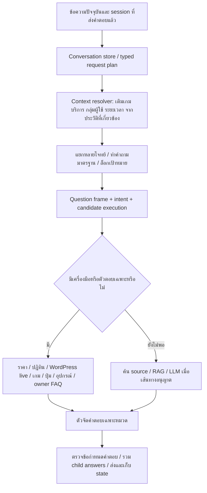
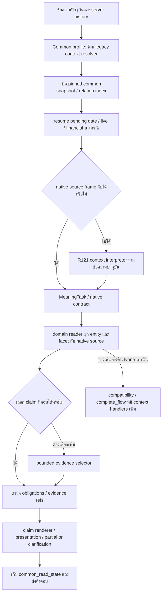

# เทียบ Flow เดิมกับ Flow กลาง R125 จากคำตอบและ log จริง

เอกสารประกอบ:

- [คำตอบเดิม–ใหม่เต็มทุกข้อ และ state/trace ราย turn](<C:/Users/Chokhun/Documents/Codex/2026-09-25/psu-esports-studio-phuket-chatbot-c-2/r127_legacy_current_flow_comparison_20261023/COMPARISON_TH.md>)
- [Source code พร้อมบรรทัดที่รองรับการวิเคราะห์](<C:/Users/Chokhun/Documents/Codex/2026-09-25/psu-esports-studio-phuket-chatbot-c-2/r127_legacy_current_flow_comparison_20261023/CODE_EVIDENCE.md>)
- [ผลตรวจ binding โดยอ่าน source ไม่มี model calls](<C:/Users/Chokhun/Documents/Codex/2026-09-25/psu-esports-studio-phuket-chatbot-c-2/r127_legacy_current_flow_comparison_20261023/SOURCE_COUNTERFACTUALS.json>)
- [สถิติและผลตรวจ hash ของระบบเดิม/ใหม่](<C:/Users/Chokhun/Documents/Codex/2026-09-25/psu-esports-studio-phuket-chatbot-c-2/r127_legacy_current_flow_comparison_20261023/SUMMARY.json>)

## ข้อสรุปที่ตรวจพบ

ข้อสังเกตของผู้ใช้ถูกในหลายส่วน โดยเฉพาะการตามบทสนทนา ราคา คำตอบนโยบายที่เปลี่ยนสำนวน และการจัดคำตอบให้เป็นขั้นตอน แต่ผลจริงไม่ได้ยืนยันว่า Flow เดิมถูกทุกกรณี ทั้งสองระบบยังมีการเข้าใจโจทย์ผิด ตอบไม่ครบ และเลือกข้อมูลที่ไม่ตรงสิ่งที่ถาม

ปัญหาหลักของ Flow ใหม่ในกรณีที่ตรวจนี้คือ **ข้อมูลมี แต่ข้อต่อระหว่างประวัติ → เจตนา → ตัวอ่าน → ความสัมพันธ์ → ขอบเขตคำตอบ ยังทำงานไม่ครบเหมือนเดิม** การเพิ่มข้อมูลหรือฝึกโมเดลตีหมวดอย่างเดียวจึงไม่แก้ทั้งหมด

การตรวจครั้งนี้เป็นการวิเคราะห์ ไม่มีการแก้ runtime ของ R125 ที่ผู้ใช้ใช้งาน ไม่มีการนำ legacy มาตอบแทนอย่างเงียบ ๆ และไม่มีการติดตั้งทับ R78

## 1. เปรียบเทียบอะไร และข้อจำกัดของหลักฐาน

- เดิม: isolated legacy teacher ที่ `r124_legacy_guided_parity_20261023/teacher` มาจาก `Downloads/Learn-LLM/18_PSU_Esports_Update_Route_Data` ไม่ใช่การนำ Flow กลางรุ่นก่อนมาเรียกว่าเดิม
- ใหม่: source R125 ตรงกับ API ที่ผู้ใช้เปิดที่ port 12422 การตรวจใช้สำเนาการรันจาก source เดียวกันที่ port 12722 โดยแยก session/log
- คำถามเดี่ยว: เอา 34 คำถามใน R126 ซึ่งมีคำตอบ R125 จริงแล้ว ไปรัน legacy จริง 34 ข้อ เก็บ HTTP response และ pipeline trace ใหม่
- ประวัติสนทนา: ทดสอบ 8 บทสนทนา 19 turn ต่อระบบ ผ่าน HTTP API จริง มี session เดิมและ acknowledgement ของคำตอบก่อนหน้า ไม่ใช่เรียก pipeline ทีละข้อด้วย history ว่าง
- ใช้เวลาจริง Asia/Bangkok ทั้งคู่ ไม่มีการใช้ผลเก่าแทนสถานะ live ปัจจุบัน คำตอบ R126 รันก่อนรอบ legacy ประมาณหนึ่งชั่วโมง จึงเทียบความสามารถเลือกวันที่/เครื่องและอ่านผล provider ได้ แต่สถานะว่าง ณ คนละเวลาไม่ใช่ ground truth เดียวกัน
- ทั้งคู่อนุญาต LLM ไม่ได้บังคับให้ทุกคำถามต้องเรียก LLM เส้นทาง deterministic ของ legacy หลายข้อจงใจข้ามโมเดล
- ใช้ backend resident เดียวกัน Typhoon2.5 Qwen3 4B, NF4/BF16; legacy ใช้ base profile ส่วน R125 ใช้ R121 context adapter จึงเป็นการเทียบระบบใช้งานสองชุด ไม่ใช่การทดลองแยก causal effect ของ Flow ล้วน ๆ และไม่ใช่ benchmark ความเร็ว Ollama/GGUF ที่เคยใช้งานเดิม
- ข้อมูลคนละ revision บางเรื่อง เช่นนโยบายเมาส์และการยืนยันราคา ต้องแยก source revision จาก regression ของ Flow
- คำถามชุดนี้เลือกเพื่อหาปัญหา มีข้อซ้ำและเคสยาก ไม่ใช่ random full test จึงไม่คิดเปอร์เซ็นต์ความถูกต้องทั้งระบบจากชุดนี้ ไม่ใช้ `validation_ok` หรือ `schema_ok` เป็นคะแนนความเข้าใจภาษา
- Log บอกเส้นทาง การเลือกข้อมูล และ output ที่สังเกตได้ ไม่ใช่หลักฐานของความคิดภายในโมเดล

## 2. Flow ที่ทำงานจริง

### 2.1 เดิม

Log ที่สนับสนุน: `conversation_request`, `source_operation`, `target_lock`, `question_frame`, `tool_precondition`, `structured_tool`, `model_gateway skip_preflight_llm`, `compound_source_evidence` และ `context_resolution` ที่ระบุคำถามหลังเติมบริบท

เดิมไม่ได้ใช้โมเดลอ่านทุกอย่างแล้วค่อยตอบทั้งหมด จุดแข็งจำนวนมากมาจากตัว parser / ตัวอ่าน / formatter ที่เขียนเฉพาะปัญหา และลำดับเลือกเส้นทางที่ทำงานร่วมกันแล้ว

### 2.2 ใหม่ R125

จุดสำคัญคือ compatibility context handlers มีอยู่ แต่เมื่อ domain path คืนคำตอบ `unconfirmed` ไปแล้ว จะไม่ย้อนให้ handler ด้านล่างช่วยแก้เป้าหมาย คำถามที่มีเจตนาแต่ขาดเกมจากรอบก่อนจึงจบเร็วในเชิง control flow แต่ช้าเพราะผ่านโมเดลก่อน แล้วตอบว่าไม่มีข้อมูล

## 3. การอ่านข้อความก่อนหน้า: มี history แต่ไม่ได้ใช้ให้ครบ

### 3.1 หลักฐานที่เห็นชัดที่สุด: เกม → โซน → ปุ่ม

บทสนทนาเดียวกัน:

1. `God of War Ragnarök คือเกมอะไร`
2. `เล่นได้ที่โซนไหน`
3. `แล้วปุ่ม R2 ทำอะไร`

เดิมรอบ 2 เปลี่ยน execution question เป็น `God of War Ragnarök เล่นได้ที่โซนไหน` มี `used_context=true`, `reason=inherited_game_from_recent_history` แล้วเข้า `structured_service_game_availability` ตอบ PlayStation 5 Zone / #01–#02 ได้ รอบ 3 เติมเกมเช่นกันแล้วเข้า `source_operation_control_lookup` ตอบ R2 โจมตีหนัก / รูนหนัก พร้อมคำเตือนแหล่งรอง

ใหม่รอบ 1 เก็บ `common_read_state.record_ids=[game_detail_god_of_war_ragnarok]` สำเร็จ แต่รอบ 2 `resolved_question` ยังเป็น `เล่นได้ที่โซนไหน` ไม่เติมหรือผูกเกมให้ task โมเดลระบุ facet=zone แต่เอาวลีทั้งประโยคเป็น target แล้วตัวอ่านหา entity ไม่ได้ จบ `common_unconfirmed` ประมาณ 23.79 วินาที รอบนี้มี history และ prior record จริง จึงไม่ใช่ผู้ใช้ไม่ได้ส่งประวัติ

**สาเหตุที่ยืนยันจากโค้ดและ log ร่วมกัน**

1. `app/web_api/server.py` common profile จงใจสร้าง `ResolvedQuestion(question, question, False, reason='migrated_common_server_history')` จึงไม่เรียก legacy resolver
2. `domain_flow/integration.py` resume เฉพาะ pending บางชนิดก่อนเข้า interpretation ไม่มี generic game-to-zone/control task rewrite ตรงนี้
3. `understanding.interpret` รับ `question` และ source index แต่ไม่มี `history` argument ใน payload ของโมเดล
4. Backend `serve_model.py` เมื่อเห็น `original_question` ใช้ `context_contract.messages(user['original_question'])` ซึ่งมีเฉพาะคำถามปัจจุบัน ไม่มีประวัติจาก session
5. ฝั่ง common ยังมี `answer.context_query`, `resolve_state`, `complete_flow` แต่ถูกวางหลัง domain path; เมื่อ domain path return คำตอบแล้วจึงไม่ถูกเรียก
6. เมื่อรอบ 2 คืน state ว่าง การตามรอบถัดไปยิ่งยากขึ้น เพราะ latest delivered state กลายเป็น record_ids ว่าง

**สิ่งที่ต้องแก้:** สร้างตัว resolve บริบทก่อนทุก domain reader ใช้ delivered entity IDs ผูก task ข้ามหมวดได้โดยอ่านความสัมพันธ์ใหม่จาก snapshot ไม่เอาข้อความคำตอบเก่ามาเป็นข้อเท็จจริง ห้ามให้นโยบาย missing-target จบเป็น missing-source หากยังมี referent ที่ผูกได้ใน state

### 3.2 ราคา: จำหมวดอย่างเดียวไม่พอ ต้องจำ slot

บทสนทนา `บุคคลทั่วไป เล่น PC 1 ชั่วโมง เสียกี่บาท` → `แล้วสองชั่วโมงล่ะ` → `เปลี่ยนเป็น PS5 ล่ะ`

เดิมเก็บ typed service fee task แล้วเปลี่ยนเฉพาะ duration เป็น 120 นาที จากนั้นเปลี่ยน service เป็น PS5 โดยยังรักษา audience=บุคคลทั่วไป และ 120 นาที ตอบ 140 บาทของ PC และ 300 บาทของ PS5 ตามอัตราที่บันทึกไว้ พร้อมเตือน validity ของราคา PS5

ใหม่คำตอบแรกถูกตามอัตราที่บันทึก แต่ `common_read_state.constraints={}` และไม่มี typed service/audience/duration slots ที่ resume เป็น task เดิมได้ รอบ `แล้วสองชั่วโมงล่ะ` โมเดลเห็น duration แต่ไม่มี service จึงถามบริการใหม่ ทั้งที่ผู้ใช้เพิ่งระบุ PC และเสียเวลาประมาณ 30.49 วินาที

**สิ่งที่ต้องแก้:** เก็บ active task เป็นโครงสร้าง `domain/operation/entity_ids/service_id/audience_ids/person_counts/duration/requested_facets/exclusions/pending_slots/source_epoch` แยก present slots ออกจาก inherited slots; update เฉพาะ slot ที่ผู้ใช้เปลี่ยน แล้ว re-read อัตรา ไม่จำราคาจากคำตอบเก่า

### 3.3 ขอบเขตของการจำ

ไม่ควรเปิดให้ดึงทุกข้อความเก่ามาปะต่อเสมอ ต้องแยก:

- คำถามต่อเนื่อง: inherit เป้าหมายและ slot ที่ยังเกี่ยวข้อง
- คำถามใหม่ชัดเจน: ไม่เอาเรื่องเดิมมาทับ
- ปฏิเสธ/แก้ไข: แทนค่าหรือเอา scope ที่ปฏิเสธออก
- อ้างถึงลำดับ `อันที่สอง`: resolve จาก ordered options ที่ส่งจริง ไม่ใช่ลำดับ record ในฐานข้อมูล
- เปลี่ยนหมวดแต่ยังเป็นเป้าหมายเดิม: เกม → ปุ่ม → ราคา → บริการที่จอง ต้อง join ข้ามหมวด
- คำกำกวมที่ไม่มี referent หรือมีหลาย referent: ถามเฉพาะสิ่งที่ขาด
- state จากคำตอบล้มเหลว: ไม่ควรล้าง active target ที่ยังถูกต้องเพียงเพราะ reader ไม่พบคำตอบในรอบล่าสุด

เดิมเองมีขอบเขตไม่ครบ เช่นคำถามยกเลิกในบทสนทนา Cockpit ถูกตีเป็น topic shift แล้วหาไม่เจอ จึงต้องย้ายพฤติกรรมที่ตรวจว่าดีมาใช้อย่างมี contract ไม่คัดลอกทุกกฎโดยถือว่าถูกทั้งหมด

ข้อจำกัดการเทียบเคสยกเลิกนี้: ฝั่ง legacy fallback ยังพบ `/api/embed` HTTP404 เพราะ backend ทดลองไม่เปิด embedding endpoint และ `/api/generate` ฝั่ง client timeout หลังเหลืองบประมาณ1.51วินาที ผลสุดท้ายข้อนี้จึงปนข้อจำกัด transport ไม่จัดเป็น pure content/Flow failure ของเดิม แม้ `context_resolution.reason=topic_shift` จะสังเกตได้จริง ส่วนใหม่โมเดลตอบ JSON สำเร็จแต่ reader `entity_not_bound` เป็นคนละสาเหตุ

## 4. การอ่านข้อมูลและเข้าใจคำถาม

### 4.1 มี FAQ แต่เปลี่ยนสำนวนแล้วอ่านไม่เจอ

`พาเพื่อนมานั่งดูเฉย ๆ ได้หรือเปล่า`

- เดิม: ตอบ `สามารถมานั่งดูเพื่อนเล่นได้ครับ` เส้นทาง `user_service_facts` ประมาณ 0.46 วินาที
- ใหม่: `ยังไม่มีข้อมูลยืนยันสำหรับส่วนที่ถามครับ` ประมาณ 25.01 วินาที
- R126 ตรวจ source แล้วมี owner FAQ คำถาม `ไปนั่งดูเพื่อนเล่นเฉย ๆ ได้ไหม?` และคำตอบอนุญาตอยู่จริง exact question อ่านได้แต่ paraphrase นี้ไม่เจอ

เป็น retrieval / intent-to-policy binding failure ไม่ใช่ข้อมูลขาด ต้อง map ความหมาย `spectator_access` ไป canonical policy record และอ่าน effective version ตัวเดียว ไม่ใช้ exact FAQ เพียงอย่างเดียว และไม่ควรจำคำตอบไว้ในน้ำหนักโมเดล

### 4.2 เข้าใจหมวดแล้วแต่ reader ยังบังคับหา keyword ใหม่

`ถ้าจะเข้าไปเล่นต้องเริ่มตรงไหนก่อนครับ`

ใหม่โมเดลตีเป็น booking_procedure / reservation ถูก แต่ส่งต่อเป็น generic owner_policy แล้ว reader ติด `entity_not_bound`; canonical `จองเครื่องทำยังไง` อ่าน source ขั้นตอนจองได้ แสดงว่า task meaning ยังไม่ได้กลายเป็น reader operation ที่ทำงานได้จริง

เดิมข้อนี้ก็ตอบที่ตั้งศูนย์ จึงไม่ใช่ตัวอย่างเดิมตอบถูก แต่เป็นหลักฐานว่าระบบใหม่ยังเสียประโยชน์จากการตีเจตนาที่ถูกของโมเดล

ต้องให้ reader รับ canonical operation เช่น `booking.procedure` พร้อม service scope โดยตรง ไม่ย้อนไปพึ่ง raw query เพื่อเดาว่าจะอ่าน record ใดซ้ำอีกครั้ง

### 4.3 เลือก field ถูกแต่ candidate ถูกตัดก่อนเห็นคำตอบ

`ใน God of War Ragnarök ถ้าต้องการตีแรงบน PS5 ต้องกดตรงไหน`

- เดิม: ตอบคำอธิบายเกม ไม่ได้ตอบปุ่ม
- ใหม่: ตอบ L2 เล็ง ไม่ใช่ R2 โจมตีหนัก
- source มี R2 หนักจริง R126 ยืนยัน `binding_8`; selector ใช้ candidate `facts[:8]` ทำให้ R2 อยู่นอก candidate window ที่ส่งให้โมเดล

การเพิ่มข้อความใน source หรือฝึกให้เลือก ID เก่งขึ้นไม่ช่วยเมื่อ ID ที่ถูกไม่ถูกส่งไป ต้องค้น action alias/semantic family ก่อนตัดจำนวน candidate แบ่งเป็นชุดเมื่อขอทั้งหมด และตรวจ requested action กับ selected binding หลังเลือก หากไม่ตรงให้ corrective read หรือถามเจาะจง ไม่ส่ง claim ที่จริงแต่ตอบคนละ action

### 4.4 หลายกลุ่มผู้ใช้และตัวเลข

`นักศึกษา PSU 1 คนกับบุคคลทั่วไป 2 คน เล่น PC 2 ชั่วโมง รวมกี่บาท`

- เดิมลด query เป็นบุคคลทั่วไป 1 คน 120 นาที แล้วตอบ 140 บาท ตกกลุ่มและจำนวนคน
- ใหม่ถามจำนวนคนอีกหลังประมาณ 74.24 วินาที ทั้งที่ระบุครบแล้ว
- R126 source audit พบ alias overlap ทำให้เกิดกลุ่มเพิ่ม `PSU Alumni and General Student` แบบไม่มีจำนวนคน และมี rate 2 ชุดสำหรับ PC #01–#02 / #03–#10 ทำให้ exact-one rate assumption reject แม้อัตราบางส่วนเท่ากัน

ทั้งสองยังไม่ผ่านโจทย์นี้ ต้องใช้ group AST แยก `(audience, count, service, duration)` ตาม span ที่ไม่ทับซ้อน longest-match ข้ามทุก audience แล้วตรวจ service-rate equivalence ก่อนรวมรายการ ไม่ควรคูณจากตัวเลขที่อยู่ใกล้คำว่า PC แบบไม่แยกกลุ่ม

### 4.5 คำว่า “คนนอก”

เดิมรักษาความกำกวมระหว่างศิษย์เก่า/นักศึกษาต่างสถาบัน กับบุคคลทั่วไป และแสดงราคา 50/140 บาทสำหรับสองชั่วโมง ใหม่เลือก General Adult และตอบ 140 โดยไม่รักษาความต่างของสองกลุ่ม

นี่คือ audience interpretation ที่แคบเกิน input แม้จำนวนเงินสำหรับบุคคลทั่วไปจะคำนวณถูก ต้องใช้ one-of audience scope ที่ยังไม่ resolve และถามเฉพาะกลุ่ม หรือแสดงสองกรณีพร้อม label

### 4.6 กติกาการแข่งขัน: คำตอบจริงแต่ไม่ครบโจทย์

คำถามขอประเภทบทลงโทษ VALORANT:

- เดิมเลือก Round Loss และ Map Forfeit เพียง 2 ประเภท ไม่ครบชุด
- ใหม่เลือกหลักพิจารณา Intent / Impact แทนรายการประเภทโทษ

ต้องแยก `penalty_types`, `penalty_conditions`, `decision_principles`, `appeal` และ event edition เป็น operation; enumeration ต้องเดิน sibling clauses ทั้งชุด ไม่ใช้ top-k fragment ว่าครบรายการแล้ว คำว่า “ถ้า” ไม่ควรทำให้ broad penalty list กลายเป็น conditional clause lookup โดยอัตโนมัติ

### 4.7 เกมหลายผู้เล่น

ถามเกมเล่นพร้อมกันสี่คน: เดิมแสดงทั้ง 42 เกมโดยไม่กรอง ใหม่แจ้ง unsupported / ข้อมูลไม่พอ ทั้งสองยังไม่ได้ตอบรายการตามเงื่อนไข ต้องแยกจำนวนผู้เล่น local/online/co-op/เครื่อง/จอย และสิทธิ์จำนวนผู้เข้าใช้ตามบริการ ไม่มีข้อมูล mode ใดต้องระบุ mode gap ห้ามเอา room_seats หรือ service_capacity มาเท่ากับ players_max ของเกม

### 4.8 ข้อผิดพลาดที่พบเพิ่มจากการรันบทสนทนารอบนี้: ชื่อเกมถูก equipment frame แย่ง

`Beat Saber คืออะไร` และ `Tekken 8 คืออะไร` เป็นคำถามเดี่ยวที่ผู้ใช้เข้าใจได้ว่าให้บอกว่าเกมนั้นคืออะไร เดิมตอบ game summary / genre / วิธีเล่น / zone แต่ใหม่ตอบจำนวนผู้ใช้ของบริการ VR หรือ PC/PS5 แทน

Log ยืนยัน `meaning_review.basis=source_equipment_definition_before_name_echo`, category C03 และ requested facet=usage ไม่ใช่ C04 summary แล้ว selector เลือก service_capacity สุดท้าย verifier แจ้ง `requested_field_not_delivered` แต่ระบบยังส่งข้อความ capacity ที่ไม่ตอบคำถามออกไปพร้อม partial warning

Readonly counterfactual ใน `SOURCE_COUNTERFACTUALS.json` ยืนยัน:

- `Beat Saber คืออะไร`: C03 bind เจอ availability_vr_30 / availability_vr_60 และ C04 bind เจอ game_detail_beat_saber จริง แต่ branch C03 มาก่อนและใช้ regex `คืออะไร` จึงแย่งงาน
- `Beat Saber คือเกมอะไร`: เปลี่ยนเป็น C04 summary ได้
- `Tekken 8 คืออะไร` กับ `Tekken 8 คือเกมอะไร` มีความต่างแบบเดียวกัน

ไม่ใช่ต้องเพิ่ม description ของสองเกมอีก ข้อมูลมีแล้ว ปัญหาคือ alias ของเกมผูกไปบริการได้ด้วยและลำดับ rule ใช้ “bind ใน C03 ได้” เป็นเหตุสรุปว่าเป็นคำถามอุปกรณ์ ต้องแยก canonical entity type จาก related service และให้ definition ผูก entity ที่ผู้ใช้เรียกจริงก่อนเลือก category ข้อมูลความจุไม่ควรถูกส่งเป็นคำตอบ definition เพียงเพราะเป็น claim ที่มี source

### 4.9 ขอ PC และ PS5 แต่ใหม่ตอบ PS5 อย่างเดียว แล้ว contract ผ่าน

`PC กับ PS5 มีเกมอะไรบ้าง`

- เดิมคืน PS5 17 เกม และ PC 6 เกม แยกกลุ่มครบเป้าหมายที่ถาม
- ใหม่คืนเฉพาะ PS5 17 เกม `MeaningTask.constraints` ยังมี platform=pc และ platform=ps5 แต่ `query_plan.record_ids` มีเฉพาะ availability_ps5_01_02
- `execution_contract` ระบุ collection_scope fulfilled และ all_obligations_fulfilled=true ทั้งที่ PC หาย เพราะตรวจรายการของ pool ที่เลือกแล้ว ไม่ได้พิสูจน์ว่าทุก explicit target ถูก execute
- Counterfactual พบ `index.bind(C04, 'PC มีเกมอะไรบ้าง')` ได้ PC สอง service record และ `index.bind(C04, 'PS5 มีเกมอะไรบ้าง')` ได้ PS5 แต่ประโยครวมได้ PS5 อย่างเดียว
- `FactIndex.bind` เลือก entity alias ความยาวสูงสุดทั้งคำถาม PS5 ยาวกว่า PC จึงตัด PC ที่เป็นคนละเป้าหมาย ไม่ใช่ alias สั้นที่ซ้อนอยู่ใน alias ยาวของเป้าหมายเดียวกัน

ต้อง resolve entity mentions แยกตาม span และ coordination ก่อน dedup ให้ longest-match เฉพาะ span ที่ซ้อนกัน แล้วเพิ่ม explicit-target obligation ต่อ PC / PS5 แยกกัน จะไม่ถือว่ารายการครบเมื่อมีเพียงหนึ่งบริการ

กรณีต่อด้วย `อันที่สองราคาเท่าไร` รอบนี้ทั้งคู่ถามชื่อบริการ ไม่ได้ resolve ordinal และคำถามเองมีความกำกวมเพิ่มเติม เพราะลำดับบริการใน input เป็น PC→PS5 แต่ output เดิมเป็น PS5→PC ควรเก็บ delivered option order และตรวจความหมายที่ยังไม่ชัดก่อนเลือก ไม่อ้างว่าเดิมแก้ referent ทุกแบบได้แล้ว

## 5. รูปแบบคำตอบต่างกันอย่างไร

| เรื่อง | เดิมที่เห็นใน log | ใหม่ที่เห็นใน log | สิ่งที่ควรทำ |
|---|---|---|---|
| ขั้นตอนจอง | หัวข้อ + bullet ทีละขั้น | ข้อความขั้นตอนสองฉบับต่อกัน + warning | canonical procedure ที่รักษาทุกเงื่อนไข และ render เป็น numbered steps |
| ราคา | service / package / audience / สูตร × session | แยก PC #01–#02 กับ #03–#10 แม้ตัวเลขเท่ากัน / label ยาว | รวมเฉพาะอัตราที่เท่ากันจริง คง scope รายเครื่องใน detail |
| อุปกรณ์ | ชื่อ ความหมาย จำนวน ที่ตั้ง ใช้ทำอะไร | “คืออะไร” ถูก map ไป usage จึงขาด quantity/location | definition card มี definition เป็นหลัก + facts จำเป็นตามคำถาม |
| GPU | ตอบข้อมูลเครื่องทั้งก้อน รวมเกมทั้งหมด | GPU อย่างเดียว | แบบใหม่ตรงโจทย์กว่า แต่ต้องรักษาคำเตือนระดับการยืนยันเครื่องจริง |
| ปุ่ม | ปุ่ม → action เป็นรายการ | claim label/action → input หลายบรรทัด มี warning | แยกหน้าตาตามงาน: ถาม action ให้ตอบปุ่มก่อน; ถามทั้งชุดให้เป็นตาราง |
| เกมบน PS5 | บางสำนวนไปตอบตัวเครื่อง | รายชื่อเกมถูกบริการ | รักษาการเลือก source ของใหม่ ลด model call ที่ไม่จำเป็น |
| หลายคำถาม | Question 1 / Question 2 | หลาย subject/claim ต่อกัน บางแบบดีขึ้นใน R125 | มี heading ตามสิ่งที่ผู้ใช้ถามและสรุปสถานะทีละส่วน |
| ข้อมูลไม่พอ | บางข้อ generic clarification | บางข้อ unconfirmed ทั้งที่แค่ target หลุด | แยก missing-target / missing-source / unsupported-operation / conflict / provider-unavailable |

### สิ่งที่เกี่ยวกับข้อมูลซ้ำ ไม่ใช่แค่ CSS

ขั้นตอนจองสองข้อความให้สาระหลักเหมือนกัน แต่ source system มองเป็นสอง owner-policy record จึงไม่กล้ารวมและแสดง partial การจัดรูปแบบหน้าเว็บอย่างเดียวไม่แก้ ต้องมี canonical fact / procedure revision พร้อม provenance ของข้อความที่สนับสนุน และ conflict record เมื่อเงื่อนไขต่างจริง

ห้ามลบข้อความที่ดูคล้ายกันทั้งหมดโดยใช้ similarity เพราะอาจทำให้ข้อยกเว้น เวลา และเงื่อนไขหาย การรวมต้องเทียบ proposition และข้อกำหนดทีละข้อ

### Source ใน UI

ในหลายคำตอบ R125 มี `[S1]` และ internal evidence_refs จริง แต่ HTTP `sources=[]` เช่นอุปกรณ์ Nintendo เมื่อ snapshot ไม่มี public URL และ `common_approved` ไม่เป็น true ตัว `_source_list` จะไม่แสดงแหล่งใน side panel ต้องทำ citation descriptor ที่แสดง “ข้อมูลฉบับร่างของศูนย์” พร้อม stable citation ID ได้โดยไม่แอบอ้างว่า approved และไม่เปิด path ภายใน นี่ไม่ใช่หลักฐานว่าคำตอบไม่มี source แต่เป็นช่องว่างระหว่าง provenance ภายในกับสิ่งที่ผู้ใช้ตรวจดูได้

## 6. วัน เวลา API และ live binding

มี live binding จริงทั้งสองระบบ ไม่ได้ขาด API ทั้งหมด:

- `PC2 ว่างไหม` ทั้งคู่เรียก WordPress และตอบสถานะตามเวลาจริงพร้อมเวลาอัปเดต
- `PC2 วันที่27 ว่างช่วงไหน` เดิมรอบนี้กลับใช้วันที่ 23 (วันนี้) ไม่ได้รักษาวันที่ 27 ส่วน R125 เลือกวันที่ 27 และอ่านรอบวันนั้นได้ ตรงนี้ใหม่ดีกว่า
- วันที่ไทยชัด `26 ตุลา` ใหม่ตอบวันจันทร์ 26 ตุลาคม เปิด 13–16 ได้กระชับกว่าเดิม
- English October 26 และ `อีกสามวัน` ยังมี date parsing gap: เดิมตอบตารางทั่วไป ไม่ได้ resolve วันจริง ใหม่ unconfirmed/ช้า ทั้งสองยังไม่ผ่านคำถามเฉพาะวันในสำนวนนี้
- “วันจันทร์หน้า” บางทางเลือก weekday แต่ไม่ผูก date จึงตอบตามสัปดาห์ทั่วไปโดยไม่ตรวจ exception วันที่ต้องการ ต้องทดสอบผลกับ date ISO และ special closure จริงเสมอ

ต้องแยก opening/play service schedule, maintenance, bookable slots และ occupancy เป็นคนละชนิดข้อมูล ใช้ clock ก่อน resolver แล้วค่อยเรียก provider ด้วย date/resource/time scope ที่ตรวจแล้ว การใช้ API ได้ไม่ได้พิสูจน์ว่า query scope ถูก

## 7. ทำไมใหม่ช้า ทั้งที่มี LLM เหมือนกัน

เดิมหลายข้อถูกแปลงเป็น typed query หรือตอบจาก source handler โดยไม่เรียกโมเดล จึงเร็ว ใหม่พอสำนวนหลุด native frame จะเรียกโมเดลตีโจทย์เป็น JSON แล้วบางกรณีเรียกโมเดลเลือก evidence อีกครั้ง

R126 34 คำถาม: median HTTP 20.70 วินาที; กลุ่มไม่เรียก model 13 ข้อ median 0.59 วินาที; กลุ่ม 1 call 19 ข้อ median 25.01 วินาที; 2 calls 2 ข้อ median 32.17 วินาที; ช้าที่สุด 74.24 วินาที model HTTP กินประมาณ 97.98% ของ pipeline wall time ในกลุ่มที่เรียกโมเดล

ตัวอย่างเดียวกัน native friendly question กับ paraphrase ต่างกันมาก ไม่ใช่ฐานข้อมูลอ่านทุกครั้งใช้เวลา 20 วินาที หรือ UI render ช้าทั้งหมด Backend นี้ไม่ stream คำตอบถึง UI และใช้ GPU lock กลาง จึงมีความเสี่ยงคิว แต่หลักฐาน R126 ไม่ได้พิสูจน์ว่าทุก request ช้าเพราะคิวหรือ GPU OOM

Power mode เป็น Silent ในรอบ R126 และมี GPU clock ต่ำในหลาย sample แต่ยังไม่มี A/B จึงไม่อ้างว่าการเปลี่ยน power plan จะแก้ได้กี่วินาที และไม่ได้เปลี่ยน setting เครื่องผู้ใช้

ต้องลด model calls ที่ขาดประโยชน์ด้วย typed context ก่อนโมเดล ไม่ใช่ตัด verifier ที่จำเป็น หลังจากนั้นจึงปรับ output budget/constrained JSON/cache/serving โดย benchmark แยก prefill/decode/queue โมเดลปัจจุบันไม่ใช้ค่า num_predict ตาม request ตรง ๆ ต้องแก้ serving adapter ก่อนคิดว่า client ลด token แล้วจะเร็วขึ้น

## 8. การฝึก R121 / distillation ช่วยตรงไหน และยังไม่ช่วยตรงไหน

มี adapter ที่ฝึกน้ำหนักจริงและใช้จริงใน context calls แต่สัญญา `context_contract.messages(question)` ส่งข้อความปัจจุบัน ไม่ได้ส่งบทสนทนา ผลจึงเรียนรู้การจำแนกเจตนาและคง span ในคำถามเดียว ไม่ได้กลายเป็นความจำ session โดยอัตโนมัติ

`context_quotes` ใน output หมายถึงข้อความอ้างอิง **ภายในคำถามปัจจุบัน** ไม่ใช่การอ่านข้อความผู้ใช้รอบก่อน ชื่อ field ทำให้เข้าใจผิดได้

ยิ่งกว่านั้น custom backend แทน payload เมื่อพบ original_question ทำให้ audience_directory และ independent_legacy_interpretation ที่ชั้น application เตรียมไว้ไม่ได้ถูกส่งให้ model ใน prompt จริงของ context stage การแก้ prompt ฝั่ง applicationอย่างเดียวจึงอาจไม่มีผลตามคาด ต้องตรวจ wire ที่ backend ใช้จริง

ต่อให้ interpreter ทายหมวดถูก ก็ไม่แก้ record join, candidate truncation, wrong rate grouping, date scope, state loss หรือ formatter ที่ขาด การ train เพิ่มควรทำหลัง interface เดินครบ และใช้ teacher trace ที่ review แล้ว ไม่ถ่ายทอดข้อผิดพลาด legacy เช่นตอบ 140 ทั้งกลุ่ม หรือให้เกมทั้ง 42 เมื่อถามสี่คน

## 9. แผนปรับให้ได้จุดแข็งเดิม โดยยังเพิ่มข้อมูลผ่าน format กลางได้

### P0 — สัญญาร่วมก่อนทุกหมวด

1. **Conversation task resolver ก่อน domain routing**: ใช้ typed delivered state เติม referent/slots ก่อนเรียก interpreter; ทำ provenance ว่าส่วนใดมาจาก current user / previous user / offered option / clock ไม่ดึง facts จาก prose คำตอบเก่า
2. **Canonical operations แทน generic facet อย่างเดียว**: `game.location`, `controls.by_action`, `booking.procedure`, `policy.spectator_access`, `fee.group_total`, `schedule.for_date` ให้ executor รับ operation นี้โดยตรง
3. **State projection ต้องไม่ทิ้ง slot**: เก็บ service/audience/count/duration/platform/event/ordered options ทั้ง current และ inherited; pending คำถามใหม่ไม่ล้าง entity ที่ยังใช้ได้
4. **Task coverage check ก่อนตอบ**: ตรวจเป้าหมาย + action + conditions + จำนวนกลุ่ม + requested scope เทียบคำถามที่ resolve แล้ว ไม่ตรวจแค่ ID มีอยู่และ evidence ref ถูก
5. **Outcome ที่แยกสาเหตุจริง**: missing referent ถามเรื่องเป้าหมาย, ambiguous audience ถามกลุ่ม, source unavailable แจ้ง provider, unsupported operation บอกขีดจำกัดเฉพาะงาน ไม่ใช้ “ไม่มีข้อมูลยืนยัน” เหมารวม

### P1 — ตัวอ่านรายหมวดที่ได้ประโยชน์จากเดิม

| หมวด | นำพฤติกรรมเดิมมาใช้ | ส่วนที่ต้องพัฒนาต่อ |
|---|---|---|
| เกม | game alias + game→service→zone relation | player-mode filter, exact title/edition, scoped enumeration |
| ปุ่ม | source_operation_control_lookup / button/action matching | action synonyms, full binding coverage, platform/version qualifiers |
| อุปกรณ์ | equipment detail fields และ zone inventory | inventory completeness, specific component lookup, จำนวนจริงกับจำนวนใน source |
| ราคา | typed conversation slots / package calculator | group AST, audience overlap, identical-rate equivalence, validity |
| การจอง | canonical ordered procedure | service-specific exceptions และยกเลิก/เปลี่ยน/ชำระเงินที่เป็นคนละ operation |
| นโยบายทั่วไป | semantic need→canonical owner fact | effective revision, conflicts, paraphrases และ source citation |
| ปฏิทิน | deterministic calendar/helper ก่อน model | English/Thai word numbers, month clarification, special closures |
| Live | provider query scope + status timestamp | keep resource/date on follow-up, distinguish no slots vs fetch failure |
| กติกาแข่งขัน | source clause lookup / edition scope | sibling enumeration และ list completeness / penalty families |
| การนำเสนอ | formatter ตามงานที่เดิมทำดี | first-line answer, steps, formulas, compact cards, grouped caveats |

ตัว executor ใช้ rule/เครื่องมือคงที่ได้ ส่วนข้อมูลธุรกิจอยู่ใน schema: alias, query profile, relationships, ordered steps, clauses, scope, validity และ evidence เจ้าของเพิ่มข้อมูลตาม schema แล้ว index/build projection ควรตรวจ capability อัตโนมัติ ไม่ต้อง hardcode คำตอบใหม่ราย FAQ

### P2 — แก้ data modelling ที่ทำให้เพิ่มข้อมูลแล้วไม่ตอบ

- procedure schema: steps / required fields / conditions / exception / source revision
- policy schema: subject + action + permission + condition + audience + effective range + supersedes
- controls schema: game_id / platform / action_id / aliases / inputs / modifiers / version / verification scope
- rates schema: service scope / audience / billing unit / participant semantics / amount / effective period
- relation schema: game offered_on service, service located_in zone, service uses equipment, control belongs_to game/platform
- สนับสนุน equivalent facts หลายแหล่งโดยเก็บ provenance หลายอันใน canonical fact เดียว; หากขัดกันจึงค่อย conflict
- publish readiness แยกจาก draft read และ public citation; ไม่ทำ approved flag ให้ true เพื่อแค่ให้ UI มีแหล่งอ้างอิง

### P3 — ตรวจรับก่อน full test

ใช้คำถาม/บทสนทนารอบนี้เป็น regression evidence เพิ่ม invariant ของ interface ที่เสียจริง: history must reach resolved task; duration change preserves service/audience; selected binding answers requested action; enumeration covers requested parent; API date/resource matches resolved scope; citations resolve to visible descriptor

เทียบ teacher เป็นราย operation กับ source ปัจจุบันที่ review แล้ว ไม่คาดหวังให้ข้อความตรง teacher ทุกตัวอักษร คำตอบเก่าที่ผิด/เก่าไม่เป็น gold label แยกคะแนน context/task coverage/content/source validity/presentation/latency/model transport แล้วค่อยรัน full test หลังทำเส้นทางครบ

## 10. สิ่งที่ยังสรุปไม่ได้

- ไม่ยืนยันว่าทุก record ย้ายครบจากการทดสอบนี้ ต้องทำ migration inventory audit ต่างหาก เคสที่ source audit พบแล้วระบุว่า retrieval ไม่ใช่ data gap
- ไม่ยืนยันว่า Flow ใหม่ดีกว่าหรือแย่กว่ากี่เปอร์เซ็นต์ทั้งระบบจาก 34 ข้อที่เลือกและ 8 บทสนทนา
- ไม่ยืนยันสถานะอุปกรณ์ปัจจุบันจากผล live ของคนละเวลา
- ไม่ถือ transport_ok / schema_ok / validation_ok / all_obligations_fulfilled เป็นความถูกต้อง semantic ของคำตอบ
- ไม่ถือเดิมเป็น gold ที่ไม่ต้อง review และไม่เอา warning ของใหม่มาเป็นเหตุยกเว้นกรณีตอบผิด action

คำตอบเต็มและ log ที่ใช้เทียบอยู่ใน `COMPARISON_TH.md` และ `COMPARISON.json` ในโฟลเดอร์นี้

## 11. รายการปัญหาที่ตรวจยืนยันในรอบนี้ แยกชั้นที่เสีย

| ชั้น | ข้อผิดพลาดที่สังเกตจริง | ผลที่ผู้ใช้เห็น | ลำดับแก้ |
|---|---|---|---|
| History → task | มี delivered game แต่ไม่เติม target ให้คำถามโซน/ปุ่ม | ไม่มีข้อมูล / ถามชื่อเกมซ้ำ | P0 |
| Active task state | ไม่รักษา service/audience/duration ของคำถามราคา | เปลี่ยนเวลาแล้วถามบริการ; เปลี่ยนPS5แล้วตอบจอย | P0 |
| Entity typing / precedence | เกม bind ได้ใน C03 จึงถูกตีเป็น equipment definition | ถามเกมคืออะไรแต่ได้ capacity | P0 |
| Multiple target binding | เลือก alias ยาวสุดข้าม target PC/PS5 | ตอบเพียงPS5 | P0 |
| Semantic obligation | ตรวจ field/list ของ subset ที่เลือกแล้ว | ขาดPCแต่ได้ all_obligations_fulfilled | P0 |
| Policy binding | exact FAQ ได้ แต่ paraphrase spectator ไม่ได้ | มีข้อมูลแต่บอกไม่มี | P0 |
| Reader operation | booking intent ยังเป็นgeneric owner_policy แล้วหา entity ซ้ำ | เข้าใจว่าจองแต่ไม่ได้ขั้นตอน | P1 |
| Evidence candidate | ตัด top8 ก่อนผูก heavy action | เลือกL2แทนR2 | P1 |
| Financial groups | aliasกลุ่มทับซ้อนและrate cardinality | ถามจำนวนซ้ำ; คำว่าคนนอกแคบเกิน | P1 |
| Enumeration / rule families | เลือกfragmentหลักพิจารณาแทนชุดโทษ | คำตอบจริงบางส่วนแต่ผิดสิ่งที่ขอ | P1 |
| Date interpretation | English month / จำนวนวันเป็นคำ / next weekday | ตารางทั่วไปหรือunconfirmed ไม่ตอบวันเฉพาะ | P1 |
| Source variants | ขั้นตอนซ้ำไม่มีcanonicalprocedure | ข้อความซ้ำและpartialทั้งที่ควรรวมได้อย่างตรวจเงื่อนไข | P1 |
| Renderer / public citation | internalrefsอยู่แต่publicsourcesว่าง; layoutขึ้นกับrecord | อ่านยาก ตรวจแหล่งจากหน้าคำตอบไม่ได้บางข้อ | P1 |
| Model/serving | context callยาว / backendไม่ใช้บางpromptfields / ไม่stream | 20–74วินาทีในเคสที่บางอันควรnativeได้ | P1–P2 |

ชุดนี้ยืนยันข้อผิดพลาดตามรายการ ไม่ได้ยืนยันว่าระบบมีเพียงเท่านี้ และไม่ได้ยืนยันว่าข้อมูลธุรกิจครบทุกหมวดจากการตรวจคำถามชุดจำกัด

## 12. ผลการตรวจครบและสถานะงาน

- คำถามเดี่ยว 34 paired requests / 31 wording ไม่ซ้ำ (มี 3 repeat probes) และ 8 บทสนทนา / 19 turns ต่อระบบ ตรวจครบตามรายการ ไม่ใช่ full test
- HTTP ใหม่รอบนี้ 72 requests: legacy คำถามเดี่ยว34 และบทสนทนา38; ฝั่ง R125 คำถามเดี่ยวใช้ response จริงที่เก็บใน R126 อีก34
- ทุก HTTP request ในชุดเทียบได้รับ ok response; คำตอบผิดบริบทที่รายงานเป็นความผิดของการตีความ/เลือก/ประกอบคำตอบ แยกจากการเชื่อมต่อ API ไม่สำเร็จ
- ชั้น model client ของ legacy 53 pipeline calls มี8 attempts: สำเร็จ6 / ไม่สำเร็จ2 (embed404 และ generate timeout ใน follow-up ยกเลิกข้อเดียว); ฝั่ง R125 conversation19 calls มี11 model attempts สำเร็จ11 ข้อมูลนี้แยกจาก HTTP chat API ที่ได้200ทั้งหมด และไม่ใช้ model transport success แทนคะแนนคำตอบถูก
- คำถามเดี่ยว median เดิม0.684วินาที / ใหม่20.703วินาที; บทสนทนา median เดิม0.745 / ใหม่6.847วินาที เป็นข้อมูลของงานชุดนี้และ model profiles ที่ระบุ ไม่ใช่อัตราความถูกต้องหรือผล causal ของ Flow อย่างเดียว
- Hash หลังตรวจ: legacy teacher copy 1,504 files, original legacy freeze1,505 files, R125 freeze1,145 files ไม่มีไฟล์ขาดหรือค่าhashเปลี่ยน
- ตัวรันเทียบใช้ runtime hooks ภายนอก source และ log/session ใหม่ การเปิด API legacy ใช้ static web root ของโฟลเดอร์ตรวจเพื่อผ่าน startup check เพราะ teacher copy ไม่มี web_chat; ไม่ได้เปลี่ยนเส้นทาง /api/chat ของ legacy
- ไม่มีการแก้ frozen source, common database, owner approvals หรือ log เดิม ไม่มีการแก้ model serving / power setting และไม่มีการใช้ผล teacher เป็นคำตอบ runtime ของ R125
