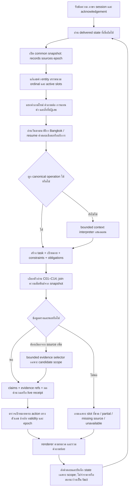
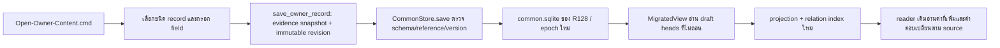

# R128 — Flow กลางที่นำไปทำจริง

วันที่จัดทำ: 24 ตุลาคม 2569 · ขอบเขต: แก้ 14 กลุ่มสาเหตุใน R127 และเชื่อม C01–C14 เข้ากับบริบท ตัวอ่าน ตัวตรวจ และรูปแบบคำตอบร่วมกัน

## 1. สิ่งที่คำว่า “ครบ” หมายถึงในงานนี้

ครบคือรายการพัฒนาใน `IMPLEMENTATION_PLAN_TH.md` มีโค้ดอยู่ในเส้นทางที่ API เรียกจริง มีการตรวจข้อต่อ และส่งมอบแชทกับหน้าเพิ่มข้อมูลที่อ่านฐานเดียวกัน ไม่ใช้การมีไฟล์โมดูลหรือ HTTP 200 เป็นหลักฐานว่าตอบถูก

ไม่ได้หมายความว่าภาษาธรรมชาติทุกสำนวนจะถูก 100% หรือข้อมูลทุกช่องมีข้อเท็จจริงยืนยันแล้ว ตัวอ่านแบบ compatibility ที่ยังมีประโยชน์ยังอยู่ แต่ต้องผ่านตัวผูกบริบทก่อนเช่นกัน ไม่ใช้ legacy เป็นฐานคำตอบสำรองโดยซ่อนจากผู้ใช้

## 2. เปรียบเทียบกับเดิม

| ส่วน | Legacy ที่นำมาอ้างอิง | R125 ก่อนแก้ | R128 |
|---|---|---|---|
| ประวัติ | เติมเกม/บริการ/กลุ่ม/เวลาให้คำถามก่อนเลือกตัวตอบ | history มี แต่บาง domain จบก่อนตัวช่วยบริบทด้านล่าง | resolve กลางก่อนเส้นทาง domain และ compatibility |
| เจตนา | parser และเครื่องมือเฉพาะหมวดช่วยกัน | บางโจทย์ชัดเจนยังผ่านโมเดล | canonical operation ที่พิสูจน์ scope ได้ก่อนโมเดล |
| ข้อมูล | ตัวอ่านเฉพาะโครงสร้างเดิม | common facts และความสัมพันธ์ แต่ binding/selection บางจุดแคบเกิน | common snapshot เดิม + binding ที่รักษาหลายเป้าหมาย + relation joins |
| คำนวณ | เครื่องมือคำนวณเฉพาะ | ข้อมูลมี แต่ slot/จำนวนคนอาจตกหล่น | อ่าน rate/หน่วย/ช่วงเวลาแล้วคำนวณ Decimal; เก็บจำนวนคนแต่ละกลุ่มใน state |
| Live | WordPress และ parser ช่วงเวลา | เชื่อมแล้ว แต่การตามเครื่อง/วัน/เวลาไม่ครบ | native binding + exact resource + วัน/ช่วงเวลา + freshness/mapping checks |
| ตรวจคำตอบ | หลาย guard เฉพาะเส้นทาง | citation ถูกแต่ยังตอบไม่ครบเป้าหมายได้ | ตรวจ claims และ obligations ของทุกเป้าหมาย/การกระทำ |
| หน้าตาคำตอบ | formatter ตามหมวด | บางเส้นทางต่อข้อความยาว | รายการเกมตามแพลตฟอร์ม ตารางปุ่ม ขั้นตอนเลขลำดับ ราคาตามกลุ่ม |
| เพิ่มข้อมูล | ต้องเข้ารูปแบบเดิม | owner editor มี แต่แยก installation ได้ | editor R128 ชี้ SQLite เดียวกับแชท; save → epoch ใหม่ → index ใหม่ |

Legacy ไม่ใช่ oracle ที่ถูกทุกข้อ ผลเปรียบเทียบ R127 มีข้อผิดพลาดและ transport confound ของ legacy ด้วย จึงยืมวิธีจัดเส้นทางและผูกบริบท ไม่คัดลอกทุกคำตอบเป็นความจริง

## 3. Flow รวม

## 4. บริบทและ state

`dialogue_task.py` อยู่ก่อน `_answer_unified` ใน CommonAnswerer จึงไม่ขึ้นกับว่าคำถามสุดท้ายจะเข้า domain reader หรือตัวอ่านเดิมที่ยังใช้ร่วมกัน

### 4.1 สิ่งที่เก็บ

- release, game IDs, entity IDs, platform และ audience IDs ที่ตรวจว่ายังอยู่ใน snapshot
- ระยะเวลารวม จำนวนคนแยกกลุ่ม ช่วงเหมา วัน และช่วงเวลา live
- เครื่องที่ถาม คำปฏิเสธ และขอบเขตสิทธิ์ภายนอกที่ยังไม่ระบุกลุ่มอายุ/นักศึกษา
- ลำดับตัวเลือกที่ส่งจริงสำหรับ “อันที่สอง”
- focus กับ slot ที่ยืมจากประวัติ และ execution question หลังผูกบริบท

### 4.2 กติกา

1. ใช้ state ของคำตอบที่ `server_written` หรือ `client_acknowledged` เท่านั้น
2. แทนเฉพาะ slot ที่ผู้ใช้เปลี่ยน เช่น PC → PS5 โดยรักษากลุ่มและเวลา
3. จำนวนผู้เล่นแต่ละกลุ่มต้องเดินทางไปพร้อม audience ID ไม่เอาจำนวนรวมไปคูณทุกกลุ่ม
4. คำถามปุ่มใหม่ไม่ถูก task ราคาก่อนหน้าดึงกลับไปตอบราคา
5. การเปลี่ยนเรื่องตัด scope ที่ไม่เกี่ยวข้อง ส่วนสรรพนาม “เกมนี้” อาจย้อนหาเกมล่าสุดที่ระบุชัดได้
6. หาก referent มีหลายตัวหรือ ordinal ไม่ผูกกับรายการที่ส่งจริง ให้ถามกลับ
7. อ่าน facts ใหม่ทุกครั้งจาก snapshot ไม่เอาข้อความตอบเก่ามาตั้งเป็น source
8. source ถูกแก้หรือถอนแล้ว index ใช้ epoch ใหม่ ข้อมูลที่ถอนต้องไม่หลุดกลับมาจาก cache

### 4.3 ตัวอย่าง

- God of War → โซนไหน → R2: รักษา game identity ข้าม C04/C05
- PC บุคคลทั่วไป 1 ชั่วโมง → สองชั่วโมง → PS5: รักษากลุ่ม เปลี่ยนเวลา แล้วเปลี่ยนบริการ
- PSU 1 คน + บุคคลทั่วไป 2 คน → เพิ่มเวลา: รักษาจำนวนคนแยกกลุ่ม
- PC2 วันที่ 27 เวลา 15:00–16:00 → PC3: เปลี่ยนเครื่อง แต่รักษาวัน/ช่วงเวลา
- วันที่ 15 เปิดไหม → พฤศจิกายน: resume pending day/month ไม่ถามโจทย์ใหม่ทั้งหมด

## 5. Flow แต่ละหมวด

| หมวด | สิ่งที่ต้องเข้าใจก่อนอ่าน | เส้นทางข้อมูลและคำตอบ | กรณีไม่ควรสรุปเอง |
|---|---|---|---|
| C01 ศูนย์/ติดต่อ | ศูนย์ อาคาร ชั้น แผนที่ ช่องทางติดต่อ หรือ facility ใด | center/contact/facility → field ที่ถาม → บรรทัดสั้นพร้อม source | สถานที่ชื่อใหม่ที่ไม่ได้อยู่ใน source ไม่แทนด้วยที่อยู่ศูนย์ |
| C02 บุคลากร | คน → ตำแหน่ง หรือ ตำแหน่ง → คน และช่วงข้อมูล | person + public_scope → role/team/period → รายชื่อหรือบทบาท | ห้ามเปิดข้อมูลที่ public scope ยังไม่ยืนยัน; ตำแหน่งซ้ำต้องไม่เลือกคนหนึ่งแบบสุ่ม |
| C03 อุปกรณ์ | รุ่น สเปก ชิ้นส่วน ที่ตั้ง จำนวน หรือรายการในโซน | equipment_model/resource/zone → specs หรือ inventory ที่ผูกโซน → รายการ/สเปก | จำนวนเก้าอี้ ความจุเครื่อง และผู้เล่นต่อเกมเป็นคนละอย่าง |
| C04 เกม | รายการ/จำนวน/รายละเอียด/แพลตฟอร์ม/บริการ/โซน/จำนวนผู้เล่น | game → game_service → service → resource → zone; โหมดอ่าน game_mode | ไม่เอาความจุ Nintendo service มาเป็นจำนวนผู้เล่นของทุกเกม; ไม่รวมคนละ edition เอง |
| C05 ปุ่ม | เกม แพลตฟอร์ม preset และถาม action หรือ button | control_set → bindings → exact chord/action → ตารางหรือคำตอบปุ่มเดียว | แหล่งรองหรือผังไม่ครบยังต้องมีข้อจำกัด; ไม่เลือก L2 แทน R2 เพราะ top-K ตัด R2 ทิ้ง |
| C06 ราคาเล่น | บริการ กลุ่มคน ระยะเวลา จำนวนคน/รอบ และหน่วยบิล | rate relation → validity/confirmation → Decimal arithmetic → ราคาแยกกลุ่ม/ยอดรวม | คนนอกไม่เท่ากับ adult เสมอ; ไม่ extrapolate หาก rule ไม่อนุญาต |
| C07 เหมา | โซน หน่วยงานภายใน/ภายนอก ครึ่งวัน/เต็มวัน และเงื่อนไขแพ็กเกจ | rental_package → amount/duration/equipment/terms → แพ็กเกจตามกลุ่ม | ค่าเหมาไม่ใช่ราคาต่อชั่วโมงบุคคล; มัดจำ/OT ที่ไม่ได้ระบุไม่แต่งเพิ่ม |
| C08 จอง | จองใหม่ เช็กอิน เปลี่ยน ยกเลิก ต่อเวลา หรือหลักฐาน | canonical policy action/procedure → ordered steps/conditions → ขั้นตอนเลขลำดับ | ขั้นตอนหลายฉบับที่มีเงื่อนไขต่างกันห้ามเอามารวมจนเงื่อนไขหาย |
| C09 ชำระเงิน | ใครจ่าย จ่ายขาด/เกิน สลิป คืนเงิน หรือใบเสร็จ | policy intent + source clauses → ตอบเฉพาะกรณี | ไม่ขยายเงินคงเหลือเป็นสิทธิ์คืนเงินหรือกำหนดหมดอายุเอง |
| C10 กฎศูนย์ | นำเข้า/บริโภค ชนิดอุปกรณ์ บุคคล สถานที่ หรือ capture ในเกม | policy/owner FAQ + เงื่อนไข/ข้อยกเว้น → คำตอบ scope ตรง | สิทธิ์ capture ในเกมไม่เท่ากับถ่ายบุคคล/สถานที่; ข้อกำหนดที่ยัง unknown ไม่เป็น permission |
| C11 วัน/เวลา | วันตามปฏิทิน ช่วงเล่น ช่วงจอง หรือซ่อมบำรุง | Bangkok clock → date arithmetic → schedule.service_periods + closure precedence | ไม่ถือ open_periods ที่ขัดแย้งว่าเป็นช่วงเล่น; ตารางไม่พิสูจน์เครื่องว่าง |
| C12 สถานะสด | เครื่อง/กลุ่มบริการ วัน จุดเวลาหรือช่วงต่อเนื่อง | live_binding → native resource mapping → WordPress snapshot → freshness/date/status/window checks | provider ล้ม ข้อมูลเก่า รหัสเครื่องไม่ตรง หรือ mapping หาย ไม่แปลว่าว่าง |
| C13 แข่งขัน | เกม รายการ ปี หมวดข้อกฎ และ clause ที่ถาม | competition + competition_rule → scoped clauses + dependencies/family enumeration | ไม่ใช้กฎศูนย์แทนกติกาแข่งขัน; heading อย่างเดียวไม่ผ่านคำถามสิทธิ์/สถานที่ |
| C14 ข่าว/กิจกรรม | กิจกรรม/ช่วงปี/วัน/ลงทะเบียน และ source จริง | projection ของข้อมูลประกาศที่มี → ขอบเขตเนื้อหา/วัน/ลิงก์ที่บันทึก | ไม่มี feed ข่าวปัจจุบันก็ไม่อ้างว่ารายการครอบคลุมทุกกิจกรรมล่าสุด |

## 6. การแยกเจตนาและเลือกข้อมูล

### 6.1 ไม่บังคับให้ LLM ทำสิ่งที่พิสูจน์จากโครงสร้างได้แล้ว

native intent frame สร้าง operation เช่น `policy.booking_steps`, `policy.checkin_documents`, `policy.capture`, ราคาแบบมี slot ชัด, exact controls, calendar, inventory และกติกาที่ผูก clause ได้ จากนั้น reader รับ operation นี้ตรง ๆ ไม่เดาความหมายจากประโยคดิบซ้ำอย่างเดียว

คำถามที่ยังต้องตีความใช้ R121 context adapter เดิม โดยส่ง execution question ที่ผูกบริบทแล้ว เก็บ hash และตรวจ identity ของคำตอบโมเดล แผนโมเดลเป็นเพียงข้อเสนอ ไม่เป็นหลักฐานนโยบายหรือราคา

หลายความต้องการถูกแยกเป็น task แล้วตรวจแต่ละ task ต้องไม่ทำคำถาม “ปุ่ม Tekken และราคา PC” หายไปหนึ่งเรื่อง ตัวแยกมีทั้ง source frames และโมเดลสำหรับสำนวนที่ไม่เข้า frame ไม่ได้อ้างว่า regex จัดการทุกภาษาได้

### 6.2 Binding

Longest alias ใช้ตัดเฉพาะช่วงตัวอักษรที่ทับกัน เช่นคำยาวครอบคำสั้น ไม่ตัด PC ทิ้งเพียงเพราะมี PlayStation 5 ซึ่งชื่อยาวกว่าในอีกช่วงหนึ่ง ส่วน edition ใช้ exact folded full-title identity ไม่ลบคำว่า Part/Remastered ออกเพื่อบังคับให้เท่ากัน

### 6.3 Selection

ปุ่มและ action ที่ตรงอ่านก่อน bounded selector; pool เพิ่มเป็น 24 สำหรับกรณีต้องเลือก แต่เพิ่ม K อย่างเดียวไม่ใช่วิธีแก้หลัก กติกาอ่าน clause เต็มและ dependency ที่เกี่ยวข้อง บทลงโทษรวมต้อง enumerate family ไม่ตอบแค่ Intent/Impact

## 7. Date และ live เป็นคนละชั้น

1. เวลาอ้างอิงเป็นนาฬิกาจริง Asia/Bangkok ไม่ใช้วันที่ฝังไว้ใน test
2. แปลงเลขไทย/เลขคำที่เป็นหน่วย แต่ไม่แก้เลขในชื่อเกมหรือคำว่า “ครึ่งวัน” ของแพ็กเกจ
3. รองรับเดือนอังกฤษ วันจันทร์หน้า อีกสามวัน และปี พ.ศ./ค.ศ. ตามตัวอ่านที่กำหนด
4. วันที่ล้วนที่ยังไม่ผ่านในเดือนปัจจุบันใช้เดือนปัจจุบัน; วันที่ผ่านไปแล้วถามเดือนตามคำขอผู้ใช้
5. เดือนที่ตอบกลับไปผูก pending day; วันที่ไม่มีจริงต้องถามกลับ ไม่เลื่อนไปเดือนถัดไป
6. แยก clock range ออกจากข้อความวันที่ก่อนเรียก date parser เพื่อไม่อ่าน `00-16` เป็นวัน/เดือน
7. วันเปิดอ่าน schedule กับ special closure; live vacancy ต้องเรียก provider อีกชั้นหนึ่ง
8. Live binding มีอยู่จริงใน common DB และ native bridge เรียก WordPress แบบเดียวกับเส้นทางเดิม ตรวจ exact machine, date, freshness, transport, status mapping และช่วงว่างต่อเนื่อง
9. วันถัดไปที่ไม่ระบุเวลาอ่านรอบทั้งวัน ไม่เอาเวลาปัจจุบันไปเป็นจุดเวลาของวันนั้นโดยอัตโนมัติ

ไม่ต้องใช้ API ภายนอกเพื่อคำนวณว่าวันที่เป็นวันอะไร การคำนวณวันเป็น deterministic calendar ส่วนข้อมูลเปิดบริการและสถานะจองมาจาก source/WordPress ตามชนิดคำถาม

## 8. ตรวจคำตอบก่อนส่ง

- claim ทุกตัวต้องอยู่ใน category/source scope ที่ผูกไว้ และมี evidence refs ที่ตรวจได้
- ตัวเลขต้องมาจาก field หรือ computation ที่มีฐานคำนวณ ไม่ใช่ข้อความโมเดล
- เป้าหมายที่ระบุครบทุกตัวต้องมีคำตอบหรือสถานะขาดข้อมูลของตัวเอง เช่น PC + PS5 ห้ามตรวจเฉพาะ PS5 แล้วสรุปครบ
- ปุ่มที่เลือกต้องตอบ action ที่ถามและรักษา chord/modifier
- ทัวร์นาเมนต์/ปีต้องตรง; คำถาม “ได้ไหม/ที่ไหน” ต้องมี clause เนื้อหา ไม่ใช่แค่ชื่อหัวข้อ
- ราคาแยก validity, การยืนยันล่าสุด และขอบเขตปีออกจากกัน
- ภาพรวมมีสิทธิ์เป็น partial แม้ทุก citation ที่ส่งจะถูก เพราะยังมีเป้าหมายหรือเงื่อนไขที่ขาด
- source epoch เปลี่ยนระหว่างตอบต้องไม่ส่ง claim จาก snapshot ที่หมดอายุอย่างเงียบ ๆ

## 9. การจัดรูปแบบ

- เกม: หัวข้อแพลตฟอร์ม จำนวนที่นับได้ รายการเกม และหมายเหตุเมื่อเครื่องในแพลตฟอร์มเดียวกันมีเกมต่างกัน
- ปุ่ม: ตาราง Input/Action พร้อมข้อจำกัดของต้นฉบับ ไม่ทำให้คำเตือนแหล่งรองหาย
- จอง: หัวข้อเดียว ขั้นตอนเรียงลำดับ ไม่แสดงข้อความเทียบเท่าสองรอบ
- ราคา: กลุ่มและบริการชัดเจน แยกบรรทัดจำนวนคนกับยอดรวม; ทางเลือกไม่ถูกบวกเป็นยอดรวมทั้งหมด
- วันเปิด: ขึ้นวัน/วันที่ และเปิดหรือปิดก่อนรายละเอียด
- source draft/private: แสดง descriptor ของหลักฐานได้ แต่ไม่เปลี่ยนให้เป็นอนุมัติ และไม่เผย path ภายในเป็น public link

## 10. เพิ่ม/แก้ข้อมูลอย่างไรให้แชทอ่านได้

หน้า owner กับแชทต้องใช้ `system/data/knowledge/common.sqlite` ของ R128 เดียวกัน ตรวจเส้นทางนี้จาก authenticated API แล้ว ไม่ใช่แค่เปิดหน้า UI ได้

### กรอกตามชนิดคำตอบ

- FAQ/นโยบาย: คำถาม คำตอบ intent/aliases และเงื่อนไขที่ยืนยัน อย่ารวมสิทธิ์คนละเรื่องไว้ในคำตอบเดียว
- เกม: game record แล้ว game_service ที่ชี้บริการ; จะตอบโซนต้องมี service → resource → zone ครบ
- จำนวนผู้เล่นเกม: game_mode ระบุเกม แพลตฟอร์ม mode_name min/max และ studio_supported โดยมีหลักฐานจริง
- ราคา: service/audience/duration/หน่วย/จำนวนเงิน/calculation_rule/validity ไม่ใส่เป็นตัวเลขลอยใน FAQ แทนความสัมพันธ์ทั้งหมด
- ปุ่ม: control_set ผูกเกม แพลตฟอร์ม bindings และ source_coverage; ปุ่มที่เจ้าของยังไม่ตรวจให้คงสถานะนั้น
- จอง: procedure มี steps/preconditions/documents/deadline หรือ FAQ intent ที่เฉพาะกรณี
- Live: ใช้ live_binding กับ provider resource ID จริง ไม่ใส่สถานะว่างถาวรเป็นข้อมูล static

การเพิ่ม FAQ อุปกรณ์ และโหมดเกมผ่าน CommonStore.save รวมถึงแก้/ถอน ถูกตรวจในฐานทดสอบแยก ไม่ได้ใส่ fixtures ลงฐานจริง การเพิ่มเนื้อหาในชนิด/field ที่ระบบรองรับไม่ต้องเพิ่ม parser ใหม่ทุก record แต่ operation ใหม่หรือเงื่อนไขธุรกิจชนิดใหม่ยังอาจต้องขยาย schema/reader ไม่สัญญาว่าใส่ข้อความอิสระอะไรก็รองรับตรรกะใหม่เองทั้งหมด

### Draft กับ published

แชท R128 ที่ส่งมอบยังเป็น draft preview การ save จึงนำข้อมูลล่าสุดที่ไม่ถอนมาใช้ตรวจได้ การเผยแพร่จริงต้องใช้ review/publish ตามระบบ owner เดิม งานนี้ไม่เปลี่ยน approvals และไม่ติดตั้งทับ R78

## 11. Model และความเร็ว

น้ำหนัก base และ adapter ยังเป็นชุดเดิม ไม่ฝึกใหม่ในงานนี้ backend R128 รับบริบทที่แอป resolve แล้ว เคารพ num_predict และ timeout รวมเวลารอคิว พร้อม provenance/hash การซ้ำคำถามใช้ cache ของ interpretation ที่ผูก index snapshot ไม่ cache ราคาหรือ live answers เป็นข้อเท็จจริงถาวร

ยังใช้ GPU เดียวและ generation lock; คำถามที่จำเป็นต้อง inference มีเวลารอได้ ความเร็วที่ดีขึ้นมาจากการลด round trip ที่ไม่จำเป็นและแก้การเลือกเส้นทาง ไม่ใช่การยืนยันว่าโมเดลตอบทุกอย่างได้ทันที

## 12. หลักฐานและการใช้งาน

- `DELIVERY_REPORT_TH.md`: ผลตรวจจริง ขอบเขตที่ผ่าน และข้อจำกัดที่ยังเป็น source gap
- `ALL_RESPONSES_TH.md`: คำถาม/คำตอบเต็มทุก turn จากรอบส่งมอบ พร้อม log path
- `EVIDENCE.json`: จำนวน request สถิติและผล gate ที่ตรวจจากไฟล์
- `FINAL_RUN.json`: รอบตรวจรับรวมและ source unchanged
- `Start-R128.cmd`: เปิด/reuse local model และแชท candidate
- `Open-Owner-Content.cmd`: เปิดแบบฟอร์มเพิ่ม/แก้ข้อมูลของ candidate เดียวกัน

สคริปต์ `patch_*.py` เก็บประวัติการพัฒนา ไม่ใช่ installer ที่ควรรันซ้ำ ระบบที่นำไปใช้งานคือ source ที่ตรวจและ freeze แล้วใน `system` กับ launchers ข้างต้น
