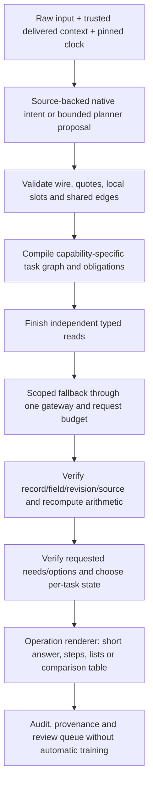

# สถานะเทียบ Flow ใหญ่ต้นฉบับ R129

## ขอบเขต

ใช้เอกสารต้นฉบับ R123 ที่ตรึงไว้ใน spec/ รวม P0–P8, R00–R12 และ C01–C14 ไม่มีการลดขอบเขตให้เหลือเฉพาะเคสตัวอย่างของ R128

จำนวนหัวข้อในตารางเป็นรายการตรวจรับ ไม่ใช่เปอร์เซ็นต์ความแม่นยำหรือเปอร์เซ็นต์งานเสร็จ การมี module ไม่เท่ากับผ่านการตรวจรับ

## สถานะรอบนี้

- ฝึกน้ำหนักใหม่เสร็จและมี optimization proof: True
- เปรียบเทียบสามแขนเสร็จ: False
- Full Test 20,554 keys / 55,811 grades ตรวจ coverage แล้ว: False
- Root cause review หลัง Full Test เสร็จ: False

รอบฝึกแรกไม่ถูกนำมาตรวจรับ เพราะพบ original family ข้าม train/validation เก็บไว้ที่ train01/NOT_ACCEPTED_SPLIT_REVIEW.json รอบที่ใช้จริงคือ training_v2/ ซึ่งรวม semantic family กับ original multilingual/core family แบบ transitive union แล้ว

## แผนที่ข้อกำหนดครบทุกหัวข้อ

| ข้อกำหนด | สถานะหลักฐาน | โค้ด/เอกสารที่ตรวจได้ |
|---|---|---|
| FLOW-01 1. เป้าหมายและสิ่งที่ต้องแก้ให้ตรงจุด | evaluation_pipeline_prepared_not_yet_complete | `EVALUATION_PROTOCOL.json`, `EVALUATION_GATE_ADDENDUM.json`, `compare_planners_v2.py` |
| FLOW-02 2. ภาพรวมสาม Flow ที่ต้องทำงานร่วมกัน | evaluation_pipeline_prepared_not_yet_complete | `EVALUATION_PROTOCOL.json`, `EVALUATION_GATE_ADDENDUM.json`, `compare_planners_v2.py` |
| FLOW-04 D01 — รับข้อมูลเป็น record ที่มีชนิดและขอบเขต | implementation_present_acceptance_pending | `system/app/knowledge/common/registry.py`, `system/app/knowledge/common/store.py`, `system/app/knowledge/common/migrated_view.py` |
| FLOW-05 D02 — ตรวจข้อมูลก่อนสร้าง index | implementation_present_acceptance_pending | `system/app/knowledge/common/registry.py`, `system/app/knowledge/common/store.py`, `system/app/knowledge/common/migrated_view.py` |
| FLOW-06 D03 — แยกความถูกต้องเชิงโครงสร้างจากสิทธิ์เผยแพร่ | implementation_present_acceptance_pending | `system/app/knowledge/common/registry.py`, `system/app/knowledge/common/store.py`, `system/app/knowledge/common/migrated_view.py` |
| FLOW-07 D04 — Compile snapshot และ capability catalog | implementation_present_acceptance_pending | `system/app/knowledge/common/registry.py`, `system/app/knowledge/common/store.py`, `system/app/knowledge/common/migrated_view.py` |
| FLOW-09 R00 — รับคำถามและ pin request context | implementation_present_acceptance_pending | `system/app/knowledge/common/flow_context.py`, `system/app/knowledge/common/domain_flow/dialogue_task.py`, `system/app/knowledge/common/domain_flow/request_provenance.py` |
| FLOW-10 R01 — โมเดลเสนอแผนงานที่มีโครงสร้าง | implementation_present_acceptance_pending | `system/app/knowledge/common/domain_flow/graph_protocol.py`, `system/app/knowledge/common/domain_flow/understanding.py`, `system/app/knowledge/common/domain_flow/meaning_review.py` |
| FLOW-11 R02 — ตรวจโครงสร้างและข้อความอ้าง | implementation_present_acceptance_pending | `system/app/knowledge/common/domain_flow/graph_protocol.py`, `system/app/knowledge/common/domain_flow/understanding.py`, `system/app/knowledge/common/domain_flow/meaning_review.py` |
| FLOW-12 R03 — ผูก local slots และ shared context | implementation_present_acceptance_pending | `system/app/knowledge/common/domain_flow/context_guard.py`, `system/app/knowledge/common/domain_flow/context_bindings.py`, `system/app/knowledge/common/domain_flow/plan_contract.py` |
| FLOW-13 R04 — Resolve entities และตรวจ semantics | implementation_present_acceptance_pending | `system/app/knowledge/common/domain_flow/context_guard.py`, `system/app/knowledge/common/domain_flow/context_bindings.py`, `system/app/knowledge/common/domain_flow/plan_contract.py` |
| FLOW-14 R05 — สร้าง obligation ledger และ task graph | implementation_present_acceptance_pending | `system/app/knowledge/common/domain_flow/context_guard.py`, `system/app/knowledge/common/domain_flow/context_bindings.py`, `system/app/knowledge/common/domain_flow/plan_contract.py` |
| FLOW-15 R06 — ตรวจว่า executor ทำ operation นี้ได้จริง | implementation_present_acceptance_pending | `system/app/knowledge/common/domain_flow/executor_registry.py`, `system/app/knowledge/common/domain_flow/capabilities.py`, `system/app/knowledge/common/domain_flow/engine.py` |
| FLOW-16 R07 — อ่านทุกงานที่ทำแบบ deterministic ได้ก่อน | implementation_present_acceptance_pending | `system/app/knowledge/common/domain_flow/executor_registry.py`, `system/app/knowledge/common/domain_flow/capabilities.py`, `system/app/knowledge/common/domain_flow/engine.py` |
| FLOW-17 R08 — จัดการช่องว่างและ model fallback แบบจำกัด | implementation_present_acceptance_pending | `system/app/knowledge/common/domain_flow/model_gateway.py`, `system/app/knowledge/common/flow_context.py` |
| FLOW-18 R09 — ตรวจหลักฐาน ขอบเขต และความครบ | implementation_present_acceptance_pending | `system/app/knowledge/common/domain_flow/obligation_verifier.py`, `system/app/knowledge/common/domain_flow/native_contract.py`, `system/app/knowledge/common/domain_flow/result_contract.py` |
| FLOW-19 R10 — เลือกสถานะต่อ task และต่อคำตอบ | implementation_present_acceptance_pending | `system/app/knowledge/common/domain_flow/obligation_verifier.py`, `system/app/knowledge/common/domain_flow/native_contract.py`, `system/app/knowledge/common/domain_flow/result_contract.py` |
| FLOW-20 R11 — จัดคำตอบจาก claims ที่ผ่านแล้ว | implementation_present_acceptance_pending | `system/app/knowledge/common/domain_flow/customer_render.py`, `system/app/knowledge/common/domain_flow/engine.py` |
| FLOW-21 R12 — เก็บ audit และ regression case | implementation_present_acceptance_pending | `system/app/knowledge/common/domain_flow/obligation_verifier.py`, `system/app/knowledge/common/domain_flow/native_contract.py`, `system/app/knowledge/common/domain_flow/result_contract.py` |
| FLOW-22 5. Executor ทั้ง 14 หมวด | implementation_present_acceptance_pending | `system/app/knowledge/common/domain_flow/executor_registry.py`, `system/app/knowledge/common/domain_flow/capabilities.py`, `system/app/knowledge/common/domain_flow/engine.py` |
| C01 C01 ข้อมูลศูนย์/ติดต่อ | implementation_present_acceptance_pending | `system/app/knowledge/common/domain_flow/executor_registry.py`, `system/app/knowledge/common/domain_flow/capabilities.py`, `system/app/knowledge/common/domain_flow/engine.py` |
| C02 C02 บุคลากร | implementation_present_acceptance_pending | `system/app/knowledge/common/domain_flow/executor_registry.py`, `system/app/knowledge/common/domain_flow/capabilities.py`, `system/app/knowledge/common/domain_flow/engine.py` |
| C03 C03 อุปกรณ์ | implementation_present_acceptance_pending | `system/app/knowledge/common/domain_flow/executor_registry.py`, `system/app/knowledge/common/domain_flow/capabilities.py`, `system/app/knowledge/common/domain_flow/engine.py` |
| C04 C04 เกม | implementation_present_acceptance_pending | `system/app/knowledge/common/domain_flow/executor_registry.py`, `system/app/knowledge/common/domain_flow/capabilities.py`, `system/app/knowledge/common/domain_flow/engine.py` |
| C05 C05 การควบคุม | implementation_present_acceptance_pending | `system/app/knowledge/common/domain_flow/executor_registry.py`, `system/app/knowledge/common/domain_flow/capabilities.py`, `system/app/knowledge/common/domain_flow/engine.py` |
| C06 C06 ราคาปกติ | implementation_present_acceptance_pending | `system/app/knowledge/common/domain_flow/executor_registry.py`, `system/app/knowledge/common/domain_flow/capabilities.py`, `system/app/knowledge/common/domain_flow/engine.py` |
| C07 C07 ราคาเหมา | implementation_present_acceptance_pending | `system/app/knowledge/common/domain_flow/executor_registry.py`, `system/app/knowledge/common/domain_flow/capabilities.py`, `system/app/knowledge/common/domain_flow/engine.py` |
| C08 C08 การจอง | implementation_present_acceptance_pending | `system/app/knowledge/common/domain_flow/executor_registry.py`, `system/app/knowledge/common/domain_flow/capabilities.py`, `system/app/knowledge/common/domain_flow/engine.py` |
| C09 C09 การชำระเงิน | implementation_present_acceptance_pending | `system/app/knowledge/common/domain_flow/executor_registry.py`, `system/app/knowledge/common/domain_flow/capabilities.py`, `system/app/knowledge/common/domain_flow/engine.py` |
| C10 C10 กฎศูนย์ | implementation_present_acceptance_pending | `system/app/knowledge/common/domain_flow/executor_registry.py`, `system/app/knowledge/common/domain_flow/capabilities.py`, `system/app/knowledge/common/domain_flow/engine.py` |
| C11 C11 ตาราง | implementation_present_acceptance_pending | `system/app/knowledge/common/domain_flow/executor_registry.py`, `system/app/knowledge/common/domain_flow/capabilities.py`, `system/app/knowledge/common/domain_flow/engine.py` |
| C12 C12 สถานะจริง | implementation_present_acceptance_pending | `system/app/knowledge/common/domain_flow/executor_registry.py`, `system/app/knowledge/common/domain_flow/capabilities.py`, `system/app/knowledge/common/domain_flow/engine.py` |
| C13 C13 กติกาแข่งขัน | implementation_present_acceptance_pending | `system/app/knowledge/common/domain_flow/executor_registry.py`, `system/app/knowledge/common/domain_flow/capabilities.py`, `system/app/knowledge/common/domain_flow/engine.py` |
| C14 C14 ข่าว/กิจกรรม | implementation_present_acceptance_pending | `system/app/knowledge/common/domain_flow/executor_registry.py`, `system/app/knowledge/common/domain_flow/capabilities.py`, `system/app/knowledge/common/domain_flow/engine.py` |
| FLOW-23 6. Flow Distillation ที่ใช้เป็นแกนฝึก planner | training_and_review_evidence_present | `training_v2/ANNOTATION_REVIEW_SUMMARY.json`, `training_v2/DATASET_FREEZE.json`, `training_v2/train01/PROGRESS.json` |
| FLOW-24 สิ่งที่สอน | training_and_review_evidence_present | `training_v2/ANNOTATION_REVIEW_SUMMARY.json`, `training_v2/DATASET_FREEZE.json`, `training_v2/train01/PROGRESS.json` |
| FLOW-25 สิ่งที่อ่านจาก source ตอนตอบ | implementation_present_acceptance_pending | `system/app/knowledge/common/registry.py`, `system/app/knowledge/common/store.py`, `system/app/knowledge/common/migrated_view.py` |
| FLOW-26 สิ่งที่ต้องระวัง | training_and_review_evidence_present | `training_v2/ANNOTATION_REVIEW_SUMMARY.json`, `training_v2/DATASET_FREEZE.json`, `training_v2/train01/PROGRESS.json` |
| FLOW-27 7. ตัวอย่างจากคำถามเดิม: เป้าหมายของ Flow นี้ | reference_section_retained | `spec/FLOW_MAIN_TH.md` |
| FLOW-28 8. จุดที่ต้องผ่านก่อนถือว่า Flow พร้อม | evaluation_pipeline_prepared_not_yet_complete | `EVALUATION_PROTOCOL.json`, `EVALUATION_GATE_ADDENDUM.json`, `compare_planners_v2.py` |
| FLOW-29 9. สิ่งที่ได้ในงานวาง Flow รอบนี้ | reference_section_retained | `spec/FLOW_MAIN_TH.md` |
| CONTRACT-01 1. หลักการร่วม | implementation_present_acceptance_pending | `system/app/knowledge/common/registry.py`, `system/app/knowledge/common/store.py`, `system/app/knowledge/common/migrated_view.py` |
| CONTRACT-02 2. RequestContext | implementation_present_acceptance_pending | `system/app/knowledge/common/flow_context.py`, `system/app/knowledge/common/domain_flow/dialogue_task.py`, `system/app/knowledge/common/domain_flow/request_provenance.py` |
| CONTRACT-03 3. PlannerProposal | implementation_present_acceptance_pending | `system/app/knowledge/common/domain_flow/graph_protocol.py`, `system/app/knowledge/common/domain_flow/understanding.py`, `system/app/knowledge/common/domain_flow/meaning_review.py` |
| CONTRACT-04 4. Task และ vocabulary ของ operation | implementation_present_acceptance_pending | `system/app/knowledge/common/domain_flow/executor_registry.py`, `system/app/knowledge/common/domain_flow/capabilities.py`, `system/app/knowledge/common/domain_flow/engine.py` |
| CONTRACT-05 5. Slot: มีทั้งบทบาทและเจ้าของ | implementation_present_acceptance_pending | `system/app/knowledge/common/domain_flow/context_guard.py`, `system/app/knowledge/common/domain_flow/context_bindings.py`, `system/app/knowledge/common/domain_flow/plan_contract.py` |
| CONTRACT-06 6. SharedBinding | implementation_present_acceptance_pending | `system/app/knowledge/common/domain_flow/context_guard.py`, `system/app/knowledge/common/domain_flow/context_bindings.py`, `system/app/knowledge/common/domain_flow/plan_contract.py` |
| CONTRACT-07 7. ตัวอย่างแผนเชิงโครงสร้างจากคำถาม VR เดิม | reference_section_retained | `spec/DATA_CONTRACTS_TH.md` |
| CONTRACT-08 8. Capability และ ExecutorResult | implementation_present_acceptance_pending | `system/app/knowledge/common/domain_flow/executor_registry.py`, `system/app/knowledge/common/domain_flow/capabilities.py`, `system/app/knowledge/common/domain_flow/engine.py` |
| CONTRACT-09 9. EvidenceReceipt และ CalculationReceipt | implementation_present_acceptance_pending | `system/app/knowledge/common/domain_flow/obligation_verifier.py`, `system/app/knowledge/common/domain_flow/native_contract.py`, `system/app/knowledge/common/domain_flow/result_contract.py` |
| CONTRACT-10 10. AuthorityResolution | implementation_present_acceptance_pending | `system/app/knowledge/common/domain_flow/authority_resolution.py`, `system/app/knowledge/common/claim_bindings.py` |
| CONTRACT-11 11. ObligationLedger และ VerifierResult | implementation_present_acceptance_pending | `system/app/knowledge/common/domain_flow/obligation_verifier.py`, `system/app/knowledge/common/domain_flow/native_contract.py`, `system/app/knowledge/common/domain_flow/result_contract.py` |
| CONTRACT-12 12. Terminal states และข้อความถึงผู้ใช้ | implementation_present_acceptance_pending | `system/app/knowledge/common/domain_flow/obligation_verifier.py`, `system/app/knowledge/common/domain_flow/native_contract.py`, `system/app/knowledge/common/domain_flow/result_contract.py` |
| CONTRACT-13 13. ModelGateway และ BudgetLedger | implementation_present_acceptance_pending | `system/app/knowledge/common/domain_flow/model_gateway.py`, `system/app/knowledge/common/flow_context.py` |
| CONTRACT-14 Wire format เทียบกับ internal plan | reference_section_retained | `spec/DATA_CONTRACTS_TH.md` |
| CONTRACT-15 14. TrainingExample และ ReviewRecord | training_and_review_evidence_present | `training_v2/ANNOTATION_REVIEW_SUMMARY.json`, `training_v2/DATASET_FREEZE.json`, `training_v2/train01/PROGRESS.json` |
| CONTRACT-16 15. การย้ายจาก R122 | reference_section_retained | `spec/DATA_CONTRACTS_TH.md` |
| PHASE-01 1. ขอบเขตและหลักฐานฐานตั้งต้น | reference_section_retained | `spec/IMPLEMENTATION_EVALUATION_TH.md` |
| PHASE-03 P0 — Freeze contracts และ capability coverage ทั้ง 14 หมวด | implementation_present_acceptance_pending | `system/app/knowledge/common/domain_flow/executor_registry.py`, `system/app/knowledge/common/domain_flow/capabilities.py`, `system/app/knowledge/common/domain_flow/engine.py` |
| PHASE-04 P1 — สร้าง task graph, slot ownership และ verifier ก่อนต่อโมเดลใหม่ | implementation_present_acceptance_pending | `system/app/knowledge/common/domain_flow/context_guard.py`, `system/app/knowledge/common/domain_flow/context_bindings.py`, `system/app/knowledge/common/domain_flow/plan_contract.py` |
| PHASE-05 P2 — ต่อ executors เดิมเข้ากับ contracts ใหม่ให้ครบหมวด | implementation_present_acceptance_pending | `system/app/knowledge/common/domain_flow/executor_registry.py`, `system/app/knowledge/common/domain_flow/capabilities.py`, `system/app/knowledge/common/domain_flow/engine.py` |
| PHASE-06 P3 — แก้ data/compiler/authority ที่จำเป็น | implementation_present_acceptance_pending | `system/app/knowledge/common/registry.py`, `system/app/knowledge/common/store.py`, `system/app/knowledge/common/migrated_view.py` |
| PHASE-07 P4 — ตรวจชุดสอนทั้งชุดและสร้าง teacher plan labels | training_and_review_evidence_present | `training_v2/ANNOTATION_REVIEW_SUMMARY.json`, `training_v2/DATASET_FREEZE.json`, `training_v2/train01/PROGRESS.json` |
| PHASE-08 P5 — Freeze การแบ่งข้อมูลและ metric ก่อนฝึก | training_and_review_evidence_present | `training_v2/ANNOTATION_REVIEW_SUMMARY.json`, `training_v2/DATASET_FREEZE.json`, `training_v2/train01/PROGRESS.json` |
| PHASE-09 P6 — ฝึก planner ใหม่อย่างมีเหตุผล | training_and_review_evidence_present | `training_v2/ANNOTATION_REVIEW_SUMMARY.json`, `training_v2/DATASET_FREEZE.json`, `training_v2/train01/PROGRESS.json` |
| PHASE-10 P7 — วัดสามแขนบน engine เดียวกัน | evaluation_pipeline_prepared_not_yet_complete | `EVALUATION_PROTOCOL.json`, `EVALUATION_GATE_ADDENDUM.json`, `compare_planners_v2.py` |
| PHASE-11 P8 — ตรวจ readiness และพิจารณาการวัดขนาดใหญ่ | evaluation_pipeline_prepared_not_yet_complete | `EVALUATION_PROTOCOL.json`, `EVALUATION_GATE_ADDENDUM.json`, `compare_planners_v2.py` |
| PHASE-13 3.1 Planner metrics | evaluation_pipeline_prepared_not_yet_complete | `EVALUATION_PROTOCOL.json`, `EVALUATION_GATE_ADDENDUM.json`, `compare_planners_v2.py` |
| PHASE-14 3.2 Executor/verifier metrics | evaluation_pipeline_prepared_not_yet_complete | `EVALUATION_PROTOCOL.json`, `EVALUATION_GATE_ADDENDUM.json`, `compare_planners_v2.py` |
| PHASE-15 3.3 End-to-end answer metrics | evaluation_pipeline_prepared_not_yet_complete | `EVALUATION_PROTOCOL.json`, `EVALUATION_GATE_ADDENDUM.json`, `compare_planners_v2.py` |
| PHASE-16 3.4 Legacy benchmark | evaluation_pipeline_prepared_not_yet_complete | `EVALUATION_PROTOCOL.json`, `EVALUATION_GATE_ADDENDUM.json`, `compare_planners_v2.py` |
| PHASE-17 4. เกณฑ์ตัดสินว่าจะใช้ adapter ใหม่หรือไม่ | evaluation_pipeline_prepared_not_yet_complete | `EVALUATION_PROTOCOL.json`, `EVALUATION_GATE_ADDENDUM.json`, `compare_planners_v2.py` |
| PHASE-18 5. แผนที่ module สำหรับ implementation | reference_section_retained | `spec/IMPLEMENTATION_EVALUATION_TH.md` |
| PHASE-19 6. ความเสี่ยงและวิธีป้องกันในการพัฒนา | implementation_present_acceptance_pending | `system/app/knowledge/common/domain_flow/obligation_verifier.py`, `system/app/knowledge/common/domain_flow/native_contract.py`, `system/app/knowledge/common/domain_flow/result_contract.py` |
| PHASE-20 7. หลักฐานที่ต้องส่งเมื่อ implement เสร็จ | evaluation_pipeline_prepared_not_yet_complete | `EVALUATION_PROTOCOL.json`, `EVALUATION_GATE_ADDENDUM.json`, `compare_planners_v2.py` |
| PHASE-21 8. ที่มาของแนวทางและขอบเขตการอ้าง | reference_section_retained | `spec/IMPLEMENTATION_EVALUATION_TH.md` |

## Flow runtime ที่ใช้

## สิ่งที่พัฒนาและข้อจำกัดที่ยังต้องรายงาน

- เพิ่ม shared prefix, local override, explicit anaphora และ ambiguity เมื่อมีหลาย antecedents พร้อม source spans
- Slot จากประวัติ/ตัวเลขที่ normalize ถูกแยกจากข้อความปัจจุบัน ไม่อ้าง derived text ว่าเป็น raw quote
- คืน ExecutorResult และ ledger ร่วม พร้อมหลักฐานการคำนวณ และเก็บส่วนที่ยังตอบไม่ครบ
- เปรียบเทียบแพ็กเกจ/กติกาโดยเก็บตัวเลือกแยก และแสดงการเปรียบเทียบเป็นตาราง
- Gateway ตรวจ profile/messages/schema จริง และคง base สำหรับ selector/compatibility callers พร้อม shared budget
- ยังคง compatibility readers อย่างเปิดเผย การมีข้อมูลบางส่วนหรือ pointer ที่ถูกไม่ยืนยัน semantic accuracy
- ข้อมูล unknown/conflicted/ช่วงมีผลที่ไม่ยืนยันคงเดิม ไม่เพิ่มข้อมูลธุรกิจหรือเปลี่ยน approvals เพื่อทำคะแนน
- ข้อมูลกับ R95 ต่างรุ่นและ full deadline ต่างกัน จึงไม่อ้างคะแนนที่เปลี่ยนว่าเกิดจาก Flow เพียงตัวเดียว
- Candidate ยังไม่ติดตั้งทับ R78

## หลักฐานการตรวจรับที่มีแล้ว

- `verification_1792866659852775400\VERIFICATION.json`
- `graph_verification_1792866710023201800\RESULT.json`
- `gateway_verification_1792866720360303800\RESULT.json`
- `comparison_verification_1792867080447770000\RESULT.json`
- `extended_1792867090809011600\RESULTS.json`
- `source_guard_verification_1792867105321402500\VERIFICATION.json`
- `live_verification_1792867120029827700\VERIFICATION.json`
- `harness_verification_1792867523143365200\RESULT.json`

ยังไม่ประกาศว่างานทั้งหมดเสร็จจนกว่าจะมีผลสามแขน, coverage Full Test, source/model proof และรายงาน root cause ที่ตรวจต่อครบ
