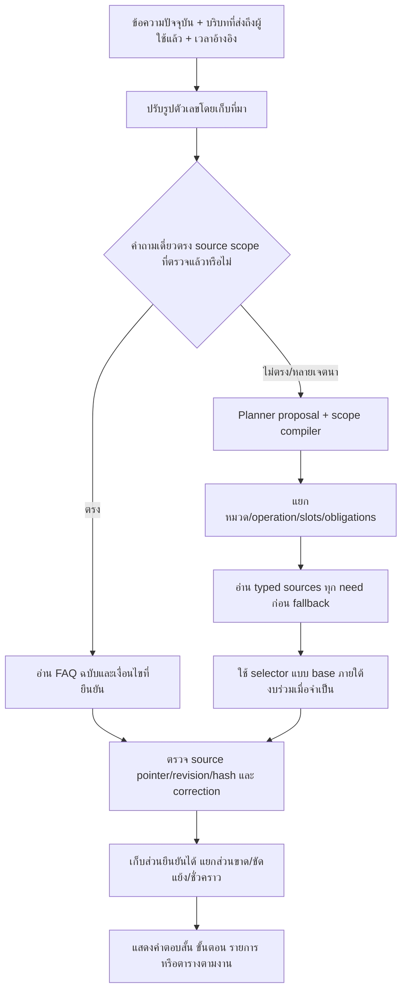

# ตรวจคำตอบเจ้าของครบ 50 ข้อ — R130

ผลนี้เป็นการตรวจการย้ายข้อมูล ขอบเขต และตัวอ่านกับคำถามที่เจ้าของให้ไว้แล้ว ไม่ใช่ชุดข้อสอบใหม่หรือคะแนนความแม่นยำของ Full Test

## ข้อค้นพบหลัก

สาเหตุมีทั้งข้อมูลตกจาก projection, คำตอบยืนยันถูกเก็บแต่ runtime อ่านไม่ได้, ตัวเลขภาษาไทยไม่ตรงคีย์ FAQ, การเลือกกฎทั่วไปทับสถานการณ์เฉพาะ และข้อมูลห้ามที่ย้ายผิดจริงในข้อ27 ไม่ใช่ปัญหาขาดข้อมูลทุกกรณี

เพิ่ม/จัดระเบียบ 23 ฉบับร่างใน candidate R130 ระเบียนเดิม 824 รายการและ approvals คงเดิม ไม่มีการติดตั้งทับ R78 ชุด R129 ที่กำลังเปรียบเทียบคงถูกตรึงไว้

## Flow หลังแก้

คำแนะนำเกมไม่กลายเป็นหลักฐาน game_mode; ตารางอัปเดตไม่กลายเป็นสถานะเวอร์ชันปัจจุบัน; การติดต่อศูนย์ไม่กลายเป็นการอนุมัติคืนเงิน; source pointer ที่ถูกไม่ใช่หลักฐานว่า semantic ถูกทั้งคำถาม

## ตรวจทีละข้อครบ 50 ข้อ

### 1. เป็นร้านเกมทั่วไปหรือเป็นของมหาวิทยาลัย?

**คำตอบต้นทาง:** เป็นของมหาวิทยาลัย

**การวิเคราะห์ขอบเขต:** เป็นของมหาวิทยาลัย ไม่ตีความว่าเป็นร้านเอกชนทั่วไป

**สถานะการอ่าน:** `answer`

**คำตอบที่บันทึกจริง:**

PSU Esports Studio - Phuket เป็นศูนย์ของมหาวิทยาลัยสงขลานครินทร์ครับ

**แหล่งอ้างอิง:** `SOURCE_OWNER_50.json#/source_items/0`; `migrated_owner_claim_university`

### 2. ต้องเป็นสมาชิกก่อนไหม?

**คำตอบต้นทาง:** ไม่ต้องเป็นสมาชิกก็สามารถใช้บริการได้

**การวิเคราะห์ขอบเขต:** ไม่บังคับสมาชิก แยกจากกลุ่มผู้ใช้สำหรับคิดราคา

**สถานะการอ่าน:** `answer`

**คำตอบที่บันทึกจริง:**

ไม่ต้องเป็นสมาชิกก็สามารถใช้บริการได้ครับ

**แหล่งอ้างอิง:** `SOURCE_OWNER_50.json#/source_items/1`; `migrated_owner_claim_membership`

### 3. ไปนั่งดูเพื่อนเล่นเฉย ๆ ได้ไหม?

**คำตอบต้นทาง:** ดูได้

**การวิเคราะห์ขอบเขต:** ดูเพื่อนได้ ไม่อนุมานจำนวนผู้ติดตามไม่จำกัด

**สถานะการอ่าน:** `answer`

**คำตอบที่บันทึกจริง:**

สามารถมานั่งดูเพื่อนเล่นได้ครับ

**แหล่งอ้างอิง:** `SOURCE_OWNER_50.json#/source_items/2`; `migrated_owner_claim_spectators`

**คำยืนยันเพิ่มที่ตรวจ:**

- Q043: สามารถนั่งดูเพื่อนเล่นเกมได้

### 4. เดินเข้าไปใช้บริการเลยได้ไหม หรือต้องจอง?

**คำตอบต้นทาง:** ในกรณี walk in ก็ต้องจองผ่านระบบ

**การวิเคราะห์ขอบเขต:** Walk-in ยังต้องจองผ่านระบบ ไม่เท่ากับมีเครื่องว่าง

**สถานะการอ่าน:** `answer`

**คำตอบที่บันทึกจริง:**

Walk-in ได้ แต่ยังต้องจองผ่านระบบก่อนใช้บริการครับ

**แหล่งอ้างอิง:** `SOURCE_OWNER_50.json#/source_items/3`; `migrated_owner_claim_walk_in`

### 5. ศูนย์อยู่ตรงไหน?

**คำตอบต้นทาง:** อาคาร 5 ชั้น 1 มหาวิทยาลัยสงขลานครินทร์ วิทยาเขตภูเก็ต 80 หมู่ 1 ถ.วิชิตสงคราม อ.กะทู้ จ.ภูเก็ต 83120

**การวิเคราะห์ขอบเขต:** อ่านที่อยู่ที่ยืนยัน ไม่แทนด้วยพิกัดที่คาดเดา

**สถานะการอ่าน:** `answer`

**คำตอบที่บันทึกจริง:**

ศูนย์อยู่ที่อาคาร 5 ชั้น 1 มหาวิทยาลัยสงขลานครินทร์ วิทยาเขตภูเก็ต 80 หมู่ 1 ถ.วิชิตสงคราม อ.กะทู้ จ.ภูเก็ต 83120ครับ

**แหล่งอ้างอิง:** `SOURCE_OWNER_50.json#/source_items/4`; `migrated_owner_claim_location`

### 6. อยู่ตึกอะไร ชั้นไหน?

**คำตอบต้นทาง:** อาคาร 5 ชั้น 1 มหาวิทยาลัยสงขลานครินทร์ วิทยาเขตภูเก็ต 80 หมู่ 1 ถ.วิชิตสงคราม อ.กะทู้ จ.ภูเก็ต 83120

**การวิเคราะห์ขอบเขต:** อาคาร/ชั้นเป็น typed fields ที่มีอยู่แล้ว ไม่ต้องย้ายซ้ำ

**สถานะการอ่าน:** `answer`

**คำตอบที่บันทึกจริง:**

PSU Esports Studio - Phuket — อาคาร: 5 [S1]
PSU Esports Studio - Phuket — ชั้น: 1 [S2]

**แหล่งอ้างอิง:** `SOURCE_OWNER_50.json#/source_items/5`; `center_psu_phuket`

### 7. มีลิงก์แผนที่ไหม?

**คำตอบต้นทาง:** https://maps.app.goo.gl/Ahst2vyFM4GDmC5s5

**การวิเคราะห์ขอบเขต:** คงลิงก์แผนที่เดิม

**สถานะการอ่าน:** `answer`

**คำตอบที่บันทึกจริง:**

ลิงก์แผนที่ศูนย์: https://maps.app.goo.gl/Ahst2vyFM4GDmC5s5

**แหล่งอ้างอิง:** `SOURCE_OWNER_50.json#/source_items/6`; `migrated_owner_claim_map`

### 8. ไปถึงก่อนเวลาจองต้องรอตรงไหน?

**คำตอบต้นทาง:** (ไม่ได้ให้คำตอบในชุดแรก)

**การวิเคราะห์ขอบเขต:** อ่านคำยืนยันเพิ่ม Q001 เรื่องรอโซนกลางและห้ามเข้าเล่นก่อนเวลา

**สถานะการอ่าน:** `answer`

**คำตอบที่บันทึกจริง:**

รอก่อนเวลา: รอที่โซนกลางห้องได้ แต่ยังเข้าเล่นก่อนถึงเวลาจองไม่ได้ [S1]

**แหล่งอ้างอิง:** `SOURCE_OWNER_50.json#/source_items/7`; `r114_q001_owner_policy`

### 9. มีที่จอดรถไหม?

**คำตอบต้นทาง:** มีที่ตอดรถหน้าตึก 5 สำหรับรถยนต์และมอเตอร์ไซค์

**การวิเคราะห์ขอบเขต:** มีที่จอดหน้าตึก ไม่ยืนยันจำนวนที่จอดว่างขณะนี้

**สถานะการอ่าน:** `answer`

**คำตอบที่บันทึกจริง:**

มีที่จอดรถหน้าตึก 5 สำหรับรถยนต์และมอเตอร์ไซค์ครับ

**แหล่งอ้างอิง:** `SOURCE_OWNER_50.json#/source_items/8`; `migrated_owner_claim_parking`

### 10. ถ้าหาศูนย์ไม่เจอ ติดต่อใครได้?

**คำตอบต้นทาง:** ติดต่อผ่านเพจศูนย์อีสปอร์ต https://www.facebook.com/psuesportsphuket

**การวิเคราะห์ขอบเขต:** ติดต่อผ่านเพจ ไม่เปิดเผยเบอร์ส่วนตัว

**สถานะการอ่าน:** `answer`

**คำตอบที่บันทึกจริง:**

ติดต่อผ่านเพจศูนย์อีสปอร์ตได้ครับ: https://www.facebook.com/psuesportsphuket

**แหล่งอ้างอิง:** `SOURCE_OWNER_50.json#/source_items/9`; `migrated_owner_claim_contact`

### 11. มีเกมไหนเล่นกับเพื่อนได้บ้าง?

**คำตอบต้นทาง:** (ไม่ได้ให้คำตอบในชุดแรก)

**การวิเคราะห์ขอบเขต:** คำตอบเดิมว่าง ใช้คำแนะนำสำหรับมา 2 คนจากข้อ12เป็นข้อมูลบางส่วนอย่างมีเงื่อนไข ไม่ยืนยันทุกกลุ่ม/โหมด

**สถานะการอ่าน:** `partial_answer`

**คำตอบที่บันทึกจริง:**

สำหรับมา 2 คน เจ้าของแนะนำเกมดังนี้

**PS5**
- SF6
- Tekken 8
- Naruto
- FC24

**Nintendo Switch**
- It Takes Two
- Luigi’s Mansion 3
- Mario Kart 8 Deluxe
- Mario Party Superstars
- Moving Out 2
- New Super Mario Bros. U Deluxe
- Nintendo Switch Sports
- Overcooked!
- Overcooked! 2
- Super Mario Odyssey
- Super Smash Bros Ultimate

รายการนี้เป็นคำแนะนำจากเจ้าของ ยังไม่ยืนยันโหมดเล่นพร้อมกันของแต่ละเกมหรือรุ่นของชื่อย่อ SF6/Naruto ส่วน PC เจ้าของให้ตรวจรายการอีกครั้ง จึงยังไม่ยืนยันว่าเล่นสองคนได้ทุกเกมครับ

**แหล่งอ้างอิง:** `SOURCE_OWNER_50.json#/source_items/10`; `r130_owner_12_scoped`

### 12. มากันสองคน มีอะไรเล่นด้วยกันได้?

**คำตอบต้นทาง:** PS5: SF6, Tekken 8, Naruto, FC24
PC ได้ทุกเกมที่ศูนย์มี (เช็ครายการอีกครั้ง)
Nintendo: It Takes Two; Luigi's Mansion™ 3; Mario Kart 8 Deluxe; Mario Party™ Superstars; Moving Out 2; New Super Mario Bros. U Deluxe; Nintendo Switch Sports; Overcooked!; Overcooked! 2; Super Mario Odyssey; Super Smash Bros Ultimate

**การวิเคราะห์ขอบเขต:** รายการแนะนำหลุดจาก projection เดิม เพิ่มรายการโดยแยก recommendation ออกจาก game_mode; PC/ชื่อย่อยังไม่ยืนยัน

**สถานะการอ่าน:** `partial_answer`

**คำตอบที่บันทึกจริง:**

สำหรับมา 2 คน เจ้าของแนะนำเกมดังนี้

**PS5**
- SF6
- Tekken 8
- Naruto
- FC24

**Nintendo Switch**
- It Takes Two
- Luigi’s Mansion 3
- Mario Kart 8 Deluxe
- Mario Party Superstars
- Moving Out 2
- New Super Mario Bros. U Deluxe
- Nintendo Switch Sports
- Overcooked!
- Overcooked! 2
- Super Mario Odyssey
- Super Smash Bros Ultimate

รายการนี้เป็นคำแนะนำจากเจ้าของ ยังไม่ยืนยันโหมดเล่นพร้อมกันของแต่ละเกมหรือรุ่นของชื่อย่อ SF6/Naruto ส่วน PC เจ้าของให้ตรวจรายการอีกครั้ง จึงยังไม่ยืนยันว่าเล่นสองคนได้ทุกเกมครับ

**แหล่งอ้างอิง:** `SOURCE_OWNER_50.json#/source_items/11`; `r130_owner_12_scoped`

### 13. มากันสี่คน ควรเลือกเครื่องไหน?

**คำตอบต้นทาง:** Nintendo Swich

**การวิเคราะห์ขอบเขต:** normalize สี่คน/4คนตรงกัน เป็นคำแนะนำ Nintendo ไม่ใช่ความจุทุกเกม

**สถานะการอ่าน:** `answer`

**คำตอบที่บันทึกจริง:**

มากัน 4 คน เจ้าของแนะนำ Nintendo Switch ครับ เป็นคำแนะนำบริการ ยังไม่ได้ยืนยันโหมดของแต่ละเกม

**แหล่งอ้างอิง:** `SOURCE_OWNER_50.json#/source_items/12`; `r130_owner_13_scoped`

### 14. มา 4 คนสามารถเล่นเครื่อง 2 คนได้ไหมแล้วสลับกัน

**คำตอบต้นทาง:** ไม่ได้

**การวิเคราะห์ขอบเขต:** ห้าม4คนหมุนเวียนรายการ2คน เก็บขอบเขตสถานการณ์ไว้

**สถานะการอ่าน:** `answer`

**คำตอบที่บันทึกจริง:**

มา 4 คนแล้วจองบริการสำหรับ 2 คนเพื่อสลับกันเล่นไม่ได้ครับ

**แหล่งอ้างอิง:** `SOURCE_OWNER_50.json#/source_items/13`; `r130_owner_14_scoped`

### 15. ถ้าอยากเล่นเกมที่ไม่มีในรายการ ขอให้ลงเพิ่มได้ไหม?

**คำตอบต้นทาง:** ขอได้แจ่จะพิจารณาเป็นรายการ

**การวิเคราะห์ขอบเขต:** ขอเพิ่มได้เป็นรายรายการ ไม่เท่ากับติดตั้งเองหรือรับประกันเพิ่มทุกเกม

**สถานะการอ่าน:** `answer`

**คำตอบที่บันทึกจริง:**

ขอให้ศูนย์ลงเกมเพิ่มได้ โดยศูนย์จะพิจารณาเป็นรายรายการครับ ยังไม่ได้ระบุช่องทาง ค่าใช้จ่าย หรือรับประกันว่าจะเพิ่มทุกเกม

**แหล่งอ้างอิง:** `SOURCE_OWNER_50.json#/source_items/14`; `r130_owner_15_scoped`

**คำยืนยันเพิ่มที่ตรวจ:**

- Q023: (ว่าง ไม่ใช่การถอนคำตอบเดิม)

### 16. คนจองเป็นคนนึงแต่คนเล่นเป็นอีกคนสามารถทำได้ไหม

**คำตอบต้นทาง:** ไม่ได้ คนเล่นต้องเป็นคนที่จองมาหรือมีรายชื่ออยู่ในรายการจอง

**การวิเคราะห์ขอบเขต:** ผู้เล่นต้องมีชื่อในจอง ไม่บังคับว่ามีได้เพียงผู้จองคนเดียว

**สถานะการอ่าน:** `answer`

**คำตอบที่บันทึกจริง:**

คนเล่นต้องเป็นคนที่จองหรือมีรายชื่ออยู่ในรายการจอง ไม่สามารถให้ผู้ที่ไม่มีรายชื่อมาใช้แทนได้ครับ

**แหล่งอ้างอิง:** `SOURCE_OWNER_50.json#/source_items/15`; `migrated_owner_claim_player_identity`

### 17. ตอนมาถึงต้องแสดงหลักฐานอะไร?

**คำตอบต้นทาง:** บัตรประชาชน หรือบัตรนักศึกษา หรือบัตรนักเรียน หรือ passport

**การวิเคราะห์ขอบเขต:** ตัวเลือกหลักฐาน ไม่บังคับยื่นทุกชนิด

**สถานะการอ่าน:** `answer`

**คำตอบที่บันทึกจริง:**

เมื่อมาถึงให้แสดงบัตรประชาชน บัตรนักศึกษา บัตรนักเรียน หรือ Passport อย่างใดอย่างหนึ่งครับ

**แหล่งอ้างอิง:** `SOURCE_OWNER_50.json#/source_items/16`; `migrated_owner_claim_checkin_documents`

### 18. จองผิดเครื่อง เปลี่ยนได้ไหม?

**คำตอบต้นทาง:** ให้กดยกเลิกผ่านอีเมล และจองเข้ามาใหม่

**การวิเคราะห์ขอบเขต:** จองผิดเครื่อง: ยกเลิกทางอีเมลแล้วจองใหม่

**สถานะการอ่าน:** `answer`

**คำตอบที่บันทึกจริง:**

กรณีจองผิดเครื่อง ให้กดยกเลิกผ่านอีเมล แล้วจองเข้ามาใหม่ครับ

**แหล่งอ้างอิง:** `SOURCE_OWNER_50.json#/source_items/17`; `migrated_owner_claim_change_machine`

### 19. เปลี่ยนเวลาจองได้ไหม?

**คำตอบต้นทาง:** ให้กดยกเลิกผ่านอีเมล และจองเข้ามาใหม่

**การวิเคราะห์ขอบเขต:** เปลี่ยนเวลาจอง: ยกเลิกทางอีเมลแล้วจองใหม่

**สถานะการอ่าน:** `answer`

**คำตอบที่บันทึกจริง:**

หากต้องการเปลี่ยนเวลาจอง ให้กดยกเลิกผ่านอีเมล แล้วจองเข้ามาใหม่ครับ

**แหล่งอ้างอิง:** `SOURCE_OWNER_50.json#/source_items/18`; `migrated_owner_claim_change_time`

### 20. ไปสายสิบห้านาทียังเล่นได้หรือเปล่า?

**คำตอบต้นทาง:** (ไม่ได้ให้คำตอบในชุดแรก)

**การวิเคราะห์ขอบเขต:** ยังไม่มีข้อยืนยันการมาสาย15นาที ตอบข้อมูลติดต่อได้แต่ต้อง partial

**สถานะการอ่าน:** `partial_answer`

**คำตอบที่บันทึกจริง:**

ยังไม่มีคำตอบยืนยันว่ามาสาย 15 นาทีแล้วยังเล่นได้หรือไม่ครับ หากมาไม่ทันให้แจ้งผู้จัดการศูนย์ผ่าน Discord หรือเพจศูนย์อีสปอร์ต

**แหล่งอ้างอิง:** `SOURCE_OWNER_50.json#/source_items/19`; `r130_owner_20_scoped`

### 21. ถ้าไปไม่ทัน ต้องแจ้งใคร?

**คำตอบต้นทาง:** แจ้ง ผจก ศูนย์ใน discord ศูนย์อีสปอร์ต หรือเพจศูนย์อีสปอร์ต

**การวิเคราะห์ขอบเขต:** คำตอบเดิมมีช่องทางผู้จัดการ/Discord/เพจ ไม่ควรถูกย่อเหลือเพียงต้องแจ้ง

**สถานะการอ่าน:** `answer`

**คำตอบที่บันทึกจริง:**

ถ้ามาไม่ทัน ให้แจ้งผู้จัดการศูนย์ผ่าน Discord ศูนย์อีสปอร์ต หรือเพจศูนย์อีสปอร์ตครับ

**แหล่งอ้างอิง:** `SOURCE_OWNER_50.json#/source_items/20`; `r130_owner_21_scoped`

**คำยืนยันเพิ่มที่ตรวจ:**

- Q008: ไม่มี ต้องแจ้งเท่านั้น

### 22. เล่นอยู่แล้วอยากต่อเวลา ทำยังไง?

**คำตอบต้นทาง:** ในกรณีที่ session ต่อยังว่าง ให้กดจองมาตามขั้นตอนปกติ

**การวิเคราะห์ขอบเขต:** จองรอบถัดไปได้ตามขั้นตอนเมื่อว่างและอยู่ในเวลาบริการ ไม่รับประกันว่างจริง

**สถานะการอ่าน:** `answer`

**คำตอบที่บันทึกจริง:**

ต่อเวลา: หากรอบถัดไปยังว่างและอยู่ในเวลาบริการปกติ สามารถจองต่อผ่านขั้นตอนปกติได้ [S1]

**แหล่งอ้างอิง:** `SOURCE_OWNER_50.json#/source_items/21`; `r114_q003_owner_policy`

**คำยืนยันเพิ่มที่ตรวจ:**

- Q003: ยึดเวลาบริการปกติ ถ้ามีรอบให้เล่นและไม่มีใครจองสามารถจองต่อได้

### 23. อยากเปลี่ยนจาก PC ไปเล่น PS5 ต้องจองใหม่ไหม?

**คำตอบต้นทาง:** ต้องยกเลิกของเก่าและจองใหม่

**การวิเคราะห์ขอบเขต:** ยกเลิกของเดิมแล้วจองใหม่; Q004 ระบุไม่คืนเงินของเดิม

**สถานะการอ่าน:** `answer`

**คำตอบที่บันทึกจริง:**

เปลี่ยนบริการระหว่างรอบ: ไม่มีการคืนเงินของรายการเดิม; คำตอบก่อนหน้าระบุให้ยกเลิกแล้วจองใหม่ [S1]

**แหล่งอ้างอิง:** `SOURCE_OWNER_50.json#/source_items/22`; `r114_q004_owner_policy`

**คำยืนยันเพิ่มที่ตรวจ:**

- Q004: ไม่มีการจ่ายเงินคืน

### 24. ต้องใช้บัญชี Steam ของตัวเองไหม?

**คำตอบต้นทาง:** ศูนย์มีบัญชีสตีมให้ แต่ละสามารถนำบัญชีของตัวเองมาเล่นได้

**การวิเคราะห์ขอบเขต:** บัญชีSteamศูนย์หรือส่วนตัว ไม่เหมารวมทุกแพลตฟอร์ม

**สถานะการอ่าน:** `answer`

**คำตอบที่บันทึกจริง:**

บัญชี Steam: ศูนย์มีบัญชี Steam ให้ใช้ที่ศูนย์ และใช้บัญชีส่วนตัวได้ [S1]

**แหล่งอ้างอิง:** `SOURCE_OWNER_50.json#/source_items/23`; `r114_q020_owner_policy`

**คำยืนยันเพิ่มที่ตรวจ:**

- Q020: ศูนย์มีบัญชีสตีมให้ แต่ละสามารถนำบัญชีของตัวเองมาเล่นได้
- Q021: ศูนย์มีบัญชีสตีมให้ แต่ละสามารถนำบัญชีของตัวเองมาเล่นได้

### 25. เครื่องค้างหรือดับระหว่างเล่น เวลาที่เสียไปคิดยังไง?

**คำตอบต้นทาง:** ต้องดูสาเหตุว่าเกิดจากอะไร ถ้าเกิดจากตัวคอมเองไม่ได้จากผู้ใช้ ให้คิดตามเวลาจริง ถ้าเกิดจากตัวผู้เล่นเอง ไม่มีต่อเวลา

**การวิเคราะห์ขอบเขต:** ฟื้นเงื่อนไขต้นเหตุจากข้อ25; Q028ใช้หลักการเดียวกัน ไม่ใช่ค่าชดเชยที่สร้างเอง

**สถานะการอ่าน:** `answer`

**คำตอบที่บันทึกจริง:**

ต้องตรวจสาเหตุครับ ถ้าเครื่องขัดข้องโดยไม่ได้เกิดจากผู้ใช้ ให้คิดตามเวลาจริง แต่ถ้าเกิดจากผู้เล่นจะไม่มีการต่อเวลา ให้แจ้งเจ้าหน้าที่ตรวจสอบครับ

**แหล่งอ้างอิง:** `SOURCE_OWNER_50.json#/source_items/24`; `r130_owner_25_scoped`

**คำยืนยันเพิ่มที่ตรวจ:**

- Q028: ใช้หลักการเดียวกันเลยและสามารถแจ้งกับทางเจ้าหน้าที่ได้

### 26. ลืมออกจากบัญชีหลังเล่น ต้องติดต่อใคร?

**คำตอบต้นทาง:** แจ้ง ผจก ศูนย์ใน discord ศูนย์อีสปอร์ต หรือเพจศูนย์อีสปอร์ต

**การวิเคราะห์ขอบเขต:** ถามติดต่อเมื่อลืมlogout ต้องตอบผู้จัดการ/Discord/เพจ ไม่เอาคำบอกการเก็บข้อมูลแทน

**สถานะการอ่าน:** `answer`

**คำตอบที่บันทึกจริง:**

หากลืมออกจากบัญชีหลังเล่น ให้แจ้งผู้จัดการศูนย์ผ่าน Discord ศูนย์อีสปอร์ต หรือเพจศูนย์อีสปอร์ตครับ

**แหล่งอ้างอิง:** `SOURCE_OWNER_50.json#/source_items/25`; `r130_owner_26_scoped`

**คำยืนยันเพิ่มที่ตรวจ:**

- Q022: ไม่มีการเก็บข้อมูลไว้เพราะเป็นการ Log Out ระบบ

### 27. เอาคีย์บอร์ดหรือเมาส์ตัวเองมาใช้ได้ไหม?

**คำตอบต้นทาง:** เอามาใช้ได้ แต่ต้องแจ้ง

**การวิเคราะห์ขอบเขต:** เดิมย้ายข้อความห้ามผิดจากหัวคำถาม; คำตอบจริงและQ044ระบุใช้ได้แต่ต้องแจ้ง มีหลักฐานแก้สอง field/revision/hash เฉพาะบริการทั่วไป

**สถานะการอ่าน:** `answer`

**คำตอบที่บันทึกจริง:**

นำคีย์บอร์ดหรือเมาส์ส่วนตัวมาใช้ได้ แต่ต้องแจ้งครับ ใช้สำหรับบริการศูนย์ทั่วไป ส่วนกฎการแข่งขันต้องตรวจแยกตามรายการ

**แหล่งอ้างอิง:** `SOURCE_OWNER_50.json#/source_items/26`; `r130_owner_27_scoped`

**คำยืนยันเพิ่มที่ตรวจ:**

- Q044: สามารถใช้ได้

### 28. ถ่ายรูปหรืออัดวิดีโอได้ไหม?

**คำตอบต้นทาง:** ถ้าหมายถึง capture รูปในเกม และ video ได้ แต่เมื่อทำเสร็จให้ลบด้วย

**การวิเคราะห์ขอบเขต:** ยืนยันเฉพาะcaptureในเกมและลบเมื่อเสร็จ การถ่ายบุคคล/สถานที่ยังไม่ยืนยัน

**สถานะการอ่าน:** `partial_answer`

**คำตอบที่บันทึกจริง:**

ยังไม่ยืนยันสิทธิ์ถ่ายสถานที่หรือบุคคลจากนโยบายการบันทึกในเกม กรุณาตรวจขอบเขตข้อมูลด้านล่างครับ
บันทึกภาพในเกม: capture ภาพหรือวิดีโอในเกมได้ เมื่อเสร็จให้ลบ; ไม่ครอบคลุมการถ่ายบุคคลหรือสถานที่ [S1]

**แหล่งอ้างอิง:** `SOURCE_OWNER_50.json#/source_items/27`; `r114_q033_owner_policy`

**คำยืนยันเพิ่มที่ตรวจ:**

- Q033: ถ้าหมายถึง capture รูปในเกม และ video ได้ แต่เมื่อทำเสร็จให้ลบด้วย

### 29. สตรีมเกมจากเครื่องของศูนย์ได้ไหม?

**คำตอบต้นทาง:** ได้

**การวิเคราะห์ขอบเขต:** สตรีมได้/ไม่จำกัดโซน ไม่แปลว่าอนุญาตติดตั้งซอฟต์แวร์เอง

**สถานะการอ่าน:** `answer`

**คำตอบที่บันทึกจริง:**

สตรีมเกม: คำตอบเดิมอนุญาตสตรีม คำตอบล่าสุดระบุไม่มีจำกัดโซน; ข้อความเรื่อง Steam ไม่ใช่การให้สิทธิ์ซอฟต์แวร์สตรีมเพิ่ม [S1]

**แหล่งอ้างอิง:** `SOURCE_OWNER_50.json#/source_items/28`; `r114_q034_owner_policy`

**คำยืนยันเพิ่มที่ตรวจ:**

- Q034: ศูนย์มีบัญชีสตีมให้ แต่ละสามารถนำบัญชีของตัวเองมาเล่นได้ ไม่มีจำกัดโซน

### 30. ติดตั้งเกม โปรแกรม หรือ mod เองได้ไหม?

**คำตอบต้นทาง:** ไม่ได้

**การวิเคราะห์ขอบเขต:** ติดตั้งเองไม่ได้ คำขอเพิ่มเกมเป็นอีกสิทธิหนึ่ง

**สถานะการอ่าน:** `answer`

**คำตอบที่บันทึกจริง:**

ผู้ใช้ติดตั้งเกม โปรแกรม หรือ mod เองไม่ได้ครับ หากต้องการเกมเพิ่ม ขอให้ศูนย์พิจารณาเป็นรายรายการได้

**แหล่งอ้างอิง:** `SOURCE_OWNER_50.json#/source_items/29`; `r130_owner_30_scoped`

### 31. เด็กเข้าใช้บริการได้ไหม ต้องมีผู้ปกครองหรือเปล่า?

**คำตอบต้นทาง:** ต้องกำหนดก่อนว่าเด็กในที่นี้หมายถึงเด็กอายุเท่าไร แต่แนะนำว่าให้มีผู้ปกครองดูแลด้วย

**การวิเคราะห์ขอบเขต:** คำแนะนำมีผู้ปกครอง/ยินยอมตามQ032 ไม่สร้างอายุขั้นต่ำหรือขยายสิทธิเด็กทุกวัย

**สถานะการอ่าน:** `answer`

**คำตอบที่บันทึกจริง:**

ผู้ปกครอง: การมีผู้ปกครองดูแลเป็นคำแนะนำ เซ็นยินยอมอย่างเดียวได้ และใช้ชื่อผู้ปกครองยืนยัน; ไม่ตั้งอายุขั้นต่ำแทนเจ้าของ [S1]

**แหล่งอ้างอิง:** `SOURCE_OWNER_50.json#/source_items/30`; `r114_q032_owner_policy`

**คำยืนยันเพิ่มที่ตรวจ:**

- Q031: (ว่าง ไม่ใช่การถอนคำตอบเดิม)
- Q032: เป็นเพียงคำแนะนำ สามารถเซ็นเพื่อยินยอมอย่างเดียวได้ และใช้ชื่อผู้ปกครองในการยืนยัน

### 32. ที่นั่งที่ระบุคือจำนวนคนเล่นพร้อมกันหรือจำนวนที่นั่งในห้อง?

**คำตอบต้นทาง:** จำนวนที่สามารถเล่นพร้อมกันได้

**การวิเคราะห์ขอบเขต:** ความหมายจำนวนที่นั่งบริการคือคนเล่นพร้อมกัน ไม่ใช่จำนวนเก้าอี้หรือกลุ่มราคา

**สถานะการอ่าน:** `answer`

**คำตอบที่บันทึกจริง:**

จำนวนที่นั่งที่ระบุสำหรับบริการ หมายถึงจำนวนคนที่เล่นพร้อมกันได้ครับ ไม่ใช่จำนวนที่นั่งทั้งหมดในห้อง

**แหล่งอ้างอิง:** `SOURCE_OWNER_50.json#/source_items/31`; `r130_owner_32_scoped`

**คำยืนยันเพิ่มที่ตรวจ:**

- Q043: สามารถนั่งดูเพื่อนเล่นเกมได้

### 33. ขอใบเสนอราคาหรือใบเสร็จได้ไหม?

**คำตอบต้นทาง:** ไม่ได้

**การวิเคราะห์ขอบเขต:** ใบเสนอราคา/ใบเสร็จเดิมและใบกำกับภาษีที่ถามเพิ่มแยกชนิดเอกสารไว้

**สถานะการอ่าน:** `answer`

**คำตอบที่บันทึกจริง:**

ใบกำกับภาษี: ออกใบกำกับภาษีไม่ได้; คำตอบก่อนหน้าแยกระบุใบเสนอราคาและใบเสร็จออกไม่ได้เช่นกัน [S1]

**แหล่งอ้างอิง:** `SOURCE_OWNER_50.json#/source_items/32`; `r114_q018_owner_policy`

**คำยืนยันเพิ่มที่ตรวจ:**

- Q018: ไม่ได้

### 34. ศูนย์มีบัญชีเกมให้ยืมหรือเปล่า?

**คำตอบต้นทาง:** ไม่มีให้ยืม บัญชีศูนย์ให้เล่นที่เฉพาะศูนย์เท่านั้น

**การวิเคราะห์ขอบเขต:** บัญชีศูนย์เฉพาะใช้งานที่ศูนย์ ไม่อนุมานให้ยืมออกไป หรือมีPSN/Nintendoให้ทุกกรณี

**สถานะการอ่าน:** `answer`

**คำตอบที่บันทึกจริง:**

ไม่ให้ยืมบัญชีของศูนย์ไปใช้นอกศูนย์ครับ บัญชีศูนย์ใช้เล่นเฉพาะที่ศูนย์ โดยมีบัญชี Steam ให้ใช้ หรือใช้ Steam ส่วนตัวก็ได้ ส่วนบัญชีแพลตฟอร์มอื่นยังไม่ยืนยัน

**แหล่งอ้างอิง:** `SOURCE_OWNER_50.json#/source_items/33`; `r130_owner_34_scoped`

**คำยืนยันเพิ่มที่ตรวจ:**

- Q020: ศูนย์มีบัญชีสตีมให้ แต่ละสามารถนำบัญชีของตัวเองมาเล่นได้
- Q021: ศูนย์มีบัญชีสตีมให้ แต่ละสามารถนำบัญชีของตัวเองมาเล่นได้

### 35. เกมอัปเดตเวอร์ชันล่าสุดแล้วหรือยัง

**คำตอบต้นทาง:** ศูนย์จะอัปเดตเกมทุกวันจันทร์เช้า

**การวิเคราะห์ขอบเขต:** ตารางจันทร์เช้าเป็นข้อมูลเดิมที่ตกหล่น ไม่ใช่หลักฐานติดตั้งเวอร์ชันล่าสุด ต้อง partial และถามผู้ดูแลตรวจจริง

**สถานะการอ่าน:** `partial_answer`

**คำตอบที่บันทึกจริง:**

ศูนย์อัปเดตเกมทุกวันจันทร์เช้าครับ แต่ตารางอัปเดตไม่ได้ยืนยันว่าเครื่องนี้เป็นเวอร์ชันล่าสุดแล้ว ต้องสอบถามผู้ดูแลเพื่อตรวจเวอร์ชันปัจจุบัน

**แหล่งอ้างอิง:** `SOURCE_OWNER_50.json#/source_items/34`; `r130_owner_35_scoped`

**คำยืนยันเพิ่มที่ตรวจ:**

- Q027: สามารถเช็กกับทางผู้ดูแลได้เลย

### 36. ถ้าไปถึงแล้วเกมต้องอัปเดต เวลาจะเริ่มนับเลยไหม?

**คำตอบต้นทาง:** ต้องดูว่าอัปเดตเกมนานไหม ถ้าเกินกว่า 5 นาทีจะต่อเวลาให้

**การวิเคราะห์ขอบเขต:** เกิน5นาทีต่อเวลาให้ แต่ไม่ยืนยันจำนวนเวลาต่อ

**สถานะการอ่าน:** `answer`

**คำตอบที่บันทึกจริง:**

ชดเชยอัปเดตเกม: หากอัปเดตนานเกิน 5 นาทีจะต่อเวลาให้; ไม่ระบุจำนวนเวลาที่ต่อ [S1]

**แหล่งอ้างอิง:** `SOURCE_OWNER_50.json#/source_items/35`; `r114_q025_owner_policy`

**คำยืนยันเพิ่มที่ตรวจ:**

- Q025: ต้องดูว่าอัปเดตเกมนานไหม ถ้าเกินกว่า 5 นาทีจะต่อเวลาให้

### 37. เกมกำลังอัปเดต เปลี่ยนไปใช้เครื่องอื่นได้ไหม?

**คำตอบต้นทาง:** ไม่ได้

**การวิเคราะห์ขอบเขต:** ห้ามเปลี่ยนเครื่องระหว่างอัปเดต แยกจาก Q026 ที่ถามเหตุอื่นและเปลี่ยนได้เมื่อเปิดเกมไม่ได้

**สถานะการอ่าน:** `answer`

**คำตอบที่บันทึกจริง:**

กรณีเกมกำลังอัปเดต เปลี่ยนไปใช้เครื่องอื่นไม่ได้ครับ กฎนี้แยกจากกรณีเปิดเกมไม่ได้ด้วยสาเหตุอื่น

**แหล่งอ้างอิง:** `SOURCE_OWNER_50.json#/source_items/36`; `r130_owner_37_scoped`

**คำยืนยันเพิ่มที่ตรวจ:**

- Q026: สามารถเปลี่ยนเครื่องได้หากไม่สามารถเล่นได้

### 38. ต้องใช้ชื่อจริงตรงกับบัตรไหม?

**คำตอบต้นทาง:** ข้อมูลต้องตรง

**การวิเคราะห์ขอบเขต:** ข้อมูลตรงบัตรเป็นคำตอบเดิมที่หายไป; วิธีแก้ชื่อ Q011 เป็นอีกการกระทำ

**สถานะการอ่าน:** `answer`

**คำตอบที่บันทึกจริง:**

ชื่อจริงและข้อมูลต้องตรงกับบัตรที่ใช้ยืนยันครับ

**แหล่งอ้างอิง:** `SOURCE_OWNER_50.json#/source_items/37`; `r130_owner_38_scoped`

**คำยืนยันเพิ่มที่ตรวจ:**

- Q011: เมื่อกดจองแล้วจะไม่สามารถแก้ไขข้อมูลได้ หากต้องการแก้ไขข้อมูลให้ยกเลิกการจองผ่านทางอีเมลก่อนเวลาใช้งานอย่างน้อย 1 ชั่วโมง แล้วจองใหม่อีกครั้ง พร้อมแนบสลิปการโอนเงินที่ชำระมาก่อนหน้านี้

### 39. กรอกเบอร์โทรผิด ต้องจองใหม่ไหม?

**คำตอบต้นทาง:** ไม่ต้องจองใหม่ แต่อีเมลต้องถูกต้อง

**การวิเคราะห์ขอบเขต:** เบอร์ผิดไม่ต้องจองใหม่ แต่อีเมลถูกต้อง; ไม่สร้างวิธีแก้เบอร์ให้

**สถานะการอ่าน:** `answer`

**คำตอบที่บันทึกจริง:**

กรอกเบอร์โทรผิดไม่ต้องจองใหม่ครับ แต่อีเมลต้องถูกต้อง คำตอบนี้ยังไม่ได้ระบุวิธีแก้ไขเบอร์ในระบบ

**แหล่งอ้างอิง:** `SOURCE_OWNER_50.json#/source_items/38`; `r130_owner_39_scoped`

### 40. จ่ายจากบัญชีของเพื่อนได้หรือเปล่า?

**คำตอบต้นทาง:** ไม่ได้ นอกจากว่าเพื่อนจะมีชื่อเป็นผู้เล่นร่วมกันด้วย

**การวิเคราะห์ขอบเขต:** เพื่อนที่มีชื่อผู้เล่นร่วมเป็นข้อยกเว้น; คำยืนยันเพิ่มผู้โอนคนเดียว ไม่แปลว่าบัญชีใครก็ได้

**สถานะการอ่าน:** `answer`

**คำตอบที่บันทึกจริง:**

โอนจากบัญชีเพื่อนที่ไม่มีชื่อเป็นผู้เล่นร่วมไม่ได้ครับ ถ้าเพื่อนมีชื่อเป็นผู้เล่นร่วมจึงอยู่ในข้อยกเว้นที่เจ้าของให้ไว้ และคำตอบเพิ่มเติมระบุให้โอนจากคนที่ลงชื่อเพียงคนเดียว

**แหล่งอ้างอิง:** `SOURCE_OWNER_50.json#/source_items/39`; `r130_owner_40_scoped`

**คำยืนยันเพิ่มที่ตรวจ:**

- Q013: โอนเฉพาะคนที่ลงชื่อเพียงคนเดียว

### 41. โอนเกินจำนวนที่ต้องจ่าย ทำยังไง?

**คำตอบต้นทาง:** ทางศูนย์ไม่มีนโยบายคืนเงิน โดยเงินที่เกินมาจะถูกนำไปใช้กับ session ที่จะเข้ามาเล่นในอนาคต

**การวิเคราะห์ขอบเขต:** โอนเกินเก็บใช้sessionอนาคต ไม่คืนเงิน; Q014ช่องทาง/หลักฐาน ไม่สร้างวันหมดอายุเครดิต

**สถานะการอ่าน:** `answer`

**คำตอบที่บันทึกจริง:**

เงินโอนเกิน: ติดต่อเพจ Facebook พร้อมสลิปและหลักฐานการจอง; คำตอบก่อนหน้าระบุเก็บใช้ session อนาคต ไม่คืนเงิน [S1]

**แหล่งอ้างอิง:** `SOURCE_OWNER_50.json#/source_items/40`; `r114_q014_owner_policy`

**คำยืนยันเพิ่มที่ตรวจ:**

- Q014: ทักผ่านทางเพจ Facebook และสลิปการโอนเงิน+หลักฐานการจอง

### 42. โอนขาดไปนิดหนึ่ง ต้องโอนเพิ่มหรือจองใหม่?

**คำตอบต้นทาง:** ต้องโอนเพิ่ม

**การวิเคราะห์ขอบเขต:** โอนขาดต้องโอนเพิ่ม; Q015ช่องทาง/หลักฐานไม่ควรทำให้คำว่าต้องโอนเพิ่มหาย

**สถานะการอ่าน:** `answer`

**คำตอบที่บันทึกจริง:**

โอนขาดต้องโอนเพิ่มครับ ให้ติดต่อเพจ Facebook ศูนย์ พร้อมสลิปโอนเงินและหลักฐานการจองเพื่อตรวจสอบ

**แหล่งอ้างอิง:** `SOURCE_OWNER_50.json#/source_items/41`; `r130_owner_42_scoped`

**คำยืนยันเพิ่มที่ตรวจ:**

- Q015: ทักผ่านทางเพจ Facebook และสลิปการโอนเงิน+หลักฐานการจอง

### 43. แนบสลิปผิดรูป เปลี่ยนได้ไหม?

**คำตอบต้นทาง:** ให้ส่งสลิปมาทางเพจศูนย์อีสปอร์ต

**การวิเคราะห์ขอบเขต:** ส่งสลิปถูกต้องทางเพจ ไม่รับรองอัตโนมัติว่าจ่ายแล้ว

**สถานะการอ่าน:** `answer`

**คำตอบที่บันทึกจริง:**

กรณีแนบสลิปผิดรูป ให้ส่งสลิปมาทางเพจศูนย์อีสปอร์ตครับ: https://www.facebook.com/psuesportsphuket

**แหล่งอ้างอิง:** `SOURCE_OWNER_50.json#/source_items/42`; `migrated_owner_claim_wrong_slip`

### 44. จองหลายเครื่อง โอนครั้งเดียวได้ไหม?

**คำตอบต้นทาง:** ได้ แต่ต้องเขียน note ตอนจองเข้ามา เพื่อให้ทางศูนย์ตรวจสอบ

**การวิเคราะห์ขอบเขต:** รวมโอนได้เมื่อระบุnote ไม่ใช่แบ่งจ่ายจากผู้ไม่มีชื่อ

**สถานะการอ่าน:** `answer`

**คำตอบที่บันทึกจริง:**

จองหลายเครื่องสามารถโอนเงินครั้งเดียวได้ แต่ต้องเขียน Note ตอนจอง เพื่อให้ศูนย์ตรวจสอบครับ

**แหล่งอ้างอิง:** `SOURCE_OWNER_50.json#/source_items/43`; `migrated_owner_claim_combined_transfer`

### 45. จองผิดวัน แต่จ่ายแล้ว แก้ได้ไหม?

**คำตอบต้นทาง:** ในกรณีที่มีการจ่ายเงินเรียบร้อย สามารถเปลี่ยนวันได้

**การวิเคราะห์ขอบเขต:** จองผิดวันจ่ายแล้ว: Q005ยกเลิกล่วงหน้าอย่างน้อย1ชั่วโมง/จองใหม่แนบสลิปเดิม เฉพาะกรณีนี้

**สถานะการอ่าน:** `answer`

**คำตอบที่บันทึกจริง:**

แก้รายการจองที่จ่ายแล้ว: แก้ข้อมูลหลังจองไม่ได้ ให้ยกเลิกผ่านอีเมลก่อนเวลาใช้งานอย่างน้อย 1 ชั่วโมง แล้วจองใหม่พร้อมแนบสลิปที่ชำระไว้เดิม [S1]

**แหล่งอ้างอิง:** `SOURCE_OWNER_50.json#/source_items/44`; `r114_q005_owner_policy`

**คำยืนยันเพิ่มที่ตรวจ:**

- Q005: เมื่อกดจองแล้วจะไม่สามารถแก้ไขข้อมูลได้ หากต้องการแก้ไขข้อมูลให้ยกเลิกการจองผ่านทางอีเมลก่อนเวลาใช้งานอย่างน้อย 1 ชั่วโมง แล้วจองใหม่อีกครั้ง พร้อมแนบสลิปการโอนเงินที่ชำระมาก่อนหน้านี้

### 46. ขอเลื่อนเป็นวันอื่นแทนคืนเงินได้ไหม?

**คำตอบต้นทาง:** ไม่ได้

**การวิเคราะห์ขอบเขต:** ห้ามเลื่อนวันแทนคืนเงิน แยกจากข้อ45 ไม่รวมนโยบายให้ขัดแย้งกัน

**สถานะการอ่าน:** `answer`

**คำตอบที่บันทึกจริง:**

กรณีขอเลื่อนเป็นวันอื่นแทนการคืนเงิน ทำไม่ได้ครับ ข้อนี้ไม่ใช่กรณีจองผิดวันและชำระแล้ว ซึ่งมีขั้นตอนแก้แยกต่างหาก

**แหล่งอ้างอิง:** `SOURCE_OWNER_50.json#/source_items/45`; `r130_owner_46_scoped`

### 47. ถ้าศูนย์ปิดพิเศษหลังจองแล้ว จะจัดการรายการยังไง?

**คำตอบต้นทาง:** ไม่เข้าใจคำถาม

**การวิเคราะห์ขอบเขต:** คำตอบเดิมไม่เข้าใจ; Q010ยืนยันเพียงติดต่อGmail ยังไม่ยืนยันคืนเงิน/จัดการรายการ จึง partial

**สถานะการอ่าน:** `partial_answer`

**คำตอบที่บันทึกจริง:**

กรณีศูนย์ปิดหลังจอง ข้อมูลเพิ่มเติมระบุว่าศูนย์ติดต่อผ่านอีเมล Gmail ที่ใช้สมัครครับ แต่ยังไม่ยืนยันว่าจะคืนเงิน เปลี่ยนรอบ หรือจัดการรายการอย่างไร

**แหล่งอ้างอิง:** `SOURCE_OWNER_50.json#/source_items/46`; `r130_owner_47_scoped`

### 48. ฝนตกหนักเดินทางไม่ได้ ขอเปลี่ยนรอบได้ไหม?

**คำตอบต้นทาง:** เปลี่ยนได้แต่ต้องแจ้งล่วงหน้าตามกฎ

**การวิเคราะห์ขอบเขต:** เปลี่ยนได้แจ้งล่วงหน้าตามกฎ; Q009ช่องทาง/หลักฐาน ไม่ยืมตัวเลข1ชั่วโมงจากคนละกรณี

**สถานะการอ่าน:** `answer`

**คำตอบที่บันทึกจริง:**

ฝนตกหนักจนเดินทางไม่ได้ ขอเปลี่ยนรอบได้แต่ต้องแจ้งล่วงหน้าตามกฎครับ ให้ติดต่อเพจ Facebook พร้อมสลิปและหลักฐานการจอง ยังไม่ได้ระบุระยะเวลาแจ้งล่วงหน้าเป็นตัวเลขสำหรับกรณีนี้

**แหล่งอ้างอิง:** `SOURCE_OWNER_50.json#/source_items/47`; `r130_owner_48_scoped`

**คำยืนยันเพิ่มที่ตรวจ:**

- Q009: ทักผ่านทางเพจ Facebook และสลิปการโอนเงิน+หลักฐานการจอง

### 49. มาก่อนหนึ่งคน เช็กอินแทนทั้งกลุ่มได้ไหม?

**คำตอบต้นทาง:** ไม่ได้ จะเช็คเป็นรายคน แต่คนที่มาก่อนสามารถเล่นได้

**การวิเคราะห์ขอบเขต:** เช็กอินรายคน คนมาก่อนเล่นได้ normalizeหนึ่งคนไม่พาไปอ่านการรอแทน

**สถานะการอ่าน:** `answer`

**คำตอบที่บันทึกจริง:**

เช็กอินแทนทั้งกลุ่มไม่ได้ครับ ต้องตรวจเป็นรายคน แต่คนที่มาถึงก่อนสามารถเล่นได้

**แหล่งอ้างอิง:** `SOURCE_OWNER_50.json#/source_items/48`; `r130_owner_49_scoped`

### 50. มีที่นั่งพักไหม

**คำตอบต้นทาง:** มี ตรงโซนกลางห้อง

**การวิเคราะห์ขอบเขต:** ที่นั่งพักโซนกลางเป็น static facility ไม่เรียกlive occupancy

**สถานะการอ่าน:** `answer`

**คำตอบที่บันทึกจริง:**

มีที่นั่งพักตรงโซนกลางห้องครับ

**แหล่งอ้างอิง:** `SOURCE_OWNER_50.json#/source_items/49`; `r130_owner_50_scoped`

**คำยืนยันเพิ่มที่ตรวจ:**

- Q001: รอที่โซนกลางได้เลย และไม่สามารถเข้าไปเล่นก่อนถึงเวลาได้

## สิ่งที่ยังยืนยันแทนเจ้าของไม่ได้

- โหมดเล่นพร้อมกัน/จำนวนผู้เล่นจริงของทุกเกม รายการPCสำหรับมา2คน และรุ่นของ SF6/Naruto จากชื่อย่อ
- สิทธิ์มาสาย15นาที ระยะเวลาแจ้งก่อนเปลี่ยนรอบเพราะฝน จำนวนเวลาชดเชยตายตัว และวิธีแก้เบอร์โทร
- การถ่ายบุคคล/สถานที่ อายุขั้นต่ำที่ไม่ได้กำหนด และผลคืนเงิน/เปลี่ยนรอบกรณีศูนย์ปิด
- เวอร์ชันติดตั้งล่าสุดและสถานะว่างจริง ต้องตรวจจากผู้ดูแล/provider ไม่อ้างจากตารางหรือ fixture

ข้อจำกัดเหล่านี้ไม่ใช่เหตุผลให้ทิ้งข้อมูลส่วนที่ตอบได้แล้ว และไม่ถูกนำไปนับเป็น actual content failure อัตโนมัติ

## งานตรวจรับใหญ่ที่ยังต้องเดินต่อ

- รอ raw ผลสามน้ำหนักที่กำลังรันเดิมให้ครบ330แถว ไม่รัน context inference ซ้ำ
- replay raw เหล่านั้นบน engine/data R130 ชุดเดียวกันทั้ง3แขน แล้วตรวจกรณี regression/source จริงก่อนเลือกน้ำหนัก
- ตรวจ API readiness และ Full Test เฉพาะ common R130 LLM ON จำนวน20,554 keys/55,811 grades
- เทียบ saved R64 legacy/R95 โดย keys/grade identities เดียวกัน แยก strict/literal/semantic review พร้อม source-version confounds
- อ่านทุกกลุ่ม failure แบบ streaming และเขียน root cause review พร้อม source evidence ก่อนประกาศงานเสร็จ

