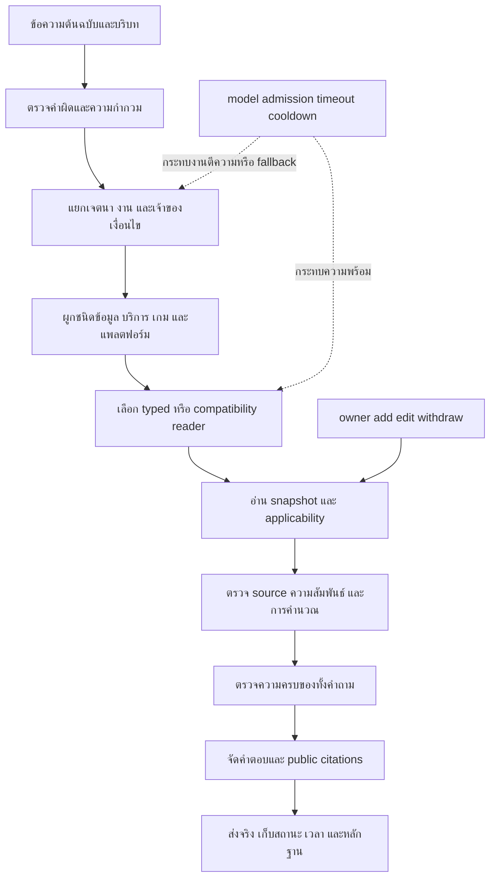

# รายการปัญหาและข้อจำกัดทั้งหมดที่มีหลักฐาน — PSU Esports Chatbot

จัดทำวันที่ 11 พฤศจิกายน 2026 สำหรับ `r135_bounded_response_20261111` หลังแพตช์คำผิด commit `44f31051` ใช้เอกสาร โค้ด และผลทดสอบที่บันทึกไว้ ไม่รัน benchmark ใหม่ ไม่แก้ข้อมูลจริงหรือสำเนาที่ตรึงวัดแล้ว

## 1. อ่านรายงานนี้อย่างไร

**ระบบดีขึ้นเฉพาะส่วนที่มีผลตรวจรองรับ แต่ยังมีปัญหาเรื่องการตีความ ขอบเขตข้อมูล ความพร้อมของโมเดล และความครอบคลุมการตรวจรับอยู่จริง** การมีข้อมูลอยู่ในฐานหรือมี URL ไม่ได้ทำให้ตอบคำถามทุกแบบได้ทันที และการระงับคำตอบก็ไม่ได้แปลว่าไม่มีข้อมูลเสมอไป

รายงานแบ่งเป็นรายการปัญหาร่วมของรุ่นปัจจุบัน ตามด้วยภาคผนวก audit gaps เดิมทั้ง 143 รายการและ requirement ledger ทั้ง 76 ข้อ เพื่อไม่ทิ้งประวัติปัญหาที่เคยพบ จำนวนเหล่านี้มีรายการทับซ้อนกัน **ห้ามบวกเป็นจำนวน bugs หรือใช้คำนวณเปอร์เซ็นต์งานที่เหลือ**

คำว่า “ทั้งหมด” ในเอกสารนี้หมายถึงทั้งหมดที่ค้นได้จากหลักฐานโครงการที่ระบุใน manifest ไม่ใช่การรับประกันว่าระบบไม่มีข้อผิดพลาดอื่นซ่อนอยู่ บางปัญหายังระบุสาเหตุได้เพียงบางชั้น

สถานะที่ใช้:

| สถานะ | ความหมาย |
|---|---|
| เปิด | ยังมีข้อจำกัดหรือสาเหตุที่ยังไม่แก้/พิสูจน์ครบ |
| แก้เฉพาะขอบเขต | มีแพตช์และผลตรวจเฉพาะกรณี แต่ยังไม่ใช่การรับรองทั้งตระกูลคำถาม |
| ประวัติที่ต้องรักษา | เคยพบจริง แก้ใน candidate แล้ว หรือเป็นปัญหาของรอบเก่า ห้ามอ้างว่ายังเกิดในรุ่นล่าสุดโดยไม่มีผลใหม่ |
| ความเสี่ยงที่ต้องตรวจ | เห็นช่องว่างในการพิสูจน์หรือการออกแบบ ยังไม่ใช่หลักฐานว่าเกิดกับทุกคำถาม |

ลำดับความสำคัญ: **P0** ผิดเงิน/ผิดเป้าหมาย/กลับความหมาย/ข้อมูลถอนหลุด ต้องแก้หรือกันเส้นทางก่อนเปิดใช้; **P1** ตอบไม่ได้ ตกหล่น ช้า หรือยังไม่พิสูจน์ความครบ; **P2** รูปแบบ เอกสาร การวัดและการบำรุงรักษา บางรายการ P0 เป็นความเสี่ยงที่ถูก guard กันไว้แล้ว ไม่ได้แปลว่ากำลังส่งคำตอบผิดอยู่

## 2. ตัวเลขที่ยืนยันได้ และสิ่งที่ตัวเลขไม่ได้บอก

| หลักฐาน | สิ่งที่วัดได้ | ข้อจำกัด |
|---|---|---|
| รุ่นผสม eval10, 2,111 คำถาม | literal 1,946 matched / 2,487 supported grade identities; 541 not matched; อีก 3,097 ไม่มีเกณฑ์ literal รองรับ | ไม่ใช่คะแนนความถูกต้องทางความหมาย; 1,242 คำถามไม่มีเกณฑ์ literal ที่รองรับ |
| eval10 เทียบ R134 keys/criteria เดียวกัน | ผ่านทั้งคู่ 1,882; เฉพาะใหม่ 64; เฉพาะเก่า 126; ไม่ผ่านทั้งคู่ 415 | source เวลา และ runtime state ต่างกัน จึงไม่พิสูจน์ว่า Flow เป็นสาเหตุของความต่างทั้งหมด |
| เวลา eval10 | รวมเวลา request ประมาณ 13.27 ชั่วโมง; median 1.263 วินาที; mean 22.628 วินาที; เกิน 60 วินาที 362 ข้อ; เกิน 120 วินาที 29 ข้อ | ผลของรุ่นเก่าที่วัดก่อน bounded response ไม่ใช่เวลาปัจจุบันทุกคำถาม |
| verified eval200 | HTTP 200/200 สำเร็จ; literal 196/255; 59 not matched; อีก 250 grade identities ไม่มีเกณฑ์รองรับ; unavailable 36 | HTTP สำเร็จไม่เท่ากับตอบถูก; เป็นชุดที่เคยเปิดดูแล้ว |
| เวลา verified eval200 | ทั้งรอบ 384 วินาที; median 0.922 วินาที; max 15.242 วินาที; ไม่มีข้อเกิน 20 วินาที | ผลเชิงสังเกตของรอบนี้ ไม่ใช่ hard deadline proof |
| เปรียบเทียบ bounded200 ก่อนแก้เว็บ | 202/255 → 196/255; unavailable 35 → 36 | ผลต่างเพียง 2 คำถาม: 5 criteria คาด 3 sessions ทั้งที่เว็บปัจจุบันบอก 6 และ 1 criterion ของ Shifter ที่ไป unavailable |
| แพตช์คำผิดล่าสุด | กลไก/reader 35 checks, source/lifecycle regression 22, budget regression 6, HTTP ตามลำดับ 11 คำถามผ่าน | ไม่ได้รัน 200/2,111 ใหม่ ไม่ใช่ unseen typo accuracy และห้ามนำมาบวกปรับคะแนน 196/255 |
| ledger R135 เต็มที่บันทึกไว้ | 76 requirements: candidate repairs under review 40, implementation gap open 17, audit in progress 19 | final behavioral acceptance ยังไม่มีข้อใดปิดใน ledger นี้; เป็นสถานะเอกสารเดิม ไม่ใช่ผล re-audit ล่าสุดของโค้ดทุกรุ่น |
| เฉพาะชุด 48 requirement IDs ที่เลือก | candidate repairs under review 36, implementation gap open 11, audit in progress 1 | ไม่ใช่ 48 ข้อที่ตรวจรับเสร็จ และไม่ใช่ 48 แถวแรกของเอกสาร |

**ทำไมคะแนนเหมือนแย่ลง:** มีทั้งเหตุที่คำตอบใหม่เปลี่ยนตามข้อมูลปัจจุบันแต่เกณฑ์เก่ายังรอค่าเดิม และเหตุที่คำตอบใช้งานไม่ได้จริง เช่น Shifter ไป unavailable จึงต้องแยกตรวจ ไม่สรุปว่าแย่ลงทั้งหมดหรือแก้เกณฑ์เพื่อทำคะแนนให้สูง

## 3. แผนที่จุดที่ปัญหาเกิด

ตัวอย่าง “มีข้อมูลแต่ตอบไม่ได้” อาจติดที่ C/D/E/G/H ไม่จำเป็นต้องติด F ส่วนการเปิดโมเดลค้างไว้แก้ได้เพียงบางส่วนของ K และไม่ได้ทำให้ schema, ความสัมพันธ์ หรือขอบเขตคำตอบถูกเอง

## 4. ข้อมูล ต้นทาง ความสัมพันธ์ และความเป็นปัจจุบัน

หลักฐานหลัก: DATA_LAYOUT_AUDIT_TH.md, VERIFIED_SOURCE_FLOW_TH.md, PUBLIC_CITATIONS_TH.md และ EVAL5_OPERATOR_DIAGNOSIS_20261107.json

| ID / ระดับ / สถานะ | ปัญหาและหลักฐาน | ผลกระทบ / สิ่งที่ยังต้องทำ |
|---|---|---|
| D01 / P1 / เปิด | ข้อมูลส่วนใหญ่ใน audit วันที่ 10 Nov เป็น draft: 847 active heads ทั้งหมด lifecycle draft | มีข้อมูลให้ preview อ่าน ไม่ใช่หลักฐานว่าเผยแพร่หรือผ่าน approval จริง ต้องแยก data-readiness กับ publication/authority |
| D02 / P0 / เปิด | validity unknown 808 records, known 39 ใน snapshot ที่ audit | ไม่ทราบช่วงมีผลไม่ได้แปลว่าผิดหรือหมดอายุ แต่ห้ามรับรองว่า current ทุกกรณี ต้องใช้ confirmation/applicability ของแต่ละ field และบอกข้อจำกัด |
| D03 / P1 / เปิด | อังกฤษ agent_translated 708, missing 139 ใน audit เดิม | ข้อความสองภาษาอาจไม่เท่ากันหรือยังไม่มีคำแปล ต้องตรวจค่าปฏิเสธ เงื่อนไข หน่วย และคำตอบจริงแยกภาษา |
| D04 / P0 / แก้เฉพาะขอบเขต | FAQ 3 records เคยบอกจองสูงสุด 3 sessions ขณะที่เว็บปัจจุบันบอก 6 | แก้สำเนา verified_sources เป็น 6 พร้อม source pins แล้ว แต่ไม่เปลี่ยน owner/live approval และไม่เดาวันเริ่มใช้ |
| D05 / P0 / เปิด | ภาพราคาบางภาพยังไม่ตรงคำยืนยันเจ้าของ: PC นักศึกษา PSU = 0 บาท | ห้ามใช้ภาพเก่ารับรอง 0 บาทและห้ามขยายคำยืนยันไปทุกบริการ ต้องแยก owner assertion กับข้อความเว็บให้ชัด |
| D06 / P1 / เปิด | เว็บ Phuket เปิดตรงบางหน้าพบ 502; Members อ่านจาก search cache ได้ | การเข้าไม่ได้ไม่เท่ากับเว็บไม่มีข้อมูล และ cache ไม่รับรองตำแหน่งบุคลากรปัจจุบัน ต้องได้ต้นฉบับ/เวลาที่ใช้ได้ก่อนรับรอง |
| D07 / P1 / เปิด | การมีหน้า entry คู่มือ/แข่งขัน/ดาวน์โหลด ไม่ได้พิสูจน์ข้อความในภาพหรือไฟล์แนบ | ต้องอ่านต้นฉบับแต่ละไฟล์และผูก section/page; inventory citation เดิมมี 84 record-field pairs ต้องตรวจ attachment ไม่ใช่ 84 คำถามที่ผิด |
| D08 / P0 / เปิด | operator FAQ บอก College of Computing แต่ typed center operator เป็นมหาวิทยาลัย และ FAQ บางรายการไม่มี relation/validity ที่ยืนยัน | ห้ามนำชื่อหน่วยงานใดมาฮาร์ดโค้ดหรือถือว่าเท่ากันจาก keyword ต้องยืนยันบทบาท เจ้าของข้อมูล และ unique center binding |
| D09 / P0 / เปิด | alias strings ใช้ร่วมหลาย records 792 ชื่อใน audit เดิม | ไม่ใช่ 792 bugs แต่ชื่อ PC/TEKKEN 8 ตรงหลาย kind; ต้องเลือกจาก operation และ relation ไม่ใช่ text similarity อย่างเดียว |
| D10 / P0 / เปิด | Monster Hunter Rise มี offering Nintendo และชุดปุ่ม PS5 ในข้อมูลคนละบริบท | มีคู่มือปุ่มไม่ได้แปลว่ามีบริการบนแพลตฟอร์มนั้น ต้องตรวจ game→service→platform ไม่อนุมานจอยจาก platform |
| D11 / P1 / ความเสี่ยงที่ต้องตรวจ | มี SQLite กลาง พร้อม curated/control/calendar/competition representations เก่าหลายชุด | ไม่พบหลักฐานว่าโฟลเดอร์เละเป็นสาเหตุโดยตรง แต่ต้องทำ reader→DB/file→snapshot mapping ทุกเส้นทางก่อนจัดเก็บหรือลบ |
| D12 / P0 / ความเสี่ยงที่ต้องตรวจ | source ID มีอยู่ และ reference ชนิดถูก ไม่ได้พิสูจน์ว่า locator/ข้อความสนับสนุน claim จริง | ต้องตรวจ source content, target, revision และ applicability ร่วมกัน ไม่ปิด issue จากการผ่าน foreign-key/schema |
| D13 / P0 / แก้เฉพาะขอบเขต | กฎศูนย์เคยถูกตอบให้ Andaman Hotel; แพตช์ center relation และ location rejection ผ่าน controls | ป้องกัน explicit locations ที่รองรับ ไม่ใช่ general entity semantics; ชื่อสถานที่ใหม่/อ้างอ้อม/คำปฏิเสธยังต้องทดสอบ |
| D14 / P1 / เปิด | source unknown กับ code gap เคยถูกปะปนในการสรุป | ต้องแยก “ไม่มี field/อำนาจยืนยัน” ออกจาก “มี field แต่ reader ไม่อ่าน” การแก้โค้ดสร้าง authority ที่ขาดไม่ได้ |

จำนวน 847/808/708/792 เป็น **ผล audit วันที่ 10 Nov** ไม่ใช่การนับฐาน verified_sources ปัจจุบันใหม่ในรายงานนี้ WAL/SHM เป็นส่วนประกอบ SQLite ไม่ใช่ข้อมูลรกที่ควรลบทิ้ง

## 5. เวลา โมเดล การรอคิว และสถานะไม่พร้อม

หลักฐานหลัก: eval10/ANALYSIS_SUMMARY.json, verified eval200/UNAVAILABLE_GROUPS.json, UNAVAILABLE_ATTRIBUTION_TH.md และ STATUS.json

| ID / ระดับ / สถานะ | ปัญหาและหลักฐาน | ผลกระทบ / สิ่งที่ยังต้องทำ |
|---|---|---|
| T01 / P1 / แก้เฉพาะขอบเขต | eval10 มี long tail สูง แม้ median ต่ำ; bounded รุ่นใหม่ลดเวลาที่สังเกตได้ใน 200 ข้อ | ยังแยกผล code/source/backend/load ไม่ได้ทั้งหมด ต้องวัด wall/admission/model/reader/verifier แยก stage |
| T02 / P1 / เปิด | ใน 15 คำถามที่ติด store code เดิม พบ 2 context TimeoutError จริง | ต้องตรวจ prompt size, token/output, transport และเวลารอ ไม่สรุปว่า intent ละเอียดเกินหรือเครื่องช้าจากข้อความเดียว |
| T03 / P1 / เปิด | อีก 13 จาก 15 มี model_admission_unavailable เพราะ context-kind cooldown หลัง timeout 2 ครั้ง; http_attempted=false ตอน denial | เปิดโมเดลอยู่ก็ยังถูก kind gate ปฏิเสธได้ ต้องตรวจ recovery/cooldown ด้วย positive calls ไม่ปิด health gate เพื่อให้ดูพร้อม |
| T04 / P1 / แก้เฉพาะขอบเขต | common/result_contract เคยเหมารวม unavailable/retry เป็น store_or_snapshot_unavailable | แพตช์ attribution ผ่าน replay 20 checks และโหลดใน preview8142; แก้ป้ายไม่ใช่แก้ timeout หรือการรับเข้า inference |
| T05 / P1 / เปิด | reason model_transport_failure อาจเป็นป้ายส่งต่อจาก fallback | 21 code occurrences ใน unavailable200 ไม่ใช่หลักฐานว่า backend ล่ม 21 ครั้ง ต้องตาม error/receipt ของ call จริง |
| T06 / P1 / เปิด | STATUS ระบุ hard_wall_clock_deadline_proven=false แม้มี analysis budget20s/model5s/admission1s | ค่า config และ fake-clock controls ไม่พิสูจน์ hard cancellation ของทุกระบบภายนอก ต้องตรวจ slow/blocking I/O และ final delivery จริง |
| T07 / P1 / ความเสี่ยงที่ต้องตรวจ | หลาย needs และ fallback ใช้งบ request เดียวกัน; งานหลังอาจหมดโควตาก่อนถึง | ต้องจัด typed reads ก่อน model และตรวจว่า timeout ของงานหนึ่งไม่ทิ้งผลที่ผ่านแล้ว ไม่จัดงบใหม่ต่อ task โดยเงียบ |
| T08 / P1 / เปิด | partial delivery ผ่านบาง controls แต่ไม่ได้พิสูจน์ว่า preserve successful siblings ทุก operation | ต้องตรวจราคา+จอง/เปรียบเทียบ/ตาราง เมื่อส่วนหนึ่งช้า ผิดแผน หรือ rejected ให้ส่วนที่ผ่านยังส่งพร้อมสถานะตรงกัน |
| T09 / P1 / ประวัติที่ต้องรักษา | normal model startup เคยใช้ bundled Python ที่ไม่มี torch; training venv จึงเป็น model runtime ที่ต่างจาก app Python | เปิดแอปได้ไม่เท่ากับโมเดลพร้อม inference ต้องคง runtime identity/package path ที่ตรวจแล้ว ไม่ติดตั้งหรือเปลี่ยนน้ำหนักลอย ๆ |
| T10 / P1 / เปิด | HTTP app health/HTTP200 กับ model call สำเร็จเป็นคนละเหตุการณ์ | ชุด HTTP11 ล่าสุดพิสูจน์คำตอบเส้นทางที่ตรวจ ไม่ได้พิสูจน์ live model ทุก fallback หรือแก้ cooldown แล้ว ต้องมี model-call receipt ตาม request |
| T11 / P2 / ประวัติที่ต้องรักษา | เคยมี automatic approval review block งานบางคำสั่ง และพื้นที่ C ต่ำ ก่อนย้าย D | ปัจจุบันไม่มีหลักฐานใช้สาเหตุเหล่านั้นอธิบายทุก unavailable; migration สำเร็จและ C เคยตรวจได้64.5GiB ว่าง ห้ามอ้างเป็นค่าพื้นที่ปัจจุบันโดยไม่ตรวจใหม่ |
| T12 / P1 / ความเสี่ยงที่ต้องตรวจ | ยังไม่มีผลวัดพร้อมกันหลายผู้ใช้ที่รับรอง latency/queue ของรุ่นปัจจุบัน | worker1 ช่วยแยกภาระ benchmark ไม่ใช่ load test; ห้ามเพิ่ม concurrency แล้วอ้างเร็วขึ้นโดยไม่ตรวจการแย่ง GPU/คิว |

15 store-labeled cases เป็นการตรวจสาเหตุของ subset ที่ระบุ ไม่ใช่การ audit ทุก unavailable ทั้ง 36 หรือทุกคำถามเก่า และ kind_only cooldown ไม่ใช่การปิดโมเดลทุกงาน

## 6. ตีโจทย์ เจตนา การแยกงาน และบริบท

หลักฐานหลัก: DETAILED_INTENT_FAILURE_ANALYSIS_TH.md, PC_COMPOUND_INTENT_DIAGNOSIS_TH.md, TYPO_RECOVERY_TH.md และ audit gaps ในภาคผนวก

| ID / ระดับ / สถานะ | ปัญหาและหลักฐาน | ผลกระทบ / สิ่งที่ยังต้องทำ |
|---|---|---|
| I01 / P1 / แก้เฉพาะขอบเขต | compound ราคา+จองเคยตอบเพียงราคา โดยจองยังงไไม่ถูกถือเป็นงานที่อ่านได้ | ปัจจุบัน positive ตัวแทนราคา400+สลิปผ่าน แต่ต้องตรวจคำเชื่อม ลำดับงาน ภาษา และบริการอื่น ไม่ปิด whole-request coverage จากหนึ่งเฟรม |
| I02 / P0 / เปิด | global constraints เคยถูกคัดลอกไปทุก task หรือข้าม target | เช่นจำนวนคน/เวลา/กลุ่มนักศึกษาของ PC ไปใช้กับงานปุ่มเกม ต้องมี slot owner/shared edge และ source span ที่ตรวจได้ |
| I03 / P1 / แก้เฉพาะขอบเขต | ก่อนแก้ independent coverage ตรวจเฉพาะ tasks ที่ planner สร้าง ทำให้ need ที่หลุดไม่อยู่ใน ledger | มี whole-request observed needs/typed recovery แล้ว แต่ยังไม่พิสูจน์ semantic coverage ของทุกประโยค; ต้องมีกรณี omission ที่ไม่ใช้ detector เดียวกันตัดสินเอง |
| I04 / P0 / แก้เฉพาะขอบเขต | ไม่มีเกมอะไรบ้างเคยตอบรายชื่อเกมที่มีอยู่จริง | explicit absence-catalog ถูกกันก่อน readers และ typo มี negative ขอให้ยืนยันแล้ว แต่ไม่ใช่ negation parser ทั่วไปหรือ closed-world dataset |
| I05 / P0 / เปิด | คำว่าไม่/ยกเว้น/เฉพาะ/ก่อน/หลังมีผลต่อ applicability ไม่ใช่ stopword | การรักษาตัวอักษรไว้ไม่พอ ต้องตรวจ actor/action/scope และการจับคู่เงื่อนไขกับ claim โดยเฉพาะปฏิเสธซ้อน |
| I06 / P1 / แก้เฉพาะขอบเขต | Is there an It Takes Two game available เคยไป live booking | offering availability กับว่างตอนนี้เป็นคนละเจตนา ต้องมีเวลา/occupancy predicate ก่อนเลือก live reader |
| I07 / P1 / ประวัติที่ต้องรักษา | ใบเสนอราคาเคยกระตุ้น price task เพราะมีคำว่าราคา; ปุ่มใช้ทำอะไรเคยเพิ่ม equipment usage task ที่ไม่ขอ | แสดงว่า keyword overlap ทำให้ over-generation ต้องตรวจคำเต็มและ requested output ไม่ใช้จำนวน task มากเป็นความครบ |
| I08 / P1 / เปิด | คำว่าอะไร/ยังไง/อยู่ไหนต้องการคำตอบต่างกัน: definition, usage, location, specs | VR2 เคยได้ชื่อ/ชนิด vr/จำนวนแทนคำอธิบายหน้าที่; native usage/location แก้บางเฟรมแล้ว ยังต้องมี source-backed positive แต่ละ field |
| I09 / P0 / เปิด | ชื่อเกมเดียวกันหลาย edition/event และเลขปีในชื่อเกมอาจถูกใช้เป็นปี rulebook | ต้องผูก event/release จริง ไม่ใช้ข้อความปีอย่างเดียว; compare ต้องมีหลักฐานแยกแต่ละตัวเลือก |
| I10 / P1 / เปิด | ประโยคสั้นหรือ fragment เช่นเครื่องดื่ม/พื้นที่ไม่ได้ยืนยันว่าถามถือเข้า ดื่ม หรือสิ่งอำนวยความสะดวก | ควรถามเฉพาะ ambiguity ที่มีจริง ไม่เปลี่ยน topic overlap เป็นเจตนาแน่นอน |
| I11 / P0 / เปิด | follow-up เช่นอันนั้น/สองคน/พรุ่งนี้อาจผูกกับบริการผิดหรือใช้ประวัติที่ไม่ผ่านการส่งจริง | ต้องอิง delivered state, server/session provenance, snapshot และเวลา; raw history ที่ลูกค้าส่งเองไม่ใช่ authority |
| I12 / P1 / แก้เฉพาะขอบเขต | “อยู่ซนไหน” เคยหลุด native predicate และหลังแก้ชั้นแรก Gaming Mouse ยังไปผิด field | แก้ทั้ง native+vocabulary และผ่าน8source/3HTTPหลัง eval; ไม่ใช่ทุกคำผิดตำแหน่งหรือทุกอุปกรณ์ผ่านแล้ว |
| I13 / P1 / เปิด | execution_dependencies มีช่องสัญญาแต่ G40 ยังระบุการ populate/consume graph ไม่ครบ | งานที่ต้องใช้ผล taskก่อนหน้าไม่เหมือน shared entity edge ต้องจัด prerequisite, unknown outcome และ cycle handling ไม่ใช่รันทุกงานอิสระ |
| I14 / P1 / เปิด | named afternoon session กับ booking window เป็นคนละ field; model wire/dated exception mapping ยังมีช่องว่าง G115 | บางคำถามผ่าน compatibility ได้แต่ typed contract/training label ยังไม่ครบ ห้ามเปลี่ยนชื่อ fieldให้เหมือนกันแล้วถือว่าถูก |

## 7. คำผิด คำขาด คำเบิ้ล และการแก้ข้อความมากเกินไป

หลักฐานหลัก: TYPO_RECOVERY_TH.md, typo_research_20261111/RESEARCH_TH.md, typo_controls_1794401444422257500/RESULT.json

| ID / ระดับ / สถานะ | ปัญหาและหลักฐาน | ผลกระทบ / สิ่งที่ยังต้องทำ |
|---|---|---|
| L01 / P1 / ประวัติที่ต้องรักษา | Flowเก่ามี keyboard/phrase/intent helpers แต่ common reader รุ่นใหม่ไม่ผ่าน preprocess เดิม | เชื่อมก่อน native/compat แล้ว นี่เป็น wiring gap ไม่ใช่จำเป็นต้องฝึกโมเดลใหม่เพื่อรองรับตัวอย่างเกส |
| L02 / P1 / เปิด | ตัวสร้าง candidate ยังจำกัด intent frames และ tokens | รองรับตัวอย่างปุ่มข้างเคียง/ตก/เบิ้ล/สลับที่ตรวจ ไม่ใช่พจนานุกรมภาษาไทยทั่วไป |
| L03 / P0 / เปิด | ชื่อเกม/คน/อุปกรณ์สะกดผิดอาจใกล้หลายชื่อ | ป้องกันชื่อที่ตรง snapshot ไม่แก้อัตโนมัติเป็นอีก entity; unseen misspelled names ยังต้องวิธีเสนอทางเลือกและยืนยัน |
| L04 / P1 / เปิด | คำสำคัญหายทั้งคำ เช่นมีอะไรบ้าง อาจหมายถึงเกม อุปกรณ์ หรือบริการ | ปัจจุบันถามกลับ ยกเว้นมีบริบท delivered ที่ตรวจแล้ว ไม่เติมเกมเองเพียงเพราะเป็นแชตศูนย์เกม |
| L05 / P1 / เปิด | หลายตำแหน่งผิดพร้อมกันหรือข้อความยาวอาจเกินขอบเขต | ขณะนี้ยาวเกิน240ตัวอักษรไม่ rewrite, OSAเกิน4/เกิน3edit spans/ต้นทุนเกิน3ไม่รับอัตโนมัติ; อาจแก้ไม่สำเร็จแม้มนุษย์อ่านออก |
| L06 / P1 / เปิด | ต้นทุน edit และช่องว่างอันดับ .75 เป็นค่าที่ตั้งทางวิศวกรรม | ยังไม่ calibrate กับข้อมูลจริง จึงไม่ใช่ probability/confidence และยังไม่รู้ precision/recall ของคำผิดที่ไม่เคยเห็น |
| L07 / P0 / แก้เฉพาะขอบเขต | แก้จองยังงไแล้วทำให้ compound ถูกปฏิเสธ unproven_cross_task_target | เคยล้มจริง; ไม่ลด verifier แต่ใช้ KEEP เมื่อ raw/candidate มี task shapes ตรงกัน ปัจจุบัน positiveผ่าน |
| L08 / P1 / แก้เฉพาะขอบเขต | ทดลอง KEEP แค่ raw native accepted แล้วเกมหลุดในเกม+ราคา | แก้ให้เทียบ category/operation/facet/target/canonical operation ทั้งสองฉบับ แต่ task-shape equivalence ไม่ใช่พิสูจน์ความหมายทั้งหมด |
| L09 / P0 / แก้เฉพาะขอบเขต | การแก้คำที่มีปฏิเสธอาจทำให้เข้าคำตอบบวก | ล่าสุดไม่ auto-execute candidateที่มีnegative และกัน clean explicit negativecatalog; ยังไม่ครอบคลุมปฏิเสธอ้อม/รูปแบบใหม่ทั้งหมด |
| L10 / P1 / เปิด | algorithmทำงานระดับ codepoint/กรอบคำ ไม่ใช่ Thai character cluster segmentation เต็ม | สระ วรรณยุกต์ ลำดับ combining marks และรูปคำใหม่ยังต้องตรวจ ไม่อ้างว่าได้ implement ThaiEditBench methods ครบ |
| L11 / P1 / เปิด | ตัวตรวจ derivation คำนวณ candidateซ้ำด้วย helperเดียวกับตัวเสนอ | พิสูจน์ความสอดคล้องและป้องกัน executionปลอมในขอบเขต ไม่ใช่ independently implemented semantic correctness ต้องมี human-reviewed unseen/clean inputs แยก |
| L12 / P1 / เปิด | ชุด35checksและ11HTTPเป็น purpose-built controls ไม่มี holdout typo corpus | ยังบอกไม่ได้ว่าดีขึ้นกี่เปอร์เซ็นต์ ต้องวัด wrong-correction rate ของคำถูก คำใหม่ และสำนวนลากเสียงด้วย ไม่ยุบดีมากกกกทุกกรณี |

## 8. ราคา จำนวนคน ระยะเวลา การจอง และตาราง

หลักฐานหลัก: PC_COMPOUND_INTENT_DIAGNOSIS_TH.md, NEXT_STEPS_FLOW_HYBRID_TH.md, hybrid GATES.json และ gaps G11–G19/G111/G140 ในภาคผนวก

| ID / ระดับ / สถานะ | ปัญหาและหลักฐาน | ผลกระทบ / สิ่งที่ยังต้องทำ |
|---|---|---|
| F01 / P1 / แก้เฉพาะขอบเขต | แสดง unit rates หลาย audience เคยถูกบังคับให้พิสูจน์ headcount/total จึงไม่มีคำตอบทั้งที่มี rates | แยก alternativesจากยอดรวมแล้ว ต้องรักษากรณีไม่มีจำนวนคนที่ควรแสดงอัตราได้ |
| F02 / P0 / แก้เฉพาะขอบเขต | direct forged total/quantity/billing lines เคยผ่าน guard บางรุ่น | มี arithmetic/source guardsและcontrolsหลายรุ่น แต่ต้องตรวจ final deployed path ไม่ใช้ forced mutation อ้างว่าปลอมถูกส่งจริงทุกครั้ง |
| F03 / P0 / เปิด | หลาย audience หลาย quantity หลาย duration มีการจับคู่และ allocation ซับซ้อน | มี positive fixtureบางชุด ไม่ใช่ general billing; sourceเดียวกันต้องระบุ quantity owner ไม่รวมคน/เวลาข้ามบริการ |
| F04 / P0 / เปิด | ช่วงจำนวนคนหรือ packageราคาเหมารวมไม่เท่ากับราคาต่อคน | range labels ผ่าน controlsแต่ไม่พิสูจน์วิธีจัดกลุ่มจริง ต้อง source semantics ของหน่วยและขอบช่วงก่อนคูณ |
| F05 / P1 / แก้เฉพาะขอบเขต | ราคาPCดูซ้ำเพราะ2services #01–#02กับ#03–#10 แม้platformเหมือนกัน | rendererใส่ชื่อบริการแล้ว ไม่dedupe records; ยังต้องปรับความกระชับโดยไม่ลบservice scopeหรือเงื่อนไข |
| F06 / P0 / เปิด | output total guardบางส่วนเป็น regex; Thai/Englishรูปแบบใหม่เคยหลุด4controls | replay16ผ่านหลังขยายรูปแบบ ไม่ใช่ semantic parser ของข้อความทุกแบบ ต้องตรวจ claims→rendered facts และคำถอดความที่ไม่เคยเห็น |
| F07 / P1 / แก้เฉพาะขอบเขต | ตอบ400บาทสำหรับ120นาทีแต่ยังแจ้งว่ายืนยัน2ชั่วโมงไม่ได้ | duration proofแก้ single numeric duration+source rate แล้ว ไม่ครอบคลุมทุก alternatives/compoundduration/ช่วงเวลา |
| F08 / P0 / แก้เฉพาะขอบเขต | VR 1ชั่วโมง1ชั่วโมงเคยถูกตีเป็น1ชั่วโมงแล้วคิดเงินทันที | ปัจจุบันถามว่าซ้ำหรือรวมหลายรอบในกรณีที่ตรวจ ต้องไม่ให้ typo-normalizerลบซ้ำจำนวนจนเดาเงินเอง |
| F09 / P1 / เปิด | audience/duration/serviceขาด กับไม่มีsource กับ verifierล้ม เคยใช้ข้อความเดียว | ต้องถามช่องที่ขาดเฉพาะเมื่อรู้ว่าการเติมนั้นทำให้คำนวณได้จริง ไม่ถามเพิ่มเพื่อกลบ source/receipt error |
| F10 / P0 / เปิด | เปิดอาคาร เปิดเล่น ช่วงจอง ตารางซ่อม และสถานะว่างจริงเป็นคนละแหล่งความหมาย | recorded timetableไม่รับรองoccupied/freeตอนนี้ ต้องrequested window, timezone, observation timeและfreshnessจริง |
| F11 / P0 / แก้เฉพาะขอบเขต | live receiptsเคยใช้resource flagแทนrequested slots; gapเคยแสดงเป็นไม่ว่าง | มีcomponentrepairsเดิมแต่ยังต้องreconcileกับcurrenthybridและbackendจริง ไม่แปลงmissingobservationเป็นoccupied |
| F12 / P1 / แก้เฉพาะขอบเขต | ตารางเคยแปลช่วงติดกันเป็นgap,ไม่รู้24:00,ใช้closureนอกvalidityหรือบังคับวันเดียวทั้งที่ถามรายสัปดาห์ | มีsourcecontrolsเดิม ต้องตรวจnamed period/datedexception/cross-midnight/weekly scopeในเส้นทางล่าสุด |
| F13 / P0 / เปิด | ขั้นตอนจอง/ยกเลิก/ชำระเงินเป็นคำแนะนำ ไม่ใช่หลักฐานว่าทำธุรกรรมสำเร็จ | รุ่นทดลองอ่านstatusแบบread-only ต้องไม่กล่าวว่าจองแล้ว/คืนเงินแล้วจากการแสดงprocedure;ยกเลิกที่ไม่ยืนยันต้องแจ้งก่อนข้อมูลประกอบ |
| F14 / P0 / เปิด | กติกาแข่งขันมีunitต่างกัน เช่น rounds/gameกับgames/match และข้อยกเว้นเฉพาะevent | มีsource-specificrepairsหลายชุด แต่เต็มrulebook,editioncomparison,เงื่อนไขdamage/forfeit/exploitยังไม่ผ่านgeneralacceptance |

## 9. Reader ตัวตรวจ หลักฐาน และความครบของคำตอบ

| ID / ระดับ / สถานะ | ปัญหาและหลักฐาน | ผลกระทบ / สิ่งที่ยังต้องทำ |
|---|---|---|
| V01 / P0 / เปิด | sourceถูกแต่entity/audience/event/editionผิดยังเป็นคำตอบผิด | receipt identityต้องมีsemantic scope;มีguardsแยกkind/relationแล้วแต่finalall-pathauditยังไม่ปิดตามG03 |
| V02 / P1 / แก้เฉพาะขอบเขต | readerอ่านfieldได้แต่predicate/dispatchไม่มี ทำให้fallbackไปโมเดลหรือunknown | ตัวอย่างrentalterms/locationแสดงว่าต้องalignschema→projection→catalog→native→executor→verifier ไม่เพิ่มaliasเพียงชั้นเดียว |
| V03 / P0 / เปิด | R134 compatibilityอาจดูตอบเก่งกว่าแต่บางผลผูกsourceไม่ได้ | ห้ามเปิดfallbackหลังR135rejectหลักฐานเพื่อหลบguard ต้องประกาศrouteก่อนและแปลงclaims/receiptsจากsnapshotเดียวกัน |
| V04 / P0 / แก้เฉพาะขอบเขต | unknown facetในnativeเพียงชั้นเดียวไม่กันlegacyrouteในกรณีnegativecatalog | แพตช์ก่อนทุกreaderในentrypointแล้ว ต้องมีcross-pathcontrolsเมื่อเพิ่มgateใหม่ ไม่ถือnativeunitpassเท่ากับHTTPpass |
| V05 / P0 / เปิด | list/count/compareอาจอ่านหนึ่งrecordได้แต่ไม่ครบชุด | exactmember/source sets,confirmedsubset,groupingและcompareoptioncoverageยังต้องตรวจรายoperation ไม่ใช้catalog_member_idsอย่างเดียวรับรองcomplete |
| V06 / P0 / เปิด | verifierบางส่วนกับselectorใช้helperร่วม เช่น billingหรือderivation | มีconsistencyvalueแต่sharedbugอาจทำให้ทั้งคู่เห็นตรงกัน ต้องแยกindependent arithmetic/sourcefactsกับsemanticreview ไม่เรียกทุกcheckว่าindependentproof |
| V07 / P1 / แก้เฉพาะขอบเขต | partial/rejected/unsupportedเคยเปลี่ยนเป็นsupportedที่outeraggregation | มีcentralterminaltaxonomy/withdrawnestedproofเดิม ยังต้องตรวจUI/API/artifactตรงกันหลังcompositionและrenderreject |
| V08 / P0 / เปิด | ข้อความหลังrenderอาจเปลี่ยนจำนวน หน่วย คน เงื่อนไข หรือคำปฏิเสธ แม้claimถูก | ต้องตรวจfinalmessageและห้ามretaindeliveredproofเมื่อformatถูกปฏิเสธ regexยอดรวมไม่ครอบคลุมsemanticทุกชนิด |
| V09 / P1 / เปิด | เมื่อguardปฏิเสธแล้วclaimsปลายทางว่าง ไม่ได้แปลว่าต้นทางไม่มีข้อมูล | ต้องเก็บinputก่อนassessและเหตุเฉพาะstage;กรณีราคาPCเคยต้องcaptureจุดนี้จึงพบrootcauseจริง |
| V10 / P1 / เปิด | fail-closedอาจblockvalidpositiveถ้าguardกว้างเกิน | ต้องมีpositiveควบคู่negativeและถอน/ปรับแนวทางเมื่อล้ม ไม่ใช้0claims/noanswerเป็นหลักฐานว่าcapabilityใช้งานได้ |

## 10. รูปแบบคำตอบ อ้างอิง และประสบการณ์ผู้ใช้

| ID / ระดับ / สถานะ | ปัญหาและหลักฐาน | ผลกระทบ / สิ่งที่ยังต้องทำ |
|---|---|---|
| O01 / P1 / เปิด | ไม่มีURLกับไม่มีหลักฐานรองรับเคยถูกเข้าใจว่าอย่างเดียวกัน | คำตอบที่ผ่านinternalsourceverifierอาจไม่มีpublicURLได้ การแปะhomepageไม่ซ่อมwrongentity/unknownvalidity/failedcalculation |
| O02 / P1 / แก้เฉพาะขอบเขต | publiccitationsเคยมีmarkersที่ผู้ใช้ตรวจตามไม่ได้ | registryใช้exactrecord/field/revision/text/sourcepins;ล่าสุด52entriesไม่ใช่52requirementsหรือ52คำถามครบถ้วน |
| O03 / P0 / แก้เฉพาะขอบเขต | การแก้recordอาจยังแปะเว็บรับรองข้อความเก่าต่อ | ตรวจexactpinsและwithdrawcitationเมื่อrevision/textเปลี่ยนแล้ว แต่ต้องทำใหม่กับคำตอบ/fieldที่ยังไม่map |
| O04 / P1 / เปิด | citationreviewเก่าพบ31จาก200คำถามมีอย่างน้อยหนึ่งclaimที่corroborate ไม่ใช่ทั้งคำตอบ | coverageเดิมก่อนเพิ่ม6entries ห้ามใช้31เป็นค่าล่าสุดหรือใช้1URLรับรองทุกประโยค;ต้องตรวจclause-levelmappingต่อ |
| O05 / P1 / แก้เฉพาะขอบเขต | FAQเคยเอาข้อความคำถามเป็นหัวข้อคำตอบ เช่นBook how many session pay | แก้directheadingในกลุ่มแล้ว ยังต้องตรวจoutputshapeของdefinition/compare/instructionsและไม่ให้ข้อมูลเสริมกลบสิ่งที่ถาม |
| O06 / P1 / เปิด | ข้อความไม่มีข้อมูลยืนยัน/ระบบไม่พร้อมกว้างเกินไป | ต้องแยกขาดslot,sourceunknown,conflict,authority,unsupportedoperation,transport,admission,timeoutพร้อมnextactionที่ตรงเหตุ |
| O07 / P1 / เปิด | ราคาหลายบริการยังยาวเป็นหลายบรรทัดและมีcaveatซ้ำ | ควรจัดตาราง/หัวข้อserviceโดยคงaudience,unit,duration,currentness ไม่รวมราคาและไม่ตัดข้อจำกัดเพื่อความสั้น |
| O08 / P1 / แก้เฉพาะขอบเขต | auto localeถูกส่งต่อเป็นliteralautoจนEnglishบางข้อออกThai | มีeffective-localefixในauditเดิม แต่ต้องตรวจภาษาผสมคำย่อ/ชื่อเฉพาะและoutputของทุกreader |
| O09 / P1 / เปิด | ในpartialบางส่วนถูกแต่ผู้ใช้ไม่รู้ว่าส่วนใดยังขาด | ต้องผูกnoticeกับneedและreason ไม่ปิดสถานะครบจากการมีข้อความยาวหรือมีsourcesหลายรายการ |
| O10 / P2 / แก้เฉพาะขอบเขต | migrationwrapperเคยทับชื่อเว็บ/sectionที่ตรวจแล้วเป็นชื่อทั่วไป | แก้titlepreservationหลังeval200แล้ว แต่sourceheading/citationdisplayยังต้องตรวจทุกrendererที่เปิด |

## 11. Owner lifecycle, runtime, การทดสอบ และการฝึก

| ID / ระดับ / สถานะ | ปัญหาและหลักฐาน | ผลกระทบ / สิ่งที่ยังต้องทำ |
|---|---|---|
| Q01 / P0 / เปิด | owneradd/edit/withdrawส่วนใหญ่เป็นsource/functiontests;parenthybridมีHTTP lifecycleเฉพาะขอบเขต | ห้ามกล่าวว่าไม่เคยมีHTTPหลักฐานเลย แต่ยังไม่มีcompletecurrentowner/editorworkflowacceptanceครบทุกkind/routeในรุ่นล่าสุด |
| Q02 / P0 / แก้เฉพาะขอบเขต | เปลี่ยนrate/serviceแล้วcacheหรือconfirmationเก่าอาจค้าง | มีreaderinstanceเดิมและsourceedit/withdrawcontrolsผ่านบางชนิด ต้องครอบคลุมtitle/scope/validity/localeและcitationinvalidationด้วย |
| Q03 / P0 / เปิด | schemaผ่านไม่ได้แปลว่าpublishได้หรือมีสิทธิ์แก้นั้นจริง | isolatedownerfixturesไม่พิสูจน์authorization/approval/transaction/production;ต้องใช้ระบบเดิมและแยกdraft/published |
| Q04 / P1 / เปิด | DraftSnapshotViewในfocusedtestsกับMigratedViewในแชตมีข้อจำกัดpath/snapshotต่างกัน | มีbridge/HTTPproofบางส่วนแล้ว แต่ผลfunctionpassไม่รับรองทุกdispatcher ต้องตรวจbuild/profile/DBและsourceจริง |
| Q05 / P0 / ประวัติที่ต้องรักษา | evalattemptแรก385requestsอ่านDBscopeผิดจนmigratedunavailable;preflightอีกครั้งใช้controlกำกวม | เก็บเป็นharness/configfailuresแยก ไม่ใช้เป็นคะแนนFlow และต้องตรวจbusiness-positiveก่อนbroadrun |
| Q06 / P1 / เปิด | หลายpreview/หลายDB/เอกสารเก่าระบุportsหรือสถานะไม่ตรงล่าสุด | 8140frozen,8141verifiedworkingเดิม,8142Typoworkingที่ตรวจHTTP;เลขportในเอกสารไม่ใช่currentprocesshealth ต้องตรวจidentityก่อนใช้งาน/แก้/หยุด |
| Q07 / P1 / เปิด | STATUS/flow/แผนบางส่วนมีhistoricalfieldsที่ยังค้าง เช่น46กับ52citations หรือreadyของparent | ต้องอ่านscope/date/รุ่น ไม่เอาgateเก่ามาปิดcandidateใหม่ เอกสารสรุปต้องระบุsupersessionชัด |
| Q08 / P1 / เปิด | literalเกณฑ์เก่าไม่ตรวจsemantic/sourceครบ และอาจคาดค่าล้าสมัย | เก็บคะแนนเดิมแยกsource-alignedreview ไม่แก้ตัวหาร/เกณฑ์ย้อนหลังเพื่อทำคะแนน และไม่เรียกHTTPsuccessว่าaccuracy |
| Q09 / P1 / เปิด | ชุด200/1056/2111เคยเปิดดูแล้ว;C07ในชุด5%/200ที่อ้างมีเพียง1ตัวอย่าง | เป็นregressionไม่ใช่unseen;ต้องเสริมcontrolledcoverageแยกคะแนนและทำholdoutใหม่เมื่อต้องอ้างgeneralization |
| Q10 / P1 / เปิด | ยังไม่ตรวจsemanticแบบรายclaimครบทุกคำถามทุก14หมวด | GPTreviewช่วยได้แต่ต้องเทียบsource/intentและบันทึกข้อไม่แน่ใจ ไม่ใช้ความคิดเห็นหรือteacheranswerแทนต้นทาง |
| Q11 / P1 / เปิด | คำตอบFlowเก่าเป็นteachercandidateไม่ใช่gold;มีตัวอย่างตอบคนละหน่วย/ละงาน/ใช้policyเก่า | ต้องsource-matchก่อนdistillation แยกtrainingจาก2111evalholdoutและไม่ฝึกweightsอัตโนมัติ |
| Q12 / P1 / เปิด | trainingreview/protocol/familysplitยังมีช่องว่าง G102/G103/G110/G128/G132–G137 | provenance,sourceversion,reviewer/adjudication,exactprompt/schema/templatehashและfamilyoverlapต้องพร้อมก่อนoptimizer;มีsyntheticgatesไม่เท่ากับrealGPUtrainingสำเร็จ |
| Q13 / P1 / เปิด | 14หมวดผ่านboundedlanesไม่ใช่ทุกoperation;48requirementsไม่ใช่48แถวแรก และยังไม่finalacceptance | ต้องตรวจcategory+operation+field+route+dependenciesรายตัว พร้อมpositive/negative/lifecycle ไม่รวมcontrolcountsเป็นcompletion |
| Q14 / P0 / เปิด | productionactivation/rollback/backupWALของfinalrevisionยังไม่ผ่านครบ | ผลส่งมอบยังเป็นcandidateทดลอง ต้องตรวจbackuprestore/identity/gatesก่อนแทนตัวจริง ไม่หยุดprotectedmodelหรือแก้frozenเพื่อความเร็ว |

## 12. ครบทั้ง 14 หมวด: สิ่งที่ยังต้องระวัง

ตารางนี้เป็นแผนที่ไปยังปัญหาข้างต้นและ historical gaps ไม่ใช่การกล่าวว่าทุกหมวดกำลังผิดอยู่

| หมวด | ปัญหาที่เคยพบ/ช่องว่างสำคัญ | สิ่งที่ต้องพิสูจน์ก่อนรับรองทั้งหมวด |
|---|---|---|
| C01 ศูนย์/ติดต่อ/ภาพรวม | operatorauthority,FAQtarget,contactchannelและuniqueentity | บทบาทผู้ดำเนินงานต่างจากเจ้าของ/มหาวิทยาลัย;ตอบแต่fieldที่sourceผูกได้ |
| C02 บุคลากร | aliasร่วม,roleหลายคน,appointmentvalidity,public/private,cacheของMembers | scalarกับlistต้องต่างกัน,ข้อมูลส่วนบุคคลไม่หลุด,ช่วงดำรงตำแหน่งมีผลจริง |
| C03 อุปกรณ์/บริการ | type/usage/spec/location/capacityสลับfield,mechanicaldefinitionunknown | ตอบหน้าที่ตามsource,ไม่อนุมานชนิดย่อยหรือจำนวนจากชื่อ |
| C04 เกม/การให้บริการ | availableไปlive,game↔service↔platform,positivecatalogกับabsence | list/countครบชุดที่ประกาศ,เกมชื่อคล้าย/คนละeditionไม่ปน |
| C05 การควบคุมเกม | inputdeviceunknown,PS5guideกับNintendooffering,buttonlabelยาวถูกตัด | sourcecontrolsต้องตรงedition/platform/device/ปุ่มและไม่สร้างงานequipmentเพิ่ม |
| C06 ราคา | alternatives/total,คน/หน่วย/เวลา/audience,forgery,currentness | source-bound arithmeticทั้งpositiveและnegative,scope/ผลส่งจริงครบ |
| C07 เช่า/แพ็กเกจ | คนละกลุ่มผู้เช่า,negatedorganization,เหมารายวัน/ช่วงคน,validityunknown | packageidentifieropaque,unit/allocation/terms/หลายวันและHTTP lifecycle |
| C08 จอง/ยกเลิก | compoundตกงาน,ขั้นตอนไม่ยืนยัน,procedureไม่ใช่transaction | ตอบงานตรง,ไม่อ้างจองสำเร็จ,add/edit/withdrawขั้นตอนผ่านเส้นทางจริง |
| C09 ชำระเงิน/เอกสาร | ใบเสนอราคากระตุ้นprice,actorในโอนขาด,หลักฐานการโอน | แยกdocumentavailability/underpayment/refund/processและไม่อ้างเงินถึงแล้ว |
| C10 กฎศูนย์ | topicfragment,wronglocation,negative/exception,damageclause | authorityและscopeตรง,ไม่เดาความเสียหาย/ค่าปรับจากเหตุการณ์อย่างเดียว |
| C11 ตารางเวลา | building/play/bookable/namedperiod,weekly/timewindow/validity | union/cross-midnight/datedexceptionและrequestedclockมีreceiptsตรง |
| C12 ว่างจริง | freshness/resource/slotgap/HTTPbackendกับrecordedตาราง | observationครอบคลุมเวลาที่ถาม,missingไม่ใช่occupied,read-only |
| C13 แข่งขัน | eventedition/rulebook,roundsกับgames,conditionalrules/boost/schedule | อ้างข้อ/ฉบับตรง,fullrulebookcompletenessและcomparisonไม่อาศัยkeywordอย่างเดียว |
| C14 ข่าว/ประกาศ | eventdate/URLไม่พิสูจน์เปิดรับสมัคร,statusobservationtime | แยกประกาศกับlive/currentstatus,expiry/futureobservationและownerupdate |

## 13. ปัญหาใดต้องทำต่อก่อน และจะถือว่าจบเมื่อใด

1. **กันคำตอบผิดเป้าหมาย/ผิดเงิน/กลับความหมายก่อน:** wrongentity/platform,negative,forgedtotal,withdrawalและfinaloutput ต้องมีpositiveที่ยังตอบได้ด้วย ไม่ผ่านเพราะระงับทุกคำถาม
2. **แก้ความพร้อมจากtraceจริง:** แยกcontext timeoutกับkindcooldown/admission ใช้คำถามpositiveและreceiptจริง ไม่เริ่มจากเพิ่มdeadlineหรือปิดguard
3. **ปิดintent/readercoverageเป็นกลุ่ม:** เกม/อุปกรณ์/ราคา+จองและnamedperiod ให้ประเภทข้อมูลและslotsตรงกันตลอดroute พร้อมpartialที่บอกเหตุเฉพาะ
4. **ทดสอบคำผิดที่ไม่เคยเห็นและคำสะกดถูก:** วัดแก้ถูก/แก้ผิด/ไม่แก้/ถามกลับ โดยreviewเจตนาก่อนดูผล ไม่ฝึกจากholdout
5. **ตรวจข้อมูลที่ยังต้องต้นฉบับ:** ภาพ/คู่มือ/การแข่งขัน/บุคลากร และauthority/ช่วงมีผล อันที่อ่านไม่ได้ต้องระบุยังไม่ตรวจ ไม่แปะhomepageแทน
6. **พิสูจน์ownerworkflowรุ่นปัจจุบัน:** add/edit/withdrawผ่านHTTP/editorพร้อมreaderเดิม/epochใหม่/citationinvalidationและrecordsพี่น้องยังตอบได้
7. **รวมแล้วค่อยวัดรอบรวมที่มีเหตุผล:** freezecode/DB/config/modelidentity,worker1,exactmanifest,append-only;รายงานliteralแยกsemanticreviewและไม่rerunR132
8. **re-auditfinalrevisionก่อนส่งมอบ:** นำผลทุกกลุ่มกลับมาตรวจdependencyและrequirementจริง พร้อมbackupWAL/restore/rollbackและข้อจำกัดที่ผู้ทดลองอ่านได้

ไม่สามารถบอกเวลาจบทั้งหมดจากจำนวนปัญหาในเอกสารนี้ได้ เพราะมีทั้งงานโค้ด งานตรวจ และข้อมูลที่ต้องยืนยันภายนอก การลดจำนวน checksหรือปิดguardอาจทำให้รอบเร็วขึ้นแต่ไม่ใช่หลักฐานว่าคำตอบดีขึ้น

## 14. หลักฐานหลักและลำดับรุ่นที่ใช้ตัดสิน

| หลักฐาน | ใช้อธิบายเรื่องใด |
|---|---|
| [STATUS.json](D:/CodexProjects/Big-PSU/r135_bounded_response_20261111/STATUS.json) | workingcandidate,งบเวลา,ข้อจำกัดและevidenceล่าสุด |
| [flow.md](D:/CodexProjects/Big-PSU/r135_bounded_response_20261111/flow.md) | เส้นทางปัจจุบัน;ข้อความport/phaseบางส่วนเป็นประวัติ ให้ดูSTATUS/typo reportประกอบ |
| [TYPO_RECOVERY_TH.md](D:/CodexProjects/Big-PSU/r135_bounded_response_20261111/TYPO_RECOVERY_TH.md) | คำผิด,failedexperiments,finalfocusedและHTTP11 |
| [UNAVAILABLE_ATTRIBUTION_TH.md](D:/CodexProjects/Big-PSU/r135_bounded_response_20261111/UNAVAILABLE_ATTRIBUTION_TH.md) | แยก15store-labeledcasesเป็น13admission+2timeouts |
| [VERIFIED_SOURCE_FLOW_TH.md](D:/CodexProjects/Big-PSU/r135_bounded_response_20261111/VERIFIED_SOURCE_FLOW_TH.md) | FAQ3→6,centerbinding,registry52;ข้อความรอevalในเอกสารนี้ถูกผลeval200แทนแล้ว |
| [PUBLIC_CITATIONS_TH.md](D:/CodexProjects/Big-PSU/r135_bounded_response_20261111/PUBLIC_CITATIONS_TH.md) | inventory244fieldpairsและregistry46ในรอบแรก;ไม่ใช่สถานะregistryล่าสุด52 |
| [REPORT_TH.md — verified200](D:/CodexProjects/Big-PSU/r135_verified_eval200_20261111/evaluation/REPORT_TH.md) | frozen200ผล196/255และ36unavailable;ไม่รวมpostpatch |
| [UNAVAILABLE_GROUPS.json](D:/CodexProjects/Big-PSU/r135_verified_eval200_20261111/evaluation/UNAVAILABLE_GROUPS.json) | 12unresolved/5competition/3overview/3equipment/7detail/4controls/2schedule ไม่ใช้codeแทนrootcause |
| [ANALYSIS_SUMMARY.json — eval10](D:/CodexProjects/Big-PSU/r135_hybrid_eval10_20261110/evaluation/ANALYSIS_SUMMARY.json) | เวลาและterminalmodesของ2111ก่อนbounded |
| [SCORES_LITERAL.json — eval10](D:/CodexProjects/Big-PSU/r135_hybrid_eval10_20261110/evaluation/SCORES_LITERAL.json) | ตัวหารและmatchedpairedR134 |
| [DATA_LAYOUT_AUDIT_TH.md](D:/CodexProjects/Big-PSU/r135_hybrid48_intent_round02_20261108/DATA_LAYOUT_AUDIT_TH.md) | โครงสร้างDB/หลายrepresentation/validity/alias วันที่10Nov |
| [PC_COMPOUND_INTENT_DIAGNOSIS_TH.md](D:/CodexProjects/Big-PSU/r135_hybrid48_intent_round02_20261108/PC_COMPOUND_INTENT_DIAGNOSIS_TH.md) | ราคาalternatives,forgedoutput,serviceidentityและขอบเขตcontrolledtests |
| [NEXT_STEPS_FLOW_HYBRID_TH.md](D:/CodexProjects/Big-PSU/r135_hybrid48_intent_round02_20261108/NEXT_STEPS_FLOW_HYBRID_TH.md) | รายการงานเดิม ไม่ใช้checkboxเก่าบอกสถานะruntimeล่าสุด |
| [DETAILED_INTENT_FAILURE_ANALYSIS_TH.md](D:/CodexProjects/Big-PSU/r135_hybrid48_20261108/evaluation/DETAILED_INTENT_FAILURE_ANALYSIS_TH.md) | ตัวอย่าง36questionsที่literalต่างจาก1056 ไม่ใช่semanticreviewครบ1056 |
| [GATES.json — parenthybrid](D:/CodexProjects/Big-PSU/r135_hybrid48_20261108/GATES.json) | หลักฐานlegacyroute/finance/ranges/HTTPของparent ห้ามยกready_for_evalมารับรองcurrentcandidate |
| [AUDIT_GAPS.json](D:/CodexProjects/Big-PSU/r135_complete_flow_audit_20261026/AUDIT_GAPS.json) | 143historicalgapsและcomponentstates แสดงเต็มในภาคผนวก |
| [COMPLETION_LEDGER.json](D:/CodexProjects/Big-PSU/r135_complete_flow_audit_20261026/COMPLETION_LEDGER.json) | 76requirementIDsและfinalacceptanceที่ยังไม่ปิด |

ส่วน publiccitations เก่า,แผน5%,และhandoffเก่ามีข้อความตามวันที่เขียน ต้องยึดหลักฐานรอบที่ใหม่กว่าเฉพาะเรื่องนั้น ไม่ลบผลเก่าหรือถือทุกข้อความในเอกสารว่าเป็นสถานะพร้อมกันวันนี้

<!-- GENERATED_APPENDIX -->
## ภาคผนวก A — Audit gaps เดิมทุก ID โดยไม่ตัดรายการที่เคยแก้แล้ว

คัดจาก AUDIT_GAPS.json จำนวน **143 รายการ** ตัวทะเบียนเองระบุว่าไม่ใช่ exhaustive list จึงต้องอ่านร่วมกับรายการปัญหารุ่นใหม่ด้านบน รายการที่ state เป็น implemented_component_verification_final_audit_pending หมายถึงมี component repair รอ final audit ไม่ใช่รับรองครบทั้ง requirement หรือยืนยันว่า patch นั้นถูก port และตรวจในรุ่นผสมล่าสุดแล้ว

คง finding ภาษาอังกฤษต้นฉบับเพื่อไม่ทำรายละเอียดเชิงสัญญาหาย บทวิเคราะห์ภาษาไทยอยู่หัวข้อ 4–12; ข้อความ finding เป็นอาการที่พบ ณ รอบนั้น ไม่ใช่การยืนยันว่าทั้ง 143 อาการยังเกิดอยู่วันนี้

| state ที่บันทึกไว้ | จำนวน |
|---|---:|
| `implemented_component_verification_final_audit_pending` | 125 |
| `identified_pending_additional_dependency_predicates_and_final_acceptance` | 1 |
| `identified_pending_remaining_label_context_coverage_and_training_run` | 2 |
| `implemented_guarded_consumer_pending_real_protocol_data_gpu_and_final_acceptance` | 1 |
| `identified_pending_model_wire_and_dated_exception_mapping_native_component_implemented` | 1 |
| `individual_semantic_correction_staged_current_cohorts_not_refreshed` | 1 |
| `conservative_semantic_family_and_split_correction_staged_not_compiled` | 2 |
| `candidate_guard_fixed_bounded_controls_passed_not_complete_family_review` | 1 |
| `candidate_gate_updated_bounded_synthetic_controls_passed_semantics_pending` | 1 |
| `v3_migration_move_replay_passed_builder_freeze_and_complete_family_review_pending` | 1 |
| `bounded_v3_optimizer_and_isolated_helper_fingerprint_controls_passed_not_real_training` | 1 |
| `candidate_bounded_source_retrieval_and_controls_passed_authority_and_scope_pending` | 1 |
| `bounded_candidate_source_retrieval_controls_passed_full_rulebook_and_authority_pending` | 1 |
| `exact_single_duration_source_receipt_guard_passed_alternatives_pending` | 1 |
| `candidate_distinct_source_predicates_controls_passed_full_scope_pending` | 1 |
| `source_specific_candidate_repair_and_controls_passed_full_rulebook_pending` | 2 |

### G01 — FLOW-18, CONTRACT-10, PHASE-06

- **สถานะที่บันทึก:** `implemented_component_verification_final_audit_pending`
- **ปัญหาที่พบเดิม:** projection.attach_rule_scope merges clauses by Thai text and event only, before AuthorityResolution. English contradictions, conditions, heading meaning and validity can disappear.
- **ผลทบทวน/ขอบเขตที่บันทึก:** Literal bilingual/scope-safe compiler plus request-local fragment selection; prose variants no longer falsely labelled proven conflict.
- **จุดโค้ดที่อ้าง:** `projection.py;authority_resolution.py;rule_semantics.py`
- **หลักฐานเดิมใต้ r135_complete_flow_audit_20261026:** `authority_projection_1793035057450109800\RESULT.json`

### G02 — FLOW-14, CONTRACT-11

- **สถานะที่บันทึก:** `implemented_component_verification_final_audit_pending`
- **ปัญหาที่พบเดิม:** Verifier explicitly checks planned tasks only; no independent whole-request factual-need/constraint coverage result exists. A dropped need can be absent from all task ledgers.
- **ผลทบทวน/ขอบเขตที่บันทึก:** Independent observed needs, bounded typed corrective tasks and five verifier sections. Remaining constraint application and final all-path audit required.
- **จุดโค้ดที่อ้าง:** `request_verifier.py;task_execution.py`
- **หลักฐานเดิมใต้ r135_complete_flow_audit_20261026:** `request_coverage_verification_1793035700368230000\RESULT.json`

### G03 — FLOW-18, CONTRACT-09

- **สถานะที่บันทึก:** `implemented_component_verification_final_audit_pending`
- **ปัญหาที่พบเดิม:** Receipt identity checks compare claim to indexed fact/category, without independently checking declared bound target and allowed source-kind scope.
- **ผลทบทวน/ขอบเขตที่บันทึก:** Independent source kind/target/audience/game/edition checks and valid typed relation control. Projection text/customer metadata now reconstructed independently; see projection_receipts and calendar_windows evidence.
- **จุดโค้ดที่อ้าง:** `receipt_scope.py;obligation_verifier.py;projection_receipt.py`
- **หลักฐานเดิมใต้ r135_complete_flow_audit_20261026:** `receipt_scope_verification_1793034114169169900\RESULT.json`

### G04 — FLOW-15, CONTRACT-08, PHASE-03

- **สถานะที่บันทึก:** `implemented_component_verification_final_audit_pending`
- **ปัญหาที่พบเดิม:** Capability matrix enumerates broad category/operation/field combinations and always reports all_operations_implemented=false. It is not an independently verified dispatch/coverage matrix.
- **ผลทบทวน/ขอบเขตที่บันทึก:** Finite executable dispatch table, source-bound catalog, distinct group membership/count receipts and full source lists; final per-contract audit pending.
- **จุดโค้ดที่อ้าง:** `capabilities.py;collection_scopes.py;customer_render.py`
- **หลักฐานเดิมใต้ r135_complete_flow_audit_20261026:** `set_operations_1793036357835913900\RESULT.json`

### G05 — FLOW-19, CONTRACT-12

- **สถานะที่บันทึก:** `implemented_component_verification_final_audit_pending`
- **ปัญหาที่พบเดิม:** Internal ledger, ExecutorResult and public need/result use separate terminal mappings; conflicts/budget/native failures can have inconsistent status at different layers.
- **ผลทบทวน/ขอบเขตที่บันทึก:** Central taxonomy extended with model_unavailable; native/public/need consistency and snapshot invalidation tested, final all-path audit pending.
- **จุดโค้ดที่อ้าง:** `terminal_states.py;integration.py;native_contract.py`
- **หลักฐานเดิมใต้ r135_complete_flow_audit_20261026:** `terminal_verification_1792953757702949300\RESULT.json`

### G06 — FLOW-18, CONTRACT-11

- **สถานะที่บันทึก:** `implemented_component_verification_final_audit_pending`
- **ปัญหาที่พบเดิม:** Collection obligation treats presence of catalog_member_ids as completeness even when confirmed subset is not complete.
- **ผลทบทวน/ขอบเขตที่บันทึก:** Exact sets versus confirmed subsets; membership, source scope and grouping recomputed.
- **จุดโค้ดที่อ้าง:** `collection_contract.py;result_contract.py`
- **หลักฐานเดิมใต้ r135_complete_flow_audit_20261026:** `collection_verification_1793031910572592600\RESULT.json`

### G07 — FLOW-21, CONTRACT-08, CONTRACT-16

- **สถานะที่บันทึก:** `implemented_component_verification_final_audit_pending`
- **ปัญหาที่พบเดิม:** Unaccepted-wire compatibility and native compound/guard paths do not always return the same ExecutorResult/obligation sections as compiled typed execution.
- **ผลทบทวน/ขอบเขตที่บันทึก:** Uniform typed/native/guard/compound/compatibility results; snapshot retry retracts nested claims and calculation/observation receipts.
- **จุดโค้ดที่อ้าง:** `native_contract.py;result_contract.py;task_execution.py`
- **หลักฐานเดิมใต้ r135_complete_flow_audit_20261026:** `native_contract_verification_1793036444503803400\RESULT.json`

### G08 — CONTRACT-13, FLOW-17

- **สถานะที่บันทึก:** `implemented_component_verification_final_audit_pending`
- **ปัญหาที่พบเดิม:** Several pipeline optional/fallback callers still contain direct generation HTTP. Reachability and shared stage/profile/budget routing need to be audited, not assumed from Common-only wrappers.
- **ผลทบทวน/ขอบเขตที่บันทึก:** Reachable generation routed through shared base-stage gateway; optional caller gate owned/reused without double reservation. Embeddings/provider transport are separate.
- **จุดโค้ดที่อ้าง:** `model_gateway.py;app/pipeline;app/runtime/mixed_mode_tester.py`
- **หลักฐานเดิมใต้ r135_complete_flow_audit_20261026:** `generation_callers_1792955808977088000\RESULT.json`

### G09 — C14, FLOW-04, FLOW-07, FLOW-18

- **สถานะที่บันทึก:** `implemented_component_verification_final_audit_pending`
- **ปัญหาที่พบเดิม:** C14 advertised registration status but news schema had no status observation/time/freshness fields.
- **จุดโค้ดที่อ้าง:** `projection.py;news.schema.json;task_registry.py`
- **หลักฐานเดิมใต้ r135_complete_flow_audit_20261026:** `news_status_verification_1793023086006499700\RESULT.json`

### G10 — FLOW-09, FLOW-12, CONTRACT-02, CONTRACT-13

- **สถานะที่บันทึก:** `implemented_component_verification_final_audit_pending`
- **ปัญหาที่พบเดิม:** Interpretation cache omitted profile/backend identity and replaced graph/provenance event on hits.
- **จุดโค้ดที่อ้าง:** `understanding.py`
- **หลักฐานเดิมใต้ r135_complete_flow_audit_20261026:** `interpretation_cache_1792957412403580700\RESULT.json`

### G11 — C12, FLOW-18, CONTRACT-09, CONTRACT-11

- **สถานะที่บันทึก:** `implemented_component_verification_final_audit_pending`
- **ปัญหาที่พบเดิม:** Live receipts used current resource flag rather than requested time slots; slot gaps could be rendered as occupied, and native calendar comparison used a global source outside the pinned owner snapshot.
- **จุดโค้ดที่อ้าง:** `live_window_receipt.py;pinned_live_calendar.py;legacy_live_on_demand.py;native_contract.py`
- **หลักฐานเดิมใต้ r135_complete_flow_audit_20261026:** `live_window_proofs_1793013715466807500\RESULT.json`

### G12 — C11, FLOW-18, FLOW-20, CONTRACT-09, CONTRACT-11

- **สถานะที่บันทึก:** `implemented_component_verification_final_audit_pending`
- **ปัญหาที่พบเดิม:** Recorded play-service calendar ignored explicit requested clock/range and used a fixed future-year prohibition. Projection verification trusted metadata and display replacement hid applicability warnings.
- **จุดโค้ดที่อ้าง:** `service_calendar.py;projection_receipt.py;obligation_verifier.py;engine.py;request_verifier.py`
- **หลักฐานเดิมใต้ r135_complete_flow_audit_20261026:** `calendar_windows_1793012834277886500\RESULT.json`

### G13 — C11, FLOW-05, FLOW-07

- **สถานะที่บันทึก:** `implemented_component_verification_final_audit_pending`
- **ปัญหาที่พบเดิม:** Owner service_slots accepted malformed clocks, unknown states, overlapping intervals and declared closed days with open slots. Capability catalog also aliased play-service slots to bookable periods.
- **จุดโค้ดที่อ้าง:** `calendar_slots.py;registry.py;service_calendar.py;capabilities.py`
- **หลักฐานเดิมใต้ r135_complete_flow_audit_20261026:** `calendar_windows_1793012834277886500\RESULT.json`

### G14 — FLOW-18, FLOW-19, FLOW-20, CONTRACT-02, CONTRACT-11, CONTRACT-12

- **สถานะที่บันทึก:** `implemented_component_verification_final_audit_pending`
- **ปัญหาที่พบเดิม:** Outer runtime re-aggregation replaced request-level partial with supported even after an unverified condition notice. Native date/window receipts and explicit requested locale needed final-delivery consistency.
- **จุดโค้ดที่อ้าง:** `request_verifier.py;task_execution.py;result_contract.py;answer.py`
- **หลักฐานเดิมใต้ r135_complete_flow_audit_20261026:** `request_delivery_1793014322135016700\RESULT.json`

### G15 — C11, C12, CONTRACT-09

- **สถานะที่บันทึก:** `implemented_component_verification_final_audit_pending`
- **ปัญหาที่พบเดิม:** Adjacent opening/bookable intervals were treated as a closure gap; 24:00 history boundary was not recognized; calendar contradiction used declarations beyond their validity window.
- **จุดโค้ดที่อ้าง:** `calendar_slots.py;live_window_receipt.py;pinned_live_calendar.py;app/booking/live_status.py`
- **หลักฐานเดิมใต้ r135_complete_flow_audit_20261026:** `interval_boundaries_1792971786217051700\RESULT.json`

### G16 — C02, FLOW-18, CONTRACT-09

- **สถานะที่บันทึก:** `implemented_component_verification_final_audit_pending`
- **ปัญหาที่พบเดิม:** Personnel guards checked public scope but not appointment validity. One private profile could suppress an independent public inverse-role subset, and inverse names existed only as unreceipted display headings.
- **จุดโค้ดที่อ้าง:** `person_scope.py;engine.py;precision.py;meaning_reader.py;obligation_verifier.py;vocabulary.py`
- **หลักฐานเดิมใต้ r135_complete_flow_audit_20261026:** `person_scope_1792974249097527100\RESULT.json`

### G17 — C07, FLOW-13, FLOW-18, CONTRACT-05, CONTRACT-11

- **สถานะที่บันทึก:** `implemented_component_verification_final_audit_pending`
- **ปัญหาที่พบเดิม:** Rental pool treated negated internal organization as positive, confused personal external visitors with an organization, and delivered a unit price as a completed multi-day request. Independent need detection also added eligibility from a price audience noun.
- **จุดโค้ดที่อ้าง:** `financial.py;readers.py;engine.py;receipt_scope.py;request_verifier.py`
- **หลักฐานเดิมใต้ r135_complete_flow_audit_20261026:** `rental_scope_1793018909490258600\RESULT.json`

### G18 — C13, FLOW-13, FLOW-18, CONTRACT-11

- **สถานะที่บันทึก:** `implemented_component_verification_final_audit_pending`
- **ปัญหาที่พบเดิม:** Saved R132 answer supplied rounds per game for a games-per-match question despite a complete same-version FT source. The typed rule topic matcher did not recognize the requested format quantity or distinguish its unit.
- **จุดโค้ดที่อ้าง:** `rule_semantics.py`
- **หลักฐานเดิมใต้ r135_complete_flow_audit_20261026:** `format_quantity_1792990858196948100\RESULT.json`

### G19 — C07, FLOW-15, FLOW-25, CONTRACT-08

- **สถานะที่บันทึก:** `implemented_component_verification_final_audit_pending`
- **ปัญหาที่พบเดิม:** Registered rental terms field existed in projection and capability catalog but lacked an executable lexical field predicate, so valid owner-added terms were left for a model instead of a typed read.
- **จุดโค้ดที่อ้าง:** `vocabulary.py;request_verifier.py;readers.py`
- **หลักฐานเดิมใต้ r135_complete_flow_audit_20261026:** `rental_fields_1793018906649044600\RESULT.json`

### G20 — FLOW-09, CONTRACT-02

- **สถานะที่บันทึก:** `implemented_component_verification_final_audit_pending`
- **ปัญหาที่พบเดิม:** Raw input was retained by convention but the shared context allowed ordinary dictionary rewrite/deletion or whole-input replacement after binding. Session/delivery controls also needed dedicated acceptance rather than generic graph evidence.
- **จุดโค้ดที่อ้าง:** `flow_context.py;request_provenance.py;app/session/conversation_store.py`
- **หลักฐานเดิมใต้ r135_complete_flow_audit_20261026:** `request_context_1792995955036815700\RESULT.json`

### G21 — C02, FLOW-13, CONTRACT-05

- **สถานะที่บันทึก:** `implemented_component_verification_final_audit_pending`
- **ปัญหาที่พบเดิม:** A shared person alias could deliver multiple different roles as a supported scalar response instead of requiring identity clarification. Full source names must resolve without choosing a nearby person.
- **จุดโค้ดที่อ้าง:** `precision.py;obligation_verifier.py;person_scope.py`
- **หลักฐานเดิมใต้ r135_complete_flow_audit_20261026:** `person_scope_1792974249097527100\RESULT.json`

### G22 — C11, FLOW-15, FLOW-18, CONTRACT-08

- **สถานะที่บันทึก:** `implemented_component_verification_final_audit_pending`
- **ปัญหาที่พบเดิม:** Typed C11 maintenance list delivers all seven recorded weekday fields, but does not declare/prove its recorded weekday collection scope. Separately the weekly play-service branch hardcodes unknown effective/resource limits even for known source; controlled known-scope/validity acceptance is still needed.
- **ผลทบทวน/ขอบเขตที่บันทึก:** Exact requested weekday/facet/scope source-set reconciliation, actual applicability limits, independent typed/native receipt reconstruction, and real CommonAnswerer delivery controlled. Recorded-set proof does not imply live or physical-world completeness; full requirement review remains pending.
- **จุดโค้ดที่อ้าง:** `calendar_sets.py;service_calendar.py;meaning_reader.py;collection_contract.py;obligation_verifier.py;engine.py;plan_contract.py;integration.py;native_contract.py`
- **หลักฐานเดิมใต้ r135_complete_flow_audit_20261026:** `weekly_calendar_1792989982432391100\RESULT.json`

### G23 — FLOW-05, C11

- **สถานะที่บันทึก:** `implemented_component_verification_final_audit_pending`
- **ปัญหาที่พบเดิม:** Owner validation rejected a booking spanning two adjacent opening intervals, although the shared runtime treats contiguous periods as an open union. Original diagnostic: data_ingestion_1792990090920817200/RESULT.json.
- **จุดโค้ดที่อ้าง:** `registry.py;calendar_slots.py`
- **หลักฐานเดิมใต้ r135_complete_flow_audit_20261026:** `data_ingestion_1793033665752092500\RESULT.json`

### G24 — FLOW-05, FLOW-07

- **สถานะที่บันทึก:** `implemented_component_verification_final_audit_pending`
- **ปัญหาที่พบเดิม:** Owner game offering readiness accepted the existence of a game_service row with unknown service/offer fields as data_ready. Related required fields and referenced target kinds must be checked; complete siblings remain usable. Original diagnostic: data_ingestion_1792990218690456000/RESULT.json.
- **จุดโค้ดที่อ้าง:** `task_registry.py`
- **หลักฐานเดิมใต้ r135_complete_flow_audit_20261026:** `data_ingestion_1793033665752092500\RESULT.json`

### G25 — FLOW-04, FLOW-07, FLOW-13, FLOW-18, C13, CONTRACT-09

- **สถานะที่บันทึก:** `implemented_component_verification_final_audit_pending`
- **ปัญหาที่พบเดิม:** Owner-added competition rulebook_release was ignored by event-year guards and final source verification, which examined only event titles. Explicit recorded release labels now bind typed rules, all matching guard/receipt/list checks use actual event source, and game-title years are excluded. Original diagnostic: competition_relations_1792990416349807300/DETAILS.json.
- **จุดโค้ดที่อ้าง:** `scope.py;projection.py;readers.py;engine.py;collection_scopes.py;receipt_scope.py`
- **หลักฐานเดิมใต้ r135_complete_flow_audit_20261026:** `competition_relations_1793036212413247800\RESULT.json`

### G26 — FLOW-15, FLOW-18, FLOW-20, C13, CONTRACT-08, CONTRACT-11

- **สถานะที่บันทึก:** `implemented_component_verification_final_audit_pending`
- **ปัญหาที่พบเดิม:** Registered rule comparison lacked a positive owner-added two-edition control: query construction retained both edition labels per option and source checks required every clause to match both years. Comparison now independently resolves explicit source options, checks each option obligation and distinguishes release captions; one option or an unasked third edition cannot complete the request. Original diagnostic: competition_relations_1792990666811436900/DETAILS.json.
- **จุดโค้ดที่อ้าง:** `comparison_executor.py;receipt_scope.py;obligation_verifier.py;customer_render.py`
- **หลักฐานเดิมใต้ r135_complete_flow_audit_20261026:** `competition_relations_1793036212413247800\RESULT.json`

### G27 — FLOW-09, CONTRACT-02

- **สถานะที่บันทึก:** `implemented_component_verification_final_audit_pending`
- **ปัญหาที่พบเดิม:** Nested readers sampled different reference timestamps within a request; context omitted consolidated source revisions/runtime identity/model observations. Pin one Bangkok timestamp, retain actual revision manifests, and distinguish returned receipts from requested aliases. Diagnostic request_identity_1792991465846790500/RESULT.json.
- **จุดโค้ดที่อ้าง:** `flow_context.py;answer.py;complete_flow.py;domain_flow/integration.py;domain_flow/task_execution.py;domain_flow/request_provenance.py;domain_flow/model_gateway.py;app/pipeline/migrated_chat.py`
- **หลักฐานเดิมใต้ r135_complete_flow_audit_20261026:** `request_identity_1793004103985346800\RESULT.json`

### G28 — FLOW-11, CONTRACT-03

- **สถานะที่บันทึก:** `implemented_component_verification_final_audit_pending`
- **ปัญหาที่พบเดิม:** Malformed domain list/object could escape the planner validator as TypeError; duplicate JSON keys and oversized planner text were accepted. Strict bounded decoding/type checks now reject proposals with explicit protocol reasons, without schema/prompt changes. Diagnostic planner_input_contract_1792991772846608100/RESULT.json.
- **จุดโค้ดที่อ้าง:** `understanding.py;context_contract.py`
- **หลักฐานเดิมใต้ r135_complete_flow_audit_20261026:** `planner_input_contract_1792992652705383900\RESULT.json`

### G29 — FLOW-12, CONTRACT-06

- **สถานะที่บันทึก:** `implemented_component_verification_final_audit_pending`
- **ปัญหาที่พบเดิม:** Source-related service/game ellipsis treated alias binding as sufficient proof and omitted typed relation record/revision/ref and validation outcome from compiled shared bindings. Recompute actual offerings, preserve source proof, and withhold only the affected task when unconfirmed; independent verifier rejects forged relation revisions. Diagnostic shared_relation_binding_1792992031725769600/DETAILS.json.
- **จุดโค้ดที่อ้าง:** `context_guard.py;context_bindings.py;plan_contract.py;task_execution.py;obligation_verifier.py`
- **หลักฐานเดิมใต้ r135_complete_flow_audit_20261026:** `shared_relation_binding_1793034112618447600\RESULT.json`

### G30 — FLOW-09, CONTRACT-02, CONTRACT-05

- **สถานะที่บันทึก:** `implemented_component_verification_final_audit_pending`
- **ปัญหาที่พบเดิม:** Inherited slot provenance retained a nullable request-context ID but lacked server session/client-turn/response linkage. History now derives a delivery carrier ref from its own turn map, strips client fallback refs, and links current-user origins while preserving unresolved legacy origins explicitly.
- **จุดโค้ดที่อ้าง:** `app/session/conversation_store.py;followup_scope.py;dialogue_task.py;request_provenance.py`
- **หลักฐานเดิมใต้ r135_complete_flow_audit_20261026:** `request_context_1792995955036815700\RESULT.json`

### G31 — FLOW-11, CONTRACT-02, CONTRACT-03, CONTRACT-09

- **สถานะที่บันทึก:** `implemented_component_verification_final_audit_pending`
- **ปัญหาที่พบเดิม:** An unverified raw-to-execution field change still delivered supported claims; an audit derivation tag alone also authorized it. Public CommonAnswerer/integration/direct Engine boundaries now require exact normalization or registered recomputation; parent scopes/dates/trusted dialogue/financial/live resumes are source-pinned and old receipts expire on source changes. Diagnostic execution_derivation_1792993281555642700/DETAILS.json.
- **จุดโค้ดที่อ้าง:** `input_derivation.py;request_provenance.py;flow_context.py;index.py;task_execution.py;integration.py;answer.py;complete_flow.py;app/pipeline/migrated_chat.py`
- **หลักฐานเดิมใต้ r135_complete_flow_audit_20261026:** `execution_derivation_1792995955402425400\RESULT.json`

### G32 — FLOW-09, FLOW-12, CONTRACT-02, CONTRACT-05

- **สถานะที่บันทึก:** `implemented_component_verification_final_audit_pending`
- **ปัญหาที่พบเดิม:** Source-bound numeric/unit-like entity titles were rewritten as duration or persons and created phantom verifier obligations. Preserve marked entity spans while interpreting actual quantities outside them, including repeated identical phrases at distinct offsets. Diagnostic named_number_slots_1792994492543865000/DETAILS.json.
- **จุดโค้ดที่อ้าง:** `named_spans.py;context_guard.py;context_bindings.py;dialogue_task.py;meaning_reader.py;request_verifier.py;plan_contract.py`
- **หลักฐานเดิมใต้ r135_complete_flow_audit_20261026:** `named_number_slots_1793007014800093900\RESULT.json`

### G33 — FLOW-09, FLOW-12, CONTRACT-03, CONTRACT-06

- **สถานะที่บันทึก:** `implemented_component_verification_final_audit_pending`
- **ปัญหาที่พบเดิม:** Presentation phrases Answer only that point/keep it brief created factual target inheritance or multiple-antecedent ambiguity; complete style phrases could survive as factual tasks. Narrow offset-preserving style scopes are excluded from referent binding, complete style tasks are filtered after proposal capture, and actual possessive pronouns outside style still resume delivered intent. Source names resembling style remain protected. Diagnostic style_scope_1792995444488096900/DETAILS.json.
- **จุดโค้ดที่อ้าง:** `style_scope.py;understanding.py;context_guard.py;context_bindings.py;plan_contract.py;dialogue_task.py`
- **หลักฐานเดิมใต้ r135_complete_flow_audit_20261026:** `style_scope_1793007014856282200\RESULT.json`

### G34 — FLOW-09, CONTRACT-02

- **สถานะที่บันทึก:** `implemented_component_verification_final_audit_pending`
- **ปัญหาที่พบเดิม:** Integration reused mutable reader.dialogue_context from a previous request and redirected the new interpretation to the old query; G31 prevented delivery but caused a false interpretation refusal. Read only current request-scoped registered dialogue derivation, never previous reader state. Diagnostic style_scope_1792995739602030300/DETAILS.json direct_integration.
- **จุดโค้ดที่อ้าง:** `integration.py;input_derivation.py`
- **หลักฐานเดิมใต้ r135_complete_flow_audit_20261026:** `style_scope_1793007014856282200\RESULT.json`

### G35 — FLOW-12, FLOW-13, FLOW-18, CONTRACT-05, CONTRACT-09, CONTRACT-11

- **สถานะที่บันทึก:** `implemented_component_verification_final_audit_pending`
- **ปัญหาที่พบเดิม:** Multiple session counts used the first value for a price subset; resource quantities lacked distinct compiled/independent constraint provenance or a visible billing-basis limitation. Reject ambiguous session roles and retain a resource_quantity obligation distinct from sessions/persons. Unit prices do not establish a requested multi-machine total. Diagnostic quantity_roles_1792996141357150900/DETAILS.json.
- **จุดโค้ดที่อ้าง:** `financial.py;plan_contract.py;request_verifier.py;engine.py`
- **หลักฐานเดิมใต้ r135_complete_flow_audit_20261026:** `quantity_roles_1793024082373966900\RESULT.json`

### G36 — FLOW-13, FLOW-14, CONTRACT-03, CONTRACT-11

- **สถานะที่บันทึก:** `implemented_component_verification_final_audit_pending`
- **ปัญหาที่พบเดิม:** Unbounded controls? predicate matched Controlled inside a source audience label and manufactured a separate C05 obligation during a price request. The independent observer now requires complete English predicate words and uses the predicate scope. Diagnostic quantity_roles_1792996141357150900/DETAILS.json.
- **จุดโค้ดที่อ้าง:** `request_verifier.py`
- **หลักฐานเดิมใต้ r135_complete_flow_audit_20261026:** `quantity_roles_1793024082373966900\RESULT.json`

### G37 — FLOW-12, FLOW-15, CONTRACT-05, CONTRACT-09

- **สถานะที่บันทึก:** `implemented_component_verification_final_audit_pending`
- **ปัญหาที่พบเดิม:** Financial quantity_text globally removed every occurrence of a service title such as One Hour, erasing an identical actual requested duration later in the question. Mask bound entity positions using their price/target context, preserving the actual duration. Diagnostic quantity_roles_1793002253440164800/DETAILS.json.
- **จุดโค้ดที่อ้าง:** `financial.py;named_spans.py`
- **หลักฐานเดิมใต้ r135_complete_flow_audit_20261026:** `quantity_roles_1793024082373966900\RESULT.json`

### G38 — FLOW-06, FLOW-07, FLOW-18, CONTRACT-02, CONTRACT-09, CONTRACT-10

- **สถานะที่บันทึก:** `implemented_component_verification_final_audit_pending`
- **ปัญหาที่พบเดิม:** Draft and published CommonStore snapshots omitted source bodies, so runtime authority locator validation always rejected valid owner-attested mappings. Pin body+metadata pairs in the same read transaction; published snapshots admit only exact release-member source metadata, never later draft source bodies. Diagnostic authority_chains_1793002723284684400/DETAILS.json.
- **จุดโค้ดที่อ้าง:** `snapshot_provider.py;store.py;domain_flow/projection.py;domain_flow/index.py`
- **หลักฐานเดิมใต้ r135_complete_flow_audit_20261026:** `authority_chains_1793034615505407900\RESULT.json`

### G39 — FLOW-18, FLOW-20, CONTRACT-10

- **สถานะที่บันทึก:** `implemented_component_verification_final_audit_pending`
- **ปัญหาที่พบเดิม:** After valid source bodies became available, authority resolver incorrectly superseded different service/duration/platform applicability, and cyclic draft authority removed both sources. Require equal confirmed semantic applicability plus acyclic validated claim chains; preserve unresolved variants for review. Diagnostic authority_chains_1793002812317545900/DETAILS.json.
- **จุดโค้ดที่อ้าง:** `authority_resolution.py;claim_bindings.py`
- **หลักฐานเดิมใต้ r135_complete_flow_audit_20261026:** `authority_chains_1793034615505407900\RESULT.json`

### G40 — FLOW-14, CONTRACT-04, CONTRACT-11

- **สถานะที่บันทึก:** `identified_pending_additional_dependency_predicates_and_final_acceptance`
- **ปัญหาที่พบเดิม:** CompiledTask declares execution_dependencies but compiler never populates them and task_execution prepares every task without consuming an execution dependency graph. Shared entity bindings are correctly non-execution edges; true output-dependent conditional tasks still need explicit prerequisite/outcome/unknown/cycle handling. Static code audit only so far; dedicated source-positive/negative controls must precede repair acceptance.
- **ผลทบทวน/ขอบเขตที่บันทึก:** Unit rate, single/mixed-audience total, explicit both-price conjunction and affirmative/explicit live/calendar predicates have source controls. Both-price gate has two independently recomputed distinct prerequisites and all-true semantics; unknown, one-false, wrong total/unit and ambiguous quantifier scopes cannot dispatch the dependent reader. Remaining general multi-service/implicit roles, mixed/combined predicates, finite scope acceptance and final saved raw/source/model/API audit remain open; not full Flow closure.
- **จุดโค้ดที่อ้าง:** `execution_dependencies.py;plan_contract.py;task_execution.py;request_verifier.py;result_contract.py;integration.py;native_contract.py;context_guard.py;context_bindings.py;flow_context.py;boolean_dependencies.py`
- **หลักฐานเดิมใต้ r135_complete_flow_audit_20261026:** `execution_dependencies_1793025610925286500\RESULT.json`

### G41 — FLOW-13, FLOW-19, CONTRACT-12

- **สถานะที่บันทึก:** `implemented_component_verification_final_audit_pending`
- **ปัญหาที่พบเดิม:** A source-known named service with unknown amount was treated as an unbound user subject and asked Which service again. Bind service identities independently of projected price availability; a single known service with no recorded rate in scope is a missing_source gap, not missing_input. Diagnostic execution_dependencies_1793005309228122800/DETAILS.json unknown prerequisite first task.
- **จุดโค้ดที่อ้าง:** `financial.py;readers.py`
- **หลักฐานเดิมใต้ r135_complete_flow_audit_20261026:** `execution_dependencies_1793025610925286500\RESULT.json`

### G42 — FLOW-14, FLOW-18, CONTRACT-08, CONTRACT-09

- **สถานะที่บันทึก:** `implemented_component_verification_final_audit_pending`
- **ปัญหาที่พบเดิม:** Native compound aggregation discarded actual child calculation receipts, so a calculated total could not survive to its dependent task or final verifier. Preserve source-pinned computations with separate parent and child receipt IDs.
- **จุดโค้ดที่อ้าง:** `native_contract.py;execution_dependencies.py`
- **หลักฐานเดิมใต้ r135_complete_flow_audit_20261026:** `calculated_dependencies_1793025425933677600\RESULT.json`

### G43 — FLOW-14, FLOW-18, CONTRACT-05, CONTRACT-11

- **สถานะที่บันทึก:** `implemented_component_verification_final_audit_pending`
- **ปัญหาที่พบเดิม:** Dependency evaluation happened before final request-constraint verification; a supported unit-price prerequisite with an unverified resource-count total could launch booking. Independently reject unverified resource/condition scope before using any prerequisite value.
- **จุดโค้ดที่อ้าง:** `execution_dependencies.py;boolean_dependencies.py`
- **หลักฐานเดิมใต้ r135_complete_flow_audit_20261026:** `calculated_dependencies_1793025425933677600\RESULT.json`

### G44 — FLOW-11, FLOW-14, C12, CONTRACT-03, CONTRACT-11

- **สถานะที่บันทึก:** `implemented_component_verification_final_audit_pending`
- **ปัญหาที่พบเดิม:** Live fast-path mixed detection missed how do I book and independent game predicates, collapsing the whole Common compound to one C12 task. Restrict the single-live fast path using independent clauses and observed non-live needs.
- **จุดโค้ดที่อ้าง:** `integration.py`
- **หลักฐานเดิมใต้ r135_complete_flow_audit_20261026:** `boolean_dependencies_1793025425974560700\RESULT.json`

### G45 — FLOW-18, C11, CONTRACT-08, CONTRACT-11

- **สถานะที่บันทึก:** `implemented_component_verification_final_audit_pending`
- **ปัญหาที่พบเดิม:** Final Common verifier had no typed child calendar metadata after native aggregation and added false unverified date/time obligations despite source-backed projections. Rebuild exact task calendar projection and verify current claim, source pointers, record revisions and snapshot independently.
- **จุดโค้ดที่อ้าง:** `boolean_dependencies.py;request_verifier.py`
- **หลักฐานเดิมใต้ r135_complete_flow_audit_20261026:** `boolean_dependencies_1793025425974560700\RESULT.json`

### G46 — FLOW-13, FLOW-18, C12, CONTRACT-09, CONTRACT-11

- **สถานะที่บันทึก:** `implemented_component_verification_final_audit_pending`
- **ปัญหาที่พบเดิม:** Same-family explicit station sets PC2 and PC3 selected only the first station; a missing second station could inherit the first free result. Select every explicit station number, preserve a source gap for missing provider members, and forbid scalar affirmative predicates over multiple resources.
- **จุดโค้ดที่อ้าง:** `app/booking/live_status.py;legacy_live_on_demand.py;native_contract.py;boolean_dependencies.py`
- **หลักฐานเดิมใต้ r135_complete_flow_audit_20261026:** `live_resource_sets_1793013587623278500\RESULT.json`

### G47 — C12, FLOW-27, CONTRACT-09

- **สถานะที่บันทึก:** `implemented_component_verification_final_audit_pending`
- **ปัญหาที่พบเดิม:** Original R123 explicit acceptance PC #03-#10 selected only #03; explicit station ranges were not represented despite adding same-family lists. Expand marked numeric ranges, preserve missing middle-member source gap, and clarify reversed range before provider read.
- **จุดโค้ดที่อ้าง:** `app/booking/live_status.py;domain_flow/integration.py;legacy_live_on_demand.py`
- **หลักฐานเดิมใต้ r135_complete_flow_audit_20261026:** `live_resource_sets_1793013587623278500\RESULT.json`

### G48 — FLOW-18, C06, CONTRACT-08, CONTRACT-11

- **สถานะที่บันทึก:** `implemented_component_verification_final_audit_pending`
- **ปัญหาที่พบเดิม:** Final native compound quantity verification lacked typed child metadata and marked valid people/session counts unverified. Numeric-only matching also did not bind each mixed count to its audience. Recompute all source purchase lines and exact raw count roles from preserved parent receipts; never accept another audience having the same number as a proof.
- **จุดโค้ดที่อ้าง:** `mixed_price_dependencies.py;request_verifier.py`
- **หลักฐานเดิมใต้ r135_complete_flow_audit_20261026:** `mixed_billing_1793025425990423800\RESULT.json`

### G49 — FLOW-13, FLOW-18, C06, CONTRACT-05, CONTRACT-09

- **สถานะที่บันทึก:** `implemented_component_verification_final_audit_pending`
- **ปัญหาที่พบเดิม:** Engine finish_plan applied the first person count to every audience group capacity check; a later group of three could pass a two-person group rate when the first group had two. Check each billing line own audience count before rendering price claims.
- **จุดโค้ดที่อ้าง:** `engine.py;mixed_price_dependencies.py`
- **หลักฐานเดิมใต้ r135_complete_flow_audit_20261026:** `mixed_billing_1793025425990423800\RESULT.json`

### G50 — FLOW-18, FLOW-20, CONTRACT-09, CONTRACT-10

- **สถานะที่บันทึก:** `implemented_component_verification_final_audit_pending`
- **ปัญหาที่พบเดิม:** Owner-attested authority for a FAQ question or English-only fragment could suppress its entire bilingual answer; replacement bindings were checked by record ID rather than actual projected value field. Validate both new and superseded mappings against the actual fact, and track supersession per fact rather than whole record.
- **จุดโค้ดที่อ้าง:** `authority_resolution.py`
- **หลักฐานเดิมใต้ r135_complete_flow_audit_20261026:** `authority_fields_chains_1793034615518019800\RESULT.json`

### G51 — FLOW-18, FLOW-20, CONTRACT-10

- **สถานะที่บันทึก:** `implemented_component_verification_final_audit_pending`
- **ปัญหาที่พบเดิม:** Equal text with different category/facet or declared policy action was deduplicated as one claim. Preserve typed field/category and source intent_key/policy_intent in duplicate identity. Diagnostics include authority_fields_chains_1793017163716293500/DETAILS.json and authority_fields_chains_1793017253379043500/DETAILS.json.
- **จุดโค้ดที่อ้าง:** `authority_resolution.py`
- **หลักฐานเดิมใต้ r135_complete_flow_audit_20261026:** `authority_fields_chains_1793034615518019800\RESULT.json`

### G52 — C07, FLOW-16, FLOW-20, CONTRACT-08

- **สถานะที่บันทึก:** `implemented_component_verification_final_audit_pending`
- **ปัญหาที่พบเดิม:** Named package comparison projected only the asked price/field and omitted differing organization, zone, duration, terms and inclusions. Add source-backed package scope rows and explicit unconfirmed cells; package alternatives are not automatically interchangeable.
- **จุดโค้ดที่อ้าง:** `comparison_executor.py;customer_render.py`
- **หลักฐานเดิมใต้ r135_complete_flow_audit_20261026:** `rental_matrix_1793022223387662800\RESULT.json`

### G53 — C07, FLOW-18, CONTRACT-07, CONTRACT-11

- **สถานะที่บันทึก:** `implemented_component_verification_final_audit_pending`
- **ปัญหาที่พบเดิม:** C07 comparison had no independent per-package/per-field obligations: removing one complete package still kept supported task completion. Recompute current explicit options and required condition fields, reject unrequested packages/forged scope metadata, and mark missing source fields partial while preserving known options.
- **จุดโค้ดที่อ้าง:** `obligation_verifier.py;receipt_scope.py;comparison_executor.py`
- **หลักฐานเดิมใต้ r135_complete_flow_audit_20261026:** `rental_matrix_1793022223387662800\RESULT.json`

### G54 — C06, C07, FLOW-18, CONTRACT-09

- **สถานะที่บันทึก:** `implemented_component_verification_final_audit_pending`
- **ปัญหาที่พบเดิม:** Monetary projection formatted amount_minor as THB without requiring confirmed source currency. A known amount with unknown currency emitted a supported THB price. Require native THB source state, carry actual currency field refs, and independently reject missing/changed currency evidence while retaining non-price duration facts.
- **จุดโค้ดที่อ้าง:** `projection.py;obligation_verifier.py`
- **หลักฐานเดิมใต้ r135_complete_flow_audit_20261026:** `price_currency_1793025777620659600\RESULT.json`

### G55 — C14, FLOW-13, FLOW-18, FLOW-20, CONTRACT-09, CONTRACT-11

- **สถานะที่บันทึก:** `implemented_component_verification_final_audit_pending`
- **ปัญหาที่พบเดิม:** Registered news description alias failed to read source body, and natural announcement registration-link questions delivered unasked body before the requested URL. Normalize supported aliases and preserve explicit requested registration field.
- **จุดโค้ดที่อ้าง:** `meaning_reader.py;native_intents.py`
- **หลักฐานเดิมใต้ r135_complete_flow_audit_20261026:** `news_matrix_1793023140289533900\RESULT.json`

### G56 — C14, FLOW-13, FLOW-18, FLOW-20, CONTRACT-09, CONTRACT-11

- **สถานะที่บันทึก:** `implemented_component_verification_final_audit_pending`
- **ปัญหาที่พบเดิม:** Fresh registration observation TTL overrode expired or not-yet-effective news publication, and old announcements could be delivered as current. Check source publication validity separately from observation freshness, retain explicit historical body with visible limits, and keep unknown validity partial or withheld. Independently reject forged publication/date receipts.
- **จุดโค้ดที่อ้าง:** `news_scope.py;engine.py;obligation_verifier.py`
- **หลักฐานเดิมใต้ r135_complete_flow_audit_20261026:** `news_matrix_1793023140289533900\RESULT.json`

### G57 — C14, FLOW-13, FLOW-18, FLOW-20, CONTRACT-09, CONTRACT-11

- **สถานะที่บันทึก:** `implemented_component_verification_final_audit_pending`
- **ปัญหาที่พบเดิม:** C14 verifier accepted another event edition with valid source refs when planner target was omitted. Rebind the actual question to source title/alias and edition independently, reject wrong editions, and clarify shared event aliases rather than arbitrarily selecting a current status.
- **จุดโค้ดที่อ้าง:** `news_scope.py;receipt_scope.py;engine.py`
- **หลักฐานเดิมใต้ r135_complete_flow_audit_20261026:** `news_matrix_1793023140289533900\RESULT.json`

### G58 — C01, FLOW-13, FLOW-18, CONTRACT-09, CONTRACT-11

- **สถานะที่บันทึก:** `implemented_component_verification_final_audit_pending`
- **ปัญหาที่พบเดิม:** C01 source-bound contact read returned phone and email together despite an explicit requested email channel; missing email could borrow a known phone. Select the actual source channel for values and office hours, carry channel locators, reject wrong/missing-channel receipts and route natural Common contact requests through the same typed operation.
- **จุดโค้ดที่อ้าง:** `contact_scope.py;source_operations.py;native_intents.py;projection.py;obligation_verifier.py`
- **หลักฐานเดิมใต้ r135_complete_flow_audit_20261026:** `contact_matrix_1793023742206015200\RESULT.json`

### G59 — C01, FLOW-13, FLOW-18, CONTRACT-09, CONTRACT-11

- **สถานะที่บันทึก:** `implemented_component_verification_final_audit_pending`
- **ปัญหาที่พบเดิม:** C01 map questions for an unknown institution substituted other center maps, and valid map receipts for another institution passed when planner target was omitted. Independently bind actual institution/facility from source or explicit generic request; unknown/withdrawn targets cannot borrow a neighbor, multiple generic centers require identity. Preserve generic retained spelling variants without a named unknown override.
- **จุดโค้ดที่อ้าง:** `contact_scope.py;source_operations.py;receipt_scope.py`
- **หลักฐานเดิมใต้ r135_complete_flow_audit_20261026:** `contact_matrix_1793023742206015200\RESULT.json`

### G60 — C03, FLOW-13, FLOW-18, CONTRACT-07, CONTRACT-09, CONTRACT-11

- **สถานะที่บันทึก:** `implemented_component_verification_final_audit_pending`
- **ปัญหาที่พบเดิม:** Advertised C03 controllers field could not read a newly supplied known equipment specification controllers entry. Project its actual source value and declared unit with an explicit specification-entry receipt; keep machines, players, service capacity and seats separate.
- **จุดโค้ดที่อ้าง:** `projection.py;obligation_verifier.py`
- **หลักฐานเดิมใต้ r135_complete_flow_audit_20261026:** `equipment_dimensions_1793024967755920500\RESULT.json`

### G61 — C03, FLOW-13, FLOW-18, CONTRACT-07, CONTRACT-09, CONTRACT-11

- **สถานะที่บันทึก:** `implemented_component_verification_final_audit_pending`
- **ปัญหาที่พบเดิม:** Conflicting duplicate equipment quantity specification rows silently selected the first value. Suppress the ambiguous derived field and independently require one actual unique source entry rather than choosing an input order.
- **จุดโค้ดที่อ้าง:** `projection.py;obligation_verifier.py`
- **หลักฐานเดิมใต้ r135_complete_flow_audit_20261026:** `equipment_dimensions_1793024967755920500\RESULT.json`

### G62 — C03, FLOW-13, FLOW-18, CONTRACT-07, CONTRACT-09, CONTRACT-11

- **สถานะที่บันทึก:** `implemented_component_verification_final_audit_pending`
- **ปัญหาที่พบเดิม:** Source receipt identity checked fact ID/record/category but not the delivered facet: a valid machine-quantity fact could be relabelled as controllers and pass. Enforce the actual projected facet independently for all typed claims.
- **จุดโค้ดที่อ้าง:** `obligation_verifier.py`
- **หลักฐานเดิมใต้ r135_complete_flow_audit_20261026:** `equipment_dimensions_1793024967755920500\RESULT.json`

### G63 — C03, FLOW-13, FLOW-18, CONTRACT-07, CONTRACT-09, CONTRACT-11

- **สถานะที่บันทึก:** `implemented_component_verification_final_audit_pending`
- **ปัญหาที่พบเดิม:** Valid quantity from another equipment model passed when planner target was absent. Independently bind the actual question for scalar/count operations, retaining component-aware source binding so GPU/การ์ดจอ is not treated as a monitor entity.
- **จุดโค้ดที่อ้าง:** `receipt_scope.py`
- **หลักฐานเดิมใต้ r135_complete_flow_audit_20261026:** `equipment_dimensions_1793024967755920500\RESULT.json`

### G64 — C03, FLOW-13, FLOW-18, CONTRACT-07, CONTRACT-09, CONTRACT-11

- **สถานะที่บันทึก:** `implemented_component_verification_final_audit_pending`
- **ปัญหาที่พบเดิม:** Inventory delivery used explicit source zone names while its verifier only used platform tokens; an exact named-zone set could not prove completeness. Unknown zones also fell back to the whole inventory. Share the independently requested source inventory set, reject wrong-zone members even with forged membership metadata, and withhold unknown zones or conflicting source locations.
- **จุดโค้ดที่อ้าง:** `collection_scopes.py;readers.py;receipt_scope.py`
- **หลักฐานเดิมใต้ r135_complete_flow_audit_20261026:** `equipment_dimensions_1793024967755920500\RESULT.json`

### G65 — C03, FLOW-13, FLOW-18, CONTRACT-07, CONTRACT-09, CONTRACT-11

- **สถานะที่บันทึก:** `implemented_component_verification_final_audit_pending`
- **ปัญหาที่พบเดิม:** A source total of controllers across a zone answered a per-machine count, and the natural English Common count question did not reach the registered typed dimension operation. Verify the declared controller basis and preserve source-bound count intent in both languages.
- **จุดโค้ดที่อ้าง:** `equipment_dimensions.py;engine.py;obligation_verifier.py;native_intents.py`
- **หลักฐานเดิมใต้ r135_complete_flow_audit_20261026:** `equipment_dimensions_1793024967755920500\RESULT.json`

### G66 — C03, FLOW-13, FLOW-18, CONTRACT-07, CONTRACT-09, CONTRACT-11

- **สถานะที่บันทึก:** `implemented_component_verification_final_audit_pending`
- **ปัญหาที่พบเดิม:** Read-only retained inventory audit showed one PlayStation equipment model with a declared PlayStation 5 Zone / VR Zone location was omitted from both zone lists. Resolve the entire literal compound location against unique current zone source labels, reject any unconfirmed component, and retain both sides of source join refs/revisions in independent collection proof.
- **จุดโค้ดที่อ้าง:** `collection_scopes.py;collection_contract.py`
- **หลักฐานเดิมใต้ r135_complete_flow_audit_20261026:** `retained_inventory_1793025210297559300\RESULT.json`

### G67 — C03, FLOW-13, FLOW-18, CONTRACT-07, CONTRACT-09, CONTRACT-11

- **สถานะที่บันทึก:** `implemented_component_verification_final_audit_pending`
- **ปัญหาที่พบเดิม:** PS5 inventory alias did not match the current source title PlayStation 5 Zone and returned the entire inventory. Match requested platform aliases against current source zone label semantics rather than raw title substring, without hardcoded source IDs or business answers.
- **จุดโค้ดที่อ้าง:** `collection_scopes.py`
- **หลักฐานเดิมใต้ r135_complete_flow_audit_20261026:** `retained_inventory_1793025210297559300\RESULT.json`

### G68 — C03, FLOW-13, FLOW-18, CONTRACT-07, CONTRACT-09, CONTRACT-11

- **สถานะที่บันทึก:** `implemented_component_verification_final_audit_pending`
- **ปัญหาที่พบเดิม:** Natural Common inventory list delivered the source names through bounded compatibility without the declared list operation/set contract. Preserve an explicit equipment-list intent into the same typed source-set operation, with separate policy/permission exclusions.
- **จุดโค้ดที่อ้าง:** `native_intents.py`
- **หลักฐานเดิมใต้ r135_complete_flow_audit_20261026:** `retained_inventory_1793025210297559300\RESULT.json`

### G69 — FLOW-11, FLOW-14, FLOW-18, CONTRACT-03, CONTRACT-11

- **สถานะที่บันทึก:** `implemented_component_verification_final_audit_pending`
- **ปัญหาที่พบเดิม:** Explicit If both unit prices conditions were not recognized as output dependencies: the conditional booking reader ran even when one source price failed or a price was unknown. Compile two exact earlier prerequisite edges for the explicit both quantifier, require independently verified distinct source results and all-true evaluation, preserve independent reads, and reject missing/forged edges or ambiguous three-price antecedents.
- **จุดโค้ดที่อ้าง:** `execution_dependencies.py`
- **หลักฐานเดิมใต้ r135_complete_flow_audit_20261026:** `both_price_dependencies_1793025501061492600\RESULT.json`

### G70 — C06, FLOW-13, FLOW-18, CONTRACT-08, CONTRACT-11

- **สถานะที่บันทึก:** `implemented_component_verification_final_audit_pending`
- **ปัญหาที่พบเดิม:** G54 preserved a duration fact after native amount became unknown, exposing a G41 variant: nonempty unrelated fields bypassed known-service/missing-rate handling and produced typed_interpretation_unresolved. A uniquely bound service with no requested monetary field is a missing_source rate gap even when its duration remains recorded.
- **จุดโค้ดที่อ้าง:** `readers.py`
- **หลักฐานเดิมใต้ r135_complete_flow_audit_20261026:** `execution_dependencies_1793025610925286500\RESULT.json`

### G71 — C05, FLOW-13, FLOW-18, FLOW-20, CONTRACT-07, CONTRACT-09, CONTRACT-11

- **สถานะที่บันทึก:** `implemented_component_verification_final_audit_pending`
- **ปัญหาที่พบเดิม:** Owner-added control_set with valid game_id could not bind the game because only the combined game/platform subject was indexed and game aliases were not joined. Project typed game identity/aliases with actual game_id/platform/game-title source refs; reject non-game relation targets.
- **จุดโค้ดที่อ้าง:** `projection.py`
- **หลักฐานเดิมใต้ r135_complete_flow_audit_20261026:** `control_scope_1793031907599247300\RESULT.json`

### G72 — C05, FLOW-13, FLOW-18, FLOW-20, CONTRACT-07, CONTRACT-09, CONTRACT-11

- **สถานะที่บันทึก:** `implemented_component_verification_final_audit_pending`
- **ปัญหาที่พบเดิม:** Binding projection dropped known gesture and context, displaying K instead of hold K only while grounded, and omitted simultaneous/context semantics for a new owner chord. Preserve declared gesture, context and notes with an independently recomputed actual binding projection.
- **จุดโค้ดที่อ้าง:** `control_scope.py;projection.py;obligation_verifier.py`
- **หลักฐานเดิมใต้ r135_complete_flow_audit_20261026:** `control_scope_1793031907599247300\RESULT.json`

### G73 — C05, FLOW-13, FLOW-18, FLOW-20, CONTRACT-07, CONTRACT-09, CONTRACT-11

- **สถานะที่บันทึก:** `implemented_component_verification_final_audit_pending`
- **ปัญหาที่พบเดิม:** Action-family selection searched output notes as well as action labels, so a Jump note saying Do not use this for heavy attack selected Jump for a heavy-attack request. Match action predicates to actual source action labels, never free notes.
- **จุดโค้ดที่อ้าง:** `source_operations.py`
- **หลักฐานเดิมใต้ r135_complete_flow_audit_20261026:** `control_scope_1793031907599247300\RESULT.json`

### G74 — C05, FLOW-13, FLOW-18, FLOW-20, CONTRACT-07, CONTRACT-09, CONTRACT-11

- **สถานะที่บันทึก:** `implemented_component_verification_final_audit_pending`
- **ปัญหาที่พบเดิม:** Three binding entries were accepted as proof of three requested physical buttons, and removing partial metadata could forge completeness. Independently rederive count/unit from the question, keep unidentified physical subsets partial, and verify explicit source key names against binding arrays: three keys may require two entries including a chord.
- **จุดโค้ดที่อ้าง:** `control_scope.py;precision.py;engine.py;collection_contract.py;obligation_verifier.py`
- **หลักฐานเดิมใต้ r135_complete_flow_audit_20261026:** `control_scope_1793031907599247300\RESULT.json`

### G75 — C05, FLOW-13, FLOW-18, FLOW-20, CONTRACT-07, CONTRACT-09, CONTRACT-11

- **สถานะที่บันทึก:** `implemented_component_verification_final_audit_pending`
- **ปัญหาที่พบเดิม:** Valid PlayStation source receipts were accepted for a PC button request when planner target was absent. Independently rebind actual game/platform/requested button or action, check actual binding projection, and require all applicable game/platform/preset/version scope locators.
- **จุดโค้ดที่อ้าง:** `receipt_scope.py;obligation_verifier.py`
- **หลักฐานเดิมใต้ r135_complete_flow_audit_20261026:** `control_scope_1793031907599247300\RESULT.json`

### G76 — C05, FLOW-13, FLOW-18, FLOW-20, CONTRACT-07, CONTRACT-09, CONTRACT-11

- **สถานะที่บันทึก:** `implemented_component_verification_final_audit_pending`
- **ปัญหาที่พบเดิม:** A valid owner platform value PS5 did not match a PS5 request because filter code required the literal substring playstation. Use canonical source platform semantics in every control read and receipt scope.
- **จุดโค้ดที่อ้าง:** `control_scope.py;precision.py;meaning_reader.py`
- **หลักฐานเดิมใต้ r135_complete_flow_audit_20261026:** `control_scope_1793031907599247300\RESULT.json`

### G77 — C05, FLOW-13, FLOW-18, FLOW-20, CONTRACT-07, CONTRACT-09, CONTRACT-11

- **สถานะที่บันทึก:** `implemented_component_verification_final_audit_pending`
- **ปัญหาที่พบเดิม:** Full control list merged multiple presets sharing the same game/platform subject, and an explicit preset did not filter them. Keep record layouts distinct, resolve only actual preset/version fields, clarify ambiguous layouts and refuse unknown scope; source preset/version are visible after requested content.
- **จุดโค้ดที่อ้าง:** `control_scope.py;precision.py;meaning_reader.py;engine.py`
- **หลักฐานเดิมใต้ r135_complete_flow_audit_20261026:** `control_scope_1793031907599247300\RESULT.json`

### G78 — C05, FLOW-13, FLOW-18, FLOW-20, CONTRACT-07, CONTRACT-09, CONTRACT-11

- **สถานะที่บันทึก:** `implemented_component_verification_final_audit_pending`
- **ปัญหาที่พบเดิม:** Natural Common Which buttons trigger a source-declared action was misclassified as a full layout list due to plural buttons. Preserve the exact source action as the registered control lookup rather than adding a whole-set obligation.
- **จุดโค้ดที่อ้าง:** `native_intents.py`
- **หลักฐานเดิมใต้ r135_complete_flow_audit_20261026:** `control_scope_1793031907599247300\RESULT.json`

### G79 — C04, FLOW-13, FLOW-18, FLOW-20, CONTRACT-07, CONTRACT-09, CONTRACT-11

- **สถานะที่บันทึก:** `implemented_component_verification_final_audit_pending`
- **ปัญหาที่พบเดิม:** Game availability returned PC studio service for a PS5 request solely because the game supported PS5. Reconstruct requested platform game-to-offered-service and service-to-resource-to-zone paths, current revisions and all source field locators; verifier independently recomputes projected values and rejects forged metadata. Supported platforms never establish studio offerings.
- **จุดโค้ดที่อ้าง:** `game_scope.py;projection.py;engine.py;obligation_verifier.py`
- **หลักฐานเดิมใต้ r135_complete_flow_audit_20261026:** `game_matrix_1793035286321211500\RESULT.json`

### G80 — C04, FLOW-13, FLOW-18, FLOW-20, CONTRACT-07, CONTRACT-09, CONTRACT-11

- **สถานะที่บันทึก:** `implemented_component_verification_final_audit_pending`
- **ปัญหาที่พบเดิม:** Player filtering assumed unknown players_min meant one. Require actual confirmed minimum and maximum, studio-supported mode, requested platform and game; preserve range and source mode visibly, keep maximum usable independently when minimum is unknown. Missing/forged scope locators or proof cannot authorize the claim.
- **จุดโค้ดที่อ้าง:** `player_scope.py;source_operations.py;engine.py;obligation_verifier.py`
- **หลักฐานเดิมใต้ r135_complete_flow_audit_20261026:** `game_matrix_1793035286321211500\RESULT.json`

### G81 — C04, FLOW-13, FLOW-18, FLOW-20, CONTRACT-07, CONTRACT-09, CONTRACT-11

- **สถานะที่บันทึก:** `implemented_component_verification_final_audit_pending`
- **ปัญหาที่พบเดิม:** A Which games request for three people was supplemented with an unfiltered catalog because the independent observer treated the generic catalog phrase as a separate need. Preserve the source-backed player predicate; natural Common English/Thai/mixed count requests select the recorded mode subset only.
- **จุดโค้ดที่อ้าง:** `request_verifier.py;native_intents.py`
- **หลักฐานเดิมใต้ r135_complete_flow_audit_20261026:** `game_matrix_1793035286321211500\RESULT.json`

### G82 — C04, FLOW-13, FLOW-18, FLOW-20, CONTRACT-07, CONTRACT-09, CONTRACT-11

- **สถานะที่บันทึก:** `implemented_component_verification_final_audit_pending`
- **ปัญหาที่พบเดิม:** Final persons verifier required requested count three to equal maximum four despite actual source mode range two to four. Verify minimum <= requested count <= maximum, source scope and actually delivered mode claims; distinguish this predicate from service capacity or price quantity.
- **จุดโค้ดที่อ้าง:** `request_verifier.py;player_scope.py`
- **หลักฐานเดิมใต้ r135_complete_flow_audit_20261026:** `game_matrix_1793035286321211500\RESULT.json`

### G83 — C04, FLOW-13, FLOW-18, FLOW-20, CONTRACT-07, CONTRACT-09, CONTRACT-11

- **สถานะที่บันทึก:** `implemented_component_verification_final_audit_pending`
- **ปัญหาที่พบเดิม:** Registered generic C04 list by studio zone returned no source despite current confirmed game/service/resource/zone relations. Read all current recorded relation facts for the list, preserve subset scope and exact group membership/counts.
- **จุดโค้ดที่อ้าง:** `meaning_reader.py`
- **หลักฐานเดิมใต้ r135_complete_flow_audit_20261026:** `game_matrix_1793035286321211500\RESULT.json`

### G84 — C04, FLOW-13, FLOW-18, FLOW-20, CONTRACT-07, CONTRACT-09, CONTRACT-11

- **สถานะที่บันทึก:** `implemented_component_verification_final_audit_pending`
- **ปัญหาที่พบเดิม:** A valid genre receipt for another game passed when planner target was omitted. Rebind the actual question game independently, permit only actual typed game relations and reject wrong game source facts.
- **จุดโค้ดที่อ้าง:** `receipt_scope.py`
- **หลักฐานเดิมใต้ r135_complete_flow_audit_20261026:** `game_matrix_1793035286321211500\RESULT.json`

### G85 — C04, FLOW-13, FLOW-18, FLOW-20, CONTRACT-07, CONTRACT-09, CONTRACT-11

- **สถานะที่บันทึก:** `implemented_component_verification_final_audit_pending`
- **ปัญหาที่พบเดิม:** Player scope used the first of multiple counts and treated bounded ranges as one exact count. Reject ambiguous role/bound predicates with explicit missing_input rather than dispatch a silently chosen exact group size; fractional/nonpositive counts are invalid. Separate task roles and additional bounded player operations remain under audit.
- **จุดโค้ดที่อ้าง:** `player_scope.py;source_operations.py`
- **หลักฐานเดิมใต้ r135_complete_flow_audit_20261026:** `game_matrix_1793035286321211500\RESULT.json`

### G86 — C08, C09, FLOW-13, FLOW-18, FLOW-20, CONTRACT-07, CONTRACT-09, CONTRACT-11

- **สถานะที่บันทึก:** `implemented_component_verification_final_audit_pending`
- **ปัญหาที่พบเดิม:** A valid overpayment receipt passed an underpayment question and a studio cancellation clause passed a customer-cancellation permission when planner target was omitted. Recompute bounded requested action/actor versus actual source declaration independently of delivered metadata; require actual intent/question/topic/mapping locators for all legacy and newly added FAQ/procedure compiler paths.
- **จุดโค้ดที่อ้าง:** `policy_scope.py;receipt_scope.py;obligation_verifier.py;projection.py`
- **หลักฐานเดิมใต้ r135_complete_flow_audit_20261026:** `booking_payment_matrix_1793035697230865700\RESULT.json`

### G87 — C08, C09, FLOW-13, FLOW-18, FLOW-20, CONTRACT-07, CONTRACT-09, CONTRACT-11

- **สถานะที่บันทึก:** `implemented_component_verification_final_audit_pending`
- **ปัญหาที่พบเดิม:** Changing booking time also matched generic change-paid-booking/date and produced an unresolved multi-action scope. Narrow the source action family to paid-booking/date, retain time-change as its own predicate, and apply the same actual-question action priorities to the independent observer.
- **จุดโค้ดที่อ้าง:** `vocabulary.py;policy_scope.py;readers.py;request_verifier.py`
- **หลักฐานเดิมใต้ r135_complete_flow_audit_20261026:** `booking_payment_matrix_1793035697230865700\RESULT.json`

### G88 — C08, C09, FLOW-13, FLOW-18, FLOW-20, CONTRACT-07, CONTRACT-09, CONTRACT-11

- **สถานะที่บันทึก:** `implemented_component_verification_final_audit_pending`
- **ปัญหาที่พบเดิม:** New owner refund FAQ could be retrieved only through compatibility fallback, with no registered typed refund action. Register a bounded refund source predicate; preserve actual clause/approval/payer conditions without converting refund to credit, prefer specific overpayment/etc scenario over unrelated general refund, and reject unrecorded refund deadlines.
- **จุดโค้ดที่อ้าง:** `vocabulary.py;policy_scope.py;readers.py`
- **หลักฐานเดิมใต้ r135_complete_flow_audit_20261026:** `booking_payment_matrix_1793035697230865700\RESULT.json`

### G89 — C08, C09, FLOW-13, FLOW-18, FLOW-20, CONTRACT-07, CONTRACT-09, CONTRACT-11

- **สถานะที่บันทึก:** `implemented_component_verification_final_audit_pending`
- **ปัญหาที่พบเดิม:** Normal Common payer question was compiled as owner_policy despite an actual payer source field, so the typed path delivered no payer information and the observer added a duplicate owner_policy need. Project declared payer to its logical payer facet and use the same payer task/observation field.
- **จุดโค้ดที่อ้าง:** `projection.py;native_intents.py;request_verifier.py`
- **หลักฐานเดิมใต้ r135_complete_flow_audit_20261026:** `booking_payment_matrix_1793035697230865700\RESULT.json`

### G90 — C08, C09, FLOW-13, FLOW-18, FLOW-20, CONTRACT-07, CONTRACT-09, CONTRACT-11

- **สถานะที่บันทึก:** `implemented_component_verification_final_audit_pending`
- **ปัญหาที่พบเดิม:** An explicit wrong-date booking situation followed by can I change it was treated as an unresolved game/machine referent. Recognize only explicit local booking date/time/name references; retain ambiguity for unnamed game/machine/service anaphora.
- **จุดโค้ดที่อ้าง:** `policy_scope.py;context_guard.py`
- **หลักฐานเดิมใต้ r135_complete_flow_audit_20261026:** `booking_payment_matrix_1793035697230865700\RESULT.json`

### G91 — C08, C09, FLOW-13, FLOW-18, FLOW-20, CONTRACT-07, CONTRACT-09, CONTRACT-11

- **สถานะที่บันทึก:** `implemented_component_verification_final_audit_pending`
- **ปัญหาที่พบเดิม:** Expired refund policy was delivered as a current clause and unknown time-change validity had no applicability limit. Check actual record validity at the request reference/date, reject expired source, keep unknown interval as partial recorded clause with explicit limitation, recheck proof/revision independently and clarify unsupported multi-date/year scope.
- **จุดโค้ดที่อ้าง:** `policy_scope.py;engine.py;obligation_verifier.py`
- **หลักฐานเดิมใต้ r135_complete_flow_audit_20261026:** `booking_payment_matrix_1793035697230865700\RESULT.json`

### G92 — C08, C09, FLOW-13, FLOW-18, FLOW-20, CONTRACT-07, CONTRACT-09, CONTRACT-11

- **สถานะที่บันทึก:** `implemented_component_verification_final_audit_pending`
- **ปัญหาที่พบเดิม:** Procedure projection always marked a known step list complete even with unknown preconditions. Preserve source step order/documents/deadline/outcome, distinguish known/not_applicable qualifiers from unknown, show known steps with an explicit partial qualifier gap and reject forged completeness independently.
- **จุดโค้ดที่อ้าง:** `policy_scope.py;projection.py;readers.py;engine.py;obligation_verifier.py`
- **หลักฐานเดิมใต้ r135_complete_flow_audit_20261026:** `booking_payment_matrix_1793035697230865700\RESULT.json`

### G93 — C10, FLOW-13, FLOW-18, FLOW-20, CONTRACT-07, CONTRACT-09, CONTRACT-11

- **สถานะที่บันทึก:** `implemented_component_verification_final_audit_pending`
- **ปัญหาที่พบเดิม:** New owner food-bring/personal-power policy worked only with forced canonical action, not normal Common reading. Register bounded source action families; legacy general-policy shortcut must not hide a new owner-declared variant, and both source variants remain separate pending actual authority.
- **จุดโค้ดที่อ้าง:** `vocabulary.py;readers.py;policy_scope.py`
- **หลักฐานเดิมใต้ r135_complete_flow_audit_20261026:** `studio_policy_matrix_1793035819962144900\RESULT.json`

### G94 — C10, FLOW-13, FLOW-18, FLOW-20, CONTRACT-07, CONTRACT-09, CONTRACT-11

- **สถานะที่บันทึก:** `implemented_component_verification_final_audit_pending`
- **ปัญหาที่พบเดิม:** A valid consumption policy receipt passed a bring-food permission with omitted planner target and forged intent. Independently rederive actual C10 action scope, require source topic/subject/mapping locators and keep bring versus consume distinct in reads and observations.
- **จุดโค้ดที่อ้าง:** `policy_scope.py;receipt_scope.py;obligation_verifier.py;projection.py;request_verifier.py`
- **หลักฐานเดิมใต้ r135_complete_flow_audit_20261026:** `studio_policy_matrix_1793035819962144900\RESULT.json`

### G95 — C10, FLOW-13, FLOW-18, FLOW-20, CONTRACT-07, CONTRACT-09, CONTRACT-11

- **สถานะที่บันทึก:** `implemented_component_verification_final_audit_pending`
- **ปัญหาที่พบเดิม:** Installed game version also matched install game, adding an unrelated installation policy to the source-backed answer. Require the install verb boundary; installed-version confirmation remains a separate predicate.
- **จุดโค้ดที่อ้าง:** `vocabulary.py`
- **หลักฐานเดิมใต้ r135_complete_flow_audit_20261026:** `studio_policy_matrix_1793035819962144900\RESULT.json`

### G96 — C10, FLOW-13, FLOW-18, FLOW-20, CONTRACT-07, CONTRACT-09, CONTRACT-11

- **สถานะที่บันทึก:** `implemented_component_verification_final_audit_pending`
- **ปัญหาที่พบเดิม:** Explicit owner not_applicable conditions were treated as unknown because projection required a non-null condition value. Use actual known/not_applicable states for conditional completeness; unknown still cannot establish unrestricted permission.
- **จุดโค้ดที่อ้าง:** `projection.py`
- **หลักฐานเดิมใต้ r135_complete_flow_audit_20261026:** `studio_policy_matrix_1793035819962144900\RESULT.json`

### G97 — C10, FLOW-13, FLOW-18, FLOW-20, CONTRACT-07, CONTRACT-09, CONTRACT-11

- **สถานะที่บันทึก:** `implemented_component_verification_final_audit_pending`
- **ปัญหาที่พบเดิม:** Expired studio streaming policy was delivered as current permission. Extend independently recomputed policy date/validity proofs and unknown-period notices to C10, preserving recorded-source list subset scope after filtering unavailable variants.
- **จุดโค้ดที่อ้าง:** `policy_scope.py;engine.py;obligation_verifier.py`
- **หลักฐานเดิมใต้ r135_complete_flow_audit_20261026:** `studio_policy_matrix_1793035819962144900\RESULT.json`

### G98 — C10, FLOW-13, FLOW-18, FLOW-20, CONTRACT-07, CONTRACT-09, CONTRACT-11

- **สถานะที่บันทึก:** `implemented_component_verification_final_audit_pending`
- **ปัญหาที่พบเดิม:** Unknown C10 exceptions could bypass the guard when canonical_operation was absent, which matches ordinary wire proposals. Enforce condition/exception completeness in shared finish path and independent receipt verifier; retain known independent sibling clauses as a partial subset with explicit source-gap notice.
- **จุดโค้ดที่อ้าง:** `source_operations.py;engine.py;obligation_verifier.py`
- **หลักฐานเดิมใต้ r135_complete_flow_audit_20261026:** `studio_policy_matrix_1793035819962144900\RESULT.json`

### G99 — C13, FLOW-13, FLOW-18, FLOW-20, CONTRACT-07, CONTRACT-09, CONTRACT-11

- **สถานะที่บันทึก:** `implemented_component_verification_final_audit_pending`
- **ปัญหาที่พบเดิม:** C13 reader traversed dependencies, but final verifier accepted a receipt cut that removed either direct or transitive required clause. Independently rederive the actual requested clause selection and source dependency closure for lookup/list/compare, including same event/game, missing source and cycles; compare the complete delivered set/proof without trusting metadata.
- **จุดโค้ดที่อ้าง:** `rule_dependencies.py;engine.py;obligation_verifier.py`
- **หลักฐานเดิมใต้ r135_complete_flow_audit_20261026:** `rule_dependency_proofs_1793036353431045800\RESULT.json`

### G100 — C13, FLOW-13, FLOW-18, FLOW-20, CONTRACT-07, CONTRACT-09, CONTRACT-11

- **สถานะที่บันทึก:** `implemented_component_verification_final_audit_pending`
- **ปัญหาที่พบเดิม:** C13 receipts could omit actual depends_on_ids, completeness and competition_id locators and still pass. Carry mandatory clause/event/game/edition/source-scope refs on both typed and legacy rule projections, attach source event refs after bounded alias scope resolution, and require all actual scope refs independently.
- **จุดโค้ดที่อ้าง:** `projection.py;index.py;rule_dependencies.py;obligation_verifier.py`
- **หลักฐานเดิมใต้ r135_complete_flow_audit_20261026:** `rule_dependency_proofs_1793036353431045800\RESULT.json`

### G101 — C13, FLOW-13, FLOW-18, FLOW-20, CONTRACT-07, CONTRACT-09, CONTRACT-11

- **สถานะที่บันทึก:** `implemented_component_verification_final_audit_pending`
- **ปัญหาที่พบเดิม:** Unknown dependency sets were treated as empty and unknown/truncated clause completeness had no visible limit. Keep known text as a partial recorded clause with explicit linked-clause/completeness notice, independently reject forged full acceptance, and preserve actual retained owner unknown fields rather than rewriting data to improve pass counts.
- **จุดโค้ดที่อ้าง:** `rule_dependencies.py;engine.py;obligation_verifier.py`
- **หลักฐานเดิมใต้ r135_complete_flow_audit_20261026:** `rule_dependency_proofs_1793036353431045800\RESULT.json`

### G102 — CONTRACT-15, FLOW-23, FLOW-24, FLOW-25, FLOW-26, PHASE-07, PHASE-09

- **สถานะที่บันทึก:** `identified_pending_remaining_label_context_coverage_and_training_run`
- **ปัญหาที่พบเดิม:** All289 historical annotation review rows lack recorded source_version, teacher_trace_refs, individual reviewer identity and explicit adjudication_status required for source-matched review. Historical decisions228retained/53corrected/8quarantined are preserved; missing provenance is not proof all labels are wrong. New training admission must fail closed until actual individual source/question/context review; generic historical reviewed text is not current semantic acceptance.
- **จุดโค้ดที่อ้าง:** `training_contract.py;training_input.py;session/history_boundary.py;tools/prepare_reviewed_planner_dataset.py;review_saved_labels_batch001/002/003.py;manual_review_support.py;repack_reviewed_admission.py`
- **หลักฐานเดิมใต้ r135_complete_flow_audit_20261026:** `saved_training_provenance_1793036732966046800\REPORT.json`

### G103 — CONTRACT-14, CONTRACT-15, PHASE-08, PHASE-09, PHASE-10, PHASE-17

- **สถานะที่บันทึก:** `identified_pending_remaining_label_context_coverage_and_training_run`
- **ปัญหาที่พบเดิม:** All281 saved accepted split training messages differ from current candidate inference messages despite retained r129-plan-v2 version. Dataset freeze itself is unchanged and original/review family splits remain disjoint. Training readiness must compare exact prompt/schema/chat-template hashes and protocol adaptation, not version alone; preserve historical failed adapter/optimization results and repack only after current label review, without declaring exposed test fresh holdout.
- **จุดโค้ดที่อ้าง:** `training_contract.py;training_input.py;session/history_boundary.py;tools/prepare_reviewed_planner_dataset.py;review_saved_labels_batch001/002/003.py;manual_review_support.py;repack_reviewed_admission.py`
- **หลักฐานเดิมใต้ r135_complete_flow_audit_20261026:** `saved_training_provenance_1793036732966046800\REPORT.json`

### G104 — CONTRACT-15, PHASE-08

- **สถานะที่บันทึก:** `implemented_component_verification_final_audit_pending`
- **ปัญหาที่พบเดิม:** Initial R135 importer used pre-family-allocation split tags rather than final frozen split-file membership;93 historical rows carry a split tag differing from their actual final bucket. Fix importer/repacker to use source file membership, then move exposed old test to development; preserve all old files/reports and semantic-review hashes. The faulty proposal was never ready and no optimizer ran.
- **จุดโค้ดที่อ้าง:** `prepare_saved_label_review.py;repack_reviewed_admission.py;verify_saved_training_import.py`
- **หลักฐานเดิมใต้ r135_complete_flow_audit_20261026:** `saved_training_import_1793039475630995400\RESULT.json`

### G105 — CONTRACT-15, PHASE-07

- **สถานะที่บันทึก:** `implemented_component_verification_final_audit_pending`
- **ปัญหาที่พบเดิม:** Initial native-history training reconstruction omitted current request/session/raw identity from its compared receipt. Changing the current request ID could replay identically when all relevant slots were inherited. Negative control failed; reconstruction now explicitly binds all three identities.
- **จุดโค้ดที่อ้าง:** `system/app/knowledge/common/domain_flow/training_input.py`
- **หลักฐานเดิมใต้ r135_complete_flow_audit_20261026:** `training_history_input_1793050427799060200\RESULT.json`

### G106 — C04, CONTRACT-05, CONTRACT-09, CONTRACT-11

- **สถานะที่บันทึก:** `implemented_component_verification_final_audit_pending`
- **ปัญหาที่พบเดิม:** The actual normal Common request เกมที่ใช้จอย PS5 มีอะไร returns the same PS5-console game FAQ as เกมบนเครื่อง PS5 มีอะไร. The result is internally partial but its customer text says confirmed without identifying the unverified controller constraint. All43 retained control sets have input_device unknown; console/platform is not an independent controller compatibility proof.
- **จุดโค้ดที่อ้าง:** `domain_flow/controller_catalog.py;projection.py;native_intents.py;integration.py;dialogue_task.py;context_guard.py;context_bindings.py;plan_contract.py;engine.py;collection_contract.py;obligation_verifier.py;request_verifier.py;source_decisions.py;catalog/control_set schema and template`
- **หลักฐานเดิมใต้ r135_complete_flow_audit_20261026:** `controller_catalog_1793054647714910500\RESULT.json`

### G107 — C08, C09, C10, CONTRACT-05, CONTRACT-09, CONTRACT-11

- **สถานะที่บันทึก:** `implemented_component_verification_final_audit_pending`
- **ปัญหาที่พบเดิม:** Policy applicability parsed English/relative days but ignored explicit ISO dates, used the current clock for same-year/bare-year requests, and could deliver June-November policy text as applicable to February or after its interval. A requested date also lacked an independently recomputed final policy-constraint proof.
- **จุดโค้ดที่อ้าง:** `system/app/knowledge/common/domain_flow/policy_scope.py;request_verifier.py;engine.py`
- **หลักฐานเดิมใต้ r135_complete_flow_audit_20261026:** `policy_reference_dates_1793055275990192400\RESULT.json`

### G108 — FLOW-14, CONTRACT-04, CONTRACT-05, CONTRACT-11, C08

- **สถานะที่บันทึก:** `implemented_component_verification_final_audit_pending`
- **ปัญหาที่พบเดิม:** Output conditions introduced by unless/เว้นแต่/provided or placed after the requested action were not compiled as dependencies. The booking reader executed and delivered its source clause even when the actual100THB price failed the condition, or the prerequisite amount was unknown. Negated numeric comparison was also unsupported despite equivalent source arithmetic.
- **จุดโค้ดที่อ้าง:** `domain_flow/execution_dependencies.py;request_verifier.py;mixed_price_dependencies.py`
- **หลักฐานเดิมใต้ r135_complete_flow_audit_20261026:** `condition_boundaries_1793069028430936300\RESULT.json`

### G109 — FLOW-09, FLOW-11, FLOW-14, CONTRACT-03, CONTRACT-05, CONTRACT-11

- **สถานะที่บันทึก:** `implemented_component_verification_final_audit_pending`
- **ปัญหาที่พบเดิม:** Native compound proposal abandoned all per-clause boundaries if one child was unresolved, then could collapse the complete request into a booking task. split_needs also used case-folded/space-normalized positions as raw task text when protecting source labels, and the independent request observer still split separators inside a source game title.
- **จุดโค้ดที่อ้าง:** `domain_flow/routing.py;native_intents.py;request_verifier.py;controller_catalog.py;integration.py`
- **หลักฐานเดิมใต้ r135_complete_flow_audit_20261026:** `raw_compounds_1793069076920566900\RESULT.json`

### G110 — FLOW-23, PHASE-08, PHASE-09

- **สถานะที่บันทึก:** `implemented_guarded_consumer_pending_real_protocol_data_gpu_and_final_acceptance`
- **ปัญหาที่พบเดิม:** R135 had an artifact-bound dataset preparer/consumer gate but no optimizer entrypoint consuming it. The historical R129 trainer imports torch before its old generic review assertion and cannot stand in for the current reviewed dataset consumer.
- **จุดโค้ดที่อ้าง:** `system/app/knowledge/common/domain_flow/training_optimizer.py;system/tools/train_reviewed_planner.py`
- **หลักฐานเดิมใต้ r135_complete_flow_audit_20261026:** `training_optimizer_1793071288086147700\RESULT.json`

### G111 — C06, CONTRACT-03, CONTRACT-05, FLOW-11

- **สถานะที่บันทึก:** `implemented_component_verification_final_audit_pending`
- **ปัญหาที่พบเดิม:** Actual saved row164 repeated1-hour wording was normalized to one60-minute source price, with a later unverified-constraint notice instead of clarification. Native source selection could quote a total before resolving duplicate scalar input.
- **จุดโค้ดที่อ้าง:** `domain_flow/duration_scope.py;engine.py;plan_contract.py`
- **หลักฐานเดิมใต้ r135_complete_flow_audit_20261026:** `duration_offering_1793073133697999900\RESULT.json`

### G112 — C04, C12, CONTRACT-11

- **สถานะที่บันทึก:** `implemented_component_verification_final_audit_pending`
- **ปัญหาที่พบเดิม:** Actual saved row155 Is there an It Takes Two game available was routed to live booking/provider unavailable. Whole-request observation also inferred C12, despite current explicit game-to-service offerings and no clock/occupancy predicate.
- **จุดโค้ดที่อ้าง:** `domain_flow/offering_intent.py;precision.py;routing.py;request_verifier.py`
- **หลักฐานเดิมใต้ r135_complete_flow_audit_20261026:** `duration_offering_1793073133697999900\RESULT.json`

### G113 — C11, CONTRACT-10

- **สถานะที่บันทึก:** `implemented_component_verification_final_audit_pending`
- **ปัญหาที่พบเดิม:** Actual saved row158 has an open_periods task and a conflicted physical opening field, but delivered play-service timetable without explicitly disclosing that opening-field conflict. Internal partial status/source-play caveat did not expose the requested field status to the customer.
- **จุดโค้ดที่อ้าง:** `domain_flow/service_calendar.py`
- **หลักฐานเดิมใต้ r135_complete_flow_audit_20261026:** `calendar_opening_warning_1793073310608850500\RESULT.json`

### G114 — FLOW-09, CONTRACT-03, C11

- **สถานะที่บันทึก:** `implemented_component_verification_final_audit_pending`
- **ปัญหาที่พบเดิม:** CommonAnswerer recorded the correct effective locale for auto but forwarded literal auto to unified/compatibility readers. Those helpers treated every non-en input as Thai. Actual English row191 returned Thai despite an available English source field.
- **จุดโค้ดที่อ้าง:** `system/app/knowledge/common/answer.py:CommonAnswerer.answer`
- **หลักฐานเดิมใต้ r135_complete_flow_audit_20261026:** `auto_locale_boundaries_1793074977493785500\RESULT.json`

### G115 — C11, CONTRACT-03, CONTRACT-08, PHASE-07, CONTRACT-14

- **สถานะที่บันทึก:** `identified_pending_model_wire_and_dated_exception_mapping_native_component_implemented`
- **ปัญหาที่พบเดิม:** The saved named-afternoon-session request has a bookable_periods label, but service session periods and booking windows are distinct source fields. Current language wire/explicit typed C11 field table lacks a named play-service-period representation; actual answer is through bounded compatibility.
- **จุดโค้ดที่อ้าง:** `system/app/knowledge/common/domain_flow/period_scope.py;native_intents.py;understanding.py;capabilities.py;calendar_sets.py;engine.py;integration.py;obligation_verifier.py;collection_contract.py;request_verifier.py`
- **หลักฐานเดิมใต้ r135_complete_flow_audit_20261026:** `named_periods_1793093672750153100\RESULT.json`

### G116 — FLOW-28, CONTRACT-13, PHASE-11, PHASE-20

- **สถานะที่บันทึก:** `implemented_component_verification_final_audit_pending`
- **ปัญหาที่พบเดิม:** Normal installed R134 startup selected bundled Python with no torch, so the model process exited before serving and chat startup failed. Existing selected training venv has the required compatible local packages. Recovery through process-local PYTHONPATH restored identical selected weight/precision identities; the normal launcher dependency selection needed a durable candidate fix.
- **จุดโค้ดที่อ้าง:** `Start-Model.ps1;system/app/knowledge/common/domain_flow/model_environment.py;system/tools/check_selected_model_environment.py`
- **หลักฐานเดิมใต้ r135_complete_flow_audit_20261026:** `model_environment_1793094124412383900\RESULT.json`

### G117 — C05, C03, FLOW-13, FLOW-10

- **สถานะที่บันทึก:** `implemented_component_verification_final_audit_pending`
- **ปัญหาที่พบเดิม:** Actual saved single button-function questions198/201/204 acquired an extra equipment/usage task from the platform and uses-for wording. Nintendo answers included an unrequested OLED gaming/family/booking description; PS5 added a source-gap paragraph. This was native interpretation/need-scope overgeneration, not a source binding answer error or HTTP failure.
- **จุดโค้ดที่อ้าง:** `system/app/knowledge/common/domain_flow/control_intent.py;native_intents.py;request_verifier.py`
- **หลักฐานเดิมใต้ r135_complete_flow_audit_20261026:** `control_predicate_scope_1793094906101319700\RESULT.json`

### G118 — CONTRACT-15, PHASE-07, PHASE-08, CONTRACT-14

- **สถานะที่บันทึก:** `implemented_component_verification_final_audit_pending`
- **ปัญหาที่พบเดิม:** Initial v3 migration builder copied stale all-train proposal tags from manual round011 rather than actual final saved train/validation/test file membership. The first real v3 cohort had205train/0development; it had no READY marker and was never optimized. Source labels/reviews were not semantic failures.
- **จุดโค้ดที่อ้าง:** `prepare_protocol_v3_admission.py;system/app/knowledge/common/domain_flow/training_contract.py`
- **หลักฐานเดิมใต้ r135_complete_flow_audit_20261026:** `protocol_v3_admission_controls_1793099625435430700\RESULT.json`

### G119 — C07, FLOW-13, CONTRACT-03, FLOW-17

- **สถานะที่บันทึก:** `implemented_component_verification_final_audit_pending`
- **ปัญหาที่พบเดิม:** Actual named rental-package questions208-219 gained unrequested C03 inventory/count or C06 per-session price tasks; some package fields fell through bounded compatibility. Native context also inferred a platform from inside an opaque package name. A sole hypothetical package price was treated as an unverified generic condition.
- **จุดโค้ดที่อ้าง:** `package_intent.py;financial.py;native_intents.py;readers.py;context_guard.py;request_verifier.py;integration.py`
- **หลักฐานเดิมใต้ r135_complete_flow_audit_20261026:** `named_package_scope_1793100813827733600\RESULT.json`

### G120 — C09, FLOW-13, CONTRACT-03

- **สถานะที่บันทึก:** `implemented_component_verification_final_audit_pending`
- **ปัญหาที่พบเดิม:** Document availability220 acquired a C06 price obligation from ราคา inside ใบเสนอราคา. Underpayment proof221 took an untyped shortcut; forcing the typed path exposed a real actor/source matcher gap for the attested โอนขาด source heading.
- **จุดโค้ดที่อ้าง:** `payment_intent.py;vocabulary.py;native_intents.py;request_verifier.py;integration.py`
- **หลักฐานเดิมใต้ r135_complete_flow_audit_20261026:** `payment_predicate_scope_1793100002391382800\RESULT.json`

### G121 — C10, FLOW-13, CONTRACT-03

- **สถานะที่บันทึก:** `implemented_component_verification_final_audit_pending`
- **ปัญหาที่พบเดิม:** Original206 drinks/area fragment was rendered as a definite consumption-policy query despite its individually unresolved predicate. Source topic overlap cannot establish whether carrying, consuming or a facility was requested.
- **จุดโค้ดที่อ้าง:** `policy_scope.py;native_intents.py;engine.py;integration.py;request_verifier.py`
- **หลักฐานเดิมใต้ r135_complete_flow_audit_20261026:** `policy_topic_scope_1793100157759221100\RESULT.json`

### G122 — C07, CONTRACT-10

- **สถานะที่บันทึก:** `implemented_component_verification_final_audit_pending`
- **ปัญหาที่พบเดิม:** Re-audit found all selected retained rental packages have unknown effective intervals, but delivery displayed their values as complete answers without disclosing that current applicability was unconfirmed. The missing disclosure/partial state was an implementation gap; unknown owner intervals themselves remain source unknowns and were not fabricated.
- **จุดโค้ดที่อ้าง:** `engine.py:finish_plan/render`
- **หลักฐานเดิมใต้ r135_complete_flow_audit_20261026:** `rental_validity_scope_1793100713722985700\RESULT.json`

### G123 — C05, FLOW-13, CONTRACT-03

- **สถานะที่บันทึก:** `implemented_component_verification_final_audit_pending`
- **ปัญหาที่พบเดิม:** Full recorded L (Left Stick) label lost to a single-letter L extraction, yielding unknown despite a matching source binding.
- **จุดโค้ดที่อ้าง:** `precision.py:controls; complete exact source labels precede component-key extraction.`
- **หลักฐานเดิมใต้ r135_complete_flow_audit_20261026:** `stick_controller_predicates_1793109239382415500/RESULT.json`

### G124 — C05, FLOW-13, CONTRACT-03

- **สถานะที่บันทึก:** `implemented_component_verification_final_audit_pending`
- **ปัญหาที่พบเดิม:** Named-game Thai controller-use question Fortnite ใช้จอยยังไง was answered with a game catalog rather than game-specific recorded controls.
- **จุดโค้ดที่อ้าง:** `control_intent.py:request; recognize bounded controller-use predicates while preserving catalog/compatibility/price/rule exclusions.`
- **หลักฐานเดิมใต้ r135_complete_flow_audit_20261026:** `stick_controller_predicates_1793109239382415500/RESULT.json`

### G125 — C05, FLOW-13, CONTRACT-03

- **สถานะที่บันทึก:** `implemented_component_verification_final_audit_pending`
- **ปัญหาที่พบเดิม:** Affected control-scope re-audit found Which buttons trigger <source action> compiled as list rather than inverse control action although selected facts were a subset.
- **จุดโค้ดที่อ้าง:** `control_intent.py:request; action predicate precedes plural-buttons list wording.`
- **หลักฐานเดิมใต้ r135_complete_flow_audit_20261026:** `control_scope_1793109239362683900/RESULT.json`

### G126 — C11

- **สถานะที่บันทึก:** `implemented_component_verification_final_audit_pending`
- **ปัญหาที่พบเดิม:** Explicit play-time question with weekday and named afternoon lacked the noun session, so native period recognition missed it and broad compatibility FAQ displaced the Monday scope.
- **จุดโค้ดที่อ้าง:** `period_scope.py:request`
- **หลักฐานเดิมใต้ r135_complete_flow_audit_20261026:** `named_periods_1793110748091086700/RESULT.json`

### G127 — C01

- **สถานะที่บันทึก:** `implemented_component_verification_final_audit_pending`
- **ปัญหาที่พบเดิม:** Explicit source-declared contact_phone FAQ was projected as generic owner_policy and removed by channel filtering, leaving a source-backed phone question unconfirmed.
- **จุดโค้ดที่อ้าง:** `projection.py/contact_scope.py; source-declared typed phone fields, exact channel/subject checks, metadata refs and source edits`
- **หลักฐานเดิมใต้ r135_complete_flow_audit_20261026:** `declared_phone_field_1793111278541984400/RESULT.json`

### G128 — FLOW-13, CONTRACT-03

- **สถานะที่บันทึก:** `individual_semantic_correction_staged_current_cohorts_not_refreshed`
- **ปัญหาที่พบเดิม:** Row266 stage-selection label inserted competition context although raw wording did not specify ordinary gameplay versus tournament rules.
- **จุดโค้ดที่อ้าง:** `semantic_amendments_round014/AMENDMENT_266.json`
- **หลักฐานเดิมใต้ r135_complete_flow_audit_20261026:** `training_review_workbench_1793037663397671000/semantic_amendments_round014/AMENDMENT_266.json`

### G129 — C13, FLOW-13, CONTRACT-03

- **สถานะที่บันทึก:** `implemented_component_verification_final_audit_pending`
- **ปัญหาที่พบเดิม:** A compound CS2 query for regulation starting money/bomb time and overtime rounds/starting money returned unconfirmed despite two separate source clauses. A first linguistic bridge mistakenly treated a different game timeout as overtime configuration.
- **จุดโค้ดที่อ้าง:** `rule_semantics.py: separate requested regime topics, source-bound normative clause substance and narrow overtime configuration scope`
- **หลักฐานเดิมใต้ r135_complete_flow_audit_20261026:** `rule_regime_scope_1793123415360008600\RESULT.json`

### G130 — C11, FLOW-13, CONTRACT-03

- **สถานะที่บันทึก:** `implemented_component_verification_final_audit_pending`
- **ปัญหาที่พบเดิม:** A request for all studio service days and hours for reservations returned no confirmed detail because weekday-only native detection missed the weekly booking predicate.
- **จุดโค้ดที่อ้าง:** `calendar_sets.py:weekly_requested; native_intents.py:weekly reservation-calendar predicate`
- **หลักฐานเดิมใต้ r135_complete_flow_audit_20261026:** `weekly_calendar_1793123797783196600\RESULT.json`

### G131 — C13, FLOW-13, CONTRACT-03

- **สถานะที่บันทึก:** `implemented_component_verification_final_audit_pending`
- **ปัญหาที่พบเดิม:** A TEKKEN question about possible forfeits returned unconfirmed despite recorded conditional sanction clauses; different breach conditions and round versus unspecified loss must not be collapsed into a universal verdict.
- **จุดโค้ดที่อ้าง:** `rule_semantics.py: source-bound forfeit-scope detection and full clause selection`
- **หลักฐานเดิมใต้ r135_complete_flow_audit_20261026:** `conditional_forfeit_scope_1793123900654202700\RESULT.json`

### G132 — PHASE-08, CONTRACT-15

- **สถานะที่บันทึก:** `conservative_semantic_family_and_split_correction_staged_not_compiled`
- **ปัญหาที่พบเดิม:** Four individually reviewed PSU-student price-and-booking requests share the same Thai frame and differ in service/duration; three are in train and one in development under distinct original families. They are not identical factual questions, but the shared frame can overstate generalization to new phrasing.
- **หลักฐานเดิมใต้ r135_complete_flow_audit_20261026:** `training_review_workbench_1793037663397671000\semantic_amendments_round014\FAMILY_PSU_PRICE_BOOKING_104_133_134_135.json`

### G133 — PHASE-08, CONTRACT-15

- **สถานะที่บันทึก:** `conservative_semantic_family_and_split_correction_staged_not_compiled`
- **ปัญหาที่พบเดิม:** Individually reviewed English price-for-audience/duration/service followed by booking questions141 and282 share a phrase frame across train/development; their audience, service, duration and factual answers differ. The relationship risks overstating generalization to new phrasing.
- **หลักฐานเดิมใต้ r135_complete_flow_audit_20261026:** `training_review_workbench_1793037663397671000\semantic_amendments_round014\FAMILY_EN_PRICE_BOOKING_141_282.json`

### G134 — PHASE-08, CONTRACT-15

- **สถานะที่บันทึก:** `candidate_guard_fixed_bounded_controls_passed_not_complete_family_review`
- **ปัญหาที่พบเดิม:** Existing semantic family gate required all group members to have the same original family, so it could not represent the independently identified shared-language groups while preserving their original identities.

### G135 — PHASE-13, PHASE-14, PHASE-15

- **สถานะที่บันทึก:** `candidate_gate_updated_bounded_synthetic_controls_passed_semantics_pending`
- **ปัญหาที่พบเดิม:** Optimization admission accepted only three free-text metric blocks; it did not require the individual planner, executor and answer metrics or answerable/unanswerable denominators requested by the original Flow.

### G136 — PHASE-08, CONTRACT-15

- **สถานะที่บันทึก:** `v3_migration_move_replay_passed_builder_freeze_and_complete_family_review_pending`
- **ปัญหาที่พบเดิม:** Existing cohort builders derive the training split directly from original file membership and cannot yet safely apply independently staged conservative development moves.

### G137 — CONTRACT-15, PHASE-08

- **สถานะที่บันทึก:** `bounded_v3_optimizer_and_isolated_helper_fingerprint_controls_passed_not_real_training`
- **ปัญหาที่พบเดิม:** Training admission fingerprint covered training_contract.py but not the new semantic_family_plan.py helper even though migration decisions call it; a helper change could otherwise reuse an outdated runtime fingerprint.

### G138 — C10

- **สถานะที่บันทึก:** `candidate_bounded_source_retrieval_and_controls_passed_authority_and_scope_pending`
- **ปัญหาที่พบเดิม:** Read-only source discovery for actual wheel-break and Switch-drop questions returned missing-source answers; spontaneous-break control returned no native answer. Source contains severity-based damage clauses but a drop or break does not itself establish cause, damage severity, or a fixed fine.

### G139 — C13

- **สถานะที่บันทึก:** `bounded_candidate_source_retrieval_controls_passed_full_rulebook_and_authority_pending`
- **ปัญหาที่พบเดิม:** Actual CS2 pre-match and competition-area request returned no confirmed details despite source sections 015 and 050–053.

### G140 — FLOW-07, C06

- **สถานะที่บันทึก:** `exact_single_duration_source_receipt_guard_passed_alternatives_pending`
- **ปัญหาที่พบเดิม:** Actual 282 single-hour Cockpit price and booking had a 60-minute source rate with scoped numeric receipt, yet duration was always reported unverified. Multiple-duration alternatives remain unverified.

### G141 — C08, C10, FLOW-07

- **สถานะที่บันทึก:** `candidate_distinct_source_predicates_controls_passed_full_scope_pending`
- **ปัญหาที่พบเดิม:** Actual R132 non-PSU guest question asking membership or national ID received generic access only; candidate source-only replay confirmed the omission.

### G142 — C13

- **สถานะที่บันทึก:** `source_specific_candidate_repair_and_controls_passed_full_rulebook_pending`
- **ปัญหาที่พบเดิม:** R132 CS2 tournament schedule request received only the rulebook heading; candidate source replay reproduced the omission while source section015 contains actual timing rules.

### G143 — C13

- **สถานะที่บันทึก:** `source_specific_candidate_repair_and_controls_passed_full_rulebook_pending`
- **ปัญหาที่พบเดิม:** R132 VALORANT teammate-boost question returned a generic exploit clause rather than the specific boosting condition; candidate source replay was missing despite source section025.

## ภาคผนวก B — Requirement ledger ครบ 76 ข้อ

ตารางนี้คงสถานะต้นฉบับของ full R135 ไม่เลื่อนสถานะเพราะมี controls รุ่นผสมผ่าน และไม่ใช้เพื่อสร้าง completion percentage ใหม่

ชุด requirement_specific_review_ids ที่บันทึกมี 48 IDs; state ภายในชุดนี้ ณ ledger ที่อ่าน: candidate_repairs_under_review = 36, audit_in_progress = 1, implementation_gap_open = 11. ตัวเลขอาจต่างจากแผน 36/11/1 ที่เขียนก่อนหน้า จึงห้ามใช้ตารางเก่าแทน ledger โดยไม่มีวันที่

| ID | ข้อกำหนด | อยู่ในชุด review IDs ที่เลือก | implementation state | acceptance state | gap IDs ที่ผูก |
|---|---|---|---|---|---|
| FLOW-01 | 1. เป้าหมายและสิ่งที่ต้องแก้ให้ตรงจุด | ไม่ใช่ | audit_in_progress | not_closed |  |
| FLOW-02 | 2. ภาพรวมสาม Flow ที่ต้องทำงานร่วมกัน | ไม่ใช่ | audit_in_progress | not_closed |  |
| FLOW-04 | D01 — รับข้อมูลเป็น record ที่มีชนิดและขอบเขต | ใช่ | candidate_repairs_under_review | component_evidence_present_final_review_pending | G09, G25 |
| FLOW-05 | D02 — ตรวจข้อมูลก่อนสร้าง index | ใช่ | candidate_repairs_under_review | component_evidence_present_final_review_pending | G13, G23, G24 |
| FLOW-06 | D03 — แยกความถูกต้องเชิงโครงสร้างจากสิทธิ์เผยแพร่ | ใช่ | candidate_repairs_under_review | component_evidence_present_final_review_pending | G38 |
| FLOW-07 | D04 — Compile snapshot และ capability catalog | ใช่ | candidate_repairs_under_review | component_evidence_present_final_review_pending | G09, G13, G24, G25, G38, G140, G141 |
| FLOW-09 | R00 — รับคำถามและ pin request context | ใช่ | candidate_repairs_under_review | component_evidence_present_final_review_pending | G10, G20, G27, G30, G32, G33, G34, G109, G114 |
| FLOW-10 | R01 — โมเดลเสนอแผนงานที่มีโครงสร้าง | ใช่ | audit_in_progress | not_closed | G117 |
| FLOW-11 | R02 — ตรวจโครงสร้างและข้อความอ้าง | ใช่ | candidate_repairs_under_review | component_evidence_present_final_review_pending | G28, G31, G44, G69, G109, G111 |
| FLOW-12 | R03 — ผูก local slots และ shared context | ใช่ | candidate_repairs_under_review | component_evidence_present_final_review_pending | G10, G29, G32, G33, G35, G37 |
| FLOW-13 | R04 — Resolve entities และตรวจ semantics | ใช่ | candidate_repairs_under_review | component_evidence_present_final_review_pending | G17, G18, G21, G25, G35, G36, G41, G46, G49, G55, G56, G57, G58, G59, G60, G61, G62, G63, G64, G65, G66, G67, G68, G70, G71, G72, G73, G74, G75, G76, G77, G78, G79, G80, G81, G82, G83, G84, G85, G86, G87, G88, G89, G90, G91, G92, G93, G94, G95, G96, G97, G98, G99, G100, G101, G117, G119, G120, G121, G123, G124, G125, G128, G129, G130, G131 |
| FLOW-14 | R05 — สร้าง obligation ledger และ task graph | ใช่ | implementation_gap_open | not_closed_open_gap | G02, G36, G40, G42, G43, G44, G69, G108, G109 |
| FLOW-15 | R06 — ตรวจว่า executor ทำ operation นี้ได้จริง | ใช่ | candidate_repairs_under_review | component_evidence_present_final_review_pending | G04, G19, G22, G26, G37 |
| FLOW-16 | R07 — อ่านทุกงานที่ทำแบบ deterministic ได้ก่อน | ใช่ | candidate_repairs_under_review | component_evidence_present_final_review_pending | G52 |
| FLOW-17 | R08 — จัดการช่องว่างและ model fallback แบบจำกัด | ใช่ | candidate_repairs_under_review | component_evidence_present_final_review_pending | G08, G119 |
| FLOW-18 | R09 — ตรวจหลักฐาน ขอบเขต และความครบ | ใช่ | candidate_repairs_under_review | component_evidence_present_final_review_pending | G01, G03, G06, G09, G11, G12, G14, G16, G17, G18, G22, G25, G26, G35, G38, G39, G42, G43, G45, G46, G48, G49, G50, G51, G53, G54, G55, G56, G57, G58, G59, G60, G61, G62, G63, G64, G65, G66, G67, G68, G69, G70, G71, G72, G73, G74, G75, G76, G77, G78, G79, G80, G81, G82, G83, G84, G85, G86, G87, G88, G89, G90, G91, G92, G93, G94, G95, G96, G97, G98, G99, G100, G101 |
| FLOW-19 | R10 — เลือกสถานะต่อ task และต่อคำตอบ | ใช่ | candidate_repairs_under_review | component_evidence_present_final_review_pending | G05, G14, G41 |
| FLOW-20 | R11 — จัดคำตอบจาก claims ที่ผ่านแล้ว | ใช่ | candidate_repairs_under_review | component_evidence_present_final_review_pending | G12, G14, G26, G39, G50, G51, G52, G55, G56, G57, G71, G72, G73, G74, G75, G76, G77, G78, G79, G80, G81, G82, G83, G84, G85, G86, G87, G88, G89, G90, G91, G92, G93, G94, G95, G96, G97, G98, G99, G100, G101 |
| FLOW-21 | R12 — เก็บ audit และ regression case | ใช่ | candidate_repairs_under_review | component_evidence_present_final_review_pending | G07 |
| FLOW-22 | 5. Executor ทั้ง 14 หมวด | ไม่ใช่ | audit_in_progress | not_closed |  |
| C01 | C01 ข้อมูลศูนย์/ติดต่อ | ใช่ | candidate_repairs_under_review | component_evidence_present_final_review_pending | G58, G59, G127 |
| C02 | C02 บุคลากร | ใช่ | candidate_repairs_under_review | component_evidence_present_final_review_pending | G16, G21 |
| C03 | C03 อุปกรณ์ | ใช่ | candidate_repairs_under_review | component_evidence_present_final_review_pending | G60, G61, G62, G63, G64, G65, G66, G67, G68, G117 |
| C04 | C04 เกม | ใช่ | candidate_repairs_under_review | component_evidence_present_final_review_pending | G79, G80, G81, G82, G83, G84, G85, G106, G112 |
| C05 | C05 การควบคุม | ใช่ | candidate_repairs_under_review | component_evidence_present_final_review_pending | G71, G72, G73, G74, G75, G76, G77, G78, G117, G123, G124, G125 |
| C06 | C06 ราคาปกติ | ใช่ | candidate_repairs_under_review | component_evidence_present_final_review_pending | G48, G49, G54, G70, G111, G140 |
| C07 | C07 ราคาเหมา | ใช่ | candidate_repairs_under_review | component_evidence_present_final_review_pending | G17, G19, G52, G53, G54, G119, G122 |
| C08 | C08 การจอง | ใช่ | candidate_repairs_under_review | component_evidence_present_final_review_pending | G86, G87, G88, G89, G90, G91, G92, G107, G108, G141 |
| C09 | C09 การชำระเงิน | ใช่ | candidate_repairs_under_review | component_evidence_present_final_review_pending | G86, G87, G88, G89, G90, G91, G92, G107, G120 |
| C10 | C10 กฎศูนย์ | ใช่ | candidate_repairs_under_review | component_evidence_present_final_review_pending | G93, G94, G95, G96, G97, G98, G107, G121, G138, G141 |
| C11 | C11 ตาราง | ใช่ | implementation_gap_open | not_closed_open_gap | G12, G13, G15, G22, G23, G45, G113, G114, G115, G126, G130 |
| C12 | C12 สถานะจริง | ใช่ | candidate_repairs_under_review | component_evidence_present_final_review_pending | G11, G15, G44, G46, G47, G112 |
| C13 | C13 กติกาแข่งขัน | ใช่ | candidate_repairs_under_review | component_evidence_present_final_review_pending | G18, G25, G26, G99, G100, G101, G129, G131, G139, G142, G143 |
| C14 | C14 ข่าว/กิจกรรม | ใช่ | candidate_repairs_under_review | component_evidence_present_final_review_pending | G09, G55, G56, G57 |
| FLOW-23 | 6. Flow Distillation ที่ใช้เป็นแกนฝึก planner | ไม่ใช่ | implementation_gap_open | not_closed_open_gap | G102, G110 |
| FLOW-24 | สิ่งที่สอน | ไม่ใช่ | implementation_gap_open | not_closed_open_gap | G102 |
| FLOW-25 | สิ่งที่อ่านจาก source ตอนตอบ | ไม่ใช่ | implementation_gap_open | not_closed_open_gap | G19, G102 |
| FLOW-26 | สิ่งที่ต้องระวัง | ไม่ใช่ | implementation_gap_open | not_closed_open_gap | G102 |
| FLOW-27 | 7. ตัวอย่างจากคำถามเดิม: เป้าหมายของ Flow นี้ | ไม่ใช่ | candidate_repairs_under_review | component_evidence_present_final_review_pending | G47 |
| FLOW-28 | 8. จุดที่ต้องผ่านก่อนถือว่า Flow พร้อม | ไม่ใช่ | audit_in_progress | not_closed | G116 |
| FLOW-29 | 9. สิ่งที่ได้ในงานวาง Flow รอบนี้ | ไม่ใช่ | audit_in_progress | not_closed |  |
| CONTRACT-01 | 1. หลักการร่วม | ไม่ใช่ | audit_in_progress | not_closed |  |
| CONTRACT-02 | 2. RequestContext | ใช่ | candidate_repairs_under_review | component_evidence_present_final_review_pending | G10, G14, G20, G27, G30, G31, G32, G34, G38 |
| CONTRACT-03 | 3. PlannerProposal | ใช่ | implementation_gap_open | not_closed_open_gap | G28, G31, G33, G36, G44, G69, G109, G111, G114, G115, G119, G120, G121, G123, G124, G125, G128, G129, G130, G131 |
| CONTRACT-04 | 4. Task และ vocabulary ของ operation | ใช่ | implementation_gap_open | not_closed_open_gap | G40, G108 |
| CONTRACT-05 | 5. Slot: มีทั้งบทบาทและเจ้าของ | ใช่ | candidate_repairs_under_review | component_evidence_present_final_review_pending | G17, G21, G30, G32, G35, G37, G43, G49, G106, G107, G108, G109, G111 |
| CONTRACT-06 | 6. SharedBinding | ใช่ | candidate_repairs_under_review | component_evidence_present_final_review_pending | G29, G33 |
| CONTRACT-07 | 7. ตัวอย่างแผนเชิงโครงสร้างจากคำถาม VR เดิม | ใช่ | candidate_repairs_under_review | component_evidence_present_final_review_pending | G53, G60, G61, G62, G63, G64, G65, G66, G67, G68, G71, G72, G73, G74, G75, G76, G77, G78, G79, G80, G81, G82, G83, G84, G85, G86, G87, G88, G89, G90, G91, G92, G93, G94, G95, G96, G97, G98, G99, G100, G101 |
| CONTRACT-08 | 8. Capability และ ExecutorResult | ใช่ | implementation_gap_open | not_closed_open_gap | G04, G07, G19, G22, G26, G42, G45, G48, G52, G70, G115 |
| CONTRACT-09 | 9. EvidenceReceipt และ CalculationReceipt | ใช่ | candidate_repairs_under_review | component_evidence_present_final_review_pending | G03, G11, G12, G15, G16, G25, G31, G35, G37, G38, G42, G46, G47, G49, G50, G54, G55, G56, G57, G58, G59, G60, G61, G62, G63, G64, G65, G66, G67, G68, G71, G72, G73, G74, G75, G76, G77, G78, G79, G80, G81, G82, G83, G84, G85, G86, G87, G88, G89, G90, G91, G92, G93, G94, G95, G96, G97, G98, G99, G100, G101, G106, G107 |
| CONTRACT-10 | 10. AuthorityResolution | ใช่ | candidate_repairs_under_review | component_evidence_present_final_review_pending | G01, G38, G39, G50, G51, G113, G122 |
| CONTRACT-11 | 11. ObligationLedger และ VerifierResult | ใช่ | implementation_gap_open | not_closed_open_gap | G02, G06, G11, G12, G14, G17, G18, G26, G35, G36, G40, G43, G44, G45, G46, G48, G53, G55, G56, G57, G58, G59, G60, G61, G62, G63, G64, G65, G66, G67, G68, G69, G70, G71, G72, G73, G74, G75, G76, G77, G78, G79, G80, G81, G82, G83, G84, G85, G86, G87, G88, G89, G90, G91, G92, G93, G94, G95, G96, G97, G98, G99, G100, G101, G106, G107, G108, G109, G112 |
| CONTRACT-12 | 12. Terminal states และข้อความถึงผู้ใช้ | ใช่ | candidate_repairs_under_review | component_evidence_present_final_review_pending | G05, G14, G41 |
| CONTRACT-13 | 13. ModelGateway และ BudgetLedger | ใช่ | candidate_repairs_under_review | component_evidence_present_final_review_pending | G08, G10, G116 |
| CONTRACT-14 | Wire format เทียบกับ internal plan | ใช่ | implementation_gap_open | not_closed_open_gap | G103, G115, G118 |
| CONTRACT-15 | 14. TrainingExample และ ReviewRecord | ใช่ | implementation_gap_open | not_closed_open_gap | G102, G103, G104, G105, G118, G132, G133, G134, G136, G137 |
| CONTRACT-16 | 15. การย้ายจาก R122 | ไม่ใช่ | candidate_repairs_under_review | component_evidence_present_final_review_pending | G07 |
| PHASE-01 | 1. ขอบเขตและหลักฐานฐานตั้งต้น | ไม่ใช่ | audit_in_progress | not_closed |  |
| PHASE-03 | P0 — Freeze contracts และ capability coverage ทั้ง 14 หมวด | ไม่ใช่ | candidate_repairs_under_review | component_evidence_present_final_review_pending | G04 |
| PHASE-04 | P1 — สร้าง task graph, slot ownership และ verifier ก่อนต่อโมเดลใหม่ | ไม่ใช่ | audit_in_progress | not_closed |  |
| PHASE-05 | P2 — ต่อ executors เดิมเข้ากับ contracts ใหม่ให้ครบหมวด | ไม่ใช่ | audit_in_progress | not_closed |  |
| PHASE-06 | P3 — แก้ data/compiler/authority ที่จำเป็น | ไม่ใช่ | candidate_repairs_under_review | component_evidence_present_final_review_pending | G01 |
| PHASE-07 | P4 — ตรวจชุดสอนทั้งชุดและสร้าง teacher plan labels | ใช่ | implementation_gap_open | not_closed_open_gap | G102, G105, G115, G118 |
| PHASE-08 | P5 — Freeze การแบ่งข้อมูลและ metric ก่อนฝึก | ใช่ | implementation_gap_open | not_closed_open_gap | G103, G104, G110, G118, G132, G133, G134, G136, G137 |
| PHASE-09 | P6 — ฝึก planner ใหม่อย่างมีเหตุผล | ใช่ | implementation_gap_open | not_closed_open_gap | G102, G103, G110 |
| PHASE-10 | P7 — วัดสามแขนบน engine เดียวกัน | ไม่ใช่ | implementation_gap_open | not_closed_open_gap | G103 |
| PHASE-11 | P8 — ตรวจ readiness และพิจารณาการวัดขนาดใหญ่ | ไม่ใช่ | audit_in_progress | not_closed | G116 |
| PHASE-13 | 3.1 Planner metrics | ไม่ใช่ | audit_in_progress | not_closed | G135 |
| PHASE-14 | 3.2 Executor/verifier metrics | ไม่ใช่ | audit_in_progress | not_closed | G135 |
| PHASE-15 | 3.3 End-to-end answer metrics | ไม่ใช่ | audit_in_progress | not_closed | G135 |
| PHASE-16 | 3.4 Legacy benchmark | ไม่ใช่ | audit_in_progress | not_closed |  |
| PHASE-17 | 4. เกณฑ์ตัดสินว่าจะใช้ adapter ใหม่หรือไม่ | ไม่ใช่ | implementation_gap_open | not_closed_open_gap | G103 |
| PHASE-18 | 5. แผนที่ module สำหรับ implementation | ไม่ใช่ | audit_in_progress | not_closed |  |
| PHASE-19 | 6. ความเสี่ยงและวิธีป้องกันในการพัฒนา | ไม่ใช่ | audit_in_progress | not_closed |  |
| PHASE-20 | 7. หลักฐานที่ต้องส่งเมื่อ implement เสร็จ | ไม่ใช่ | audit_in_progress | not_closed | G116 |
| PHASE-21 | 8. ที่มาของแนวทางและขอบเขตการอ้าง | ไม่ใช่ | audit_in_progress | not_closed |  |

## ภาคผนวก C — ขอบเขตการตรวจเอกสารครั้งนี้

- รายการปัญหาร่วมในหัวข้อ 4–11 มี 100 IDs เป็นการจัดกลุ่มใหม่ ไม่ใช่จำนวน bugs ที่ไม่ซ้ำกับ 143 historical gaps
- อ่านสถานะ/แผน/ผลตรวจที่ระบุใน manifest พร้อมโค้ดเส้นทางคำผิดและ input derivation ที่เกี่ยวข้อง ไม่ได้ semantic review คำตอบดิบทุกแถวใหม่ในรอบนี้
- ไม่เรียกโมเดล ไม่เปิด benchmark ใหม่ ไม่เปลี่ยน runtime/DB/approval/frozen evaluation และไม่แก้คะแนนเก่า
- การพบเอกสารเก่าที่ขัดกับรายงานใหม่ถูกระบุว่าเป็น historical state ไม่ใช้เป็นหลักฐานว่าระบบอยู่สองสถานะพร้อมกัน
- ไม่สรุปว่าข้อมูลรก, ไม่มีลิงก์, โมเดลล่ม, พื้นที่เต็ม หรือ intent ละเอียดเกิน เป็น root cause ทั้งระบบโดยไม่มี receipt
- SHA256 ของไฟล์ประกอบ ณ ตอนสร้างอยู่ ISSUE_AUDIT_MANIFEST.json ใช้ตรวจว่าฐานหลักฐานเปลี่ยนหรือไม่ ไม่ใช่ semantic proof
