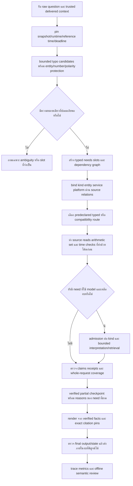

# เทคนิคจากงานวิจัยเพื่อแก้ปัญหา Flow ผสม PSU Esports

วันที่ค้นและสังเคราะห์: 11 พฤศจิกายน 2026 ฐานปัญหาคือ [ALL_KNOWN_ISSUES_TH.md](D:/CodexProjects/Big-PSU/r135_bounded_response_20261111/ALL_KNOWN_ISSUES_TH.md) จำนวน100กลุ่มประเด็น พร้อม143historical audit gaps และ76requirements

**ข้อเสนอหลักคือใช้เทคนิคหลายชั้นร่วมกัน โดยรักษาแกนที่ทำงานอยู่ ไม่เปลี่ยนทุกอย่างเป็นการถามโมเดลเพิ่ม:** provenance ราย field + relation-aware intent/slot binding + typed execution + arithmetic/set/time contracts + verified partial delivery ภายใต้งบเดียว + การตรวจคำตอบราย claim/need + behavioral tests ก่อนพิจารณาฝึก planner ใหม่

เอกสารนี้เป็น **งานวิจัยและแผนประยุกต์ ไม่ใช่ผล implementation ใหม่** ไม่มีการเรียก local model, เปลี่ยนน้ำหนัก, ติดตั้งแพ็กเกจ, รัน200/2111, เปลี่ยน owner/live/frozen หรือยกสถานะ48/76ให้เสร็จจากการมี paper อ้างอิง

## 1. ข้อค้นพบที่มีผลต่อการตัดสินใจ

1. **ชื่อคล้ายไม่พอ ต้องจับกับ schema และ relation:** RAT-SQL ใช้บริบทและความสัมพันธ์ schema ส่วน BLINK แยก retrieval/reranking เราควรนำหลักแยก candidate จากการยืนยันตัวตนมาใช้กับชนิดข้อมูล/บริการ/แพลตฟอร์ม ไม่ใช้ similarity เป็นหลักฐานสุดท้าย [RAT-SQL](https://aclanthology.org/2020.acl-main.677/), [BLINK](https://aclanthology.org/2020.emnlp-main.519/)
2. **โมเดลแปลโจทย์ได้ แต่ไม่ควรเป็นผู้คูณราคาเอง:** PAL แยกการแปลโจทย์ออกจาก runtime คำนวณ ส่วน FinQA บันทึก reasoning programs สำหรับเราให้ใช้ fixed typed arithmetic แทนโค้ดอิสระ พร้อม source-rate/หน่วย/จำนวนคนที่ยืนยันแล้ว [PAL](https://proceedings.mlr.press/v202/gao23f.html), [FinQA](https://aclanthology.org/2021.emnlp-main.300/)
3. **อ้างอิงกับความครบของคำตอบต้องวัดแยกกัน:** ALCE ตรวจคุณภาพ citation ส่วน FActScore ตรวจ atomic factual precision และระบุเองว่าไม่วัด recall จึงต้องเพิ่ม need coverage/abstention ของคำถามเรา ไม่ทำให้คำตอบดูแม่นโดยตอบน้อยลงทุกข้อ [ALCE](https://aclanthology.org/2023.emnlp-main.398/), [FActScore](https://aclanthology.org/2023.emnlp-main.741/)
4. **ทำให้เร็วด้วยการจัดงบและตัดงานเสริม ไม่ลดเงื่อนไขความจริง:** anytime computation ช่วยคิดเรื่องเวลาที่คุ้มค่า แต่ข้อเสนอ PSU คือส่งเฉพาะ verified partial; deadline ต้องส่งเวลาคงเหลือลงไปและตรวจ runningwork จริง ไม่ใช่แค่รอ Future ครบเวลา [Anytime](https://anytime.cs.umass.edu/shlomo/papers/Zaimag96.pdf), [gRPC deadlines](https://grpc.io/docs/guides/deadlines/), [Python3.12 Future](https://docs.python.org/3.12/library/concurrent.futures.html)
5. **การฝึกตาม Flow เก่าควรอยู่หลังแก้ข้อมูล/reader/contract:** sequence distillation เสนอใช้ teacheroutputs สอน student แต่ไม่ได้ทำให้ teacher ถูก ต้องคัดเจตนา/source/revision และแยก holdout ก่อน ข้อมูล2111ที่วัดแล้วห้ามกลายเป็นชุดสอนโดยยังอ้างเป็น unseen [Sequence-level KD](https://aclanthology.org/D16-1139/), [n-best reranking](https://aclanthology.org/2024.naacl-long.72/), [Leakage](https://doi.org/10.1016/j.patter.2023.100804)

ประโยชน์ของการรวมเทคนิคข้างต้นเป็นข้อเสนอทางวิศวกรรมของรายงานนี้ ไม่ใช่ผลทดลองที่ paper ใดรับรองบนข้อมูล PSU หรือเครื่องนี้ และไม่มีงานเดียวที่แก้ครบ100ประเด็นได้โดยตรง

## 2. วิธีค้นและข้อจำกัดของหลักฐาน

- ใช้โครงวางคำถาม/แบ่งกลุ่ม/relevance judgement ของ skill **paper-search-pro** สำหรับ engineering literature synthesis ตั้งต้นระดับ Standard แต่ **ไม่ได้รัน tierpipeline สำเร็จ**: configcheck พบ OpenAlex/NCBI/SemanticScholar/CrossRef ไม่พร้อม จึงหยุด APIhelper ตามคำสั่งใน SKILL ไม่ติดตั้งหรือสร้าง keys แทนผู้ใช้
- ค้นเว็บแยกกลุ่ม data/provenance, schema/entity/intent, ambiguity/negation/typos, numerical reasoning, citation/factuality, latency/reliability, evaluation/leakage, distillation/document extraction แล้วตรวจบทความต้นฉบับ/หน้าผู้วิจัย/เอกสารทางการ
- ไม่จำกัดปี เพื่อได้ทั้ง foundations และงานใหม่ มีงานปี2026ด้าน Thai orthography ที่ตรวจต้นฉบับเพิ่ม แต่ **ไม่ใช่การสแกนวรรณกรรมใหม่ปี2026ครบทุกหัวข้อ**
- คัดไว้31งานวิจัยและ11เอกสารทางการ;จำนวนนี้เป็น selected reference set ไม่ใช่จำนวน searchhits ทั้งหมด และไม่ใช่การเลือกตาม citationcount/impactfactor ไม่มี journal-rankfilter
- ส่วนใหญ่ตรวจ primary abstract/metadata และเลือกอ่าน method/limitation บางส่วน เช่น ALCEsection3.3, FActScoreprecision/recall, ThaiEditBenchTCC/over-edit, provenance และ anytime introduction ไม่กล่าวว่าอ่าน fulltext ครบ31งาน
- OpenReview บางหน้าเป็น browserchallenge จึงใช้ authorcamera-ready บน arXiv/officialauthorrepository;ConformalLM PDF timeout ใช้ abstract เท่านั้นและระบุเป็นแนวทางภายหลัง
- ไม่รัน PubMed เพราะไม่ใช่หัวข้อแพทย์;ไม่ใช้ Chineseboosters เพราะไม่มีคำขอ Chinese literature;ไม่ใช้ subagents ตามกฎโครงการ;จำแนก relevance ด้วย mainagent และบันทึก manualscore ที่ไม่ใช่ qualityrating
- ข้าม automaticmulti-indexretrieval/federation, citation-network expansion, L3metrics และ saturation estimator เพราะ APIpipeline ไม่พร้อม จึง **coverage_estimate=null** ไม่อ้าง PRISMA-compliant/systematic review หรือเปอร์เซ็นต์ครอบคลุมวรรณกรรม วิธีชดเชยคือค้นต่อเป็นกลุ่มจาก primarysources และระบุช่องว่างไว้;หากต้องการวัด coverage ต้องตั้งค่า helper แล้วรัน protocol ใหม่
- ส่ง Markdown ตามที่ผู้ใช้ขอ ไม่สร้าง/เปิด HTML แบบ14-step report;มี JSON/CSV/BibTeX เสริมสำหรับตรวจย้อนกลับ ไม่ทำ PRISMAlog จำลองจากข้อมูลค้นที่ไม่ได้เก็บครบ
- หยุดค้นแบบ targeted เมื่อทุกกลุ่มปัญหามีวิธีที่อธิบายกลไก จุดเชื่อม ข้อจำกัด และเกณฑ์ตรวจได้ แล้วสังเคราะห์เป็น26methodfamilies นี่เป็น stoppingrule เชิง engineering coverage ไม่ใช่ statistical literature saturation

วิธีที่ไม่ใช่ paper ถูกแยกเป็น E01–E11ชัดเจน เช่น SQLite/gRPC/SRE เอกสารเหล่านี้จำเป็นต่อ backup/cancellation/admission จริง การใช้ paperNLP แทนรายละเอียด API เหล่านี้จะไม่ตอบปัญหา runtime

## 3. แยกชนิดข้ออ้างก่อนนำมาใช้

| ป้าย | ความหมาย | ตัวอย่าง |
|---|---|---|
| หลักฐานจาก paper | วิธี/ข้อจำกัดที่ผู้วิจัยเสนอในขอบเขตของงานนั้น | FActScore วัด precision ไม่วัด needrecall ของ PSU |
| หลักการจากเอกสารทางการ | พฤติกรรม API/มาตรฐานที่ตรวจได้ | Future.cancel ไม่หยุด callable ที่กำลังทำงาน |
| ข้อเสนอประยุกต์ PSU | วิธีต่อเข้ากับ architecture และกฎข้อมูลของเรา | fixedarithmeticAST + source-bound billinglines |
| ต้องทดลองก่อนรับรอง | ยังไม่มีผลบน candidate/ข้อมูล/เครื่องของเรา | reranker ใหม่,conformalcalibration,ThaiTCCintegration,modeltraining |

**PROV/lineage ไม่สร้าง truth; validJSON ไม่สร้าง correctintent; exactarithmetic ไม่สร้าง correctrate; citation ไม่สร้าง authority; deadline ไม่สร้าง cancellation; teacher ไม่สร้าง gold** ต้องเชื่อม contract ของแต่ละชั้นและทดสอบด้วยกรณีที่อีกชั้นหนึ่งผิดด้วย

## 4. Flow ร่วมที่เสนอ



การตีความว่า “ใช้คำตอบใกล้ที่สุดถ้าคิดไม่ทัน” ในรุ่นที่เสนอต้องหมายถึง **candidate ที่ตรง target/field/service/platform/เงื่อนไขและผ่าน sourceverification แล้ว** ถ้าใกล้แต่คนละบริการหรือยังไม่ผ่าน ไม่ส่งเป็นข้อเท็จจริง อาจแสดงเพียงอัตราต่อหน่วยหรือข้อมูลบางส่วนที่ยืนยันได้พร้อมข้อจำกัด

### 4.1 สัญญาข้อมูลร่วมที่ควรมี

```text
Request: raw_text, raw_sha, session/turn, locale, snapshot_id, runtime_id,
         reference_time, monotonic_deadline
Need: raw_span, operation, desired_field, target_candidates,
      slot_owners, prerequisites, ambiguity_state
Binding: kind, record/revision, relationship_path, platform/service/audience,
         evidence_refs, outcome
Claim: typed_value, unit/currency, scope, validity_state, source_refs,
       calculation_or_set_or_time_proof, need_id
Delivery: delivered_claim_ids, unresolved_needs/reasons, terminal_state,
          rendered_fact_signature, citations, timing_receipts
```

เป็นข้อเสนอขยาย/จัดให้สอดคล้องกับ objects ที่มีอยู่ ไม่ใช่สร้าง model หรือ database ใหม่ทุกชั้น เริ่มจากทำ adapter ให้ typed/native/compatibility ใช้สัญญาร่วมที่มี แล้วเติมเฉพาะ field ที่ขาดจริง

### 4.2 จุดที่ควรเก็บของเดิมและจุดที่ควรปรับ

| ส่วนปัจจุบัน | ควรทำต่ออย่างไร | สิ่งที่ยังไม่ควรทำ |
|---|---|---|
| raw/snapshot/task/receipt/verifier | คงแกนและตรวจ invariants ระหว่างชั้น ลด duplicateinterpretation | เขียน Flow ใหม่ทิ้งหลักฐาน/identity ทั้งหมด |
| native_intents + vocabulary + task_registry | ใช้ description/positive-negativeexamples และ fieldcontract เดียว | เพิ่ม regex ชั้นเดียวแล้วถือทุก reader รองรับ |
| index/bind/receipt_scope | candidate→relation-proof แยกชัด | ให้ nearestentity หรือ platform เดียวกันเป็น proof |
| typo_recovery/input_derivation | reuseboundedhelpers,เพิ่ม unseen/clean/TCCcontrols | autocorrect ชื่อ/เลข/negative โดยไม่มี confirmation |
| calculation_check/billing | แยก unit/alternative/line_total และ independentsourcearithmetic | ให้โมเดลคิดเงินหรือรัน code ที่มันสร้างอิสระ |
| request_verifier/terminalstates | coverage มอง rawneeds และ constraints ที่ส่งจริง | ถือว่าทุก task ที่ planner สร้างผ่าน=ทั้งคำถามครบ |
| public_citations/renderer | claimpins+factpreservingtemplates | แปะ homepage ทุก answer หรือย่อจนเงื่อนไขหาย |
| modelgateway/admission | deadline ร่วม+halfopen+reasontraces ก่อนเปลี่ยน threshold | เพิ่ม concurrency/timeout หรือหยุด protectedmodel เพื่อเดาแก้ |
| trainingreview/optimizer | source-verifiedlabels+exactprotocol+familyholdout ภายหลัง | ฝึกจาก eval2111หรือ promoteweights จาก syntaxscore |

## 5. ชุดเทคนิคที่ใช้ร่วมกันได้จริง

### ชุด A — ผูกเจตนาเข้าต้นทางอย่างปลอดภัย

**M01 + M04 + M05 + M06 + M07**: data contract ให้ชนิดและ relation → schema descriptions ช่วยแปลเจตนา → typedplan ตรวจรูปแบบ → relation-awarebinding เลือก record → coverageledger ตรวจว่างานไม่ตก

ใช้กับ D08–D13, I01–I14 และ wrongtargetreceipts จุดเสริมกันคือ syntaxchecker ไม่ต้องเดา authority และ entityranker ไม่ต้องตัดสินว่าคำถามครบหรือยัง การลดจำนวน calls มาจากอ่าน contract เดียวกันทุก route ไม่ใช่ละ guard

### ชุด B — คำผิดโดยไม่แก้เจตนาเอง

**M09 + M10 + M04 + M11 + M21**: keyboard/errorchannel สร้าง candidates → minimaledit เก็บ rawdspan → protectedentity และ semanticshapecheck → ambiguity ถามกลับ → clean/unseencontrols วัด falsecorrection

เพิ่ม M08เมื่อมี negative การใช้ TCC ช่วยการจัดแนว/วัดคำผิดภาษาไทย แต่ไม่ได้สร้าง entitybinding หรือการตีความคำปฏิเสธให้เอง

### ชุด C — ราคาและแพ็กเกจ

**M01 + M02 + M04 + M12 + M16**: sourceamount/currency/unit/applicability → service/audiencebinding → typedarithmetic → renderedfacts ตรวจซ้ำ เพิ่ม M07เมื่อมีหลายงาน และ M13เมื่อเปรียบเทียบหลายตัวเลือก

ราคาเหมารวม/ช่วงคนต้องมี sourceunit ก่อนคูณ คำถามที่ไม่ระบุจำนวนคนอาจแสดง alternatives ได้ แต่ต้องไม่สร้างยอดรวม ไม่ใช้รายการราคาที่น่าจะถูกมาเดาเงินจริง

### ชุด D — เร็วขึ้นและไม่สูญเสียส่วนที่ตอบได้

**M07 + M17 + M18 + M19 + M16**: typedreads ก่อน → บันทึก successfulneeds → optionalmodel ภายใต้ remainingbudget → kindbreaker ป้องกันคิวพัง → reasontrace และ partialoutput ตรงกับสิ่งที่ส่ง

การส่ง partial ที่ปลอดภัยต้องใช้ M01/M15ด้วย ไม่ใช้ degraded response แบบ staleprice/liveoccupancy เพียงเพราะ SRE ยกตัวอย่าง staleresult ในระบบทั่วไป และไม่ใช้ hedgedinference หลายชุดบน GPU เดียว

### ชุด E — อ้างอิงและข้อมูลที่เปลี่ยน

**M01 + M03 + M15 + M25 + M24**: ingest ต้นฉบับ/ภาพแบบ offline → review แล้วเป็น draftrevision → request อ่าน snapshot เดียว → citations ตรง claim/revision → owneredit/withdrawinvalidatesproof ก่อน release

publicURL เป็นชั้นแสดงหลักฐาน ไม่ใช่เหตุให้เปลี่ยน unknownvalidity เป็น current หรือ draft เป็น published

### ชุด F — เวลาและสถานะสด

**M02 + M20 + M04 + M13 + M19**: แยก calendarfacet/timewindow → bind ทรัพยากรทุกตัว → verifyobservationset/freshness → tracebackendfailure แยก missingdata

Allenintervals ช่วยคำนวณ overlap/adjacency ไม่บอกว่าเครื่องว่างจริง ต้องมี observation จาก backend ตามเวลาที่ถาม

### ชุด G — วัดและเรียนรู้จาก Flow เก่า

**M21 + M22 + M15 + M23 + M24**: ตรวจพฤติกรรม/negativecontrols → frozenpaired+semanticreview → source-verifiedteacherlabels → familyholdout/exactprotocol → ค่อยฝึก/รับ candidate ตาม gates

ต้องแยกสองงาน: offline ตัวอย่างแก้ Flow/renderer ที่ไม่ฝึก weights กับ distillation ที่มี training จริง รายงานนี้เสนอวิธีจัดงานทั้งสอง แต่ไม่ได้ทำ training หรือรับประกัน student ชนะ teacher

## 6. เทคนิคที่ขัดกัน หรือห้ามใช้แทนกัน

| คู่/แนวทาง | จุดขัดกัน | วิธีใช้ร่วมอย่างถูกขอบเขต |
|---|---|---|
| fullrewrite spellchecker ↔ raw/entity provenance | อาจเปลี่ยนชื่อเลขหน่วยและความหมาย | minimaledits,protectedspans,validatedderivation;ชื่อกำกวม confirm |
| nearest/dense retrieval ↔ sourceauthority/relations | ใกล้ทางภาษาแต่คนละหน่วยงาน/บริการ | retrieve เป็น candidate;relation+authority ตรวจแยก |
| constrainedJSON ↔ correctplan | plan ถูก schema แต่ถามผิด field | validateIR แล้ว checkrawneeds+binding+source |
| FActScoreprecision ↔ answercompleteness | ตอบน้อยอาจดูแม่นมาก | วัด needrecall/coverage/abstention และ wrongclaim คู่กัน |
| softselectiveconfidence ↔ hardprice/sourceguards | model มั่นใจยังผิดเงินได้ | sourceinvariants เป็น hardgate;calibration ช่วย clarify ไม่เลี่ยง guard |
| iterativeSelf-RAG/CoT ↔ strictlatencybudget | เพิ่ม calls/เวลาคิวได้ | boundedfallback เมื่อ typed ไม่พอ;fulltraining/loops ไว้ภายหลัง |
| Futuretimeout ↔ หยุดงานจริง | thread/call ยังทำต่อแม้ caller หยุดรอ | transportdeadline+cooperativecancellation+tracklatecompletion;ไม่ killmodelservice |
| retry/hedging ↔ GPU เดียว/overload | คำขอซ้ำทำให้คิวหนักขึ้น | admissionlimits,halfopenprobe ที่ควบคุม;benchmark ไม่ retry เงียบ |
| cachedHTTP สด ↔ policy/currentlive | cachefresh ไม่เท่ากับ policy มีผลหรือเครื่องว่าง | validity กับ observationcontract แยกและบอกเวลาที่เห็น |
| citationhomepage ↔ clauseevidence | ลิงก์ไม่รองรับทุก claim | exactfield/section/revisionpins และ offlineclaimreview |
| OCR/Donutoutput ↔ sourcefinancialtruth | อ่านเลข/หัวตาราง/เงื่อนไขผิดได้ | offlinehumanreview ก่อน publish;ownerpriceoverride มี scope |
| teacherR134 ↔ goldlabels | teacher เคยตอบผิด unit/ขาดงาน/ใช้ policy เก่า | reviewsource+intent+version ก่อน pseudo-label และ quarantine |
| family-relatedtrain/dev ↔ unseenclaim | เฟรมภาษาใกล้กันข้าม split ทำให้ดู generalize | groupedsplit/freeze และ newholdout แยก seenregression |
| provenancehash ↔ factcorrectness | hash รับรอง bytes เดิมไม่รับรองความหมาย | semanticapplicability+ownerreview+positive/negativecontrols |

## 7. แผนนำมาใช้ที่ลดงานซ้ำ

| ระยะ | ทำเป็นกลุ่มร่วม | ผลที่ต้องได้ก่อนเดินต่อ | ไม่ทำในระยะนี้ |
|---|---|---|---|
| 0 เก็บ baseline และ trace | M19/M24 | 15mislabelcases มี causalreceipts;route/runtime/sourceidentity ชัด | ไม่ regradeR132หรือแก้ frozen |
| 1 sharedbinding/needcontract | M01/M04/M05/M06/M07 | wrongtarget/polarity/compoundpositive+negative ผ่านเส้นทางจริง | ไม่สร้าง reranker ใหม่ก่อน lexicalrelations ถูก |
| 2 deterministicfinance/time | M12/M13/M20/M02 | units/alternatives/multi-count/slots/validity ตรวจ source และ finaloutput | ไม่ใช้ LLM ทำ total หรือเดา live |
| 3 boundedruntime | M17/M18/M19 | verifiedsiblings รอดเมื่อ optionaltimeout;halfopenrecovery มีหลักฐาน | ไม่เพิ่ม inferenceworkers หรือปิด healthgate |
| 4 output/sourceupdates | M15/M16/M03/M25/M26 | ownerHTTPedit/withdraw และ citationinvalidation;TH/ENfacts ตรง | ไม่ OCR ทุก request/ติดตั้ง documentmodel โดยอัตโนมัติ |
| 5 unseenfocused+integration | M21/M22 | วัด typoovercorrection,needcoverage,wrongmoney,targeterrors,latency พร้อมกัน | ไม่ตี focusedcounts เป็น score รวม |
| 6 pairedbroadrun | M22/M24 | frozenmanifest,worker1,actualsemanticreview แยก literal,time/sourceconfounds | ไม่สุ่มชุดง่าย/เปลี่ยนเกณฑ์ให้คะแนนดี |
| 7 training เมื่อจำเป็น | M23/M22/M24 | source-reviewedcohort/protocolhash/split/gates พร้อม | ไม่ train จาก evalholdout หรือเปลี่ยน protectedweights |

### 7.1 เริ่มสิ่งที่ทำด้วยโค้ดและข้อมูลก่อนงานโมเดลหนัก

- เริ่มตอนนี้ในรอบ implementation ถัดไปได้: trace/reasontaxonomy,sharedneed/bindingcontracts,deterministicunits/sets/intervals,exactcitations,factpreservingtemplates,focusedcontrols และ ownerHTTPbridge
- ต้องการข้อมูล/การตรวจจากเจ้าของ: operatorrole/authority,effectivedates,conflictingpriceimages,fullattachmentcontent และ publicationapproval กรณีเหล่านี้ paper ไม่สร้างคำตอบแทนเจ้าของได้
- ไว้หลังผลชุดข้างบน: denseentityreranker,grammar-constrainedlocaldecoding ที่ backend ต้องรองรับ,TCCimplementation ที่ต้องประเมิน,documentmodel ใหม่,fullSelf-RAG/conformalLM,plannertraining

### 7.2 ตัวเลขงบเวลาเป็นค่าทดลอง ไม่ใช่ค่าที่ paper กำหนด

ใช้20วินาทีจาก candidate ปัจจุบันเป็น baseline ได้ แต่ต้องวัดก่อนปรับ ไม่ใช่ยืนยันว่าทุกคำถามควรเสร็จใน20วินาทีด้วย paper เวลาต่อ stage ต้องไม่รวมกันเกิน requestbudget และต้องกันเวลาตรวจ/ส่งผลไว้ด้วย

```text
remaining = request_deadline - monotonic_now
typed_reads_and_checks()
checkpoint_verified_claims()
if unresolved_need and remaining > delivery_reserve + minimum_model_budget:
    admit_one_bounded_optional_stage_if_allowed()
verify_coverage_and_render_current_verified_subset()
```

เป็น pseudocode นโยบายที่เสนอ ไม่ใช่แพตช์ runtime ใหม่ และ“หนึ่ง optionalstage”อาจต้องแยก protocol เฉพาะงาน ไม่ยืนยันว่าโมเดลทุก kind แก้ได้ด้วยหนึ่ง call

## 8. เกณฑ์วัดว่าการรวมเทคนิคดีขึ้นจริง

| มิติ | ตัวตั้ง/ตัวหารที่ควรบันทึก | ข้อห้ามในการสรุป |
|---|---|---|
| wrongtarget/wrongmoney/withdrawnleak | จำนวน deliveredwrongclaims ต่อกรณี critical ที่ review แล้ว | 0ใน controls ไม่เท่ากับ0ทุกคำถามจริง |
| factualprecision | supportedatomicclaims / deliveredverifiableclaims ที่ตรวจ source แล้ว | ไม่เรียกทั้งระบบ accuracy ถ้าเลือก review แค่บางข้อ |
| requestedneedcoverage | needs ที่ตอบถูกตาม source / needs ที่ answerable ใน snapshot ตาม review | ไม่ใช้ plannedtasks เป็นตัวหารอย่างเดียว |
| correctclarification | clarification ที่จำเป็นและถาม slot ถูก / กรณีที่ review ว่า needsclarification | ถามกลับทุกข้อไม่ถือผ่าน availability |
| typoquality | correctedit/wrongedit/keep/miss/clarify แยก mechanism,length,entity,locale | ไม่ fitthreshold บน heldout และไม่วัดแต่คำผิดที่สร้างเอง |
| citationquality | supportprecision+claimcoverage พร้อม source/revision ที่ใช้ | มี URL ไม่เท่ากับทั้ง answer มีหลักฐาน |
| availability | complete/partial/clarify/unconfirmed/systemfailure พร้อมสาเหตุ | HTTP200และ knownfield ไม่เท่ากับตอบเจตนาถูก |
| latency | wall/queue/admission/model/read/verify/render,p50/p95/p99,deadlineoverrun | median ดีไม่พิสูจน์ tail ดี และ failedfast ไม่เท่ากับ answerfast |
| lifecycle | add/edit/withdraw/validitychange และ same-instance+HTTP/editorpositive | noanswer หลัง withdraw อย่างเดียวไม่รับรอง remainingavailability |
| broadcomparison | exactquestionkeys/criteria,source/runtime/time,pairedchanges | เกณฑ์ policy เก่าไม่เปลี่ยนเงียบและไม่อ้าง causalFloweffect จาก observationalcompare |

พิจารณา confidenceinterval และ pairedanalysis เมื่อมีจำนวน review พอ โดย resample ตาม question/family ถ้า gradeidentities หรือ paraphrases พึ่งพากัน ไม่คิดว่า criteria หลายข้อในคำถามเดียวเป็น independentobservations ทั้งหมด และต้องเก็บข้อผิดจริงไม่ใช้ LLMjudge ลบออก

## 9. คำตอบต่อคำถาม “เอาเทคนิคไหนมาใช้ร่วมกันคุ้มที่สุด”

สำหรับสถานะปัจจุบันเลือก **ชุด A+B+C+D+E แบบขอบเขตเล็กก่อน** โดย reuseR135contracts เดิมและ R134reader ที่ประกาศ route ไว้ แก้ sharedbinding/needcontract ครั้งเดียวให้ทุกหมวดได้ประโยชน์ แล้วใช้ typedfinance/time และ verifiedpartial เพื่อลดความเสี่ยงกับเวลา

ใช้ CheckList-stylecontrols และ source/intentreview เป็นวิธีตัดสินผลร่วมกันทุกชุด เมื่อพบว่า source ขาดให้แก้ข้อมูลหรือประกาศข้อจำกัด เมื่อพบว่า reader ไม่มี predicate ให้แก้ reader ไม่ส่งทั้งสองอย่างไปให้ model คิดนานขึ้นทุกครั้ง ส่วน distillation ให้เรียนเฉพาะพฤติกรรมที่ตรวจแล้วภายหลัง เพื่อไม่สอน student ให้จำความผิดของ teacher และไม่ฝังข้อมูลธุรกิจที่เปลี่ยนบ่อยใน weights

หัวข้อต่อไปเชื่อมเทคนิคเป็นราย ID ครบ100ประเด็นและ143historicalgaps โดยทุกแถวเป็นข้อเสนอ/เกณฑ์ทดลอง ไม่ใช่การปิด issue

### คำเทคนิคที่ใช้ในตารางด้านล่าง

| คำ | ความหมายในโครงการนี้ |
|---|---|
| provenance / lineage | ร่องรอยว่าค่าหรือคำตอบมาจากข้อมูลฉบับใดและผ่านขั้นตอนใด |
| schema / typed IR | สัญญาชนิดข้อมูลและแผนกลางที่แยกงาน/ค่า/หน่วยอย่างตรวจสอบได้ |
| binding / entity linking | การผูกสิ่งที่ผู้ใช้หมายถึงกับ record จริง ไม่ใช่แค่ชื่อคล้าย |
| need / slot owner | สิ่งที่ต้องตอบ และงานที่เป็นเจ้าของเวลา จำนวนคน หรือเงื่อนไขนั้น |
| coverage / completeness | ตอบสิ่งที่ถามครบหรือได้สมาชิกในชุดครบตามขอบเขตที่ประกาศ |
| authority / validity | ใครมีอำนาจยืนยันข้อมูลนั้น และข้อมูลมีผลช่วงใด เป็นคนละเรื่องกับมี URL |
| freshness / observation | ความใหม่ของผลที่ตรวจเห็น โดยเฉพาะสถานะว่างจริง ไม่ใช่เวลาเปิดตามตาราง |
| admission / circuit breaker | การรับงานเข้าโมเดลและการพักบางเส้นทางเมื่อพบความผิดพลาด |
| half-open | เปิดให้คำขอทดลองจำนวนจำกัดผ่านเพื่อตรวจว่าฟื้นแล้ว ไม่ปล่อยคิวทั้งหมดทันที |
| invariant / gate | เงื่อนไขที่ต้องคงจริง และเกณฑ์ก่อนยอมรับหรือเปิดเส้นทางนั้น |
| calibration / risk–coverage | การตั้งเกณฑ์จากข้อมูลแยก และดูจำนวนที่ยอมตอบควบคู่กับความเสี่ยงผิด |
| heldout / leakage | ข้อมูลที่กันไว้ตรวจการใช้งานใหม่ และปัญหาที่ข้อมูลตรวจหลุดเข้าไปใช้พัฒนา/ฝึก |
| regression / lifecycle | ตรวจของเดิมไม่เสีย และตรวจหลังเจ้าของเพิ่ม แก้ ถอนข้อมูล |

<!-- GENERATED_RESEARCH -->
## 10. รายละเอียดเทคนิคทั้ง 26 กลุ่ม

ทุกช่อง “นำมาใช้” ด้านล่างเป็นข้อเสนอ PSU ที่สังเคราะห์ขึ้นจากหลักฐาน ไม่ใช่การอ้างว่าผู้วิจัยทดสอบ implementation นี้แล้ว หลายส่วนมีอยู่ใน candidate บางขอบเขต ให้ตรวจ code/data/config/HTTP ล่าสุดก่อนตัดสินว่าต้องเพิ่มส่วนใด

<a id="method-m01"></a>
### M01 — Field-level provenance และ data contract

- **หลักฐานต้นฉบับ:** [R01: Provenance Semirings](https://www.cs.ucdavis.edu/~green/papers/pods07.pdf), [R02: Datasheets for Datasets](https://arxiv.org/abs/1803.09010), [E01: PROV-DM: The PROV Data Model](https://www.w3.org/TR/prov-dm/)
- **วิธีนำมาใช้กับ PSU:** เก็บค่าราย field พร้อม source locator/hash/revision, scope, authority state, valid interval, observed time และความสัมพันธ์;แยก known/unknown/not_applicable/conflict
- **จุดเชื่อม:** schema/projection/source authority/public citations
- **เกณฑ์ที่ต้องตรวจ:** source เดิมแต่ผิด field/target ต้องตก;owner แก้ค่าต้อง invalidateclaim/citation เดิม
- **ข้อจำกัด/สิ่งที่ห้ามสรุป:** lineage บอกที่มาไม่ตัดสินว่าหน่วยงานใดมีอำนาจ;ต้องเจ้าของยืนยันช่องที่ขาด
- **ใช้ร่วมกับ:** [M02](#method-m02), [M03](#method-m03), [M04](#method-m04), [M15](#method-m15), [M24](#method-m24)
- **ลักษณะต้นทุนที่ประเมินเชิงออกแบบ:** low online; moderate data review — ยังไม่ใช่เวลาหรือ benchmark ใหม่

<a id="method-m02"></a>
### M02 — Temporal applicability และ freshness แยกชนิดเวลา

- **หลักฐานต้นฉบับ:** [R27: Maintaining Knowledge about Temporal Intervals](https://cse.unl.edu/~choueiry/Documents/Allen-CACM1983.pdf), [E10: RFC 9111: HTTP Caching](https://www.rfc-editor.org/rfc/rfc9111.html)
- **วิธีนำมาใช้กับ PSU:** แยก effective_from/to, recorded_at, observed_at, freshnessTTL, requestreference และ requestedwindow;normalize interval พร้อม timezone
- **จุดเชื่อม:** temporal/policy/calendar/live/news
- **เกณฑ์ที่ต้องตรวจ:** adjacent/cross-midnight/expired/future/unknown ต้องได้สถานะถูก;cache สดแต่ policy หมดอายุต้องไม่ผ่าน
- **ข้อจำกัด/สิ่งที่ห้ามสรุป:** TTL ไม่แทน validity และไม่สร้างเวลาว่างจริงจากตาราง
- **ใช้ร่วมกับ:** [M01](#method-m01), [M03](#method-m03), [M12](#method-m12), [M20](#method-m20)
- **ลักษณะต้นทุนที่ประเมินเชิงออกแบบ:** low online; source dates may require owner — ยังไม่ใช่เวลาหรือ benchmark ใหม่

<a id="method-m03"></a>
### M03 — Transactional snapshot, revision-keyed cache และ lifecycle

- **หลักฐานต้นฉบับ:** [E02: Isolation In SQLite](https://www.sqlite.org/isolation.html), [E03: SQLite Online Backup API](https://www.sqlite.org/backup.html), [R01: Provenance Semirings](https://www.cs.ucdavis.edu/~green/papers/pods07.pdf)
- **วิธีนำมาใช้กับ PSU:** pin records+source bodies ใน readtransaction เดียว;cache ตาม snapshot/epoch/revision/runtime;add/edit/withdraw สร้าง revision ใหม่และ rebuild ผลที่พึ่งพา
- **จุดเชื่อม:** MigratedView/DraftSnapshotView/owner/store/cache
- **เกณฑ์ที่ต้องตรวจ:** readerinstance เดิมหลัง edit เห็นใหม่;ถอนแล้วไม่อ้าง claim/receipt/citation แต่ siblings ยังตอบ;backuprestore ได้
- **ข้อจำกัด/สิ่งที่ห้ามสรุป:** transaction ไม่ซ่อม scope ผิดหรือ applicationcache ที่ลืม key;ห้ามแตะ frozen/live
- **ใช้ร่วมกับ:** [M01](#method-m01), [M02](#method-m02), [M19](#method-m19), [M24](#method-m24)
- **ลักษณะต้นทุนที่ประเมินเชิงออกแบบ:** low online; moderate integration — ยังไม่ใช่เวลาหรือ benchmark ใหม่

<a id="method-m04"></a>
### M04 — Two-stage entity linking ที่ตรวจ relation

- **หลักฐานต้นฉบับ:** [R03: RAT-SQL: Relation-Aware Schema Encoding and Linking for Text-to-SQL Parsers](https://aclanthology.org/2020.acl-main.677/), [R04: Scalable Zero-shot Entity Linking with Dense Entity Retrieval](https://aclanthology.org/2020.emnlp-main.519/)
- **วิธีนำมาใช้กับ PSU:** สร้าง candidates ด้วย alias/lexical ก่อน;rank ด้วย context,kind,description;finalbind ผ่าน game→offering→service→resource→zone/platform ที่มี source
- **จุดเชื่อม:** index/bind/receipt_scope/game/control readers
- **เกณฑ์ที่ต้องตรวจ:** ชื่อร่วม/ผิด edition/platform/หน่วยงาน/withdrawnrelation ต้องไม่ส่ง;unknown ไม่เลือกอันดับหนึ่งเอง
- **ข้อจำกัด/สิ่งที่ห้ามสรุป:** ไม่ต้องติดตั้ง BLINK ทันที;similarity สร้าง candidate ไม่ใช่ proof
- **ใช้ร่วมกับ:** [M01](#method-m01), [M05](#method-m05), [M11](#method-m11), [M13](#method-m13)
- **ลักษณะต้นทุนที่ประเมินเชิงออกแบบ:** low lexical first; trained reranker later — ยังไม่ใช่เวลาหรือ benchmark ใหม่

<a id="method-m05"></a>
### M05 — Description-driven intents/slots และ desired output

- **หลักฐานต้นฉบับ:** [R05: Description-Driven Task-Oriented Dialog Modeling](https://arxiv.org/abs/2201.08904), [R03: RAT-SQL: Relation-Aware Schema Encoding and Linking for Text-to-SQL Parsers](https://aclanthology.org/2020.acl-main.677/)
- **วิธีนำมาใช้กับ PSU:** นิยาม operation/field ด้วยคำอธิบายและ positive/negativeexamples;slot ทุกตัวมี owner task/span;definition/usage/location/spec/price/total/live แยกกัน
- **จุดเชื่อม:** native_intents/vocabulary/task_registry/planner schema
- **เกณฑ์ที่ต้องตรวจ:** schema เพิ่ม field แล้ว normalchat อ่านได้;noextra task จากใบเสนอราคา/ชื่อ package/uses-for
- **ข้อจำกัด/สิ่งที่ห้ามสรุป:** prompt/schema ดีขึ้นไม่แก้ modelavailability และไม่พิสูจน์ intent ทุกข้อความ
- **ใช้ร่วมกับ:** [M04](#method-m04), [M06](#method-m06), [M07](#method-m07), [M11](#method-m11)
- **ลักษณะต้นทุนที่ประเมินเชิงออกแบบ:** low bounded parsing; optional model once — ยังไม่ใช่เวลาหรือ benchmark ใหม่

<a id="method-m06"></a>
### M06 — Typed intermediate plan และ constrained validation

- **หลักฐานต้นฉบับ:** [R06: PICARD: Parsing Incrementally for Constrained Auto-Regressive Decoding from Language Models](https://aclanthology.org/2021.emnlp-main.779/), [R12: FinQA: A Dataset of Numerical Reasoning over Financial Data](https://aclanthology.org/2021.emnlp-main.300/)
- **วิธีนำมาใช้กับ PSU:** รับแผนเป็น typed IR;validate types/enums/IDs/limits/duplicatekeys และ capability ราย operation;หาก backend รองรับค่อยทดลอง grammar constrained decoding แยก
- **จุดเชื่อม:** plan_contract/understanding/compiler/model protocol
- **เกณฑ์ที่ต้องตรวจ:** invalidplan/protocoloversize ถูก reject พร้อมเหตุ;valid syntax แต่ wrongentity ยังต้องถูก sourceguard
- **ข้อจำกัด/สิ่งที่ห้ามสรุป:** PICARDinspiredsyntax ไม่ใช่ semanticproof;ห้ามอ้างเปิด constraineddecoder แล้ว
- **ใช้ร่วมกับ:** [M04](#method-m04), [M05](#method-m05), [M07](#method-m07), [M12](#method-m12)
- **ลักษณะต้นทุนที่ประเมินเชิงออกแบบ:** low post-validation; decoding integration later — ยังไม่ใช่เวลาหรือ benchmark ใหม่

<a id="method-m07"></a>
### M07 — Explicit need graph และ independent coverage ledger

- **หลักฐานต้นฉบับ:** [R30: Decomposed Prompting: A Modular Approach for Solving Complex Tasks](https://arxiv.org/abs/2210.02406), [R21: Beyond Accuracy: Behavioral Testing of NLP Models with CheckList](https://aclanthology.org/2020.acl-main.442/)
- **วิธีนำมาใช้กับ PSU:** เก็บ need จาก rawspans,task/slotowners,prerequisites และ conditionaledges;runtypedneeds ก่อน;ปิด need เมื่อผ่าน output+constraintcoverage เท่านั้น
- **จุดเชื่อม:** routing/compiler/task_execution/request_verifier
- **เกณฑ์ที่ต้องตรวจ:** ราคา+จองครบทั้งคู่;หนึ่ง needunknown ยังไม่ทิ้ง siblings;both/unless prerequisite ไม่ผ่านต้องไม่กล่าวผลสำเร็จ
- **ข้อจำกัด/สิ่งที่ห้ามสรุป:** ใช้ graph ภายในไม่ใช้ subagents;observer ที่ sharebug กับ planner ต้องมี humancontrastivecheck
- **ใช้ร่วมกับ:** [M05](#method-m05), [M06](#method-m06), [M11](#method-m11), [M17](#method-m17), [M21](#method-m21)
- **ลักษณะต้นทุนที่ประเมินเชิงออกแบบ:** bounded linear graph; no recursive LLM loop — ยังไม่ใช่เวลาหรือ benchmark ใหม่

<a id="method-m08"></a>
### M08 — Polarity/scope model และ contrastive negation tests

- **หลักฐานต้นฉบับ:** [R07: CONDAQA: A Contrastive Reading Comprehension Dataset for Reasoning about Negation](https://aclanthology.org/2022.emnlp-main.598/), [E11: OWL 2 Web Ontology Language Primer (Second Edition)](https://www.w3.org/TR/owl2-primer/)
- **วิธีนำมาใช้กับ PSU:** แทน actor/action/polarity/scope/exception ชัด;เทียบ positive/negative/scope-shift;absence-list ต้องมี completeuniverse หรือ explicitnegativefacts
- **จุดเชื่อม:** native_intents/policy/request_verifier/negativecatalog gate
- **เกณฑ์ที่ต้องตรวจ:** ไม่มีเกมไม่คืน positivecatalog;นำเข้า/ดื่มและห้าม/ยกเว้นต้องต่าง;ambiguous ถามกลับ
- **ข้อจำกัด/สิ่งที่ห้ามสรุป:** EnglishCondaQA ไม่รับรอง Thai;ห้ามเปลี่ยนประโยคปฏิเสธเป็นบวกแล้วส่งโดยไม่ verify
- **ใช้ร่วมกับ:** [M05](#method-m05), [M07](#method-m07), [M11](#method-m11), [M13](#method-m13), [M21](#method-m21)
- **ลักษณะต้นทุนที่ประเมินเชิงออกแบบ:** low bounded rules; semantics review required — ยังไม่ใช่เวลาหรือ benchmark ใหม่

<a id="method-m09"></a>
### M09 — Noisy-channel spelling candidates แบบรักษา entity

- **หลักฐานต้นฉบับ:** [R08: An Improved Error Model for Noisy Channel Spelling Correction](https://aclanthology.org/P00-1037/), [R10: Misspelling Semantics in Thai](https://aclanthology.org/2022.lrec-1.24/)
- **วิธีนำมาใช้กับ PSU:** เพิ่ม keyboardgeometry และ insert/delete/transposecandidates ใน intentframes;protectsourceentities/numbers/URLs/conditions;rank ด้วย cost+context
- **จุดเชื่อม:** typo_recovery/keyboard helpers
- **เกณฑ์ที่ต้องตรวจ:** คำผิด knownframe ดีขึ้นและ clean ชื่อ/เลข/expressive ไม่ถูกแก้;เก็บ raw และ candidates
- **ข้อจำกัด/สิ่งที่ห้ามสรุป:** cost ไม่ใช่ probability;ชื่อผิดใกล้หลาย entity ต้องเลือกยืนยัน ไม่ nearestalways
- **ใช้ร่วมกับ:** [M04](#method-m04), [M10](#method-m10), [M11](#method-m11), [M21](#method-m21)
- **ลักษณะต้นทุนที่ประเมินเชิงออกแบบ:** low bounded candidate count — ยังไม่ใช่เวลาหรือ benchmark ใหม่

<a id="method-m10"></a>
### M10 — Minimal edit, KEEP และ Thai-character-cluster evaluation

- **หลักฐานต้นฉบับ:** [R09: GECToR – Grammatical Error Correction: Tag, Not Rewrite](https://aclanthology.org/2020.bea-1.16/), [R11: ThaiEditBench: A Mechanism-Typed, Length-Stratified Benchmark for Thai Orthographic Error Correction](https://aclanthology.org/2026.aacl-short.17/)
- **วิธีนำมาใช้กับ PSU:** เก็บ editspans และ validatedderivation;KEEP ถ้าตีความเดิมครบ;แยก TCC จาก codepoint ในการวัดและเพิ่ม support เฉพาะที่ทดสอบ
- **จุดเชื่อม:** typo_recovery/input_derivation/normalization
- **เกณฑ์ที่ต้องตรวจ:** compound ไม่ตกงานหลังแก้;forgedexecution ตก;วัด falsecorrection ตามกลไกและความยาว
- **ข้อจำกัด/สิ่งที่ห้ามสรุป:** ไม่ได้ติดตั้ง GECToR/TCCtagger;sharedrecomputation ไม่เป็น independentsemantics
- **ใช้ร่วมกับ:** [M07](#method-m07), [M09](#method-m09), [M11](#method-m11), [M21](#method-m21)
- **ลักษณะต้นทุนที่ประเมินเชิงออกแบบ:** low bounded edits; TCC integration separate — ยังไม่ใช่เวลาหรือ benchmark ใหม่

<a id="method-m11"></a>
### M11 — Targeted clarification และ risk–coverage

- **หลักฐานต้นฉบับ:** [R18: Selective Classification for Deep Neural Networks](https://proceedings.neurips.cc/paper/2017/hash/4a8423d5e91fda00bb7e46540e2b0cf1-Abstract.html), [R31: CLAMBER: A Benchmark of Identifying and Clarifying Ambiguous Information Needs in Large Language Models](https://aclanthology.org/2024.acl-long.578/), [R29: Conformal Language Modeling](https://proceedings.iclr.cc/paper_files/paper/2024/hash/31421b112e5f7faf4fc577b74e45dab2-Abstract-Conference.html)
- **วิธีนำมาใช้กับ PSU:** ถามเฉพาะ slot/ความหมายที่จำเป็น;มี candidate ต่าง target/quantity ให้ยืนยัน;calibrateaccept/reject บนชุดแยกและรายงาน coverage คู่ error
- **จุดเชื่อม:** followup_scope/clarification/need states
- **เกณฑ์ที่ต้องตรวจ:** questionmissingword ถาม domain;missingrate ไม่ถาม service ซ้ำ;positive ยังตอบได้ ไม่ abstain ทั้งหมด
- **ข้อจำกัด/สิ่งที่ห้ามสรุป:** ยังไม่ให้ conformalguarantee;R29samplingcost สูงและต้อง assumptions จัดเป็นงานภายหลัง
- **ใช้ร่วมกับ:** [M04](#method-m04), [M07](#method-m07), [M08](#method-m08), [M09](#method-m09), [M17](#method-m17), [M22](#method-m22)
- **ลักษณะต้นทุนที่ประเมินเชิงออกแบบ:** low deterministic clarification; calibration offline — ยังไม่ใช่เวลาหรือ benchmark ใหม่

<a id="method-m12"></a>
### M12 — Source-bound arithmetic program และ dimensional checks

- **หลักฐานต้นฉบับ:** [R12: FinQA: A Dataset of Numerical Reasoning over Financial Data](https://aclanthology.org/2021.emnlp-main.300/), [R13: TAT-QA: A Question Answering Benchmark on a Hybrid of Tabular and Textual Content in Finance](https://aclanthology.org/2021.acl-long.254/), [R14: PAL: Program-aided Language Models](https://proceedings.mlr.press/v202/gao23f.html)
- **วิธีนำมาใช้กับ PSU:** แปลง sourcefacts+quantityowners เป็น allowlistedAST:unit_rate/alternative/line_total/sum;Decimal+currency/unit/duration/audience/service และ receipt แยก
- **จุดเชื่อม:** billing/calculation_check/obligation_verifier
- **เกณฑ์ที่ต้องตรวจ:** positiveownereditrecomputes;forgedrate/total/quantity/output ตก;rangeprice ไม่ถูกคูณต่อคนเอง
- **ข้อจำกัด/สิ่งที่ห้ามสรุป:** ไม่รัน code จาก model;ถูกเลขแต่ผิด rate ยังผิด ต้องผูก semantics ก่อน
- **ใช้ร่วมกับ:** [M01](#method-m01), [M02](#method-m02), [M04](#method-m04), [M06](#method-m06), [M07](#method-m07), [M16](#method-m16)
- **ลักษณะต้นทุนที่ประเมินเชิงออกแบบ:** low deterministic arithmetic — ยังไม่ใช่เวลาหรือ benchmark ใหม่

<a id="method-m13"></a>
### M13 — Declared collection scope และ set completeness

- **หลักฐานต้นฉบับ:** [R01: Provenance Semirings](https://www.cs.ucdavis.edu/~green/papers/pods07.pdf), [E11: OWL 2 Web Ontology Language Primer (Second Edition)](https://www.w3.org/TR/owl2-primer/), [R21: Beyond Accuracy: Behavioral Testing of NLP Models with CheckList](https://aclanthology.org/2020.acl-main.442/)
- **วิธีนำมาใช้กับ PSU:** ระบุ universe/filter/grouping/source-membership ของ list/count/compare;ตรวจ exactset หรือ explicitconfirmedsubset;ไม่ unionlists คนละ service
- **จุดเชื่อม:** collection_contract/inventory/game/rules comparison
- **เกณฑ์ที่ต้องตรวจ:** ตัดสมาชิก/option/field แล้วไม่ complete;wrongzone ไม่คืน all;absence ต้อง closedset ที่ source ประกาศ
- **ข้อจำกัด/สิ่งที่ห้ามสรุป:** ไม่มีข้อมูลไม่เท่ากับ false;รายชื่อที่บันทึกไม่รับรอง physicalworld ทั้งหมด
- **ใช้ร่วมกับ:** [M01](#method-m01), [M04](#method-m04), [M07](#method-m07), [M08](#method-m08), [M15](#method-m15)
- **ลักษณะต้นทุนที่ประเมินเชิงออกแบบ:** low set operations — ยังไม่ใช่เวลาหรือ benchmark ใหม่

<a id="method-m14"></a>
### M14 — Bounded retrieve–check สำหรับข้อความที่ typed อ่านไม่ได้

- **หลักฐานต้นฉบับ:** [R17: Self-RAG: Learning to Retrieve, Generate, and Critique through Self-Reflection](https://arxiv.org/abs/2310.11511), [R03: RAT-SQL: Relation-Aware Schema Encoding and Linking for Text-to-SQL Parsers](https://aclanthology.org/2020.acl-main.677/)
- **วิธีนำมาใช้กับ PSU:** retrieve เฉพาะ source/field ที่ bound แล้ว;rankclauses และตรวจ support/conditions/dependencies;อนุญาต refinement จำนวนจำกัดใน budget
- **จุดเชื่อม:** compatibility/source quote/rules/policy fallback
- **เกณฑ์ที่ต้องตรวจ:** knownclause ตอบได้;wrongevent/negatednote/genericexploit แทน boost ไม่ผ่าน;no post-reject bypass
- **ข้อจำกัด/สิ่งที่ห้ามสรุป:** ไม่ใช่ Self-RAGtrained และไม่เพิ่ม self-criticloop ทุกคำถาม;ไม่มี evidence ต้องคง unknown
- **ใช้ร่วมกับ:** [M01](#method-m01), [M04](#method-m04), [M07](#method-m07), [M15](#method-m15), [M17](#method-m17)
- **ลักษณะต้นทุนที่ประเมินเชิงออกแบบ:** moderate optional; limit model call count — ยังไม่ใช่เวลาหรือ benchmark ใหม่

<a id="method-m15"></a>
### M15 — Atomic claims, citation precision และ answer coverage

- **หลักฐานต้นฉบับ:** [R15: Enabling Large Language Models to Generate Text with Citations](https://aclanthology.org/2023.emnlp-main.398/), [R16: FActScore: Fine-grained Atomic Evaluation of Factual Precision in Long Form Text Generation](https://aclanthology.org/2023.emnlp-main.741/)
- **วิธีนำมาใช้กับ PSU:** แยก claims ต่อ need พร้อม evidence;ตรวจ support/precision และ citationcoverage;แยก URLpublic จาก internalreceipt และวัด requestedneedrecall เพิ่ม
- **จุดเชื่อม:** finish/public_citations/offline semantic review
- **เกณฑ์ที่ต้องตรวจ:** citationwrongrevision ตก;หนึ่ง citation ไม่รับรองทั้ง paragraph;ตรวจทั้ง claims ผิดและ needs ที่ไม่ตอบ
- **ข้อจำกัด/สิ่งที่ห้ามสรุป:** FActScoreprecision ไม่ลงโทษตอบน้อย;LLM/NLIjudge ไม่ใช่ gold และต้อง Thai/sourceaudit
- **ใช้ร่วมกับ:** [M01](#method-m01), [M07](#method-m07), [M13](#method-m13), [M16](#method-m16), [M22](#method-m22)
- **ลักษณะต้นทุนที่ประเมินเชิงออกแบบ:** low exactpins online; semantic judge offline — ยังไม่ใช่เวลาหรือ benchmark ใหม่

<a id="method-m16"></a>
### M16 — Fact-preserving renderer และ output contract

- **หลักฐานต้นฉบับ:** [R15: Enabling Large Language Models to Generate Text with Citations](https://aclanthology.org/2023.emnlp-main.398/), [R12: FinQA: A Dataset of Numerical Reasoning over Financial Data](https://aclanthology.org/2021.emnlp-main.300/), [R21: Beyond Accuracy: Behavioral Testing of NLP Models with CheckList](https://aclanthology.org/2020.acl-main.442/)
- **วิธีนำมาใช้กับ PSU:** format จาก verifiedtypedclaims;template ตาม desiredoutput;ตรวจ money/units/names/polarity/dateconditions กับ renderedrepresentation;notice ผูก need
- **จุดเชื่อม:** customer_render/finish/final delivery
- **เกณฑ์ที่ต้องตรวจ:** 0บาท/จำนวนคน/หน่วย/ข้อยกเว้นไม่เปลี่ยน;renderreject ถอน deliveryproof;partial ไม่กลาย supported
- **ข้อจำกัด/สิ่งที่ห้ามสรุป:** regex ยังไม่ generalsemanticvalidator;freeparaphrase ใช้เฉพาะ field ที่ไม่ทำ facts หาย
- **ใช้ร่วมกับ:** [M07](#method-m07), [M12](#method-m12), [M15](#method-m15), [M17](#method-m17)
- **ลักษณะต้นทุนที่ประเมินเชิงออกแบบ:** low templates; limited paraphrase optional — ยังไม่ใช่เวลาหรือ benchmark ใหม่

<a id="method-m17"></a>
### M17 — Shared deadline และ verified partial delivery

- **หลักฐานต้นฉบับ:** [R19: Using Anytime Algorithms in Intelligent Systems](https://anytime.cs.umass.edu/shlomo/papers/Zaimag96.pdf), [R20: The Tail at Scale](https://research.google/pubs/the-tail-at-scale/), [E04: gRPC Deadlines](https://grpc.io/docs/guides/deadlines/), [E09: Python 3.12 concurrent.futures](https://docs.python.org/3.12/library/concurrent.futures.html)
- **วิธีนำมาใช้กับ PSU:** pinmonotonicdeadline เดียว;จองเวลาส่งผล;typedreads ก่อน optionalmodel;checkpointverifiedclaims;หมดงบส่งเฉพาะที่ผ่านและระบุส่วนที่ค้าง
- **จุดเชื่อม:** budget/model_gateway/task_execution/API
- **เกณฑ์ที่ต้องตรวจ:** slowoptionalneed ไม่ทำ typedanswer หาย;no newcall หลัง deadline;timeout ไม่กลาย nosource;ตรวจ orphanwork
- **ข้อจำกัด/สิ่งที่ห้ามสรุป:** Futuretimeout ไม่ killrunningcall;partial ต้องไม่ใช้ใกล้เคียงผิด scope ไม่หยุด protectedmodel
- **ใช้ร่วมกับ:** [M07](#method-m07), [M11](#method-m11), [M15](#method-m15), [M16](#method-m16), [M18](#method-m18), [M19](#method-m19)
- **ลักษณะต้นทุนที่ประเมินเชิงออกแบบ:** low scheduling; integration moderate — ยังไม่ใช่เวลาหรือ benchmark ใหม่

<a id="method-m18"></a>
### M18 — Per-kind circuit breaker, bounded admission และ half-open recovery

- **หลักฐานต้นฉบับ:** [E05: Google SRE: Handling Overload](https://sre.google/sre-book/handling-overload/), [E07: Circuit Breaker Pattern](https://learn.microsoft.com/en-us/azure/architecture/patterns/circuit-breaker), [R20: The Tail at Scale](https://research.google/pubs/the-tail-at-scale/)
- **วิธีนำมาใช้กับ PSU:** separatequeue/admission/transport/timeout/modelparse;gate ตาม kind+profile+backend;limitedhalfopenprobe และ backoff ไม่ retrystorm
- **จุดเชื่อม:** model_admission/health/gateway
- **เกณฑ์ที่ต้องตรวจ:** contextkindopen ไม่ปิด typedreads;timeoutthreshold/recovery มี receipts;health200ไม่แทน inference
- **ข้อจำกัด/สิ่งที่ห้ามสรุป:** ยังไม่สรุปค่าคิว/timeout ที่เหมาะก่อน trace;ไม่ปิด gate หรือเพิ่ม concurrency ลอยๆ
- **ใช้ร่วมกับ:** [M17](#method-m17), [M19](#method-m19), [M24](#method-m24)
- **ลักษณะต้นทุนที่ประเมินเชิงออกแบบ:** low control overhead; no duplicate inference — ยังไม่ใช่เวลาหรือ benchmark ใหม่

<a id="method-m19"></a>
### M19 — Stage-level traces และ causal error taxonomy

- **หลักฐานต้นฉบับ:** [E06: Google SRE: Monitoring Distributed Systems](https://sre.google/sre-book/monitoring-distributed-systems/), [E08: OpenTelemetry Traces](https://opentelemetry.io/docs/concepts/signals/traces/), [R25: Hidden Technical Debt in Machine Learning Systems](https://proceedings.neurips.cc/paper_files/paper/2015/hash/86df7dcfd896fcaf2674f757a2463eba-Abstract.html)
- **วิธีนำมาใช้กับ PSU:** ใช้ request/turn/task/span IDs เดียว;บันทึก queuewait,admission,inference,read,verify,render และ exception จริง;labels ตาม receipt
- **จุดเชื่อม:** flow_context/logs/result_contract/runner
- **เกณฑ์ที่ต้องตรวจ:** storeerror ต้องมาจาก store;denialhttp_attemptedfalse ไม่เรียก backenddown;outertiming เทียบ stage ได้
- **ข้อจำกัด/สิ่งที่ห้ามสรุป:** trace ไม่พิสูจน์ semantics;redactprivatecontent และไม่ pushrawlogs
- **ใช้ร่วมกับ:** [M03](#method-m03), [M07](#method-m07), [M17](#method-m17), [M18](#method-m18), [M22](#method-m22), [M24](#method-m24)
- **ลักษณะต้นทุนที่ประเมินเชิงออกแบบ:** low sampled metadata; avoid broad tracing overhead — ยังไม่ใช่เวลาหรือ benchmark ใหม่

<a id="method-m20"></a>
### M20 — Typed calendar algebra และ live-observation contract

- **หลักฐานต้นฉบับ:** [R27: Maintaining Knowledge about Temporal Intervals](https://cse.unl.edu/~choueiry/Documents/Allen-CACM1983.pdf), [E10: RFC 9111: HTTP Caching](https://www.rfc-editor.org/rfc/rfc9111.html)
- **วิธีนำมาใช้กับ PSU:** ใช้ intervalunion/intersection ที่แยก building/play/bookable/maintenance/live;สดต้อง resource/requestedslots/observation/freshness ครบ
- **จุดเชื่อม:** calendar_windows/period_scope/live readers
- **เกณฑ์ที่ต้องตรวจ:** contiguousinterval ไม่ gap;missingmiddlemember ไม่ free;future/expiredobservation ไม่ตอบ current
- **ข้อจำกัด/สิ่งที่ห้ามสรุป:** ตารางไม่ใช่ live occupancy;HTTPfreshness ไม่รับรอง owner effective dates
- **ใช้ร่วมกับ:** [M01](#method-m01), [M02](#method-m02), [M03](#method-m03), [M04](#method-m04), [M13](#method-m13)
- **ลักษณะต้นทุนที่ประเมินเชิงออกแบบ:** low local intervals; external fetch bounded — ยังไม่ใช่เวลาหรือ benchmark ใหม่

<a id="method-m21"></a>
### M21 — Behavioral, invariance, directional และ lifecycle controls

- **หลักฐานต้นฉบับ:** [R21: Beyond Accuracy: Behavioral Testing of NLP Models with CheckList](https://aclanthology.org/2020.acl-main.442/), [R07: CONDAQA: A Contrastive Reading Comprehension Dataset for Reasoning about Negation](https://aclanthology.org/2022.emnlp-main.598/), [R11: ThaiEditBench: A Mechanism-Typed, Length-Stratified Benchmark for Thai Orthographic Error Correction](https://aclanthology.org/2026.aacl-short.17/)
- **วิธีนำมาใช้กับ PSU:** แต่ละ capability มี MFTpositive,typo/localeinvariance,polarity/scope-directional,sourceadd/edit/withdraw และ HTTPbridge;แยก harnessfail จาก behavior
- **จุดเชื่อม:** focused scripts/dispatcher/API/editor
- **เกณฑ์ที่ต้องตรวจ:** กรณีเพิ่มข้อมูลต้องมี nonemptypositive;ถอนแล้ว siblings อยู่;wrongtarget และ outputtamper ตก
- **ข้อจำกัด/สิ่งที่ห้ามสรุป:** controlcount ไม่เป็น completion;ไม่รัน unchanged ซ้ำหรือเพิ่มแต่ negative
- **ใช้ร่วมกับ:** [M03](#method-m03), [M07](#method-m07), [M08](#method-m08), [M09](#method-m09), [M10](#method-m10), [M12](#method-m12), [M22](#method-m22)
- **ลักษณะต้นทุนที่ประเมินเชิงออกแบบ:** low focused tests; broad run only meaningful changes — ยังไม่ใช่เวลาหรือ benchmark ใหม่

<a id="method-m22"></a>
### M22 — Frozen paired evaluation, semantic review และ leakage-safe split

- **หลักฐานต้นฉบับ:** [R22: Leakage and the reproducibility crisis in machine-learning-based science](https://doi.org/10.1016/j.patter.2023.100804), [R28: An Empirical Investigation of Statistical Significance in NLP](https://aclanthology.org/D12-1091/), [R16: FActScore: Fine-grained Atomic Evaluation of Factual Precision in Long Form Text Generation](https://aclanthology.org/2023.emnlp-main.741/), [R21: Beyond Accuracy: Behavioral Testing of NLP Models with CheckList](https://aclanthology.org/2020.acl-main.442/)
- **วิธีนำมาใช้กับ PSU:** freezeinputs/source/runtime;จับคู่ question/criteria;รายงาน literal แยก atomicprecision/needcoverage/unavailable/latency;holdout ตาม family และ time
- **จุดเชื่อม:** eval/semantic review/train admission
- **เกณฑ์ที่ต้องตรวจ:** keys ครบไม่ซ้ำ;เกณฑ์3sessions กับ source6แยก review;C07thin แสดง denominator;ไม่ใช้ test ปรับ threshold
- **ข้อจำกัด/สิ่งที่ห้ามสรุป:** paired เกณฑ์ตรงยังมี time/source/backendconfounds;รายงาน CI ภายหลังใช้ familycluster ไม่ถือ gradeidentities อิสระทุกตัว
- **ใช้ร่วมกับ:** [M11](#method-m11), [M15](#method-m15), [M19](#method-m19), [M21](#method-m21), [M23](#method-m23), [M24](#method-m24)
- **ลักษณะต้นทุนที่ประเมินเชิงออกแบบ:** offline review cost; no full rerun this task — ยังไม่ใช่เวลาหรือ benchmark ใหม่

<a id="method-m23"></a>
### M23 — Source-verified teacher examples และ staged distillation

- **หลักฐานต้นฉบับ:** [R23: Sequence-Level Knowledge Distillation](https://aclanthology.org/D16-1139/), [R24: Accurate Knowledge Distillation via n-best Reranking](https://aclanthology.org/2024.naacl-long.72/), [R22: Leakage and the reproducibility crisis in machine-learning-based science](https://doi.org/10.1016/j.patter.2023.100804)
- **วิธีนำมาใช้กับ PSU:** R134เสนอ candidate;reviewintent/source/version/output ก่อนคัด hardlabels หรือ rank;เริ่ม plannerlabels แทน businessfacts;familyholdout และ protocolhash ตรงก่อน train
- **จุดเชื่อม:** training_review/contracts/cohort/optimizer
- **เกณฑ์ที่ต้องตรวจ:** teacherwrongunits หรือ policy เก่าถูก quarantine;eval2111ไม่เข้าฝึก;student ผ่าน criticalsourcechecks
- **ข้อจำกัด/สิ่งที่ห้ามสรุป:** hardlabelSFT ไม่ใช่ softKD;ไม่ trainweights ในงานนี้และไม่แทน retainedmodel ก่อน gates
- **ใช้ร่วมกับ:** [M05](#method-m05), [M06](#method-m06), [M21](#method-m21), [M22](#method-m22), [M24](#method-m24)
- **ลักษณะต้นทุนที่ประเมินเชิงออกแบบ:** offline potentially high; defer until flow stable — ยังไม่ใช่เวลาหรือ benchmark ใหม่

<a id="method-m24"></a>
### M24 — Single runtime/capability manifest และ reviewed release gate

- **หลักฐานต้นฉบับ:** [R02: Datasheets for Datasets](https://arxiv.org/abs/1803.09010), [R25: Hidden Technical Debt in Machine Learning Systems](https://proceedings.neurips.cc/paper_files/paper/2015/hash/86df7dcfd896fcaf2674f757a2463eba-Abstract.html), [E03: SQLite Online Backup API](https://www.sqlite.org/backup.html)
- **วิธีนำมาใช้กับ PSU:** หนึ่ง manifest ผูก code/DB/profile/modelidentity/capabilities/route/evidence;เอกสารใหม่ supersede เก่าเฉพาะเรื่อง;backuprestore/rollback
- **จุดเชื่อม:** launchers/GATES/STATUS/route matrix
- **เกณฑ์ที่ต้องตรวจ:** preflightbusinesspositive+negative/buildidentity ก่อน sample;parentready ไม่ใช้รับรอง current;unknownroutesdisabled
- **ข้อจำกัด/สิ่งที่ห้ามสรุป:** เอกสาร manifest ไม่พิสูจน์ codepath เอง;ยังต้อง HTTP/editor และ approval จริง
- **ใช้ร่วมกับ:** [M01](#method-m01), [M03](#method-m03), [M06](#method-m06), [M19](#method-m19), [M21](#method-m21), [M22](#method-m22)
- **ลักษณะต้นทุนที่ประเมินเชิงออกแบบ:** low runtime; moderate release review — ยังไม่ใช่เวลาหรือ benchmark ใหม่

<a id="method-m25"></a>
### M25 — Offline document extraction พร้อม human/source validation

- **หลักฐานต้นฉบับ:** [R26: OCR-free Document Understanding Transformer](https://arxiv.org/abs/2111.15664), [R02: Datasheets for Datasets](https://arxiv.org/abs/1803.09010), [R15: Enabling Large Language Models to Generate Text with Citations](https://aclanthology.org/2023.emnlp-main.398/)
- **วิธีนำมาใช้กับ PSU:** เก็บภาพ/PDFhash,page/region,text/table และ language;extractoffline แล้วมนุษย์ตรวจ numbers/conditions ก่อนสร้าง draftrecords/sourcepins
- **จุดเชื่อม:** source ingestion/attachments/citation registry
- **เกณฑ์ที่ต้องตรวจ:** ภาพราคาเก่าไม่ทับ owner0;อ่านไม่ได้คง unreviewed;tablecells+section ผูก claim ตรง
- **ข้อจำกัด/สิ่งที่ห้ามสรุป:** Donut ไม่รับรอง Thai ทุกภาพ;ไม่ติดตั้ง model ใหม่และไม่ OCR ทุก chatrequest
- **ใช้ร่วมกับ:** [M01](#method-m01), [M02](#method-m02), [M03](#method-m03), [M15](#method-m15), [M24](#method-m24)
- **ลักษณะต้นทุนที่ประเมินเชิงออกแบบ:** offline potentially high; zero added chat inference — ยังไม่ใช่เวลาหรือ benchmark ใหม่

<a id="method-m26"></a>
### M26 — Cross-language semantic parity และ locale contract

- **หลักฐานต้นฉบับ:** [R05: Description-Driven Task-Oriented Dialog Modeling](https://arxiv.org/abs/2201.08904), [R10: Misspelling Semantics in Thai](https://aclanthology.org/2022.lrec-1.24/), [R21: Beyond Accuracy: Behavioral Testing of NLP Models with CheckList](https://aclanthology.org/2020.acl-main.442/)
- **วิธีนำมาใช้กับ PSU:** sourcevalues แยกภาษาและ translationreview;ส่ง effectivelocale เดียวทั้ง route;คู่ทดสอบ TH/EN เทียบ facts ไม่เทียบ string อย่างเดียว
- **จุดเชื่อม:** language/normalization/renderer/source bilingual fields
- **เกณฑ์ที่ต้องตรวจ:** TH/EN จำนวนเงิน/negation/role/validity ตรง;auto ไม่บังคับ Thai;missingtranslation ไม่แต่ง facts
- **ข้อจำกัด/สิ่งที่ห้ามสรุป:** ยังไม่มี generalThai-to-Englishqualityscore;ไม่ใช้ machine translation แทน authority
- **ใช้ร่วมกับ:** [M01](#method-m01), [M05](#method-m05), [M08](#method-m08), [M10](#method-m10), [M15](#method-m15), [M21](#method-m21)
- **ลักษณะต้นทุนที่ประเมินเชิงออกแบบ:** low paired tests; translation review offline — ยังไม่ใช่เวลาหรือ benchmark ใหม่

## 11. จับคู่ครบ 100 ประเด็นจากรายงานปัญหา

ช่องวิธีหลักเป็น links ไป methodcards ซึ่งมี primarycitations และข้อจำกัดครบ ไม่ใช่แนะนำลง26เทคนิคพร้อมกันทุกคำถาม เลือกเฉพาะ dependency ที่เกี่ยวกับ operation นั้น ส่วน state เดิมคงไว้ไม่เปลี่ยนเป็น fixed

### กลุ่ม D — ข้อมูล/ต้นทาง

| ID/สถานะเดิม | ปัญหาที่ใช้จับคู่ | เทคนิคหลัก | การปรับที่เสนอ | สิ่งที่ต้องพิสูจน์ |
|---|---|---|---|---|
| D01 / P1 / เปิด | ข้อมูลส่วนใหญ่ใน audit วันที่ 10 Nov เป็น draft: 847 active heads ทั้งหมด lifecycle draft | [M01](#method-m01), [M24](#method-m24), [M03](#method-m03) | เพิ่ม readiness/publication/authority states แยก ไม่ promote draft เมื่อมี URL | draft อ่านใน preview ได้แต่ไม่อ้าง published;releasegate ต้องตรวจ approval |
| D02 / P0 / เปิด | validity unknown 808 records, known 39 ใน snapshot ที่ audit | [M02](#method-m02), [M01](#method-m01), [M11](#method-m11) | แยก unknowninterval จาก expired และจาก confirmedassertion | expired/unknown/current มีคำตอบและ caveat ต่างกันโดยไม่เดาวัน |
| D03 / P1 / เปิด | อังกฤษ agent_translated 708, missing 139 ใน audit เดิม | [M26](#method-m26), [M01](#method-m01), [M21](#method-m21) | reviewtranslation ราย field และเก็บ language/sourceversion | TH/ENfacts/negation/units ตรงและ missingEnglish ไม่แต่ง |
| D04 / P0 / แก้เฉพาะขอบเขต | FAQ 3 records เคยบอกจองสูงสุด 3 sessions ขณะที่เว็บปัจจุบันบอก 6 | [M01](#method-m01), [M02](#method-m02), [M03](#method-m03), [M15](#method-m15) | คง revision3sessions เก่าและ6sessions ใหม่พร้อม scope/effectivestate | คำถามปัจจุบันอ่าน6;historical ไม่ถูกทับและเกณฑ์เก่าไม่ถูกแก้เงียบ |
| D05 / P0 / เปิด | ภาพราคาบางภาพยังไม่ตรงคำยืนยันเจ้าของ: PC นักศึกษา PSU = 0 บาท | [M01](#method-m01), [M02](#method-m02), [M25](#method-m25) | แยก ownerpriceassertion กับ imageclaim ไม่ผูกภาพเก่ารับรอง0 | PCstudent0อยู่;บริการอื่นไม่รับ0และ citation ไม่รับรองผิด |
| D06 / P1 / เปิด | เว็บ Phuket เปิดตรงบางหน้าพบ 502; Members อ่านจาก search cache ได้ | [M19](#method-m19), [M25](#method-m25), [M02](#method-m02) | บันทึก fetchstatus/cachetimestamp แยก sourcevalidity | 502เป็น fetcherror ไม่ใช่ไม่มีข้อมูล;cachedrole มีข้อจำกัด |
| D07 / P1 / เปิด | การมีหน้า entry คู่มือ/แข่งขัน/ดาวน์โหลด ไม่ได้พิสูจน์ข้อความในภาพหรือไฟล์แนบ | [M25](#method-m25), [M01](#method-m01), [M15](#method-m15) | extractattachmentoffline และ reviewpage/region/units ก่อน import | entrypage ไม่ใช้รับรองไฟล์ที่ยังไม่อ่าน;ภาพไม่ชัดยัง unreviewed |
| D08 / P0 / เปิด | operator FAQ บอก College of Computing แต่ typed center operator เป็นมหาวิทยาลัย และ FAQ บางรายการไม่มี relation/validity ที่ยืนยัน | [M01](#method-m01), [M04](#method-m04), [M11](#method-m11) | ยืนยัน roleoperator กับ uniquecenterrelation ก่อนเลือก source | College กับ University ไม่ถูก dedupe/แทนกันโดย alias;ambiguity ถูกแสดง |
| D09 / P0 / เปิด | alias strings ใช้ร่วมหลาย records 792 ชื่อใน audit เดิม | [M04](#method-m04), [M05](#method-m05), [M13](#method-m13) | ใช้ kind+operation+relation ลด candidate ก่อน rank | PC/TEKKEN ร่วมหลาย kind ยังตอบ field ถูก;unknown ไม่เลือก first |
| D10 / P0 / เปิด | Monster Hunter Rise มี offering Nintendo และชุดปุ่ม PS5 ในข้อมูลคนละบริบท | [M04](#method-m04), [M01](#method-m01), [M05](#method-m05) | แยก platform ของ controlguide จาก platform ที่ offering จริง | Nintendooffering ไม่รับรอง PS5availability/จอยโดยไม่มี relation |
| D11 / P1 / ความเสี่ยงที่ต้องตรวจ | มี SQLite กลาง พร้อม curated/control/calendar/competition representations เก่าหลายชุด | [M24](#method-m24), [M03](#method-m03), [M19](#method-m19) | ทำ readermap และ sourceidentitymanifest ก่อนย้าย/ลด representation | ทุก route ระบุ DB/file/snapshot และไม่อ่านทุกเวอร์ชันรวม |
| D12 / P0 / ความเสี่ยงที่ต้องตรวจ | source ID มีอยู่ และ reference ชนิดถูก ไม่ได้พิสูจน์ว่า locator/ข้อความสนับสนุน claim จริง | [M01](#method-m01), [M04](#method-m04), [M15](#method-m15) | verifylocatorcontent/field/target/revision หลัง referenceexistence | sourceID ถูกแต่ locator หรือ entity ผิดต้องตก |
| D13 / P0 / แก้เฉพาะขอบเขต | กฎศูนย์เคยถูกตอบให้ Andaman Hotel; แพตช์ center relation และ location rejection ผ่าน controls | [M04](#method-m04), [M08](#method-m08), [M21](#method-m21) | ขยาย entityscopecontrols จาก namedlocation สู่ newaliases/negation | โรงแรมอื่นไม่ยืมกฎศูนย์และศูนย์จริงยังตอบ |
| D14 / P1 / เปิด | source unknown กับ code gap เคยถูกปะปนในการสรุป | [M19](#method-m19), [M01](#method-m01), [M24](#method-m24) | taxonomy แยก sourceunknown/authorityunknown/readerunsupported/verificationfailed | มี source แต่ predicate หายถูกจัดเป็น readergap ไม่ใช่ nosource |

### กลุ่ม T — เวลา/โมเดล

| ID/สถานะเดิม | ปัญหาที่ใช้จับคู่ | เทคนิคหลัก | การปรับที่เสนอ | สิ่งที่ต้องพิสูจน์ |
|---|---|---|---|---|
| T01 / P1 / แก้เฉพาะขอบเขต | eval10 มี long tail สูง แม้ median ต่ำ; bounded รุ่นใหม่ลดเวลาที่สังเกตได้ใน 200 ข้อ | [M19](#method-m19), [M17](#method-m17), [M18](#method-m18) | วัด queue/inference/verify/render แล้วลด optionalcall ที่ทำ longtail | p50/p95/p99และ timeoutrate เทียบ snapshot/runtime ที่ควบคุม |
| T02 / P1 / เปิด | ใน 15 คำถามที่ติด store code เดิม พบ 2 context TimeoutError จริง | [M19](#method-m19), [M17](#method-m17), [M06](#method-m06) | จับ contextprompt/token/deadline/transport จริงก่อนตัดสินงบ | timeout ทำซ้ำได้ใน controlledstage และ knownpositive ไม่ถูกตัดหมด |
| T03 / P1 / เปิด | อีก 13 จาก 15 มี model_admission_unavailable เพราะ context-kind cooldown หลัง timeout 2 ครั้ง; http_attempted=false ตอน denial | [M18](#method-m18), [M19](#method-m19), [M17](#method-m17) | ตรวจ kindbreaker+halfopenrecovery แทนปิด healthgate | denial ไม่ส่ง HTTP;probe สำเร็จคืน kind และ typed งานอื่นไม่ถูกบล็อก |
| T04 / P1 / แก้เฉพาะขอบเขต | common/result_contract เคยเหมารวม unavailable/retry เป็น store_or_snapshot_unavailable | [M19](#method-m19), [M21](#method-m21) | คงแพตช์ attribution และเพิ่ม causalmetadata ผ่าน composition | replaystore/admission/timeout/retry ไม่สลับสาเหตุ |
| T05 / P1 / เปิด | reason model_transport_failure อาจเป็นป้ายส่งต่อจาก fallback | [M19](#method-m19), [M18](#method-m18) | บันทึก attempted/callid/admission/transporterror แยก | transportfailurelabel ต้องย้อนถึง stage จริงได้ไม่เหมารวม backenddown |
| T06 / P1 / เปิด | STATUS ระบุ hard_wall_clock_deadline_proven=false แม้มี analysis budget20s/model5s/admission1s | [M17](#method-m17), [M19](#method-m19) | propagate เวลาคงเหลือและตรวจ cancellation/orphanwork | call ไม่เริ่มหลัง deadline;runningfuture ไม่ถูกอ้างว่ายกเลิกแล้ว |
| T07 / P1 / ความเสี่ยงที่ต้องตรวจ | หลาย needs และ fallback ใช้งบ request เดียวกัน; งานหลังอาจหมดโควตาก่อนถึง | [M07](#method-m07), [M17](#method-m17) | จัด typedreads ก่อน optional และใช้ requestbudget ร่วม | หนึ่ง task ไม่ resetbudget และไม่ทำ need อื่นอดงบโดยไม่มี notice |
| T08 / P1 / เปิด | partial delivery ผ่านบาง controls แต่ไม่ได้พิสูจน์ว่า preserve successful siblings ทุก operation | [M07](#method-m07), [M17](#method-m17), [M16](#method-m16) | checkpointverifiedsiblings และส่ง partial ตาม need | slowbooking ไม่ลบ verifiedprice;pendingcondition ไม่อนุญาต transaction |
| T09 / P1 / ประวัติที่ต้องรักษา | normal model startup เคยใช้ bundled Python ที่ไม่มี torch; training venv จึงเป็น model runtime ที่ต่างจาก app Python | [M24](#method-m24), [M19](#method-m19) | pinapppython/modelpython/packagepath พร้อม semanticpreflight | launcherhealth และ positiveinference แยกกัน;ไม่ install เพื่อเดาแก้ |
| T10 / P1 / เปิด | HTTP app health/HTTP200 กับ model call สำเร็จเป็นคนละเหตุการณ์ | [M19](#method-m19), [M21](#method-m21), [M18](#method-m18) | วัด health200/HTTPanswer/modelreceipt เป็นคนละ metric | typedanswer ผ่านไม่ใช้ปิด modelinferencegate ทุก kind |
| T11 / P2 / ประวัติที่ต้องรักษา | เคยมี automatic approval review block งานบางคำสั่ง และพื้นที่ C ต่ำ ก่อนย้าย D | [M24](#method-m24), [M19](#method-m19) | อ้าง disk/approval/migration ตามเวลาตรวจจริง | ไม่ใช้พื้นที่ C เก่าหรือ policyblock เก่าอธิบาย currentfailure โดยไม่มี log |
| T12 / P1 / ความเสี่ยงที่ต้องตรวจ | ยังไม่มีผลวัดพร้อมกันหลายผู้ใช้ที่รับรอง latency/queue ของรุ่นปัจจุบัน | [M18](#method-m18), [M17](#method-m17), [M22](#method-m22) | ภายหลังทำ boundedloadtest แยกจาก worker1eval | queuewait/admissionrate/GPUload และ outputcorrectness ถูกวัดพร้อมกัน |

### กลุ่ม I — เจตนา/ตีโจทย์

| ID/สถานะเดิม | ปัญหาที่ใช้จับคู่ | เทคนิคหลัก | การปรับที่เสนอ | สิ่งที่ต้องพิสูจน์ |
|---|---|---|---|---|
| I01 / P1 / แก้เฉพาะขอบเขต | compound ราคา+จองเคยตอบเพียงราคา โดยจองยังงไไม่ถูกถือเป็นงานที่อ่านได้ | [M07](#method-m07), [M05](#method-m05), [M21](#method-m21) | แยก need ตาม raw และเช็ก coverage ทั้งก่อนและหลัง reader | ราคา+จองภาษา/ลำดับต่างยังครบและไม่มี extra task |
| I02 / P0 / เปิด | global constraints เคยถูกคัดลอกไปทุก task หรือข้าม target | [M05](#method-m05), [M07](#method-m07), [M04](#method-m04) | slot มี taskowner/rawdspan/sharedrelationreceipt | จำนวนคนราคาไม่ไปใช้กับ task ปุ่มเกมหรือบริการอื่น |
| I03 / P1 / แก้เฉพาะขอบเขต | ก่อนแก้ independent coverage ตรวจเฉพาะ tasks ที่ planner สร้าง ทำให้ need ที่หลุดไม่อยู่ใน ledger | [M07](#method-m07), [M15](#method-m15), [M21](#method-m21) | observedneeds แยกจาก plannedtasks และ reviewomission | ตัด task ที่ควรตอบออกต้องไม่ complete แม้ claims ที่เหลือถูก |
| I04 / P0 / แก้เฉพาะขอบเขต | ไม่มีเกมอะไรบ้างเคยตอบรายชื่อเกมที่มีอยู่จริง | [M08](#method-m08), [M13](#method-m13), [M11](#method-m11) | absencequery ต้อง explicitnegativefacts หรือ completeuniverse | ไม่มีเกมไม่คืนเกมที่มี;ไม่ตี missingrecord เป็น false |
| I05 / P0 / เปิด | คำว่าไม่/ยกเว้น/เฉพาะ/ก่อน/หลังมีผลต่อ applicability ไม่ใช่ stopword | [M08](#method-m08), [M05](#method-m05), [M21](#method-m21) | เก็บ polarity/exception/actionscope ไม่เพียง protect ตัวอักษร | กลับคำว่าไม่/ยกเว้นแล้วผลเปลี่ยนถูกทิศและไม่มี falsepermission |
| I06 / P1 / แก้เฉพาะขอบเขต | Is there an It Takes Two game available เคยไป live booking | [M05](#method-m05), [M04](#method-m04), [M20](#method-m20) | typedintent แยก offering จาก occupancy โดยเวลา/สถานะ predicate | มีเกมไหมไม่เรียก live;ว่างคืนนี้ต้องใช้ timewindowobservation |
| I07 / P1 / ประวัติที่ต้องรักษา | ใบเสนอราคาเคยกระตุ้น price task เพราะมีคำว่าราคา; ปุ่มใช้ทำอะไรเคยเพิ่ม equipment usage task ที่ไม่ขอ | [M05](#method-m05), [M07](#method-m07), [M21](#method-m21) | word-boundary และ semanticfielddescription แทน keyword ภายในคำ | ใบเสนอราคาไม่สร้าง price;buttonfunction ไม่เพิ่ม equipmentdescription |
| I08 / P1 / เปิด | คำว่าอะไร/ยังไง/อยู่ไหนต้องการคำตอบต่างกัน: definition, usage, location, specs | [M05](#method-m05), [M16](#method-m16), [M01](#method-m01) | desiredoutputdefinition/usage/location/spec แยก sourcefields | อะไรคือได้คำอธิบายหน้าที่ที่รองรับ ไม่ใช้ quantity แทน definition |
| I09 / P0 / เปิด | ชื่อเกมเดียวกันหลาย edition/event และเลขปีในชื่อเกมอาจถูกใช้เป็นปี rulebook | [M04](#method-m04), [M02](#method-m02), [M13](#method-m13) | event/release/edition ต้อง source-bound ทุก compareoption | gameyear ไม่กลาย rulebookyear และสอง edition ไม่ถูก merged |
| I10 / P1 / เปิด | ประโยคสั้นหรือ fragment เช่นเครื่องดื่ม/พื้นที่ไม่ได้ยืนยันว่าถามถือเข้า ดื่ม หรือสิ่งอำนวยความสะดวก | [M11](#method-m11), [M05](#method-m05), [M08](#method-m08) | ถาม predicate ที่กำกวมแทนเลือก topic ใกล้สุด | drinks/area ต้องแยก bring/consume/facility ได้ก่อน claim |
| I11 / P0 / เปิด | follow-up เช่นอันนั้น/สองคน/พรุ่งนี้อาจผูกกับบริการผิดหรือใช้ประวัติที่ไม่ผ่านการส่งจริง | [M07](#method-m07), [M03](#method-m03), [M19](#method-m19) | ใช้ deliverycarrier/session/turn และ snapshot-boundfollowup | forgedclienthistory กับ oldrequest ไม่สร้าง targetauthority |
| I12 / P1 / แก้เฉพาะขอบเขต | “อยู่ซนไหน” เคยหลุด native predicate และหลังแก้ชั้นแรก Gaming Mouse ยังไปผิด field | [M05](#method-m05), [M09](#method-m09), [M10](#method-m10), [M21](#method-m21) | alignnativepredicate กับ fieldvocabulary และ keepraw | Shifter/Mouse/unknownlocation ผ่าน dispatcher ไม่เฉพาะ nativeunit |
| I13 / P1 / เปิด | execution_dependencies มีช่องสัญญาแต่ G40 ยังระบุการ populate/consume graph ไม่ครบ | [M07](#method-m07), [M06](#method-m06), [M21](#method-m21) | compileexecutionDAG จริง แยก sharedentityedges จาก outputdeps | both/unless/unknown/cycle มี outcome และ prerequisiteverified ก่อน dependent |
| I14 / P1 / เปิด | named afternoon session กับ booking window เป็นคนละ field; model wire/dated exception mapping ยังมีช่องว่าง G115 | [M05](#method-m05), [M20](#method-m20), [M06](#method-m06), [M23](#method-m23) | แก้ schemawire/labels ให้แยก namedplaysession กับ bookableperiod | namedafternoon+weekday และ datedexceptions ไม่ไป field ผิด |

### กลุ่ม L — คำผิด

| ID/สถานะเดิม | ปัญหาที่ใช้จับคู่ | เทคนิคหลัก | การปรับที่เสนอ | สิ่งที่ต้องพิสูจน์ |
|---|---|---|---|---|
| L01 / P1 / ประวัติที่ต้องรักษา | Flow เก่ามี keyboard/phrase/intent helpers แต่ common reader รุ่นใหม่ไม่ผ่าน preprocess เดิม | [M09](#method-m09), [M10](#method-m10), [M24](#method-m24) | คง wiring ก่อน native/compat พร้อม runtimeidentity | คำผิดผ่าน HTTP เส้นทางจริงและเดิม recognized ยัง KEEP |
| L02 / P1 / เปิด | ตัวสร้าง candidate ยังจำกัด intent frames และ tokens | [M09](#method-m09), [M21](#method-m21), [M11](#method-m11) | เพิ่ม candidatefamilies ตามชุด unseen จริงอย่างมีขอบเขต | วัดแก้ถูก/ผิด/ไม่แก้/ถามกลับ ไม่เพิ่ม alias ทีละคำถามอย่างเดียว |
| L03 / P0 / เปิด | ชื่อเกม/คน/อุปกรณ์สะกดผิดอาจใกล้หลายชื่อ | [M04](#method-m04), [M09](#method-m09), [M11](#method-m11) | entitycandidateproposal แยกจาก intentautocorrection | ชื่อผิดใกล้สองเกมถามยืนยัน ไม่แก้เป็นอันดับแรก |
| L04 / P1 / เปิด | คำสำคัญหายทั้งคำ เช่นมีอะไรบ้าง อาจหมายถึงเกม อุปกรณ์ หรือบริการ | [M11](#method-m11), [M07](#method-m07) | missingcontentword ใช้ validatedcontext หรือถาม domain | มีอะไรบ้างไม่เติมเกมเองและ history ปลอมไม่ถูกใช้ |
| L05 / P1 / เปิด | หลายตำแหน่งผิดพร้อมกันหรือข้อความยาวอาจเกินขอบเขต | [M09](#method-m09), [M10](#method-m10), [M21](#method-m21) | ขยายขอบเขต edit หลังวัดต้นทุนและ falsepositive ไม่ลบ caps ทันที | multipleerrors/longcleanpassage มี worstcaseboundedtime และไม่ overedit |
| L06 / P1 / เปิด | ต้นทุน edit และช่องว่างอันดับ .75 เป็นค่าที่ตั้งทางวิศวกรรม | [M11](#method-m11), [M22](#method-m22), [M09](#method-m09) | calibratecostthreshold/margin บน dev แยก | รายงาน error–coverage พร้อม denominator ไม่แปลง cost เป็น confidence |
| L07 / P0 / แก้เฉพาะขอบเขต | แก้จองยังงไแล้วทำให้ compound ถูกปฏิเสธ unproven_cross_task_target | [M10](#method-m10), [M07](#method-m07), [M04](#method-m04) | เทียบ semantic-taskshape และ binding ก่อน acceptrewrite | ราคา400+booking ยังผ่าน receipt และไม่ bypasscross-taskguard |
| L08 / P1 / แก้เฉพาะขอบเขต | ทดลอง KEEP แค่ raw native accepted แล้วเกมหลุดในเกม+ราคา | [M07](#method-m07), [M10](#method-m10), [M21](#method-m21) | KEEP ต่อเมื่อ needset/target ครบ ไม่ใช่ acceptedflag อย่างเดียว | เกมผิด+ราคา rawaccepted แค่ราคาต้องไม่ทำเกมหลุด |
| L09 / P0 / แก้เฉพาะขอบเขต | การแก้คำที่มีปฏิเสธอาจทำให้เข้าคำตอบบวก | [M08](#method-m08), [M11](#method-m11), [M10](#method-m10) | candidate มี negative ต้อง confirm ก่อนและมี cleannegativegate | ทั้ง clean/typo ไม่กลับเป็น positive และไม่แก้ negativespan |
| L10 / P1 / เปิด | algorithm ทำงานระดับ codepoint/กรอบคำ ไม่ใช่ Thai character cluster segmentation เต็ม | [M10](#method-m10), [M09](#method-m09), [M21](#method-m21) | เพิ่ม TCC-awarealignment/metrics แยกจาก currentcodepoint | tone/combining/loanwordcases ไม่ถูกนับผ่านเพราะตัวอักษรใกล้ |
| L11 / P1 / เปิด | ตัวตรวจ derivation คำนวณ candidate ซ้ำด้วย helper เดียวกับตัวเสนอ | [M21](#method-m21), [M22](#method-m22), [M10](#method-m10) | มี human-reviewedsemanticoracle นอก sharedgenerator | forgedexecution และ shared-helperbug มี controls จากคนละ basis |
| L12 / P1 / เปิด | ชุด35checks และ11HTTP เป็น purpose-built controls ไม่มี holdout typo corpus | [M21](#method-m21), [M22](#method-m22), [M26](#method-m26) | สร้าง heldoutmechanism×length×clean/misspelledmatrix | ไม่ใช้35controls เดิมอ้าง generalaccuracy หรือ fitthreshold บน test |

### กลุ่ม F — ราคา/จอง/เวลา

| ID/สถานะเดิม | ปัญหาที่ใช้จับคู่ | เทคนิคหลัก | การปรับที่เสนอ | สิ่งที่ต้องพิสูจน์ |
|---|---|---|---|---|
| F01 / P1 / แก้เฉพาะขอบเขต | แสดง unit rates หลาย audience เคยถูกบังคับให้พิสูจน์ headcount/total จึงไม่มีคำตอบทั้งที่มี rates | [M12](#method-m12), [M05](#method-m05), [M11](#method-m11) | typedIR แยก unitratealternatives กับ purchaseplan | ถามราคาไม่ขอ total ยังเห็นอัตรา;missingheadcount ถามเมื่อจำเป็น |
| F02 / P0 / แก้เฉพาะขอบเขต | direct forged total/quantity/billing lines เคยผ่าน guard บางรุ่น | [M12](#method-m12), [M01](#method-m01), [M16](#method-m16), [M21](#method-m21) | recompute จาก source และ rawquantity แยกจาก executorclaims | forgedtotal/quantity/billinglines/finaltext ถูก reject และ positive ยังตอบ |
| F03 / P0 / เปิด | หลาย audience หลาย quantity หลาย duration มีการจับคู่และ allocation ซับซ้อน | [M12](#method-m12), [M07](#method-m07), [M04](#method-m04) | line มี service/audience/count/durationowners และ sourceunit | สองกลุ่มจำนวนต่างไม่ใช้ count แรกซ้ำและ actualeditrecomputes |
| F04 / P0 / เปิด | ช่วงจำนวนคนหรือ package ราคาเหมารวมไม่เท่ากับราคาต่อคน | [M12](#method-m12), [M01](#method-m01), [M11](#method-m11) | sourceunit และ groupbounds เป็น typed ไม่ใช่ชื่อ label | ราคาเหมากลุ่ม/รายวันไม่ถูกคิดต่อคนเมื่อไม่มี allocation |
| F05 / P1 / แก้เฉพาะขอบเขต | ราคา PC ดูซ้ำเพราะ2services #01–#02กับ#03–#10 แม้ platform เหมือนกัน | [M16](#method-m16), [M04](#method-m04), [M13](#method-m13) | render แยก serviceidentity แล้ว group เฉพาะ facts ที่ scope เท่ากัน | PC สอง service ยังอยู่พร้อม labels โดยไม่ sum หรือ dedupe เดา |
| F06 / P0 / เปิด | output total guard บางส่วนเป็น regex; Thai/English รูปแบบใหม่เคยหลุด4controls | [M16](#method-m16), [M12](#method-m12), [M21](#method-m21) | finalnumericfacts ตรวจจาก IR ไม่พึ่ง totalregex เพียงอย่างเดียว | Thai/ENparaphrase ยอดรวมปลอมกับ rates ถูกมีผลต่างชัด |
| F07 / P1 / แก้เฉพาะขอบเขต | ตอบ400บาทสำหรับ120นาทีแต่ยังแจ้งว่ายืนยัน2ชั่วโมงไม่ได้ | [M12](#method-m12), [M07](#method-m07), [M02](#method-m02) | durationproof ผูก source+rawdspan+task และ applicability แยกกัน | 2ชั่วโมง→120นาทีมี proof;หลาย duration ไม่อ้างผ่านจาก singleproof |
| F08 / P0 / แก้เฉพาะขอบเขต | VR 1ชั่วโมง1ชั่วโมงเคยถูกตีเป็น1ชั่วโมงแล้วคิดเงินทันที | [M11](#method-m11), [M12](#method-m12), [M10](#method-m10) | duplicatequantity ไม่ถูก typonormalize เหลือค่าเดียว | 1ชั่วโมง1ชั่วโมงต้อง confirmtotal/roles ก่อนคิดเงิน |
| F09 / P1 / เปิด | audience/duration/service ขาด กับไม่มี source กับ verifier ล้ม เคยใช้ข้อความเดียว | [M11](#method-m11), [M19](#method-m19), [M12](#method-m12) | reason เลือกจาก boundservice/field/receipterror จริง | missingrate ไม่ถาม service ซ้ำ;invalidcalculation ไม่กล่าว source ไม่มี |
| F10 / P0 / เปิด | เปิดอาคาร เปิดเล่น ช่วงจอง ตารางซ่อม และสถานะว่างจริงเป็นคนละแหล่งความหมาย | [M20](#method-m20), [M05](#method-m05), [M02](#method-m02) | แยก calendarfacets และ requestedwindow อย่างชัดเจน | เวลาอาคารไม่ใช้แทนเปิดเล่นหรือ livefree |
| F11 / P0 / แก้เฉพาะขอบเขต | live receipts เคยใช้ resource flag แทน requested slots; gap เคยแสดงเป็นไม่ว่าง | [M20](#method-m20), [M13](#method-m13), [M19](#method-m19) | reconcileexactresources/slots/freshness กับ actualproviderreceipt | missinggap/resource ไม่กลาย occupied หรือ free จากสมาชิกอื่น |
| F12 / P1 / แก้เฉพาะขอบเขต | ตารางเคยแปลช่วงติดกันเป็น gap,ไม่รู้24:00,ใช้ closure นอก validity หรือบังคับวันเดียวทั้งที่ถามรายสัปดาห์ | [M20](#method-m20), [M02](#method-m02), [M21](#method-m21) | ใช้ normalizedintervalunion และ datedexception | 24:00/adjacent/weekly/futureexplicitdate ไม่ใช้ yearheuristic ผิด |
| F13 / P0 / เปิด | ขั้นตอนจอง/ยกเลิก/ชำระเงินเป็นคำแนะนำ ไม่ใช่หลักฐานว่าทำธุรกรรมสำเร็จ | [M05](#method-m05), [M07](#method-m07), [M16](#method-m16), [M24](#method-m24) | แยก procedure/read-onlyobservation/transactionstate | แสดงวิธีจองไม่กล่าวจองสำเร็จและ cancelunknown มี notice ก่อน |
| F14 / P0 / เปิด | กติกาแข่งขันมี unit ต่างกัน เช่น rounds/game กับ games/match และข้อยกเว้นเฉพาะ event | [M04](#method-m04), [M14](#method-m14), [M12](#method-m12), [M07](#method-m07) | retrieveclause ตาม event/action/unit และ transitivedeps | games/match ไม่ใช้ rounds/game;boost ใช้ specificcondition ไม่ genericexploit |

### กลุ่ม V — ตัวตรวจ/ความครบ

| ID/สถานะเดิม | ปัญหาที่ใช้จับคู่ | เทคนิคหลัก | การปรับที่เสนอ | สิ่งที่ต้องพิสูจน์ |
|---|---|---|---|---|
| V01 / P0 / เปิด | source ถูกแต่ entity/audience/event/edition ผิดยังเป็นคำตอบผิด | [M01](#method-m01), [M04](#method-m04), [M21](#method-m21) | independentscopecheck จาก raw+sources ไม่เชื่อ plannertarget อย่างเดียว | omittedtarget/wrongaudience/editionreceipt ถูก source แต่ผิดเรื่องต้องตก |
| V02 / P1 / แก้เฉพาะขอบเขต | reader อ่าน field ได้แต่ predicate/dispatch ไม่มี ทำให้ fallback ไปโมเดลหรือ unknown | [M05](#method-m05), [M06](#method-m06), [M24](#method-m24) | capabilitymatrix เชื่อม projection→predicate→executor→verifier | ownerfield ใหม่มี positivenaturalread หรือประกาศ unsupported จริง |
| V03 / P0 / เปิด | R134 compatibility อาจดูตอบเก่งกว่าแต่บางผลผูก source ไม่ได้ | [M06](#method-m06), [M01](#method-m01), [M24](#method-m24), [M14](#method-m14) | predeclarecompatroute และ adaptreceipts ก่อน verify ร่วม | source-rejectedneed ไม่ retry ผ่าน legacybypass |
| V04 / P0 / แก้เฉพาะขอบเขต | unknown facet ใน native เพียงชั้นเดียวไม่กัน legacyroute ในกรณี negativecatalog | [M06](#method-m06), [M08](#method-m08), [M21](#method-m21) | gate ใน sharedentry/finish และทดสอบทุก route | nativeunknownfacet ไม่ทำ compat คืน positivecatalog |
| V05 / P0 / เปิด | list/count/compare อาจอ่านหนึ่ง record ได้แต่ไม่ครบชุด | [M13](#method-m13), [M07](#method-m07), [M21](#method-m21) | set/option/fieldcoverage ตาม request และ source | dropoption/member ไม่ complete;list/count/compare ทดสอบแยก |
| V06 / P0 / เปิด | verifier บางส่วนกับ selector ใช้ helper ร่วม เช่น billing หรือ derivation | [M12](#method-m12), [M21](#method-m21), [M22](#method-m22) | separateoracle สำหรับ numeric/source และ semanticreview | selector/verifier ใช้ helper ร่วมถูกระบุข้อจำกัด ไม่อ้าง independent เต็ม |
| V07 / P1 / แก้เฉพาะขอบเขต | partial/rejected/unsupported เคยเปลี่ยนเป็น supported ที่ outeraggregation | [M07](#method-m07), [M16](#method-m16), [M19](#method-m19) | centralterminalstates และ deliveryproofretraction | renderreject/snapshotretry/partialouter มี state ตรงกับ artifact/UI |
| V08 / P0 / เปิด | ข้อความหลัง render อาจเปลี่ยนจำนวน หน่วย คน เงื่อนไข หรือคำปฏิเสธ แม้ claim ถูก | [M16](#method-m16), [M12](#method-m12), [M15](#method-m15) | verifyrenderedfacts หลัง format ก่อนส่งจริง | เงิน/คน/วัน/negative/caveat เปลี่ยนแล้วส่งไม่ได้ |
| V09 / P1 / เปิด | เมื่อ guard ปฏิเสธแล้ว claims ปลายทางว่าง ไม่ได้แปลว่าต้นทางไม่มีข้อมูล | [M19](#method-m19), [M01](#method-m01) | capturepre-assessinputs+postrejectstate โดยไม่ retainasdelivered | 0claims หลัง guard ไม่ถูกวินิจฉัยว่า source ไม่มี |
| V10 / P1 / เปิด | fail-closed อาจ blockvalidpositive ถ้า guard กว้างเกิน | [M11](#method-m11), [M21](#method-m21), [M22](#method-m22) | gateacceptance มี answerablepositive คู่กับ negative | blockedvalidquery ปรากฏใน coverage ไม่ผ่านจาก0claims ทุกข้อ |

### กลุ่ม O — คำตอบ/อ้างอิง

| ID/สถานะเดิม | ปัญหาที่ใช้จับคู่ | เทคนิคหลัก | การปรับที่เสนอ | สิ่งที่ต้องพิสูจน์ |
|---|---|---|---|---|
| O01 / P1 / เปิด | ไม่มี URL กับไม่มีหลักฐานรองรับเคยถูกเข้าใจว่าอย่างเดียวกัน | [M01](#method-m01), [M15](#method-m15), [M16](#method-m16) | แยก internalproof/publiccitation/authority/validity ใน model และ UI | noURL ไม่กลาย unavailable และ homepage ไม่ทำ wrongclaim ผ่าน |
| O02 / P1 / แก้เฉพาะขอบเขต | publiccitations เคยมี markers ที่ผู้ใช้ตรวจตามไม่ได้ | [M15](#method-m15), [M01](#method-m01) | citationregistryexactpins และ clausecoverage | marker ทุกตัวมี realsource/support และไม่มี danglingrefs |
| O03 / P0 / แก้เฉพาะขอบเขต | การแก้ record อาจยังแปะเว็บรับรองข้อความเก่าต่อ | [M03](#method-m03), [M15](#method-m15), [M01](#method-m01) | revokedrevision/sourcehashinvalidatespubliccitation | แก้/ถอน/ปลอม mapping ไม่แปะเว็บเดิม |
| O04 / P1 / เปิด | citationreview เก่าพบ31จาก200คำถามมีอย่างน้อยหนึ่ง claim ที่ corroborate ไม่ใช่ทั้งคำตอบ | [M15](#method-m15), [M22](#method-m22) | รายงาน citationprecision/coverage ตาม claim ไม่ใช่มี URL ต่อ question | 1supportedclause ไม่รับรองทั้ง answer;denominator ชัด |
| O05 / P1 / แก้เฉพาะขอบเขต | FAQ เคยเอาข้อความคำถามเป็นหัวข้อคำตอบ เช่น Book how many session pay | [M16](#method-m16), [M05](#method-m05) | template ตาม desiredoutput และ answerfirstheading | definition/compare/procedure ไม่ใช้คำถามผิดเป็นหัวข้อหรือกลบ answer |
| O06 / P1 / เปิด | ข้อความไม่มีข้อมูลยืนยัน/ระบบไม่พร้อมกว้างเกินไป | [M19](#method-m19), [M11](#method-m11), [M16](#method-m16) | reason-specificusernotice ผูก need และ nextaction | admission/timeout/conflict/missingslot แสดงไม่เหมือน nosource |
| O07 / P1 / เปิด | ราคาหลายบริการยังยาวเป็นหลายบรรทัดและมี caveat ซ้ำ | [M16](#method-m16), [M13](#method-m13), [M12](#method-m12) | scope-awaretable/servicelabels ลดซ้ำโดยคง units/currentness | ย่อข้อความแล้ว facts ไม่หายและ alternatives ไม่กลาย total |
| O08 / P1 / แก้เฉพาะขอบเขต | auto locale ถูกส่งต่อเป็น literalauto จน English บางข้อออก Thai | [M26](#method-m26), [M05](#method-m05), [M21](#method-m21) | pinlocale และตรวจ TH/ENfactparity ทั้ง routes | autoEnglish ไม่ออก Thai และ missingtranslation ไม่ fabricate |
| O09 / P1 / เปิด | ใน partial บางส่วนถูกแต่ผู้ใช้ไม่รู้ว่าส่วนใดยังขาด | [M07](#method-m07), [M16](#method-m16), [M15](#method-m15) | need-levelcoverage และ notice ใกล้ส่วนที่ยังขาด | partial มีคำตอบที่ผ่านพร้อม unansweredneed ไม่กล่าวครบทั้งหมด |
| O10 / P2 / แก้เฉพาะขอบเขต | migrationwrapper เคยทับชื่อเว็บ/section ที่ตรวจแล้วเป็นชื่อทั่วไป | [M15](#method-m15), [M16](#method-m16), [M24](#method-m24) | sourceidentity/title/section ไม่ถูก wrapper เปลี่ยน | citationdisplay ตรง registry และมี revisionmanifest |

### กลุ่ม Q — owner/runtime/eval/training

| ID/สถานะเดิม | ปัญหาที่ใช้จับคู่ | เทคนิคหลัก | การปรับที่เสนอ | สิ่งที่ต้องพิสูจน์ |
|---|---|---|---|---|
| Q01 / P0 / เปิด | owneradd/edit/withdraw ส่วนใหญ่เป็น source/functiontests;parenthybrid มี HTTP lifecycle เฉพาะขอบเขต | [M03](#method-m03), [M21](#method-m21), [M24](#method-m24) | currentowner/editorHTTPintegration บน DB สำเนาและ route matrix | add/edit/withdraw ทุก kind ที่เปิดพร้อม nonemptypositive และ siblings |
| Q02 / P0 / แก้เฉพาะขอบเขต | เปลี่ยน rate/service แล้ว cache หรือ confirmation เก่าอาจค้าง | [M03](#method-m03), [M01](#method-m01), [M15](#method-m15) | cachedependency+confirmationinvalidation ตาม content/revision | sameinstance เห็นใหม่และ oldassertion ไม่รับรอง newscope |
| Q03 / P0 / เปิด | schema ผ่านไม่ได้แปลว่า publish ได้หรือมีสิทธิ์แก้นั้นจริง | [M01](#method-m01), [M24](#method-m24), [M03](#method-m03) | authorization/approval/lifecycle แยกจาก schemavalidation | draftschema ผ่านไม่ published และ unauthorizedwrite ไม่ผ่าน gate |
| Q04 / P1 / เปิด | DraftSnapshotView ใน focusedtests กับ MigratedView ในแชตมีข้อจำกัด path/snapshot ต่างกัน | [M03](#method-m03), [M24](#method-m24), [M21](#method-m21) | ทดสอบ DraftSnapshotView↔MigratedViewbridge จริง | HTTP ใช้ DB/profile/snapshot ที่ตั้งใจและไม่ยก functionpass แทน |
| Q05 / P0 / ประวัติที่ต้องรักษา | evalattempt แรก385requests อ่าน DBscope ผิดจน migratedunavailable;preflight อีกครั้งใช้ control กำกวม | [M24](#method-m24), [M19](#method-m19), [M21](#method-m21) | positivebusinesspreflight+negative+identity ก่อน broadrun | DBscope ผิดถูก detect ก่อน2111;harnessfailure ไม่นับ accuracy |
| Q06 / P1 / เปิด | หลาย preview/หลาย DB/เอกสารเก่าระบุ ports หรือสถานะไม่ตรงล่าสุด | [M24](#method-m24), [M19](#method-m19) | oneactivecandidateidentitymanifest แยก ports/DB/frozen | ดู health/version/process จริงก่อนแก้และไม่หยุด protectedmodel |
| Q07 / P1 / เปิด | STATUS/flow/แผนบางส่วนมี historicalfields ที่ยังค้าง เช่น46กับ52citations หรือ ready ของ parent | [M24](#method-m24), [M02](#method-m02) | supersession/date ของ reports และ routeevidence | 46/52entries หรือ parentready แยกตามรุ่นไม่เป็น status ขัดกัน |
| Q08 / P1 / เปิด | literal เกณฑ์เก่าไม่ตรวจ semantic/source ครบ และอาจคาดค่าล้าสมัย | [M22](#method-m22), [M15](#method-m15) | literal+semantic/source+coverage รายงานแยกกัน | 3/6sessions ไม่ regrade เงียบ;HTTP200ไม่นับตอบถูก |
| Q09 / P1 / เปิด | ชุด200/1056/2111เคยเปิดดูแล้ว;C07ในชุด5%/200ที่อ้างมีเพียง1ตัวอย่าง | [M22](#method-m22), [M21](#method-m21) | familyheldout และ controlledC07แยก broadscore | seen200ไม่เรียก unseen และ thinstrata แสดง count |
| Q10 / P1 / เปิด | ยังไม่ตรวจ semantic แบบราย claim ครบทุกคำถามทุก14หมวด | [M15](#method-m15), [M22](#method-m22), [M21](#method-m21) | stratifiedclaim/intent/sourcehumanreview พร้อม uncertain | review จำนวนจริงและ judge ผิด/abstention รายงานไม่ขยายทั้งระบบ |
| Q11 / P1 / เปิด | คำตอบ Flow เก่าเป็น teachercandidate ไม่ใช่ gold;มีตัวอย่างตอบคนละหน่วย/ละงาน/ใช้ policy เก่า | [M23](#method-m23), [M22](#method-m22), [M01](#method-m01) | teacheranswerreview ก่อน pseudo-label และแยก evalholdout | oldwrongunit/policy ถูก quarantine;ไม่มี trainleakage2111 |
| Q12 / P1 / เปิด | trainingreview/protocol/familysplit ยังมีช่องว่าง G102/G103/G110/G128/G132–G137 | [M23](#method-m23), [M24](#method-m24), [M22](#method-m22) | exactprotocol/family/source/reviewer/adjudicationhashadmission | เปลี่ยน helper/prompt แล้ว oldready ไม่ใช้ต่อและ realtrain แยก synthetic |
| Q13 / P1 / เปิด | 14หมวดผ่าน boundedlanes ไม่ใช่ทุก operation;48requirements ไม่ใช่48แถวแรก และยังไม่ finalacceptance | [M24](#method-m24), [M21](#method-m21), [M07](#method-m07) | operation×field×route×dependencyacceptance | หนึ่ง lane ไม่ปิดทั้งหมวดหรือ48/76;listcountcompare มี positive |
| Q14 / P0 / เปิด | productionactivation/rollback/backupWAL ของ finalrevision ยังไม่ผ่านครบ | [M24](#method-m24), [M03](#method-m03), [M19](#method-m19) | finalrevisionbackuprestore/rollback ก่อน activation | backup รวม WAL หรือ onlinebackuprestore ได้และ frozen/live ไม่ถูกทับ |

## 12. เชื่อม historical audit gaps ทั้ง 143 ID

เป็น manual method assignment จาก finding ที่บันทึก ไม่ใช่ keywordauto-classification และไม่เปลี่ยน state เดิม กรณีที่ component เคยแก้แล้วควรใช้วิธีนี้ตรวจ regression/portability ก่อน ไม่แก้ซ้ำโดยไม่มี failure ใหม่ ให้เปิด finding เต็มและ evidence ใน ALL_KNOWN_ISSUES_TH.md/AUDIT_GAPS.json ประกอบ

| Gap | Requirements ที่เกี่ยว | Finding เดิม | เทคนิคที่ใช้ประกอบ | สถานะเดิม |
|---|---|---|---|---|
| G01 | FLOW-18, CONTRACT-10, PHASE-06 | projection.attach_rule_scope merges clauses by Thai text and event only, before AuthorityResolution. English contradictions, conditions, heading meaning and validity can disappear. | [M01](#method-m01), [M02](#method-m02), [M04](#method-m04), [M26](#method-m26) | `implemented_component_verification_final_audit_pending` |
| G02 | FLOW-14, CONTRACT-11 | Verifier explicitly checks planned tasks only; no independent whole-request factual-need/constraint coverage result exists. A dropped need can be absent from all task ledgers. | [M07](#method-m07), [M15](#method-m15), [M21](#method-m21) | `implemented_component_verification_final_audit_pending` |
| G03 | FLOW-18, CONTRACT-09 | Receipt identity checks compare claim to indexed fact/category, without independently checking declared bound target and allowed source-kind scope. | [M01](#method-m01), [M04](#method-m04), [M21](#method-m21) | `implemented_component_verification_final_audit_pending` |
| G04 | FLOW-15, CONTRACT-08, PHASE-03 | Capability matrix enumerates broad category/operation/field combinations and always reports all_operations_implemented=false. It is not an independently verified dispatch/coverage matrix. | [M06](#method-m06), [M24](#method-m24), [M21](#method-m21) | `implemented_component_verification_final_audit_pending` |
| G05 | FLOW-19, CONTRACT-12 | Internal ledger, ExecutorResult and public need/result use separate terminal mappings; conflicts/budget/native failures can have inconsistent status at different layers. | [M07](#method-m07), [M16](#method-m16), [M19](#method-m19) | `implemented_component_verification_final_audit_pending` |
| G06 | FLOW-18, CONTRACT-11 | Collection obligation treats presence of catalog_member_ids as completeness even when confirmed subset is not complete. | [M13](#method-m13), [M21](#method-m21) | `implemented_component_verification_final_audit_pending` |
| G07 | FLOW-21, CONTRACT-08, CONTRACT-16 | Unaccepted-wire compatibility and native compound/guard paths do not always return the same ExecutorResult/obligation sections as compiled typed execution. | [M07](#method-m07), [M16](#method-m16), [M19](#method-m19) | `implemented_component_verification_final_audit_pending` |
| G08 | CONTRACT-13, FLOW-17 | Several pipeline optional/fallback callers still contain direct generation HTTP. Reachability and shared stage/profile/budget routing need to be audited, not assumed from Common-only wrappers. | [M17](#method-m17), [M18](#method-m18), [M19](#method-m19), [M24](#method-m24) | `implemented_component_verification_final_audit_pending` |
| G09 | C14, FLOW-04, FLOW-07, FLOW-18 | C14 advertised registration status but news schema had no status observation/time/freshness fields. | [M01](#method-m01), [M02](#method-m02), [M20](#method-m20), [M21](#method-m21) | `implemented_component_verification_final_audit_pending` |
| G10 | FLOW-09, FLOW-12, CONTRACT-02, CONTRACT-13 | Interpretation cache omitted profile/backend identity and replaced graph/provenance event on hits. | [M03](#method-m03), [M19](#method-m19), [M24](#method-m24) | `implemented_component_verification_final_audit_pending` |
| G11 | C12, FLOW-18, CONTRACT-09, CONTRACT-11 | Live receipts used current resource flag rather than requested time slots; slot gaps could be rendered as occupied, and native calendar comparison used a global source outside the pinned owner snapshot. | [M20](#method-m20), [M02](#method-m02), [M13](#method-m13), [M21](#method-m21) | `implemented_component_verification_final_audit_pending` |
| G12 | C11, FLOW-18, FLOW-20, CONTRACT-09, CONTRACT-11 | Recorded play-service calendar ignored explicit requested clock/range and used a fixed future-year prohibition. Projection verification trusted metadata and display replacement hid applicability warnings. | [M20](#method-m20), [M02](#method-m02), [M13](#method-m13), [M21](#method-m21) | `implemented_component_verification_final_audit_pending` |
| G13 | C11, FLOW-05, FLOW-07 | Owner service_slots accepted malformed clocks, unknown states, overlapping intervals and declared closed days with open slots. Capability catalog also aliased play-service slots to bookable periods. | [M20](#method-m20), [M03](#method-m03), [M21](#method-m21) | `implemented_component_verification_final_audit_pending` |
| G14 | FLOW-18, FLOW-19, FLOW-20, CONTRACT-02, CONTRACT-11, CONTRACT-12 | Outer runtime re-aggregation replaced request-level partial with supported even after an unverified condition notice. Native date/window receipts and explicit requested locale needed final-delivery consistency. | [M07](#method-m07), [M16](#method-m16), [M19](#method-m19) | `implemented_component_verification_final_audit_pending` |
| G15 | C11, C12, CONTRACT-09 | Adjacent opening/bookable intervals were treated as a closure gap; 24:00 history boundary was not recognized; calendar contradiction used declarations beyond their validity window. | [M20](#method-m20), [M02](#method-m02), [M13](#method-m13), [M21](#method-m21) | `implemented_component_verification_final_audit_pending` |
| G16 | C02, FLOW-18, CONTRACT-09 | Personnel guards checked public scope but not appointment validity. One private profile could suppress an independent public inverse-role subset, and inverse names existed only as unreceipted display headings. | [M01](#method-m01), [M02](#method-m02), [M04](#method-m04), [M13](#method-m13) | `implemented_component_verification_final_audit_pending` |
| G17 | C07, FLOW-13, FLOW-18, CONTRACT-05, CONTRACT-11 | Rental pool treated negated internal organization as positive, confused personal external visitors with an organization, and delivered a unit price as a completed multi-day request. Independent need detection also added eligibility from a price audience noun. | [M08](#method-m08), [M12](#method-m12), [M05](#method-m05), [M11](#method-m11) | `implemented_component_verification_final_audit_pending` |
| G18 | C13, FLOW-13, FLOW-18, CONTRACT-11 | Saved R132 answer supplied rounds per game for a games-per-match question despite a complete same-version FT source. The typed rule topic matcher did not recognize the requested format quantity or distinguish its unit. | [M04](#method-m04), [M12](#method-m12), [M14](#method-m14), [M21](#method-m21) | `implemented_component_verification_final_audit_pending` |
| G19 | C07, FLOW-15, FLOW-25, CONTRACT-08 | Registered rental terms field existed in projection and capability catalog but lacked an executable lexical field predicate, so valid owner-added terms were left for a model instead of a typed read. | [M05](#method-m05), [M06](#method-m06), [M24](#method-m24) | `implemented_component_verification_final_audit_pending` |
| G20 | FLOW-09, CONTRACT-02 | Raw input was retained by convention but the shared context allowed ordinary dictionary rewrite/deletion or whole-input replacement after binding. Session/delivery controls also needed dedicated acceptance rather than generic graph evidence. | [M10](#method-m10), [M19](#method-m19), [M21](#method-m21) | `implemented_component_verification_final_audit_pending` |
| G21 | C02, FLOW-13, CONTRACT-05 | A shared person alias could deliver multiple different roles as a supported scalar response instead of requiring identity clarification. Full source names must resolve without choosing a nearby person. | [M04](#method-m04), [M11](#method-m11), [M13](#method-m13) | `implemented_component_verification_final_audit_pending` |
| G22 | C11, FLOW-15, FLOW-18, CONTRACT-08 | Typed C11 maintenance list delivers all seven recorded weekday fields, but does not declare/prove its recorded weekday collection scope. Separately the weekly play-service branch hardcodes unknown effective/resource limits even for known source; controlled known-scope/validity acceptance is still needed. | [M20](#method-m20), [M02](#method-m02), [M13](#method-m13), [M21](#method-m21) | `implemented_component_verification_final_audit_pending` |
| G23 | FLOW-05, C11 | Owner validation rejected a booking spanning two adjacent opening intervals, although the shared runtime treats contiguous periods as an open union. Original diagnostic: data_ingestion_1792990090920817200/RESULT.json. | [M20](#method-m20), [M03](#method-m03), [M21](#method-m21) | `implemented_component_verification_final_audit_pending` |
| G24 | FLOW-05, FLOW-07 | Owner game offering readiness accepted the existence of a game_service row with unknown service/offer fields as data_ready. Related required fields and referenced target kinds must be checked; complete siblings remain usable. Original diagnostic: data_ingestion_1792990218690456000/RESULT.json. | [M01](#method-m01), [M04](#method-m04), [M24](#method-m24) | `implemented_component_verification_final_audit_pending` |
| G25 | FLOW-04, FLOW-07, FLOW-13, FLOW-18, C13, CONTRACT-09 | Owner-added competition rulebook_release was ignored by event-year guards and final source verification, which examined only event titles. Explicit recorded release labels now bind typed rules, all matching guard/receipt/list checks use actual event source, and game-title years are excluded. Original diagnostic: competition_relations_1792990416349807300/DETAILS.json. | [M04](#method-m04), [M02](#method-m02), [M13](#method-m13), [M14](#method-m14) | `implemented_component_verification_final_audit_pending` |
| G26 | FLOW-15, FLOW-18, FLOW-20, C13, CONTRACT-08, CONTRACT-11 | Registered rule comparison lacked a positive owner-added two-edition control: query construction retained both edition labels per option and source checks required every clause to match both years. Comparison now independently resolves explicit source options, checks each option obligation and distinguishes release captions; one option or an unasked third edition cannot complete the request. Original diagnostic: competition_relations_1792990666811436900/DETAILS.json. | [M04](#method-m04), [M02](#method-m02), [M13](#method-m13), [M14](#method-m14) | `implemented_component_verification_final_audit_pending` |
| G27 | FLOW-09, CONTRACT-02 | Nested readers sampled different reference timestamps within a request; context omitted consolidated source revisions/runtime identity/model observations. Pin one Bangkok timestamp, retain actual revision manifests, and distinguish returned receipts from requested aliases. Diagnostic request_identity_1792991465846790500/RESULT.json. | [M02](#method-m02), [M03](#method-m03), [M19](#method-m19), [M24](#method-m24) | `implemented_component_verification_final_audit_pending` |
| G28 | FLOW-11, CONTRACT-03 | Malformed domain list/object could escape the planner validator as TypeError; duplicate JSON keys and oversized planner text were accepted. Strict bounded decoding/type checks now reject proposals with explicit protocol reasons, without schema/prompt changes. Diagnostic planner_input_contract_1792991772846608100/RESULT.json. | [M06](#method-m06), [M21](#method-m21) | `implemented_component_verification_final_audit_pending` |
| G29 | FLOW-12, CONTRACT-06 | Source-related service/game ellipsis treated alias binding as sufficient proof and omitted typed relation record/revision/ref and validation outcome from compiled shared bindings. Recompute actual offerings, preserve source proof, and withhold only the affected task when unconfirmed; independent verifier rejects forged relation revisions. Diagnostic shared_relation_binding_1792992031725769600/DETAILS.json. | [M04](#method-m04), [M07](#method-m07), [M19](#method-m19) | `implemented_component_verification_final_audit_pending` |
| G30 | FLOW-09, CONTRACT-02, CONTRACT-05 | Inherited slot provenance retained a nullable request-context ID but lacked server session/client-turn/response linkage. History now derives a delivery carrier ref from its own turn map, strips client fallback refs, and links current-user origins while preserving unresolved legacy origins explicitly. | [M04](#method-m04), [M07](#method-m07), [M19](#method-m19) | `implemented_component_verification_final_audit_pending` |
| G31 | FLOW-11, CONTRACT-02, CONTRACT-03, CONTRACT-09 | An unverified raw-to-execution field change still delivered supported claims; an audit derivation tag alone also authorized it. Public CommonAnswerer/integration/direct Engine boundaries now require exact normalization or registered recomputation; parent scopes/dates/trusted dialogue/financial/live resumes are source-pinned and old receipts expire on source changes. Diagnostic execution_derivation_1792993281555642700/DETAILS.json. | [M10](#method-m10), [M04](#method-m04), [M12](#method-m12), [M21](#method-m21) | `implemented_component_verification_final_audit_pending` |
| G32 | FLOW-09, FLOW-12, CONTRACT-02, CONTRACT-05 | Source-bound numeric/unit-like entity titles were rewritten as duration or persons and created phantom verifier obligations. Preserve marked entity spans while interpreting actual quantities outside them, including repeated identical phrases at distinct offsets. Diagnostic named_number_slots_1792994492543865000/DETAILS.json. | [M10](#method-m10), [M04](#method-m04), [M12](#method-m12), [M21](#method-m21) | `implemented_component_verification_final_audit_pending` |
| G33 | FLOW-09, FLOW-12, CONTRACT-03, CONTRACT-06 | Presentation phrases Answer only that point/keep it brief created factual target inheritance or multiple-antecedent ambiguity; complete style phrases could survive as factual tasks. Narrow offset-preserving style scopes are excluded from referent binding, complete style tasks are filtered after proposal capture, and actual possessive pronouns outside style still resume delivered intent. Source names resembling style remain protected. Diagnostic style_scope_1792995444488096900/DETAILS.json. | [M05](#method-m05), [M07](#method-m07), [M16](#method-m16) | `implemented_component_verification_final_audit_pending` |
| G34 | FLOW-09, CONTRACT-02 | Integration reused mutable reader.dialogue_context from a previous request and redirected the new interpretation to the old query; G31 prevented delivery but caused a false interpretation refusal. Read only current request-scoped registered dialogue derivation, never previous reader state. Diagnostic style_scope_1792995739602030300/DETAILS.json direct_integration. | [M03](#method-m03), [M07](#method-m07), [M19](#method-m19) | `implemented_component_verification_final_audit_pending` |
| G35 | FLOW-12, FLOW-13, FLOW-18, CONTRACT-05, CONTRACT-09, CONTRACT-11 | Multiple session counts used the first value for a price subset; resource quantities lacked distinct compiled/independent constraint provenance or a visible billing-basis limitation. Reject ambiguous session roles and retain a resource_quantity obligation distinct from sessions/persons. Unit prices do not establish a requested multi-machine total. Diagnostic quantity_roles_1792996141357150900/DETAILS.json. | [M12](#method-m12), [M07](#method-m07), [M11](#method-m11) | `implemented_component_verification_final_audit_pending` |
| G36 | FLOW-13, FLOW-14, CONTRACT-03, CONTRACT-11 | Unbounded controls? predicate matched Controlled inside a source audience label and manufactured a separate C05 obligation during a price request. The independent observer now requires complete English predicate words and uses the predicate scope. Diagnostic quantity_roles_1792996141357150900/DETAILS.json. | [M05](#method-m05), [M08](#method-m08), [M21](#method-m21) | `implemented_component_verification_final_audit_pending` |
| G37 | FLOW-12, FLOW-15, CONTRACT-05, CONTRACT-09 | Financial quantity_text globally removed every occurrence of a service title such as One Hour, erasing an identical actual requested duration later in the question. Mask bound entity positions using their price/target context, preserving the actual duration. Diagnostic quantity_roles_1793002253440164800/DETAILS.json. | [M10](#method-m10), [M04](#method-m04), [M12](#method-m12), [M21](#method-m21) | `implemented_component_verification_final_audit_pending` |
| G38 | FLOW-06, FLOW-07, FLOW-18, CONTRACT-02, CONTRACT-09, CONTRACT-10 | Draft and published CommonStore snapshots omitted source bodies, so runtime authority locator validation always rejected valid owner-attested mappings. Pin body+metadata pairs in the same read transaction; published snapshots admit only exact release-member source metadata, never later draft source bodies. Diagnostic authority_chains_1793002723284684400/DETAILS.json. | [M03](#method-m03), [M01](#method-m01), [M21](#method-m21) | `implemented_component_verification_final_audit_pending` |
| G39 | FLOW-18, FLOW-20, CONTRACT-10 | After valid source bodies became available, authority resolver incorrectly superseded different service/duration/platform applicability, and cyclic draft authority removed both sources. Require equal confirmed semantic applicability plus acyclic validated claim chains; preserve unresolved variants for review. Diagnostic authority_chains_1793002812317545900/DETAILS.json. | [M01](#method-m01), [M04](#method-m04), [M02](#method-m02), [M26](#method-m26) | `implemented_component_verification_final_audit_pending` |
| G40 | FLOW-14, CONTRACT-04, CONTRACT-11 | CompiledTask declares execution_dependencies but compiler never populates them and task_execution prepares every task without consuming an execution dependency graph. Shared entity bindings are correctly non-execution edges; true output-dependent conditional tasks still need explicit prerequisite/outcome/unknown/cycle handling. Static code audit only so far; dedicated source-positive/negative controls must precede repair acceptance. | [M07](#method-m07), [M06](#method-m06), [M12](#method-m12), [M21](#method-m21) | `identified_pending_additional_dependency_predicates_and_final_acceptance` |
| G41 | FLOW-13, FLOW-19, CONTRACT-12 | A source-known named service with unknown amount was treated as an unbound user subject and asked Which service again. Bind service identities independently of projected price availability; a single known service with no recorded rate in scope is a missing_source gap, not missing_input. Diagnostic execution_dependencies_1793005309228122800/DETAILS.json unknown prerequisite first task. | [M04](#method-m04), [M05](#method-m05), [M11](#method-m11), [M19](#method-m19) | `implemented_component_verification_final_audit_pending` |
| G42 | FLOW-14, FLOW-18, CONTRACT-08, CONTRACT-09 | Native compound aggregation discarded actual child calculation receipts, so a calculated total could not survive to its dependent task or final verifier. Preserve source-pinned computations with separate parent and child receipt IDs. | [M07](#method-m07), [M06](#method-m06), [M12](#method-m12), [M21](#method-m21) | `implemented_component_verification_final_audit_pending` |
| G43 | FLOW-14, FLOW-18, CONTRACT-05, CONTRACT-11 | Dependency evaluation happened before final request-constraint verification; a supported unit-price prerequisite with an unverified resource-count total could launch booking. Independently reject unverified resource/condition scope before using any prerequisite value. | [M07](#method-m07), [M06](#method-m06), [M12](#method-m12), [M21](#method-m21) | `implemented_component_verification_final_audit_pending` |
| G44 | FLOW-11, FLOW-14, C12, CONTRACT-03, CONTRACT-11 | Live fast-path mixed detection missed how do I book and independent game predicates, collapsing the whole Common compound to one C12 task. Restrict the single-live fast path using independent clauses and observed non-live needs. | [M05](#method-m05), [M07](#method-m07), [M20](#method-m20) | `implemented_component_verification_final_audit_pending` |
| G45 | FLOW-18, C11, CONTRACT-08, CONTRACT-11 | Final Common verifier had no typed child calendar metadata after native aggregation and added false unverified date/time obligations despite source-backed projections. Rebuild exact task calendar projection and verify current claim, source pointers, record revisions and snapshot independently. | [M20](#method-m20), [M07](#method-m07), [M01](#method-m01) | `implemented_component_verification_final_audit_pending` |
| G46 | FLOW-13, FLOW-18, C12, CONTRACT-09, CONTRACT-11 | Same-family explicit station sets PC2 and PC3 selected only the first station; a missing second station could inherit the first free result. Select every explicit station number, preserve a source gap for missing provider members, and forbid scalar affirmative predicates over multiple resources. | [M20](#method-m20), [M13](#method-m13), [M04](#method-m04) | `implemented_component_verification_final_audit_pending` |
| G47 | C12, FLOW-27, CONTRACT-09 | Original R123 explicit acceptance PC #03-#10 selected only #03; explicit station ranges were not represented despite adding same-family lists. Expand marked numeric ranges, preserve missing middle-member source gap, and clarify reversed range before provider read. | [M20](#method-m20), [M13](#method-m13), [M04](#method-m04) | `implemented_component_verification_final_audit_pending` |
| G48 | FLOW-18, C06, CONTRACT-08, CONTRACT-11 | Final native compound quantity verification lacked typed child metadata and marked valid people/session counts unverified. Numeric-only matching also did not bind each mixed count to its audience. Recompute all source purchase lines and exact raw count roles from preserved parent receipts; never accept another audience having the same number as a proof. | [M12](#method-m12), [M07](#method-m07), [M11](#method-m11) | `implemented_component_verification_final_audit_pending` |
| G49 | FLOW-13, FLOW-18, C06, CONTRACT-05, CONTRACT-09 | Engine finish_plan applied the first person count to every audience group capacity check; a later group of three could pass a two-person group rate when the first group had two. Check each billing line own audience count before rendering price claims. | [M12](#method-m12), [M07](#method-m07), [M11](#method-m11) | `implemented_component_verification_final_audit_pending` |
| G50 | FLOW-18, FLOW-20, CONTRACT-09, CONTRACT-10 | Owner-attested authority for a FAQ question or English-only fragment could suppress its entire bilingual answer; replacement bindings were checked by record ID rather than actual projected value field. Validate both new and superseded mappings against the actual fact, and track supersession per fact rather than whole record. | [M01](#method-m01), [M04](#method-m04), [M02](#method-m02), [M26](#method-m26) | `implemented_component_verification_final_audit_pending` |
| G51 | FLOW-18, FLOW-20, CONTRACT-10 | Equal text with different category/facet or declared policy action was deduplicated as one claim. Preserve typed field/category and source intent_key/policy_intent in duplicate identity. Diagnostics include authority_fields_chains_1793017163716293500/DETAILS.json and authority_fields_chains_1793017253379043500/DETAILS.json. | [M01](#method-m01), [M04](#method-m04), [M02](#method-m02), [M26](#method-m26) | `implemented_component_verification_final_audit_pending` |
| G52 | C07, FLOW-16, FLOW-20, CONTRACT-08 | Named package comparison projected only the asked price/field and omitted differing organization, zone, duration, terms and inclusions. Add source-backed package scope rows and explicit unconfirmed cells; package alternatives are not automatically interchangeable. | [M13](#method-m13), [M12](#method-m12), [M01](#method-m01), [M16](#method-m16) | `implemented_component_verification_final_audit_pending` |
| G53 | C07, FLOW-18, CONTRACT-07, CONTRACT-11 | C07 comparison had no independent per-package/per-field obligations: removing one complete package still kept supported task completion. Recompute current explicit options and required condition fields, reject unrequested packages/forged scope metadata, and mark missing source fields partial while preserving known options. | [M13](#method-m13), [M12](#method-m12), [M01](#method-m01), [M16](#method-m16) | `implemented_component_verification_final_audit_pending` |
| G54 | C06, C07, FLOW-18, CONTRACT-09 | Monetary projection formatted amount_minor as THB without requiring confirmed source currency. A known amount with unknown currency emitted a supported THB price. Require native THB source state, carry actual currency field refs, and independently reject missing/changed currency evidence while retaining non-price duration facts. | [M12](#method-m12), [M01](#method-m01), [M21](#method-m21) | `implemented_component_verification_final_audit_pending` |
| G55 | C14, FLOW-13, FLOW-18, FLOW-20, CONTRACT-09, CONTRACT-11 | Registered news description alias failed to read source body, and natural announcement registration-link questions delivered unasked body before the requested URL. Normalize supported aliases and preserve explicit requested registration field. | [M05](#method-m05), [M16](#method-m16), [M24](#method-m24) | `implemented_component_verification_final_audit_pending` |
| G56 | C14, FLOW-13, FLOW-18, FLOW-20, CONTRACT-09, CONTRACT-11 | Fresh registration observation TTL overrode expired or not-yet-effective news publication, and old announcements could be delivered as current. Check source publication validity separately from observation freshness, retain explicit historical body with visible limits, and keep unknown validity partial or withheld. Independently reject forged publication/date receipts. | [M02](#method-m02), [M20](#method-m20), [M01](#method-m01) | `implemented_component_verification_final_audit_pending` |
| G57 | C14, FLOW-13, FLOW-18, FLOW-20, CONTRACT-09, CONTRACT-11 | C14 verifier accepted another event edition with valid source refs when planner target was omitted. Rebind the actual question to source title/alias and edition independently, reject wrong editions, and clarify shared event aliases rather than arbitrarily selecting a current status. | [M04](#method-m04), [M05](#method-m05), [M01](#method-m01), [M21](#method-m21) | `implemented_component_verification_final_audit_pending` |
| G58 | C01, FLOW-13, FLOW-18, CONTRACT-09, CONTRACT-11 | C01 source-bound contact read returned phone and email together despite an explicit requested email channel; missing email could borrow a known phone. Select the actual source channel for values and office hours, carry channel locators, reject wrong/missing-channel receipts and route natural Common contact requests through the same typed operation. | [M04](#method-m04), [M05](#method-m05), [M01](#method-m01), [M21](#method-m21) | `implemented_component_verification_final_audit_pending` |
| G59 | C01, FLOW-13, FLOW-18, CONTRACT-09, CONTRACT-11 | C01 map questions for an unknown institution substituted other center maps, and valid map receipts for another institution passed when planner target was omitted. Independently bind actual institution/facility from source or explicit generic request; unknown/withdrawn targets cannot borrow a neighbor, multiple generic centers require identity. Preserve generic retained spelling variants without a named unknown override. | [M04](#method-m04), [M05](#method-m05), [M01](#method-m01), [M21](#method-m21) | `implemented_component_verification_final_audit_pending` |
| G60 | C03, FLOW-13, FLOW-18, CONTRACT-07, CONTRACT-09, CONTRACT-11 | Advertised C03 controllers field could not read a newly supplied known equipment specification controllers entry. Project its actual source value and declared unit with an explicit specification-entry receipt; keep machines, players, service capacity and seats separate. | [M05](#method-m05), [M04](#method-m04), [M12](#method-m12), [M01](#method-m01) | `implemented_component_verification_final_audit_pending` |
| G61 | C03, FLOW-13, FLOW-18, CONTRACT-07, CONTRACT-09, CONTRACT-11 | Conflicting duplicate equipment quantity specification rows silently selected the first value. Suppress the ambiguous derived field and independently require one actual unique source entry rather than choosing an input order. | [M05](#method-m05), [M04](#method-m04), [M12](#method-m12), [M01](#method-m01) | `implemented_component_verification_final_audit_pending` |
| G62 | C03, FLOW-13, FLOW-18, CONTRACT-07, CONTRACT-09, CONTRACT-11 | Source receipt identity checked fact ID/record/category but not the delivered facet: a valid machine-quantity fact could be relabelled as controllers and pass. Enforce the actual projected facet independently for all typed claims. | [M05](#method-m05), [M04](#method-m04), [M12](#method-m12), [M01](#method-m01) | `implemented_component_verification_final_audit_pending` |
| G63 | C03, FLOW-13, FLOW-18, CONTRACT-07, CONTRACT-09, CONTRACT-11 | Valid quantity from another equipment model passed when planner target was absent. Independently bind the actual question for scalar/count operations, retaining component-aware source binding so GPU/การ์ดจอ is not treated as a monitor entity. | [M05](#method-m05), [M04](#method-m04), [M12](#method-m12), [M01](#method-m01) | `implemented_component_verification_final_audit_pending` |
| G64 | C03, FLOW-13, FLOW-18, CONTRACT-07, CONTRACT-09, CONTRACT-11 | Inventory delivery used explicit source zone names while its verifier only used platform tokens; an exact named-zone set could not prove completeness. Unknown zones also fell back to the whole inventory. Share the independently requested source inventory set, reject wrong-zone members even with forged membership metadata, and withhold unknown zones or conflicting source locations. | [M13](#method-m13), [M04](#method-m04), [M05](#method-m05), [M21](#method-m21) | `implemented_component_verification_final_audit_pending` |
| G65 | C03, FLOW-13, FLOW-18, CONTRACT-07, CONTRACT-09, CONTRACT-11 | A source total of controllers across a zone answered a per-machine count, and the natural English Common count question did not reach the registered typed dimension operation. Verify the declared controller basis and preserve source-bound count intent in both languages. | [M05](#method-m05), [M04](#method-m04), [M12](#method-m12), [M01](#method-m01) | `implemented_component_verification_final_audit_pending` |
| G66 | C03, FLOW-13, FLOW-18, CONTRACT-07, CONTRACT-09, CONTRACT-11 | Read-only retained inventory audit showed one PlayStation equipment model with a declared PlayStation 5 Zone / VR Zone location was omitted from both zone lists. Resolve the entire literal compound location against unique current zone source labels, reject any unconfirmed component, and retain both sides of source join refs/revisions in independent collection proof. | [M13](#method-m13), [M04](#method-m04), [M05](#method-m05), [M21](#method-m21) | `implemented_component_verification_final_audit_pending` |
| G67 | C03, FLOW-13, FLOW-18, CONTRACT-07, CONTRACT-09, CONTRACT-11 | PS5 inventory alias did not match the current source title PlayStation 5 Zone and returned the entire inventory. Match requested platform aliases against current source zone label semantics rather than raw title substring, without hardcoded source IDs or business answers. | [M13](#method-m13), [M04](#method-m04), [M05](#method-m05), [M21](#method-m21) | `implemented_component_verification_final_audit_pending` |
| G68 | C03, FLOW-13, FLOW-18, CONTRACT-07, CONTRACT-09, CONTRACT-11 | Natural Common inventory list delivered the source names through bounded compatibility without the declared list operation/set contract. Preserve an explicit equipment-list intent into the same typed source-set operation, with separate policy/permission exclusions. | [M13](#method-m13), [M04](#method-m04), [M05](#method-m05), [M21](#method-m21) | `implemented_component_verification_final_audit_pending` |
| G69 | FLOW-11, FLOW-14, FLOW-18, CONTRACT-03, CONTRACT-11 | Explicit If both unit prices conditions were not recognized as output dependencies: the conditional booking reader ran even when one source price failed or a price was unknown. Compile two exact earlier prerequisite edges for the explicit both quantifier, require independently verified distinct source results and all-true evaluation, preserve independent reads, and reject missing/forged edges or ambiguous three-price antecedents. | [M07](#method-m07), [M06](#method-m06), [M12](#method-m12), [M21](#method-m21) | `implemented_component_verification_final_audit_pending` |
| G70 | C06, FLOW-13, FLOW-18, CONTRACT-08, CONTRACT-11 | G54 preserved a duration fact after native amount became unknown, exposing a G41 variant: nonempty unrelated fields bypassed known-service/missing-rate handling and produced typed_interpretation_unresolved. A uniquely bound service with no requested monetary field is a missing_source rate gap even when its duration remains recorded. | [M04](#method-m04), [M05](#method-m05), [M11](#method-m11), [M19](#method-m19) | `implemented_component_verification_final_audit_pending` |
| G71 | C05, FLOW-13, FLOW-18, FLOW-20, CONTRACT-07, CONTRACT-09, CONTRACT-11 | Owner-added control_set with valid game_id could not bind the game because only the combined game/platform subject was indexed and game aliases were not joined. Project typed game identity/aliases with actual game_id/platform/game-title source refs; reject non-game relation targets. | [M04](#method-m04), [M01](#method-m01), [M13](#method-m13), [M21](#method-m21) | `implemented_component_verification_final_audit_pending` |
| G72 | C05, FLOW-13, FLOW-18, FLOW-20, CONTRACT-07, CONTRACT-09, CONTRACT-11 | Binding projection dropped known gesture and context, displaying K instead of hold K only while grounded, and omitted simultaneous/context semantics for a new owner chord. Preserve declared gesture, context and notes with an independently recomputed actual binding projection. | [M01](#method-m01), [M05](#method-m05), [M16](#method-m16), [M08](#method-m08) | `implemented_component_verification_final_audit_pending` |
| G73 | C05, FLOW-13, FLOW-18, FLOW-20, CONTRACT-07, CONTRACT-09, CONTRACT-11 | Action-family selection searched output notes as well as action labels, so a Jump note saying Do not use this for heavy attack selected Jump for a heavy-attack request. Match action predicates to actual source action labels, never free notes. | [M05](#method-m05), [M08](#method-m08), [M04](#method-m04) | `implemented_component_verification_final_audit_pending` |
| G74 | C05, FLOW-13, FLOW-18, FLOW-20, CONTRACT-07, CONTRACT-09, CONTRACT-11 | Three binding entries were accepted as proof of three requested physical buttons, and removing partial metadata could forge completeness. Independently rederive count/unit from the question, keep unidentified physical subsets partial, and verify explicit source key names against binding arrays: three keys may require two entries including a chord. | [M12](#method-m12), [M13](#method-m13), [M07](#method-m07) | `implemented_component_verification_final_audit_pending` |
| G75 | C05, FLOW-13, FLOW-18, FLOW-20, CONTRACT-07, CONTRACT-09, CONTRACT-11 | Valid PlayStation source receipts were accepted for a PC button request when planner target was absent. Independently rebind actual game/platform/requested button or action, check actual binding projection, and require all applicable game/platform/preset/version scope locators. | [M04](#method-m04), [M01](#method-m01), [M13](#method-m13), [M21](#method-m21) | `implemented_component_verification_final_audit_pending` |
| G76 | C05, FLOW-13, FLOW-18, FLOW-20, CONTRACT-07, CONTRACT-09, CONTRACT-11 | A valid owner platform value PS5 did not match a PS5 request because filter code required the literal substring playstation. Use canonical source platform semantics in every control read and receipt scope. | [M04](#method-m04), [M01](#method-m01), [M13](#method-m13), [M21](#method-m21) | `implemented_component_verification_final_audit_pending` |
| G77 | C05, FLOW-13, FLOW-18, FLOW-20, CONTRACT-07, CONTRACT-09, CONTRACT-11 | Full control list merged multiple presets sharing the same game/platform subject, and an explicit preset did not filter them. Keep record layouts distinct, resolve only actual preset/version fields, clarify ambiguous layouts and refuse unknown scope; source preset/version are visible after requested content. | [M04](#method-m04), [M01](#method-m01), [M13](#method-m13), [M21](#method-m21) | `implemented_component_verification_final_audit_pending` |
| G78 | C05, FLOW-13, FLOW-18, FLOW-20, CONTRACT-07, CONTRACT-09, CONTRACT-11 | Natural Common Which buttons trigger a source-declared action was misclassified as a full layout list due to plural buttons. Preserve the exact source action as the registered control lookup rather than adding a whole-set obligation. | [M05](#method-m05), [M13](#method-m13), [M16](#method-m16) | `implemented_component_verification_final_audit_pending` |
| G79 | C04, FLOW-13, FLOW-18, FLOW-20, CONTRACT-07, CONTRACT-09, CONTRACT-11 | Game availability returned PC studio service for a PS5 request solely because the game supported PS5. Reconstruct requested platform game-to-offered-service and service-to-resource-to-zone paths, current revisions and all source field locators; verifier independently recomputes projected values and rejects forged metadata. Supported platforms never establish studio offerings. | [M04](#method-m04), [M01](#method-m01), [M20](#method-m20) | `implemented_component_verification_final_audit_pending` |
| G80 | C04, FLOW-13, FLOW-18, FLOW-20, CONTRACT-07, CONTRACT-09, CONTRACT-11 | Player filtering assumed unknown players_min meant one. Require actual confirmed minimum and maximum, studio-supported mode, requested platform and game; preserve range and source mode visibly, keep maximum usable independently when minimum is unknown. Missing/forged scope locators or proof cannot authorize the claim. | [M12](#method-m12), [M11](#method-m11), [M04](#method-m04) | `implemented_component_verification_final_audit_pending` |
| G81 | C04, FLOW-13, FLOW-18, FLOW-20, CONTRACT-07, CONTRACT-09, CONTRACT-11 | A Which games request for three people was supplemented with an unfiltered catalog because the independent observer treated the generic catalog phrase as a separate need. Preserve the source-backed player predicate; natural Common English/Thai/mixed count requests select the recorded mode subset only. | [M13](#method-m13), [M07](#method-m07), [M04](#method-m04) | `implemented_component_verification_final_audit_pending` |
| G82 | C04, FLOW-13, FLOW-18, FLOW-20, CONTRACT-07, CONTRACT-09, CONTRACT-11 | Final persons verifier required requested count three to equal maximum four despite actual source mode range two to four. Verify minimum <= requested count <= maximum, source scope and actually delivered mode claims; distinguish this predicate from service capacity or price quantity. | [M12](#method-m12), [M11](#method-m11), [M04](#method-m04) | `implemented_component_verification_final_audit_pending` |
| G83 | C04, FLOW-13, FLOW-18, FLOW-20, CONTRACT-07, CONTRACT-09, CONTRACT-11 | Registered generic C04 list by studio zone returned no source despite current confirmed game/service/resource/zone relations. Read all current recorded relation facts for the list, preserve subset scope and exact group membership/counts. | [M13](#method-m13), [M07](#method-m07), [M04](#method-m04) | `implemented_component_verification_final_audit_pending` |
| G84 | C04, FLOW-13, FLOW-18, FLOW-20, CONTRACT-07, CONTRACT-09, CONTRACT-11 | A valid genre receipt for another game passed when planner target was omitted. Rebind the actual question game independently, permit only actual typed game relations and reject wrong game source facts. | [M04](#method-m04), [M01](#method-m01), [M21](#method-m21) | `implemented_component_verification_final_audit_pending` |
| G85 | C04, FLOW-13, FLOW-18, FLOW-20, CONTRACT-07, CONTRACT-09, CONTRACT-11 | Player scope used the first of multiple counts and treated bounded ranges as one exact count. Reject ambiguous role/bound predicates with explicit missing_input rather than dispatch a silently chosen exact group size; fractional/nonpositive counts are invalid. Separate task roles and additional bounded player operations remain under audit. | [M12](#method-m12), [M11](#method-m11), [M04](#method-m04) | `implemented_component_verification_final_audit_pending` |
| G86 | C08, C09, FLOW-13, FLOW-18, FLOW-20, CONTRACT-07, CONTRACT-09, CONTRACT-11 | A valid overpayment receipt passed an underpayment question and a studio cancellation clause passed a customer-cancellation permission when planner target was omitted. Recompute bounded requested action/actor versus actual source declaration independently of delivered metadata; require actual intent/question/topic/mapping locators for all legacy and newly added FAQ/procedure compiler paths. | [M05](#method-m05), [M04](#method-m04), [M08](#method-m08) | `implemented_component_verification_final_audit_pending` |
| G87 | C08, C09, FLOW-13, FLOW-18, FLOW-20, CONTRACT-07, CONTRACT-09, CONTRACT-11 | Changing booking time also matched generic change-paid-booking/date and produced an unresolved multi-action scope. Narrow the source action family to paid-booking/date, retain time-change as its own predicate, and apply the same actual-question action priorities to the independent observer. | [M05](#method-m05), [M07](#method-m07), [M04](#method-m04), [M14](#method-m14) | `implemented_component_verification_final_audit_pending` |
| G88 | C08, C09, FLOW-13, FLOW-18, FLOW-20, CONTRACT-07, CONTRACT-09, CONTRACT-11 | New owner refund FAQ could be retrieved only through compatibility fallback, with no registered typed refund action. Register a bounded refund source predicate; preserve actual clause/approval/payer conditions without converting refund to credit, prefer specific overpayment/etc scenario over unrelated general refund, and reject unrecorded refund deadlines. | [M05](#method-m05), [M07](#method-m07), [M04](#method-m04), [M14](#method-m14) | `implemented_component_verification_final_audit_pending` |
| G89 | C08, C09, FLOW-13, FLOW-18, FLOW-20, CONTRACT-07, CONTRACT-09, CONTRACT-11 | Normal Common payer question was compiled as owner_policy despite an actual payer source field, so the typed path delivered no payer information and the observer added a duplicate owner_policy need. Project declared payer to its logical payer facet and use the same payer task/observation field. | [M05](#method-m05), [M07](#method-m07), [M04](#method-m04), [M14](#method-m14) | `implemented_component_verification_final_audit_pending` |
| G90 | C08, C09, FLOW-13, FLOW-18, FLOW-20, CONTRACT-07, CONTRACT-09, CONTRACT-11 | An explicit wrong-date booking situation followed by can I change it was treated as an unresolved game/machine referent. Recognize only explicit local booking date/time/name references; retain ambiguity for unnamed game/machine/service anaphora. | [M05](#method-m05), [M07](#method-m07), [M04](#method-m04), [M14](#method-m14) | `implemented_component_verification_final_audit_pending` |
| G91 | C08, C09, FLOW-13, FLOW-18, FLOW-20, CONTRACT-07, CONTRACT-09, CONTRACT-11 | Expired refund policy was delivered as a current clause and unknown time-change validity had no applicability limit. Check actual record validity at the request reference/date, reject expired source, keep unknown interval as partial recorded clause with explicit limitation, recheck proof/revision independently and clarify unsupported multi-date/year scope. | [M02](#method-m02), [M01](#method-m01), [M08](#method-m08) | `implemented_component_verification_final_audit_pending` |
| G92 | C08, C09, FLOW-13, FLOW-18, FLOW-20, CONTRACT-07, CONTRACT-09, CONTRACT-11 | Procedure projection always marked a known step list complete even with unknown preconditions. Preserve source step order/documents/deadline/outcome, distinguish known/not_applicable qualifiers from unknown, show known steps with an explicit partial qualifier gap and reject forged completeness independently. | [M01](#method-m01), [M07](#method-m07), [M08](#method-m08), [M16](#method-m16) | `implemented_component_verification_final_audit_pending` |
| G93 | C10, FLOW-13, FLOW-18, FLOW-20, CONTRACT-07, CONTRACT-09, CONTRACT-11 | New owner food-bring/personal-power policy worked only with forced canonical action, not normal Common reading. Register bounded source action families; legacy general-policy shortcut must not hide a new owner-declared variant, and both source variants remain separate pending actual authority. | [M05](#method-m05), [M08](#method-m08), [M04](#method-m04), [M21](#method-m21) | `implemented_component_verification_final_audit_pending` |
| G94 | C10, FLOW-13, FLOW-18, FLOW-20, CONTRACT-07, CONTRACT-09, CONTRACT-11 | A valid consumption policy receipt passed a bring-food permission with omitted planner target and forged intent. Independently rederive actual C10 action scope, require source topic/subject/mapping locators and keep bring versus consume distinct in reads and observations. | [M05](#method-m05), [M08](#method-m08), [M04](#method-m04), [M21](#method-m21) | `implemented_component_verification_final_audit_pending` |
| G95 | C10, FLOW-13, FLOW-18, FLOW-20, CONTRACT-07, CONTRACT-09, CONTRACT-11 | Installed game version also matched install game, adding an unrelated installation policy to the source-backed answer. Require the install verb boundary; installed-version confirmation remains a separate predicate. | [M05](#method-m05), [M08](#method-m08), [M04](#method-m04), [M21](#method-m21) | `implemented_component_verification_final_audit_pending` |
| G96 | C10, FLOW-13, FLOW-18, FLOW-20, CONTRACT-07, CONTRACT-09, CONTRACT-11 | Explicit owner not_applicable conditions were treated as unknown because projection required a non-null condition value. Use actual known/not_applicable states for conditional completeness; unknown still cannot establish unrestricted permission. | [M01](#method-m01), [M07](#method-m07), [M08](#method-m08), [M16](#method-m16) | `implemented_component_verification_final_audit_pending` |
| G97 | C10, FLOW-13, FLOW-18, FLOW-20, CONTRACT-07, CONTRACT-09, CONTRACT-11 | Expired studio streaming policy was delivered as current permission. Extend independently recomputed policy date/validity proofs and unknown-period notices to C10, preserving recorded-source list subset scope after filtering unavailable variants. | [M02](#method-m02), [M01](#method-m01), [M08](#method-m08) | `implemented_component_verification_final_audit_pending` |
| G98 | C10, FLOW-13, FLOW-18, FLOW-20, CONTRACT-07, CONTRACT-09, CONTRACT-11 | Unknown C10 exceptions could bypass the guard when canonical_operation was absent, which matches ordinary wire proposals. Enforce condition/exception completeness in shared finish path and independent receipt verifier; retain known independent sibling clauses as a partial subset with explicit source-gap notice. | [M01](#method-m01), [M07](#method-m07), [M08](#method-m08), [M16](#method-m16) | `implemented_component_verification_final_audit_pending` |
| G99 | C13, FLOW-13, FLOW-18, FLOW-20, CONTRACT-07, CONTRACT-09, CONTRACT-11 | C13 reader traversed dependencies, but final verifier accepted a receipt cut that removed either direct or transitive required clause. Independently rederive the actual requested clause selection and source dependency closure for lookup/list/compare, including same event/game, missing source and cycles; compare the complete delivered set/proof without trusting metadata. | [M07](#method-m07), [M14](#method-m14), [M13](#method-m13), [M01](#method-m01) | `implemented_component_verification_final_audit_pending` |
| G100 | C13, FLOW-13, FLOW-18, FLOW-20, CONTRACT-07, CONTRACT-09, CONTRACT-11 | C13 receipts could omit actual depends_on_ids, completeness and competition_id locators and still pass. Carry mandatory clause/event/game/edition/source-scope refs on both typed and legacy rule projections, attach source event refs after bounded alias scope resolution, and require all actual scope refs independently. | [M07](#method-m07), [M14](#method-m14), [M13](#method-m13), [M01](#method-m01) | `implemented_component_verification_final_audit_pending` |
| G101 | C13, FLOW-13, FLOW-18, FLOW-20, CONTRACT-07, CONTRACT-09, CONTRACT-11 | Unknown dependency sets were treated as empty and unknown/truncated clause completeness had no visible limit. Keep known text as a partial recorded clause with explicit linked-clause/completeness notice, independently reject forged full acceptance, and preserve actual retained owner unknown fields rather than rewriting data to improve pass counts. | [M07](#method-m07), [M14](#method-m14), [M13](#method-m13), [M01](#method-m01) | `implemented_component_verification_final_audit_pending` |
| G102 | CONTRACT-15, FLOW-23, FLOW-24, FLOW-25, FLOW-26, PHASE-07, PHASE-09 | All289 historical annotation review rows lack recorded source_version, teacher_trace_refs, individual reviewer identity and explicit adjudication_status required for source-matched review. Historical decisions228retained/53corrected/8quarantined are preserved; missing provenance is not proof all labels are wrong. New training admission must fail closed until actual individual source/question/context review; generic historical reviewed text is not current semantic acceptance. | [M23](#method-m23), [M22](#method-m22), [M24](#method-m24), [M19](#method-m19) | `identified_pending_remaining_label_context_coverage_and_training_run` |
| G103 | CONTRACT-14, CONTRACT-15, PHASE-08, PHASE-09, PHASE-10, PHASE-17 | All281 saved accepted split training messages differ from current candidate inference messages despite retained r129-plan-v2 version. Dataset freeze itself is unchanged and original/review family splits remain disjoint. Training readiness must compare exact prompt/schema/chat-template hashes and protocol adaptation, not version alone; preserve historical failed adapter/optimization results and repack only after current label review, without declaring exposed test fresh holdout. | [M23](#method-m23), [M22](#method-m22), [M24](#method-m24), [M19](#method-m19) | `identified_pending_remaining_label_context_coverage_and_training_run` |
| G104 | CONTRACT-15, PHASE-08 | Initial R135 importer used pre-family-allocation split tags rather than final frozen split-file membership;93 historical rows carry a split tag differing from their actual final bucket. Fix importer/repacker to use source file membership, then move exposed old test to development; preserve all old files/reports and semantic-review hashes. The faulty proposal was never ready and no optimizer ran. | [M23](#method-m23), [M22](#method-m22), [M24](#method-m24), [M19](#method-m19) | `implemented_component_verification_final_audit_pending` |
| G105 | CONTRACT-15, PHASE-07 | Initial native-history training reconstruction omitted current request/session/raw identity from its compared receipt. Changing the current request ID could replay identically when all relevant slots were inherited. Negative control failed; reconstruction now explicitly binds all three identities. | [M23](#method-m23), [M22](#method-m22), [M24](#method-m24), [M19](#method-m19) | `implemented_component_verification_final_audit_pending` |
| G106 | C04, CONTRACT-05, CONTRACT-09, CONTRACT-11 | The actual normal Common request เกมที่ใช้จอย PS5 มีอะไร returns the same PS5-console game FAQ as เกมบนเครื่อง PS5 มีอะไร. The result is internally partial but its customer text says confirmed without identifying the unverified controller constraint. All43 retained control sets have input_device unknown; console/platform is not an independent controller compatibility proof. | [M05](#method-m05), [M04](#method-m04), [M16](#method-m16) | `implemented_component_verification_final_audit_pending` |
| G107 | C08, C09, C10, CONTRACT-05, CONTRACT-09, CONTRACT-11 | Policy applicability parsed English/relative days but ignored explicit ISO dates, used the current clock for same-year/bare-year requests, and could deliver June-November policy text as applicable to February or after its interval. A requested date also lacked an independently recomputed final policy-constraint proof. | [M02](#method-m02), [M01](#method-m01), [M08](#method-m08) | `implemented_component_verification_final_audit_pending` |
| G108 | FLOW-14, CONTRACT-04, CONTRACT-05, CONTRACT-11, C08 | Output conditions introduced by unless/เว้นแต่/provided or placed after the requested action were not compiled as dependencies. The booking reader executed and delivered its source clause even when the actual100THB price failed the condition, or the prerequisite amount was unknown. Negated numeric comparison was also unsupported despite equivalent source arithmetic. | [M07](#method-m07), [M06](#method-m06), [M12](#method-m12), [M21](#method-m21) | `implemented_component_verification_final_audit_pending` |
| G109 | FLOW-09, FLOW-11, FLOW-14, CONTRACT-03, CONTRACT-05, CONTRACT-11 | Native compound proposal abandoned all per-clause boundaries if one child was unresolved, then could collapse the complete request into a booking task. split_needs also used case-folded/space-normalized positions as raw task text when protecting source labels, and the independent request observer still split separators inside a source game title. | [M07](#method-m07), [M10](#method-m10), [M05](#method-m05) | `implemented_component_verification_final_audit_pending` |
| G110 | FLOW-23, PHASE-08, PHASE-09 | R135 had an artifact-bound dataset preparer/consumer gate but no optimizer entrypoint consuming it. The historical R129 trainer imports torch before its old generic review assertion and cannot stand in for the current reviewed dataset consumer. | [M23](#method-m23), [M24](#method-m24), [M21](#method-m21) | `implemented_guarded_consumer_pending_real_protocol_data_gpu_and_final_acceptance` |
| G111 | C06, CONTRACT-03, CONTRACT-05, FLOW-11 | Actual saved row164 repeated1-hour wording was normalized to one60-minute source price, with a later unverified-constraint notice instead of clarification. Native source selection could quote a total before resolving duplicate scalar input. | [M11](#method-m11), [M12](#method-m12), [M10](#method-m10) | `implemented_component_verification_final_audit_pending` |
| G112 | C04, C12, CONTRACT-11 | Actual saved row155 Is there an It Takes Two game available was routed to live booking/provider unavailable. Whole-request observation also inferred C12, despite current explicit game-to-service offerings and no clock/occupancy predicate. | [M05](#method-m05), [M20](#method-m20), [M04](#method-m04) | `implemented_component_verification_final_audit_pending` |
| G113 | C11, CONTRACT-10 | Actual saved row158 has an open_periods task and a conflicted physical opening field, but delivered play-service timetable without explicitly disclosing that opening-field conflict. Internal partial status/source-play caveat did not expose the requested field status to the customer. | [M02](#method-m02), [M20](#method-m20), [M16](#method-m16) | `implemented_component_verification_final_audit_pending` |
| G114 | FLOW-09, CONTRACT-03, C11 | CommonAnswerer recorded the correct effective locale for auto but forwarded literal auto to unified/compatibility readers. Those helpers treated every non-en input as Thai. Actual English row191 returned Thai despite an available English source field. | [M26](#method-m26), [M05](#method-m05), [M21](#method-m21) | `implemented_component_verification_final_audit_pending` |
| G115 | C11, CONTRACT-03, CONTRACT-08, PHASE-07, CONTRACT-14 | The saved named-afternoon-session request has a bookable_periods label, but service session periods and booking windows are distinct source fields. Current language wire/explicit typed C11 field table lacks a named play-service-period representation; actual answer is through bounded compatibility. | [M05](#method-m05), [M20](#method-m20), [M06](#method-m06), [M23](#method-m23) | `identified_pending_model_wire_and_dated_exception_mapping_native_component_implemented` |
| G116 | FLOW-28, CONTRACT-13, PHASE-11, PHASE-20 | Normal installed R134 startup selected bundled Python with no torch, so the model process exited before serving and chat startup failed. Existing selected training venv has the required compatible local packages. Recovery through process-local PYTHONPATH restored identical selected weight/precision identities; the normal launcher dependency selection needed a durable candidate fix. | [M24](#method-m24), [M19](#method-m19), [M21](#method-m21) | `implemented_component_verification_final_audit_pending` |
| G117 | C05, C03, FLOW-13, FLOW-10 | Actual saved single button-function questions198/201/204 acquired an extra equipment/usage task from the platform and uses-for wording. Nintendo answers included an unrequested OLED gaming/family/booking description; PS5 added a source-gap paragraph. This was native interpretation/need-scope overgeneration, not a source binding answer error or HTTP failure. | [M05](#method-m05), [M07](#method-m07), [M11](#method-m11), [M21](#method-m21) | `implemented_component_verification_final_audit_pending` |
| G118 | CONTRACT-15, PHASE-07, PHASE-08, CONTRACT-14 | Initial v3 migration builder copied stale all-train proposal tags from manual round011 rather than actual final saved train/validation/test file membership. The first real v3 cohort had205train/0development; it had no READY marker and was never optimized. Source labels/reviews were not semantic failures. | [M23](#method-m23), [M22](#method-m22), [M24](#method-m24), [M19](#method-m19) | `implemented_component_verification_final_audit_pending` |
| G119 | C07, FLOW-13, CONTRACT-03, FLOW-17 | Actual named rental-package questions208-219 gained unrequested C03 inventory/count or C06 per-session price tasks; some package fields fell through bounded compatibility. Native context also inferred a platform from inside an opaque package name. A sole hypothetical package price was treated as an unverified generic condition. | [M05](#method-m05), [M07](#method-m07), [M11](#method-m11), [M21](#method-m21) | `implemented_component_verification_final_audit_pending` |
| G120 | C09, FLOW-13, CONTRACT-03 | Document availability220 acquired a C06 price obligation from ราคา inside ใบเสนอราคา. Underpayment proof221 took an untyped shortcut; forcing the typed path exposed a real actor/source matcher gap for the attested โอนขาด source heading. | [M05](#method-m05), [M07](#method-m07), [M11](#method-m11), [M21](#method-m21) | `implemented_component_verification_final_audit_pending` |
| G121 | C10, FLOW-13, CONTRACT-03 | Original206 drinks/area fragment was rendered as a definite consumption-policy query despite its individually unresolved predicate. Source topic overlap cannot establish whether carrying, consuming or a facility was requested. | [M05](#method-m05), [M07](#method-m07), [M11](#method-m11), [M21](#method-m21) | `implemented_component_verification_final_audit_pending` |
| G122 | C07, CONTRACT-10 | Re-audit found all selected retained rental packages have unknown effective intervals, but delivery displayed their values as complete answers without disclosing that current applicability was unconfirmed. The missing disclosure/partial state was an implementation gap; unknown owner intervals themselves remain source unknowns and were not fabricated. | [M02](#method-m02), [M01](#method-m01), [M16](#method-m16) | `implemented_component_verification_final_audit_pending` |
| G123 | C05, FLOW-13, CONTRACT-03 | Full recorded L (Left Stick) label lost to a single-letter L extraction, yielding unknown despite a matching source binding. | [M05](#method-m05), [M04](#method-m04), [M10](#method-m10), [M21](#method-m21) | `implemented_component_verification_final_audit_pending` |
| G124 | C05, FLOW-13, CONTRACT-03 | Named-game Thai controller-use question Fortnite ใช้จอยยังไง was answered with a game catalog rather than game-specific recorded controls. | [M05](#method-m05), [M04](#method-m04), [M10](#method-m10), [M21](#method-m21) | `implemented_component_verification_final_audit_pending` |
| G125 | C05, FLOW-13, CONTRACT-03 | Affected control-scope re-audit found Which buttons trigger <source action> compiled as list rather than inverse control action although selected facts were a subset. | [M05](#method-m05), [M04](#method-m04), [M10](#method-m10), [M21](#method-m21) | `implemented_component_verification_final_audit_pending` |
| G126 | C11 | Explicit play-time question with weekday and named afternoon lacked the noun session, so native period recognition missed it and broad compatibility FAQ displaced the Monday scope. | [M05](#method-m05), [M20](#method-m20), [M06](#method-m06), [M23](#method-m23) | `implemented_component_verification_final_audit_pending` |
| G127 | C01 | Explicit source-declared contact_phone FAQ was projected as generic owner_policy and removed by channel filtering, leaving a source-backed phone question unconfirmed. | [M05](#method-m05), [M04](#method-m04), [M10](#method-m10), [M21](#method-m21) | `implemented_component_verification_final_audit_pending` |
| G128 | FLOW-13, CONTRACT-03 | Row266 stage-selection label inserted competition context although raw wording did not specify ordinary gameplay versus tournament rules. | [M11](#method-m11), [M23](#method-m23), [M22](#method-m22) | `individual_semantic_correction_staged_current_cohorts_not_refreshed` |
| G129 | C13, FLOW-13, CONTRACT-03 | A compound CS2 query for regulation starting money/bomb time and overtime rounds/starting money returned unconfirmed despite two separate source clauses. A first linguistic bridge mistakenly treated a different game timeout as overtime configuration. | [M14](#method-m14), [M05](#method-m05), [M07](#method-m07), [M08](#method-m08), [M01](#method-m01) | `implemented_component_verification_final_audit_pending` |
| G130 | C11, FLOW-13, CONTRACT-03 | A request for all studio service days and hours for reservations returned no confirmed detail because weekday-only native detection missed the weekly booking predicate. | [M05](#method-m05), [M20](#method-m20), [M06](#method-m06), [M23](#method-m23) | `implemented_component_verification_final_audit_pending` |
| G131 | C13, FLOW-13, CONTRACT-03 | A TEKKEN question about possible forfeits returned unconfirmed despite recorded conditional sanction clauses; different breach conditions and round versus unspecified loss must not be collapsed into a universal verdict. | [M14](#method-m14), [M05](#method-m05), [M07](#method-m07), [M08](#method-m08), [M01](#method-m01) | `implemented_component_verification_final_audit_pending` |
| G132 | PHASE-08, CONTRACT-15 | Four individually reviewed PSU-student price-and-booking requests share the same Thai frame and differ in service/duration; three are in train and one in development under distinct original families. They are not identical factual questions, but the shared frame can overstate generalization to new phrasing. | [M23](#method-m23), [M22](#method-m22), [M24](#method-m24) | `conservative_semantic_family_and_split_correction_staged_not_compiled` |
| G133 | PHASE-08, CONTRACT-15 | Individually reviewed English price-for-audience/duration/service followed by booking questions141 and282 share a phrase frame across train/development; their audience, service, duration and factual answers differ. The relationship risks overstating generalization to new phrasing. | [M23](#method-m23), [M22](#method-m22), [M24](#method-m24) | `conservative_semantic_family_and_split_correction_staged_not_compiled` |
| G134 | PHASE-08, CONTRACT-15 | Existing semantic family gate required all group members to have the same original family, so it could not represent the independently identified shared-language groups while preserving their original identities. | [M23](#method-m23), [M22](#method-m22), [M24](#method-m24) | `candidate_guard_fixed_bounded_controls_passed_not_complete_family_review` |
| G135 | PHASE-13, PHASE-14, PHASE-15 | Optimization admission accepted only three free-text metric blocks; it did not require the individual planner, executor and answer metrics or answerable/unanswerable denominators requested by the original Flow. | [M23](#method-m23), [M22](#method-m22), [M24](#method-m24) | `candidate_gate_updated_bounded_synthetic_controls_passed_semantics_pending` |
| G136 | PHASE-08, CONTRACT-15 | Existing cohort builders derive the training split directly from original file membership and cannot yet safely apply independently staged conservative development moves. | [M23](#method-m23), [M22](#method-m22), [M24](#method-m24) | `v3_migration_move_replay_passed_builder_freeze_and_complete_family_review_pending` |
| G137 | CONTRACT-15, PHASE-08 | Training admission fingerprint covered training_contract.py but not the new semantic_family_plan.py helper even though migration decisions call it; a helper change could otherwise reuse an outdated runtime fingerprint. | [M23](#method-m23), [M22](#method-m22), [M24](#method-m24) | `bounded_v3_optimizer_and_isolated_helper_fingerprint_controls_passed_not_real_training` |
| G138 | C10 | Read-only source discovery for actual wheel-break and Switch-drop questions returned missing-source answers; spontaneous-break control returned no native answer. Source contains severity-based damage clauses but a drop or break does not itself establish cause, damage severity, or a fixed fine. | [M14](#method-m14), [M05](#method-m05), [M07](#method-m07), [M08](#method-m08), [M01](#method-m01) | `candidate_bounded_source_retrieval_and_controls_passed_authority_and_scope_pending` |
| G139 | C13 | Actual CS2 pre-match and competition-area request returned no confirmed details despite source sections 015 and 050–053. | [M14](#method-m14), [M05](#method-m05), [M07](#method-m07), [M08](#method-m08), [M01](#method-m01) | `bounded_candidate_source_retrieval_controls_passed_full_rulebook_and_authority_pending` |
| G140 | FLOW-07, C06 | Actual 282 single-hour Cockpit price and booking had a 60-minute source rate with scoped numeric receipt, yet duration was always reported unverified. Multiple-duration alternatives remain unverified. | [M12](#method-m12), [M07](#method-m07), [M02](#method-m02), [M21](#method-m21) | `exact_single_duration_source_receipt_guard_passed_alternatives_pending` |
| G141 | C08, C10, FLOW-07 | Actual R132 non-PSU guest question asking membership or national ID received generic access only; candidate source-only replay confirmed the omission. | [M14](#method-m14), [M05](#method-m05), [M07](#method-m07), [M08](#method-m08), [M01](#method-m01) | `candidate_distinct_source_predicates_controls_passed_full_scope_pending` |
| G142 | C13 | R132 CS2 tournament schedule request received only the rulebook heading; candidate source replay reproduced the omission while source section015 contains actual timing rules. | [M14](#method-m14), [M05](#method-m05), [M07](#method-m07), [M08](#method-m08), [M01](#method-m01) | `source_specific_candidate_repair_and_controls_passed_full_rulebook_pending` |
| G143 | C13 | R132 VALORANT teammate-boost question returned a generic exploit clause rather than the specific boosting condition; candidate source replay was missing despite source section025. | [M14](#method-m14), [M05](#method-m05), [M07](#method-m07), [M08](#method-m08), [M01](#method-m01) | `source_specific_candidate_repair_and_controls_passed_full_rulebook_pending` |

### เชื่อมกลับไป requirement ledger ทั้ง 76 ข้อ

ตารางนี้รวมการจับคู่จาก gap IDs ข้างต้น ไม่ใช่การ audit หรือคิดวิธีแก้ requirement ใหม่ทุกข้อ ช่องเทคนิคแสดงไม่เกิน5กลุ่มที่ปรากฏบ่อย รายการเต็มอยู่ requirement_method_map.json หากข้อใดไม่มี gap เชื่อม ห้ามสรุปว่าผ่าน: ต้องทบทวนขอบเขตนั้นแยกและใช้ M24/M21 เป็นกระบวนการตรวจ ไม่ใช่คำตอบเชิง implementation

| Requirement | ชื่อที่บันทึก | Gap ที่เชื่อม | เทคนิคจาก gaps (สรุปไม่เกิน5) | acceptance state เดิม |
|---|---|---|---|---|
| FLOW-01 | 1. เป้าหมายและสิ่งที่ต้องแก้ให้ตรงจุด | ไม่มี gap เฉพาะที่ผูกในทะเบียน | ต้องทบทวนเฉพาะข้อ;กระบวนการ M24/M21 | not_closed |
| FLOW-02 | 2. ภาพรวมสาม Flow ที่ต้องทำงานร่วมกัน | ไม่มี gap เฉพาะที่ผูกในทะเบียน | ต้องทบทวนเฉพาะข้อ;กระบวนการ M24/M21 | not_closed |
| FLOW-04 | D01 — รับข้อมูลเป็น record ที่มีชนิดและขอบเขต | G09, G25 | [M02](#method-m02), [M01](#method-m01), [M20](#method-m20), [M21](#method-m21), [M04](#method-m04) | component_evidence_present_final_review_pending |
| FLOW-05 | D02 — ตรวจข้อมูลก่อนสร้าง index | G13, G23, G24 | [M20](#method-m20), [M03](#method-m03), [M21](#method-m21), [M01](#method-m01), [M04](#method-m04) | component_evidence_present_final_review_pending |
| FLOW-06 | D03 — แยกความถูกต้องเชิงโครงสร้างจากสิทธิ์เผยแพร่ | G38 | [M03](#method-m03), [M01](#method-m01), [M21](#method-m21) | component_evidence_present_final_review_pending |
| FLOW-07 | D04 — Compile snapshot และ capability catalog | G09, G13, G24, G25, G38, G140, G141 | [M01](#method-m01), [M21](#method-m21), [M02](#method-m02), [M20](#method-m20), [M03](#method-m03) | component_evidence_present_final_review_pending |
| FLOW-09 | R00 — รับคำถามและ pin request context | G10, G20, G27, G30, G32, G33, G34, G109, G114 | [M19](#method-m19), [M07](#method-m07), [M03](#method-m03), [M10](#method-m10), [M21](#method-m21) | component_evidence_present_final_review_pending |
| FLOW-10 | R01 — โมเดลเสนอแผนงานที่มีโครงสร้าง | G117 | [M05](#method-m05), [M07](#method-m07), [M11](#method-m11), [M21](#method-m21) | not_closed |
| FLOW-11 | R02 — ตรวจโครงสร้างและข้อความอ้าง | G28, G31, G44, G69, G109, G111 | [M21](#method-m21), [M10](#method-m10), [M12](#method-m12), [M07](#method-m07), [M06](#method-m06) | component_evidence_present_final_review_pending |
| FLOW-12 | R03 — ผูก local slots และ shared context | G10, G29, G32, G33, G35, G37 | [M04](#method-m04), [M07](#method-m07), [M12](#method-m12), [M19](#method-m19), [M10](#method-m10) | component_evidence_present_final_review_pending |
| FLOW-13 | R04 — Resolve entities และตรวจ semantics | G17, G18, G21, G25, G35, G36, G41, G46, G49, G55, G56, G57, G58, G59, G60, G61, G62, G63, G64, G65, G66, G67, G68, G70, G71, G72, G73, G74, G75, G76, G77, G78, G79, G80, G81, G82, G83, G84, G85, G86, G87, G88, G89, G90, G91, G92, G93, G94, G95, G96, G97, G98, G99, G100, G101, G117, G119, G120, G121, G123, G124, G125, G128, G129, G130, G131 | [M04](#method-m04), [M05](#method-m05), [M01](#method-m01), [M21](#method-m21), [M07](#method-m07) | component_evidence_present_final_review_pending |
| FLOW-14 | R05 — สร้าง obligation ledger และ task graph | G02, G36, G40, G42, G43, G44, G69, G108, G109 | [M07](#method-m07), [M21](#method-m21), [M06](#method-m06), [M12](#method-m12), [M05](#method-m05) | not_closed_open_gap |
| FLOW-15 | R06 — ตรวจว่า executor ทำ operation นี้ได้จริง | G04, G19, G22, G26, G37 | [M21](#method-m21), [M06](#method-m06), [M24](#method-m24), [M02](#method-m02), [M13](#method-m13) | component_evidence_present_final_review_pending |
| FLOW-16 | R07 — อ่านทุกงานที่ทำแบบ deterministic ได้ก่อน | G52 | [M13](#method-m13), [M12](#method-m12), [M01](#method-m01), [M16](#method-m16) | component_evidence_present_final_review_pending |
| FLOW-17 | R08 — จัดการช่องว่างและ model fallback แบบจำกัด | G08, G119 | [M17](#method-m17), [M18](#method-m18), [M19](#method-m19), [M24](#method-m24), [M05](#method-m05) | component_evidence_present_final_review_pending |
| FLOW-18 | R09 — ตรวจหลักฐาน ขอบเขต และความครบ | G01, G03, G06, G09, G11, G12, G14, G16, G17, G18, G22, G25, G26, G35, G38, G39, G42, G43, G45, G46, G48, G49, G50, G51, G53, G54, G55, G56, G57, G58, G59, G60, G61, G62, G63, G64, G65, G66, G67, G68, G69, G70, G71, G72, G73, G74, G75, G76, G77, G78, G79, G80, G81, G82, G83, G84, G85, G86, G87, G88, G89, G90, G91, G92, G93, G94, G95, G96, G97, G98, G99, G100, G101 | [M04](#method-m04), [M01](#method-m01), [M21](#method-m21), [M05](#method-m05), [M13](#method-m13) | component_evidence_present_final_review_pending |
| FLOW-19 | R10 — เลือกสถานะต่อ task และต่อคำตอบ | G05, G14, G41 | [M19](#method-m19), [M07](#method-m07), [M16](#method-m16), [M04](#method-m04), [M05](#method-m05) | component_evidence_present_final_review_pending |
| FLOW-20 | R11 — จัดคำตอบจาก claims ที่ผ่านแล้ว | G12, G14, G26, G39, G50, G51, G52, G55, G56, G57, G71, G72, G73, G74, G75, G76, G77, G78, G79, G80, G81, G82, G83, G84, G85, G86, G87, G88, G89, G90, G91, G92, G93, G94, G95, G96, G97, G98, G99, G100, G101 | [M04](#method-m04), [M01](#method-m01), [M13](#method-m13), [M07](#method-m07), [M05](#method-m05) | component_evidence_present_final_review_pending |
| FLOW-21 | R12 — เก็บ audit และ regression case | G07 | [M07](#method-m07), [M16](#method-m16), [M19](#method-m19) | component_evidence_present_final_review_pending |
| FLOW-22 | 5. Executor ทั้ง 14 หมวด | ไม่มี gap เฉพาะที่ผูกในทะเบียน | ต้องทบทวนเฉพาะข้อ;กระบวนการ M24/M21 | not_closed |
| C01 | C01 ข้อมูลศูนย์/ติดต่อ | G58, G59, G127 | [M04](#method-m04), [M05](#method-m05), [M21](#method-m21), [M01](#method-m01), [M10](#method-m10) | component_evidence_present_final_review_pending |
| C02 | C02 บุคลากร | G16, G21 | [M04](#method-m04), [M13](#method-m13), [M01](#method-m01), [M02](#method-m02), [M11](#method-m11) | component_evidence_present_final_review_pending |
| C03 | C03 อุปกรณ์ | G60, G61, G62, G63, G64, G65, G66, G67, G68, G117 | [M05](#method-m05), [M04](#method-m04), [M12](#method-m12), [M01](#method-m01), [M21](#method-m21) | component_evidence_present_final_review_pending |
| C04 | C04 เกม | G79, G80, G81, G82, G83, G84, G85, G106, G112 | [M04](#method-m04), [M12](#method-m12), [M11](#method-m11), [M01](#method-m01), [M20](#method-m20) | component_evidence_present_final_review_pending |
| C05 | C05 การควบคุม | G71, G72, G73, G74, G75, G76, G77, G78, G117, G123, G124, G125 | [M04](#method-m04), [M21](#method-m21), [M05](#method-m05), [M13](#method-m13), [M01](#method-m01) | component_evidence_present_final_review_pending |
| C06 | C06 ราคาปกติ | G48, G49, G54, G70, G111, G140 | [M12](#method-m12), [M11](#method-m11), [M07](#method-m07), [M21](#method-m21), [M01](#method-m01) | component_evidence_present_final_review_pending |
| C07 | C07 ราคาเหมา | G17, G19, G52, G53, G54, G119, G122 | [M12](#method-m12), [M01](#method-m01), [M05](#method-m05), [M16](#method-m16), [M11](#method-m11) | component_evidence_present_final_review_pending |
| C08 | C08 การจอง | G86, G87, G88, G89, G90, G91, G92, G107, G108, G141 | [M07](#method-m07), [M05](#method-m05), [M04](#method-m04), [M08](#method-m08), [M14](#method-m14) | component_evidence_present_final_review_pending |
| C09 | C09 การชำระเงิน | G86, G87, G88, G89, G90, G91, G92, G107, G120 | [M05](#method-m05), [M07](#method-m07), [M04](#method-m04), [M08](#method-m08), [M14](#method-m14) | component_evidence_present_final_review_pending |
| C10 | C10 กฎศูนย์ | G93, G94, G95, G96, G97, G98, G107, G121, G138, G141 | [M08](#method-m08), [M05](#method-m05), [M01](#method-m01), [M07](#method-m07), [M21](#method-m21) | component_evidence_present_final_review_pending |
| C11 | C11 ตาราง | G12, G13, G15, G22, G23, G45, G113, G114, G115, G126, G130 | [M20](#method-m20), [M21](#method-m21), [M02](#method-m02), [M05](#method-m05), [M13](#method-m13) | not_closed_open_gap |
| C12 | C12 สถานะจริง | G11, G15, G44, G46, G47, G112 | [M20](#method-m20), [M13](#method-m13), [M04](#method-m04), [M02](#method-m02), [M21](#method-m21) | component_evidence_present_final_review_pending |
| C13 | C13 กติกาแข่งขัน | G18, G25, G26, G99, G100, G101, G129, G131, G139, G142, G143 | [M14](#method-m14), [M07](#method-m07), [M01](#method-m01), [M13](#method-m13), [M05](#method-m05) | component_evidence_present_final_review_pending |
| C14 | C14 ข่าว/กิจกรรม | G09, G55, G56, G57 | [M01](#method-m01), [M02](#method-m02), [M20](#method-m20), [M21](#method-m21), [M05](#method-m05) | component_evidence_present_final_review_pending |
| FLOW-23 | 6. Flow Distillation ที่ใช้เป็นแกนฝึก planner | G102, G110 | [M23](#method-m23), [M24](#method-m24), [M22](#method-m22), [M19](#method-m19), [M21](#method-m21) | not_closed_open_gap |
| FLOW-24 | สิ่งที่สอน | G102 | [M23](#method-m23), [M22](#method-m22), [M24](#method-m24), [M19](#method-m19) | not_closed_open_gap |
| FLOW-25 | สิ่งที่อ่านจาก source ตอนตอบ | G19, G102 | [M24](#method-m24), [M05](#method-m05), [M06](#method-m06), [M23](#method-m23), [M22](#method-m22) | not_closed_open_gap |
| FLOW-26 | สิ่งที่ต้องระวัง | G102 | [M23](#method-m23), [M22](#method-m22), [M24](#method-m24), [M19](#method-m19) | not_closed_open_gap |
| FLOW-27 | 7. ตัวอย่างจากคำถามเดิม: เป้าหมายของ Flow นี้ | G47 | [M20](#method-m20), [M13](#method-m13), [M04](#method-m04) | component_evidence_present_final_review_pending |
| FLOW-28 | 8. จุดที่ต้องผ่านก่อนถือว่า Flow พร้อม | G116 | [M24](#method-m24), [M19](#method-m19), [M21](#method-m21) | not_closed |
| FLOW-29 | 9. สิ่งที่ได้ในงานวาง Flow รอบนี้ | ไม่มี gap เฉพาะที่ผูกในทะเบียน | ต้องทบทวนเฉพาะข้อ;กระบวนการ M24/M21 | not_closed |
| CONTRACT-01 | 1. หลักการร่วม | ไม่มี gap เฉพาะที่ผูกในทะเบียน | ต้องทบทวนเฉพาะข้อ;กระบวนการ M24/M21 | not_closed |
| CONTRACT-02 | 2. RequestContext | G10, G14, G20, G27, G30, G31, G32, G34, G38 | [M19](#method-m19), [M03](#method-m03), [M21](#method-m21), [M07](#method-m07), [M10](#method-m10) | component_evidence_present_final_review_pending |
| CONTRACT-03 | 3. PlannerProposal | G28, G31, G33, G36, G44, G69, G109, G111, G114, G115, G119, G120, G121, G123, G124, G125, G128, G129, G130, G131 | [M05](#method-m05), [M21](#method-m21), [M07](#method-m07), [M10](#method-m10), [M11](#method-m11) | not_closed_open_gap |
| CONTRACT-04 | 4. Task และ vocabulary ของ operation | G40, G108 | [M07](#method-m07), [M06](#method-m06), [M12](#method-m12), [M21](#method-m21) | not_closed_open_gap |
| CONTRACT-05 | 5. Slot: มีทั้งบทบาทและเจ้าของ | G17, G21, G30, G32, G35, G37, G43, G49, G106, G107, G108, G109, G111 | [M12](#method-m12), [M07](#method-m07), [M11](#method-m11), [M04](#method-m04), [M10](#method-m10) | component_evidence_present_final_review_pending |
| CONTRACT-06 | 6. SharedBinding | G29, G33 | [M07](#method-m07), [M04](#method-m04), [M19](#method-m19), [M05](#method-m05), [M16](#method-m16) | component_evidence_present_final_review_pending |
| CONTRACT-07 | 7. ตัวอย่างแผนเชิงโครงสร้างจากคำถาม VR เดิม | G53, G60, G61, G62, G63, G64, G65, G66, G67, G68, G71, G72, G73, G74, G75, G76, G77, G78, G79, G80, G81, G82, G83, G84, G85, G86, G87, G88, G89, G90, G91, G92, G93, G94, G95, G96, G97, G98, G99, G100, G101 | [M04](#method-m04), [M01](#method-m01), [M05](#method-m05), [M13](#method-m13), [M07](#method-m07) | component_evidence_present_final_review_pending |
| CONTRACT-08 | 8. Capability และ ExecutorResult | G04, G07, G19, G22, G26, G42, G45, G48, G52, G70, G115 | [M06](#method-m06), [M07](#method-m07), [M21](#method-m21), [M05](#method-m05), [M20](#method-m20) | not_closed_open_gap |
| CONTRACT-09 | 9. EvidenceReceipt และ CalculationReceipt | G03, G11, G12, G15, G16, G25, G31, G35, G37, G38, G42, G46, G47, G49, G50, G54, G55, G56, G57, G58, G59, G60, G61, G62, G63, G64, G65, G66, G67, G68, G71, G72, G73, G74, G75, G76, G77, G78, G79, G80, G81, G82, G83, G84, G85, G86, G87, G88, G89, G90, G91, G92, G93, G94, G95, G96, G97, G98, G99, G100, G101, G106, G107 | [M04](#method-m04), [M01](#method-m01), [M05](#method-m05), [M21](#method-m21), [M13](#method-m13) | component_evidence_present_final_review_pending |
| CONTRACT-10 | 10. AuthorityResolution | G01, G38, G39, G50, G51, G113, G122 | [M01](#method-m01), [M02](#method-m02), [M04](#method-m04), [M26](#method-m26), [M16](#method-m16) | component_evidence_present_final_review_pending |
| CONTRACT-11 | 11. ObligationLedger และ VerifierResult | G02, G06, G11, G12, G14, G17, G18, G26, G35, G36, G40, G43, G44, G45, G46, G48, G53, G55, G56, G57, G58, G59, G60, G61, G62, G63, G64, G65, G66, G67, G68, G69, G70, G71, G72, G73, G74, G75, G76, G77, G78, G79, G80, G81, G82, G83, G84, G85, G86, G87, G88, G89, G90, G91, G92, G93, G94, G95, G96, G97, G98, G99, G100, G101, G106, G107, G108, G109, G112 | [M04](#method-m04), [M05](#method-m05), [M01](#method-m01), [M21](#method-m21), [M07](#method-m07) | not_closed_open_gap |
| CONTRACT-12 | 12. Terminal states และข้อความถึงผู้ใช้ | G05, G14, G41 | [M19](#method-m19), [M07](#method-m07), [M16](#method-m16), [M04](#method-m04), [M05](#method-m05) | component_evidence_present_final_review_pending |
| CONTRACT-13 | 13. ModelGateway และ BudgetLedger | G08, G10, G116 | [M19](#method-m19), [M24](#method-m24), [M17](#method-m17), [M18](#method-m18), [M03](#method-m03) | component_evidence_present_final_review_pending |
| CONTRACT-14 | Wire format เทียบกับ internal plan | G103, G115, G118 | [M23](#method-m23), [M22](#method-m22), [M24](#method-m24), [M19](#method-m19), [M05](#method-m05) | not_closed_open_gap |
| CONTRACT-15 | 14. TrainingExample และ ReviewRecord | G102, G103, G104, G105, G118, G132, G133, G134, G136, G137 | [M23](#method-m23), [M22](#method-m22), [M24](#method-m24), [M19](#method-m19) | not_closed_open_gap |
| CONTRACT-16 | 15. การย้ายจาก R122 | G07 | [M07](#method-m07), [M16](#method-m16), [M19](#method-m19) | component_evidence_present_final_review_pending |
| PHASE-01 | 1. ขอบเขตและหลักฐานฐานตั้งต้น | ไม่มี gap เฉพาะที่ผูกในทะเบียน | ต้องทบทวนเฉพาะข้อ;กระบวนการ M24/M21 | not_closed |
| PHASE-03 | P0 — Freeze contracts และ capability coverage ทั้ง 14 หมวด | G04 | [M06](#method-m06), [M24](#method-m24), [M21](#method-m21) | component_evidence_present_final_review_pending |
| PHASE-04 | P1 — สร้าง task graph, slot ownership และ verifier ก่อนต่อโมเดลใหม่ | ไม่มี gap เฉพาะที่ผูกในทะเบียน | ต้องทบทวนเฉพาะข้อ;กระบวนการ M24/M21 | not_closed |
| PHASE-05 | P2 — ต่อ executors เดิมเข้ากับ contracts ใหม่ให้ครบหมวด | ไม่มี gap เฉพาะที่ผูกในทะเบียน | ต้องทบทวนเฉพาะข้อ;กระบวนการ M24/M21 | not_closed |
| PHASE-06 | P3 — แก้ data/compiler/authority ที่จำเป็น | G01 | [M01](#method-m01), [M02](#method-m02), [M04](#method-m04), [M26](#method-m26) | component_evidence_present_final_review_pending |
| PHASE-07 | P4 — ตรวจชุดสอนทั้งชุดและสร้าง teacher plan labels | G102, G105, G115, G118 | [M23](#method-m23), [M22](#method-m22), [M24](#method-m24), [M19](#method-m19), [M05](#method-m05) | not_closed_open_gap |
| PHASE-08 | P5 — Freeze การแบ่งข้อมูลและ metric ก่อนฝึก | G103, G104, G110, G118, G132, G133, G134, G136, G137 | [M23](#method-m23), [M24](#method-m24), [M22](#method-m22), [M19](#method-m19), [M21](#method-m21) | not_closed_open_gap |
| PHASE-09 | P6 — ฝึก planner ใหม่อย่างมีเหตุผล | G102, G103, G110 | [M23](#method-m23), [M24](#method-m24), [M22](#method-m22), [M19](#method-m19), [M21](#method-m21) | not_closed_open_gap |
| PHASE-10 | P7 — วัดสามแขนบน engine เดียวกัน | G103 | [M23](#method-m23), [M22](#method-m22), [M24](#method-m24), [M19](#method-m19) | not_closed_open_gap |
| PHASE-11 | P8 — ตรวจ readiness และพิจารณาการวัดขนาดใหญ่ | G116 | [M24](#method-m24), [M19](#method-m19), [M21](#method-m21) | not_closed |
| PHASE-13 | 3.1 Planner metrics | G135 | [M23](#method-m23), [M22](#method-m22), [M24](#method-m24) | not_closed |
| PHASE-14 | 3.2 Executor/verifier metrics | G135 | [M23](#method-m23), [M22](#method-m22), [M24](#method-m24) | not_closed |
| PHASE-15 | 3.3 End-to-end answer metrics | G135 | [M23](#method-m23), [M22](#method-m22), [M24](#method-m24) | not_closed |
| PHASE-16 | 3.4 Legacy benchmark | ไม่มี gap เฉพาะที่ผูกในทะเบียน | ต้องทบทวนเฉพาะข้อ;กระบวนการ M24/M21 | not_closed |
| PHASE-17 | 4. เกณฑ์ตัดสินว่าจะใช้ adapter ใหม่หรือไม่ | G103 | [M23](#method-m23), [M22](#method-m22), [M24](#method-m24), [M19](#method-m19) | not_closed_open_gap |
| PHASE-18 | 5. แผนที่ module สำหรับ implementation | ไม่มี gap เฉพาะที่ผูกในทะเบียน | ต้องทบทวนเฉพาะข้อ;กระบวนการ M24/M21 | not_closed |
| PHASE-19 | 6. ความเสี่ยงและวิธีป้องกันในการพัฒนา | ไม่มี gap เฉพาะที่ผูกในทะเบียน | ต้องทบทวนเฉพาะข้อ;กระบวนการ M24/M21 | not_closed |
| PHASE-20 | 7. หลักฐานที่ต้องส่งเมื่อ implement เสร็จ | G116 | [M24](#method-m24), [M19](#method-m19), [M21](#method-m21) | not_closed |
| PHASE-21 | 8. ที่มาของแนวทางและขอบเขตการอ้าง | ไม่มี gap เฉพาะที่ผูกในทะเบียน | ต้องทบทวนเฉพาะข้อ;กระบวนการ M24/M21 | not_closed |

## 13. ทะเบียนแหล่งอ้างอิงและขอบเขตที่อ่านจริง

R01–R31 เป็นงานวิจัย E01–E11 เป็นเอกสารทางการ;manualrelevance0–10เป็นความเกี่ยวข้องกับปัญหา ไม่ใช่คะแนนคุณภาพงานหรือ citationimpact ตัวเลือกที่ควรเลื่อนไว้ภายหลังยังถูกเก็บเพื่ออธิบายเหตุผลไม่ใช้ทันที

### R01 — Provenance Semirings (2007)

- **ต้นฉบับ:** [Provenance Semirings](https://www.cs.ucdavis.edu/~green/papers/pods07.pdf)
- **สิ่งที่นำมาอ้าง:** ติดตาม input tuples ที่มีส่วนสร้างผล query ด้วย annotations
- **ขอบเขต/ข้อจำกัด:** lineage ไม่ใช่ความจริง/authority ของข้อมูล; โครงการเสนอใช้ dependency IDs ก่อน ไม่จำเป็นต้องใช้ polynomial engine เต็ม
- **ระดับที่ตรวจ:** primary PDF abstract/introduction;manualrelevance=8/10
- **DOI:** `10.1145/1265530.1265535`

### R02 — Datasheets for Datasets (2021)

- **ต้นฉบับ:** [Datasheets for Datasets](https://arxiv.org/abs/1803.09010)
- **สิ่งที่นำมาอ้าง:** บันทึกที่มา การเก็บ การใช้ และการดูแลข้อมูลอย่างเป็นระบบ
- **ขอบเขต/ข้อจำกัด:** เอกสารไม่แทนการตรวจข้อความหรือสิทธิ์เผยแพร่; preprint เริ่ม2018 ฉบับปรับ2021
- **ระดับที่ตรวจ:** primary abstract/metadata;manualrelevance=8/10
- **DOI:** `10.1145/3458723`

### R03 — RAT-SQL: Relation-Aware Schema Encoding and Linking for Text-to-SQL Parsers (2020)

- **ต้นฉบับ:** [RAT-SQL: Relation-Aware Schema Encoding and Linking for Text-to-SQL Parsers](https://aclanthology.org/2020.acl-main.677/)
- **สิ่งที่นำมาอ้าง:** ใช้ schema relations และการจับคู่ข้อความกับ schema ร่วมกัน
- **ขอบเขต/ข้อจำกัด:** เป็น text-to-SQL ไม่ใช่ตัวตรวจ PSU authority; ใช้แนวคิด relation-aware linking ไม่เสนอเปลี่ยนไปใช้ SQL ที่โมเดลรันอิสระ
- **ระดับที่ตรวจ:** primary abstract and PDF introduction;manualrelevance=8/10
- **DOI:** `10.18653/v1/2020.acl-main.677`

### R04 — Scalable Zero-shot Entity Linking with Dense Entity Retrieval (2020)

- **ต้นฉบับ:** [Scalable Zero-shot Entity Linking with Dense Entity Retrieval](https://aclanthology.org/2020.emnlp-main.519/)
- **สิ่งที่นำมาอ้าง:** candidate retrieval ตาม mention/context แล้ว rerank ด้วย entity description
- **ขอบเขต/ข้อจำกัด:** dense similarity ไม่เป็นหลักฐานว่าบริการเดียวกัน; ห้ามนำเวลา benchmark ของ BLINK มารับรองเครื่องนี้
- **ระดับที่ตรวจ:** primary abstract/metadata;manualrelevance=7/10
- **DOI:** `10.18653/v1/2020.emnlp-main.519`

### R05 — Description-Driven Task-Oriented Dialog Modeling (2022)

- **ต้นฉบับ:** [Description-Driven Task-Oriented Dialog Modeling](https://arxiv.org/abs/2201.08904)
- **สิ่งที่นำมาอ้าง:** อธิบาย intents/slots ด้วยภาษาธรรมชาติให้ model เลือกค่าตาม schema
- **ขอบเขต/ข้อจำกัด:** ไม่ได้แก้ source unknown หรือรับรอง Thai slots ทันที; ใช้ arXiv/หน้าผู้วิจัย ไม่อ้างหน้า ACL ที่ค้นผิด
- **ระดับที่ตรวจ:** primary abstract/metadata;manualrelevance=7/10

### R06 — PICARD: Parsing Incrementally for Constrained Auto-Regressive Decoding from Language Models (2021)

- **ต้นฉบับ:** [PICARD: Parsing Incrementally for Constrained Auto-Regressive Decoding from Language Models](https://aclanthology.org/2021.emnlp-main.779/)
- **สิ่งที่นำมาอ้าง:** ปฏิเสธ token ที่ parser ไม่ยอมรับระหว่าง decoding
- **ขอบเขต/ข้อจำกัด:** syntax-valid ไม่เท่ากับ intent/source-valid; full constrained decoder ต้องตรวจว่า local backend รองรับจริง
- **ระดับที่ตรวจ:** primary abstract/metadata;manualrelevance=7/10
- **DOI:** `10.18653/v1/2021.emnlp-main.779`

### R07 — CONDAQA: A Contrastive Reading Comprehension Dataset for Reasoning about Negation (2022)

- **ต้นฉบับ:** [CONDAQA: A Contrastive Reading Comprehension Dataset for Reasoning about Negation](https://aclanthology.org/2022.emnlp-main.598/)
- **สิ่งที่นำมาอ้าง:** ใช้ contrastive edits ของ paraphrase, negation scope และกลับ polarity เพื่อตรวจความเข้าใจ
- **ขอบเขต/ข้อจำกัด:** เป็น English benchmark ไม่ใช่กฎแปลคำปฏิเสธไทยอัตโนมัติ; ใช้หลักการสร้างคู่ทดสอบ
- **ระดับที่ตรวจ:** primary abstract/metadata;manualrelevance=7/10
- **DOI:** `10.18653/v1/2022.emnlp-main.598`

### R08 — An Improved Error Model for Noisy Channel Spelling Correction (2000)

- **ต้นฉบับ:** [An Improved Error Model for Noisy Channel Spelling Correction](https://aclanthology.org/P00-1037/)
- **สิ่งที่นำมาอ้าง:** จัดอันดับคำสะกดโดย error channel และบริบท/ความเป็นไปได้ของคำ
- **ขอบเขต/ข้อจำกัด:** cost ที่เราตั้งเองยังไม่ใช่ learned probability; ต้องวัด false correction
- **ระดับที่ตรวจ:** primary abstract/metadata;manualrelevance=8/10
- **DOI:** `10.3115/1075218.1075255`

### R09 — GECToR – Grammatical Error Correction: Tag, Not Rewrite (2020)

- **ต้นฉบับ:** [GECToR – Grammatical Error Correction: Tag, Not Rewrite](https://aclanthology.org/2020.bea-1.16/)
- **สิ่งที่นำมาอ้าง:** สร้างการแก้แบบ edit tags แทนเขียนประโยคใหม่ทั้งหมด
- **ขอบเขต/ข้อจำกัด:** tagger ที่ฝึกในงานไม่ได้ถูกติดตั้ง; ใช้แนวคิด minimal edits และ KEEP
- **ระดับที่ตรวจ:** primary abstract/metadata;manualrelevance=7/10
- **DOI:** `10.18653/v1/2020.bea-1.16`

### R10 — Misspelling Semantics in Thai (2022)

- **ต้นฉบับ:** [Misspelling Semantics in Thai](https://aclanthology.org/2022.lrec-1.24/)
- **สิ่งที่นำมาอ้าง:** ศึกษาการสะกดแปรที่สื่อความหมายในภาษาไทย
- **ขอบเขต/ข้อจำกัด:** ผลในบริบท semantics/sentiment ไม่พิสูจน์เจตนา PSU; เตือนให้เก็บ expressive spelling
- **ระดับที่ตรวจ:** primary abstract/metadata;manualrelevance=7/10

### R11 — ThaiEditBench: A Mechanism-Typed, Length-Stratified Benchmark for Thai Orthographic Error Correction (2026)

- **ต้นฉบับ:** [ThaiEditBench: A Mechanism-Typed, Length-Stratified Benchmark for Thai Orthographic Error Correction](https://aclanthology.org/2026.aacl-short.17/)
- **สิ่งที่นำมาอ้าง:** แยกกลไกคำผิด/ความยาว และวัด edit ระดับ Thai character cluster
- **ขอบเขต/ข้อจำกัด:** benchmark ไม่ใช่ production spellchecker; ไม่อ้าง current codepoint helper เป็น TCC; ยังไม่ได้รัน benchmark นี้
- **ระดับที่ตรวจ:** primary abstract and PDF introduction/edit-typing sections;manualrelevance=7/10
- **DOI:** `10.18653/2026.aacl-short.17`

### R12 — FinQA: A Dataset of Numerical Reasoning over Financial Data (2021)

- **ต้นฉบับ:** [FinQA: A Dataset of Numerical Reasoning over Financial Data](https://aclanthology.org/2021.emnlp-main.300/)
- **สิ่งที่นำมาอ้าง:** ให้ reasoning programs ที่ตรวจตามขั้นตอนตัวเลขได้
- **ขอบเขต/ข้อจำกัด:** เป็น financial reports ไม่รับรองความหมายราคาเหมารวม/คน/ชั่วโมงของ PSU
- **ระดับที่ตรวจ:** primary abstract/metadata;manualrelevance=7/10
- **DOI:** `10.18653/v1/2021.emnlp-main.300`

### R13 — TAT-QA: A Question Answering Benchmark on a Hybrid of Tabular and Textual Content in Finance (2021)

- **ต้นฉบับ:** [TAT-QA: A Question Answering Benchmark on a Hybrid of Tabular and Textual Content in Finance](https://aclanthology.org/2021.acl-long.254/)
- **สิ่งที่นำมาอ้าง:** แยก spans/cells จากข้อความ/ตารางแล้วใช้ symbolic aggregation
- **ขอบเขต/ข้อจำกัด:** ต้องผูกหน่วยและเงื่อนไขเอง; คำตอบเลขถูกไม่พิสูจน์เลือก rate ถูก
- **ระดับที่ตรวจ:** primary abstract/metadata;manualrelevance=7/10
- **DOI:** `10.18653/v1/2021.acl-long.254`

### R14 — PAL: Program-aided Language Models (2023)

- **ต้นฉบับ:** [PAL: Program-aided Language Models](https://proceedings.mlr.press/v202/gao23f.html)
- **สิ่งที่นำมาอ้าง:** ให้ model ช่วยแปลโจทย์และให้ runtime คำนวณ
- **ขอบเขต/ข้อจำกัด:** ข้อเสนอ PSU ใช้ fixed allowlisted arithmetic AST ไม่รัน Python จาก model และยังต้องตรวจ semantic slots
- **ระดับที่ตรวจ:** primary abstract/metadata;manualrelevance=7/10

### R15 — Enabling Large Language Models to Generate Text with Citations (2023)

- **ต้นฉบับ:** [Enabling Large Language Models to Generate Text with Citations](https://aclanthology.org/2023.emnlp-main.398/)
- **สิ่งที่นำมาอ้าง:** ALCE แยก fluency/correctness/citation quality และ citation precision/recall
- **ขอบเขต/ข้อจำกัด:** NLI/LLM citation evaluation ผิดได้; URL ไม่ใช่ authority หรือ freshness; ใช้ช่วย offline review ก่อน
- **ระดับที่ตรวจ:** primary abstract and PDF section 3.3;manualrelevance=8/10
- **DOI:** `10.18653/v1/2023.emnlp-main.398`

### R16 — FActScore: Fine-grained Atomic Evaluation of Factual Precision in Long Form Text Generation (2023)

- **ต้นฉบับ:** [FActScore: Fine-grained Atomic Evaluation of Factual Precision in Long Form Text Generation](https://aclanthology.org/2023.emnlp-main.741/)
- **สิ่งที่นำมาอ้าง:** แยก atomic facts แล้วตรวจว่ามี source สนับสนุนหรือไม่
- **ขอบเขต/ข้อจำกัด:** วัด precision ไม่ใช่ recall; ต้องวัด need coverage/abstention เพิ่ม และไม่ใช้ automated judge ตัดสิน Thai business facts เพียงตัวเดียว
- **ระดับที่ตรวจ:** primary abstract and PDF section 3.1/limitations;manualrelevance=8/10
- **DOI:** `10.18653/v1/2023.emnlp-main.741`

### R17 — Self-RAG: Learning to Retrieve, Generate, and Critique through Self-Reflection (2024)

- **ต้นฉบับ:** [Self-RAG: Learning to Retrieve, Generate, and Critique through Self-Reflection](https://arxiv.org/abs/2310.11511)
- **สิ่งที่นำมาอ้าง:** ฝึกให้เลือก retrieve และวิจารณ์ relevance/support ผ่าน reflection tokens
- **ขอบเขต/ข้อจำกัด:** full method ต้องฝึกและอาจเพิ่ม inference; ใช้เพียงแนวคิด bounded retrieve-then-check ไม่เรียกระบบเราว่า Self-RAG ที่ฝึกแล้ว
- **ระดับที่ตรวจ:** primary abstract/metadata;manualrelevance=7/10

### R18 — Selective Classification for Deep Neural Networks (2017)

- **ต้นฉบับ:** [Selective Classification for Deep Neural Networks](https://proceedings.neurips.cc/paper/2017/hash/4a8423d5e91fda00bb7e46540e2b0cf1-Abstract.html)
- **สิ่งที่นำมาอ้าง:** วัด trade-off ระหว่าง risk กับ coverage เมื่อยอม reject
- **ขอบเขต/ข้อจำกัด:** ทดลอง image classification ไม่ให้ guarantee กับ Thai dialogue หรือ source authority โดยตรง; ต้อง calibration ใหม่
- **ระดับที่ตรวจ:** primary abstract/metadata;manualrelevance=7/10

### R19 — Using Anytime Algorithms in Intelligent Systems (1996)

- **ต้นฉบับ:** [Using Anytime Algorithms in Intelligent Systems](https://anytime.cs.umass.edu/shlomo/papers/Zaimag96.pdf)
- **สิ่งที่นำมาอ้าง:** จัดเวลาคิดกับคุณภาพและควบคุมการประกอบหลายงาน
- **ขอบเขต/ข้อจำกัด:** ไม่ได้หมายความว่าคำตอบที่ใกล้ที่สุดปลอดภัย; PSU เสนอสะสมเฉพาะ verified partial ไม่อ้างคุณภาพเพิ่มตามเวลาทุกครั้ง
- **ระดับที่ตรวจ:** primary PDF abstract/introduction;manualrelevance=8/10
- **DOI:** `10.1609/aimag.v17i3.1232`

### R20 — The Tail at Scale (2013)

- **ต้นฉบับ:** [The Tail at Scale](https://research.google/pubs/the-tail-at-scale/)
- **สิ่งที่นำมาอ้าง:** อธิบาย long-tail latency และการลดผลของความแปรปรวน
- **ขอบเขต/ข้อจำกัด:** ระบบ distributed ขนาดใหญ่ต่างจาก GPU เดียว; ไม่เลือก hedged duplicate inference ที่อาจเพิ่มคิว
- **ระดับที่ตรวจ:** primary abstract/metadata;manualrelevance=7/10
- **DOI:** `10.1145/2408776.2408794`

### R21 — Beyond Accuracy: Behavioral Testing of NLP Models with CheckList (2020)

- **ต้นฉบับ:** [Beyond Accuracy: Behavioral Testing of NLP Models with CheckList](https://aclanthology.org/2020.acl-main.442/)
- **สิ่งที่นำมาอ้าง:** capability matrix และ minimum-functionality/invariance/directional tests
- **ขอบเขต/ข้อจำกัด:** ผ่าน synthetic controls ไม่เท่ากับ unseen accuracy; ต้องตรวจ positive และพฤติกรรมส่งจริงด้วย
- **ระดับที่ตรวจ:** primary abstract/metadata;manualrelevance=8/10
- **DOI:** `10.18653/v1/2020.acl-main.442`

### R22 — Leakage and the reproducibility crisis in machine-learning-based science (2023)

- **ต้นฉบับ:** [Leakage and the reproducibility crisis in machine-learning-based science](https://doi.org/10.1016/j.patter.2023.100804)
- **สิ่งที่นำมาอ้าง:** taxonomy ของ leakage และเอกสาร model info sheets เพื่อทบทวนการวัด
- **ขอบเขต/ข้อจำกัด:** ขอบเขตงาน ML science; ใช้หลัก split/provenance กับ PSU ไม่อ้างตัวเลขงานนั้นเป็น failure rate ของเรา
- **ระดับที่ตรวจ:** primary abstract/metadata;manualrelevance=7/10
- **DOI:** `10.1016/j.patter.2023.100804`

### R23 — Sequence-Level Knowledge Distillation (2016)

- **ต้นฉบับ:** [Sequence-Level Knowledge Distillation](https://aclanthology.org/D16-1139/)
- **สิ่งที่นำมาอ้าง:** ใช้ teacher-generated sequences เพื่อสอน student ในงานแปล
- **ขอบเขต/ข้อจำกัด:** teacher อาจผิด; source-verified hard-label SFT ของเรายังต่างจาก soft-logit KD และไม่มีผลฝึกใหม่ในรอบนี้
- **ระดับที่ตรวจ:** primary abstract/metadata;manualrelevance=7/10
- **DOI:** `10.18653/v1/D16-1139`

### R24 — Accurate Knowledge Distillation via n-best Reranking (2024)

- **ต้นฉบับ:** [Accurate Knowledge Distillation via n-best Reranking](https://aclanthology.org/2024.naacl-long.72/)
- **สิ่งที่นำมาอ้าง:** rerank teacher candidates เพื่อปรับคุณภาพ pseudo-labels
- **ขอบเขต/ข้อจำกัด:** reranker ไม่สร้าง gold โดยตัวเอง และ full n-best เพิ่มค่าใช้จ่าย; ใช้ offline source/intent review จำกัด candidates
- **ระดับที่ตรวจ:** primary abstract/metadata;manualrelevance=7/10
- **DOI:** `10.18653/v1/2024.naacl-long.72`

### R25 — Hidden Technical Debt in Machine Learning Systems (2015)

- **ต้นฉบับ:** [Hidden Technical Debt in Machine Learning Systems](https://proceedings.neurips.cc/paper_files/paper/2015/hash/86df7dcfd896fcaf2674f757a2463eba-Abstract.html)
- **สิ่งที่นำมาอ้าง:** ชี้ data dependencies/configuration/undeclared consumers ที่เพิ่ม maintenance debt
- **ขอบเขต/ข้อจำกัด:** เป็นระบบ-level analysis ไม่ใช่ algorithm รับประกันแก้ path หรือ runtime; ต้องตรวจเครื่องจริง
- **ระดับที่ตรวจ:** primary abstract/metadata;manualrelevance=7/10

### R26 — OCR-free Document Understanding Transformer (2022)

- **ต้นฉบับ:** [OCR-free Document Understanding Transformer](https://arxiv.org/abs/2111.15664)
- **สิ่งที่นำมาอ้าง:** Donut เสนออ่าน document image แบบ end-to-end โดยไม่พึ่ง OCR แยก
- **ขอบเขต/ข้อจำกัด:** ไม่รับรองภาษาไทยทุกภาพ/ตัวเลขเงิน และไม่ได้ติดตั้ง; เริ่ม offline extraction+human check ก่อน model ใหม่
- **ระดับที่ตรวจ:** primary abstract/metadata;manualrelevance=7/10

### R27 — Maintaining Knowledge about Temporal Intervals (1983)

- **ต้นฉบับ:** [Maintaining Knowledge about Temporal Intervals](https://cse.unl.edu/~choueiry/Documents/Allen-CACM1983.pdf)
- **สิ่งที่นำมาอ้าง:** ความสัมพันธ์ช่วงเวลาและ constraint propagation
- **ขอบเขต/ข้อจำกัด:** ไม่แก้การขาด observation/freshness/authority; โครงการใช้ normalized intervals ไม่จำเป็นต้องสร้าง temporal theorem prover เต็ม
- **ระดับที่ตรวจ:** primary PDF introduction;manualrelevance=8/10
- **DOI:** `10.1145/182.358434`

### R28 — An Empirical Investigation of Statistical Significance in NLP (2012)

- **ต้นฉบับ:** [An Empirical Investigation of Statistical Significance in NLP](https://aclanthology.org/D12-1091/)
- **สิ่งที่นำมาอ้าง:** ศึกษาการเปรียบเทียบแบบ paired และข้อจำกัด i.i.d./domain shift
- **ขอบเขต/ข้อจำกัด:** significance ไม่ซ่อมเกณฑ์ผิดหรือ source/time confounds; report นี้ไม่คำนวณ p-value ใหม่
- **ระดับที่ตรวจ:** primary abstract/metadata;manualrelevance=7/10

### R29 — Conformal Language Modeling (2024)

- **ต้นฉบับ:** [Conformal Language Modeling](https://proceedings.iclr.cc/paper_files/paper/2024/hash/31421b112e5f7faf4fc577b74e45dab2-Abstract-Conference.html)
- **สิ่งที่นำมาอ้าง:** calibrate sampling/rejection เพื่อได้ prediction sets ภายใต้เงื่อนไขที่งานกำหนด
- **ขอบเขต/ข้อจำกัด:** ต้อง calibration/assumptions และ sampling เพิ่ม; PDF เปิด timeout จึงใช้ abstract เท่านั้น ไม่แนะนำออนไลน์ตอนนี้
- **ระดับที่ตรวจ:** primary abstract/metadata;manualrelevance=7/10

### R30 — Decomposed Prompting: A Modular Approach for Solving Complex Tasks (2023)

- **ต้นฉบับ:** [Decomposed Prompting: A Modular Approach for Solving Complex Tasks](https://arxiv.org/abs/2210.02406)
- **สิ่งที่นำมาอ้าง:** แยกงานซับซ้อนเป็นโมดูลที่เปลี่ยนเป็น symbolic functions ได้
- **ขอบเขต/ข้อจำกัด:** prompt recursion หลาย call เพิ่มเวลา; PSU เสนอ bounded explicit task graph ไม่ใช้ agents หลายตัว
- **ระดับที่ตรวจ:** primary camera-ready abstract and official author repository;manualrelevance=7/10

### R31 — CLAMBER: A Benchmark of Identifying and Clarifying Ambiguous Information Needs in Large Language Models (2024)

- **ต้นฉบับ:** [CLAMBER: A Benchmark of Identifying and Clarifying Ambiguous Information Needs in Large Language Models](https://aclanthology.org/2024.acl-long.578/)
- **สิ่งที่นำมาอ้าง:** จำแนก ambiguity และประเมินการระบุ/ถามกลับให้ตรงความต้องการ
- **ขอบเขต/ข้อจำกัด:** เป็น benchmark ไม่ใช่ clarification policy สำเร็จรูป; CoT/fewshot ไม่รับรองแก้ ambiguity ครบ
- **ระดับที่ตรวจ:** primary abstract/metadata;manualrelevance=7/10
- **DOI:** `10.18653/v1/2024.acl-long.578`

### E01 — PROV-DM: The PROV Data Model (เอกสารทางการ;ตรวจ11Nov2026)

- **ต้นฉบับ:** [PROV-DM: The PROV Data Model](https://www.w3.org/TR/prov-dm/)
- **สิ่งที่นำมาอ้าง:** entities/activities/agents/derivation
- **ขอบเขต/ข้อจำกัด:** เป็น provenance model ไม่ใช่การรับรองว่า facts จริง
- **ระดับที่ตรวจ:** official specification/documentation; relevant sections;manualrelevance=7/10

### E02 — Isolation In SQLite (เอกสารทางการ;ตรวจ11Nov2026)

- **ต้นฉบับ:** [Isolation In SQLite](https://www.sqlite.org/isolation.html)
- **สิ่งที่นำมาอ้าง:** transaction/snapshot visibility
- **ขอบเขต/ข้อจำกัด:** ต้องใช้งาน connection/transaction ตามจริง ไม่ได้แก้ stale application cache
- **ระดับที่ตรวจ:** official specification/documentation; relevant sections;manualrelevance=7/10

### E03 — SQLite Online Backup API (เอกสารทางการ;ตรวจ11Nov2026)

- **ต้นฉบับ:** [SQLite Online Backup API](https://www.sqlite.org/backup.html)
- **สิ่งที่นำมาอ้าง:** สร้าง snapshot backup ของฐานที่ทำงาน
- **ขอบเขต/ข้อจำกัด:** ต้องตรวจ restore ไม่คัดลอกไฟล์หลักโดยทิ้ง WAL
- **ระดับที่ตรวจ:** official specification/documentation; relevant sections;manualrelevance=7/10

### E04 — gRPC Deadlines (เอกสารทางการ;ตรวจ11Nov2026)

- **ต้นฉบับ:** [gRPC Deadlines](https://grpc.io/docs/guides/deadlines/)
- **สิ่งที่นำมาอ้าง:** deadline propagation และ server cooperation
- **ขอบเขต/ข้อจำกัด:** ใช้หลักการกับ HTTP ปัจจุบัน ไม่จำเป็นต้องย้ายเป็น gRPC; cancellation ไม่หยุดงานทุกชนิดอัตโนมัติ
- **ระดับที่ตรวจ:** official specification/documentation; relevant sections;manualrelevance=7/10

### E05 — Google SRE: Handling Overload (เอกสารทางการ;ตรวจ11Nov2026)

- **ต้นฉบับ:** [Google SRE: Handling Overload](https://sre.google/sre-book/handling-overload/)
- **สิ่งที่นำมาอ้าง:** admission/load shedding/graceful degradation
- **ขอบเขต/ข้อจำกัด:** PSU ต้องไม่ degrade เป็นราคาหรือข้อมูลสดที่ยังไม่ยืนยัน
- **ระดับที่ตรวจ:** official specification/documentation; relevant sections;manualrelevance=7/10

### E06 — Google SRE: Monitoring Distributed Systems (เอกสารทางการ;ตรวจ11Nov2026)

- **ต้นฉบับ:** [Google SRE: Monitoring Distributed Systems](https://sre.google/sre-book/monitoring-distributed-systems/)
- **สิ่งที่นำมาอ้าง:** white-box/black-box monitoring และ latency/errors
- **ขอบเขต/ข้อจำกัด:** ต้องเก็บ source-specific reasons ไม่อนุมาน rootcause จาก label
- **ระดับที่ตรวจ:** official specification/documentation; relevant sections;manualrelevance=7/10

### E07 — Circuit Breaker Pattern (เอกสารทางการ;ตรวจ11Nov2026)

- **ต้นฉบับ:** [Circuit Breaker Pattern](https://learn.microsoft.com/en-us/azure/architecture/patterns/circuit-breaker)
- **สิ่งที่นำมาอ้าง:** closed/open/half-open recovery
- **ขอบเขต/ข้อจำกัด:** gate isolation ต้องวัดจริง ไม่เปิด model ทุกงานหรือทำ retrystorm
- **ระดับที่ตรวจ:** official specification/documentation; relevant sections;manualrelevance=7/10

### E08 — OpenTelemetry Traces (เอกสารทางการ;ตรวจ11Nov2026)

- **ต้นฉบับ:** [OpenTelemetry Traces](https://opentelemetry.io/docs/concepts/signals/traces/)
- **สิ่งที่นำมาอ้าง:** trace/span และ parent-child causality
- **ขอบเขต/ข้อจำกัด:** ใช้แนวคิดกับ existinglogs ก่อนได้ ไม่จำเป็นต้องติดตั้ง collector
- **ระดับที่ตรวจ:** official specification/documentation; relevant sections;manualrelevance=7/10

### E09 — Python 3.12 concurrent.futures (เอกสารทางการ;ตรวจ11Nov2026)

- **ต้นฉบับ:** [Python 3.12 concurrent.futures](https://docs.python.org/3.12/library/concurrent.futures.html)
- **สิ่งที่นำมาอ้าง:** cancel/timeout ของ Future ไม่หยุด running callable
- **ขอบเขต/ข้อจำกัด:** อ้าง API 3.12 ให้ตรง runtime;ไม่ใช้ Python3.15ใหม่เป็นฐานและไม่ killprotectedmodel
- **ระดับที่ตรวจ:** official specification/documentation; relevant sections;manualrelevance=7/10

### E10 — RFC 9111: HTTP Caching (เอกสารทางการ;ตรวจ11Nov2026)

- **ต้นฉบับ:** [RFC 9111: HTTP Caching](https://www.rfc-editor.org/rfc/rfc9111.html)
- **สิ่งที่นำมาอ้าง:** freshness/validation ของ HTTP cache
- **ขอบเขต/ข้อจำกัด:** HTTPcache freshness ไม่ใช่ policy effective dates หรือ live occupancy
- **ระดับที่ตรวจ:** official specification/documentation; relevant sections;manualrelevance=7/10

### E11 — OWL 2 Web Ontology Language Primer (Second Edition) (เอกสารทางการ;ตรวจ11Nov2026)

- **ต้นฉบับ:** [OWL 2 Web Ontology Language Primer (Second Edition)](https://www.w3.org/TR/owl2-primer/)
- **สิ่งที่นำมาอ้าง:** แยก open-world กับ closed-world semantics
- **ขอบเขต/ข้อจำกัด:** PSU อาจใช้ closed-world เฉพาะชุดที่ประกาศ complete ไม่ใช่ต้องติดตั้ง OWL engine
- **ระดับที่ตรวจ:** official specification/documentation; relevant sections;manualrelevance=7/10

## 14. สิ่งที่รายงานนี้ยังตอบแทนการทดลองไม่ได้

- ยังไม่รู้ว่าการรวมชุด A–G ทำให้คะแนน PSU ดีขึ้นกี่เปอร์เซ็นต์หรือใช้เวลากี่ชั่วโมงจบ ต้องเปลี่ยน candidate และวัดผลจริงภายหลัง
- ยังไม่รู้ threshold ของ typo/clarification/admission ที่เหมาะกับข้อมูลจริง จึงไม่เอาค่าตั้งต้นไปเรียก calibratedconfidence
- ไม่มี paper ใดให้ authority/effectivedates/operatorrole/attachmentcontent ที่เจ้าของหรือเว็บยังไม่ยืนยัน
- ไม่มีผล training/distillation หรือการ promoteweights ใหม่ และไม่มีสิทธิ์ใช้ evaluationholdout เป็น training แล้วอ้าง unseen เหมือนเดิม
- การจับคู่ครบ100+143เป็นความครอบคลุมรายการปัญหาที่มี ไม่ใช่เปอร์เซ็นต์ครอบคลุมงานวิจัยหรือหลักฐานว่าระบบไม่มี unknownbugs
- ควรทำ smallestsharedcontractchange แล้ว focusedpositive/negative/affectedregression ก่อน broadrun ไม่เพิ่ม modelcall ทุกชั้นเพื่อให้ดูมี technique ครบ
