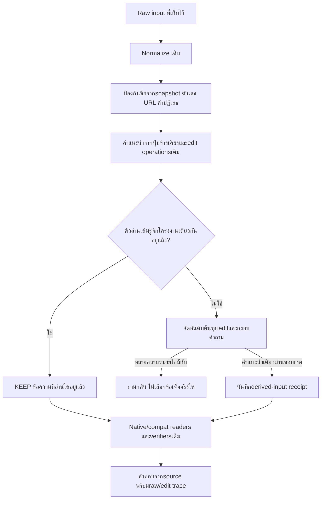

# งานวิจัยคำผิดและการประยุกต์กับ PSU Flow

ค้น11พฤศจิกายน2026 เพื่อเลือกวิธีนำมาใช้ในโค้ด ไม่จำกัดปี ไม่ใช่systematic reviewหรือผลประเมินความครอบคลุมวรรณกรรม

## วิธีค้นและข้อจำกัดสกิล

ใช้แนวทางagent-modeของ [paper-search-pro SKILL.md](C:/Users/Chokhun/.codex/skills/paper-search-pro/SKILL.md) สำหรับการค้นเพื่อประกอบimplementation อ่านagent_mode/tier/setup/RCSแล้ว แต่configไม่มีOpenAlex API keyและNCBI email สกิลระบุ “If "MISSING", point the user to `references/setup.md` ... and halt.” จึงไม่รันhelperที่ต้องใช้configนั้น

ค้นผ่านwebแทนและตรวจเอกสารต้นฉบับจากACL/NeurIPS เก็บquery_plan.jsonและreferences.json ไม่ติดตั้งdependency ไม่เปลี่ยนน้ำหนักโมเดล ไม่ใช้subagentsตามข้อกำหนดโครงการ ไม่ได้ทำautomatic federation/saturation/PRISMAหรือรายงาน14ขั้น ขาดผลค้นจากAPIฐานข้อมูลที่ตั้งค่าไม่ครบ จึงไม่ให้ตัวเลขcoverageหรืออ้างว่าครบทั้งสาขา

## หลักฐานที่เลือกและสิ่งที่ใช้จริง

| งาน | หลักการ | การประยุกต์/ข้อจำกัด |
|---|---|---|
| [Brill & Moore 2000 — Improved Error Model](https://aclanthology.org/P00-1037/) | สร้างคำแนะนำจากerror channelแล้วใช้บริบท/ความเป็นไปได้ของคำช่วยจัดอันดับ | ใช้ต้นทุนeditที่กำหนดเองร่วมกับปุ่มข้างเคียงและกรอบคำถาม ไม่ได้ฝึกprobability modelตามpaper และไม่เรียกคะแนนนี้ว่าconfidence |
| [GECToR 2020](https://aclanthology.org/2020.bea-1.16/) | token transformationsแทนการเขียนทั้งประโยคใหม่ เช่นเก็บ ลบ แทน เพิ่ม | เก็บminimal edit spansและเลือกKEEPเมื่อโครงงานเดิมกับฉบับแก้เหมือนกัน ไม่ได้ติดตั้งหรือฝึกGECToR |
| [Levenshtein Transformer 2019](https://papers.neurips.cc/paper_files/paper/2019/hash/675f9820626f5bc0afb47b57890b466e-Abstract.html) | sequence refinementด้วยinsertion/deletion | เป็นหลักการประกอบเรื่องคำขาด/ส่วนเกิน ไม่ได้นำarchitectureหรือweightsมาใช้ |
| [Misspelling Semantics in Thai 2022](https://aclanthology.org/2022.lrec-1.24/) | คำสะกดแปลกอาจมีความหมาย/น้ำเสียง การnormalizeทั้งหมดมีข้อเสียในงานที่ศึกษา | เก็บraw input ไม่ยุบคำลากเสียงทั้งหมด ไม่แก้ชื่อนอกกรอบintent ไม่อ้างว่าผลsentimentในpaperพิสูจน์เจตนาของchatbotนี้ |
| [ThaiEditBench 2026](https://aclanthology.org/2026.aacl-short.17/) | แยกชนิดข้อผิดและตรวจover-editsในข้อความที่ส่วนมากถูกต้อง ใช้Thai character clustersประเมิน | แยกcontrolsปุ่มใกล้ ตัวตก ซ้ำ สลับ clean/ชื่อ/ข้อจำกัด ไม่ใช้benchmarkหรือคะแนนในpaperมาเป็นคะแนนเรา ตัวeditปัจจุบันยังเป็นcode-point alignment ไม่ใช่TCCgraderเต็ม |

การค้นหลายรูปแบบพบงานที่ครอบคลุมกลไกที่ต้องใช้5รายการ จึงหยุดเพื่อทำimplementationและตรวจผล ไม่ได้อ้างว่าการค้นอิ่มตัวแล้ว

## สิ่งที่พบจากFlowเก่า

มีkeyboard_neighbor_recovery.py, multi_error_phrase_recovery.py และintent_cue_recovery.pyอยู่แล้ว เส้นทางเก่าผ่านpipeline/preprocess.pyเรียกต่อกัน แต่common Flowใหม่ผ่านnormalized_queryและตัวอ่านของตนเอง จึงไม่ได้ใช้การฟื้นคำชุดเดียวกันครบ

ตรวจตรงจากhelperเดิม:มีเกสอะไรบ้าง→มีเกมอะไรบ้าง,มีเกอะไรบ้าง→มีเกมอะไรบ้าง,มีเกมมอะไรบ้าง→มีเกมอะไรบ้าง ตัวสกับมผ่านตำแหน่งแป้นเกษมณีของโค้ดเดิม คำนวณเพื่อนบ้านจากgeometry ไม่ใช้รายการเดาคำจากคำตอบ

## Flowที่นำมาใช้

แยกตัวอักษรหายกับคำหายทั้งคำ:มีเกอะไรบ้างสามารถเติมมตามคำแนะนำและบริบท ส่วนมีอะไรบ้างไม่มีหลักฐานพอเลือกว่าเกม/อุปกรณ์/บริการ ต้องถามกลับ หากมีvalidated native historyเดิมให้ตัวresolveบริบททำงานต่อ ไม่ใช้ประวัติassistantลอย ๆ เป็นข้อเท็จจริง

ต้นทุนปุ่มข้างเคียง0.6,ลบตัวซ้ำ0.35,ตัวสลับ0.8,แทรก/ลบทั่วไป1,แทนอื่น1.2 เป็นengineering parametersที่ต้องประเมินต่อ ไม่ใช่ค่าที่เรียนรู้จากคลังคำผิด จำกัด240อักษร/4OSA edits/3spansและต้องไม่ตัดส่วนที่ป้องกัน ถ้าคะแนนใกล้กันถามกลับ ไม่ค้นหรือแก้ชื่อเกม/รุ่นให้เอง

## ขอบเขตที่ยังไม่รับรอง

คำผิดหลายตำแหน่ง ชื่อเฉพาะที่สะกดผิด แป้นมือถือ/แป้นอื่น การหายไปทั้งคำที่เปลี่ยนสาระ และประโยคยาวยังไม่ครอบคลุม ไม่ใช้ผลcontrolsไม่กี่ชุดอ้างaccuracyทั่วไปหรือปิดR135ครบ48/76 ไม่ให้คำที่แก้เป็นsource facts ไม่ใช้200/2111เป็นชุดฝึกweights

## ผลการใช้กับคำปฏิเสธ
การรักษา raw คำปฏิเสธไม่เพียงพอที่จะพิสูจน์เจตนา พบ clean negative catalogue ถูกตีความเป็นรายการบวก จึงไม่ auto-execute typo ที่มีคำปฏิเสธ และปิด explicit absence-catalog ด้วยข้อความข้อจำกัดก่อน readers เดิม ดู TYPO_RECOVERY_TH.md; ไม่อ้างเป็นตัววิเคราะห์ negation ทั่วไป
