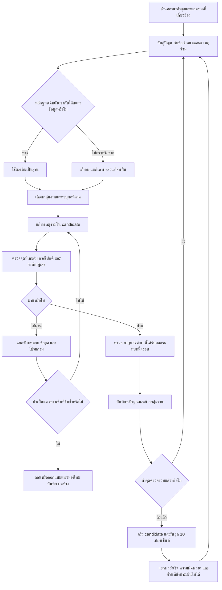

# Flow การทำงาน R135 เพื่อให้แก้เร็วขึ้นและตรวจผลได้

> **คำสั่งล่าสุดจากผู้ใช้:** รอบทดสอบรวมครั้งถัดไปลดจากประมาณ 10% เหลือประมาณ 5% ของชุดคำถามทั้งหมด ให้เลือกตัวอย่างแบบแบ่งชั้นตามหมวดและภาษาอย่างมีหลักฐาน โดยพยายามใช้ subset จาก 2,111 คำถามเดิมเพื่อจับคู่กับผล R134 ได้ ตรึงรายการและตัวหารก่อนรัน บันทึกวิธีเลือก จำนวนจริง และข้อจำกัด 5% เป็นขนาดตัวอย่าง ไม่ใช่คะแนนหรือเปอร์เซ็นต์งานที่เสร็จ ข้อความอ้างถึง 10% ในแผนด้านล่างให้ตีความเป็นจุดรันทดสอบรวม 5% ครั้งถัดไป คงการตรวจเฉพาะจุดและขอบเขตข้อกำหนดเดิม

วันที่จัดทำ: 6 พฤศจิกายน 2026

เอกสารนี้กำหนดวิธีทำงานของผู้พัฒนาและวิธีเลือกรอบทดสอบ R135 โดยเฉพาะ ไม่เปลี่ยนข้อกำหนดผลิตภัณฑ์เดิม 76 ข้อ/14 หมวด และไม่รับรองว่างานหรือคะแนนเสร็จแล้ว

## 1. ปัญหาที่วิธีทำงานใหม่นี้ต้องแก้

วิธีเดิมเสียเวลาไปกับการตรวจย่อยหลายรอบ โดยไม่มีจุดรวมผลและเกณฑ์ย้ายงานที่ชัดเจน การเพิ่มกรณีตรวจหนึ่งกรณีทุกครั้งที่ระบบกลับมาทำงานทำให้มีรายงานผ่านเพิ่ม แต่ยังไม่ปิดสาเหตุหลักหรือพาไปถึงการประเมินรวม

ข้อเท็จจริงที่ต้องใช้วางแผน:

- การแก้คำถามหนึ่งข้ออาจกระทบหลายส่วน: แยกคำถาม ผูกเป้าหมาย อ่านข้อมูล ตรวจหลักฐาน และจัดคำตอบ
- เคยแก้การระงับราคาที่ไม่ชัดแล้วทำให้ราคา PC ที่ควรแสดงหายไป การตรวจกรณีปกติจึงจำเป็น
- เคยมีกรณีตรวจที่คาดผลผิดเพราะการแก้ข้อมูลทำให้การยืนยันฉบับเดิมใช้ต่อไม่ได้ ต้องแยกปัญหาในตัวทดสอบออกจากปัญหาโปรแกรม
- รายงานกลางบางไฟล์เก่ากว่าผลตรวจย่อย เลข 48 เป็นจำนวนข้อที่มีการตรวจรายละเอียดในอดีต ไม่ใช่ลำดับข้อที่กำลังทำหรือจำนวนข้อที่เสร็จ
- งานเดินเป็นช่วงที่ผู้ช่วยกำลังทำงานจริง และบางการทดสอบทำงานในโปรเซสพื้นหลัง เวลาระหว่างการแจ้งเตือนไม่ใช่เวลาลงมือทั้งหมด

## 2. ผลลัพธ์ที่ต้องได้จากแต่ละรอบ

หนึ่งรอบต้องจบด้วยอย่างใดอย่างหนึ่ง:

1. แก้สาเหตุร่วมหนึ่งกลุ่ม พร้อมผลก่อน–หลังและผลตรวจส่วนที่ได้รับผลกระทบ
2. ยืนยันว่าปัญหาเกิดจากตัวทดสอบหรือข้อมูล พร้อมแก้ตัวทดสอบหรือระบุข้อมูลที่ขาด
3. ถอนแนวทางที่ล้ม พร้อมเหตุผลและแนวทางถัดไปที่ต่างจากเดิม
4. รันรอบรวมที่ถึงเกณฑ์แล้ว พร้อมผลดิบและสรุปที่ตรวจสอบย้อนกลับได้

การเพิ่มจำนวนกรณีผ่านอย่างเดียวไม่ถือว่ากลุ่มงานเสร็จ ต้องระบุว่าช่วยตัดสินข้อกำหนดใด และสิ่งที่ยังไม่พิสูจน์คืออะไร

## 3. ขอบเขตและสถานที่ทำงาน

- งานหลัก: r135_complete_flow_audit_20261026/system/app
- ชุดทดลอง Flow เล็กและ flow_small_trial_20261031 เป็นแหล่งหลักฐานประกอบ ไม่คัดลอกกลับเข้า R135 ทั้งชุดโดยอัตโนมัติ
- คงไฟล์ข้อกำหนด 76 ข้อ/14 หมวดและข้อความเดิม
- แก้โปรแกรมใน candidate; การทดลองเพิ่ม แก้ ถอนข้อมูลทำใน SQLite สำเนา
- ไม่แก้ข้อมูลจริง ข้อมูลอนุมัติ ประวัติผู้ใช้ หรือชุดที่ตรึงไว้เพื่อการวัดเดิม
- ไม่หยุดหรือบังคับเริ่มใหม่ protected model ไม่ใช้ subagents
- ไม่รัน R132 ซ้ำและไม่แก้คะแนนหรือคำตอบเดิม
- การติดตั้งจริงต้องผ่านเกณฑ์เดิมและสำรองฐานข้อมูลจริง รวมข้อมูลที่อยู่ใน WAL

## 4. ขั้นตอนหลัก

## 5. เตรียมคิวหนึ่งครั้ง ไม่ค้นประวัติทั้งหมดทุกครั้ง

เมื่อเริ่มใช้แผน ให้ทำตารางคิวจาก CURRENT_HANDOFF_TH.md, STATUS.json, COMPLETION_LEDGER.json, AUDIT_GAPS.json และหลักฐานใหม่กว่า จากนั้นใช้ตารางนี้เป็นหน้าทำงานหลัก

ตารางแต่ละแถวต้องมี:

| ช่อง | สิ่งที่บันทึก |
|---|---|
| กลุ่มปัญหา | เช่น เงื่อนไขยอดรวม หรือผูกเป้าหมายในคำถามหลายส่วน |
| ข้อกำหนดที่เกี่ยวข้อง | ใช้ IDs เดิม ไม่สร้างจำนวน completion ใหม่ |
| ตัวอย่างก่อนแก้ | key ของคำถามและที่อยู่ผลบันทึก |
| สาเหตุที่มีหลักฐาน | ระบุว่าเป็นข้อเท็จจริงหรือสมมติฐาน |
| ไฟล์ที่จะเปลี่ยน | เฉพาะส่วนที่เกี่ยวข้อง |
| ผลที่ต้องได้ | คำตอบหรือสถานะที่สังเกตได้ |
| กรณีปกติที่ต้องรักษา | ป้องกันแก้ข้อหนึ่งแล้วเสียอีกข้อ |
| ชุดตรวจ | เลือกไว้ก่อนแก้ |
| สถานะ | รอตรวจ / กำลังแก้ / ผ่านเฉพาะส่วน / รอรวม / ข้อมูลขาด / ถอนแนวทาง |
| หลักฐานและข้อจำกัด | path, hash และสิ่งที่ผลนี้ยังไม่พิสูจน์ |

ไม่เรียก “ข้อมูลขาด” ว่าโปรแกรมแก้สำเร็จ ไม่เรียก “ผ่านเฉพาะส่วน” ว่าผ่านการตรวจรับทั้งข้อกำหนด

## 6. ลำดับกลุ่มงานที่จะทำ

### รอบ A — วิเคราะห์โจทย์และตอบตรงสิ่งที่ถาม

รวมปัญหาแยกคำถามหลายส่วน การอ้างอิง it/มัน/ที่นั่น การเปลี่ยนเป้าหมาย และคำตอบที่ให้ข้อมูลข้างเคียงแทนสิ่งที่ถาม

ตรวจด้วย:

- ตัวอย่างคำถามที่เคยตอบไม่ตรง
- คำถามตรงที่ควรตอบได้
- สองเป้าหมายที่ต้องแยกจากกัน
- การอ้างอิงกำกวมที่ควรถามเพิ่มเฉพาะส่วน
- คำถามหลายส่วนที่ต้องคงคำตอบอีกส่วนไว้
- ภาษาไทยและอังกฤษเฉพาะเส้นทางที่แก้

กรณีวิธียกเลิกที่จัดคำตอบหลักขึ้นก่อนแล้วเป็นหลักฐานเฉพาะกรณี ไม่สรุปว่าการเข้าใจคำถามทั้งหมดเสร็จ

จบรอบเมื่อปัญหาที่เลือกในกลุ่มนี้มีผลก่อน–หลัง ชุดตรวจที่เลือกผ่าน และข้อที่ยังติดข้อมูลหรือแบบออกแบบถูกบันทึกชัดเจน

### รอบ B — ราคาและการจอง

แก้ร่วมกันตามขอบเขตบริการ กลุ่มผู้ใช้ จำนวนคน ระยะเวลา หน่วยคิดเงิน และยอดรวม ห้ามเลือกจากคำเหมือนหรือ platform เพียงอย่างเดียว

ชุดตรวจต้องเลือกจากความเสี่ยงจริง:

| สิ่งที่แก้ | ต้องตรวจ |
|---|---|
| เลือกราคา | ราคาเดี่ยวที่ถูกต้อง บริการอื่นที่ต้องไม่ถูกเลือก กลุ่มผู้ใช้ที่ต่างกัน |
| ช่วงจำนวนคน | ช่วงครบ ขอบเขตขาด ช่วงทับกัน และข้อมูลที่ไม่ควรถูกจับเป็นบริการเดียวกัน |
| คำนวณยอด | ยอดที่คำนวณได้จริง ยอดที่ยังคำนวณไม่ได้ ปลอมจำนวนคน/ยอด/หลักฐาน และแก้ source แล้วคำนวณใหม่ |
| วันเวลาที่มีผล | อยู่ในช่วง นอกช่วง ไม่ทราบช่วง และ notice ที่ยังต้องแสดง |
| ขั้นตอนจอง | ถามจอง ถามยกเลิก และคำถามรวมราคากับจอง |

ใช้ชุดที่มีอยู่ เช่น verify_rate_calculation_receipt.py, verify_exact_rate_duration.py และชุดที่เกี่ยวข้องเมื่อ dependencies ตรงกัน คำสั่งและจำนวนกรณีต้องตรวจจากไฟล์จริงก่อนเรียก

ไม่แก้ยอดรวมด้วยการซ่อนราคาทุกกรณี และไม่อ้างว่าตรวจยอดรวมอิสระแล้วหากตรวจเพียงเลขคูณกันตรงโดยยังไม่ตรวจจำนวนคนกับโจทย์

### รอบ C — เพิ่ม แก้ ถอนข้อมูล

หลักฐานที่มีแล้ว: owner workflow, เบอร์ติดต่อ, ขั้นตอนยกเลิก และการถอนราคา PC ในสำเนา ใช้ผลเดิมได้เมื่อ code/source/dependencies ตรงกัน

ตรวจส่วนที่ยังขาดโดยเลือกตัวแทนตามวิธีอ่านข้อมูล ไม่สร้างการตรวจเหมือนกันให้ทุก record:

1. เพิ่ม record ใหม่โดยไม่อาศัย ID ที่เขียนตายตัว
2. ตอบข้อมูลที่เพิ่มได้ตามขอบเขตและสถานะร่าง/เผยแพร่จริง
3. แก้ค่าแล้วไม่ตอบค่าเก่า
4. ถอนแล้วไม่ตอบ record ที่ถอน
5. คง record อีกตัวที่ไม่ถูกแก้หรือถอน
6. คำขอหรือหลักฐานเก่าไม่รับรอง revision ใหม่
7. แก้ข้อมูลแล้วไม่ใช้การอนุมัติหรือคำแปลเก่าอย่างผิดเงื่อนไข

ถ้าขาดเฉพาะความถูกต้องของข้อมูลจากเจ้าของ ให้ระบุสิ่งที่ต้องยืนยันและไปทำกลุ่มที่เดินต่อได้ ไม่สร้างข้อมูลจริงขึ้นมาให้ผ่าน

### รอบ D — หมวดอื่นและข้อกำหนดที่ยังค้าง

จัดคิวตามสาเหตุร่วม เช่น เกม/อุปกรณ์ กติกา/ฉบับรายการ ตารางบริการ/สถานะสด และข่าว ไม่ปล่อยให้รอบ A–C ถูกใช้เป็นเหตุปิดครบ 14 หมวด

งานชุดฝึก การแบ่ง family การตรึง protocol และการประเมินโมเดลยังคงเป็นส่วนของ Flow เต็ม ต้องใช้สถานะและหลักฐานจริงก่อนอนุญาตขั้นต่อไป ผล synthetic ไม่แทนการฝึกจริง

## 7. เลือกชุดทดสอบตามประเภทการเปลี่ยน

| ประเภทการเปลี่ยน | รอบที่ต้องรันก่อน | สิ่งที่ยังไม่ต้องรัน |
|---|---|---|
| จัดข้อความและลำดับคำตอบ | ตัวอย่างก่อน–หลัง และตรวจว่า claims/คำเตือนที่จำเป็นยังอยู่ | ไม่รันโมเดลทุกหมวดเพียงเพื่อเปลี่ยนลำดับข้อความ |
| แยกคำถามหรือผูก target | คำถามที่ล้ม เป้าหมายต่างกัน กำกวม หลายส่วน และ coverage ที่เกี่ยวข้อง | ไม่รันราคา/ข่าวทั้งหมดเมื่อไม่มีเส้นทางร่วม |
| เลือก/คำนวณราคา | กรณี source และ verifier ที่ได้รับผล รวมกรณีปกติและคำถามหลายส่วน | ไม่รัน 2,111 คำถามหลังแก้บรรทัดเดียว |
| เปลี่ยน projection หรือ verifier กลาง | กรณีตัวแทนจากทุกหมวดที่ใช้ส่วนกลางนั้น | ห้ามจำกัดเหลือคำถามเดียวเมื่อกระทบหลายหมวดจริง |
| แก้ตัวทดสอบ | ตรวจว่าคาดผลจากหลักฐานถูกต้องและยังตรวจพบความผิดเดิม | ไม่เปลี่ยน owner data เพื่อให้ผ่าน |
| รวม candidate พร้อมวัด | ชุดตัวอย่าง 10% ที่ตรึงรายการไว้ | ไม่รัน baseline เดิมซ้ำ |

ไม่บังคับจำนวนกรณีให้เท่ากันทุกรอบ เลือกให้ตอบความเสี่ยงที่แก้จริง และระบุเหตุผลหากเพิ่มชุดตรวจ

## 8. กติกาใช้หลักฐานเดิม

ก่อนใช้ผลเก่า ตรวจอย่างน้อยว่า:

- เวอร์ชันไฟล์ที่มีผลต่อพฤติกรรมยังตรงกัน
- schema, source snapshot, parser และ protocol ที่เกี่ยวข้องตรงกัน
- คำถาม locale ประวัติ และเงื่อนไขเวลาไม่เปลี่ยนในส่วนที่ใช้ตัดสิน
- ผลเดิมเป็นผลผ่านจริงและครอบคลุมข้ออ้างที่กำลังใช้

ถ้าตรง ใช้ผลเดิมและบันทึกว่า reuse ถ้าไม่ตรง รันเฉพาะส่วนที่ผลเดิมใช้ต่อไม่ได้ ไม่ล้างความน่าเชื่อถือของทุกผลเพราะมีไฟล์ที่ไม่เกี่ยวข้องเปลี่ยน

## 9. กติกาหยุดลูป

ตัวเลขต่อไปนี้เป็นจุดทบทวนวิธีทำงาน ไม่ใช่เพดานความถูกต้องหรือการตัดข้อกำหนด:

- ก่อนแก้ ต้องมีสมมติฐานเดียวที่ตรวจได้และกรณีปกติที่ต้องรักษา
- หากแนวทางเดิมล้มสองรอบ ห้ามปรับเล็กน้อยแล้วรันชุดเดิมซ้ำโดยไม่มีหลักฐานใหม่ ให้ตรวจสาเหตุและเปลี่ยนแนวทาง
- หากใช้เวลาลงมือประมาณ 90 นาทีแล้วยังไม่ได้ข้อมูลใหม่ ให้บันทึกสิ่งที่ลองและจุดไม่แน่ใจ แล้วเปลี่ยนไปงานอิสระที่เดินต่อได้ หรือแก้โครงสร้างที่เป็นต้นเหตุ
- ความล้มเหลวจาก environment/schema/ตัวทดสอบต้องแยกจากพฤติกรรมโปรแกรม ไม่ให้การแก้ตัวทดสอบถูกนับเป็นการแก้ระบบ
- ไม่ต้องถอนทุกการแก้เมื่อพบปัญหาที่ไม่เกี่ยวข้อง ต้องพิสูจน์ว่าปัญหาเกิดจาก candidate ใดและรักษา baseline ก่อนตัดสิน
- ไม่เพิ่มการทดลองปลอมขึ้นเรื่อย ๆ หากไม่ได้ทดสอบขอบเขตความเสี่ยงใหม่
- การย้ายงานต้องมี next action เฉพาะเจาะจง ห้ามเปลี่ยน “ค้าง” เป็น “เสร็จ”

## 10. จุดรันตัวอย่าง 10% ครั้งถัดไป

ให้รันหนึ่งรอบเมื่อ:

1. รอบ A–C มีคิวปัญหาที่ระบุชัด และการแก้ที่เลือกพร้อมรวม
2. กรณีที่เคยล้มและ regression ที่ได้รับผลจาก candidate รอบนี้ผ่าน
3. ไม่มีข้อผิดพลาดร้ายแรงที่ทราบอยู่และทำให้ผลทั้งรอบใช้ตัดสินไม่ได้
4. บันทึก code/source/model/protocol/clock และตัวเลือกการรันไว้แล้ว
5. ไม่มีงานทดสอบซ้อนที่แย่งโมเดลเดียวกันโดยไม่ควบคุม

ใช้รายการเดิม 2,111 keys ถ้า manifest ยืนยันว่ารายการครบ ไม่สุ่มใหม่เพราะต้องการคะแนนดีขึ้น ชุดนี้เป็นตัวอย่างกว้างประมาณ 10% ไม่ใช่เฉพาะข้อมูลศูนย์ ราคา และการจอง

ถ้าบางปัญหาไม่ร้ายแรงและตั้งใจวัดในรอบนี้ ให้ระบุล่วงหน้าเป็น known limitation ห้ามแอบข้ามหรือเรียกว่าผ่านแล้ว

การรันใช้ candidate แยก เก็บ log ตามระบบที่มีและผูกกับ key/session ของการทดสอบ มีผลดิบแบบเพิ่มต่อท้ายและ progress ไม่แก้ raw ระหว่างวัด

ถ้าคำขอผิดพลาด เก็บสถานะจริง ไม่ retry แบบเงียบจนลบประวัติความล้มเหลว หากจะ retry ต้องแยกเป็นรอบและเหตุผลใหม่

## 11. วิธีสรุปคะแนน

แสดงแยกอย่างน้อย:

| ผล | หน่วยและความหมาย |
|---|---|
| ความคืบหน้าการรัน | จำนวนคำถามจาก 2,111 ไม่ใช่คะแนน |
| ส่งคำขอสำเร็จ | HTTP/การประมวลผล ไม่ได้แปลว่าตอบถูก |
| ตรงเกณฑ์ข้อความ | จำนวนเกณฑ์ที่ match พร้อมตัวหารและส่วนที่ไม่ได้ตรวจ |
| ความถูกต้องตามโจทย์ | ใช้การตรวจความหมายและ source; ถ้ายังไม่ได้ตรวจให้ระบุ |
| การเปลี่ยนคำตอบ | เหมือนเดิม/เปลี่ยนข้อความ ไม่เรียกดีขึ้นโดยอัตโนมัติ |
| หมวดและ locale | แยกผลตามชุดที่มีหลักฐานเพียงพอ |

คำถามหนึ่งข้อมีหลายเกณฑ์ ห้ามนำ 1,964/2,487 ไปเรียกว่าตอบถูก 1,964 จาก 2,111 คำถาม เกณฑ์ไม่มีหรือประเมินไม่ได้ไม่ใช่ข้อผิดโดยอัตโนมัติ

การเทียบ Flow เดิมต้องจับคู่คำถามและวิธีวัด พร้อมรายงานความต่างของวัน ข้อมูล การเชื่อมต่อ และภาระเครื่อง คะแนนข้อความสูงไม่แทนการตอบตรงประเด็น

## 12. หลังรอบ 10%

1. แยกความผิดจากโปรแกรม ข้อมูลไม่ครบ ตัวทดสอบ และการเชื่อมต่อ
2. จัดกลุ่มคำถามที่ผิดตามสาเหตุร่วม ไม่เรียงแก้ทีละข้อจากรายการยาว
3. เลือกกลุ่มที่กระทบหลายคำถามหรือทำให้ตอบผิดสาระก่อน
4. ทำ targeted checks และ regression ของกลุ่มนั้น
5. รัน 10% อีกเมื่อรวมการแก้ที่มีผลต่อผลรวมได้แล้ว ไม่ใช่เพราะมีการแจ้งเตือนครบหนึ่งรอบ
6. ก่อนส่งมอบ ตรวจข้อกำหนด 76 ข้อ/14 หมวดและ gates เดิมทั้งหมด ข้อที่หลักฐานไม่พอคงสถานะเปิด

## 13. เวลาทำงานและการรายงานทุก 6 ชั่วโมง

แยกเวลา 3 แบบ: เวลาลงมือของผู้ช่วย เวลาที่โปรเซสทดสอบรัน และเวลาบนปฏิทิน ไม่ใช้เวลารวมแทนเวลาลงมือจริง

- ระหว่าง active turn ให้ทำงานที่ได้รับอนุญาตต่อจนจบรอบงานที่เลือก
- โปรเซสทดสอบที่เริ่มไว้สามารถทำต่อในเครื่องได้ ตรวจ PID/progress/log เพื่อยืนยัน
- การนัดทุก 6 ชั่วโมงเป็นจุดกลับมาทำงานและรายงาน ไม่รับประกันว่ามีผู้ช่วยแก้โค้ดทุกนาทีระหว่างรอบ
- ไม่รอให้ครบ 6 ชั่วโมงเพื่อเลือกขั้นต่อไป หากยังอยู่ระหว่างทำงานจริงและทำต่อได้
- หากมีความล้มเหลวสำคัญหรือจำเป็นต้องให้ผู้ใช้ช่วย ให้แจ้งตามข้อเท็จจริง

รายงานแต่ละครั้งใช้รูปแบบสั้น:

1. กลุ่มที่กำลังทำและสิ่งที่เปลี่ยนจริง
2. ผลตรวจใหม่และหลักฐานที่ reuse
3. ปัญหาที่ยังเปิดและ next action
4. ถึงเกณฑ์รัน 10% หรือยัง เพราะอะไร
5. มีอะไรต้องให้ผู้ใช้ช่วยหรือไม่

ไม่รายงานเพียง “ผ่านเพิ่ม N กรณี” และไม่ใส่เปอร์เซ็นต์เสร็จทั้ง Flow หากยังไม่มีตัวนับที่ผ่านการตรวจรับจริง

## 14. สิ่งที่จะทำก่อนในรอบถัดไป

1. รวมผลล่าสุดที่ใหม่กว่า STATUS ลงคิวแบบไม่แก้หลักฐานเก่า ระบุว่า 48 คือค่าประวัติ
2. ตรวจ gap รอบ A จากคำตอบที่เก็บไว้ เลือกสาเหตุร่วมที่ยังไม่ปิด แทนการเพิ่มกรณีถอนข้อมูลต่อไปเรื่อย ๆ
3. ตรวจว่าปัญหาราคาที่พบใน Flow เล็กยังเกิดใน R135 เต็มจริงหรือไม่ ก่อนนำ patch กลับ
4. เลือกชุดตรวจรอบ B ล่วงหน้าตามตาราง เลือกกรณีปกติและกรณีเสี่ยงพร้อมกัน
5. ประเมินจุดรัน 10% จากเกณฑ์ในข้อ 10 และรายงานสิ่งที่ยังขวางอย่างเฉพาะเจาะจง

ไม่มีการรับประกันชั่วโมงจบหรือคะแนนที่จะได้ เอกสารนี้ทำให้เห็นว่าขั้นต่อไปคืออะไร ลดการตรวจซ้ำ และทำให้ประเมินเวลาได้จากงานจริงในรอบถัดไป
