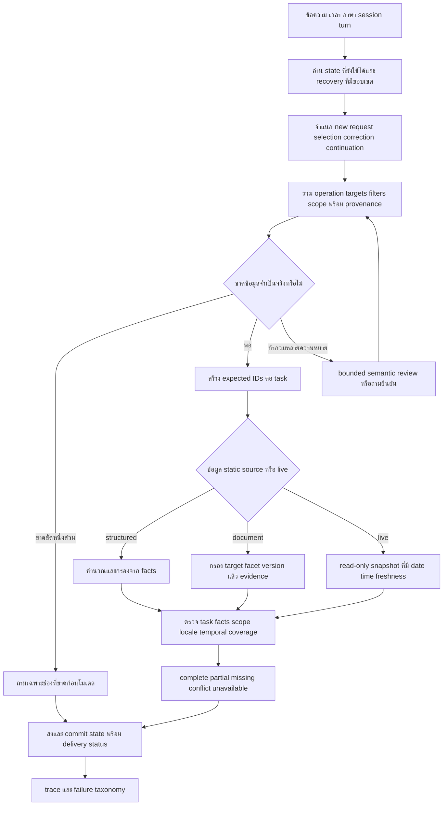

# Flow พัฒนาและตรวจเฉพาะปัญหา 66 รายการ — r40

วันที่ 6 ตุลาคม 2026 / Asia Bangkok; เริ่มจาก r39.3

## 0. สถานะและข้อกำหนด

เอกสารนี้กำหนดวิธีแก้/ตรวจครบ B001–B066 ไม่ได้ประกาศว่าทุกงานเสร็จแล้ว สถานะการลงมือจริงอยู่ในรายงานผลคู่กัน ใช้ baseline และ targeted tests ไม่รัน full corpus สองหมื่นกว่าข้อ ไม่แก้ข้อมูลเจ้าของ/นโยบายที่ยังไม่ยืนยัน ไม่เก็บ booking truth จริงที่ผู้ใช้พักไว้ และไม่เปิดบริการสาธารณะหรือธุรกรรมจองเพิ่มเอง

ได้รับสิทธิ์เขียนต้นทางผ่านระบบในรอบนี้ สำรอง app/web/templates/tests ที่มีอยู่ก่อนแก้และ hash ข้อมูลที่ต้องรักษา ใช้ผล Git จาก workdir ตรง ไม่อนุมาน success จากไฟล์ stdout ที่เป็น error สร้าง release/process/log ใหม่ ไม่ทับ r39.3 และไม่หยุดชุดเดิมของผู้ใช้

## 1. หลักจากงานวิจัยและวิธีนำมาใช้

- [CheckList — Ribeiro et al., ACL 2020](https://aclanthology.org/2020.acl-main.442/): ใช้เมทริกซ์ความสามารถกับการทดสอบพฤติกรรม แยกเคสพื้นฐาน การเปลี่ยนที่ควรคงผล และการเปลี่ยนที่ต้องเปลี่ยนผล ใช้คู่คำสะกดผิด/คำสะอาด กับตัวเลข/negation ที่ต้องรักษา
- [RADDLE — Peng et al., ACL 2021](https://aclanthology.org/2021.acl-long.341/): ทดสอบบทสนทนาต่อเนื่อง ภาษาแปรผัน entity ใหม่และนอกหมวด จึงต้องตรวจทุก turn และ unknown targets แยกจาก typo ที่ควรกู้ได้
- [CheckDST — Cho et al., Findings EMNLP 2022](https://aclanthology.org/2022.findings-emnlp.391/): วินิจฉัยจุดแข็ง/จุดอ่อนและ failure modes แยก แทนรวม accuracy เดียว ใช้แยก context/target/entity/scope errors
- [Misspelling Semantics in Thai — Nakwijit & Purver, LREC 2022](https://aclanthology.org/2022.lrec-1.24/): งานศึกษา misspelling ในไทยพบว่ารูปสะกดอาจมีความหมายและการ normalize แบบไม่แยกแยะให้ผลเสียในงานที่ศึกษา จึงเก็บ original input ไม่บังคับแก้ทุกตัวและไม่อ้างผล sentiment ว่ารับรอง Chatbot นี้
- [Schema-Guided Dialogue Dataset — Rastogi et al.](https://arxiv.org/abs/1909.05855): ใช้ schema/slots เพื่ออธิบายบริการและสถานะ นำหลักการมาทำ request plan ไม่ได้ฝึกโมเดลใหม่หรือรับรองผล zero-shot ของระบบนี้

การใช้ paper เป็นเหตุผลออกแบบ การพิสูจน์ว่าช่วย PSU Chatbot ต้องใช้ผลก่อน/หลังจริงของเรา ไม่ถ่ายเปอร์เซ็นต์จาก paper มาเป็นผลโครงการ

## 2. Flow ร่วม

ข้อแก้ไขสำคัญ: ไม่วน H→D ไม่จำกัดเวลา ใช้ semantic review เฉพาะหนึ่งครั้งภายใน deadline เดิม ถ้าไม่ได้ valid output ให้ถามเฉพาะที่ยังไม่ชัด ไม่เดาข้อเท็จจริง การแก้คำไม่เปลี่ยนเลข/รุ่น/คำปฏิเสธที่ชัด

## 3. แผนรอบนี้และเกณฑ์หยุดวน

1. ตรวจ inventory/state จริงและสำรอง → baseline targeted บน r39.3
2. Round A: ปุ่มที่ไม่มีชื่อเกม TH/EN — early deterministic clarification ก่อน semantic/model; negative controls ไม่ถูกดัก
3. Round B: เลือกหลายเกม/โซนจาก pending — คง operation และ explicit topic shift; ไม่เปลี่ยน unknown/เลขภาคเป็น known title
4. Round C: แก้จาก failure ที่พบจริง เพิ่ม holdout สำนวนใหม่และ regression ราคา/กติกา/session/fault ที่เกี่ยวข้อง จัดคู่มือ/runtime identity/config ให้ตรง
5. ส่งมอบ candidate ใหม่เมื่อ critical targeted gates ผ่าน บันทึกข้อที่เหลือว่า source gap/owner decision/coverage gap จริง

ทำรอบถัดไปเมื่อยังมี failure ที่เกี่ยวกับการแก้และมีหลักฐานสาเหตุ หยุด optional tests เมื่อ gate ที่เกี่ยวข้องเพียงพอแล้ว ไม่วนเพื่อเพิ่มตัวเลข ไม่กล่าวว่าทุก 66 ข้อเสร็จ การจบงานรอบนี้ต้องมีผลจริงและรายงาน residual ที่แก้ไม่ได้ด้วยข้อมูลที่มี

## 4. Test contract

- Freeze questions/source/oracle ก่อนแก้ เก็บ actual answer และ full debug trace แบบ JSONL แยก run ID
- ตรวจ operation/targets/required facts/forbidden facts และ first-turn clarification ไม่ใช้แค่ mode หรือชื่อปรากฏ
- Multi-select ต้องมีทุก selected target ไม่มี unselected zone; explicit new question ต้องออกจาก pending
- สำหรับ recorded prices ตรวจกับ fixture ที่บันทึกและคำเตือน validity ไม่รับรองอัตราปัจจุบัน
- เกมไม่รู้จัก/ภาคผิดต้องแจ้งข้อมูลไม่ยืนยัน ไม่ใช้ title อื่นเป็น substitute
- แยก direct source tests ที่ปิด LLM ออกจาก HTTP ที่เปิด LLM จริง และแยก fixtures จาก live booking
- แยก parse error/grader error/runtime error/source gap จึงแก้ทั้งระบบหรือ oracle ตามสาเหตุพร้อมหลักฐาน
- เก็บ clean/noisy และ invariance/directional negatives; ชุดที่ใช้พัฒนาแล้วเรียก regression ไม่เรียก holdout อีก
- ทุก run สรุป planned/executed/pass/fail/error/timeout และ latency; ไม่มีคำตอบหายจาก denominator

## 5. กลุ่มงานและ dependency

### R — รุ่น/แพ็กเกจ/หลักฐาน

- รายการ: B001, B002, B003, B004, B005, B045, B050, B052, B059, B066
- ลำดับ: ตรวจ health/version/root/config และก่อนแก้ → สร้าง release ใหม่แยก → ตรวจ hash/CRC/launcher → เปิดเฉพาะ process ของรอบนี้ → ตรวจ URL ที่ผู้ใช้เข้า
- จุดโค้ด/ข้อมูล: deployment_templates, tools/build_owner_local_package.ps1, web_chat/app.js, ตัวเก็บหลักฐานใน workspace
- เคส: พอร์ตชน; เปิดซ้ำ; path ไทย/ช่องว่าง; wrong instance; Git return code; data/index คนละรุ่น; cache 0/10; โมเดลหาย
- Gate: ใช้แพ็กเกจที่ตรวจจริง ไม่คัดลอก owner data/log เก่ามารวมชุดแจก

### L — เวลาและการเรียกโมเดล

- รายการ: B006, B064
- ลำดับ: แยก stage timings → ตรวจว่าขาด slot เดียวจริง → ใช้ deterministic clarification ที่แคบ → ตรวจ negative requests → วัด cold/warm และ model-call count
- จุดโค้ด/ข้อมูล: app/pipeline/engine.py, ambiguity_gate.py, bilingual_english.py, โมดูล shared control request
- เคส: คำขอปุ่มหลายสำนวน TH/EN; unknown title; ชื่อภาคผิด; ปุ่มจอง; keyboard damage; คำถามใหม่ที่มี negation
- Gate: ไม่มี universal_intent/semantic model call ในเส้นทางที่ชัด ไม่รับรอง latency เป็น SLA

### D — สถานะบทสนทนาและขอบเขต

- รายการ: B007, B008, B009, B010, B011, B012, B013, B018, B054, B055
- ลำดับ: อ่าน state ที่อนุญาต → จำแนก new/selection/correction/continuation → merge ค่าที่ผู้ใช้เลือก → สร้างงานราย target → execute/contract → commit revision และ delivery
- จุดโค้ด/ข้อมูล: app/session/context_resolver.py, conversation_store.py, conversation_plan.py, app/pipeline/engine.py
- เคส: เลือกหนึ่ง/สองเกม; เลือกสองโซน; เปลี่ยนหัวข้อ; all ไม่มีบริบท; all สองมิติ; partial failure; session ใหม่/TTL; source เปลี่ยน; retry
- Gate: คง operation/filter ของผู้ใช้ ไม่อ่าน offered list เป็น selected และ explicit new request ชนะบริบท

### N — ภาษาพูด/คำผิด/ภาษา/ภาคเกม

- รายการ: B014, B015, B016, B017, B019, B056
- ลำดับ: เก็บข้อความเดิม → เสนอ candidate ที่มีขอบเขต → กันตัวเลข/negation/ชื่อภาค → ประเมิน context+margin → รับ/ถามยืนยัน → trace recovery
- จุดโค้ด/ข้อมูล: app/pipeline/input_recovery.py, entity_resolver.py, game_edition_guard.py, context_resolver.py, bilingual_english.py
- เคส: คำเบิ้ล/ขาด/สลับ/แป้นข้างเคียง; price/rice; pay/play; unknown title; เลขโรมัน; mixed language; general ที่มี PC
- Gate: clean input ไม่ถอยหลัง การแก้ไม่ลบความหมายที่ผู้ใช้ตั้งใจ และไม่มี alias ต่อประโยคเพื่อดันคะแนน

### O — ข้อเท็จจริงและเจ้าของ

- รายการ: B020, B021, B022, B023, B024, B025, B026, B027, B028, B029, B030, B031, B032
- ลำดับ: จำแนก missing/conflict/stale → รวบรวม clause/วันที่/ID → ทำคำถามผู้มีอำนาจ → เมื่อได้คำตอบตรวจ source/hash → แปล/build release → paired regression
- จุดโค้ด/ข้อมูล: data/competition_rules, data/curated, data/locales/en, source registry; รักษาต้นฉบับเดิม
- เคส: ราคา recorded vs current; pause conflicts; RoV ขาด; roster vs format; carry vs consume; source ที่ไม่มีห้ามอนุมาน
- Gate: ระหว่างรอให้ตอบข้อจำกัดตามจริง ห้ามเดาราคา/โทษ/สิทธิ์ และห้ามเปิด draft เป็น approved

### B — Booking/calendar/เวลา

- รายการ: B033, B034, B035, B036, B037, B057, B058
- ลำดับ: ตีความ target+date+window → โหลด source/calendar identity → snapshot เดียว → คำนวณ blocked interval → free/booked/closed/unknown → timestamp/privacy contract
- จุดโค้ด/ข้อมูล: app/booking/live_status.py, app/calendar/service_calendar.py, booking_dashboard/server.py; ตารางเจ้าของไม่แก้โดยเดา
- เคส: 12:00/12:30/13:00; maintenance/special close; exact end/start; VR30 full-hour occupancy; cancellation; partial booking; midnight; live down
- Gate: fixture truth แยก live oracle; งานจริงยังพัก ไม่สร้าง/ยกเลิก/ถือสิทธิ์การจอง

### E — Ground Truth/trace/semantic evidence

- รายการ: B038, B039, B040, B041, B042, B062, B063
- ลำดับ: freeze input/source/oracle → ตรวจ expected task/facts+forbidden facts → run targeted → จัด failure layers → adjudicate code/gold/source → replay+holdout
- จุดโค้ด/ข้อมูล: tests เฉพาะเรื่อง, workspace runners, trace/decision artifacts, retrieval/evidence pack/answer contracts
- เคส: ชื่อมีแต่ operation ผิด; clause หลักขาด exception; false no-answer; unnecessary clarification; grade เดิมผิด; wrong source/year
- Gate: ไม่ใช้ HTTP 200/confidence/validation.ok แทนตอบถูก ไม่เปลี่ยน gold โดยไม่เก็บเหตุผล

### F — Fault/load/log

- รายการ: B043, B044, B046
- ลำดับ: สร้าง process/adapter ที่แยก → ฉีด fault จุดเดียว → ตรวจ state/delivery/log หลัง fault → เพิ่มโหลดตามความจำเป็น → report ทุก error/timeout
- จุดโค้ด/ข้อมูล: app/web_api/pipeline_supervisor.py, server.py, session store/chat_logger และ runner ที่แยก
- เคส: worker crash/hang; stale revision; network cut; logger fail; restore; 5/10/20/30 users เมื่อถึงระยะนั้น
- Gate: ไม่ฆ่า process ผู้ใช้เดิม ไม่ลบ log และไม่อนุมาน concurrency จาก serial tests

### P — การใช้งานต่อเนื่อง/ภายนอก/เจ้าของเพิ่มข้อมูล

- รายการ: B047, B048, B049, B065
- ลำดับ: กำหนด deployment/roles/retention → เลือกสิ่งจำเป็น → implementation แบบแยก → ตรวจ access/startup/review/publish → รับรองตามสภาพแวดล้อมจริง
- จุดโค้ด/ข้อมูล: deployment configuration, admin workflow, data publishing tools; Local default เดิมยังคงใช้ได้
- เคส: เปิดเครื่อง; role access; no-log-in-sharing-package; draft ไม่เข้ารัน; owner UI approval; rollback
- Gate: เป็นระยะตามการใช้งาน ไม่เปลี่ยนระบบภายนอก/นโยบายแทนผู้ใช้

### K — อัปเดตข้อมูล/คำแปล/จำนวน/แหล่งอ้างอิง

- รายการ: B051, B053, B060, B061
- ลำดับ: snapshot ต้นทาง → classify change/effective date → invalidate locale → build projections/index → ตรวจ facts/counts/citations → publish release ที่ตรวจแล้ว
- จุดโค้ด/ข้อมูล: data/content, data/locales/en, knowledge inbox, catalog/formatters และ viewer หากเลือกทำ
- เคส: Thai field เปลี่ยนแล้ว English stale; unique games vs zone sum; คน vs เครื่อง; local citation; publish ไม่ครบ
- Gate: แสดง source date/release ไม่เรียก static source ว่าเพิ่งอ่านเว็บ และไม่เปิดไฟล์ส่วนตัวผ่าน viewer

## 6. Flow เฉพาะแต่ละรายการ

รายละเอียดสาเหตุและเกณฑ์จาก inventory เดิมถูกคงไว้เป็นข้อกำหนด แล้วเพิ่มขั้นลงมือและชุดตรวจต่อรายการ สถานะในหัวข้อนี้เป็นสถานะตั้งต้น ต้องใช้ execution report เพื่อทราบงานที่ทำแล้ว

### F-B001 — หลายรุ่นเปิดพร้อมกันจนผู้ใช้ลองคนละรุ่น

- Workstream: R / รุ่น/แพ็กเกจ/หลักฐาน
- สถานะตั้งต้น: พบจริง / P0
- วิธีจัดการ: ทำเองจากหลักฐานและ targeted checks

- **สถานะ/ลำดับ:** พบจริง / P0
- **อาการและสาเหตุ:** พอร์ต 8090–8094 เป็นคนละรุ่น และตัวเปิดเดิมยังพาไปชุดเก่าได้ การลองพอร์ตเก่าจะไม่เห็นการแก้ล่าสุด
- **ผลกระทบ:** เข้าใจผิดว่าแก้แล้วไม่ดีขึ้น และ log ของแต่ละรุ่นถูกนำมาปะปนในการวิเคราะห์
- **แนวทาง:** กำหนดชุดหลัก แสดงรุ่น/รหัสติดตั้งในหน้าเว็บและตัวเปิด และบอกตำแหน่งชุดที่ผู้ใช้กำลังเปิด ไม่หยุดตัวเก่าโดยเดาว่าไม่ใช้
- **เกณฑ์เสร็จ:** เปิดตัวหลักซ้ำแล้วยังเข้ารุ่นที่เลือก ตรวจ health/root identity ตรง และผู้ใช้เห็นรุ่นได้ชัด
- **ทำเองได้/หลักฐาน:** ทำได้ / S01, S12 และ health รอบนี้

**ขั้นลงมือเฉพาะรายการ**

1. อ่านหลักฐานของ B001 และระบุ expected behavior ตามเกณฑ์เสร็จข้างบน เก็บ input/runtime/source ที่สร้างอาการ
2. ใช้ลำดับกลุ่ม R: ตรวจ health/version/root/config และก่อนแก้ → สร้าง release ใหม่แยก → ตรวจ hash/CRC/launcher → เปิดเฉพาะ process ของรอบนี้ → ตรวจ URL ที่ผู้ใช้เข้า
3. สร้างเคสยืนยันอาการเดิม เคสสำนวนใหม่ และ negative control จากชุดต่อไปนี้: พอร์ตชน; เปิดซ้ำ; path ไทย/ช่องว่าง; wrong instance; Git return code; data/index คนละรุ่น; cache 0/10; โมเดลหาย
4. เชื่อมข้อของ B001 กับเกณฑ์เนื้อหา/สถานะที่เฉพาะมัน ตรวจจุดโค้ด: deployment_templates, tools/build_owner_local_package.ps1, web_chat/app.js, ตัวเก็บหลักฐานใน workspace
5. สำรองก่อนแก้และเปลี่ยนเฉพาะจุดที่ baseline/trace สนับสนุน หากไม่พบผิดให้เก็บเป็น coverage result ไม่เพิ่มเงื่อนไขโดยเดา
6. ตรวจหลังแก้พร้อม regression ของ workstream นี้ Gate: ใช้แพ็กเกจที่ตรวจจริง ไม่คัดลอก owner data/log เก่ามารวมชุดแจก
7. เก็บผล/สาเหตุ/remaining limitations และเปลี่ยนสถานะ B001 เฉพาะตามหลักฐาน ไม่ปิดรายการทั้งกลุ่มจากเคสเดียว

### F-B002 — ชุด Ready, WithModels และ DownloadModels ยังไม่ตาม r39.3

- Workstream: R / รุ่น/แพ็กเกจ/หลักฐาน
- สถานะตั้งต้น: พบจริง / P1
- วิธีจัดการ: ทำเองจากหลักฐานและ targeted checks

- **สถานะ/ลำดับ:** พบจริง / P1
- **อาการและสาเหตุ:** มีแพ็กเกจ r37.2 ที่ยังใช้งาน ขณะที่แก้ในต้นทางและแพ็กเกจ r39.3 อีกชุด
- **ผลกระทบ:** คนที่ได้รับชุดส่งต่อยังเจออาการที่แก้ไปแล้ว
- **แนวทาง:** สร้างสองชุดใหม่จาก release ที่ยืนยันเดียวกัน ใช้ manifest/hash และบันทึกข้อมูล/โมเดลที่รวมจริง
- **เกณฑ์เสร็จ:** ทั้งชุดมีโมเดลและชุดดาวน์โหลดตอบเคสสำคัญเหมือนรุ่นหลัก และเปิดจากไฟล์ที่ส่งจริงได้ ไม่ใช้ผลจากโฟลเดอร์ต้นทางแทน
- **ทำเองได้/หลักฐาน:** ทำได้เมื่อได้รับสิทธิ์ที่จำเป็น / S01, S02

**ขั้นลงมือเฉพาะรายการ**

1. อ่านหลักฐานของ B002 และระบุ expected behavior ตามเกณฑ์เสร็จข้างบน เก็บ input/runtime/source ที่สร้างอาการ
2. ใช้ลำดับกลุ่ม R: ตรวจ health/version/root/config และก่อนแก้ → สร้าง release ใหม่แยก → ตรวจ hash/CRC/launcher → เปิดเฉพาะ process ของรอบนี้ → ตรวจ URL ที่ผู้ใช้เข้า
3. สร้างเคสยืนยันอาการเดิม เคสสำนวนใหม่ และ negative control จากชุดต่อไปนี้: พอร์ตชน; เปิดซ้ำ; path ไทย/ช่องว่าง; wrong instance; Git return code; data/index คนละรุ่น; cache 0/10; โมเดลหาย
4. เชื่อมข้อของ B002 กับเกณฑ์เนื้อหา/สถานะที่เฉพาะมัน ตรวจจุดโค้ด: deployment_templates, tools/build_owner_local_package.ps1, web_chat/app.js, ตัวเก็บหลักฐานใน workspace
5. สำรองก่อนแก้และเปลี่ยนเฉพาะจุดที่ baseline/trace สนับสนุน หากไม่พบผิดให้เก็บเป็น coverage result ไม่เพิ่มเงื่อนไขโดยเดา
6. ตรวจหลังแก้พร้อม regression ของ workstream นี้ Gate: ใช้แพ็กเกจที่ตรวจจริง ไม่คัดลอก owner data/log เก่ามารวมชุดแจก
7. เก็บผล/สาเหตุ/remaining limitations และเปลี่ยนสถานะ B002 เฉพาะตามหลักฐาน ไม่ปิดรายการทั้งกลุ่มจากเคสเดียว

### F-B003 — รุ่นล่าสุดยังไม่ยืนยันพร้อมใช้บนเครื่องสะอาด

- Workstream: R / รุ่น/แพ็กเกจ/หลักฐาน
- สถานะตั้งต้น: พบจริงว่าชุดปัจจุบันพึ่งของในเครื่อง; ตรวจเครื่องใหม่ไม่ครบ / P2
- วิธีจัดการ: ทำเองจากหลักฐานและ targeted checks

- **สถานะ/ลำดับ:** พบจริงว่าชุดปัจจุบันพึ่งของในเครื่อง; ตรวจเครื่องใหม่ไม่ครบ / P2
- **อาการและสาเหตุ:** r39.3 ใช้ Python/Ollama/โมเดลที่เครื่องนี้มีอยู่แล้ว การเปิดได้บนเครื่องนี้ไม่ยืนยันการติดตั้งใหม่
- **แนวทาง:** ระบุ dependency จริง ตรวจเครื่องที่ไม่มี Ollama/โมเดล และทดสอบเครื่องที่มี Ollama รุ่นอื่นด้วย แยกเวลาติดตั้งกับเวลาตอบคำถาม
- **เกณฑ์เสร็จ:** มีหลักฐานติดตั้งและเปิดจากเครื่องใหม่สำหรับทั้งสองรูปแบบ รวมการกลับมาเปิดซ้ำ ไม่พึ่ง path ของเจ้าของเครื่องเดิม
- **ทำเองได้/หลักฐาน:** เตรียมและตรวจบางส่วนเองได้; การยืนยันเครื่องสะอาดต้องมีสภาพแวดล้อมดังกล่าว / S01, S02

**ขั้นลงมือเฉพาะรายการ**

1. อ่านหลักฐานของ B003 และระบุ expected behavior ตามเกณฑ์เสร็จข้างบน เก็บ input/runtime/source ที่สร้างอาการ
2. ใช้ลำดับกลุ่ม R: ตรวจ health/version/root/config และก่อนแก้ → สร้าง release ใหม่แยก → ตรวจ hash/CRC/launcher → เปิดเฉพาะ process ของรอบนี้ → ตรวจ URL ที่ผู้ใช้เข้า
3. สร้างเคสยืนยันอาการเดิม เคสสำนวนใหม่ และ negative control จากชุดต่อไปนี้: พอร์ตชน; เปิดซ้ำ; path ไทย/ช่องว่าง; wrong instance; Git return code; data/index คนละรุ่น; cache 0/10; โมเดลหาย
4. เชื่อมข้อของ B003 กับเกณฑ์เนื้อหา/สถานะที่เฉพาะมัน ตรวจจุดโค้ด: deployment_templates, tools/build_owner_local_package.ps1, web_chat/app.js, ตัวเก็บหลักฐานใน workspace
5. สำรองก่อนแก้และเปลี่ยนเฉพาะจุดที่ baseline/trace สนับสนุน หากไม่พบผิดให้เก็บเป็น coverage result ไม่เพิ่มเงื่อนไขโดยเดา
6. ตรวจหลังแก้พร้อม regression ของ workstream นี้ Gate: ใช้แพ็กเกจที่ตรวจจริง ไม่คัดลอก owner data/log เก่ามารวมชุดแจก
7. เก็บผล/สาเหตุ/remaining limitations และเปลี่ยนสถานะ B003 เฉพาะตามหลักฐาน ไม่ปิดรายการทั้งกลุ่มจากเคสเดียว

### F-B004 — คู่มือพอร์ตและรูปแบบตัวเปิดไม่ตรงพฤติกรรมจริง

- Workstream: R / รุ่น/แพ็กเกจ/หลักฐาน
- สถานะตั้งต้น: พบจริง / P1
- วิธีจัดการ: ทำเองจากหลักฐานและ targeted checks

- **สถานะ/ลำดับ:** พบจริง / P1
- **อาการและสาเหตุ:** เอกสารบางไฟล์ระบุ 8090 เสมอ แต่ตัวเปิดเบื้องหลังเลือกพอร์ตว่าง ส่วนตัวเปิดแบบอื่นมีวิธีใช้ต่างกัน
- **แนวทาง:** ให้เอกสารระบุว่าใช้ลิงก์จากตัวเปิด แสดง URL จริง และอธิบายตัวเปิดหน้าเว็บ/ตัวเปิดเบื้องหลังให้สอดคล้องกัน
- **เกณฑ์เสร็จ:** พอร์ต 8090 ถูกใช้อยู่แล้วก็ยังเปิดและแสดง URL ของรุ่นที่ต้องการถูกต้อง คู่มือในแพ็กเกจตรงกับค่าจริง
- **ทำเองได้/หลักฐาน:** ทำได้ / S02, S06, S12

**ขั้นลงมือเฉพาะรายการ**

1. อ่านหลักฐานของ B004 และระบุ expected behavior ตามเกณฑ์เสร็จข้างบน เก็บ input/runtime/source ที่สร้างอาการ
2. ใช้ลำดับกลุ่ม R: ตรวจ health/version/root/config และก่อนแก้ → สร้าง release ใหม่แยก → ตรวจ hash/CRC/launcher → เปิดเฉพาะ process ของรอบนี้ → ตรวจ URL ที่ผู้ใช้เข้า
3. สร้างเคสยืนยันอาการเดิม เคสสำนวนใหม่ และ negative control จากชุดต่อไปนี้: พอร์ตชน; เปิดซ้ำ; path ไทย/ช่องว่าง; wrong instance; Git return code; data/index คนละรุ่น; cache 0/10; โมเดลหาย
4. เชื่อมข้อของ B004 กับเกณฑ์เนื้อหา/สถานะที่เฉพาะมัน ตรวจจุดโค้ด: deployment_templates, tools/build_owner_local_package.ps1, web_chat/app.js, ตัวเก็บหลักฐานใน workspace
5. สำรองก่อนแก้และเปลี่ยนเฉพาะจุดที่ baseline/trace สนับสนุน หากไม่พบผิดให้เก็บเป็น coverage result ไม่เพิ่มเงื่อนไขโดยเดา
6. ตรวจหลังแก้พร้อม regression ของ workstream นี้ Gate: ใช้แพ็กเกจที่ตรวจจริง ไม่คัดลอก owner data/log เก่ามารวมชุดแจก
7. เก็บผล/สาเหตุ/remaining limitations และเปลี่ยนสถานะ B004 เฉพาะตามหลักฐาน ไม่ปิดรายการทั้งกลุ่มจากเคสเดียว

### F-B005 — เส้นทางไฟล์ยาวของ Windows ในการแตก ZIP

- Workstream: R / รุ่น/แพ็กเกจ/หลักฐาน
- สถานะตั้งต้น: ย้อนหลังที่พิสูจน์แล้ว; ต้องตรวจชุดใหม่ / P2
- วิธีจัดการ: ทำเองจากหลักฐานและ targeted checks

- **สถานะ/ลำดับ:** ย้อนหลังที่พิสูจน์แล้ว; ต้องตรวจชุดใหม่ / P2
- **อาการและสาเหตุ:** เคยแตก ZIP ในโฟลเดอร์ซ้อนลึกแล้วชนความยาว path แตกใน path สั้นจึงผ่าน
- **แนวทาง:** ลดชื่อ/ชั้นโฟลเดอร์ในชุดส่งต่อ แนะนำ path แตกที่เหมาะสม และตรวจชื่อไทย ช่องว่าง และตำแหน่งย้ายใหม่
- **เกณฑ์เสร็จ:** ZIP ส่งมอบแตกครบ CRC/hash ตรง และเปิดได้จากตำแหน่งใหม่ที่ระบุรองรับ เก็บหลักฐานการแตกผิดเดิมไว้
- **ทำเองได้/หลักฐาน:** ทำได้ / S02

**ขั้นลงมือเฉพาะรายการ**

1. อ่านหลักฐานของ B005 และระบุ expected behavior ตามเกณฑ์เสร็จข้างบน เก็บ input/runtime/source ที่สร้างอาการ
2. ใช้ลำดับกลุ่ม R: ตรวจ health/version/root/config และก่อนแก้ → สร้าง release ใหม่แยก → ตรวจ hash/CRC/launcher → เปิดเฉพาะ process ของรอบนี้ → ตรวจ URL ที่ผู้ใช้เข้า
3. สร้างเคสยืนยันอาการเดิม เคสสำนวนใหม่ และ negative control จากชุดต่อไปนี้: พอร์ตชน; เปิดซ้ำ; path ไทย/ช่องว่าง; wrong instance; Git return code; data/index คนละรุ่น; cache 0/10; โมเดลหาย
4. เชื่อมข้อของ B005 กับเกณฑ์เนื้อหา/สถานะที่เฉพาะมัน ตรวจจุดโค้ด: deployment_templates, tools/build_owner_local_package.ps1, web_chat/app.js, ตัวเก็บหลักฐานใน workspace
5. สำรองก่อนแก้และเปลี่ยนเฉพาะจุดที่ baseline/trace สนับสนุน หากไม่พบผิดให้เก็บเป็น coverage result ไม่เพิ่มเงื่อนไขโดยเดา
6. ตรวจหลังแก้พร้อม regression ของ workstream นี้ Gate: ใช้แพ็กเกจที่ตรวจจริง ไม่คัดลอก owner data/log เก่ามารวมชุดแจก
7. เก็บผล/สาเหตุ/remaining limitations และเปลี่ยนสถานะ B005 เฉพาะตามหลักฐาน ไม่ปิดรายการทั้งกลุ่มจากเคสเดียว

### F-B006 — คำถามง่ายบางคำถามยังใช้โมเดลจนช้า

- Workstream: L / เวลาและการเรียกโมเดล
- สถานะตั้งต้น: พบจริง / P1
- วิธีจัดการ: ทำเองจากหลักฐานและ targeted checks

- **สถานะ/ลำดับ:** พบจริง / P1
- **อาการและสาเหตุ:** “ขอดูปุ่มควบคุมเกม” เคยใช้ 14.152 วินาที; universal_intent 11.8345 วินาที และ semantic_route_refiner 1.8255 วินาที
- **แนวทาง:** เมื่อเจตนาปุ่มชัดแต่ไม่มีชื่อเกม ให้ถามชื่อเกมก่อนใช้โมเดล ต้องแยกจากคำถามเปรียบเทียบ/หลายเกมที่ซับซ้อนจริง
- **เกณฑ์เสร็จ:** เส้นทางถามข้อมูลที่ขาดชัดเจนไม่เรียกโมเดลโดยไม่จำเป็น ตอบถูกทั้ง TH/EN และไม่ดักคำถามรายละเอียดเกมไปผิดงาน รายงาน cold/warm แยก
- **ทำเองได้/หลักฐาน:** ทำได้ / S01; เวลา 180 ms ของ UI ครั้งถัดไปไม่ได้ลบ outlier นี้

**ขั้นลงมือเฉพาะรายการ**

1. อ่านหลักฐานของ B006 และระบุ expected behavior ตามเกณฑ์เสร็จข้างบน เก็บ input/runtime/source ที่สร้างอาการ
2. ใช้ลำดับกลุ่ม L: แยก stage timings → ตรวจว่าขาด slot เดียวจริง → ใช้ deterministic clarification ที่แคบ → ตรวจ negative requests → วัด cold/warm และ model-call count
3. สร้างเคสยืนยันอาการเดิม เคสสำนวนใหม่ และ negative control จากชุดต่อไปนี้: คำขอปุ่มหลายสำนวน TH/EN; unknown title; ชื่อภาคผิด; ปุ่มจอง; keyboard damage; คำถามใหม่ที่มี negation
4. เชื่อมข้อของ B006 กับเกณฑ์เนื้อหา/สถานะที่เฉพาะมัน ตรวจจุดโค้ด: app/pipeline/engine.py, ambiguity_gate.py, bilingual_english.py, โมดูล shared control request
5. สำรองก่อนแก้และเปลี่ยนเฉพาะจุดที่ baseline/trace สนับสนุน หากไม่พบผิดให้เก็บเป็น coverage result ไม่เพิ่มเงื่อนไขโดยเดา
6. ตรวจหลังแก้พร้อม regression ของ workstream นี้ Gate: ไม่มี universal_intent/semantic model call ในเส้นทางที่ชัด ไม่รับรอง latency เป็น SLA
7. เก็บผล/สาเหตุ/remaining limitations และเปลี่ยนสถานะ B006 เฉพาะตามหลักฐาน ไม่ปิดรายการทั้งกลุ่มจากเคสเดียว

### F-B007 — โครงสร้างงานสนทนายังไม่เป็นแบบเดียวกันทุกหมวด

- Workstream: D / สถานะบทสนทนาและขอบเขต
- สถานะตั้งต้น: พบจริงเป็นข้อจำกัดสถาปัตยกรรม / P1
- วิธีจัดการ: ทำเองจากหลักฐานและ targeted checks

- **สถานะ/ลำดับ:** พบจริงเป็นข้อจำกัดสถาปัตยกรรม / P1
- **สาเหตุ:** typed task ครบกว่าในงานราคา ส่วนเกม ปุ่ม กติกา และ availability ยังมีตัวอ่านบริบท/ข้อความเฉพาะทางหลายส่วน
- **แนวทาง:** ใช้ request plan ที่เก็บ domain, operation, targets, filters, pending slots, offered IDs, source release, scope และที่มาของค่า ร่วมกันผ่าน adapter เดิม
- **เกณฑ์เสร็จ:** เติมชื่อสั้นได้โดยคงงานเดิม ข้อความใหม่ชนะค่าที่สืบทอด และตัวเลือกที่บอทเสนอไม่ถูกถือว่าเป็นสิ่งที่ผู้ใช้เลือก
- **ทำเองได้/หลักฐาน:** ทำได้ / S01–S03, S09

**ขั้นลงมือเฉพาะรายการ**

1. อ่านหลักฐานของ B007 และระบุ expected behavior ตามเกณฑ์เสร็จข้างบน เก็บ input/runtime/source ที่สร้างอาการ
2. ใช้ลำดับกลุ่ม D: อ่าน state ที่อนุญาต → จำแนก new/selection/correction/continuation → merge ค่าที่ผู้ใช้เลือก → สร้างงานราย target → execute/contract → commit revision และ delivery
3. สร้างเคสยืนยันอาการเดิม เคสสำนวนใหม่ และ negative control จากชุดต่อไปนี้: เลือกหนึ่ง/สองเกม; เลือกสองโซน; เปลี่ยนหัวข้อ; all ไม่มีบริบท; all สองมิติ; partial failure; session ใหม่/TTL; source เปลี่ยน; retry
4. เชื่อมข้อของ B007 กับเกณฑ์เนื้อหา/สถานะที่เฉพาะมัน ตรวจจุดโค้ด: app/session/context_resolver.py, conversation_store.py, conversation_plan.py, app/pipeline/engine.py
5. สำรองก่อนแก้และเปลี่ยนเฉพาะจุดที่ baseline/trace สนับสนุน หากไม่พบผิดให้เก็บเป็น coverage result ไม่เพิ่มเงื่อนไขโดยเดา
6. ตรวจหลังแก้พร้อม regression ของ workstream นี้ Gate: คง operation/filter ของผู้ใช้ ไม่อ่าน offered list เป็น selected และ explicit new request ชนะบริบท
7. เก็บผล/สาเหตุ/remaining limitations และเปลี่ยนสถานะ B007 เฉพาะตามหลักฐาน ไม่ปิดรายการทั้งกลุ่มจากเคสเดียว

### F-B008 — บทสนทนายาวหลายรอบยังตรวจไม่ครบ

- Workstream: D / สถานะบทสนทนาและขอบเขต
- สถานะตั้งต้น: ตรวจไม่ครบ / P1
- วิธีจัดการ: ทำเองจากหลักฐานและ targeted checks

- **สถานะ/ลำดับ:** ตรวจไม่ครบ / P1
- **ตัวอย่าง:** ราคา → PC → ภายนอก → สองชั่วโมง → แล้ว VR → เทียบกัน → เปลี่ยนเป็นนักศึกษา
- **แนวทาง:** ตรวจ state หลังทุก turn ไม่ดูแค่คำตอบสุดท้าย แยกค่าที่ควรคง ค่าที่ถูกเปลี่ยน และค่าที่ต้องถามใหม่
- **เกณฑ์เสร็จ:** operation/group/time/duration ไม่หล่นหรือไหลไปผิด target และถามเฉพาะสิ่งที่ขาดจริง
- **ทำเองได้/หลักฐาน:** ทำได้ / S01–S03; 61 เคสล่าสุดไม่รับรองทุกลำดับหลายรอบ

**ขั้นลงมือเฉพาะรายการ**

1. อ่านหลักฐานของ B008 และระบุ expected behavior ตามเกณฑ์เสร็จข้างบน เก็บ input/runtime/source ที่สร้างอาการ
2. ใช้ลำดับกลุ่ม D: อ่าน state ที่อนุญาต → จำแนก new/selection/correction/continuation → merge ค่าที่ผู้ใช้เลือก → สร้างงานราย target → execute/contract → commit revision และ delivery
3. สร้างเคสยืนยันอาการเดิม เคสสำนวนใหม่ และ negative control จากชุดต่อไปนี้: เลือกหนึ่ง/สองเกม; เลือกสองโซน; เปลี่ยนหัวข้อ; all ไม่มีบริบท; all สองมิติ; partial failure; session ใหม่/TTL; source เปลี่ยน; retry
4. เชื่อมข้อของ B008 กับเกณฑ์เนื้อหา/สถานะที่เฉพาะมัน ตรวจจุดโค้ด: app/session/context_resolver.py, conversation_store.py, conversation_plan.py, app/pipeline/engine.py
5. สำรองก่อนแก้และเปลี่ยนเฉพาะจุดที่ baseline/trace สนับสนุน หากไม่พบผิดให้เก็บเป็น coverage result ไม่เพิ่มเงื่อนไขโดยเดา
6. ตรวจหลังแก้พร้อม regression ของ workstream นี้ Gate: คง operation/filter ของผู้ใช้ ไม่อ่าน offered list เป็น selected และ explicit new request ชนะบริบท
7. เก็บผล/สาเหตุ/remaining limitations และเปลี่ยนสถานะ B008 เฉพาะตามหลักฐาน ไม่ปิดรายการทั้งกลุ่มจากเคสเดียว

### F-B009 — เลือกหลายเกม/หลายบริการในคำตอบสั้น

- Workstream: D / สถานะบทสนทนาและขอบเขต
- สถานะตั้งต้น: ตรวจไม่ครบ / P1
- วิธีจัดการ: ทำเองจากหลักฐานและ targeted checks

- **สถานะ/ลำดับ:** ตรวจไม่ครบ / P1
- **ตัวอย่าง:** ถามชื่อเกมสำหรับปุ่มแล้วตอบ “VALORANT กับ CS2”; ถามราคาบริการแล้วตอบ “PC และ VR”
- **แนวทาง:** รับ target set จากคำตอบและสร้างงานแยก ไม่เก็บเพียงชื่อแรก แยกเงื่อนไขราย target เมื่อระบุระยะเวลาต่างกัน
- **เกณฑ์เสร็จ:** รายการที่ตอบเท่ากับรายการที่เลือก ไม่ปนข้อเท็จจริง และแสดงส่วนไม่มีข้อมูลแยกจากส่วนที่ตอบได้
- **ทำเองได้/หลักฐาน:** ทำได้ / S03, S09

**ขั้นลงมือเฉพาะรายการ**

1. อ่านหลักฐานของ B009 และระบุ expected behavior ตามเกณฑ์เสร็จข้างบน เก็บ input/runtime/source ที่สร้างอาการ
2. ใช้ลำดับกลุ่ม D: อ่าน state ที่อนุญาต → จำแนก new/selection/correction/continuation → merge ค่าที่ผู้ใช้เลือก → สร้างงานราย target → execute/contract → commit revision และ delivery
3. สร้างเคสยืนยันอาการเดิม เคสสำนวนใหม่ และ negative control จากชุดต่อไปนี้: เลือกหนึ่ง/สองเกม; เลือกสองโซน; เปลี่ยนหัวข้อ; all ไม่มีบริบท; all สองมิติ; partial failure; session ใหม่/TTL; source เปลี่ยน; retry
4. เชื่อมข้อของ B009 กับเกณฑ์เนื้อหา/สถานะที่เฉพาะมัน ตรวจจุดโค้ด: app/session/context_resolver.py, conversation_store.py, conversation_plan.py, app/pipeline/engine.py
5. สำรองก่อนแก้และเปลี่ยนเฉพาะจุดที่ baseline/trace สนับสนุน หากไม่พบผิดให้เก็บเป็น coverage result ไม่เพิ่มเงื่อนไขโดยเดา
6. ตรวจหลังแก้พร้อม regression ของ workstream นี้ Gate: คง operation/filter ของผู้ใช้ ไม่อ่าน offered list เป็น selected และ explicit new request ชนะบริบท
7. เก็บผล/สาเหตุ/remaining limitations และเปลี่ยนสถานะ B009 เฉพาะตามหลักฐาน ไม่ปิดรายการทั้งกลุ่มจากเคสเดียว

### F-B010 — “ทั้งหมด” เมื่อมีหลายมิติของขอบเขต

- Workstream: D / สถานะบทสนทนาและขอบเขต
- สถานะตั้งต้น: ตรวจไม่ครบ; เคสราคาในภาพเดิมแก้แล้ว / P1
- วิธีจัดการ: ทำเองจากหลักฐานและ targeted checks

- **สถานะ/ลำดับ:** ตรวจไม่ครบ; เคสราคาในภาพเดิมแก้แล้ว / P1
- **ตัวอย่าง:** ทั้งหมดของ PC, ทุกบริการเฉพาะภายนอก, ทุกข้อเฉพาะการลงโทษ, ทั้งหมดของสองเกม
- **แนวทาง:** แยก entity scope, facet scope, detail level และ customer filter ใช้ชุด ID จาก manifest ไม่ขยายทุกมิติพร้อมกันโดยเดา
- **เกณฑ์เสร็จ:** expected IDs ตรง returned IDs และมีข้อห้ามรายการนอกขอบเขต ถ้ากำกวมจริงให้ถามว่าต้องการขยายมิติใด
- **ทำเองได้/หลักฐาน:** ทำได้ / S03, S09

**ขั้นลงมือเฉพาะรายการ**

1. อ่านหลักฐานของ B010 และระบุ expected behavior ตามเกณฑ์เสร็จข้างบน เก็บ input/runtime/source ที่สร้างอาการ
2. ใช้ลำดับกลุ่ม D: อ่าน state ที่อนุญาต → จำแนก new/selection/correction/continuation → merge ค่าที่ผู้ใช้เลือก → สร้างงานราย target → execute/contract → commit revision และ delivery
3. สร้างเคสยืนยันอาการเดิม เคสสำนวนใหม่ และ negative control จากชุดต่อไปนี้: เลือกหนึ่ง/สองเกม; เลือกสองโซน; เปลี่ยนหัวข้อ; all ไม่มีบริบท; all สองมิติ; partial failure; session ใหม่/TTL; source เปลี่ยน; retry
4. เชื่อมข้อของ B010 กับเกณฑ์เนื้อหา/สถานะที่เฉพาะมัน ตรวจจุดโค้ด: app/session/context_resolver.py, conversation_store.py, conversation_plan.py, app/pipeline/engine.py
5. สำรองก่อนแก้และเปลี่ยนเฉพาะจุดที่ baseline/trace สนับสนุน หากไม่พบผิดให้เก็บเป็น coverage result ไม่เพิ่มเงื่อนไขโดยเดา
6. ตรวจหลังแก้พร้อม regression ของ workstream นี้ Gate: คง operation/filter ของผู้ใช้ ไม่อ่าน offered list เป็น selected และ explicit new request ชนะบริบท
7. เก็บผล/สาเหตุ/remaining limitations และเปลี่ยนสถานะ B010 เฉพาะตามหลักฐาน ไม่ปิดรายการทั้งกลุ่มจากเคสเดียว

### F-B011 — สลับเรื่องแล้วกลับไปงานก่อนหน้า

- Workstream: D / สถานะบทสนทนาและขอบเขต
- สถานะตั้งต้น: ตรวจไม่ครบ / P1
- วิธีจัดการ: ทำเองจากหลักฐานและ targeted checks

- **สถานะ/ลำดับ:** ตรวจไม่ครบ / P1
- **ตัวอย่าง:** กติกา CS2 → ราคา VR → “กลับไปต่อกติกาเมื่อกี้” หรือ “อีกอันล่ะ” หลังมีสองรายการ
- **แนวทาง:** เก็บงานที่เกี่ยวข้องและ continuation แยก ไม่ใช้คำตอบล่าสุดอย่างเดียว ถ้าอ้างได้หลายงานให้ถามเลือกเฉพาะงานนั้น
- **เกณฑ์เสร็จ:** ไม่ต่อราคาหรือกติกาผิดเกม และคำถามเรื่องใหม่ไม่ติด pending เก่า
- **ทำเองได้/หลักฐาน:** ทำได้ / S01, S03, S09; topic shift ที่มีเคสแล้วไม่ใช่งานที่ยังไม่มีเลย

**ขั้นลงมือเฉพาะรายการ**

1. อ่านหลักฐานของ B011 และระบุ expected behavior ตามเกณฑ์เสร็จข้างบน เก็บ input/runtime/source ที่สร้างอาการ
2. ใช้ลำดับกลุ่ม D: อ่าน state ที่อนุญาต → จำแนก new/selection/correction/continuation → merge ค่าที่ผู้ใช้เลือก → สร้างงานราย target → execute/contract → commit revision และ delivery
3. สร้างเคสยืนยันอาการเดิม เคสสำนวนใหม่ และ negative control จากชุดต่อไปนี้: เลือกหนึ่ง/สองเกม; เลือกสองโซน; เปลี่ยนหัวข้อ; all ไม่มีบริบท; all สองมิติ; partial failure; session ใหม่/TTL; source เปลี่ยน; retry
4. เชื่อมข้อของ B011 กับเกณฑ์เนื้อหา/สถานะที่เฉพาะมัน ตรวจจุดโค้ด: app/session/context_resolver.py, conversation_store.py, conversation_plan.py, app/pipeline/engine.py
5. สำรองก่อนแก้และเปลี่ยนเฉพาะจุดที่ baseline/trace สนับสนุน หากไม่พบผิดให้เก็บเป็น coverage result ไม่เพิ่มเงื่อนไขโดยเดา
6. ตรวจหลังแก้พร้อม regression ของ workstream นี้ Gate: คง operation/filter ของผู้ใช้ ไม่อ่าน offered list เป็น selected และ explicit new request ชนะบริบท
7. เก็บผล/สาเหตุ/remaining limitations และเปลี่ยนสถานะ B011 เฉพาะตามหลักฐาน ไม่ปิดรายการทั้งกลุ่มจากเคสเดียว

### F-B012 — ขอบเขตความจำและการปิดเซิร์ฟเวอร์

- Workstream: D / สถานะบทสนทนาและขอบเขต
- สถานะตั้งต้น: พบจริง; persistence เป็นฟังก์ชันเสริม / P1 หรือเลือกตามความต้องการ
- วิธีจัดการ: ทำเมื่อเลือกการใช้งาน; ตรวจข้อจำกัดปัจจุบันได้

- **สถานะ/ลำดับ:** พบจริง; persistence เป็นฟังก์ชันเสริม / P1 หรือเลือกตามความต้องการ
- **ข้อมูลจริง:** TTL ค่าเริ่มต้น 1,800 วินาทีต่อช่วงไม่ใช้งาน, สูงสุด 512 sessions, history 16 messages และ retry ledger 8 turns; parent memory ไม่อยู่ข้าม restart
- **แนวทาง:** แจ้งข้อจำกัดและถามบริบทใหม่อย่างตรงจุดเมื่อหมดอายุ หากต้องการคงข้าม restart จึงเพิ่ม storage แบบมี schema version/expiry ไม่ใช้ log เดิมเป็น state โดยไม่ตรวจ
- **เกณฑ์เสร็จ:** TTL/eviction/restart ไม่สร้างบริบทปลอม ไม่ปน session และหากเพิ่ม persistence กู้กลับได้พร้อม version ที่รองรับ
- **ทำเองได้/หลักฐาน:** ทำได้; เลือกการเก็บถาวรตามความต้องการ / S01, S09

**ขั้นลงมือเฉพาะรายการ**

1. อ่านหลักฐานของ B012 และระบุ expected behavior ตามเกณฑ์เสร็จข้างบน เก็บ input/runtime/source ที่สร้างอาการ
2. ใช้ลำดับกลุ่ม D: อ่าน state ที่อนุญาต → จำแนก new/selection/correction/continuation → merge ค่าที่ผู้ใช้เลือก → สร้างงานราย target → execute/contract → commit revision และ delivery
3. สร้างเคสยืนยันอาการเดิม เคสสำนวนใหม่ และ negative control จากชุดต่อไปนี้: เลือกหนึ่ง/สองเกม; เลือกสองโซน; เปลี่ยนหัวข้อ; all ไม่มีบริบท; all สองมิติ; partial failure; session ใหม่/TTL; source เปลี่ยน; retry
4. เชื่อมข้อของ B012 กับเกณฑ์เนื้อหา/สถานะที่เฉพาะมัน ตรวจจุดโค้ด: app/session/context_resolver.py, conversation_store.py, conversation_plan.py, app/pipeline/engine.py
5. สำรองก่อนแก้และเปลี่ยนเฉพาะจุดที่ baseline/trace สนับสนุน หากไม่พบผิดให้เก็บเป็น coverage result ไม่เพิ่มเงื่อนไขโดยเดา
6. ตรวจหลังแก้พร้อม regression ของ workstream นี้ Gate: คง operation/filter ของผู้ใช้ ไม่อ่าน offered list เป็น selected และ explicit new request ชนะบริบท
7. เก็บผล/สาเหตุ/remaining limitations และเปลี่ยนสถานะ B012 เฉพาะตามหลักฐาน ไม่ปิดรายการทั้งกลุ่มจากเคสเดียว

### F-B013 — Refresh/Clear เริ่มบทสนทนาใหม่

- Workstream: D / สถานะบทสนทนาและขอบเขต
- สถานะตั้งต้น: พฤติกรรมตามการออกแบบ / เสริมตามการใช้งาน
- วิธีจัดการ: ทำเมื่อเลือกการใช้งาน; ตรวจข้อจำกัดปัจจุบันได้

- **สถานะ/ลำดับ:** พฤติกรรมตามการออกแบบ / เสริมตามการใช้งาน
- **ข้อมูลจริง:** หน้าเว็บสร้าง session ใหม่เมื่อเปิด/refresh; Clear เริ่ม session ใหม่ แต่ SQLite/JSONL เก็บ log เดิมต่อเนื่อง
- **แนวทาง:** หากต้องการกลับมาคุยต่อ ให้เพิ่มการคืน session/transcript อย่างชัดเจน พร้อมระยะเวลาเก็บและการล้าง ไม่ถือว่ามีประวัติใน log แล้ว state จะกู้ได้เอง
- **เกณฑ์เสร็จ:** พฤติกรรมที่เลือกตรง UI และไม่แสดงแชทของอีกผู้ใช้ การคืน transcript ไม่ใช้คำตอบที่ยังไม่ได้ส่งเป็นบริบทที่ยืนยันแล้ว
- **ทำเองได้/หลักฐาน:** ทำได้เมื่อกำหนดพฤติกรรม / S06, S10

**ขั้นลงมือเฉพาะรายการ**

1. อ่านหลักฐานของ B013 และระบุ expected behavior ตามเกณฑ์เสร็จข้างบน เก็บ input/runtime/source ที่สร้างอาการ
2. ใช้ลำดับกลุ่ม D: อ่าน state ที่อนุญาต → จำแนก new/selection/correction/continuation → merge ค่าที่ผู้ใช้เลือก → สร้างงานราย target → execute/contract → commit revision และ delivery
3. สร้างเคสยืนยันอาการเดิม เคสสำนวนใหม่ และ negative control จากชุดต่อไปนี้: เลือกหนึ่ง/สองเกม; เลือกสองโซน; เปลี่ยนหัวข้อ; all ไม่มีบริบท; all สองมิติ; partial failure; session ใหม่/TTL; source เปลี่ยน; retry
4. เชื่อมข้อของ B013 กับเกณฑ์เนื้อหา/สถานะที่เฉพาะมัน ตรวจจุดโค้ด: app/session/context_resolver.py, conversation_store.py, conversation_plan.py, app/pipeline/engine.py
5. สำรองก่อนแก้และเปลี่ยนเฉพาะจุดที่ baseline/trace สนับสนุน หากไม่พบผิดให้เก็บเป็น coverage result ไม่เพิ่มเงื่อนไขโดยเดา
6. ตรวจหลังแก้พร้อม regression ของ workstream นี้ Gate: คง operation/filter ของผู้ใช้ ไม่อ่าน offered list เป็น selected และ explicit new request ชนะบริบท
7. เก็บผล/สาเหตุ/remaining limitations และเปลี่ยนสถานะ B013 เฉพาะตามหลักฐาน ไม่ปิดรายการทั้งกลุ่มจากเคสเดียว

### F-B014 — Typo หลายตำแหน่งทั้งเจตนา ชื่อ และรายละเอียด

- Workstream: N / ภาษาพูด/คำผิด/ภาษา/ภาคเกม
- สถานะตั้งต้น: ตรวจไม่ครบ / P1
- วิธีจัดการ: ทำเองจากหลักฐานและ targeted checks

- **สถานะ/ลำดับ:** ตรวจไม่ครบ / P1
- **สาเหตุที่ต้องระวัง:** กู้คำเดี่ยวสำเร็จไม่ได้ยืนยันการกู้หลายช่วง ขอบคำไทยไม่ชัด และการกู้ช่วงหนึ่งอาจเปลี่ยน route อีกช่วง
- **แนวทาง:** ใช้ recovery แบบมีบริบท เก็บ original/recovered spans และเหตุผล จำกัดการแก้ตัวเลข/คำปฏิเสธ แล้วตรวจ semantic outcome หลังรวมคำ
- **เกณฑ์เสร็จ:** noise แบบเพิ่ม/หาย/ซ้ำ/สลับ/แป้นข้างเคียงทั้ง TH/EN ทำให้ตอบถูกดีขึ้นบนชุดใหม่ โดยไม่ทำให้คำสะอาดถอยหลัง
- **ทำเองได้/หลักฐาน:** ทำได้ / S01, S04, S09; ไม่ใช้ alias รายประโยคเป็นคำตอบหลัก

**ขั้นลงมือเฉพาะรายการ**

1. อ่านหลักฐานของ B014 และระบุ expected behavior ตามเกณฑ์เสร็จข้างบน เก็บ input/runtime/source ที่สร้างอาการ
2. ใช้ลำดับกลุ่ม N: เก็บข้อความเดิม → เสนอ candidate ที่มีขอบเขต → กันตัวเลข/negation/ชื่อภาค → ประเมิน context+margin → รับ/ถามยืนยัน → trace recovery
3. สร้างเคสยืนยันอาการเดิม เคสสำนวนใหม่ และ negative control จากชุดต่อไปนี้: คำเบิ้ล/ขาด/สลับ/แป้นข้างเคียง; price/rice; pay/play; unknown title; เลขโรมัน; mixed language; general ที่มี PC
4. เชื่อมข้อของ B014 กับเกณฑ์เนื้อหา/สถานะที่เฉพาะมัน ตรวจจุดโค้ด: app/pipeline/input_recovery.py, entity_resolver.py, game_edition_guard.py, context_resolver.py, bilingual_english.py
5. สำรองก่อนแก้และเปลี่ยนเฉพาะจุดที่ baseline/trace สนับสนุน หากไม่พบผิดให้เก็บเป็น coverage result ไม่เพิ่มเงื่อนไขโดยเดา
6. ตรวจหลังแก้พร้อม regression ของ workstream นี้ Gate: clean input ไม่ถอยหลัง การแก้ไม่ลบความหมายที่ผู้ใช้ตั้งใจ และไม่มี alias ต่อประโยคเพื่อดันคะแนน
7. เก็บผล/สาเหตุ/remaining limitations และเปลี่ยนสถานะ B014 เฉพาะตามหลักฐาน ไม่ปิดรายการทั้งกลุ่มจากเคสเดียว

### F-B015 — Real-word typo: คำผิดกลายเป็นอีกคำที่มีความหมาย

- Workstream: N / ภาษาพูด/คำผิด/ภาษา/ภาคเกม
- สถานะตั้งต้น: ย้อนหลังและยังต้องตรวจ r39.3 / P1
- วิธีจัดการ: ทำเองจากหลักฐานและ targeted checks

- **สถานะ/ลำดับ:** ย้อนหลังและยังต้องตรวจ r39.3 / P1
- **ตัวอย่างจริงในชุดเก่า:** price/rice, play/pay, members/embers, match/march
- **แนวทาง:** พิจารณาทั้งคำเดิมและคำเสนอแก้จากบริบท ถ้าทั้งสองเจตนาสมเหตุผลให้ถามยืนยัน ไม่ลด threshold จนทุกคำถูกแก้
- **เกณฑ์เสร็จ:** มีคู่ positive/negative ที่ผู้ใช้ตั้งใจใช้คำจริงนั้นด้วย และระบบไม่เปลี่ยนคำถามทั่วไปเป็นเรื่องศูนย์โดยอัตโนมัติ
- **ทำเองได้/หลักฐาน:** ทำได้ / S04, S09

**ขั้นลงมือเฉพาะรายการ**

1. อ่านหลักฐานของ B015 และระบุ expected behavior ตามเกณฑ์เสร็จข้างบน เก็บ input/runtime/source ที่สร้างอาการ
2. ใช้ลำดับกลุ่ม N: เก็บข้อความเดิม → เสนอ candidate ที่มีขอบเขต → กันตัวเลข/negation/ชื่อภาค → ประเมิน context+margin → รับ/ถามยืนยัน → trace recovery
3. สร้างเคสยืนยันอาการเดิม เคสสำนวนใหม่ และ negative control จากชุดต่อไปนี้: คำเบิ้ล/ขาด/สลับ/แป้นข้างเคียง; price/rice; pay/play; unknown title; เลขโรมัน; mixed language; general ที่มี PC
4. เชื่อมข้อของ B015 กับเกณฑ์เนื้อหา/สถานะที่เฉพาะมัน ตรวจจุดโค้ด: app/pipeline/input_recovery.py, entity_resolver.py, game_edition_guard.py, context_resolver.py, bilingual_english.py
5. สำรองก่อนแก้และเปลี่ยนเฉพาะจุดที่ baseline/trace สนับสนุน หากไม่พบผิดให้เก็บเป็น coverage result ไม่เพิ่มเงื่อนไขโดยเดา
6. ตรวจหลังแก้พร้อม regression ของ workstream นี้ Gate: clean input ไม่ถอยหลัง การแก้ไม่ลบความหมายที่ผู้ใช้ตั้งใจ และไม่มี alias ต่อประโยคเพื่อดันคะแนน
7. เก็บผล/สาเหตุ/remaining limitations และเปลี่ยนสถานะ B015 เฉพาะตามหลักฐาน ไม่ปิดรายการทั้งกลุ่มจากเคสเดียว

### F-B016 — ข้อความขาดมากจนกู้ความหมายไม่ได้แน่นอน

- Workstream: N / ภาษาพูด/คำผิด/ภาษา/ภาคเกม
- สถานะตั้งต้น: ย้อนหลัง/ตรวจไม่ครบ / P1
- วิธีจัดการ: ทำเองจากหลักฐานและ targeted checks

- **สถานะ/ลำดับ:** ย้อนหลัง/ตรวจไม่ครบ / P1
- **ตัวอย่าง:** “นาย้ปนไค อ” ที่เสียทั้งคำและส่วนท้าย
- **แนวทาง:** ตั้งเกณฑ์ insufficient evidence และถามกลับตามสิ่งที่พอรู้ เช่น ถามว่าต้องการทราบตัวบอตหรือความสามารถ แทนถามรายการหมวดกว้างซ้ำทุกครั้ง
- **เกณฑ์เสร็จ:** clarification จำเป็นจริง เข้าใจง่าย และไม่ถือการเดาผิดเป็นความสำเร็จเพียงเพราะตอบออกมาได้
- **ทำเองได้/หลักฐาน:** ทำได้ / S04, S09

**ขั้นลงมือเฉพาะรายการ**

1. อ่านหลักฐานของ B016 และระบุ expected behavior ตามเกณฑ์เสร็จข้างบน เก็บ input/runtime/source ที่สร้างอาการ
2. ใช้ลำดับกลุ่ม N: เก็บข้อความเดิม → เสนอ candidate ที่มีขอบเขต → กันตัวเลข/negation/ชื่อภาค → ประเมิน context+margin → รับ/ถามยืนยัน → trace recovery
3. สร้างเคสยืนยันอาการเดิม เคสสำนวนใหม่ และ negative control จากชุดต่อไปนี้: คำเบิ้ล/ขาด/สลับ/แป้นข้างเคียง; price/rice; pay/play; unknown title; เลขโรมัน; mixed language; general ที่มี PC
4. เชื่อมข้อของ B016 กับเกณฑ์เนื้อหา/สถานะที่เฉพาะมัน ตรวจจุดโค้ด: app/pipeline/input_recovery.py, entity_resolver.py, game_edition_guard.py, context_resolver.py, bilingual_english.py
5. สำรองก่อนแก้และเปลี่ยนเฉพาะจุดที่ baseline/trace สนับสนุน หากไม่พบผิดให้เก็บเป็น coverage result ไม่เพิ่มเงื่อนไขโดยเดา
6. ตรวจหลังแก้พร้อม regression ของ workstream นี้ Gate: clean input ไม่ถอยหลัง การแก้ไม่ลบความหมายที่ผู้ใช้ตั้งใจ และไม่มี alias ต่อประโยคเพื่อดันคะแนน
7. เก็บผล/สาเหตุ/remaining limitations และเปลี่ยนสถานะ B016 เฉพาะตามหลักฐาน ไม่ปิดรายการทั้งกลุ่มจากเคสเดียว

### F-B017 — ชื่อรุ่น/ภาคที่มีเลขโรมันหรือชื่อภาคย่อย

- Workstream: N / ภาษาพูด/คำผิด/ภาษา/ภาคเกม
- สถานะตั้งต้น: ตรวจไม่ครบ / P1
- วิธีจัดการ: ทำเองจากหลักฐานและ targeted checks

- **สถานะ/ลำดับ:** ตรวจไม่ครบ / P1
- **ข้อมูลจริง:** guard r39.3 กัน TEKKEN 9 → TEKKEN 8 แล้ว แต่เน้นเลขอารบิกที่สัมพันธ์กับ stem/alias ของ catalog
- **แนวทาง:** แยก family, edition, subtitle และ platform ใช้ offered candidates ที่มีจริง ไม่ให้ fuzzy เปลี่ยนภาคที่ระบุชัด
- **เกณฑ์เสร็จ:** ชื่อภาคผิด/ไม่รู้จักแจ้งสถานะนั้น ภาคที่เลือกจากรายการกลับเข้ารายละเอียด/ปุ่มที่ผู้ใช้ถาม และทดสอบเลขโรมันพร้อม negative controls
- **ทำเองได้/หลักฐาน:** ทำได้ / S01, S13

**ขั้นลงมือเฉพาะรายการ**

1. อ่านหลักฐานของ B017 และระบุ expected behavior ตามเกณฑ์เสร็จข้างบน เก็บ input/runtime/source ที่สร้างอาการ
2. ใช้ลำดับกลุ่ม N: เก็บข้อความเดิม → เสนอ candidate ที่มีขอบเขต → กันตัวเลข/negation/ชื่อภาค → ประเมิน context+margin → รับ/ถามยืนยัน → trace recovery
3. สร้างเคสยืนยันอาการเดิม เคสสำนวนใหม่ และ negative control จากชุดต่อไปนี้: คำเบิ้ล/ขาด/สลับ/แป้นข้างเคียง; price/rice; pay/play; unknown title; เลขโรมัน; mixed language; general ที่มี PC
4. เชื่อมข้อของ B017 กับเกณฑ์เนื้อหา/สถานะที่เฉพาะมัน ตรวจจุดโค้ด: app/pipeline/input_recovery.py, entity_resolver.py, game_edition_guard.py, context_resolver.py, bilingual_english.py
5. สำรองก่อนแก้และเปลี่ยนเฉพาะจุดที่ baseline/trace สนับสนุน หากไม่พบผิดให้เก็บเป็น coverage result ไม่เพิ่มเงื่อนไขโดยเดา
6. ตรวจหลังแก้พร้อม regression ของ workstream นี้ Gate: clean input ไม่ถอยหลัง การแก้ไม่ลบความหมายที่ผู้ใช้ตั้งใจ และไม่มี alias ต่อประโยคเพื่อดันคะแนน
7. เก็บผล/สาเหตุ/remaining limitations และเปลี่ยนสถานะ B017 เฉพาะตามหลักฐาน ไม่ปิดรายการทั้งกลุ่มจากเคสเดียว

### F-B018 — การระบุชื่อเป้าหมายกระจายอยู่หลายเส้นทาง

- Workstream: D / สถานะบทสนทนาและขอบเขต
- สถานะตั้งต้น: พบจริงด้านโครงสร้าง; ความผิดปัจจุบันนอกเคสที่ตรวจยังไม่ยืนยัน / P1
- วิธีจัดการ: ทำเองจากหลักฐานและ targeted checks

- **สถานะ/ลำดับ:** พบจริงด้านโครงสร้าง; ความผิดปัจจุบันนอกเคสที่ตรวจยังไม่ยืนยัน / P1
- **สาเหตุ:** context, catalog, controls และ competition มี resolver/guard ต่างจุด เคยกันภาคผิดในบริบทแล้ว engine ยังเลือกอีกภาค
- **แนวทาง:** แชร์ผล resolved target + candidate set + protected edition + confidence/margin แล้วให้แต่ละหมวดใช้ผลเดียวกัน
- **เกณฑ์เสร็จ:** input เดียวกันระบุ game identity สอดคล้องข้ามหมวด และไม่มี handler ภายหลังข้าม target lock
- **ทำเองได้/หลักฐาน:** ทำได้ / S01, S13

**ขั้นลงมือเฉพาะรายการ**

1. อ่านหลักฐานของ B018 และระบุ expected behavior ตามเกณฑ์เสร็จข้างบน เก็บ input/runtime/source ที่สร้างอาการ
2. ใช้ลำดับกลุ่ม D: อ่าน state ที่อนุญาต → จำแนก new/selection/correction/continuation → merge ค่าที่ผู้ใช้เลือก → สร้างงานราย target → execute/contract → commit revision และ delivery
3. สร้างเคสยืนยันอาการเดิม เคสสำนวนใหม่ และ negative control จากชุดต่อไปนี้: เลือกหนึ่ง/สองเกม; เลือกสองโซน; เปลี่ยนหัวข้อ; all ไม่มีบริบท; all สองมิติ; partial failure; session ใหม่/TTL; source เปลี่ยน; retry
4. เชื่อมข้อของ B018 กับเกณฑ์เนื้อหา/สถานะที่เฉพาะมัน ตรวจจุดโค้ด: app/session/context_resolver.py, conversation_store.py, conversation_plan.py, app/pipeline/engine.py
5. สำรองก่อนแก้และเปลี่ยนเฉพาะจุดที่ baseline/trace สนับสนุน หากไม่พบผิดให้เก็บเป็น coverage result ไม่เพิ่มเงื่อนไขโดยเดา
6. ตรวจหลังแก้พร้อม regression ของ workstream นี้ Gate: คง operation/filter ของผู้ใช้ ไม่อ่าน offered list เป็น selected และ explicit new request ชนะบริบท
7. เก็บผล/สาเหตุ/remaining limitations และเปลี่ยนสถานะ B018 เฉพาะตามหลักฐาน ไม่ปิดรายการทั้งกลุ่มจากเคสเดียว

### F-B019 — ภาษาอังกฤษและไทยปนอังกฤษยังไม่ครอบคลุมทุกหมวด

- Workstream: N / ภาษาพูด/คำผิด/ภาษา/ภาคเกม
- สถานะตั้งต้น: ตรวจไม่ครบ / P1
- วิธีจัดการ: ทำเองจากหลักฐานและ targeted checks

- **สถานะ/ลำดับ:** ตรวจไม่ครบ / P1
- **ตัวอย่าง:** ตัวเลือกสั้น “ราคา please”, “the วาโล one”, คำย่อ/ภาษาพูด และคำปฏิเสธที่ปนภาษา
- **แนวทาง:** แยกภาษาตอบจากตัวระบุเกม explicit language toggle ชนะ Auto และเปรียบเทียบคำตอบ TH/EN ด้วย fact IDs/numbers/conditions
- **เกณฑ์เสร็จ:** ชื่อเกมภาษาอังกฤษไม่ทำให้คำถามไทยเปลี่ยน locale โดยไม่ตั้งใจ และ paired cases มีความหมาย/เงื่อนไขตรงกัน
- **ทำเองได้/หลักฐาน:** ทำได้ / S01, S09, S10; ไม่เรียกผล 17 เคสเพิ่มเติมว่าทุกภาษาอังกฤษผ่านแล้ว

**ขั้นลงมือเฉพาะรายการ**

1. อ่านหลักฐานของ B019 และระบุ expected behavior ตามเกณฑ์เสร็จข้างบน เก็บ input/runtime/source ที่สร้างอาการ
2. ใช้ลำดับกลุ่ม N: เก็บข้อความเดิม → เสนอ candidate ที่มีขอบเขต → กันตัวเลข/negation/ชื่อภาค → ประเมิน context+margin → รับ/ถามยืนยัน → trace recovery
3. สร้างเคสยืนยันอาการเดิม เคสสำนวนใหม่ และ negative control จากชุดต่อไปนี้: คำเบิ้ล/ขาด/สลับ/แป้นข้างเคียง; price/rice; pay/play; unknown title; เลขโรมัน; mixed language; general ที่มี PC
4. เชื่อมข้อของ B019 กับเกณฑ์เนื้อหา/สถานะที่เฉพาะมัน ตรวจจุดโค้ด: app/pipeline/input_recovery.py, entity_resolver.py, game_edition_guard.py, context_resolver.py, bilingual_english.py
5. สำรองก่อนแก้และเปลี่ยนเฉพาะจุดที่ baseline/trace สนับสนุน หากไม่พบผิดให้เก็บเป็น coverage result ไม่เพิ่มเงื่อนไขโดยเดา
6. ตรวจหลังแก้พร้อม regression ของ workstream นี้ Gate: clean input ไม่ถอยหลัง การแก้ไม่ลบความหมายที่ผู้ใช้ตั้งใจ และไม่มี alias ต่อประโยคเพื่อดันคะแนน
7. เก็บผล/สาเหตุ/remaining limitations และเปลี่ยนสถานะ B019 เฉพาะตามหลักฐาน ไม่ปิดรายการทั้งกลุ่มจากเคสเดียว

### F-B020 — อายุการใช้งานของอัตราราคา

- Workstream: O / ข้อเท็จจริงและเจ้าของ
- สถานะตั้งต้น: รอข้อมูล / P0
- วิธีจัดการ: รอข้อมูลเฉพาะข้อเท็จจริง; ทำ guard/fixture ได้

- **สถานะ/ลำดับ:** รอข้อมูล / P0
- **หลักฐาน:** ภาพราคาเดิมมีช่วงสิ้นสุด 31 มีนาคม 2026; มี PC local update 27 กรกฎาคม 2026
- **คำถามเจ้าของ:** “ตารางเดิมยังใช้หลัง 31 มีนาคมหรือไม่? PC ฉบับ 27 กรกฎาคมยังใช้หรือไม่? ขอราคาตามบริการ/แพ็กเกจ/กลุ่มผู้ใช้ และวันเริ่ม–สิ้นสุดจริง”
- **แนวทาง:** เก็บ recorded facts แยก current validity แสดงสถานะไม่ยืนยันปัจจุบันจนมีหลักฐานใหม่ ไม่แก้ตัวเลขจากการคาดเดา
- **เกณฑ์เสร็จ:** มีเอกสาร/ผู้ยืนยัน/วันที่มีผล และทุกเส้นทางราคาใช้ release เดียวกันพร้อม units ถูกต้อง
- **ทำเองได้/หลักฐาน:** ทำกลไก/คำเตือนได้เอง; อัตราปัจจุบันต้องเจ้าของ / S01–S03

**ขั้นลงมือเฉพาะรายการ**

1. อ่านหลักฐานของ B020 และระบุ expected behavior ตามเกณฑ์เสร็จข้างบน เก็บ input/runtime/source ที่สร้างอาการ
2. ใช้ลำดับกลุ่ม O: จำแนก missing/conflict/stale → รวบรวม clause/วันที่/ID → ทำคำถามผู้มีอำนาจ → เมื่อได้คำตอบตรวจ source/hash → แปล/build release → paired regression
3. สร้างเคสยืนยันอาการเดิม เคสสำนวนใหม่ และ negative control จากชุดต่อไปนี้: ราคา recorded vs current; pause conflicts; RoV ขาด; roster vs format; carry vs consume; source ที่ไม่มีห้ามอนุมาน
4. เชื่อมข้อของ B020 กับเกณฑ์เนื้อหา/สถานะที่เฉพาะมัน ตรวจจุดโค้ด: data/competition_rules, data/curated, data/locales/en, source registry; รักษาต้นฉบับเดิม
5. เก็บคำถามเจ้าของที่ระบุไว้พร้อม clause/วันที่ ยังไม่แก้ fact ระหว่างรอ และตรวจ safe missing/conflict/recorded answer
6. ตรวจหลังแก้พร้อม regression ของ workstream นี้ Gate: ระหว่างรอให้ตอบข้อจำกัดตามจริง ห้ามเดาราคา/โทษ/สิทธิ์ และห้ามเปิด draft เป็น approved
7. เก็บผล/สาเหตุ/remaining limitations และเปลี่ยนสถานะ B020 เฉพาะตามหลักฐาน ไม่ปิดรายการทั้งกลุ่มจากเคสเดียว

### F-B021 — Tekken pause และระดับบทลงโทษขัดกัน

- Workstream: O / ข้อเท็จจริงและเจ้าของ
- สถานะตั้งต้น: รอข้อมูล / P0
- วิธีจัดการ: รอข้อมูลเฉพาะข้อเท็จจริง; ทำ guard/fixture ได้

- **สถานะ/ลำดับ:** รอข้อมูล / P0
- **หลักฐาน:** `...s03_c01` ห้ามหยุดหลังเริ่มและเจตนาหยุดเสีย 1 รอบ; `...s07_c01` มีกรณียินยอม/เหตุเหมาะสม และเทียบโทษออกจากเกม
- **คำถามผู้จัด:** ข้อใดเป็นหลัก? s07 เป็น exception หรือไม่? เผลอหยุด/ตั้งใจหยุด/อุปกรณ์เสีย/ฉุกเฉินต่างกันอย่างไร? ขอกรรมการหรือคู่แข่งยินยอมเมื่อใด? “1 รอบ/แพ้ทันที” หมายถึง Round, Game หรือ Match?
- **แนวทาง:** เก็บ conflict และขอบเขตแต่ละ clause ชัดเจน รอคำวินิจฉัยก่อนสร้างคำตอบที่รวมเป็นกฎเดียว
- **เกณฑ์เสร็จ:** ได้ตารางเหตุการณ์และโทษที่ผู้จัดยืนยัน พร้อมตรวจ TH/EN ไม่ลด/เพิ่มระดับโทษ
- **ทำเองได้/หลักฐาน:** ตรวจความขัดแย้งได้; ตัดสินกติกาแทนผู้จัดไม่ได้ / S05

**ขั้นลงมือเฉพาะรายการ**

1. อ่านหลักฐานของ B021 และระบุ expected behavior ตามเกณฑ์เสร็จข้างบน เก็บ input/runtime/source ที่สร้างอาการ
2. ใช้ลำดับกลุ่ม O: จำแนก missing/conflict/stale → รวบรวม clause/วันที่/ID → ทำคำถามผู้มีอำนาจ → เมื่อได้คำตอบตรวจ source/hash → แปล/build release → paired regression
3. สร้างเคสยืนยันอาการเดิม เคสสำนวนใหม่ และ negative control จากชุดต่อไปนี้: ราคา recorded vs current; pause conflicts; RoV ขาด; roster vs format; carry vs consume; source ที่ไม่มีห้ามอนุมาน
4. เชื่อมข้อของ B021 กับเกณฑ์เนื้อหา/สถานะที่เฉพาะมัน ตรวจจุดโค้ด: data/competition_rules, data/curated, data/locales/en, source registry; รักษาต้นฉบับเดิม
5. เก็บคำถามเจ้าของที่ระบุไว้พร้อม clause/วันที่ ยังไม่แก้ fact ระหว่างรอ และตรวจ safe missing/conflict/recorded answer
6. ตรวจหลังแก้พร้อม regression ของ workstream นี้ Gate: ระหว่างรอให้ตอบข้อจำกัดตามจริง ห้ามเดาราคา/โทษ/สิทธิ์ และห้ามเปิด draft เป็น approved
7. เก็บผล/สาเหตุ/remaining limitations และเปลี่ยนสถานะ B021 เฉพาะตามหลักฐาน ไม่ปิดรายการทั้งกลุ่มจากเคสเดียว

### F-B022 — RoV ข้อ 6.1.5–6.1.5.1 ขาดท้ายข้อความ

- Workstream: O / ข้อเท็จจริงและเจ้าของ
- สถานะตั้งต้น: รอข้อมูล / P0
- วิธีจัดการ: รอข้อมูลเฉพาะข้อเท็จจริง; ทำ guard/fixture ได้

- **สถานะ/ลำดับ:** รอข้อมูล / P0
- **หลักฐาน:** `competition_rules_rov_blueket_2025_men_s08_c01` จบข้อความ “…ตัดสิทธิ์ทีมผู้เข้าแข่งขันดังกล่าวออกจาก”
- **คำถามผู้จัด:** ขอหน้า/ข้อ 6.1.5 และ 6.1.5.1 ครบ รวมหน้าต่อ ชื่อรายการ รุ่นเอกสาร และหน้าที่อ้างอิง
- **แนวทาง:** เติมจากต้นฉบับเต็มแล้วแปลอังกฤษใหม่ โดย invalidate คำแปลของ field ที่ source hash เปลี่ยน
- **เกณฑ์เสร็จ:** ไทยครบ อังกฤษตรงบทลงโทษ และสถานะส่วนแปลที่ขาดถูกแก้จากหลักฐาน ไม่เติมคำท้ายด้วยโมเดล
- **ทำเองได้/หลักฐาน:** แปลและตรวจต่อได้เมื่อมี source / S01, S05, S11

**ขั้นลงมือเฉพาะรายการ**

1. อ่านหลักฐานของ B022 และระบุ expected behavior ตามเกณฑ์เสร็จข้างบน เก็บ input/runtime/source ที่สร้างอาการ
2. ใช้ลำดับกลุ่ม O: จำแนก missing/conflict/stale → รวบรวม clause/วันที่/ID → ทำคำถามผู้มีอำนาจ → เมื่อได้คำตอบตรวจ source/hash → แปล/build release → paired regression
3. สร้างเคสยืนยันอาการเดิม เคสสำนวนใหม่ และ negative control จากชุดต่อไปนี้: ราคา recorded vs current; pause conflicts; RoV ขาด; roster vs format; carry vs consume; source ที่ไม่มีห้ามอนุมาน
4. เชื่อมข้อของ B022 กับเกณฑ์เนื้อหา/สถานะที่เฉพาะมัน ตรวจจุดโค้ด: data/competition_rules, data/curated, data/locales/en, source registry; รักษาต้นฉบับเดิม
5. เก็บคำถามเจ้าของที่ระบุไว้พร้อม clause/วันที่ ยังไม่แก้ fact ระหว่างรอ และตรวจ safe missing/conflict/recorded answer
6. ตรวจหลังแก้พร้อม regression ของ workstream นี้ Gate: ระหว่างรอให้ตอบข้อจำกัดตามจริง ห้ามเดาราคา/โทษ/สิทธิ์ และห้ามเปิด draft เป็น approved
7. เก็บผล/สาเหตุ/remaining limitations และเปลี่ยนสถานะ B022 เฉพาะตามหลักฐาน ไม่ปิดรายการทั้งกลุ่มจากเคสเดียว

### F-B023 — V2 และฉบับกติกา 104 รายการยังรอรับรอง

- Workstream: O / ข้อเท็จจริงและเจ้าของ
- สถานะตั้งต้น: รอข้อมูล / P0 ก่อนเปิดใช้ canonical release ใหม่
- วิธีจัดการ: รอข้อมูลเฉพาะข้อเท็จจริง; ทำ guard/fixture ได้

- **สถานะ/ลำดับ:** รอข้อมูล / P0 ก่อนเปิดใช้ canonical release ใหม่
- **ข้อมูลจริง:** queue ทั้ง 104 pending_owner_review: CS2 58, RoV 12, Tekken 8, VALORANT 26; canonical active_release_ids ว่าง
- **คำถามผู้จัด:** เกม/รายการใด ฉบับไหน มีผลวันใด ใช้เฉพาะงานนี้หรือทุกงาน? ข้อใดยืนยัน/แก้/ยกเลิก และผู้ยืนยันคือใคร?
- **แนวทาง:** อนุมัติ source/atomic claims แล้วค่อย build และ activate release ไม่เลื่อน draft เป็น runtime เพื่อเพิ่มคะแนน
- **เกณฑ์เสร็จ:** runtime ใหม่ผูก source hash/effective date/approval ที่ตรง และปฏิเสธฉบับ inactive ได้
- **ข้อควรแยก/หลักฐาน:** runtime legacy ยังตอบกติกาจากข้อมูลนำเข้าได้ ไม่ใช่กติกาทั้งหมดถูกปิด; pending canonical English ไม่เท่ากับคำตอบอังกฤษ runtime หายทั้งหมด / S05, S08

**ขั้นลงมือเฉพาะรายการ**

1. อ่านหลักฐานของ B023 และระบุ expected behavior ตามเกณฑ์เสร็จข้างบน เก็บ input/runtime/source ที่สร้างอาการ
2. ใช้ลำดับกลุ่ม O: จำแนก missing/conflict/stale → รวบรวม clause/วันที่/ID → ทำคำถามผู้มีอำนาจ → เมื่อได้คำตอบตรวจ source/hash → แปล/build release → paired regression
3. สร้างเคสยืนยันอาการเดิม เคสสำนวนใหม่ และ negative control จากชุดต่อไปนี้: ราคา recorded vs current; pause conflicts; RoV ขาด; roster vs format; carry vs consume; source ที่ไม่มีห้ามอนุมาน
4. เชื่อมข้อของ B023 กับเกณฑ์เนื้อหา/สถานะที่เฉพาะมัน ตรวจจุดโค้ด: data/competition_rules, data/curated, data/locales/en, source registry; รักษาต้นฉบับเดิม
5. เก็บคำถามเจ้าของที่ระบุไว้พร้อม clause/วันที่ ยังไม่แก้ fact ระหว่างรอ และตรวจ safe missing/conflict/recorded answer
6. ตรวจหลังแก้พร้อม regression ของ workstream นี้ Gate: ระหว่างรอให้ตอบข้อจำกัดตามจริง ห้ามเดาราคา/โทษ/สิทธิ์ และห้ามเปิด draft เป็น approved
7. เก็บผล/สาเหตุ/remaining limitations และเปลี่ยนสถานะ B023 เฉพาะตามหลักฐาน ไม่ปิดรายการทั้งกลุ่มจากเคสเดียว

### F-B024 — VALORANT ขาด source ตรง 6 หัวข้อ

- Workstream: O / ข้อเท็จจริงและเจ้าของ
- สถานะตั้งต้น: รอข้อมูล / P1
- วิธีจัดการ: รอข้อมูลเฉพาะข้อเท็จจริง; ทำ guard/fixture ได้

- **สถานะ/ลำดับ:** รอข้อมูล / P1
- **ส่วนที่ขาด:** conduct/fair play, ผู้ติดต่อกรณีปัญหาระหว่างแข่งทั่วไป, ตัวจริง/สำรอง, จำนวนผู้เล่นเริ่มแข่ง, อายุ/คุณสมบัติ, กำหนดส่งรายชื่อ/สมัคร
- **คำถามผู้จัด:** ขอ clause/ประกาศของแต่ละเรื่อง พร้อมรายการและวันมีผล ไม่ใช่เพียงคำตอบลอย ๆ
- **แนวทาง:** เก็บ source_missing ต่อหัวข้อจนได้หลักฐาน จำนวนคนในพื้นที่ไม่ใช้แทนจำนวนตัวจริง
- **เกณฑ์เสร็จ:** แต่ละหัวข้อมี direct evidence หรือคงคำตอบขาดหลักฐานที่ระบุเรื่องชัดเจน ไม่มีการยืมกฎจากเกมอื่น
- **ทำเองได้/หลักฐาน:** ทำ coverage/คำตอบขาดข้อมูลได้; facts ต้องผู้จัด / S07

**ขั้นลงมือเฉพาะรายการ**

1. อ่านหลักฐานของ B024 และระบุ expected behavior ตามเกณฑ์เสร็จข้างบน เก็บ input/runtime/source ที่สร้างอาการ
2. ใช้ลำดับกลุ่ม O: จำแนก missing/conflict/stale → รวบรวม clause/วันที่/ID → ทำคำถามผู้มีอำนาจ → เมื่อได้คำตอบตรวจ source/hash → แปล/build release → paired regression
3. สร้างเคสยืนยันอาการเดิม เคสสำนวนใหม่ และ negative control จากชุดต่อไปนี้: ราคา recorded vs current; pause conflicts; RoV ขาด; roster vs format; carry vs consume; source ที่ไม่มีห้ามอนุมาน
4. เชื่อมข้อของ B024 กับเกณฑ์เนื้อหา/สถานะที่เฉพาะมัน ตรวจจุดโค้ด: data/competition_rules, data/curated, data/locales/en, source registry; รักษาต้นฉบับเดิม
5. เก็บคำถามเจ้าของที่ระบุไว้พร้อม clause/วันที่ ยังไม่แก้ fact ระหว่างรอ และตรวจ safe missing/conflict/recorded answer
6. ตรวจหลังแก้พร้อม regression ของ workstream นี้ Gate: ระหว่างรอให้ตอบข้อจำกัดตามจริง ห้ามเดาราคา/โทษ/สิทธิ์ และห้ามเปิด draft เป็น approved
7. เก็บผล/สาเหตุ/remaining limitations และเปลี่ยนสถานะ B024 เฉพาะตามหลักฐาน ไม่ปิดรายการทั้งกลุ่มจากเคสเดียว

### F-B025 — CS2/RoV ขาด roster และขั้นตอนหน้างานบางส่วน

- Workstream: O / ข้อเท็จจริงและเจ้าของ
- สถานะตั้งต้น: รอข้อมูล / P1
- วิธีจัดการ: รอข้อมูลเฉพาะข้อเท็จจริง; ทำ guard/fixture ได้

- **สถานะ/ลำดับ:** รอข้อมูล / P1
- **ส่วนที่ขาด:** CS2 นโยบายตัวจริง/สำรอง; RoV นโยบายตัวจริง/สำรอง และ arrival/check-in
- **แนวทาง:** ขอจำนวนรายชื่อรวม จำนวนสำรอง ขั้นตอนเปลี่ยนตัว และเอกสารเช็กอินเฉพาะรายการ แยกจากรูปแบบ 5v5
- **เกณฑ์เสร็จ:** roster/format/check-in เป็นคนละ fact และมี source ตรง ไม่มีการอนุมานจาก “5 คน”
- **ข้อควรแยก/หลักฐาน:** CS2 pre_match_on_site มี source รองรับแล้วใน sections 51–53 ไม่ใส่เป็นข้อมูลขาด / S07

**ขั้นลงมือเฉพาะรายการ**

1. อ่านหลักฐานของ B025 และระบุ expected behavior ตามเกณฑ์เสร็จข้างบน เก็บ input/runtime/source ที่สร้างอาการ
2. ใช้ลำดับกลุ่ม O: จำแนก missing/conflict/stale → รวบรวม clause/วันที่/ID → ทำคำถามผู้มีอำนาจ → เมื่อได้คำตอบตรวจ source/hash → แปล/build release → paired regression
3. สร้างเคสยืนยันอาการเดิม เคสสำนวนใหม่ และ negative control จากชุดต่อไปนี้: ราคา recorded vs current; pause conflicts; RoV ขาด; roster vs format; carry vs consume; source ที่ไม่มีห้ามอนุมาน
4. เชื่อมข้อของ B025 กับเกณฑ์เนื้อหา/สถานะที่เฉพาะมัน ตรวจจุดโค้ด: data/competition_rules, data/curated, data/locales/en, source registry; รักษาต้นฉบับเดิม
5. เก็บคำถามเจ้าของที่ระบุไว้พร้อม clause/วันที่ ยังไม่แก้ fact ระหว่างรอ และตรวจ safe missing/conflict/recorded answer
6. ตรวจหลังแก้พร้อม regression ของ workstream นี้ Gate: ระหว่างรอให้ตอบข้อจำกัดตามจริง ห้ามเดาราคา/โทษ/สิทธิ์ และห้ามเปิด draft เป็น approved
7. เก็บผล/สาเหตุ/remaining limitations และเปลี่ยนสถานะ B025 เฉพาะตามหลักฐาน ไม่ปิดรายการทั้งกลุ่มจากเคสเดียว

### F-B026 — อายุขั้นต่ำและค่าสมัครแข่งต่อรายการ

- Workstream: O / ข้อเท็จจริงและเจ้าของ
- สถานะตั้งต้น: รอข้อมูล / P1
- วิธีจัดการ: รอข้อมูลเฉพาะข้อเท็จจริง; ทำ guard/fixture ได้

- **สถานะ/ลำดับ:** รอข้อมูล / P1
- **คำถามผู้จัด:** มีอายุขั้นต่ำหรือไม่ นับ ณ วันไหน? มีค่าสมัครหรือไม่ เท่าไร สกุลเงินอะไร ต่อคน/ทีม และยกเว้นกลุ่มใด?
- **แนวทาง:** เก็บต่อรายการและฉบับกฎ ถ้าไม่มีเงื่อนไข/สมัครฟรีต้องมีข้อความยืนยันนั้น ไม่ใช่สรุปจากการไม่พบตัวเลข
- **เกณฑ์เสร็จ:** ไม่ใช้ค่าบริการเครื่องแทนค่าสมัคร ไม่ใช้คุณสมบัติของเกมหนึ่งแทนอีกเกม และ TH/EN ใช้หน่วยเดียวกัน
- **ทำเองได้/หลักฐาน:** จัดรูปแบบได้; facts ต้องผู้จัด / S05

**ขั้นลงมือเฉพาะรายการ**

1. อ่านหลักฐานของ B026 และระบุ expected behavior ตามเกณฑ์เสร็จข้างบน เก็บ input/runtime/source ที่สร้างอาการ
2. ใช้ลำดับกลุ่ม O: จำแนก missing/conflict/stale → รวบรวม clause/วันที่/ID → ทำคำถามผู้มีอำนาจ → เมื่อได้คำตอบตรวจ source/hash → แปล/build release → paired regression
3. สร้างเคสยืนยันอาการเดิม เคสสำนวนใหม่ และ negative control จากชุดต่อไปนี้: ราคา recorded vs current; pause conflicts; RoV ขาด; roster vs format; carry vs consume; source ที่ไม่มีห้ามอนุมาน
4. เชื่อมข้อของ B026 กับเกณฑ์เนื้อหา/สถานะที่เฉพาะมัน ตรวจจุดโค้ด: data/competition_rules, data/curated, data/locales/en, source registry; รักษาต้นฉบับเดิม
5. เก็บคำถามเจ้าของที่ระบุไว้พร้อม clause/วันที่ ยังไม่แก้ fact ระหว่างรอ และตรวจ safe missing/conflict/recorded answer
6. ตรวจหลังแก้พร้อม regression ของ workstream นี้ Gate: ระหว่างรอให้ตอบข้อจำกัดตามจริง ห้ามเดาราคา/โทษ/สิทธิ์ และห้ามเปิด draft เป็น approved
7. เก็บผล/สาเหตุ/remaining limitations และเปลี่ยนสถานะ B026 เฉพาะตามหลักฐาน ไม่ปิดรายการทั้งกลุ่มจากเคสเดียว

### F-B027 — สิทธิ์บุคคลภายนอกและเอกสารยืนยันตัวตน

- Workstream: O / ข้อเท็จจริงและเจ้าของ
- สถานะตั้งต้น: รอเจ้าของรับรองอย่างเป็นทางการ / P0 สำหรับการรับรองนโยบาย
- วิธีจัดการ: รอข้อมูลเฉพาะข้อเท็จจริง; ทำ guard/fixture ได้

- **สถานะ/ลำดับ:** รอเจ้าของรับรองอย่างเป็นทางการ / P0 สำหรับการรับรองนโยบาย
- **หลักฐาน:** public_access มี basis เป็น reviewer_interpretation_with_site_context รวมการทบทวนของผู้ใช้และบริบทเว็บไซต์ ไม่ใช่ไม่มีข้อมูลเลย
- **คำถามเจ้าของ:** non-PSU ใช้ทุกบริการหรือไม่? ผู้ไม่มีบัตรประชาชนไทยใช้เอกสารใด? ต้องสมัครสมาชิก/อนุมัติก่อนหรือไม่?
- **แนวทาง:** เก็บหลักฐานและเงื่อนไขรายกลุ่ม ไม่ขยายสิทธิ์จากมีช่อง National ID หรือมีราคาในตารางเพียงอย่างเดียว
- **เกณฑ์เสร็จ:** มีผู้ยืนยัน/วันที่/ขอบเขต และคำตอบบริการภายนอกไม่รับรองสิทธิ์เกินข้อมูล
- **ทำเองได้/หลักฐาน:** ทำ provenance/guards ได้; นโยบายต้องเจ้าของ / S05

**ขั้นลงมือเฉพาะรายการ**

1. อ่านหลักฐานของ B027 และระบุ expected behavior ตามเกณฑ์เสร็จข้างบน เก็บ input/runtime/source ที่สร้างอาการ
2. ใช้ลำดับกลุ่ม O: จำแนก missing/conflict/stale → รวบรวม clause/วันที่/ID → ทำคำถามผู้มีอำนาจ → เมื่อได้คำตอบตรวจ source/hash → แปล/build release → paired regression
3. สร้างเคสยืนยันอาการเดิม เคสสำนวนใหม่ และ negative control จากชุดต่อไปนี้: ราคา recorded vs current; pause conflicts; RoV ขาด; roster vs format; carry vs consume; source ที่ไม่มีห้ามอนุมาน
4. เชื่อมข้อของ B027 กับเกณฑ์เนื้อหา/สถานะที่เฉพาะมัน ตรวจจุดโค้ด: data/competition_rules, data/curated, data/locales/en, source registry; รักษาต้นฉบับเดิม
5. เก็บคำถามเจ้าของที่ระบุไว้พร้อม clause/วันที่ ยังไม่แก้ fact ระหว่างรอ และตรวจ safe missing/conflict/recorded answer
6. ตรวจหลังแก้พร้อม regression ของ workstream นี้ Gate: ระหว่างรอให้ตอบข้อจำกัดตามจริง ห้ามเดาราคา/โทษ/สิทธิ์ และห้ามเปิด draft เป็น approved
7. เก็บผล/สาเหตุ/remaining limitations และเปลี่ยนสถานะ B027 เฉพาะตามหลักฐาน ไม่ปิดรายการทั้งกลุ่มจากเคสเดียว

### F-B028 — นำอาหารเข้า กับรับประทาน เป็นคนละเงื่อนไข

- Workstream: O / ข้อเท็จจริงและเจ้าของ
- สถานะตั้งต้น: รอข้อมูล / P0 สำหรับการรับรองนโยบาย
- วิธีจัดการ: รอข้อมูลเฉพาะข้อเท็จจริง; ทำ guard/fixture ได้

- **สถานะ/ลำดับ:** รอข้อมูล / P0 สำหรับการรับรองนโยบาย
- **หลักฐาน:** food_bring ใช้ interpretation ร่วมกับเว็บไซต์; wording ไทย/อังกฤษต้องแยก carry/consume
- **คำถามเจ้าของ:** นำผ่านประตูได้หรือไม่? รับประทานพื้นที่ไหน? น้ำ/ภาชนะใดใช้ใกล้แต่ละโซนได้? ข้อ 4.2 ไทย/อังกฤษที่มีผลคืออะไร?
- **แนวทาง:** แตก actions และ areas ไม่ใช้คำว่าอนุญาต/ห้ามครอบทุกสถานการณ์ และไม่เอากฎศูนย์ไปแทน rulebook งานแข่ง
- **เกณฑ์เสร็จ:** paired TH/EN มีข้อยกเว้นตรงกันและอ้างข้อที่เจ้าของยืนยัน
- **ทำเองได้/หลักฐาน:** จัด schema/แปลได้; นโยบายต้องเจ้าของ / S05

**ขั้นลงมือเฉพาะรายการ**

1. อ่านหลักฐานของ B028 และระบุ expected behavior ตามเกณฑ์เสร็จข้างบน เก็บ input/runtime/source ที่สร้างอาการ
2. ใช้ลำดับกลุ่ม O: จำแนก missing/conflict/stale → รวบรวม clause/วันที่/ID → ทำคำถามผู้มีอำนาจ → เมื่อได้คำตอบตรวจ source/hash → แปล/build release → paired regression
3. สร้างเคสยืนยันอาการเดิม เคสสำนวนใหม่ และ negative control จากชุดต่อไปนี้: ราคา recorded vs current; pause conflicts; RoV ขาด; roster vs format; carry vs consume; source ที่ไม่มีห้ามอนุมาน
4. เชื่อมข้อของ B028 กับเกณฑ์เนื้อหา/สถานะที่เฉพาะมัน ตรวจจุดโค้ด: data/competition_rules, data/curated, data/locales/en, source registry; รักษาต้นฉบับเดิม
5. เก็บคำถามเจ้าของที่ระบุไว้พร้อม clause/วันที่ ยังไม่แก้ fact ระหว่างรอ และตรวจ safe missing/conflict/recorded answer
6. ตรวจหลังแก้พร้อม regression ของ workstream นี้ Gate: ระหว่างรอให้ตอบข้อจำกัดตามจริง ห้ามเดาราคา/โทษ/สิทธิ์ และห้ามเปิด draft เป็น approved
7. เก็บผล/สาเหตุ/remaining limitations และเปลี่ยนสถานะ B028 เฉพาะตามหลักฐาน ไม่ปิดรายการทั้งกลุ่มจากเคสเดียว

### F-B029 — ถ่ายเอง อัดวิดีโอ และบริการถ่ายภาพ

- Workstream: O / ข้อเท็จจริงและเจ้าของ
- สถานะตั้งต้น: รอข้อมูล / P1
- วิธีจัดการ: รอข้อมูลเฉพาะข้อเท็จจริง; ทำ guard/fixture ได้

- **สถานะ/ลำดับ:** รอข้อมูล / P1
- **คำถามเจ้าของ:** ถ่าย/อัดเองได้ที่ไหน เมื่อใด ต้องขอใคร? ติดบุคคลอื่นทำอย่างไร? ศูนย์มีบริการถ่ายโปรไฟล์จริงหรือไม่ และมีรายละเอียดอะไร?
- **แนวทาง:** แยก permission policy ออกจาก service existence ไม่ใช้ข้อมูลบริการที่ไม่พบเป็นคำตอบว่าห้ามนำกล้อง
- **เกณฑ์เสร็จ:** ทุก action มีเงื่อนไข/ผู้ติดต่อที่ยืนยัน หรือแจ้งยังไม่มีนโยบายเฉพาะอย่างตรงจุด
- **ทำเองได้/หลักฐาน:** จัดรูปแบบได้; facts ต้องเจ้าของ / S05

**ขั้นลงมือเฉพาะรายการ**

1. อ่านหลักฐานของ B029 และระบุ expected behavior ตามเกณฑ์เสร็จข้างบน เก็บ input/runtime/source ที่สร้างอาการ
2. ใช้ลำดับกลุ่ม O: จำแนก missing/conflict/stale → รวบรวม clause/วันที่/ID → ทำคำถามผู้มีอำนาจ → เมื่อได้คำตอบตรวจ source/hash → แปล/build release → paired regression
3. สร้างเคสยืนยันอาการเดิม เคสสำนวนใหม่ และ negative control จากชุดต่อไปนี้: ราคา recorded vs current; pause conflicts; RoV ขาด; roster vs format; carry vs consume; source ที่ไม่มีห้ามอนุมาน
4. เชื่อมข้อของ B029 กับเกณฑ์เนื้อหา/สถานะที่เฉพาะมัน ตรวจจุดโค้ด: data/competition_rules, data/curated, data/locales/en, source registry; รักษาต้นฉบับเดิม
5. เก็บคำถามเจ้าของที่ระบุไว้พร้อม clause/วันที่ ยังไม่แก้ fact ระหว่างรอ และตรวจ safe missing/conflict/recorded answer
6. ตรวจหลังแก้พร้อม regression ของ workstream นี้ Gate: ระหว่างรอให้ตอบข้อจำกัดตามจริง ห้ามเดาราคา/โทษ/สิทธิ์ และห้ามเปิด draft เป็น approved
7. เก็บผล/สาเหตุ/remaining limitations และเปลี่ยนสถานะ B029 เฉพาะตามหลักฐาน ไม่ปิดรายการทั้งกลุ่มจากเคสเดียว

### F-B030 — รุ่นอุปกรณ์และปุ่มที่ติดตั้งจริง

- Workstream: O / ข้อเท็จจริงและเจ้าของ
- สถานะตั้งต้น: รอข้อมูล / P1
- วิธีจัดการ: รอข้อมูลเฉพาะข้อเท็จจริง; ทำ guard/fixture ได้

- **สถานะ/ลำดับ:** รอข้อมูล / P1
- **ส่วนที่ต้องยืนยัน:** รุ่น/จำนวนจอย PS5 ต่อจุดและสำรอง; keybindings ที่เครื่องศูนย์ใช้จริง โดยเฉพาะข้อมูลจากแหล่งรอง เช่น VALORANT
- **แนวทาง:** เก็บ inventory ต่อสถานีและ controls ต่อ platform/version พร้อมวันที่ตรวจ แยก default guide จาก verified studio configuration
- **เกณฑ์เสร็จ:** ถามรุ่นจอยได้จาก stock จริง และคำตอบปุ่มยังแสดงข้อจำกัดเมื่อไม่ตรวจเครื่อง ไม่ถือว่าชื่อเกมถูกแล้วค่าปุ่มถูกทั้งหมด
- **ทำเองได้/หลักฐาน:** สร้าง schema/คำเตือนได้; ตรวจอุปกรณ์ต้องมีข้อมูลจริง / S01, S05

**ขั้นลงมือเฉพาะรายการ**

1. อ่านหลักฐานของ B030 และระบุ expected behavior ตามเกณฑ์เสร็จข้างบน เก็บ input/runtime/source ที่สร้างอาการ
2. ใช้ลำดับกลุ่ม O: จำแนก missing/conflict/stale → รวบรวม clause/วันที่/ID → ทำคำถามผู้มีอำนาจ → เมื่อได้คำตอบตรวจ source/hash → แปล/build release → paired regression
3. สร้างเคสยืนยันอาการเดิม เคสสำนวนใหม่ และ negative control จากชุดต่อไปนี้: ราคา recorded vs current; pause conflicts; RoV ขาด; roster vs format; carry vs consume; source ที่ไม่มีห้ามอนุมาน
4. เชื่อมข้อของ B030 กับเกณฑ์เนื้อหา/สถานะที่เฉพาะมัน ตรวจจุดโค้ด: data/competition_rules, data/curated, data/locales/en, source registry; รักษาต้นฉบับเดิม
5. เก็บคำถามเจ้าของที่ระบุไว้พร้อม clause/วันที่ ยังไม่แก้ fact ระหว่างรอ และตรวจ safe missing/conflict/recorded answer
6. ตรวจหลังแก้พร้อม regression ของ workstream นี้ Gate: ระหว่างรอให้ตอบข้อจำกัดตามจริง ห้ามเดาราคา/โทษ/สิทธิ์ และห้ามเปิด draft เป็น approved
7. เก็บผล/สาเหตุ/remaining limitations และเปลี่ยนสถานะ B030 เฉพาะตามหลักฐาน ไม่ปิดรายการทั้งกลุ่มจากเคสเดียว

### F-B031 — ชื่อภาษาอังกฤษทางการของคนและงานแข่ง

- Workstream: O / ข้อเท็จจริงและเจ้าของ
- สถานะตั้งต้น: รอ spelling ทางการ / P2
- วิธีจัดการ: รอข้อมูลเฉพาะข้อเท็จจริง; ทำ guard/fixture ได้

- **สถานะ/ลำดับ:** รอ spelling ทางการ / P2
- **ข้อมูลจริง:** มีแบบฟอร์มบุคคล 23 ช่อง และชื่อรายการ Tekken ที่ต้องรับรอง
- **แนวทาง:** คงชื่อไทยในคำตอบอังกฤษจนมีชื่อทางการ ไม่เดา romanization การขาด spelling ไม่ควรปิดการตอบบทบาทที่มีหลักฐาน
- **เกณฑ์เสร็จ:** spelling ผูก content ID/หลักฐานเจ้าของชื่อ และการแก้ชื่อไทย invalidate field ที่เกี่ยวข้อง
- **ทำเองได้/หลักฐาน:** เตรียม/ใช้ชื่อไทยได้; official spelling ต้องหลักฐาน / S05

**ขั้นลงมือเฉพาะรายการ**

1. อ่านหลักฐานของ B031 และระบุ expected behavior ตามเกณฑ์เสร็จข้างบน เก็บ input/runtime/source ที่สร้างอาการ
2. ใช้ลำดับกลุ่ม O: จำแนก missing/conflict/stale → รวบรวม clause/วันที่/ID → ทำคำถามผู้มีอำนาจ → เมื่อได้คำตอบตรวจ source/hash → แปล/build release → paired regression
3. สร้างเคสยืนยันอาการเดิม เคสสำนวนใหม่ และ negative control จากชุดต่อไปนี้: ราคา recorded vs current; pause conflicts; RoV ขาด; roster vs format; carry vs consume; source ที่ไม่มีห้ามอนุมาน
4. เชื่อมข้อของ B031 กับเกณฑ์เนื้อหา/สถานะที่เฉพาะมัน ตรวจจุดโค้ด: data/competition_rules, data/curated, data/locales/en, source registry; รักษาต้นฉบับเดิม
5. เก็บคำถามเจ้าของที่ระบุไว้พร้อม clause/วันที่ ยังไม่แก้ fact ระหว่างรอ และตรวจ safe missing/conflict/recorded answer
6. ตรวจหลังแก้พร้อม regression ของ workstream นี้ Gate: ระหว่างรอให้ตอบข้อจำกัดตามจริง ห้ามเดาราคา/โทษ/สิทธิ์ และห้ามเปิด draft เป็น approved
7. เก็บผล/สาเหตุ/remaining limitations และเปลี่ยนสถานะ B031 เฉพาะตามหลักฐาน ไม่ปิดรายการทั้งกลุ่มจากเคสเดียว

### F-B032 — การตรวจรับข้อเท็จจริงโดยคนยังไม่ครบ

- Workstream: O / ข้อเท็จจริงและเจ้าของ
- สถานะตั้งต้น: ยังไม่ยืนยัน / P1
- วิธีจัดการ: รอข้อมูลเฉพาะข้อเท็จจริง; ทำ guard/fixture ได้

- **สถานะ/ลำดับ:** ยังไม่ยืนยัน / P1
- **สาเหตุ:** automated assertions ตรวจเงื่อนไขที่ตั้งไว้ ไม่แทนการอ่านความหมายและความเป็นปัจจุบันทุกหมวด
- **แนวทาง:** แยกผู้ตรวจเทคนิค ผู้แปล และเจ้าของนโยบาย เก็บ sample/result หลังแก้ ไม่ใช้คะแนนคำตอบรุ่นเก่าแทนคำตอบใหม่
- **เกณฑ์เสร็จ:** มีรายการ reviewed/unreviewed และสาเหตุผิดรายหมวด โดยไม่อ้าง human approval จากสถานะ approved_localizations เพียงอย่างเดียว
- **ทำเองได้/หลักฐาน:** วิเคราะห์และเตรียมชุดตรวจเองได้; owner approval ต้องผู้มีอำนาจ / S01–S05

**ขั้นลงมือเฉพาะรายการ**

1. อ่านหลักฐานของ B032 และระบุ expected behavior ตามเกณฑ์เสร็จข้างบน เก็บ input/runtime/source ที่สร้างอาการ
2. ใช้ลำดับกลุ่ม O: จำแนก missing/conflict/stale → รวบรวม clause/วันที่/ID → ทำคำถามผู้มีอำนาจ → เมื่อได้คำตอบตรวจ source/hash → แปล/build release → paired regression
3. สร้างเคสยืนยันอาการเดิม เคสสำนวนใหม่ และ negative control จากชุดต่อไปนี้: ราคา recorded vs current; pause conflicts; RoV ขาด; roster vs format; carry vs consume; source ที่ไม่มีห้ามอนุมาน
4. เชื่อมข้อของ B032 กับเกณฑ์เนื้อหา/สถานะที่เฉพาะมัน ตรวจจุดโค้ด: data/competition_rules, data/curated, data/locales/en, source registry; รักษาต้นฉบับเดิม
5. เก็บคำถามเจ้าของที่ระบุไว้พร้อม clause/วันที่ ยังไม่แก้ fact ระหว่างรอ และตรวจ safe missing/conflict/recorded answer
6. ตรวจหลังแก้พร้อม regression ของ workstream นี้ Gate: ระหว่างรอให้ตอบข้อจำกัดตามจริง ห้ามเดาราคา/โทษ/สิทธิ์ และห้ามเปิด draft เป็น approved
7. เก็บผล/สาเหตุ/remaining limitations และเปลี่ยนสถานะ B032 เฉพาะตามหลักฐาน ไม่ปิดรายการทั้งกลุ่มจากเคสเดียว

### F-B033 — ความถูกต้องสถานะจริงยังไม่เทียบ independent oracle

- Workstream: B / Booking/calendar/เวลา
- สถานะตั้งต้น: ตรวจไม่ครบ; พักเก็บจริงตามคำขอ / P0 ก่อนรับรอง live accuracy
- วิธีจัดการ: รอข้อมูลเฉพาะข้อเท็จจริง; ทำ guard/fixture ได้

- **สถานะ/ลำดับ:** ตรวจไม่ครบ; พักเก็บจริงตามคำขอ / P0 ก่อนรับรอง live accuracy
- **สิ่งที่ขาด:** วันที่ เครื่อง ช่วงเวลา ผลที่เจ้าหน้าที่รู้แน่ เวลาที่ตรวจ และ snapshot ที่คำตอบใช้
- **แนวทาง:** เมื่อพร้อมจับคู่ WordPress/เจ้าหน้าที่กับ output/trace ไม่สร้างหรือยกเลิกรายการจริงเพื่อทดสอบโดยพลการ
- **เกณฑ์เสร็จ:** รายงาน connectivity แยก status accuracy และมีกรณี free/booked/closed/unknown ครบ ไม่ใช้ HTTP 200 แทนคำตอบถูก
- **ทำเองได้/หลักฐาน:** fixture/ตัวเทียบทำได้; oracle จริงต้องข้อมูล / S01, S02, S05

**ขั้นลงมือเฉพาะรายการ**

1. อ่านหลักฐานของ B033 และระบุ expected behavior ตามเกณฑ์เสร็จข้างบน เก็บ input/runtime/source ที่สร้างอาการ
2. ใช้ลำดับกลุ่ม B: ตีความ target+date+window → โหลด source/calendar identity → snapshot เดียว → คำนวณ blocked interval → free/booked/closed/unknown → timestamp/privacy contract
3. สร้างเคสยืนยันอาการเดิม เคสสำนวนใหม่ และ negative control จากชุดต่อไปนี้: 12:00/12:30/13:00; maintenance/special close; exact end/start; VR30 full-hour occupancy; cancellation; partial booking; midnight; live down
4. เชื่อมข้อของ B033 กับเกณฑ์เนื้อหา/สถานะที่เฉพาะมัน ตรวจจุดโค้ด: app/booking/live_status.py, app/calendar/service_calendar.py, booking_dashboard/server.py; ตารางเจ้าของไม่แก้โดยเดา
5. เก็บคำถามเจ้าของที่ระบุไว้พร้อม clause/วันที่ ยังไม่แก้ fact ระหว่างรอ และตรวจ safe missing/conflict/recorded answer
6. ตรวจหลังแก้พร้อม regression ของ workstream นี้ Gate: fixture truth แยก live oracle; งานจริงยังพัก ไม่สร้าง/ยกเลิก/ถือสิทธิ์การจอง
7. เก็บผล/สาเหตุ/remaining limitations และเปลี่ยนสถานะ B033 เฉพาะตามหลักฐาน ไม่ปิดรายการทั้งกลุ่มจากเคสเดียว

### F-B034 — การเปลี่ยนสถานะและความหมายสถานะต้นทาง

- Workstream: B / Booking/calendar/เวลา
- สถานะตั้งต้น: ตรวจไม่ครบกับระบบจริง / P1
- วิธีจัดการ: ทำเองจากหลักฐานและ targeted checks

- **สถานะ/ลำดับ:** ตรวจไม่ครบกับระบบจริง / P1
- **ขอบเขต:** cancel, pending payment, no-show และสถานะเปลี่ยนหลังจอง ต้องดู mapping ที่ WordPress ใช้จริง
- **แนวทาง:** เก็บ mapping จาก export/API ฉบับจริงและ fixtures ที่รู้ผล ไม่เดาว่ารอชำระหรือ no-show ต้องปล่อย Slot ตามชื่อสถานะ
- **เกณฑ์เสร็จ:** แต่ละสถานะส่งผล occupancy ถูกต้องตามนโยบายที่ยืนยัน และความเปลี่ยนแปลง reflected ในการถามรอบใหม่
- **ทำเองได้/หลักฐาน:** ตรวจโค้ด/fixture ได้; semantics จริงบางส่วนต้องเจ้าหน้าที่ / S02, S05, S14

**ขั้นลงมือเฉพาะรายการ**

1. อ่านหลักฐานของ B034 และระบุ expected behavior ตามเกณฑ์เสร็จข้างบน เก็บ input/runtime/source ที่สร้างอาการ
2. ใช้ลำดับกลุ่ม B: ตีความ target+date+window → โหลด source/calendar identity → snapshot เดียว → คำนวณ blocked interval → free/booked/closed/unknown → timestamp/privacy contract
3. สร้างเคสยืนยันอาการเดิม เคสสำนวนใหม่ และ negative control จากชุดต่อไปนี้: 12:00/12:30/13:00; maintenance/special close; exact end/start; VR30 full-hour occupancy; cancellation; partial booking; midnight; live down
4. เชื่อมข้อของ B034 กับเกณฑ์เนื้อหา/สถานะที่เฉพาะมัน ตรวจจุดโค้ด: app/booking/live_status.py, app/calendar/service_calendar.py, booking_dashboard/server.py; ตารางเจ้าของไม่แก้โดยเดา
5. สำรองก่อนแก้และเปลี่ยนเฉพาะจุดที่ baseline/trace สนับสนุน หากไม่พบผิดให้เก็บเป็น coverage result ไม่เพิ่มเงื่อนไขโดยเดา
6. ตรวจหลังแก้พร้อม regression ของ workstream นี้ Gate: fixture truth แยก live oracle; งานจริงยังพัก ไม่สร้าง/ยกเลิก/ถือสิทธิ์การจอง
7. เก็บผล/สาเหตุ/remaining limitations และเปลี่ยนสถานะ B034 เฉพาะตามหลักฐาน ไม่ปิดรายการทั้งกลุ่มจากเคสเดียว

### F-B035 — รวมหลายโซนด้วยข้อมูลช่วงเวลาเดียวกัน

- Workstream: B / Booking/calendar/เวลา
- สถานะตั้งต้น: ตรวจไม่ครบ / P1
- วิธีจัดการ: ทำเองจากหลักฐานและ targeted checks

- **สถานะ/ลำดับ:** ตรวจไม่ครบ / P1
- **ความเสี่ยง:** ถ้า adapter คนละส่วนดึงคนละรอบ การเปรียบเทียบอาจใช้ snapshot ต่างกัน ยังไม่ได้พิสูจน์ว่า r39.3 เกิดผิดในเคสจริง
- **แนวทาง:** ใช้ snapshot/reference time ร่วมต่อ request พร้อม freshness และกำหนดพฤติกรรมเมื่อโซนหนึ่งอ่านไม่ได้
- **เกณฑ์เสร็จ:** snapshot ID/date/time ของรายการที่นำมารวมสอดคล้อง ไม่สรุป unknown เป็น free และแสดงส่วนที่ตรวจไม่ได้
- **ทำเองได้/หลักฐาน:** ทำ fixture/contract ได้ / S03, S09, S14

**ขั้นลงมือเฉพาะรายการ**

1. อ่านหลักฐานของ B035 และระบุ expected behavior ตามเกณฑ์เสร็จข้างบน เก็บ input/runtime/source ที่สร้างอาการ
2. ใช้ลำดับกลุ่ม B: ตีความ target+date+window → โหลด source/calendar identity → snapshot เดียว → คำนวณ blocked interval → free/booked/closed/unknown → timestamp/privacy contract
3. สร้างเคสยืนยันอาการเดิม เคสสำนวนใหม่ และ negative control จากชุดต่อไปนี้: 12:00/12:30/13:00; maintenance/special close; exact end/start; VR30 full-hour occupancy; cancellation; partial booking; midnight; live down
4. เชื่อมข้อของ B035 กับเกณฑ์เนื้อหา/สถานะที่เฉพาะมัน ตรวจจุดโค้ด: app/booking/live_status.py, app/calendar/service_calendar.py, booking_dashboard/server.py; ตารางเจ้าของไม่แก้โดยเดา
5. สำรองก่อนแก้และเปลี่ยนเฉพาะจุดที่ baseline/trace สนับสนุน หากไม่พบผิดให้เก็บเป็น coverage result ไม่เพิ่มเงื่อนไขโดยเดา
6. ตรวจหลังแก้พร้อม regression ของ workstream นี้ Gate: fixture truth แยก live oracle; งานจริงยังพัก ไม่สร้าง/ยกเลิก/ถือสิทธิ์การจอง
7. เก็บผล/สาเหตุ/remaining limitations และเปลี่ยนสถานะ B035 เฉพาะตามหลักฐาน ไม่ปิดรายการทั้งกลุ่มจากเคสเดียว

### F-B036 — ตาราง D: กับตารางแพ็กเกจยังไม่ซิงก์เอง

- Workstream: B / Booking/calendar/เวลา
- สถานะตั้งต้น: พบจริงเป็นข้อจำกัด / P1
- วิธีจัดการ: ทำเองจากหลักฐานและ targeted checks

- **สถานะ/ลำดับ:** พบจริงเป็นข้อจำกัด / P1
- **พฤติกรรม:** เลือก Dashboard เจ้าของที่เปิดอยู่ก่อนเริ่ม Chatbot มิฉะนั้นใช้ WordPress และปฏิทินในแพ็กเกจ การเปิด D: ทีหลังไม่ทำให้ค่าต้นทางสลับเองเสมอ
- **แนวทาง:** แสดง active source/calendar version และออกแบบ refresh/source switch ถ้าต้องการ กำหนดการนำเข้าตารางเจ้าของแบบตรวจ diff ไม่เขียนทับ
- **เกณฑ์เสร็จ:** เห็นว่าใช้ตารางใด special closure ชนะ weekly template และไม่เปลี่ยน policy เจ้าของโดยเดา
- **ทำเองได้/หลักฐาน:** กลไก/การแสดงผลทำได้; ตารางต้องรักษาเจ้าของ / S06, S12, S14

**ขั้นลงมือเฉพาะรายการ**

1. อ่านหลักฐานของ B036 และระบุ expected behavior ตามเกณฑ์เสร็จข้างบน เก็บ input/runtime/source ที่สร้างอาการ
2. ใช้ลำดับกลุ่ม B: ตีความ target+date+window → โหลด source/calendar identity → snapshot เดียว → คำนวณ blocked interval → free/booked/closed/unknown → timestamp/privacy contract
3. สร้างเคสยืนยันอาการเดิม เคสสำนวนใหม่ และ negative control จากชุดต่อไปนี้: 12:00/12:30/13:00; maintenance/special close; exact end/start; VR30 full-hour occupancy; cancellation; partial booking; midnight; live down
4. เชื่อมข้อของ B036 กับเกณฑ์เนื้อหา/สถานะที่เฉพาะมัน ตรวจจุดโค้ด: app/booking/live_status.py, app/calendar/service_calendar.py, booking_dashboard/server.py; ตารางเจ้าของไม่แก้โดยเดา
5. สำรองก่อนแก้และเปลี่ยนเฉพาะจุดที่ baseline/trace สนับสนุน หากไม่พบผิดให้เก็บเป็น coverage result ไม่เพิ่มเงื่อนไขโดยเดา
6. ตรวจหลังแก้พร้อม regression ของ workstream นี้ Gate: fixture truth แยก live oracle; งานจริงยังพัก ไม่สร้าง/ยกเลิก/ถือสิทธิ์การจอง
7. เก็บผล/สาเหตุ/remaining limitations และเปลี่ยนสถานะ B036 เฉพาะตามหลักฐาน ไม่ปิดรายการทั้งกลุ่มจากเคสเดียว

### F-B037 — เครือข่ายผิดปกติ วันที่ไม่ตรง และเปลี่ยนวันจริง

- Workstream: B / Booking/calendar/เวลา
- สถานะตั้งต้น: ตรวจไม่ครบแบบ E2E / P1
- วิธีจัดการ: ทำเองจากหลักฐานและ targeted checks

- **สถานะ/ลำดับ:** ตรวจไม่ครบแบบ E2E / P1
- **ขอบเขต:** WordPress down/ช้า, export malformed/wrong date, เน็ตตัด, ข้ามเที่ยงคืนไทย และ schema ต้นทางเปลี่ยน
- **แนวทาง:** ฉีด fault เฉพาะจุดกับ fake source/clock รักษาการตอบ live_unavailable และไม่ fallback ตารางเก่าเป็นว่างสด
- **เกณฑ์เสร็จ:** ระบุสาเหตุที่ตรวจไม่ได้และวันที่ถูกต้อง ไม่อ่านข้อมูลตัวอย่าง/วันอื่นไปยืนยันว่าง
- **ทำเองได้/หลักฐาน:** จำลองได้; live truth ยังแยก / S02, S03, S06, S14

**ขั้นลงมือเฉพาะรายการ**

1. อ่านหลักฐานของ B037 และระบุ expected behavior ตามเกณฑ์เสร็จข้างบน เก็บ input/runtime/source ที่สร้างอาการ
2. ใช้ลำดับกลุ่ม B: ตีความ target+date+window → โหลด source/calendar identity → snapshot เดียว → คำนวณ blocked interval → free/booked/closed/unknown → timestamp/privacy contract
3. สร้างเคสยืนยันอาการเดิม เคสสำนวนใหม่ และ negative control จากชุดต่อไปนี้: 12:00/12:30/13:00; maintenance/special close; exact end/start; VR30 full-hour occupancy; cancellation; partial booking; midnight; live down
4. เชื่อมข้อของ B037 กับเกณฑ์เนื้อหา/สถานะที่เฉพาะมัน ตรวจจุดโค้ด: app/booking/live_status.py, app/calendar/service_calendar.py, booking_dashboard/server.py; ตารางเจ้าของไม่แก้โดยเดา
5. สำรองก่อนแก้และเปลี่ยนเฉพาะจุดที่ baseline/trace สนับสนุน หากไม่พบผิดให้เก็บเป็น coverage result ไม่เพิ่มเงื่อนไขโดยเดา
6. ตรวจหลังแก้พร้อม regression ของ workstream นี้ Gate: fixture truth แยก live oracle; งานจริงยังพัก ไม่สร้าง/ยกเลิก/ถือสิทธิ์การจอง
7. เก็บผล/สาเหตุ/remaining limitations และเปลี่ยนสถานะ B037 เฉพาะตามหลักฐาน ไม่ปิดรายการทั้งกลุ่มจากเคสเดียว

### F-B038 — Ground Truth ใหญ่ยังไม่รันครบกับ r39.3

- Workstream: E / Ground Truth/trace/semantic evidence
- สถานะตั้งต้น: งานตรวจค้าง / P1
- วิธีจัดการ: ทำเองจากหลักฐานและ targeted checks

- **สถานะ/ลำดับ:** งานตรวจค้าง / P1
- **ข้อจำกัด:** ผล 61 เคสไม่ใช่ทั้ง 10k หรือทั้ง noisy TH/EN 1,000+1,000 ที่เคยทำ
- **แนวทาง:** สร้าง inventory ชุด/เวอร์ชัน/gold/source/จำนวนเคสก่อนรัน เลือก regression ตามผลกระทบ แล้วรันใหญ่เมื่อกลไกพื้นฐานผ่าน
- **เกณฑ์เสร็จ:** ทุกชุดที่ประกาศตรวจมี raw output และจำนวน planned/executed/completed ตรง แยก timeout/error/skipped ไม่หายไปจาก denominator
- **ทำเองได้/หลักฐาน:** ทำได้ / S01, S04

**ขั้นลงมือเฉพาะรายการ**

1. อ่านหลักฐานของ B038 และระบุ expected behavior ตามเกณฑ์เสร็จข้างบน เก็บ input/runtime/source ที่สร้างอาการ
2. ใช้ลำดับกลุ่ม E: freeze input/source/oracle → ตรวจ expected task/facts+forbidden facts → run targeted → จัด failure layers → adjudicate code/gold/source → replay+holdout
3. สร้างเคสยืนยันอาการเดิม เคสสำนวนใหม่ และ negative control จากชุดต่อไปนี้: ชื่อมีแต่ operation ผิด; clause หลักขาด exception; false no-answer; unnecessary clarification; grade เดิมผิด; wrong source/year
4. เชื่อมข้อของ B038 กับเกณฑ์เนื้อหา/สถานะที่เฉพาะมัน ตรวจจุดโค้ด: tests เฉพาะเรื่อง, workspace runners, trace/decision artifacts, retrieval/evidence pack/answer contracts
5. สำรองก่อนแก้และเปลี่ยนเฉพาะจุดที่ baseline/trace สนับสนุน หากไม่พบผิดให้เก็บเป็น coverage result ไม่เพิ่มเงื่อนไขโดยเดา
6. ตรวจหลังแก้พร้อม regression ของ workstream นี้ Gate: ไม่ใช้ HTTP 200/confidence/validation.ok แทนตอบถูก ไม่เปลี่ยน gold โดยไม่เก็บเหตุผล
7. เก็บผล/สาเหตุ/remaining limitations และเปลี่ยนสถานะ B038 เฉพาะตามหลักฐาน ไม่ปิดรายการทั้งกลุ่มจากเคสเดียว

### F-B039 — ผลผิดรุ่นเก่าต้อง regrade ก่อนใช้เป็น backlog ปัจจุบัน

- Workstream: E / Ground Truth/trace/semantic evidence
- สถานะตั้งต้น: ย้อนหลัง / P1
- วิธีจัดการ: ทำเองจากหลักฐานและ targeted checks

- **สถานะ/ลำดับ:** ย้อนหลัง / P1
- **หลักฐาน:** r34 เคยมี autotriage 429 failed unique ในชุดรวม ไม่ใช่หลักฐานว่าปัจจุบันตอบผิด 429 ข้อ และไม่ใช่คนยืนยันผิดครบ
- **แนวทาง:** แยก fixed/current code bug/invalid gold/source missing/ambiguity/locale/delivery แล้ว replay เฉพาะที่ยังต้องพิสูจน์บนรุ่นใหม่
- **เกณฑ์เสร็จ:** แต่ละเคสมีรุ่นจริง source และ verdict พร้อมเหตุผล เปรียบเทียบรุ่นด้วย oracle เดียวกัน
- **ทำเองได้/หลักฐาน:** ทำได้ / S01, S04

**ขั้นลงมือเฉพาะรายการ**

1. อ่านหลักฐานของ B039 และระบุ expected behavior ตามเกณฑ์เสร็จข้างบน เก็บ input/runtime/source ที่สร้างอาการ
2. ใช้ลำดับกลุ่ม E: freeze input/source/oracle → ตรวจ expected task/facts+forbidden facts → run targeted → จัด failure layers → adjudicate code/gold/source → replay+holdout
3. สร้างเคสยืนยันอาการเดิม เคสสำนวนใหม่ และ negative control จากชุดต่อไปนี้: ชื่อมีแต่ operation ผิด; clause หลักขาด exception; false no-answer; unnecessary clarification; grade เดิมผิด; wrong source/year
4. เชื่อมข้อของ B039 กับเกณฑ์เนื้อหา/สถานะที่เฉพาะมัน ตรวจจุดโค้ด: tests เฉพาะเรื่อง, workspace runners, trace/decision artifacts, retrieval/evidence pack/answer contracts
5. สำรองก่อนแก้และเปลี่ยนเฉพาะจุดที่ baseline/trace สนับสนุน หากไม่พบผิดให้เก็บเป็น coverage result ไม่เพิ่มเงื่อนไขโดยเดา
6. ตรวจหลังแก้พร้อม regression ของ workstream นี้ Gate: ไม่ใช้ HTTP 200/confidence/validation.ok แทนตอบถูก ไม่เปลี่ยน gold โดยไม่เก็บเหตุผล
7. เก็บผล/สาเหตุ/remaining limitations และเปลี่ยนสถานะ B039 เฉพาะตามหลักฐาน ไม่ปิดรายการทั้งกลุ่มจากเคสเดียว

### F-B040 — Smoke expectations เก่า 2 รายการต้องตัดสิน

- Workstream: E / Ground Truth/trace/semantic evidence
- สถานะตั้งต้น: ย้อนหลังที่ยังต้องทบทวน / P1
- วิธีจัดการ: ทำเองจากหลักฐานและ targeted checks

- **สถานะ/ลำดับ:** ย้อนหลังที่ยังต้องทบทวน / P1
- **เคส:** decision artifact คาด repair_attempted=True แต่ได้ False; availability policy คาด reservation สำหรับ Call of Duty แต่ระบบขอชื่อภาค
- **แนวทาง:** ตรวจ actual answer/trace/source และ specification ที่ถูกต้อง การถามภาคก่อนอาจจำเป็นเพราะแต่ละภาคอยู่คนละบริการ
- **เกณฑ์เสร็จ:** verdict ระบุว่าโค้ดผิดหรือ expectation ผิด พร้อมหลักฐาน เก็บ baseline เดิม; ไม่บังคับ repair/เดาภาคเพื่อทำให้ test ผ่าน
- **ทำเองได้/หลักฐาน:** ทำได้ / S02, S15

**ขั้นลงมือเฉพาะรายการ**

1. อ่านหลักฐานของ B040 และระบุ expected behavior ตามเกณฑ์เสร็จข้างบน เก็บ input/runtime/source ที่สร้างอาการ
2. ใช้ลำดับกลุ่ม E: freeze input/source/oracle → ตรวจ expected task/facts+forbidden facts → run targeted → จัด failure layers → adjudicate code/gold/source → replay+holdout
3. สร้างเคสยืนยันอาการเดิม เคสสำนวนใหม่ และ negative control จากชุดต่อไปนี้: ชื่อมีแต่ operation ผิด; clause หลักขาด exception; false no-answer; unnecessary clarification; grade เดิมผิด; wrong source/year
4. เชื่อมข้อของ B040 กับเกณฑ์เนื้อหา/สถานะที่เฉพาะมัน ตรวจจุดโค้ด: tests เฉพาะเรื่อง, workspace runners, trace/decision artifacts, retrieval/evidence pack/answer contracts
5. สำรองก่อนแก้และเปลี่ยนเฉพาะจุดที่ baseline/trace สนับสนุน หากไม่พบผิดให้เก็บเป็น coverage result ไม่เพิ่มเงื่อนไขโดยเดา
6. ตรวจหลังแก้พร้อม regression ของ workstream นี้ Gate: ไม่ใช้ HTTP 200/confidence/validation.ok แทนตอบถูก ไม่เปลี่ยน gold โดยไม่เก็บเหตุผล
7. เก็บผล/สาเหตุ/remaining limitations และเปลี่ยนสถานะ B040 เฉพาะตามหลักฐาน ไม่ปิดรายการทั้งกลุ่มจากเคสเดียว

### F-B041 — เกณฑ์คะแนนบางชุดไม่ตรวจ semantic adequacy ครบ

- Workstream: E / Ground Truth/trace/semantic evidence
- สถานะตั้งต้น: พบจริงในประวัติการตรวจ; ต้องยกระดับทั้งชุด / P1
- วิธีจัดการ: ทำเองจากหลักฐานและ targeted checks

- **สถานะ/ลำดับ:** พบจริงในประวัติการตรวจ; ต้องยกระดับทั้งชุด / P1
- **สาเหตุ:** route/source/HTTP success/name presence ไม่ตรวจ operation, omission, negation, exclusion หรือ current validity ทั้งหมด
- **แนวทาง:** expected facts/IDs + forbidden facts + target/filter/detail level + temporal/locale checks แยก answered_complete/partial/false_no_answer/unnecessary_clarification
- **เกณฑ์เสร็จ:** คำอธิบายเกมไม่ผ่าน test ปุ่มเพียงเพราะมีชื่อเกม; source_missing ที่ปลอดภัยไม่ถูกนับเป็นตอบครบ และ confidence ไม่ถูกใช้แทน fact correctness
- **ทำเองได้/หลักฐาน:** ทำได้ / S01, S09

**ขั้นลงมือเฉพาะรายการ**

1. อ่านหลักฐานของ B041 และระบุ expected behavior ตามเกณฑ์เสร็จข้างบน เก็บ input/runtime/source ที่สร้างอาการ
2. ใช้ลำดับกลุ่ม E: freeze input/source/oracle → ตรวจ expected task/facts+forbidden facts → run targeted → จัด failure layers → adjudicate code/gold/source → replay+holdout
3. สร้างเคสยืนยันอาการเดิม เคสสำนวนใหม่ และ negative control จากชุดต่อไปนี้: ชื่อมีแต่ operation ผิด; clause หลักขาด exception; false no-answer; unnecessary clarification; grade เดิมผิด; wrong source/year
4. เชื่อมข้อของ B041 กับเกณฑ์เนื้อหา/สถานะที่เฉพาะมัน ตรวจจุดโค้ด: tests เฉพาะเรื่อง, workspace runners, trace/decision artifacts, retrieval/evidence pack/answer contracts
5. สำรองก่อนแก้และเปลี่ยนเฉพาะจุดที่ baseline/trace สนับสนุน หากไม่พบผิดให้เก็บเป็น coverage result ไม่เพิ่มเงื่อนไขโดยเดา
6. ตรวจหลังแก้พร้อม regression ของ workstream นี้ Gate: ไม่ใช้ HTTP 200/confidence/validation.ok แทนตอบถูก ไม่เปลี่ยน gold โดยไม่เก็บเหตุผล
7. เก็บผล/สาเหตุ/remaining limitations และเปลี่ยนสถานะ B041 เฉพาะตามหลักฐาน ไม่ปิดรายการทั้งกลุ่มจากเคสเดียว

### F-B042 — ต้องมีคำถามสำรองที่ไม่เคยใช้พัฒนา

- Workstream: E / Ground Truth/trace/semantic evidence
- สถานะตั้งต้น: งานตรวจค้าง / P1
- วิธีจัดการ: ทำเองจากหลักฐานและ targeted checks

- **สถานะ/ลำดับ:** งานตรวจค้าง / P1
- **สาเหตุ:** เคสที่นำมาแก้แล้วไม่เป็น holdout อิสระอีก รวมเคส generated ที่ปรับ threshold จากผลเดิม
- **แนวทาง:** แยก development/regression/holdout ตามคำถามต้นแบบและครอบครัวความหมาย มีคำพูดจริงใหม่และ negative controls
- **เกณฑ์เสร็จ:** freeze holdout ก่อนตรวจ ระบุเมื่อชุดถูกใช้พัฒนาแล้ว และไม่สรุป generalization จากการผ่านชุดฝึกซ้ำ
- **ทำเองได้/หลักฐาน:** ทำได้ / S02, S04, S09

**ขั้นลงมือเฉพาะรายการ**

1. อ่านหลักฐานของ B042 และระบุ expected behavior ตามเกณฑ์เสร็จข้างบน เก็บ input/runtime/source ที่สร้างอาการ
2. ใช้ลำดับกลุ่ม E: freeze input/source/oracle → ตรวจ expected task/facts+forbidden facts → run targeted → จัด failure layers → adjudicate code/gold/source → replay+holdout
3. สร้างเคสยืนยันอาการเดิม เคสสำนวนใหม่ และ negative control จากชุดต่อไปนี้: ชื่อมีแต่ operation ผิด; clause หลักขาด exception; false no-answer; unnecessary clarification; grade เดิมผิด; wrong source/year
4. เชื่อมข้อของ B042 กับเกณฑ์เนื้อหา/สถานะที่เฉพาะมัน ตรวจจุดโค้ด: tests เฉพาะเรื่อง, workspace runners, trace/decision artifacts, retrieval/evidence pack/answer contracts
5. สำรองก่อนแก้และเปลี่ยนเฉพาะจุดที่ baseline/trace สนับสนุน หากไม่พบผิดให้เก็บเป็น coverage result ไม่เพิ่มเงื่อนไขโดยเดา
6. ตรวจหลังแก้พร้อม regression ของ workstream นี้ Gate: ไม่ใช้ HTTP 200/confidence/validation.ok แทนตอบถูก ไม่เปลี่ยน gold โดยไม่เก็บเหตุผล
7. เก็บผล/สาเหตุ/remaining limitations และเปลี่ยนสถานะ B042 เฉพาะตามหลักฐาน ไม่ปิดรายการทั้งกลุ่มจากเคสเดียว

### F-B043 — Worker crash/hang และคำขอซ้ำจริงทุกจังหวะ

- Workstream: F / Fault/load/log
- สถานะตั้งต้น: ตรวจไม่ครบ / P1
- วิธีจัดการ: ทำเองจากหลักฐานและ targeted checks

- **สถานะ/ลำดับ:** ตรวจไม่ครบ / P1
- **ขอบเขต:** worker ค้าง/ล่มจริง, request rejected, timeout, retry same turn, same ID ต่าง input และ response เก่ามาช้ากว่า revision ใหม่
- **แนวทาง:** ฉีด fault โดยใช้ process/ระบบทดสอบที่แยก เก็บ state ก่อน/หลังและ delivered ledger ไม่ทดสอบโดยฆ่า runtime ผู้ใช้ที่ไม่เกี่ยวข้อง
- **เกณฑ์เสร็จ:** ไม่ปน/ย้อน state ไม่ข้ามคำตอบ และ retry ไม่คำนวณ static answer ซ้ำผิด revision เคสที่ตรวจ unit แล้วต้องแยกจาก E2E จริง
- **ทำเองได้/หลักฐาน:** ทำได้ / S02, S03, S09

**ขั้นลงมือเฉพาะรายการ**

1. อ่านหลักฐานของ B043 และระบุ expected behavior ตามเกณฑ์เสร็จข้างบน เก็บ input/runtime/source ที่สร้างอาการ
2. ใช้ลำดับกลุ่ม F: สร้าง process/adapter ที่แยก → ฉีด fault จุดเดียว → ตรวจ state/delivery/log หลัง fault → เพิ่มโหลดตามความจำเป็น → report ทุก error/timeout
3. สร้างเคสยืนยันอาการเดิม เคสสำนวนใหม่ และ negative control จากชุดต่อไปนี้: worker crash/hang; stale revision; network cut; logger fail; restore; 5/10/20/30 users เมื่อถึงระยะนั้น
4. เชื่อมข้อของ B043 กับเกณฑ์เนื้อหา/สถานะที่เฉพาะมัน ตรวจจุดโค้ด: app/web_api/pipeline_supervisor.py, server.py, session store/chat_logger และ runner ที่แยก
5. สำรองก่อนแก้และเปลี่ยนเฉพาะจุดที่ baseline/trace สนับสนุน หากไม่พบผิดให้เก็บเป็น coverage result ไม่เพิ่มเงื่อนไขโดยเดา
6. ตรวจหลังแก้พร้อม regression ของ workstream นี้ Gate: ไม่ฆ่า process ผู้ใช้เดิม ไม่ลบ log และไม่อนุมาน concurrency จาก serial tests
7. เก็บผล/สาเหตุ/remaining limitations และเปลี่ยนสถานะ B043 เฉพาะตามหลักฐาน ไม่ปิดรายการทั้งกลุ่มจากเคสเดียว

### F-B044 — โหลดผู้ใช้พร้อมกันของรุ่นล่าสุด

- Workstream: F / Fault/load/log
- สถานะตั้งต้น: ตรวจไม่ครบ / P2
- วิธีจัดการ: ทำเองจากหลักฐานและ targeted checks

- **สถานะ/ลำดับ:** ตรวจไม่ครบ / P2
- **ขอบเขต:** 5/10/20/30 users รวม local models/live adapter, queue, CPU/RAM/GPU, P50/P95/P99/max, timeout และ semantic correctness
- **แนวทาง:** เพิ่มโหลดตามผล ตรวจเกณฑ์ 20 วินาทีตามขอบเขตที่ตกลง ไม่อนุมานจาก serial tests หรือ health
- **เกณฑ์เสร็จ:** มีผลแยกตามโหลด/สถานะโมเดล/ชนิดคำถาม ไม่มี cross-session leakage และรายงานข้อจำกัด throughput จริง
- **ทำเองได้/หลักฐาน:** ทำได้บนเครื่องที่มีทรัพยากร; ยังมีการทดสอบ concurrent บางส่วนในอดีต ไม่ใช่ไม่เคยตรวจเลย / S01–S03, S10

**ขั้นลงมือเฉพาะรายการ**

1. อ่านหลักฐานของ B044 และระบุ expected behavior ตามเกณฑ์เสร็จข้างบน เก็บ input/runtime/source ที่สร้างอาการ
2. ใช้ลำดับกลุ่ม F: สร้าง process/adapter ที่แยก → ฉีด fault จุดเดียว → ตรวจ state/delivery/log หลัง fault → เพิ่มโหลดตามความจำเป็น → report ทุก error/timeout
3. สร้างเคสยืนยันอาการเดิม เคสสำนวนใหม่ และ negative control จากชุดต่อไปนี้: worker crash/hang; stale revision; network cut; logger fail; restore; 5/10/20/30 users เมื่อถึงระยะนั้น
4. เชื่อมข้อของ B044 กับเกณฑ์เนื้อหา/สถานะที่เฉพาะมัน ตรวจจุดโค้ด: app/web_api/pipeline_supervisor.py, server.py, session store/chat_logger และ runner ที่แยก
5. สำรองก่อนแก้และเปลี่ยนเฉพาะจุดที่ baseline/trace สนับสนุน หากไม่พบผิดให้เก็บเป็น coverage result ไม่เพิ่มเงื่อนไขโดยเดา
6. ตรวจหลังแก้พร้อม regression ของ workstream นี้ Gate: ไม่ฆ่า process ผู้ใช้เดิม ไม่ลบ log และไม่อนุมาน concurrency จาก serial tests
7. เก็บผล/สาเหตุ/remaining limitations และเปลี่ยนสถานะ B044 เฉพาะตามหลักฐาน ไม่ปิดรายการทั้งกลุ่มจากเคสเดียว

### F-B045 — ตัวเก็บหลักฐาน Git ไม่ตรวจความสำเร็จครบ

- Workstream: R / รุ่น/แพ็กเกจ/หลักฐาน
- สถานะตั้งต้น: พบจริง / P1
- วิธีจัดการ: ทำเองจากหลักฐานและ targeted checks

- **สถานะ/ลำดับ:** พบจริง / P1
- **สาเหตุ:** subprocess ในขั้น finalize เจอ dubious ownership; status file บางไฟล์เป็นข้อความ error และ summary ยังได้ exit 129
- **แนวทาง:** ตรวจ return code ก่อนเรียกไฟล์ว่าเป็นสถานะ/diff ใช้ context ที่มีสิทธิ์เหมาะสมและสร้าง supplemental record ไม่เปลี่ยน safe.directory ทั้งระบบโดยไม่จำเป็น
- **เกณฑ์เสร็จ:** จับความผิดพลาดได้ และหลักฐานก่อน/หลังมีทั้ง success status และ path จริง; เก็บไฟล์ผิดเดิมไว้
- **ข้อมูลเพิ่มเติม/หลักฐาน:** อ่าน Git ตรงจาก workdir ต้นทางในรอบเอกสารนี้ได้ และ diff check exit 0 ไม่ลบความผิดพลาดของตัวเก็บเดิม / S01, S16

**ขั้นลงมือเฉพาะรายการ**

1. อ่านหลักฐานของ B045 และระบุ expected behavior ตามเกณฑ์เสร็จข้างบน เก็บ input/runtime/source ที่สร้างอาการ
2. ใช้ลำดับกลุ่ม R: ตรวจ health/version/root/config และก่อนแก้ → สร้าง release ใหม่แยก → ตรวจ hash/CRC/launcher → เปิดเฉพาะ process ของรอบนี้ → ตรวจ URL ที่ผู้ใช้เข้า
3. สร้างเคสยืนยันอาการเดิม เคสสำนวนใหม่ และ negative control จากชุดต่อไปนี้: พอร์ตชน; เปิดซ้ำ; path ไทย/ช่องว่าง; wrong instance; Git return code; data/index คนละรุ่น; cache 0/10; โมเดลหาย
4. เชื่อมข้อของ B045 กับเกณฑ์เนื้อหา/สถานะที่เฉพาะมัน ตรวจจุดโค้ด: deployment_templates, tools/build_owner_local_package.ps1, web_chat/app.js, ตัวเก็บหลักฐานใน workspace
5. สำรองก่อนแก้และเปลี่ยนเฉพาะจุดที่ baseline/trace สนับสนุน หากไม่พบผิดให้เก็บเป็น coverage result ไม่เพิ่มเงื่อนไขโดยเดา
6. ตรวจหลังแก้พร้อม regression ของ workstream นี้ Gate: ใช้แพ็กเกจที่ตรวจจริง ไม่คัดลอก owner data/log เก่ามารวมชุดแจก
7. เก็บผล/สาเหตุ/remaining limitations และเปลี่ยนสถานะ B045 เฉพาะตามหลักฐาน ไม่ปิดรายการทั้งกลุ่มจากเคสเดียว

### F-B046 — ความสำเร็จการเขียน log การเก็บ และกู้คืน

- Workstream: F / Fault/load/log
- สถานะตั้งต้น: ตรวจไม่ครบด้านใช้งาน; คู่มือสำรองมีอยู่ / P2
- วิธีจัดการ: ทำเองจากหลักฐานและ targeted checks

- **สถานะ/ลำดับ:** ตรวจไม่ครบด้านใช้งาน; คู่มือสำรองมีอยู่ / P2
- **สาเหตุ:** การ queue งานเขียนไม่พิสูจน์ว่า SQLite/JSONL เขียนสำเร็จทุก fault; เคยมีพื้นที่เต็มระหว่างสร้าง ZIP ในรอบก่อน
- **แนวทาง:** ตรวจ logger failure/disk full/backup restore แบบแยก มี retention ที่อนุมัติ และตรวจความครบของ request IDs โดยไม่ dump CSV ผู้จอง
- **เกณฑ์เสร็จ:** ระบบรายงาน log failure ได้ สำเนากู้เปิดอ่านได้ และไม่ลบหลักฐานเพื่อคืนพื้นที่โดยไม่มีขอบเขต
- **ข้อควรแยก/หลักฐาน:** ไม่ได้ยืนยันว่าดิสก์ยังเต็มตอนนี้ หรือ log ปัจจุบันหาย; backup เดิมมีวิธีทำด้วยมือ / S02, S06

**ขั้นลงมือเฉพาะรายการ**

1. อ่านหลักฐานของ B046 และระบุ expected behavior ตามเกณฑ์เสร็จข้างบน เก็บ input/runtime/source ที่สร้างอาการ
2. ใช้ลำดับกลุ่ม F: สร้าง process/adapter ที่แยก → ฉีด fault จุดเดียว → ตรวจ state/delivery/log หลัง fault → เพิ่มโหลดตามความจำเป็น → report ทุก error/timeout
3. สร้างเคสยืนยันอาการเดิม เคสสำนวนใหม่ และ negative control จากชุดต่อไปนี้: worker crash/hang; stale revision; network cut; logger fail; restore; 5/10/20/30 users เมื่อถึงระยะนั้น
4. เชื่อมข้อของ B046 กับเกณฑ์เนื้อหา/สถานะที่เฉพาะมัน ตรวจจุดโค้ด: app/web_api/pipeline_supervisor.py, server.py, session store/chat_logger และ runner ที่แยก
5. สำรองก่อนแก้และเปลี่ยนเฉพาะจุดที่ baseline/trace สนับสนุน หากไม่พบผิดให้เก็บเป็น coverage result ไม่เพิ่มเงื่อนไขโดยเดา
6. ตรวจหลังแก้พร้อม regression ของ workstream นี้ Gate: ไม่ฆ่า process ผู้ใช้เดิม ไม่ลบ log และไม่อนุมาน concurrency จาก serial tests
7. เก็บผล/สาเหตุ/remaining limitations และเปลี่ยนสถานะ B046 เฉพาะตามหลักฐาน ไม่ปิดรายการทั้งกลุ่มจากเคสเดียว

### F-B047 — เครื่องให้บริการต้องเปิดระหว่างใช้งาน

- Workstream: P / การใช้งานต่อเนื่อง/ภายนอก/เจ้าของเพิ่มข้อมูล
- สถานะตั้งต้น: ข้อจำกัดจริง / เสริมตามการใช้งาน
- วิธีจัดการ: ทำเมื่อเลือกการใช้งาน; ตรวจข้อจำกัดปัจจุบันได้

- **สถานะ/ลำดับ:** ข้อจำกัดจริง / เสริมตามการใช้งาน
- **ข้อมูลจริง:** รันเบื้องหลังช่วยไม่ต้องค้างหน้าต่าง แต่ปิดเครื่องแล้วบริการหยุด และ WordPress สดยังต้องเข้าถึงเครือข่าย
- **แนวทาง:** หากต้องการต่อเนื่อง เลือกเครื่องที่ให้บริการและระบบเริ่ม/หยุดที่เหมาะสม ตั้ง Windows startup/service เมื่อเลือกใช้งานรูปแบบนั้น
- **เกณฑ์เสร็จ:** เปิดเครื่อง/เข้าสู่ระบบแล้วบริการพร้อมตามข้อกำหนดที่เลือก มีวิธีหยุด/ดู health และไม่เปิดหลาย instance โดยไม่ตั้งใจ
- **ทำเองได้/หลักฐาน:** เตรียมได้; ยังไม่มีคำเลือกจากผู้ใช้ว่าต้อง auto-login startup / S06, S12

**ขั้นลงมือเฉพาะรายการ**

1. อ่านหลักฐานของ B047 และระบุ expected behavior ตามเกณฑ์เสร็จข้างบน เก็บ input/runtime/source ที่สร้างอาการ
2. ใช้ลำดับกลุ่ม P: กำหนด deployment/roles/retention → เลือกสิ่งจำเป็น → implementation แบบแยก → ตรวจ access/startup/review/publish → รับรองตามสภาพแวดล้อมจริง
3. สร้างเคสยืนยันอาการเดิม เคสสำนวนใหม่ และ negative control จากชุดต่อไปนี้: เปิดเครื่อง; role access; no-log-in-sharing-package; draft ไม่เข้ารัน; owner UI approval; rollback
4. เชื่อมข้อของ B047 กับเกณฑ์เนื้อหา/สถานะที่เฉพาะมัน ตรวจจุดโค้ด: deployment configuration, admin workflow, data publishing tools; Local default เดิมยังคงใช้ได้
5. สำรองก่อนแก้และเปลี่ยนเฉพาะจุดที่ baseline/trace สนับสนุน หากไม่พบผิดให้เก็บเป็น coverage result ไม่เพิ่มเงื่อนไขโดยเดา
6. ตรวจหลังแก้พร้อม regression ของ workstream นี้ Gate: เป็นระยะตามการใช้งาน ไม่เปลี่ยนระบบภายนอก/นโยบายแทนผู้ใช้
7. เก็บผล/สาเหตุ/remaining limitations และเปลี่ยนสถานะ B047 เฉพาะตามหลักฐาน ไม่ปิดรายการทั้งกลุ่มจากเคสเดียว

### F-B048 — สิทธิ์และความปลอดภัยก่อนเปิดเครือข่ายภายนอก

- Workstream: P / การใช้งานต่อเนื่อง/ภายนอก/เจ้าของเพิ่มข้อมูล
- สถานะตั้งต้น: ก่อนเปิดภายนอก / P2
- วิธีจัดการ: ทำเมื่อเลือกการใช้งาน; ตรวจข้อจำกัดปัจจุบันได้

- **สถานะ/ลำดับ:** ก่อนเปิดภายนอก / P2
- **ข้อมูลจริง:** Local bind 127.0.0.1 ไม่มี login ตามรูปแบบเจ้าของใช้เอง; Dashboard มีค่า PIN เริ่มต้นในโค้ด ไม่เหมาะใช้เป็นสิทธิ์ผู้ดูแลสาธารณะ
- **แนวทาง:** ออกแบบ HTTPS/roles/admin/log access/session ownership และควบคุม abuse ตาม deployment จริง ตรวจ origin/proxy และสิทธิ์ endpoint ก่อนเปิดออก
- **เกณฑ์เสร็จ:** ผู้ใช้ทั่วไปดู/แก้ admin หรือ log ไม่ได้ และ endpoint เปิดตามสิทธิ์ที่กำหนด พร้อมตรวจ deployment จริง
- **ข้อควรแยก/หลักฐาน:** มีข้อจำกัดขนาดข้อความ/body และ active requests อยู่แล้ว ไม่กล่าวว่าไม่มีการจำกัดใด ๆ; ไม่ได้พบการรั่วจริงในรอบนี้ และไม่บังคับเปลี่ยน DB โดยไม่มีผลโหลดรองรับ / S06, S14

**ขั้นลงมือเฉพาะรายการ**

1. อ่านหลักฐานของ B048 และระบุ expected behavior ตามเกณฑ์เสร็จข้างบน เก็บ input/runtime/source ที่สร้างอาการ
2. ใช้ลำดับกลุ่ม P: กำหนด deployment/roles/retention → เลือกสิ่งจำเป็น → implementation แบบแยก → ตรวจ access/startup/review/publish → รับรองตามสภาพแวดล้อมจริง
3. สร้างเคสยืนยันอาการเดิม เคสสำนวนใหม่ และ negative control จากชุดต่อไปนี้: เปิดเครื่อง; role access; no-log-in-sharing-package; draft ไม่เข้ารัน; owner UI approval; rollback
4. เชื่อมข้อของ B048 กับเกณฑ์เนื้อหา/สถานะที่เฉพาะมัน ตรวจจุดโค้ด: deployment configuration, admin workflow, data publishing tools; Local default เดิมยังคงใช้ได้
5. สำรองก่อนแก้และเปลี่ยนเฉพาะจุดที่ baseline/trace สนับสนุน หากไม่พบผิดให้เก็บเป็น coverage result ไม่เพิ่มเงื่อนไขโดยเดา
6. ตรวจหลังแก้พร้อม regression ของ workstream นี้ Gate: เป็นระยะตามการใช้งาน ไม่เปลี่ยนระบบภายนอก/นโยบายแทนผู้ใช้
7. เก็บผล/สาเหตุ/remaining limitations และเปลี่ยนสถานะ B048 เฉพาะตามหลักฐาน ไม่ปิดรายการทั้งกลุ่มจากเคสเดียว

### F-B049 — นโยบายเก็บข้อความเมื่อใช้กับคนอื่น

- Workstream: P / การใช้งานต่อเนื่อง/ภายนอก/เจ้าของเพิ่มข้อมูล
- สถานะตั้งต้น: ก่อนเปิดภายนอก / P2
- วิธีจัดการ: ทำเมื่อเลือกการใช้งาน; ตรวจข้อจำกัดปัจจุบันได้

- **สถานะ/ลำดับ:** ก่อนเปิดภายนอก / P2
- **สาเหตุ:** ผู้ใช้อาจพิมพ์ข้อมูลส่วนตัวลงแชท แม้ live payload ตัดข้อมูลผู้จองแล้ว log แชทจึงต้องกำหนดผู้เข้าถึง/อายุข้อมูล
- **แนวทาง:** ระบุข้อความแจ้งการเก็บ ระยะเวลา สิทธิ์ดู/ส่งออก/สำรอง และชุดแชร์ต้องไม่ใส่ประวัติของเครื่องเจ้าของ
- **เกณฑ์เสร็จ:** policy ถูกนำไปใช้จริง export/package ผ่านการตรวจไม่มี user logs ที่ไม่ควรส่งต่อ และ restore ตามสิทธิ์ได้
- **ทำเองได้/หลักฐาน:** กลไกทำได้; ระยะเวลา/สิทธิ์ต้องหน่วยงานตัดสิน / S06

**ขั้นลงมือเฉพาะรายการ**

1. อ่านหลักฐานของ B049 และระบุ expected behavior ตามเกณฑ์เสร็จข้างบน เก็บ input/runtime/source ที่สร้างอาการ
2. ใช้ลำดับกลุ่ม P: กำหนด deployment/roles/retention → เลือกสิ่งจำเป็น → implementation แบบแยก → ตรวจ access/startup/review/publish → รับรองตามสภาพแวดล้อมจริง
3. สร้างเคสยืนยันอาการเดิม เคสสำนวนใหม่ และ negative control จากชุดต่อไปนี้: เปิดเครื่อง; role access; no-log-in-sharing-package; draft ไม่เข้ารัน; owner UI approval; rollback
4. เชื่อมข้อของ B049 กับเกณฑ์เนื้อหา/สถานะที่เฉพาะมัน ตรวจจุดโค้ด: deployment configuration, admin workflow, data publishing tools; Local default เดิมยังคงใช้ได้
5. สำรองก่อนแก้และเปลี่ยนเฉพาะจุดที่ baseline/trace สนับสนุน หากไม่พบผิดให้เก็บเป็น coverage result ไม่เพิ่มเงื่อนไขโดยเดา
6. ตรวจหลังแก้พร้อม regression ของ workstream นี้ Gate: เป็นระยะตามการใช้งาน ไม่เปลี่ยนระบบภายนอก/นโยบายแทนผู้ใช้
7. เก็บผล/สาเหตุ/remaining limitations และเปลี่ยนสถานะ B049 เฉพาะตามหลักฐาน ไม่ปิดรายการทั้งกลุ่มจากเคสเดียว

### F-B050 — อัปเดตและ rollback โดยรักษาข้อมูลเจ้าของ

- Workstream: R / รุ่น/แพ็กเกจ/หลักฐาน
- สถานะตั้งต้น: งานดูแล release / P1
- วิธีจัดการ: ทำเองจากหลักฐานและ targeted checks

- **สถานะ/ลำดับ:** งานดูแล release / P1
- **สาเหตุ:** มีหลาย release และต้นทางยังมี uncommitted changes การคัดลอกทั้งโฟลเดอร์เสี่ยงทับ owner calendar/config/log
- **แนวทาง:** แยก code/data/owner overrides/logs มี manifest รุ่น เก็บ before snapshot และ migration แบบ additive ตรวจ diff ก่อนอัปเดต
- **เกณฑ์เสร็จ:** อัปเดตและย้อน code release ได้ ข้อมูลเจ้าของกับ log ยังครบ และ runtime/source/model identities ตรวจย้อนกลับได้
- **ทำเองได้/หลักฐาน:** ทำได้เมื่อมีสิทธิ์; รอบนี้ไม่ commit/reset งานผู้ใช้ / S01, S02, S12

**ขั้นลงมือเฉพาะรายการ**

1. อ่านหลักฐานของ B050 และระบุ expected behavior ตามเกณฑ์เสร็จข้างบน เก็บ input/runtime/source ที่สร้างอาการ
2. ใช้ลำดับกลุ่ม R: ตรวจ health/version/root/config และก่อนแก้ → สร้าง release ใหม่แยก → ตรวจ hash/CRC/launcher → เปิดเฉพาะ process ของรอบนี้ → ตรวจ URL ที่ผู้ใช้เข้า
3. สร้างเคสยืนยันอาการเดิม เคสสำนวนใหม่ และ negative control จากชุดต่อไปนี้: พอร์ตชน; เปิดซ้ำ; path ไทย/ช่องว่าง; wrong instance; Git return code; data/index คนละรุ่น; cache 0/10; โมเดลหาย
4. เชื่อมข้อของ B050 กับเกณฑ์เนื้อหา/สถานะที่เฉพาะมัน ตรวจจุดโค้ด: deployment_templates, tools/build_owner_local_package.ps1, web_chat/app.js, ตัวเก็บหลักฐานใน workspace
5. สำรองก่อนแก้และเปลี่ยนเฉพาะจุดที่ baseline/trace สนับสนุน หากไม่พบผิดให้เก็บเป็น coverage result ไม่เพิ่มเงื่อนไขโดยเดา
6. ตรวจหลังแก้พร้อม regression ของ workstream นี้ Gate: ใช้แพ็กเกจที่ตรวจจริง ไม่คัดลอก owner data/log เก่ามารวมชุดแจก
7. เก็บผล/สาเหตุ/remaining limitations และเปลี่ยนสถานะ B050 เฉพาะตามหลักฐาน ไม่ปิดรายการทั้งกลุ่มจากเคสเดียว

### F-B051 — ข้อมูลความรู้ทั่วไปไม่อัปเดตจากเว็บไซต์เอง

- Workstream: K / อัปเดตข้อมูล/คำแปล/จำนวน/แหล่งอ้างอิง
- สถานะตั้งต้น: พบจริงเป็นพฤติกรรม / P1 สำหรับข้อมูลที่เปลี่ยนบ่อย
- วิธีจัดการ: ทำเองจากหลักฐานและ targeted checks

- **สถานะ/ลำดับ:** พบจริงเป็นพฤติกรรม / P1 สำหรับข้อมูลที่เปลี่ยนบ่อย
- **ข้อมูลจริง:** ราคา เกม สมาชิก นโยบาย และ rulebooks มาจาก knowledge release ที่แพ็กไว้ ไม่ดึงเว็บ/Facebook สดทุกครั้ง; live booking เป็นอีกเส้นทาง
- **ผลกระทบ:** เว็บไซต์เปลี่ยนแล้วบอตอาจยังตอบข้อมูลที่บันทึกไว้ การมี URL อ้างอิงไม่แปลว่าเพิ่งอ่าน URL นั้น
- **แนวทาง:** กำหนดรอบตรวจ source, snapshot/hash, วันที่มีผล และ workflow นำเข้า-review-build-release แสดงวันที่ข้อมูลเมื่อมีผลต่อคำตอบ
- **เกณฑ์เสร็จ:** source update ที่ทดสอบเข้าสู่ทุก projection/แพ็กเกจที่ต้องใช้ และข้อมูลเก่ามีสถานะชัด ไม่แอบแทนที่ runtime ระหว่างตอบ
- **ทำเองได้/หลักฐาน:** เตรียม workflow ได้; การอนุมัติ policy ใหม่ยังต้องเจ้าของ / S06, S11

**ขั้นลงมือเฉพาะรายการ**

1. อ่านหลักฐานของ B051 และระบุ expected behavior ตามเกณฑ์เสร็จข้างบน เก็บ input/runtime/source ที่สร้างอาการ
2. ใช้ลำดับกลุ่ม K: snapshot ต้นทาง → classify change/effective date → invalidate locale → build projections/index → ตรวจ facts/counts/citations → publish release ที่ตรวจแล้ว
3. สร้างเคสยืนยันอาการเดิม เคสสำนวนใหม่ และ negative control จากชุดต่อไปนี้: Thai field เปลี่ยนแล้ว English stale; unique games vs zone sum; คน vs เครื่อง; local citation; publish ไม่ครบ
4. เชื่อมข้อของ B051 กับเกณฑ์เนื้อหา/สถานะที่เฉพาะมัน ตรวจจุดโค้ด: data/content, data/locales/en, knowledge inbox, catalog/formatters และ viewer หากเลือกทำ
5. สำรองก่อนแก้และเปลี่ยนเฉพาะจุดที่ baseline/trace สนับสนุน หากไม่พบผิดให้เก็บเป็น coverage result ไม่เพิ่มเงื่อนไขโดยเดา
6. ตรวจหลังแก้พร้อม regression ของ workstream นี้ Gate: แสดง source date/release ไม่เรียก static source ว่าเพิ่งอ่านเว็บ และไม่เปิดไฟล์ส่วนตัวผ่าน viewer
7. เก็บผล/สาเหตุ/remaining limitations และเปลี่ยนสถานะ B051 เฉพาะตามหลักฐาน ไม่ปิดรายการทั้งกลุ่มจากเคสเดียว

### F-B052 — ความสอดคล้อง canonical, structured, RAG index และแพ็กเกจ

- Workstream: R / รุ่น/แพ็กเกจ/หลักฐาน
- สถานะตั้งต้น: มีกลไกอยู่; ต้องตรวจการอัปเดตครบ release / P1
- วิธีจัดการ: ทำเองจากหลักฐานและ targeted checks

- **สถานะ/ลำดับ:** มีกลไกอยู่; ต้องตรวจการอัปเดตครบ release / P1
- **ความเสี่ยง:** ไฟล์หนึ่งใหม่แต่อีก projection/index เก่า หรือ code ใหม่ใช้ data release คนละชุด ยังไม่ได้ยืนยันว่าเกิดผิดในคำตอบ r39.3
- **แนวทาง:** build จาก source เดียว ตรวจ manifest/source hash/index version แล้ว switch release หลังสร้างครบ ให้ health/log แสดง identities ที่จำเป็น
- **เกณฑ์เสร็จ:** เลือกตัวอย่าง facts เดียวกันแล้ว Fast/Structured/RAG/TH/EN ให้ค่าเดียวกัน; partial build ไม่ถูก activate
- **ทำเองได้/หลักฐาน:** ทำได้ / S10–S11; ตรวจ 5 runtime files ล่าสุดไม่ครอบคลุม data/index ทั้งหมด

**ขั้นลงมือเฉพาะรายการ**

1. อ่านหลักฐานของ B052 และระบุ expected behavior ตามเกณฑ์เสร็จข้างบน เก็บ input/runtime/source ที่สร้างอาการ
2. ใช้ลำดับกลุ่ม R: ตรวจ health/version/root/config และก่อนแก้ → สร้าง release ใหม่แยก → ตรวจ hash/CRC/launcher → เปิดเฉพาะ process ของรอบนี้ → ตรวจ URL ที่ผู้ใช้เข้า
3. สร้างเคสยืนยันอาการเดิม เคสสำนวนใหม่ และ negative control จากชุดต่อไปนี้: พอร์ตชน; เปิดซ้ำ; path ไทย/ช่องว่าง; wrong instance; Git return code; data/index คนละรุ่น; cache 0/10; โมเดลหาย
4. เชื่อมข้อของ B052 กับเกณฑ์เนื้อหา/สถานะที่เฉพาะมัน ตรวจจุดโค้ด: deployment_templates, tools/build_owner_local_package.ps1, web_chat/app.js, ตัวเก็บหลักฐานใน workspace
5. สำรองก่อนแก้และเปลี่ยนเฉพาะจุดที่ baseline/trace สนับสนุน หากไม่พบผิดให้เก็บเป็น coverage result ไม่เพิ่มเงื่อนไขโดยเดา
6. ตรวจหลังแก้พร้อม regression ของ workstream นี้ Gate: ใช้แพ็กเกจที่ตรวจจริง ไม่คัดลอก owner data/log เก่ามารวมชุดแจก
7. เก็บผล/สาเหตุ/remaining limitations และเปลี่ยนสถานะ B052 เฉพาะตามหลักฐาน ไม่ปิดรายการทั้งกลุ่มจากเคสเดียว

### F-B053 — คำแปลต้องตรวจซ้ำเมื่อไทยเปลี่ยน และรักษาคำเงื่อนไข

- Workstream: K / อัปเดตข้อมูล/คำแปล/จำนวน/แหล่งอ้างอิง
- สถานะตั้งต้น: hash gate มีอยู่; ความครอบคลุมตรวจไม่ครบ / P1
- วิธีจัดการ: ทำเองจากหลักฐานและ targeted checks

- **สถานะ/ลำดับ:** hash gate มีอยู่; ความครอบคลุมตรวจไม่ครบ / P1
- **ขอบเขต:** must/may, ห้าม/อนุญาต, except/unless, ก่อน/หลัง และ Round/Game/Match รวมตัวเลข/หน่วย
- **แนวทาง:** ใช้ source hash invalidate field ที่เปลี่ยน ตรวจ paired meaning และขอ review เฉพาะส่วนที่เปลี่ยน ไม่แปลข้อเท็จจริงขาดระหว่าง runtime
- **เกณฑ์เสร็จ:** คำแปล stale ไม่เข้า runtime และส่วนใหม่มีสถานะพร้อม/ขาดชัดเจน TH/EN ไม่เปลี่ยนเงื่อนไขหลัก
- **ข้อควรแยก/หลักฐาน:** ปัจจุบันมี English runtime release แล้ว ไม่ใช้จำนวน pending ของ canonical V2 เป็นจำนวนคำตอบอังกฤษที่หายทั้งหมด / S01, S08, S11

**ขั้นลงมือเฉพาะรายการ**

1. อ่านหลักฐานของ B053 และระบุ expected behavior ตามเกณฑ์เสร็จข้างบน เก็บ input/runtime/source ที่สร้างอาการ
2. ใช้ลำดับกลุ่ม K: snapshot ต้นทาง → classify change/effective date → invalidate locale → build projections/index → ตรวจ facts/counts/citations → publish release ที่ตรวจแล้ว
3. สร้างเคสยืนยันอาการเดิม เคสสำนวนใหม่ และ negative control จากชุดต่อไปนี้: Thai field เปลี่ยนแล้ว English stale; unique games vs zone sum; คน vs เครื่อง; local citation; publish ไม่ครบ
4. เชื่อมข้อของ B053 กับเกณฑ์เนื้อหา/สถานะที่เฉพาะมัน ตรวจจุดโค้ด: data/content, data/locales/en, knowledge inbox, catalog/formatters และ viewer หากเลือกทำ
5. สำรองก่อนแก้และเปลี่ยนเฉพาะจุดที่ baseline/trace สนับสนุน หากไม่พบผิดให้เก็บเป็น coverage result ไม่เพิ่มเงื่อนไขโดยเดา
6. ตรวจหลังแก้พร้อม regression ของ workstream นี้ Gate: แสดง source date/release ไม่เรียก static source ว่าเพิ่งอ่านเว็บ และไม่เปิดไฟล์ส่วนตัวผ่าน viewer
7. เก็บผล/สาเหตุ/remaining limitations และเปลี่ยนสถานะ B053 เฉพาะตามหลักฐาน ไม่ปิดรายการทั้งกลุ่มจากเคสเดียว

### F-B054 — คำตอบยาว การส่งต่อ และการเปลี่ยน source ระหว่างคุย

- Workstream: D / สถานะบทสนทนาและขอบเขต
- สถานะตั้งต้น: unit/ack บางส่วนผ่าน; E2E ตรวจไม่ครบ / P1
- วิธีจัดการ: ทำเองจากหลักฐานและ targeted checks

- **สถานะ/ลำดับ:** unit/ack บางส่วนผ่าน; E2E ตรวจไม่ครบ / P1
- **ขอบเขต:** “ต่อ” หลังส่งไม่ครบ, ขอทุกข้ออีกครั้ง, เปลี่ยนภาษากลางทาง, เปลี่ยน source release ตอนยังเหลือ clauses
- **แนวทาง:** continuation ผูก source release/detail level/expected IDs; แยก prepared/server_written/client_acknowledged/uncertain และ invalidate cursor เมื่อ source เปลี่ยน
- **เกณฑ์เสร็จ:** เดินครบ manifest ไม่มี section หาย/ซ้ำโดยไม่ตั้งใจ และไม่กล่าวว่าส่งครบเพียงเพราะ server สร้างข้อความแล้ว การส่งซ้ำเมื่อ uncertain ต้องตรงส่วนที่ผู้ใช้ยังไม่ยืนยัน
- **ทำเองได้/หลักฐาน:** ทำได้ / S03 C18/C32, S09; ledger เดิมมีแล้ว ไม่ใช่เริ่มจากไม่มีทั้งหมด

**ขั้นลงมือเฉพาะรายการ**

1. อ่านหลักฐานของ B054 และระบุ expected behavior ตามเกณฑ์เสร็จข้างบน เก็บ input/runtime/source ที่สร้างอาการ
2. ใช้ลำดับกลุ่ม D: อ่าน state ที่อนุญาต → จำแนก new/selection/correction/continuation → merge ค่าที่ผู้ใช้เลือก → สร้างงานราย target → execute/contract → commit revision และ delivery
3. สร้างเคสยืนยันอาการเดิม เคสสำนวนใหม่ และ negative control จากชุดต่อไปนี้: เลือกหนึ่ง/สองเกม; เลือกสองโซน; เปลี่ยนหัวข้อ; all ไม่มีบริบท; all สองมิติ; partial failure; session ใหม่/TTL; source เปลี่ยน; retry
4. เชื่อมข้อของ B054 กับเกณฑ์เนื้อหา/สถานะที่เฉพาะมัน ตรวจจุดโค้ด: app/session/context_resolver.py, conversation_store.py, conversation_plan.py, app/pipeline/engine.py
5. สำรองก่อนแก้และเปลี่ยนเฉพาะจุดที่ baseline/trace สนับสนุน หากไม่พบผิดให้เก็บเป็น coverage result ไม่เพิ่มเงื่อนไขโดยเดา
6. ตรวจหลังแก้พร้อม regression ของ workstream นี้ Gate: คง operation/filter ของผู้ใช้ ไม่อ่าน offered list เป็น selected และ explicit new request ชนะบริบท
7. เก็บผล/สาเหตุ/remaining limitations และเปลี่ยนสถานะ B054 เฉพาะตามหลักฐาน ไม่ปิดรายการทั้งกลุ่มจากเคสเดียว

### F-B055 — คำถามหลายงานเมื่อบางงานล้มเหลว

- Workstream: D / สถานะบทสนทนาและขอบเขต
- สถานะตั้งต้น: ตรวจบางส่วน / P1
- วิธีจัดการ: ทำเองจากหลักฐานและ targeted checks

- **สถานะ/ลำดับ:** ตรวจบางส่วน / P1
- **ตัวอย่าง:** “ราคา VR และตอนบ่ายสามว่างไหม”; ค่าบริการมี แต่ข้อมูลสด timeout หรือภาษาอังกฤษของส่วนหนึ่งยังขาด
- **แนวทาง:** outcome/evidence ต่อ task ตอบส่วนที่ยืนยันได้ แล้วแยกส่วนที่ทำไม่ได้พร้อมเหตุผล ไม่ให้ adapter หนึ่งล้มทั้งคำตอบ
- **เกณฑ์เสร็จ:** ฉีด fault แล้วส่วนที่สำเร็จยังอยู่ ข้อมูลหนึ่งไม่ถูกใช้แทนอีกงาน และ state เก็บเฉพาะสิ่งที่ยืนยันได้
- **ทำเองได้/หลักฐาน:** ทำได้ / S03 C19/C20, S09; ราคา+วิธีจองพื้นฐานบางเคสผ่านแล้ว

**ขั้นลงมือเฉพาะรายการ**

1. อ่านหลักฐานของ B055 และระบุ expected behavior ตามเกณฑ์เสร็จข้างบน เก็บ input/runtime/source ที่สร้างอาการ
2. ใช้ลำดับกลุ่ม D: อ่าน state ที่อนุญาต → จำแนก new/selection/correction/continuation → merge ค่าที่ผู้ใช้เลือก → สร้างงานราย target → execute/contract → commit revision และ delivery
3. สร้างเคสยืนยันอาการเดิม เคสสำนวนใหม่ และ negative control จากชุดต่อไปนี้: เลือกหนึ่ง/สองเกม; เลือกสองโซน; เปลี่ยนหัวข้อ; all ไม่มีบริบท; all สองมิติ; partial failure; session ใหม่/TTL; source เปลี่ยน; retry
4. เชื่อมข้อของ B055 กับเกณฑ์เนื้อหา/สถานะที่เฉพาะมัน ตรวจจุดโค้ด: app/session/context_resolver.py, conversation_store.py, conversation_plan.py, app/pipeline/engine.py
5. สำรองก่อนแก้และเปลี่ยนเฉพาะจุดที่ baseline/trace สนับสนุน หากไม่พบผิดให้เก็บเป็น coverage result ไม่เพิ่มเงื่อนไขโดยเดา
6. ตรวจหลังแก้พร้อม regression ของ workstream นี้ Gate: คง operation/filter ของผู้ใช้ ไม่อ่าน offered list เป็น selected และ explicit new request ชนะบริบท
7. เก็บผล/สาเหตุ/remaining limitations และเปลี่ยนสถานะ B055 เฉพาะตามหลักฐาน ไม่ปิดรายการทั้งกลุ่มจากเคสเดียว

### F-B056 — คำถามทั่วไปที่มีคำว่า PC/VR/game ไม่ควรถูกบังคับเข้าศูนย์

- Workstream: N / ภาษาพูด/คำผิด/ภาษา/ภาคเกม
- สถานะตั้งต้น: ตรวจไม่ครบ / P1
- วิธีจัดการ: ทำเองจากหลักฐานและ targeted checks

- **สถานะ/ลำดับ:** ตรวจไม่ครบ / P1
- **ตัวอย่างตรวจใหม่:** ถามความหมายทั่วไปของคอมพิวเตอร์ หรือความต่างเทคโนโลยี VR ไม่ได้ขอราคา/เครื่องของศูนย์
- **แนวทาง:** แยก complete general task, complete PSU task, ambiguous PSU และ incomplete follow-up ตามความหมายและ general policy เดิม
- **เกณฑ์เสร็จ:** คำถามทั่วไปครบไม่ถูกถามเลือกเกม/ราคาโดยไม่จำเป็น และคำถาม PSU ไม่ถูกตอบจากความรู้ทั่วไปแทนหลักฐานศูนย์
- **ทำเองได้/หลักฐาน:** ทำได้ / S03 C28/C29, S09; ไก่กับไข่ที่เคยผิดแก้และตรวจแล้ว

**ขั้นลงมือเฉพาะรายการ**

1. อ่านหลักฐานของ B056 และระบุ expected behavior ตามเกณฑ์เสร็จข้างบน เก็บ input/runtime/source ที่สร้างอาการ
2. ใช้ลำดับกลุ่ม N: เก็บข้อความเดิม → เสนอ candidate ที่มีขอบเขต → กันตัวเลข/negation/ชื่อภาค → ประเมิน context+margin → รับ/ถามยืนยัน → trace recovery
3. สร้างเคสยืนยันอาการเดิม เคสสำนวนใหม่ และ negative control จากชุดต่อไปนี้: คำเบิ้ล/ขาด/สลับ/แป้นข้างเคียง; price/rice; pay/play; unknown title; เลขโรมัน; mixed language; general ที่มี PC
4. เชื่อมข้อของ B056 กับเกณฑ์เนื้อหา/สถานะที่เฉพาะมัน ตรวจจุดโค้ด: app/pipeline/input_recovery.py, entity_resolver.py, game_edition_guard.py, context_resolver.py, bilingual_english.py
5. สำรองก่อนแก้และเปลี่ยนเฉพาะจุดที่ baseline/trace สนับสนุน หากไม่พบผิดให้เก็บเป็น coverage result ไม่เพิ่มเงื่อนไขโดยเดา
6. ตรวจหลังแก้พร้อม regression ของ workstream นี้ Gate: clean input ไม่ถอยหลัง การแก้ไม่ลบความหมายที่ผู้ใช้ตั้งใจ และไม่มี alias ต่อประโยคเพื่อดันคะแนน
7. เก็บผล/สาเหตุ/remaining limitations และเปลี่ยนสถานะ B056 เฉพาะตามหลักฐาน ไม่ปิดรายการทั้งกลุ่มจากเคสเดียว

### F-B057 — “ตอนนี้/วันนี้/พรุ่งนี้/แล้วเครื่องนั้นล่ะ” ต้องมี time anchor ถูกต้อง

- Workstream: B / Booking/calendar/เวลา
- สถานะตั้งต้น: ตรวจไม่ครบแบบ E2E / P1
- วิธีจัดการ: ทำเองจากหลักฐานและ targeted checks

- **สถานะ/ลำดับ:** ตรวจไม่ครบแบบ E2E / P1
- **ขอบเขต:** ผู้ใช้ถามตอนนี้แล้วคุยต่อข้ามเวลา คำใหม่ “วันนี้” หลังข้ามเที่ยงคืน และคำถามวันที่ชัดที่ต้องคงเดิมเมื่อเปลี่ยนเครื่อง
- **แนวทาง:** เก็บเวลารับคำถาม/timezone/ชนิด anchor แยก relative กับ absolute การถาม “ตอนนี้” ใหม่ต้องดึงใหม่ ไม่ replay สถานะเดิมเป็นปัจจุบัน
- **เกณฑ์เสร็จ:** fake clock และ E2E ข้ามวันได้วันที่ที่ตั้งใจ ชั่วโมงไทยถูก และอดีตเป็นประวัติไม่ใช่ Slot จองได้ปัจจุบัน
- **ทำเองได้/หลักฐาน:** ทำได้ / S03 C26, S09, S14

**ขั้นลงมือเฉพาะรายการ**

1. อ่านหลักฐานของ B057 และระบุ expected behavior ตามเกณฑ์เสร็จข้างบน เก็บ input/runtime/source ที่สร้างอาการ
2. ใช้ลำดับกลุ่ม B: ตีความ target+date+window → โหลด source/calendar identity → snapshot เดียว → คำนวณ blocked interval → free/booked/closed/unknown → timestamp/privacy contract
3. สร้างเคสยืนยันอาการเดิม เคสสำนวนใหม่ และ negative control จากชุดต่อไปนี้: 12:00/12:30/13:00; maintenance/special close; exact end/start; VR30 full-hour occupancy; cancellation; partial booking; midnight; live down
4. เชื่อมข้อของ B057 กับเกณฑ์เนื้อหา/สถานะที่เฉพาะมัน ตรวจจุดโค้ด: app/booking/live_status.py, app/calendar/service_calendar.py, booking_dashboard/server.py; ตารางเจ้าของไม่แก้โดยเดา
5. สำรองก่อนแก้และเปลี่ยนเฉพาะจุดที่ baseline/trace สนับสนุน หากไม่พบผิดให้เก็บเป็น coverage result ไม่เพิ่มเงื่อนไขโดยเดา
6. ตรวจหลังแก้พร้อม regression ของ workstream นี้ Gate: fixture truth แยก live oracle; งานจริงยังพัก ไม่สร้าง/ยกเลิก/ถือสิทธิ์การจอง
7. เก็บผล/สาเหตุ/remaining limitations และเปลี่ยนสถานะ B057 เฉพาะตามหลักฐาน ไม่ปิดรายการทั้งกลุ่มจากเคสเดียว

### F-B058 — ราคา VR กับช่องจองต้องสัมพันธ์กันโดยไม่เปลี่ยนนโยบาย

- Workstream: B / Booking/calendar/เวลา
- สถานะตั้งต้น: ตรวจแยกส่วนแล้ว; E2E ทุกเคสยังไม่ครบ / P1
- วิธีจัดการ: ทำเองจากหลักฐานและ targeted checks

- **สถานะ/ลำดับ:** ตรวจแยกส่วนแล้ว; E2E ทุกเคสยังไม่ครบ / P1
- **ข้อมูลยืนยัน:** ผู้ใช้กำหนด VR 30 นาทีให้กินช่องเต็มชั่วโมง แต่ระยะเวลาคิดค่าบริการและช่วง occupancy เป็นคนละมิติ
- **แนวทาง:** แยก billed duration/package กับ blocked interval ตรวจทั้งราคาและ availability ในคำถามเดียว โดยใช้ policy ที่ยืนยันเท่านั้น
- **เกณฑ์เสร็จ:** จอง 09:00–09:30 ปิดช่อง 09:00–10:00 ตามที่ตกลง ไม่เปลี่ยนราคา 30 นาทีเป็นราคา 60 นาทีเพียงเพราะกินช่องเต็มชั่วโมง
- **ทำเองได้/หลักฐาน:** ทำได้ / S03 C27 และคำยืนยันผู้ใช้; ไม่เดาว่าต้องเปลี่ยนตัวเลขราคา

**ขั้นลงมือเฉพาะรายการ**

1. อ่านหลักฐานของ B058 และระบุ expected behavior ตามเกณฑ์เสร็จข้างบน เก็บ input/runtime/source ที่สร้างอาการ
2. ใช้ลำดับกลุ่ม B: ตีความ target+date+window → โหลด source/calendar identity → snapshot เดียว → คำนวณ blocked interval → free/booked/closed/unknown → timestamp/privacy contract
3. สร้างเคสยืนยันอาการเดิม เคสสำนวนใหม่ และ negative control จากชุดต่อไปนี้: 12:00/12:30/13:00; maintenance/special close; exact end/start; VR30 full-hour occupancy; cancellation; partial booking; midnight; live down
4. เชื่อมข้อของ B058 กับเกณฑ์เนื้อหา/สถานะที่เฉพาะมัน ตรวจจุดโค้ด: app/booking/live_status.py, app/calendar/service_calendar.py, booking_dashboard/server.py; ตารางเจ้าของไม่แก้โดยเดา
5. สำรองก่อนแก้และเปลี่ยนเฉพาะจุดที่ baseline/trace สนับสนุน หากไม่พบผิดให้เก็บเป็น coverage result ไม่เพิ่มเงื่อนไขโดยเดา
6. ตรวจหลังแก้พร้อม regression ของ workstream นี้ Gate: fixture truth แยก live oracle; งานจริงยังพัก ไม่สร้าง/ยกเลิก/ถือสิทธิ์การจอง
7. เก็บผล/สาเหตุ/remaining limitations และเปลี่ยนสถานะ B058 เฉพาะตามหลักฐาน ไม่ปิดรายการทั้งกลุ่มจากเคสเดียว

### F-B059 — Cache/freshness ต้องอธิบายตาม configuration จริง

- Workstream: R / รุ่น/แพ็กเกจ/หลักฐาน
- สถานะตั้งต้น: พบจริงว่าคู่มือ/default/runtime ต่างกัน / P1
- วิธีจัดการ: ทำเองจากหลักฐานและ targeted checks

- **สถานะ/ลำดับ:** พบจริงว่าคู่มือ/default/runtime ต่างกัน / P1
- **ข้อมูลจริง:** live_status default 10 วินาที clamp 0–30; health r39.3 และเว็บอื่นที่ตรวจตั้ง 0 วินาที
- **แนวทาง:** คู่มือแยกค่าเริ่มต้นกับค่าที่เปิดใช้ แสดง updated_at/source/cached ตาม payload จริง หากเปิด cache ให้ทดสอบ invalidate/freshness โดยไม่สัญญา realtime เกินข้อมูล
- **เกณฑ์เสร็จ:** cache=0 ไม่รายงานว่าใช้ cache; cache>0 แจ้งเวลาและไม่ reuse ผิดวัน/แหล่ง จำนวนวินาทีใน README ตรง config ของ release
- **ข้อควรแยก/หลักฐาน:** cache 0 ไม่พิสูจน์ว่า WordPress export ต้นทางใหม่เท่าการจองล่าสุดทันที ต้องวัดต้นทางใน B033/B034 / S06, S14 และ health รอบนี้

**ขั้นลงมือเฉพาะรายการ**

1. อ่านหลักฐานของ B059 และระบุ expected behavior ตามเกณฑ์เสร็จข้างบน เก็บ input/runtime/source ที่สร้างอาการ
2. ใช้ลำดับกลุ่ม R: ตรวจ health/version/root/config และก่อนแก้ → สร้าง release ใหม่แยก → ตรวจ hash/CRC/launcher → เปิดเฉพาะ process ของรอบนี้ → ตรวจ URL ที่ผู้ใช้เข้า
3. สร้างเคสยืนยันอาการเดิม เคสสำนวนใหม่ และ negative control จากชุดต่อไปนี้: พอร์ตชน; เปิดซ้ำ; path ไทย/ช่องว่าง; wrong instance; Git return code; data/index คนละรุ่น; cache 0/10; โมเดลหาย
4. เชื่อมข้อของ B059 กับเกณฑ์เนื้อหา/สถานะที่เฉพาะมัน ตรวจจุดโค้ด: deployment_templates, tools/build_owner_local_package.ps1, web_chat/app.js, ตัวเก็บหลักฐานใน workspace
5. สำรองก่อนแก้และเปลี่ยนเฉพาะจุดที่ baseline/trace สนับสนุน หากไม่พบผิดให้เก็บเป็น coverage result ไม่เพิ่มเงื่อนไขโดยเดา
6. ตรวจหลังแก้พร้อม regression ของ workstream นี้ Gate: ใช้แพ็กเกจที่ตรวจจริง ไม่คัดลอก owner data/log เก่ามารวมชุดแจก
7. เก็บผล/สาเหตุ/remaining limitations และเปลี่ยนสถานะ B059 เฉพาะตามหลักฐาน ไม่ปิดรายการทั้งกลุ่มจากเคสเดียว

### F-B060 — การนับรายการและหน่วยต้องไม่สับสน

- Workstream: K / อัปเดตข้อมูล/คำแปล/จำนวน/แหล่งอ้างอิง
- สถานะตั้งต้น: ข้อกำหนดที่ต้องตรวจครอบคลุม / P1
- วิธีจัดการ: ทำเองจากหลักฐานและ targeted checks

- **สถานะ/ลำดับ:** ข้อกำหนดที่ต้องตรวจครอบคลุม / P1
- **ขอบเขต:** จำนวนเกมไม่ซ้ำกับจำนวนรายการรวมทุกโซน; จำนวนเครื่องกับจำนวนคน; ราคา/ชั่วโมง/แพ็กเกจ; free/total ของหมวด
- **แนวทาง:** คำนวณจาก stable IDs และหน่วยใน catalog ไม่ hardcode 42 หรือใช้จำนวนคนแทนจำนวนเครื่อง แสดง denominator ที่ผู้ใช้เข้าใจ
- **เกณฑ์เสร็จ:** เพิ่ม/ย้าย/ซ้ำเกมใน fixture แล้ว counts ยังถูก และคำตอบ TH/EN ใช้หน่วย/ยอดเดียวกัน ไม่กล่าวว่าพบ count bug ปัจจุบันโดยยังไม่มี output ผิด
- **ทำเองได้/หลักฐาน:** ทำได้ / S10, S09

**ขั้นลงมือเฉพาะรายการ**

1. อ่านหลักฐานของ B060 และระบุ expected behavior ตามเกณฑ์เสร็จข้างบน เก็บ input/runtime/source ที่สร้างอาการ
2. ใช้ลำดับกลุ่ม K: snapshot ต้นทาง → classify change/effective date → invalidate locale → build projections/index → ตรวจ facts/counts/citations → publish release ที่ตรวจแล้ว
3. สร้างเคสยืนยันอาการเดิม เคสสำนวนใหม่ และ negative control จากชุดต่อไปนี้: Thai field เปลี่ยนแล้ว English stale; unique games vs zone sum; คน vs เครื่อง; local citation; publish ไม่ครบ
4. เชื่อมข้อของ B060 กับเกณฑ์เนื้อหา/สถานะที่เฉพาะมัน ตรวจจุดโค้ด: data/content, data/locales/en, knowledge inbox, catalog/formatters และ viewer หากเลือกทำ
5. สำรองก่อนแก้และเปลี่ยนเฉพาะจุดที่ baseline/trace สนับสนุน หากไม่พบผิดให้เก็บเป็น coverage result ไม่เพิ่มเงื่อนไขโดยเดา
6. ตรวจหลังแก้พร้อม regression ของ workstream นี้ Gate: แสดง source date/release ไม่เรียก static source ว่าเพิ่งอ่านเว็บ และไม่เปิดไฟล์ส่วนตัวผ่าน viewer
7. เก็บผล/สาเหตุ/remaining limitations และเปลี่ยนสถานะ B060 เฉพาะตามหลักฐาน ไม่ปิดรายการทั้งกลุ่มจากเคสเดียว

### F-B061 — การเปิดดูแหล่งอ้างอิงภายในสำหรับผู้ใช้ทั่วไป

- Workstream: K / อัปเดตข้อมูล/คำแปล/จำนวน/แหล่งอ้างอิง
- สถานะตั้งต้น: เสริมตามการใช้งาน / P2
- วิธีจัดการ: ทำเมื่อเลือกการใช้งาน; ตรวจข้อจำกัดปัจจุบันได้

- **สถานะ/ลำดับ:** เสริมตามการใช้งาน / P2
- **ข้อจำกัด:** source IDs เช่น local://competition_rules/... บอกต้นทางให้ระบบตรวจ แต่ไม่เท่ากับลิงก์เว็บสาธารณะที่ผู้ใช้เปิดอ่านได้
- **แนวทาง:** ถ้าต้องการให้ตรวจเองง่าย เพิ่มชื่อเอกสาร/ข้อ/รุ่น และ viewer เฉพาะ source ที่อนุญาตเผยแพร่ หรือ URL ทางการเมื่อมี
- **เกณฑ์เสร็จ:** ผู้ใช้เปิดอ่านข้อที่อ้างได้โดยไม่เปิดโฟลเดอร์ log/config และ citation ตรง claim ไม่ใช่แค่ homepage
- **ทำเองได้/หลักฐาน:** viewer ทำได้; สิทธิ์เผยแพร่เอกสารต้องตรวจ / S01, S05, S10

**ขั้นลงมือเฉพาะรายการ**

1. อ่านหลักฐานของ B061 และระบุ expected behavior ตามเกณฑ์เสร็จข้างบน เก็บ input/runtime/source ที่สร้างอาการ
2. ใช้ลำดับกลุ่ม K: snapshot ต้นทาง → classify change/effective date → invalidate locale → build projections/index → ตรวจ facts/counts/citations → publish release ที่ตรวจแล้ว
3. สร้างเคสยืนยันอาการเดิม เคสสำนวนใหม่ และ negative control จากชุดต่อไปนี้: Thai field เปลี่ยนแล้ว English stale; unique games vs zone sum; คน vs เครื่อง; local citation; publish ไม่ครบ
4. เชื่อมข้อของ B061 กับเกณฑ์เนื้อหา/สถานะที่เฉพาะมัน ตรวจจุดโค้ด: data/content, data/locales/en, knowledge inbox, catalog/formatters และ viewer หากเลือกทำ
5. สำรองก่อนแก้และเปลี่ยนเฉพาะจุดที่ baseline/trace สนับสนุน หากไม่พบผิดให้เก็บเป็น coverage result ไม่เพิ่มเงื่อนไขโดยเดา
6. ตรวจหลังแก้พร้อม regression ของ workstream นี้ Gate: แสดง source date/release ไม่เรียก static source ว่าเพิ่งอ่านเว็บ และไม่เปิดไฟล์ส่วนตัวผ่าน viewer
7. เก็บผล/สาเหตุ/remaining limitations และเปลี่ยนสถานะ B061 เฉพาะตามหลักฐาน ไม่ปิดรายการทั้งกลุ่มจากเคสเดียว

### F-B062 — Trace ที่อธิบายการเลือกคำตอบต้องเชื่อมได้ครบ

- Workstream: E / Ground Truth/trace/semantic evidence
- สถานะตั้งต้น: มี trace แล้ว; coverage ของรายละเอียดต้องตรวจเพิ่ม / P1
- วิธีจัดการ: ทำเองจากหลักฐานและ targeted checks

- **สถานะ/ลำดับ:** มี trace แล้ว; coverage ของรายละเอียดต้องตรวจเพิ่ม / P1
- **ขอบเขต:** original→normalized→resolved, state ก่อน/หลัง, candidates/scores/margins, veto, selected vs executed, evidence IDs, missing facts และเวลาต่อ stage
- **แนวทาง:** ทำ trace schema ตรวจ field ที่แต่ละ route มีจริง เพิ่มข้อมูลที่ขาดแบบ additive ผูก request/turn/runtime/source ให้หา actual request ได้
- **เกณฑ์เสร็จ:** อธิบายเคสผิดได้ว่าเสียในชั้นใดจาก log ของคำขอนั้น ไม่สร้างคะแนนใหม่แล้วเรียกว่าเป็นคะแนนของภาพเก่า
- **ทำเองได้/หลักฐาน:** ทำได้ / S01, S09; ในบางเหตุการณ์เก่าไม่พบ actual scores ครบ จึงต้องระบุ unknown ไม่แต่งคำอธิบาย

**ขั้นลงมือเฉพาะรายการ**

1. อ่านหลักฐานของ B062 และระบุ expected behavior ตามเกณฑ์เสร็จข้างบน เก็บ input/runtime/source ที่สร้างอาการ
2. ใช้ลำดับกลุ่ม E: freeze input/source/oracle → ตรวจ expected task/facts+forbidden facts → run targeted → จัด failure layers → adjudicate code/gold/source → replay+holdout
3. สร้างเคสยืนยันอาการเดิม เคสสำนวนใหม่ และ negative control จากชุดต่อไปนี้: ชื่อมีแต่ operation ผิด; clause หลักขาด exception; false no-answer; unnecessary clarification; grade เดิมผิด; wrong source/year
4. เชื่อมข้อของ B062 กับเกณฑ์เนื้อหา/สถานะที่เฉพาะมัน ตรวจจุดโค้ด: tests เฉพาะเรื่อง, workspace runners, trace/decision artifacts, retrieval/evidence pack/answer contracts
5. สำรองก่อนแก้และเปลี่ยนเฉพาะจุดที่ baseline/trace สนับสนุน หากไม่พบผิดให้เก็บเป็น coverage result ไม่เพิ่มเงื่อนไขโดยเดา
6. ตรวจหลังแก้พร้อม regression ของ workstream นี้ Gate: ไม่ใช้ HTTP 200/confidence/validation.ok แทนตอบถูก ไม่เปลี่ยน gold โดยไม่เก็บเหตุผล
7. เก็บผล/สาเหตุ/remaining limitations และเปลี่ยนสถานะ B062 เฉพาะตามหลักฐาน ไม่ปิดรายการทั้งกลุ่มจากเคสเดียว

### F-B063 — คำถามที่ต้องเชื่อมหลายข้อกติกาหรือหลายหลักฐาน

- Workstream: E / Ground Truth/trace/semantic evidence
- สถานะตั้งต้น: ตรวจไม่ครบกับชุดใหม่ / P1
- วิธีจัดการ: ทำเองจากหลักฐานและ targeted checks

- **สถานะ/ลำดับ:** ตรวจไม่ครบกับชุดใหม่ / P1
- **ตัวอย่าง:** บทลงโทษพร้อมข้อยกเว้น เงื่อนไขก่อนแข่งและกรณีอุปกรณ์เสีย หรือเปรียบเทียบสองเกมโดยแยกคนละ rulebook
- **แนวทาง:** ตรวจ target/facet/version ก่อน retrieval เก็บหลักฐานของข้อหลักและ exception แต่ไม่เชื่อม clause ที่ขัดกันเองโดยไม่มีคำยืนยัน
- **เกณฑ์เสร็จ:** required clauses ครบ ไม่ตอบเพียงหัวเอกสาร/หัวข้อ และไม่มี cross-game/source contamination คำตอบขาดหลักฐานรายส่วนระบุได้
- **ทำเองได้/หลักฐาน:** ทำได้สำหรับ source ที่มี; conflict ใช้ B021 / S05, S09, S10

**ขั้นลงมือเฉพาะรายการ**

1. อ่านหลักฐานของ B063 และระบุ expected behavior ตามเกณฑ์เสร็จข้างบน เก็บ input/runtime/source ที่สร้างอาการ
2. ใช้ลำดับกลุ่ม E: freeze input/source/oracle → ตรวจ expected task/facts+forbidden facts → run targeted → จัด failure layers → adjudicate code/gold/source → replay+holdout
3. สร้างเคสยืนยันอาการเดิม เคสสำนวนใหม่ และ negative control จากชุดต่อไปนี้: ชื่อมีแต่ operation ผิด; clause หลักขาด exception; false no-answer; unnecessary clarification; grade เดิมผิด; wrong source/year
4. เชื่อมข้อของ B063 กับเกณฑ์เนื้อหา/สถานะที่เฉพาะมัน ตรวจจุดโค้ด: tests เฉพาะเรื่อง, workspace runners, trace/decision artifacts, retrieval/evidence pack/answer contracts
5. สำรองก่อนแก้และเปลี่ยนเฉพาะจุดที่ baseline/trace สนับสนุน หากไม่พบผิดให้เก็บเป็น coverage result ไม่เพิ่มเงื่อนไขโดยเดา
6. ตรวจหลังแก้พร้อม regression ของ workstream นี้ Gate: ไม่ใช้ HTTP 200/confidence/validation.ok แทนตอบถูก ไม่เปลี่ยน gold โดยไม่เก็บเหตุผล
7. เก็บผล/สาเหตุ/remaining limitations และเปลี่ยนสถานะ B063 เฉพาะตามหลักฐาน ไม่ปิดรายการทั้งกลุ่มจากเคสเดียว

### F-B064 — ยังต้องวัดว่าชั้นไหนช่วยหรือทำให้ช้าจริง

- Workstream: L / เวลาและการเรียกโมเดล
- สถานะตั้งต้น: งานวิเคราะห์เสริม / P1 หลังแก้พื้นฐาน
- วิธีจัดการ: ทำเองจากหลักฐานและ targeted checks

- **สถานะ/ลำดับ:** งานวิเคราะห์เสริม / P1 หลังแก้พื้นฐาน
- **สาเหตุ:** ผ่าน route ไม่แสดงว่าความสามารถมาจาก Fast, Structured, lexical/vector RAG หรือโมเดล และไม่ควรเพิ่ม model calls เพื่อให้ดูฉลาด
- **แนวทาง:** เปรียบเทียบเปิด/ปิดองค์ประกอบบนชุดเดิมที่ freeze เก็บ correctness/coverage/latency ต่อชนิดคำถาม ไม่เปลี่ยนเส้นทาง live/price ไปให้โมเดลเดา
- **เกณฑ์เสร็จ:** มีหลักฐานว่าส่วนที่เพิ่มช่วยคำถามใหม่โดยไม่ถอยหลังราคา/จอง และทราบสาเหตุ outlier แบบ B006
- **ทำเองได้/หลักฐาน:** ทำได้ / S10, S09

**ขั้นลงมือเฉพาะรายการ**

1. อ่านหลักฐานของ B064 และระบุ expected behavior ตามเกณฑ์เสร็จข้างบน เก็บ input/runtime/source ที่สร้างอาการ
2. ใช้ลำดับกลุ่ม L: แยก stage timings → ตรวจว่าขาด slot เดียวจริง → ใช้ deterministic clarification ที่แคบ → ตรวจ negative requests → วัด cold/warm และ model-call count
3. สร้างเคสยืนยันอาการเดิม เคสสำนวนใหม่ และ negative control จากชุดต่อไปนี้: คำขอปุ่มหลายสำนวน TH/EN; unknown title; ชื่อภาคผิด; ปุ่มจอง; keyboard damage; คำถามใหม่ที่มี negation
4. เชื่อมข้อของ B064 กับเกณฑ์เนื้อหา/สถานะที่เฉพาะมัน ตรวจจุดโค้ด: app/pipeline/engine.py, ambiguity_gate.py, bilingual_english.py, โมดูล shared control request
5. สำรองก่อนแก้และเปลี่ยนเฉพาะจุดที่ baseline/trace สนับสนุน หากไม่พบผิดให้เก็บเป็น coverage result ไม่เพิ่มเงื่อนไขโดยเดา
6. ตรวจหลังแก้พร้อม regression ของ workstream นี้ Gate: ไม่มี universal_intent/semantic model call ในเส้นทางที่ชัด ไม่รับรอง latency เป็น SLA
7. เก็บผล/สาเหตุ/remaining limitations และเปลี่ยนสถานะ B064 เฉพาะตามหลักฐาน ไม่ปิดรายการทั้งกลุ่มจากเคสเดียว

### F-B065 — หน้าจอเจ้าของสำหรับเพิ่มข้อมูล/ตรวจ/เผยแพร่ยังไม่อยู่ในชุด Local

- Workstream: P / การใช้งานต่อเนื่อง/ภายนอก/เจ้าของเพิ่มข้อมูล
- สถานะตั้งต้น: เสริมตามการใช้งาน / เลือกตามความต้องการ
- วิธีจัดการ: ทำเมื่อเลือกการใช้งาน; ตรวจข้อจำกัดปัจจุบันได้

- **สถานะ/ลำดับ:** เสริมตามการใช้งาน / เลือกตามความต้องการ
- **ข้อมูลจริง:** มี workflow canonical/inbox/localization และเครื่องมือ build แต่ Admin Dual Publish ที่ออกแบบไว้ไม่ใช่หน้าเจ้าของพร้อมใช้ในชุดนี้
- **แนวทาง:** หากเจ้าของต้องดูแลเอง ให้สร้าง draft/review/publish/rollback UI ที่ใช้ workflow เดิม ไม่ให้แก้ไฟล์ runtime โดยตรง
- **เกณฑ์เสร็จ:** draft ไม่เข้า runtime publish ข้อมูลครบทั้ง TH/EN/projections/index และมี audit ผู้อนุมัติ
- **ทำเองได้/หลักฐาน:** UI/กลไกทำได้; role/ผู้อนุมัติต้องกำหนด / S06, S11

**ขั้นลงมือเฉพาะรายการ**

1. อ่านหลักฐานของ B065 และระบุ expected behavior ตามเกณฑ์เสร็จข้างบน เก็บ input/runtime/source ที่สร้างอาการ
2. ใช้ลำดับกลุ่ม P: กำหนด deployment/roles/retention → เลือกสิ่งจำเป็น → implementation แบบแยก → ตรวจ access/startup/review/publish → รับรองตามสภาพแวดล้อมจริง
3. สร้างเคสยืนยันอาการเดิม เคสสำนวนใหม่ และ negative control จากชุดต่อไปนี้: เปิดเครื่อง; role access; no-log-in-sharing-package; draft ไม่เข้ารัน; owner UI approval; rollback
4. เชื่อมข้อของ B065 กับเกณฑ์เนื้อหา/สถานะที่เฉพาะมัน ตรวจจุดโค้ด: deployment configuration, admin workflow, data publishing tools; Local default เดิมยังคงใช้ได้
5. สำรองก่อนแก้และเปลี่ยนเฉพาะจุดที่ baseline/trace สนับสนุน หากไม่พบผิดให้เก็บเป็น coverage result ไม่เพิ่มเงื่อนไขโดยเดา
6. ตรวจหลังแก้พร้อม regression ของ workstream นี้ Gate: เป็นระยะตามการใช้งาน ไม่เปลี่ยนระบบภายนอก/นโยบายแทนผู้ใช้
7. เก็บผล/สาเหตุ/remaining limitations และเปลี่ยนสถานะ B065 เฉพาะตามหลักฐาน ไม่ปิดรายการทั้งกลุ่มจากเคสเดียว

### F-B066 — ความพร้อมตอนเริ่มเครื่อง โมเดลหาย และขอบเขต offline

- Workstream: R / รุ่น/แพ็กเกจ/หลักฐาน
- สถานะตั้งต้น: preflight/warmup มีอยู่; เครื่องใหม่/เหตุผิดปกติยังตรวจไม่ครบ / P2
- วิธีจัดการ: ทำเองจากหลักฐานและ targeted checks

- **สถานะ/ลำดับ:** preflight/warmup มีอยู่; เครื่องใหม่/เหตุผิดปกติยังตรวจไม่ครบ / P2
- **ขอบเขต:** Ollama ไม่เปิด, โมเดลชื่อไม่ตรง/หาย, embedding โหลดไม่ได้, ดาวน์โหลดค้าง, offline และการเริ่มใหม่หลังปิดเครื่อง
- **แนวทาง:** readiness แยกเว็บตอบได้/worker พร้อม/LLM พร้อม/embedding พร้อม/live source อ่านได้ จัดข้อความและตัวช่วย setup ตามสาเหตุ
- **เกณฑ์เสร็จ:** ไม่บอกพร้อมทั้งหมดจาก health HTTP อย่างเดียว และไม่กล่าวว่ามีโมเดลแล้วจองสดได้ offline ข้อมูล static ที่ทำงานได้แยกจากงานสดที่ทำไม่ได้
- **ทำเองได้/หลักฐาน:** ทำ fixture/setup checks ได้; fresh machine ใช้ B003 / S01, S06, S12

**ขั้นลงมือเฉพาะรายการ**

1. อ่านหลักฐานของ B066 และระบุ expected behavior ตามเกณฑ์เสร็จข้างบน เก็บ input/runtime/source ที่สร้างอาการ
2. ใช้ลำดับกลุ่ม R: ตรวจ health/version/root/config และก่อนแก้ → สร้าง release ใหม่แยก → ตรวจ hash/CRC/launcher → เปิดเฉพาะ process ของรอบนี้ → ตรวจ URL ที่ผู้ใช้เข้า
3. สร้างเคสยืนยันอาการเดิม เคสสำนวนใหม่ และ negative control จากชุดต่อไปนี้: พอร์ตชน; เปิดซ้ำ; path ไทย/ช่องว่าง; wrong instance; Git return code; data/index คนละรุ่น; cache 0/10; โมเดลหาย
4. เชื่อมข้อของ B066 กับเกณฑ์เนื้อหา/สถานะที่เฉพาะมัน ตรวจจุดโค้ด: deployment_templates, tools/build_owner_local_package.ps1, web_chat/app.js, ตัวเก็บหลักฐานใน workspace
5. สำรองก่อนแก้และเปลี่ยนเฉพาะจุดที่ baseline/trace สนับสนุน หากไม่พบผิดให้เก็บเป็น coverage result ไม่เพิ่มเงื่อนไขโดยเดา
6. ตรวจหลังแก้พร้อม regression ของ workstream นี้ Gate: ใช้แพ็กเกจที่ตรวจจริง ไม่คัดลอก owner data/log เก่ามารวมชุดแจก
7. เก็บผล/สาเหตุ/remaining limitations และเปลี่ยนสถานะ B066 เฉพาะตามหลักฐาน ไม่ปิดรายการทั้งกลุ่มจากเคสเดียว

## 7. ทบทวน Flow ก่อนลงมือ

| รอบ | สิ่งที่ตรวจ | สิ่งที่ปรับ |
|---|---|---|
| Review 1 | 66 IDs และการจัด dependency | ทุก ID อยู่ใน workstream เดียวครบ ไม่มีรายการ owner ถูกสั่งแก้ fact อัตโนมัติ |
| Review 2 | clarification/model/coverage | เพิ่ม original-vs-recovered negatives และ first-turn assertions; semantic review จำกัดหนึ่งครั้งใน deadline |
| Review 3 | release/live/fault/ภาษา | ค่า cache ตาม health ไม่ตาม README; read-only fixture แยก live oracle; source hash/locale/owner states แยก; stop gates ไม่บังคับรัน full corpus |

## 8. อะไรไม่ทำโดยเดา

- ไม่เปลี่ยนช่วงราคา/กติกา pause/RoV ขาด/สิทธิ์ภายนอก/อาหาร/อุปกรณ์จริง
- ไม่เปิดบริการภายนอก ไม่ตั้ง auto-start ถาวร และไม่เพิ่มการเก็บแชทถาวรตามใจ
- ไม่สลับไปใช้ Dashboard D: หรือเขียน calendar เจ้าของอัตโนมัติโดยไม่ตรวจ identity/diff
- ไม่อ้างผล unit/model-offline แทนผลเว็บที่เปิดโมเดล หรือ fixture แทนสถานะจองจริง

## 9. หลักฐานประกอบ

Inventory ฉบับ 66 รายการ, r39.3 report, r38.5 implemented C01–C32 และ source files เป็นฐาน ไม่ถือ research paper เป็นหลักฐานการผ่านของระบบนี้ รายงานรอบนี้ต้องเชื่อม raw JSONL, trace, before hashes, diff, test summary และ release identity ที่ตรวจจริง
