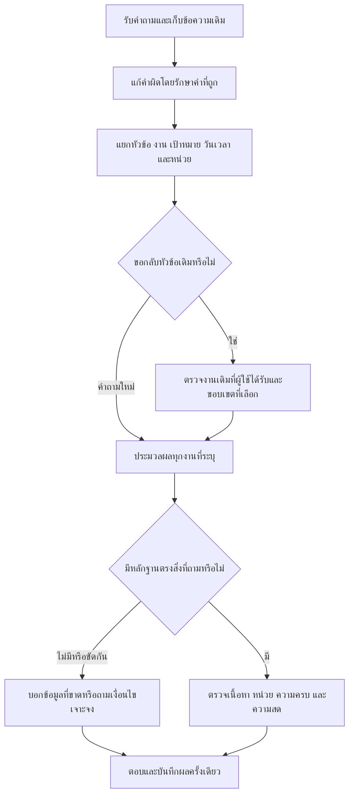

# Flow แก้บริบทและเงื่อนไขคำตอบ r42 — ฉบับตรวจทาน

## ขอบเขตและสิ่งที่ต้องรักษา

- อ่าน source และคำตอบ/trace จริง สำรอง uncommitted files ก่อน patch ไม่ reset/stash/แก้ log เก่า
- กติกา ราคา และตารางเจ้าของเปลี่ยนได้เมื่อมีหลักฐานเท่านั้น Missing fact ต้องตอบ missing; API connected ไม่เป็น real booking oracle
- เก็บ requested query เพื่อ execute ใหม่ ห้าม archive answer แล้วนำสถานะสดเก่ามาตอบ
- ไม่รัน full corpus20k; เคสพัฒนาและ regression เป็นหลักฐานตามขอบเขต ไม่เรียก unseen holdout

## 1. แยกคำถามเป็นงานที่ชัดเจน

1. รักษา raw input แล้วแยก locale, domain, operation, target, user group, date/time, quantity/unit และ negation
2. คำถามอังกฤษที่มี interrogative ทั้งสอง clause แยกงานแม้ operation เหมือนกัน; bare noun lists/ชื่อเกมยังเป็นหนึ่งคำถาม
3. เก็บ child question แต่ละข้อใน array ห้ามใช้ comma เป็นตัวแบ่ง target labels
4. จำกัด replay 1–4 child requests และ query ≤2000 chars; เกินขอบเขตถามแบ่งงาน ไม่ตัดท้าย

## 2. การแก้คำผิดและคำสั่งกลับหัวข้อ

1. Keyword fuzzy correction ต้องไม่ทับช่วงคำที่สะกดถูกแล้ว เช่น เปิดปิด
2. Return parser ใช้ NFC/casefold/Thai digits โดยไม่ใช้ fuzzy rewrite ทั้งประโยคซ้ำ
3. รองรับ please ก่อน/หลัง return และสำนวนกลับหัวข้อที่ระบุจริง
4. มีชื่อใหม่ เลข วันเวลาใหม่ หรือ negation ให้เส้นทางปกติรักษาข้อมูลนั้น; เงื่อนไขใหม่ที่รวมไม่ได้ถาม scope ไม่ลบทิ้ง

## 3. requested-task memory

1. แต่ละ task มี schema_version/domain/operation/query/targets/offered_options/status/provenance/response_id
2. เก็บเฉพาะผลที่ server complete แล้วและ client acknowledged; แยก session, TTL30นาที, ≤8 operation/session
3. เพิ่ม schedule, booking policy/navigation/live availability, members, contact และ game details นอกเหนือจาก price/controls/rules/catalog/equipment
4. หมวด booking กว้างที่มีหลาย operation เก่าถามว่า status/process/page ไม่เดาเลือกงานแรก
5. parent compound รวม same-operation ทุก child โดยเก็บ queries/request_targets; unknown child ยังอยู่ใน scope
6. ราคาใช้ schema เฉพาะและรักษา customer filters; หลาย price requests ที่ขัดกันต้อง clarification

## 4. execute หลัง resume

1. Single request ใช้ archived user query รัน pipeline ใหม่
2. Multiple requests ส่ง dialogue_resume_v1 ที่ตรวจ schema/version/domain+operation/จำนวนและชนิด requests
3. ห้าม fallback plan ที่ schema ผิดไปเป็น unrelated answer
4. Status สด fetch ใหม่ทุกครั้งตาม runtime cache0; explicit date/time คงไว้ Relative now/today resolve ใหม่
5. Mask ISO date ใน clock parser เท่านั้น ไม่เปลี่ยน date parser: 2026-09-17 at14:00 ต้องเป็น14:00 ไม่ใช่09–17
6. Generic plan/API/log ต้องบอก domain จริง; positive valid_price_task เท่านั้นที่จัดเป็นราคา

## 5. policy fields และคำตอบที่ตรงคำถาม

| Field | source ที่มี / gap | สิ่งที่ต้องตอบ |
|---|---|---|
| minimum booking notice | reservation_rules rule_booking_advance | อย่างน้อย1ชั่วโมง พร้อม source |
| maximum days ahead | ยังไม่มี source ยืนยัน | missing ของเพดานวัน ไม่ตอบ minimum hour หรือ weekly schedule |
| cancellation notice | rule_cancel_advance | อย่างน้อย1ชั่วโมง ไม่ตอบตารางเปิดศูนย์ |
| maximum Sessions | rule_booking_max_sessions | 3 Sessions ไม่เรียก3เครื่อง |
| maximum devices per booking | ยังไม่มี source ยืนยัน | missing จำนวนเครื่อง; ไม่ใช้ Sessions แทน |
| check-in | rule_checkin_advance | ล่วงหน้าสูงสุด30นาทีและก่อนเริ่มรอบ |
| payment deadline | rule_payment_10_minutes | ภายใน10นาทีพร้อมผลตามข้อกำหนดใน source |
| member count | structured members | 3กลุ่มแยกจาก25 member records |

Weekly schedule path ต้องไม่กลืน cancellation/payment/check-in/advance-offset fields จากคำว่า days/hours/book เพียงอย่างเดียว และ missing response ยังต้องผ่าน validator เดิม

## 6. state commit และ retry

1. ตรวจ turn identity/fingerprint/revision ก่อนเขียน
2. complete ครั้งแรกเป็น authoritative response; complete ซ้ำ returnFalse ไม่ overwrite archive/ack/history
3. API replay ใช้ original response ID/answer; changed input ที่ใช้turn IDเดิมเป็น client_turn_conflict409
4. same-session in-flight request อาจ session_busy409 มี retry_after_ms; retryด้วยturn IDเดิมหลังข้อแรกเสร็จ ต้องได้ response เดิม
5. Concurrent invariant ไม่เป็น multiuser load proof; late callbacks/crash ทุกจังหวะยังอยู่ backlog

## 7. เกณฑ์ตรวจที่แยกกัน

- Transport: HTTP status/ok/version/worker availability
- State: acknowledged history, domain/operation/scope/session/revision และ cache identity
- Execution: expected/executed/pending/answered/missing children; all executed ไม่รับรองทุก fact ถูก
- Content: actual requested quantity/unit/source clause และ missing policy อย่างเจาะจง; resume answerเหมือนเดิมอย่างเดียวไม่เป็น semantic oracle
- Real-world: เจ้าของยืนยัน policy/current prices และ booking snapshot ที่ตรวจไว้ แยกจาก fixtures

## 8. วงรอบที่ทำจริงและจุดแก้เกณฑ์

1. Baseline resume source/HTTP6จาก16; เพิ่ม domains/typed replay/immutable completion
2. Source14จาก16 →16จาก16 หลังแก้คำไทยเปิดปิดและ missing-policy response ให้ผ่าน validator
3. Variations9จาก12 →12จาก12 หลังรับ please และแยก same-intent English clauses; fixture time/date เปิดเผยบั๊ก ISO date ส่วน assertion booked/None เป็น oracle ที่ตั้งผิด แก้เกณฑ์แยกและเก็บ failure เดิม
4. Negative policy facets เปิดเผย helper จัดขั้นต่ำ/ยกเลิก/จำนวนเครื่องเป็น maximum days; ตรวจ actual answers แล้วแก้ weekly path/English ahead/source gap ไม่หยุดที่ predicate score
5. API duplicate caseแรก concurrent409session_busy เป็นการกันงานซ้อนตามโค้ด ไม่ใช่ client_turn_conflict; เก็บผลเดิม แล้วเพิ่ม retry oracle ที่เจาะจง error code
6. Runtime warmup/HTTP500 เก็บเป็น operational failure แยกจาก content score; pin interpreter ที่ตรวจและตรวจ APIจริงอีกครั้ง ไม่รับรอง root cause เพราะ restart ผ่าน

## 9. การปล่อยและทวนเอกสาร

1. สร้าง releaseใหม่แต่ละminorไม่ overlayตัวเก่า; app/web hashตรง source
2. Hash calendar/policy/competition chunks/review queue/rates ก่อนหลัง; เก็บ diffเทียบbackupรอบนี้
3. ตรวจ /health รุ่น/preflight/warmup และ actual chat request; healthokอย่างเดียวไม่พอ
4. รัน targeted source+HTTP ที่เกี่ยวข้อง; stop-on-first-failed-gateเพื่อไม่เพิ่มโหลดหลัง runtime failure
5. ชุด local ใช้ runtime/models ในเครื่องนี้; rebuildชุดแจกสองแบบ/clean-machineยังแยกเป็นงานค้าง
6. รายงานต้องระบุ testsพัฒนาไม่ใช่holdout, fixtureไม่ใช่real occupancy, และทุก66รายการที่ไม่ตรวจซ้ำไม่ตีว่าปิดแล้ว

## ผลตรวจทานเอกสารฉบับสุดท้าย

- ผลอัตโนมัติสุดท้าย 124 เคส/บทสนทนา, 283 คำขอ และ 135 test methods ผูกกับ r42.4
- หน่วยวัน/ชั่วโมง/นาที, Sessions/เครื่อง และกลุ่มสมาชิก/จำนวนคนต้องแยกกัน
- Resume equivalence ใช้ตรวจบริบทเท่านั้น คำตอบทั่วไปเรื่องเวลาอังกฤษยังต้องเพิ่มเกณฑ์ว่าตารางบริการปรากฏครบ
- การเริ่มใหม่แล้วผ่านเป็นหลักฐานว่ากู้ใช้งานได้ในรอบนี้ สาเหตุ MemoryError/500 และการใช้ Python ต่างตัวตาม PATH ยังไม่ปิดครบ
- ตัวเปิด local ที่กำหนด Python ยังใช้หลักฐานรุ่น/โฟลเดอร์ในการนำเว็บเดิมกลับมา ต้องเพิ่มการตรวจ interpreter และ actual request readiness ต่อ
- รายการงานเดิม 66 ข้อคงรหัสและชื่อเดิม แยกข้อที่ตรวจเพิ่มจากข้อที่ไม่ได้ตรวจซ้ำ
