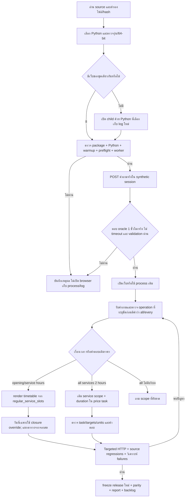

# Flow r43 ฉบับตรวจทาน: Runtime พร้อมจริงและ Scope ของตารางภาษาอังกฤษ

## หลักฐานที่ใช้และขอบเขต

ใช้ source/calendar เดิมและคำยืนยันเดิมว่า 12:00–13:00 ไม่มีให้จอง ไม่แก้ตารางเจ้าของ ราคา หรือกฎการแข่งขัน การทำงานเป็น local candidate บนเครื่องนี้ ไม่ใช่การรับรองชุดแจกหรือข้อเท็จจริงปัจจุบันทั้งหมด

## การเลือก Python

ลำดับ explicit `-PythonPath` → `PSU_PYTHON_EXE` → bundled runtime → manifest binding → PATH/fallback ตรวจด้วย executable จริง แล้วส่ง path เดิมผ่าน Background → Open → Start ตัว Python ตรวจรุ่น 3.11+ และ 64-bit การตรวจผ่านยังไม่รับรอง dependencies/ทุก Python รุ่นบนเครื่องใหม่

health แสดง executable path fingerprint, version, bitness, PID และ system memory โดยไม่แสดง absolute interpreter path ใน health ตัว diagnostic launcher สำหรับผู้ดูแลเก็บ path จริง Manifest ของ r43.3 ผูก Ready Python 3.12.14 บนเครื่องนี้ จึงห้ามอ้างว่าโฟลเดอร์ local นี้แจกไปใช้ได้ทันทีบนเครื่องอื่น

## Readiness และการใช้เว็บเดิม

ต้องผ่านชื่อบริการ version installation fingerprint Python identity parent warmup/preflight และ worker alive/ready แล้ว POST คำถาม `How far ahead must I book?` ด้วย Session ID `startup-probe-*` คำตอบต้องเป็น booking_advance_time, rule_en, validation_ok และมี at least 1 hour พร้อม source URL HTTP 200 หรือ confidence สูงไม่ใช่เกณฑ์ผ่าน

ใช้หนึ่ง oracle ที่มีอยู่ใน source เพื่อเช็กการตอบจริงผ่าน HTTP/worker ไม่ยืนยันทุก intent หรือว่า LLM ยังใช้ได้ในคำขอถัดไป Probe เป็น audit exchange แยก session แต่เก็บใน log จึงต้องแยก prefix นี้เมื่อวิเคราะห์ผู้ใช้

ถ้า instance ของชุดเดียวกันไม่พร้อม ตัวเปิดรายงานสาเหตุและไม่สร้าง instance เพิ่มโดยเงียบ ไม่ฆ่า process ที่เปิดอยู่ หาก process ที่เพิ่งเปิดไม่พร้อม จะเก็บไว้พร้อม diagnostic ให้ตรวจ การกู้/cleanup อัตโนมัติแบบตรวจ ownership และ worker-stage ยังเป็นงานต่อ

## การรักษา scope

คำว่า all/every ใช้กับ operation ที่ระบุในคำถาม ห้ามตีเป็นราคาโดยไม่มีหลักฐาน เช่น opening hours for every day ต้องเป็นตาราง ทั้งกรณีถามครั้งแรกและหลังคุยราคา ส่วน all services 2 hours หลังราคาเป็นราคาเดิมพร้อม duration ไม่ใช้ hours เพียงคำเดียวเป็นตัวเปลี่ยนไปหมวด schedule

ตารางประจำอังกฤษแสดง 7 วันจาก shared calendar: slot เปิดและ maintenance แยกกัน พักกลางวัน 12:00–13:00 ไม่มีเล่น/จอง และ no regular service สำหรับเสาร์/อาทิตย์ วันที่เฉพาะใช้ recorded closure override โดย public holiday ไม่ทำให้ปิดอัตโนมัติ ตารางนี้ไม่ใช่ความว่างของแต่ละเครื่อง

## รอบตรวจทานและปรับ Flow

1. Baseline: generic English hours ไม่มีช่วงเวลาครบ จึงเปลี่ยน renderer ใช้ shared slots; fixture พบ PowerShell 5.1 ทำ quote ของ Python หาย แก้ native argument ที่รองรับทั้ง 5.1/7; ปัญหา temp directory ของ sandbox แก้เฉพาะ harness
2. Review runtime: health อย่างเดียวไม่พอ เพิ่ม actual POST/oracle, runtime identity และ memory snapshot; ทดลองใน sandbox แล้ว HTTP หายหลัง tool จบ จึงเปิด persistent runtime ผ่าน permission ระบบ และตรวจ HTTP หลังจบคำสั่งอีกครั้ง
3. HTTP r43.2: ผ่าน 14/15 แต่ every day ถูก price plan แย่ง scope เพิ่ม explicit schedule operation signals พร้อม negative guard สำหรับ duration ราคา; r43.3 ผ่าน 17/17 กลุ่มตาราง และชุดเกี่ยวข้องรวม 72/72; source/fixture 159/159 พร้อม reuse process จริง
4. Review ส่งมอบ: แก้คู่มือให้ตรงการรันเบื้องหลัง ตรวจ Git EOF/parity/hash แยก local binding จาก portable และคง failed artifacts/release เดิมไว้ ไม่เปลี่ยน owner facts

## สิ่งที่ต้องพัฒนาต่อ

worker warmup บาง exception ยังถูก catch แล้ว ready.set; probe static หนึ่งข้อไม่รับรอง retrieval/LLM ทุกเส้นทาง ต้องเพิ่ม stage diagnostics และ controlled recovery ภายหลัง การสรุป root cause MemoryError ต้องเก็บ resource/error ใกล้เหตุการณ์ ไม่ใช้การ restart ผ่านแทนข้อพิสูจน์ Operation/scope ownership ของหมวดอื่นต้องตรวจ holdout ที่ไม่ใช้พัฒนา และ content completeness ต้องมี oracle ราย fact
