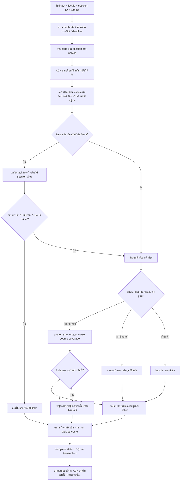

# Flow ฉบับสุดท้าย r50: คำตอบตามขอบเขต ความจำ และโหลดพร้อมกัน

วันที่ 2026-10-09 เวลาไทย · Runtime 2026.10.09-flow-r50.2

## 1. สถานะและเป้าหมาย

- สถานะจองจริง: ผู้ใช้ยืนยันว่าตรวจถูกต้องแล้ว เก็บคำยืนยันแยกจากผลอัตโนมัติ
- ภาษาอังกฤษ: ผู้ใช้แจ้งผ่านแล้ว งานนี้เพิ่ม regression TH/EN เฉพาะส่วนที่แก้
- เป้าหมาย: ให้คำถามเดิมหลายสำนวนเข้าหัวข้อถูก รักษาเงื่อนไขคำถามต่อ ฟื้นบริบทหลัง restart และวัดโหลดบนเครื่องจริง
- ใช้สำเนารุ่นใหม่และหลักฐานใหม่ เก็บโค้ดที่ Git ยังไม่บันทึกและ log ก่อนหน้าไว้ ไม่แก้นโยบาย/ข้อมูลเจ้าของเพื่อให้คะแนนดีขึ้น

## 2. Flow เมื่อรับข้อความ

การตอบหลายประเด็นต้องแยกสิ่งที่ตอบได้/ไม่ทราบออกจากกัน `validation_ok` และ `task_contract` ไม่ใช่หลักฐานว่าข้อเท็จจริงทุกข้อถูก ต้องมี oracle ตรวจเนื้อหาจริงด้วย

## 3. P0 Routing ของกติกา — ทำแล้ว

1. อ่าน input, trace, route, mode, source และ expected answer คู่กัน
2. เมื่อมีเกมแข่งขันที่ระบุ + team/member + จำนวน ให้ส่งเข้า competition_rules ก่อน guard สมาชิกบริการทั่วไป
3. ตรวจ facet ว่าคือ team_size, roster_composition หรือ pause_timeout จากเจตนาที่ขอ ไม่ใช้คำว่า team ตัดสินทั้งหมด
4. CS2: อ้าง clause s18_c01 ที่ระบุผู้เล่น 5 คน ตอบ 5 โดยไม่แต่งจำนวนสำรอง
5. VALORANT: source ที่นำเข้ายังไม่รองรับจำนวน starter/substitute/team_size; ตอบช่องว่าง ไม่ตีความ Match Prep ไม่เกิน 6 คนเป็น roster
6. Tactical timeout: จับสำนวน “ทีมขอเวลานอกได้กี่ครั้ง” ให้ตรง clause 2 ครั้งต่อแผนที่และครั้งละ 60 วินาที พร้อมขอบเขตที่ source ระบุ
7. แยก Steam/account membership และจำนวนกลุ่มสมาชิกออกจากคำถามสมัครสมาชิกศูนย์
8. ตรวจ source/localization ที่ใช้งานจริงและ negative cases ไทย/อังกฤษ

เกณฑ์: mode/game/facet ถูก + ตัวเลขและเงื่อนไขถูก + มี source; missing source ผ่านได้เมื่อระบุว่าไม่ทราบตรงประเด็น ไม่ถือว่าข้อมูลเรื่องนั้นครบ

## 4. P1 คำผิดและคำถามต่อ — ทำแล้วในขอบเขตที่ทดสอบ

1. Vocabulary canonical + distance ที่มี anchor บริการ รองรับ “เครือง” ร่วมกับการจอง/โอน
2. แก้หลายจุดเฉพาะที่สอดคล้องกันและมี edit budget; เก็บ query ก่อน/หลัง ไม่แก้ตัวเลข ID วันเวลา
3. ตัดคำสุภาพท้ายคำถามต่อเฉพาะขอบข้อความ เช่น อะครับ/อ่ะครับ/please เพื่อจับ motorbike/mouse followup
4. คำกลับเรื่องชัดเจนค้น history ไม่เกิน 16 messages/8 turns และใช้เฉพาะ server turn ที่ ACK
5. กลับเรื่องที่จอดรถหลังถามเกม: ใช้คำถามที่เคย resolve พร้อมเงื่อนไขเดิม
6. หากต้นเรื่อง compound หรือ pending price อย่าเลือก subtask เอง; ชี้แจงให้เลือก
7. ไม่พบประวัติเรื่องนั้น: ถามให้ระบุ ห้ามยืมประวัติคนอื่น
8. คำถามระบุสถานที่อื่นชัดเจน เช่น กรุงเทพ ต้องไม่ตอบว่าเป็นที่จอดรถของตึก 5 ภูเก็ต

ขอบเขต: return marker/สถานที่/คำผิดที่รองรับยังเป็นแบบ bounded ไม่ใช่ semantic correction ครบทุกประโยค การเพิ่มคำควรขยายชุดทดสอบจากความผิดจริงพร้อม negative cases ไม่เพิ่ม alias เพื่อกลบทุกคำผิด

## 5. P2 ความจำหลัง restart — ทำแล้ว

1. State DB ใหม่ `dialogue_state_v1.sqlite3` แยกจาก transcript; SQLite WAL + transactions ปิด connection ทุกครั้ง
2. เก็บ session snapshot เฉพาะ server-created state, ACK, completed turns, active task และ bounded history
3. Default TTL 1,800 วินาที ใช้ wall clock ข้าม restart; สูงสุด 512 sessions; ต้องเป็น session ID เดิมและยังไม่หมดอายุ
4. Turn ที่ pending ห้ามยกระดับเป็น complete; restore ต้องให้ประมวลผลใหม่
5. Duplicate completed turn replay ได้ตาม protocol; conflicting payload กับ turn ID เดิมต้อง conflict
6. ไม่ replay live booking answer จาก disk; ถามใหม่ต้องดึงสถานะใหม่
7. DB เสีย/เขียนไม่ได้ใช้ memory fallback และ health ระบุ last_error/survives_server_restart=false
8. Unit tests ตรวจ TTL/corrupt/unacknowledged/pending/live/idempotency/isolation; HTTP restart จริงตรวจ 10 sessions ตามลำดับ + fresh session 1
9. HTTP followups 4 sessions พร้อมกันตรวจสาระและ resolved question ของ public response

ความจำนี้ไม่รับรองการเริ่ม session ใหม่ การล้างข้อมูล browser การย้ายไปโฟลเดอร์ใหม่ หรือทุก domain หลัง restart ผล HTTP รอบนี้ครอบคลุม parking/personal peripherals

## 6. P3 Release และโฟลเดอร์ใช้/ส่งต่อ — ทำแล้วพร้อมขอบเขตตรวจ

1. Freeze รุ่น r50.2 ใหม่ สำรองก่อนแก้ เก็บ source diff และ hash; รุ่นเก่าคงอยู่
2. ตรวจ source/release 217 ไฟล์ และ full app/web/data ทั้งสองโฟลเดอร์ส่งต่อ
3. มี 01_Download_Models และ 02_With_Models รวม Python/Ollama/launcher/code/data
4. ไม่แนบ log, state DB หรือ session ของผู้จัดทำให้ผู้รับ
5. ตรวจ bundled Python sqlite3/ssl และโมเดลสองไฟล์ด้วย streamed SHA-256
6. รัน HTTP บน candidate รุ่นที่ freeze พร้อม health identity; โฟลเดอร์ส่งต่อยืนยัน equality กับ candidate
7. ตรวจ cold start ทั้งสองแบบบนเครื่องผู้รับใหม่: ยังไม่ได้ทำ จึงไม่ถือว่า file checks เป็นผล cold boot
8. ใช้ `Start-Chatbot.cmd` ของทั้งโฟลเดอร์; with models ไม่ต้องดาวน์โหลดน้ำหนัก, live WordPress ต้องเชื่อมอินเทอร์เน็ต

## 7. P4 ผู้ใช้พร้อมกัน — ทำแล้ว

### ออกแบบ

- แต่ละคนมี session/turn ID แยก ใช้ barrier เริ่ม HTTP พร้อมกัน; debug=false; ไม่ retry
- Fast: ที่จอดรถ/สมาชิก/สถานที่/คีย์บอร์ด/สลิป/walk-in; 3 waves ที่ 1,2,4,8,12,16,24,32 คน
- Mixed: CS2 controls, VALORANT personal mouse competition rule, PC games EN, personal keyboard EN; 2 waves ที่ 1,2,4,6,8,12 คน
- Runtime ใช้ worker เดียว, admission cap 16, queue wait 3s, global deadline 20s; คง setting จริง
- เก็บทุกคำขอ ทั้งคำตอบ เนื้อหาที่ต้องมี ภาษาจริง status เวลา session ID; แยก successful latency จาก rejected latency
- เกณฑ์ผ่าน: ทุก request ตรง oracle, ไม่มี timeout, PID ไม่เปลี่ยนในระดับนั้น, p95<=20s; หยุดเมื่อสองระดับต่อกันไม่ผ่าน
- ไม่ยิง load burst ใส่ WordPress และไม่ถือว่า selected mixed เป็น worst-case LLM ทุกหมวด

### ปรับ Flow จากผลจริง

1. Baseline พบ 503 ที่ fast16/mixed8 เก็บไว้ก่อนแก้
2. Final fast16 ผ่านครบ; mixed8 มี planned recycle ปนอยู่ — อ่าน event worker_recycle warming/promoted และ launcher threshold 250
3. ทดสอบ mixed ซ้ำแยกเมื่อ worker ยังมี completed count ต่ำ ไม่มี PID เปลี่ยนทุกระดับ
4. ใช้ mixed repeat เป็นหลักฐาน capacity ที่แยกปัจจัย recycle; เก็บ final ที่มี recycle เพื่อแสดง long-running behavior
5. การทดสอบ restart เริ่มยิง 10 พร้อมกันทำ harness หยุดที่503: แยก functional recovery เป็น sequential กับ load benchmark เก็บข้อมูลพลาดเดิมไว้
6. Public debug=false ไม่คืน debug-only context_resolution: ตรวจ resolved_question/content/session ใน oracle ห้ามแก้ระบบเพียงเพื่อให้ test ผ่าน

ข้อสรุป: Fast สูงสุดที่ทดสอบแล้วผ่านทั้งหมด 16 คน; Mixed สูงสุดที่ผ่านทั้งรอบหลักและรอบแยก recycle 6 คน ยังไม่ได้วัด 7 หรือ 17–23 จึงไม่อ้าง exact maximum แนะนำเผื่อแรง 12 fast หรือ 4–6 mixed สำหรับ workload นี้

## 8. Review / feedback loop

ใช้ 10 มิติตรวจทาน: evidence, source/locale, scope, completeness, context/ACK, persistence/TTL, restart/failure, load/recycle, package/preservation, acceptance/remaining work รายละเอียดอยู่ REVIEW_LOG_R50.md

รอบแก้จริง: source V1 → แก้ routing/facet/scope → V2 → พบ regression member group → แก้ → freeze r50.2 → HTTP/regression → restart → load → พบ recycle confound → mixed confirm → public context oracle regrade → final docs ไม่มีการอ้างว่ารันแก้โค้ด 10 รอบเต็ม

## 9. งานถัดไปตามสิ่งที่ยังพบ

1. หากต้องรองรับเกิน 6 mixed ให้แยก performance trace ต่อ stage และวัด sustained load/queue wait ตาม SLA ที่ต้องการ ก่อนปรับจำนวน workers; RAM เครื่องนี้มีแรงกดดันสูงอยู่แล้ว
2. Planned recycle ให้พิจารณา schedule/warmup/resource contention จาก event จริง; ยังไม่สรุปว่า recycle มีบั๊กจาก PID เปลี่ยนเพียงอย่างเดียว
3. ถ้ามีคำถามกติกา VALORANT roster จริง ต้องได้เอกสารจำนวนตัวจริง/สำรองของรายการนี้ ไม่ใช้กติกาทั่วไปแทน
4. เก็บ unseen input/return marker ที่ผิดจริง ขยาย bounded recovery และ scope negative fixtures
5. Cold startup/reinstall บนเครื่องผู้รับ + sustained requests + live booking load เป็นขั้นแยกที่ยังไม่ได้รับผลในรอบนี้

ทุกครั้งที่แก้ให้มี failing example → trace/source analysis → expected content → narrow fix → focused TH/EN regression → version+evidence ใหม่ ห้ามนับการเชื่อม API ได้เป็น factual correctness
