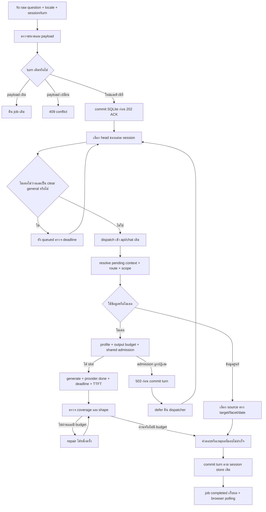

# Flow และบันทึกการพัฒนา r52 — ฉบับหลังลงมือและตรวจทาน

วันที่ 2026-10-09 · อ้างอิงงานวิจัยใน paper-search-results/20261009_181825_llm-serving-answers

## เกณฑ์วัด

แยก HTTP สำเร็จ, routing ตรงเจตนา, โมเดลจบ, ตอบครบรูปแบบ, เนื้อหาถูก, และเวลาตามเป้าหมายออกจากกัน ทุก loop ต้องมีผลก่อน/หลังและไฟล์ดิบ ไม่รันชุดเต็ม 20,000 เคส ไม่เปลี่ยนข้อมูลเจ้าของโดยเดา

## ลำดับลงมือ

1. Loop 1 — เก็บ baseline ของ frame rate/each box/across/งานเขียนและแปล แล้วแก้ routing และตัวตรวจชนิดคำตอบ ตรวจคำถามราคาจริงเป็น negative control
2. Loop 2 — ตรวจ format ของ steps/สองประโยค/การแปล/คำขอความยาว แก้ budget และ coverage ของรูปแบบ เก็บเหตุผล output ไม่ครบแยกจาก provider ใช้ไม่ได้
3. Loop 3 — ทดสอบผ่าน pipeline และเว็บจริงด้วยคำถามหลายสำนวน ตรวจ metadata เมื่อ timeout และเมื่อ stream ไม่จบ แก้เฉพาะสาเหตุที่ reproduce ได้
4. Loop 4 — ตรวจหลาย worker และ model gate สร้าง shared admission ที่ไม่เพิ่ม GPU concurrency โดยเดา ทดสอบสถานะผิดพลาดและเส้นทางใกล้เคียง สรุปข้อจำกัดพร้อมปรับ Flow

## Flow คำขอ

รับ raw + session/turn → ตรวจบริบท/ขอบเขต → แยกงานทั่วไปออกจากข้อเท็จจริงศูนย์ → อ่านแหล่งข้อมูลที่ตรง → เลือกรูปแบบและ budget ตามคำขอ → admission โมเดล → generate พร้อม deadline/TTFT/provider_done → ตรวจ coverage/ชนิด/ข้อเท็จจริง → ส่งคำตอบหรือเหตุผลที่ไม่สำเร็จ → commit ประวัติตามกลไกเดิม

## แผนรองรับคนพร้อมกัน

เริ่มจากแก้คอขวดที่ยืนยันได้และ admission รวมหลาย worker ก่อน งานคิวแบบ job API ต้องมี persist-before-ACK, idempotency, session ordering, deadline/cancel และ recovery หลัง restart ครบก่อนเปิดใช้ ห้ามเรียกคิวในหน่วยความจำว่า durable หรืออ้างว่าเพิ่ม workers แล้วตอบ LLM พร้อมกันได้บน GPU นี้

## การรักษาไฟล์

snapshot source/tests/data ก่อนแก้ + SHA256 อยู่ใน before/ และ before_hashes.json ผลใหม่อยู่ในโฟลเดอร์นี้เท่านั้น Git status ถ้าใช้ไม่ได้ให้ระบุข้อจำกัด ห้าม reset/revert/ลบ log

## สถานะเริ่มต้นที่บันทึกไว้ก่อนลงมือ

ยังไม่ถือว่า loop ใดผ่านจนมีผลการทดสอบจริง ขั้นที่ต้องใช้ GPU/หลายคนจะรายงานจำนวนคำตอบที่ผ่านเนื้อหาและจำนวน request ที่เสร็จแยกกัน

## 1. ขอบเขตหลังตรวจทาน

ส่วนที่ดำเนินการจริงคือ P0 routing/answer coverage/trace และ P1 admission/job API/ลำดับประวัติ/การหลีกเลี่ยง retry แย่งช่อง worker ส่วนการเพิ่ม GPU generation จาก 1 เป็น 2, เปลี่ยน serving engine และการรับรองข้อเท็จจริงทั่วไปทั้งโลกเป็นขั้นที่ยังไม่มีหลักฐานให้เปิดใช้อัตโนมัติ

Flow เริ่มต้นเก็บใน `FLOW_INITIAL.md` ผลการทดสอบที่ทำให้เปลี่ยนแต่ละขั้นเก็บแยก ไม่มีการทับผลก่อนหน้า อ่านผลทั้งหมดใน [RESULTS_ANALYSIS.md](RESULTS_ANALYSIS.md) และคำตอบพร้อมเหตุผลรายข้อใน [QUESTIONS_ANSWERS_ANALYSIS.md](QUESTIONS_ANSWERS_ANALYSIS.md)

## 2. Flow คำขอฉบับที่ใช้งานจริง

Mermaid เป็นภาพรวม: transport/job completed อาจเก็บคำตอบปฏิเสธหรือเหตุผลไม่สำเร็จไว้ด้วย ห้ามใช้ node completed รับรอง factual accuracy

### 2.1 รับและจัดคิว

1. เก็บข้อความดิบ ไม่แก้เลขเครื่อง/เวลา/ราคา/ชื่อเกมโดยเดา
2. ตรวจ JSON object และ question limits ตาม endpoint เดิม; session/turn เป็น stable IDs
3. session+turn ซ้ำและ payload fingerprint ตรง คืน job เดิม; payload ต่างคืน 409
4. ถ้าจำนวน queued/running ถึง capacity ปฏิเสธ admission ชัดเจน ไม่ ACK งานที่ยังไม่บันทึก
5. commit SQLite ก่อนตอบ 202 ข้อมูล queued recover ได้เมื่อ restart แต่ running เดิมเป็น failed/worker_lost เพื่อไม่ replay งานที่ไม่รู้ว่ารันไปแล้วหรือยัง
6. หนึ่ง session เลือกเฉพาะ turn เก่าสุดที่ยัง queued/running ต่าง session จึงแทรกกันได้ ไม่ให้คำตอบ follow-up ใช้ประวัติที่ยังไม่ commit
7. เรียงคำขอที่ยังไม่เคย dispatch ก่อนงาน retry ภายในกลุ่ม แล้วเรียงเวลารับ งาน retry อายุ 15 วินาทีกลับมาได้สิทธิ์ก่อน; นี่เป็น aging ของแอป ไม่ใช่ fairness theorem ของ GPU scheduler
8. เมื่อ shared broker active ถึง limit พักเฉพาะ clear general requests ที่คาดว่าจะใช้โมเดลไว้ งานข้อมูลศูนย์/งานไม่ชัดยังต้องเข้า pipeline จริง; ไม่สร้างคำตอบที่ scheduler
9. การอ่านสถานะ busy เป็น hint มี race ได้ จึงยังใช้ admission จริงที่ขั้นเรียกโมเดลเสมอ

### 2.2 เข้าใจคำถามและรักษาบริบท

1. pending price + “PC” เติม service แต่รักษากลุ่มผู้ใช้เดิม
2. pending price + “ทั้งหมด/all services” เติม scope ทั้งบริการ ต้องแสดงแพ็กเกจที่ต่างกัน ไม่รวมจนเงื่อนไขคน/นาทีหาย
3. คำถามใหม่คนละเรื่องต้องไม่ถูกบังคับใช้ pending เดิม
4. “each box” ไม่ใช่ all services; “frame rate” ต้องมีบริบท financial ก่อนเปิด price guard; “feel” ไม่ใช่ fee และ “across” ไม่ใช่ Cross
5. งานเขียน study session เป็นงานเขียนเมื่อไม่มีหลักฐานว่าเป็น booking; งานทั่วไปไทย “ระหว่าง RAM กับ SSD” ไม่ใช่ availability
6. ตรรกะ clear general ใช้ร่วมกันใน router/routing policy/engine ไม่ให้ priority matrix ดึงกลับเพราะ keyword บังเอิญ
7. ข้อมูลมหาวิทยาลัย/สมาชิก/เอกสารต้องอ้าง owner source ปัจจุบันและตอบ facet ที่ถาม “member of the public pay” ต้องเป็นราคา ไม่ใช่ membership

### 2.3 หลักฐานและรูปแบบคำตอบ

| งาน | เงื่อนไขก่อนตอบ | เงื่อนไขที่ตรวจเพิ่มแล้ว | สิ่งที่ยังต้องตรวจแยก |
|---|---|---|---|
| ราคา/บริการ | source + กลุ่ม + แพ็กเกจ + validity | scope ของ follow-up และ source | current policy หลังตารางหมดอายุ |
| กฎแข่ง | game + source + facet | regression claim contract เดิมผ่าน | ไม่ใช้คำตอบเกมอื่นแทน |
| จองสด | target/date/time + live source | ไม่แก้ flow สดในรอบนี้ | ใช้คำยืนยันจริงของผู้ใช้ตามขอบเขตเดิม |
| numbered steps | จำนวนที่ขอ | รายการเลข 1..N ครบ | ความเหมาะสมของแต่ละขั้น |
| two sentences | สองประโยคจริง | จำนวน/จบประโยค/รายละเอียดวันที่ไม่มาจากคำถาม | ประโยคทักทายอาจไม่ใช่ substantive invitation |
| comparison each | entity แต่ละตัว | Pros/Cons และชื่อแต่ละ entity | ข้อกล่าวอ้าง factual accuracy |
| translation | source และภาษาปลายทาง | ความครบรูปแบบไม่ถูกตัดเหลือวลี 8 คำ | ความหมาย/การละส่วน/การทำให้แคบลง |
| long English | requested words + entities | budget มากขึ้น/word floor/stop | ความถูกต้องเชิงข้อเท็จจริง |
| long Thai | requested words + entities | entities/ข้อดีข้อเสีย/provider done | จำนวนคำต้องมี tokenizer/version ก่อนรับรอง |

### 2.4 สร้าง ตรวจ และบันทึก

1. เลือก generation profile จาก task/raw request คำขอยาวเพิ่ม output tokens ตามความยาว ไม่เปลี่ยน deadline เงียบ ๆ
2. shared gate อยู่ที่ parent; worker ทุกตัวเรียก model admission เดียวกัน ค่า candidate นี้เท่ากับ 1
3. provider stream ต้องมี done; EOF ที่มีบางข้อความเป็น incomplete ไม่ยกเป็นคำตอบสมบูรณ์
4. เก็บ configured/effective timeout, tokens, answer plan, first-token time, elapsed, provider done reason และ rejected draft แบบมีขอบเขต
5. รูปแบบไม่ผ่านทำ repair ได้มากที่สุดหนึ่งครั้ง เฉพาะ profiles ที่เปิดและเวลาเหลือพอ ไม่ retry timeout/network ambiguity
6. admission full คืน 503 ก่อน session complete; job defer ได้ ส่วนการ timeout หลังเริ่มจริงต้องล้มเหลวชัดเจน ไม่ replay เพราะอาจสร้าง/commit ไปแล้ว
7. commit ผลตาม session store เดิมแล้วเก็บ job result; UI poll และแสดงสถานะ processing แทนการอ้างว่ากำลังสร้าง token ตลอดเวลา
8. log `confidence`, `validation_ok`, `answered_complete` ตามความหมายจริง แยกจาก claim correctness และ owner confirmation

## 3. เกณฑ์ทดสอบและสิ่งที่ทำใน 4 loops

### Loop 1 — keyword และ route

- Baseline fixtures 6/21; หลังแก้ชุดแรก 16/21
- วิเคราะห์สิ่งที่ยังผิด: router อาจเลือก general แต่ policy override กลับ, price_intent อีกชั้นยังนับ substring และ each scope ยังรั่ว
- ปรับแต่ละจุดจากหลักฐาน; negative controls ของราคาจริง/ปุ่ม Cross/PC availability ยังต้องผ่าน
- ผลท้าย loop รวมขั้น profile 21/21; ไฟล์ `loop1_baseline.json`, `loop1_after.json`, `loop2_after.json`, `loop_final_checks.json`

### Loop 2 — output coverage และ budgets

- จำแนก shape, provider incomplete และ semantic content คนละสาเหตุ
- เพิ่ม numbered steps/two sentences/comparison per entity/long explanation; แปลเต็มข้อความที่ขอ
- ตรวจคำตอบไม่ครบ, จำนวนผิด, generation length และ stream ที่ไม่มี done ด้วย fixtures
- ผล mock pipeline 6/9 → 8/9 → 9/9 อยู่ `loop3_pipeline_*.json` เป็นการทดสอบ route กับ gold text ไม่ใช่โมเดลจริง

### Loop 3 — เว็บจริงและคำตอบ

- 19 คำขอจริงรวม 11 general + 8 price turns: r52.1 ได้ model answers 9/11
- ตรวจ draft งานเขียนพบ 3 ประโยคและสร้างวันศุกร์; เพิ่ม bounded repair และ unsupported-specific guard
- RAM/SSD ไทยหลง equipment เพราะ `ว่าง` ใน `ระหว่าง`; แก้เงื่อนไขและทดสอบ booking เป็น negative
- r52.2 transport 19/19, model answers 11/11; ภาษา/เนื้อหายังมีข้อผิดพลาด จึงประเมินรายข้อ ไม่ทำเครื่องหมาย correct ทั้งชุด

### Loop 4 — concurrency และปรับคิวจากผลจริง

| ขั้น | สิ่งที่พบ | แก้จากหลักฐาน | ผล |
|---|---|---|---|
| r52.1 | 4 พร้อมกันได้ model answer เพียง 1 อีก 3 busy | durable jobs + ไม่ commit admission rejection + shared gate | r52.2 ได้ model answers 4/4 |
| r52.3 | ราคาใช้ pipeline 0.07s แต่รอรวม 17s | first attempts ก่อน retries + aging | r52.4 ราคา 9.03s |
| r52.4 | ยังเข้าซ้ำเพื่อไปพบว่า model busy | parent busy hint พัก clear general jobs | r52.5 ราคา 5.52s ระหว่างงานยาว |
| r52.5 | วัดงาน LLM ล้วน 6 พร้อมกัน | รักษา gate 1 และวัดตามจริง | ส่งครบ 6/6, 3.40–12.31s |
| r52.5 quiet | ตรวจซ้ำโดยไม่มี regression รันคู่ | ชุดผสมเดิม แยกบันทึกใหม่ | ราคา 1.67s, สมาชิก 2.17s, ทั้งชุดจบ 18.81s |

เพิ่ม tests การเลือกคิวให้ครอบคลุม retry ready แล้ว/aged retry/session head/general busy และ owner source รวม 11 methods ผ่าน ทำ raw regression รวม 78 methods ยังมี 3 legacy subfailures ใน 2 methods ที่ baseline มีอยู่ก่อน รายละเอียดเกณฑ์ล้าสมัยในรายงานผล

## 4. Flow รอบถัดไปจากข้อผิดพลาดที่ยังเหลือ

### P0 — ความหมายของคำตอบหลัง shape ผ่าน

1. ใช้ failure log เป็นแหล่งตั้งโจทย์ แยก ping/translation/version qualifiers/คำชวน/Thai length
2. สร้าง claim และ forbidden inference rubric: ping ไม่รับรอง bandwidth, network ไม่แปลแคบเป็น internet, HTTP ไม่เหมารวม transport ทุกรุ่น, คำชวนไม่แต่งวันเวลา; ตรวจ meta-instruction ใน output และ clarifying question ท้ายคำตอบที่ไม่จำเป็นซึ่งพบจริงในรอบ quiet
3. สำหรับหมวดทั่วไปที่ตั้งใจรองรับ เลือก primary sources และบันทึกวันที่/version/schema แยกจาก owner policies
4. สร้าง gold fact constraints และคำถามเปลี่ยนสำนวน/พิมพ์ผิด/ถามต่าง facet พร้อม negative cases ก่อนแก้
5. ปรับ prompt/claim validation/retrieval เมื่อมีหลักฐาน ระบุผล unknown หากตรวจความหมายไม่ได้ ไม่เรียก format-pass ว่า semantic-pass
6. bounded repair เฉพาะเมื่อมีเหตุผลและหลักฐานรองรับ; ไม่เชื่อ self-judge ของโมเดลตัวเดียวเป็น final oracle
7. ภาษาไทยคำขอจำนวนคำต้องเลือก tokenizer/version/test segmentation ก่อนเปิด assertion; ตอนนี้บอก word_count_verified=false ตามจริง
8. รันทดสอบชุดที่เกี่ยวข้องและเปรียบเทียบคำตอบ/metadata ก่อนหลัง ถ้ายังผิดกลับข้อ 1 โดยไม่เพิ่ม alias ตามตัวอย่างทีละข้อเป็นทางหลัก

### P1 — serving ที่ยังต้องวัด

1. sustained bursts ตาม workload และ token length จริง วัด ACK, queue wait, pipeline, TTFT, complete, format, semantic correctness แยก
2. ตรวจ fairness ต่าง session และ same session ordering ภายใต้ long/short work ต่อเนื่อง ยังไม่รับรอง starvation bound จาก aging heuristic
3. hard-kill worker ระหว่าง generation และ restart เว็บจริงใน runtime ทดลอง; ตรวจ broker release, queued recovery, running failure, idempotent session commit ไม่ซ้ำ
4. เพิ่ม browser refresh/resume และ terminal-result retention โดยไม่ลบ log เก่า
5. ปรับ provider attempt metadata ให้แยก gate rejection จาก actual provider call ทุกเส้นทาง
6. เมื่อทราบโหลดเป้าหมายแล้วจึงทดลอง model parallel 1 vs 2 บน runtime แยก วัด VRAM/RAM/คุณภาพ/p95 แบบมีจำนวนตัวอย่างและ warm/cold control
7. ถ้าไม่พอจึงพิจารณา engine/hardware ตาม paper โดยไม่ย้าย production และไม่อ้าง GPU continuous batching ว่ามีแล้ว

### P2 — เรื่องที่ต้องถามเจ้าของ

อัตรา PS5/Switch/Cockpit/VR ในตารางที่ระบุถึง 2026-03-31 ยังใช้หลังวันนั้นหรือไม่ ถ้าเปลี่ยนต้องขออัตรา แพ็กเกจ และวันมีผลใหม่ PC update 2026-07-27 แยกอยู่แล้ว ไม่ต้องขอเจ้าของตรวจ routing หรือคิวเพื่อทำงานส่วนเหล่านั้น

## 5. ตรวจทานรอบสุดท้าย

- สถานะ “done” ของงานวิจัยเดิมเป็น research-only; เอกสารนี้บันทึก implementation ใหม่แยก ไม่ย้อนแก้ผลค้นเดิม
- ModelAdmissionBroker คือคิวควบคุมใน parent ไม่ durable; ChatJobQueue คือ SQLite durable ของ queued jobs แยกสองคำนี้ชัดเจน
- 202 ACK ไม่ใช่คำตอบ; 200/transport completed ไม่ใช่ provider done และ provider done ไม่ใช่ semantic correct
- การตอบยาวและหลายคนวัดจริงแล้วในตัวอย่างนี้ แต่ไม่รับรองเวลาทุกคำถามหรือจำนวนผู้ใช้สูงสุด
- ข้อมูลเจ้าของ 38 ไฟล์ที่ snapshot ไว้ hash ไม่เปลี่ยน; source candidate r52.5 ตรง ROOT; snapshot/ผลเดิม/แพ็กเกจทุกเวอร์ชันยังอยู่
- Git status ใช้ไม่ได้และไม่ได้แก้ metadata; ไม่อ้าง working tree clean หรือ old-log hash verification ที่ไม่ได้เก็บ baseline
- candidate เปิดใช้ jobs ใน launcher ใหม่ แต่ source feature default ปิด ถ้าเปิดแพ็กเกจเก่าจะไม่ใช้โค้ดนี้

## 6. เปิดรุ่นที่ทดสอบ

บนเครื่องปัจจุบันเปิด http://127.0.0.1:8093/ เป็น r52.5 ใช้ Python/Ollama/models เดิม

เมื่อปิด process ทดลองแล้ว ต้องเปิด `candidate_r52_5/PSU_Esports_Chatbot_Local/Open-PSU-Esports-Chatbot.ps1` พร้อม PythonPath ที่ใช้ในผลทดสอบ หรือจัด runtime dependencies ให้ launcher พบก่อน รุ่นนี้เป็น candidate สำหรับเครื่องเดิม ไม่ใช่ portable package ใหม่สำหรับคนอื่น
