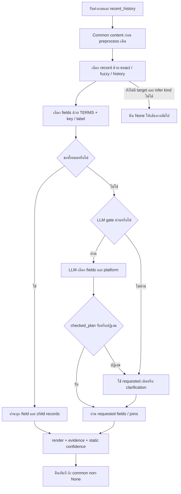

# วิเคราะห์สาเหตุการตอบผิดอย่างละเอียด — PSU Esports Chatbot / format กลาง

**ข้อมูลสมมุติแยกสำหรับทดสอบเท่านั้น ไม่ใช่บริการ ราคา กฎ หรือข้อมูลจริงของ PSU / SYNTHETIC DEMO ONLY — NOT PRODUCTION**

วันที่อ้างอิง 2026-10-12 เวลาไทย รายงานนี้วิเคราะห์ข้อมูลเดิมที่รันเสร็จแล้วครบ 5,056 เคส รวม 2403 เคสที่ไม่ผ่าน และประเด็นในเคสที่ผ่าน เพิ่มเฉพาะ diagnostic replay ของ 131 เคสที่ CommonAnswerer คืน None ไม่รัน full GT ไม่แก้โค้ดหรือข้อมูลจริง

## วิธีอ่านรายงาน

- เริ่มจากข้อ 1–4 เพื่อเห็นภาพและความหมายของคะแนน
- ข้อ 5–15 อธิบายว่าทำไมข้อมูลมีแต่เลือกตอบผิด พร้อมตัวอย่างจริงและโค้ด
- ข้อ 16–22 ตรวจ LLM, confidence, ภาษา, การแสดงผล, การทดสอบ และข้อจำกัด
- ภาคผนวกแยกครบทุกเคสที่ตกตาม 24 หมวด ดูคำถาม คำตอบจริง ค่าที่ควรตอบ history, plan, obligations, keyword ที่จับ และ source refs
- `CASE_ANNOTATIONS_5056_V2.json` มีรายการทุกเคสทั้งผ่าน/ไม่ผ่าน พร้อม quality audit flags เพิ่มเติม; เก็บรุ่นแรกไว้ด้วย `FAILURE_PATTERN_GROUPS.md` รวม pattern ซ้ำ 180 กลุ่ม เพื่อไม่เข้าใจว่า 2403 คือบั๊กคนละตัวทั้งหมด

## 1. ข้อสรุปที่หลักฐานรองรับ

ระบบเก็บและอ่านข้อมูล typed fields ได้ แต่การแปลงคำถามเป็น **record ที่ต้องใช้ + fields ที่ต้องตอบ + ความสัมพันธ์ + จำนวนหัวข้อ + ขอบเขต** ยังไม่ครบ เมื่อขอทุกข้อมูลจึงได้ครบ แต่คำถามเจาะจงถูก matcher เลือก field ผิดหรือเลือกไม่ได้

จากเคสไม่ผ่าน 2403: **1509** หา record ถูกแต่ field ว่าง; **763** หา record ถูกแต่เลือก field ไม่ครบ/ผิด; **131** CommonAnswerer คืน None. รวม 2272/2403 = 94.55% ที่ตกมีหลักฐานว่า target record ถูกแล้ว ปัญหาอยู่ขั้น field/intent มากกว่าการขาด record ในชุดนี้

คำว่า “ตอบผิด” รวมการถามกลับทั้งที่ข้อมูลพร้อม, บอกยังไม่มีข้อมูลทั้งที่ field ที่ถูกมีค่า, ตอบผิดมิติ เช่นขั้นต่ำแทนสูงสุด, และตอบขาดบางหัวข้อ ไม่ได้หมายความว่าทั้ง 2403 เคสแต่งข้อเท็จจริง

## 2. ข้อมูลและขอบเขตที่วิเคราะห์

20 ชุด × 24 หมวด = 480 records ใหม่ กับ 240 เดิม รวม 720 records ใน DEMO. 155 field slots ใน catalog / 122 ชื่อ field ไม่ซ้ำ. TERMS มีเพียง 13 กลุ่ม intent แบบ keyword; catalog ทำให้ field ใหม่ถูกอ่านและแสดงได้ แต่ไม่ได้สร้าง semantic interpretation ทุกสำนวนให้อัตโนมัติ

คำถามหลัก 5056 = ใหม่ 4960 + control เดิม 96. ภาษาไทย 2528, อังกฤษ 2528. ตัวอย่างข้อมูลสมมุติ ราคาศูนย์บาท/known-empty/known-false/unknown/min–max/time ต่างกันถูกเก็บไว้เพื่อดู guard. ไม่มีหลักฐานจากชุดนี้เรื่องความถูกต้องของสถานะ WordPress จริงหรือ translation ที่เจ้าของรับรอง

| ส่วน | ผ่านเกณฑ์เนื้อหา | ไม่ผ่าน | ความหมาย |
|---|---:|---:|---|
| ทั้งหมด | 2653 | 2403 | 52.47% ตาม scoring นี้ ไม่ใช่ human accuracy |
| เฉพาะใหม่ | 2584 | 2376 | 4960 เคส |
| ขอทั้งหมดใหม่ | 960 | 0 | ไม่ต้องเลือกหัวข้อย่อยจากคำถาม |
| สำนวนทั่วไป | 420 | 540 | 960 เคส |
| เปลี่ยนสำนวน | 380 | 580 | 960 เคส |
| ถามต่อ | 440 | 520 | 960 เคส |
| หลายหัวข้อ | 320 | 640 | 960 เคส |
| พิมพ์ซ้ำ | 64 | 96 | 160 เคส; 26 ที่ผ่านยังไม่ resolve field |
| control เดิม | 69 | 27 | เทียบเดิมแล้วไม่เปลี่ยน pass หรือ query_plan เลย 96 เคส |
| HTTP | 116 | 108 | HTTP 200 ครบ 224; ขนส่งสำเร็จไม่เท่ากับตอบถูก |
| pipeline จริง | 116 | 108 | 224 เคส, skipped legacy 8 เมื่อ common miss |
| บทสนทนา 3 รอบ | 360 | 120 | 160 first + 40 followup + 160 switch ผ่าน |
| LLM เฉพาะปัญหา | 5 | 43 | baseline เดียวกัน 3/48; attempts 27, accepted 2 |

หลายแถวใช้คำถามซ้ำกัน ห้ามรวมยอดเป็น unique requests คะแนนชุดเก่า 84.66% เทียบ 52.47% ชุดใหม่ตรง ๆ ไม่ได้ เพราะชุดเก่ามี contract-key/label queries 3100 แต่ชุดใหม่เน้น natural/multi-field ไม่มีการเปลี่ยนโค้ดก่อน/หลังในรอบนี้

## 3. หลักฐานแต่ละระดับและสิ่งที่ยังไม่รู้

| ระดับ | สิ่งที่มี | สิ่งที่สรุปได้ |
|---|---|---|
| log ต้นฉบับ | question, history, answer, decision, obligations, evidence, reasons | ระบบส่งข้อความไหนและเลือก field/record อะไร |
| code ที่ใช้รัน | hash ของ source และ code links ระบุบรรทัด | เงื่อนไขนั้นเกิดได้อย่างไรและอยู่ส่วนไหน |
| replay เฉพาะ None | 131 เคสคืน None เหมือนเดิม, return line, ratio ของ matcher เดิม | ระบุจุดออกและ threshold/margin ของ typo 11 เคส |
| วิเคราะห์ keyword | TERMS/catalog เดิมเทียบ q เดิม, annotate entity spans | คำไหนเข้า matcher; เป็นการคำนวณเพิ่ม ไม่ใช่แสร้งว่า log เดิมเคยบันทึกไว้ |
| LLM raw เดิม | 27 JSON responses ครั้งเดียวกับ 48 tests | emitted platform ผิดจริง 25 ครั้ง; ไม่มีเหตุ timeout/network ใน health ชุดนี้ |
| ข้อสันนิษฐาน | prompt ไม่อธิบาย platform/ไม่ enum | เป็นปัจจัยที่ทำให้โมเดลเลือก string ผิดได้ แต่ไม่เห็นกระบวนการคิดภายในโมเดล |
| ยังไม่ได้ยืนยัน | UX, อังกฤษทุกคำ, ผู้ใช้จริงทุกสำนวน, runtime fallback ของทุก None | ห้ามอ้างว่าอัตโนมัติยืนยันครบแล้ว |

## 4. Flow ที่ทำงานจริงและตำแหน่งที่พลาด



ต้องแยก entity resolution, field resolution, join resolution, answer coverage และ rendering. ทั้งห้าส่วนไม่เท่ากัน การหา record ถูกและมี citation ยังตอบผิดส่วนได้

## 5. R01 — ทำไมสำนวนเปลี่ยนแล้วเลือกหัวข้อไม่ได้

field_requests ใช้ `any(term in q)` และ full literal catalog labels. เช่น “อยู่ไหน” ไม่ตรง “อยู่ตรงไหน”; “เล่นยังไง” ไม่ตรง “ต้องทำอะไรเพื่อเล่นให้สำเร็จ”; “required proofs” ไม่ตรง “Which documents do I need to show?”. NFC/casefold ช่วยตัวอักษร/ตัวพิมพ์ ไม่ได้เข้าใจคำพ้องหรือความหมายประโยค

เหตุให้ข้อความถามกลับไม่ช่วย: clarification ถูก hardcode ว่า วิธีเล่น/ปุ่ม/อุปกรณ์/ราคา สำหรับทุกหมวด เช่นถามหลักฐานของ audience ยังได้รับตัวเลือกเกม/ราคา. ข้อมูลมี known required_proofs อยู่แล้ว จึงควรตอบหรือถามเจาะจงหัวข้อที่จำเป็น ไม่ถามซ้ำกว้าง ๆ

## 6. R02/R03 — ทำไมกี่คนได้ players_min และทำไมบอกไม่มีข้อมูล

คำจำนวนคนต้องแยกอย่างน้อย resource.capacity_persons, zone.room_seats, service.capacity_min/capacity_max, game_mode.players_min/players_max และ rental.room_seats. Matcher กลางใช้ players_min เพียงตัวเดียว; ใน resource ไม่มี key นี้ จึง add ไม่ทำงาน แล้วท้าย answer สร้าง unknown record_id=None.

ดังนั้นข้อความ “ยังไม่มีข้อมูล” ในเคสนี้หมายถึง field ที่ matcher เลือกไม่ถูกตอบ ไม่ใช่ว่า capacity_persons ไม่ทราบ. ส่วน game_mode มี players_min จริง จึงอาจตอบขั้นต่ำ 1 ทั้งที่ผู้ถามอยากรู้สูงสุด 4/8/12. ความผิดแบบหลังอันตรายกว่าการถามกลับ เพราะตัวเลขมาจาก source จริงแต่คนละความหมาย

## 7. R04 — ทำไม What is... ไป summary แล้วตอบผิดหมวด

summary มีคำ `what is`, `about`, `description` ใช้ทุก kind. What is their role? / What is the maximum player count? / What is the answer? จึงอาจไป field summary ซึ่งไม่มีใน person/game_mode/faq. ตัวแปร field_kinds จำกัดเฉพาะการวน catalog แต่ไม่ได้กรอง TERMS กลาง เป็นความผิดของขอบเขต matcher ไม่ใช่ข้อพิสูจน์ว่าอังกฤษแปลผิด

## 8. R05 — ทำไมตอบหลายเรื่องไม่ครบ

คำถามหนึ่งประโยคอาจขอราคา+นาที, อาคาร+ชั้น, มีเกมไหม+version, เริ่ม+จบ, กฎ+completeness. ปัจจุบันไม่มีตัวแยก question slots และไม่มี postcondition ทุกส่วนต้องมี answer/status. หากหาเจอ floor แต่ไม่เจอ building, หรือ event_start แต่ไม่เจอ event_end ก็พิมพ์ส่วนที่มีแล้วจบ

ส่วนราคา/แพ็กเกจพิมพ์ทุก fields โดย design และ policy แนบ decision/conditions/exceptions/details/consequence เสมอ จึงสามารถผ่านหลายหัวข้อแม้ plan ไม่ได้เลือกทุก key. การแนบเงื่อนไขราคา/กฎเป็นสิ่งที่ควรรักษา แต่ไม่ควรใช้การแนบเผื่อแทนการพิสูจน์ว่าเข้าใจทุกเรื่อง

## 9. R06/R07 — ประวัติหายหรือ field ไม่ได้ถูกเข้าใจ

ต้องอ่าน method/record_ids/requested_fields. บางเคส method=history_exact และ record ถูก แต่ requested=[] หรือ players_min ผิด. ถ้าแก้ส่ง history เพิ่มเฉย ๆ จะไม่แก้ field mapping. ในบทสนทนา 3 รอบที่ใช้คำตอบ assistant จริง: first 160/160 และ switch 160/160 ผ่าน แต่ followup 40/160 เท่านั้น

None 120 เคสจาก followup ทั้งหมดเป็นอังกฤษ: guard ประวัติไม่รับ And เพียงอย่างเดียว เมื่อไม่มี field keyword หรือ it/this/that แล้วไม่ได้เลือก prior record. question สั้น+มี history อย่างเดียวไม่พอ จึงไป infer kind แล้วกลับ None. นี่เป็นสองปัญหาต่อกัน: field mapping ไม่รู้สำนวน → history guard ไม่ให้ยืม record → common route ไม่ตอบ

context_query สแกน user turns ล่าสุด 6 messages ไม่อ่าน assistant choices เป็น typed pending state. assistant history ที่เพิ่มช่วยให้เห็นบริบท แต่ไม่ได้แปลว่าจะถูกใช้ resolver. การถามกว้าง→แสดงตัวเลือก→เลือกด้วยชื่ออย่างเดียวต้องมี pending intent/selection axis ที่ชัด ไม่ควรยืมคำแบบไม่รู้ชนิดรายการ

## 10. R08 — คะแนน fuzzy จริงเป็นอะไร

Exact ไม่ได้ใช้โมเดลคะแนนความหมาย. ถ้า exact ไม่พบจึงเปรียบเทียบ alias กับช่วงข้อความยาว alias−1/alias/alias+1, ต้องมีชุดตัวเลขเท่ากัน แล้ว SequenceMatcher.ratio >=0.88. เลือกได้เมื่ออันดับแรกทิ้งอันดับสอง >=0.06; ถ้า margin ไม่พอคืนไม่มีชื่อแทนเลือกสุ่ม

คะแนนคือความคล้ายตัวอักษรของ span ไม่ใช่ความมั่นใจตอบถูกหรือความเข้าใจเจตนา. การทำคะแนนชื่อดีขึ้นไม่แก้ required_proofs/session_minutes/players_max หาก field matcher ยังไม่รู้. Replay 11 typo misses ใช้ matcher/ratio ตัวเดิมและเก็บ top 5, alias/span, intended-record score, threshold และ margin ในภาคผนวก

## 11. R09/R17 — ทำไมพิมพ์ผิดกลับผ่าน แต่พิมพ์ถูกไม่ผ่าน

26 คู่ clean_fail/repeat_pass ไม่ใช่หลักฐานว่า typo ช่วยความเข้าใจ. Exact+field ว่างเข้า clarification; bounded_fuzzy+field ว่างถูกยกเว้น clarification แล้วตอบ publish_core/default fields. ตัวอย่าง sessionn ได้ name/resource/platform/session/occupancy จึงมี 60 นาทีอยู่ด้วย. Content scorer ผ่าน แต่ requested=[] และ all_fields=false ยืนยันว่า intent ยังไม่ถูกเลือก

อีก 94 คู่ clean_fail/repeat_fail ยังแยกสาเหตุ typo ไม่ได้ เพราะคำปกติก็ผิด. 38 คู่ผ่านทั้งสอง. 2 คู่ clean_pass/repeat_fail เป็นการตกหลังพิมพ์ซ้ำที่ชัดเจนในเกณฑ์นี้. อย่าใช้ 96 typo failures ทั้งหมดเป็นจำนวนบั๊กสะกด

## 12. R10 — ชื่อรายการทำให้จับหัวข้อผิดได้อย่างไร

q ทั้งประโยคเข้า matcher. ชื่อที่มี policy/procedure/controls หรือข้อกำหนด/ขั้นตอน/ปุ่มจึงเข้า field mapping ก่อนเข้าใจคำถามจริง. Alias ถูกตัดออกตอน remainder guard หลังเลือก fields แล้ว จึงตัดช้าไป. Detector แยก term matches ที่อยู่ใน span ชื่อ เพื่อบอกว่าคำนี้มาจาก title หรือส่วนคำถาม

คำในชื่ออาจทำให้ผ่านโดยบังเอิญด้วย เช่นชื่อ policy ทำให้ได้ details แล้ว policy bundle ตอบ gold ที่ขอครบ. ไม่ใช่ทุก match ใน entity เป็นบั๊ก ต้องดูว่ามันตรงเจตนาผู้ถามหรือทำให้เกิด field เกิน/ขาด

## 13. R13 — คำว่า “ครบไหม” ทำให้ตอบทั้งหมด

all_query ใช้ “ครบ” แบบ substring ไม่มีการแยกถาม completeness จากขอทั้งรายการ. คำอ่านกติกาให้ครบอาจควรขอ text เต็ม แต่ไม่จำเป็นต้องทุก field; “ข้อมูลครบไหม” ควรตอบ completeness. ใน dataset มี passed non-all cases ที่ broad=True ด้วยเหตุนี้ เก็บแยกใน PASSES_NEED_REVIEW.md

ยังพบ 20 เคส “รองรับคนนั่งทั้งหมดได้กี่คน”: ทั้งหมดขยายคำว่า “คนนั่ง” หมายถึงจำนวนรวม แต่ broad detector ตีเป็นขอทุก field ของโซน. จึงได้ room_seats จากการพิมพ์ทั้งหมด ทั้งที่ requested_fields ไป players_min และพ่วงข้อความยังไม่มีข้อมูลขั้นต่ำ ปัญหาคือ scope ของคำทั้งหมด ไม่ใช่การที่เลขที่นั่งใน source ผิด

helper probe ยังยืนยัน all_query('football'/'small'/'install')=True เพราะ `all\b` ไม่กันขอบต้น และ all_query('ไม่ต้องตอบทั้งหมด')=True เพราะไม่อ่าน negation. เป็นข้อจำกัดจริงของ helper แต่ไม่เอาเคส probe เหล่านี้ไปเพิ่มยอด 2403 เดิม และไม่อ้างว่า live เว็บส่งคำตอบไหนจาก probe นี้โดยไม่ได้วัด

## 14. R18 — source unknown กับ unsupported field ต้องต่างกัน

unknown ที่อยู่ใน record พร้อม note หมายถึงเจ้าของ/fixture ยังไม่ยืนยันข้อมูลจริง; known-empty/0/false ก็เป็นข้อมูลที่ยืนยันแล้ว ห้ามตีเป็น unknown. แต่ obligation record_id=None จาก requested ที่ตอบไม่ได้เป็นผล resolver ไม่ใช่ field factual unknown. การแสดงเหมือนกันทำให้ผู้ใช้คิดว่าข้อมูลไม่มีและย้อนแก้ DB ผิดจุด

ข้อเสนอเชิงวิเคราะห์: แยก unavailable_fact, unsupported_request_field, unresolved_intent, missing_relation, needs_clarification และ current-time validity. อย่าเพิ่มค่า guessed 0/false หรือบอกเจ้าของกรอกใหม่เพียงเพราะ matcher เลือก key ผิด

## 15. R15 — ทำไมตัวแก้ภาษาเดิมไม่ช่วยทุกคำถามจาก format ใหม่

engine เรียก common และ return non-None ก่อน explicit_request_focus และ preprocess_input เดิม ซึ่งมี keyboard-neighbour, transposition, multi-error phrase, intent recovery, normalize เเ→แ และ competition name recovery. Owner preview เรียก CommonAnswerer โดยตรง ไม่มี planner/preprocess จาก route เดิมเลย

คำตอบ common แบบ clarification/unknown ถือเป็น non-None จึงหยุดก่อนใช้เส้นทางเดิม. การเพิ่มความสามารถ typo/intent ที่ legacy route จึงไม่อัตโนมัติขยายมาถึง common. request_plan ที่ engine รับถูกใช้ส่วนถัดไป แต่ common ใช้เพียง raw question/recent_history. ข้อสรุปนี้ยืนยันด้วยลำดับโค้ด; ยังไม่ถือว่าทุก miss ในชุดนี้เกิดจาก preprocess bypass เพราะไม่ได้เปรียบเทียบเปิด preprocess ทุกเคส

## 16. R11/R12 — ทำไมมี LLM แต่ยังไม่ตอบถูก

48 tests เป็น CommonAnswerer + bounded schema planner, ไม่ใช่ให้ LLM แต่ง fact จากความจำ. 21 เคสไม่มี planner attempt เพราะ gate ไม่เข้า, 27 เรียกได้, 2 plans accepted, 25 rejected platform. การมี requested field ผิดอยู่แล้วทำให้ไม่เรียก LLM มาซ่อม เช่น resource กี่คน→players_min.

JSON schema ให้ requested_fields เป็น string ใดก็ได้และ platform เป็น string/null แต่ validator ตรวจ allowed keys/platforms ทีหลัง. Input prompt มี record_ids แต่ไม่ได้ส่ง allowed platform values/อธิบาย null แบบชัดเจน. Raw แสดง platform เป็น record ID/unknown/service; การปฏิเสธถูกตามข้อกำหนดปัจจุบัน การปล่อยผ่าน string ผิดเพื่อเพิ่มคะแนนจะทำให้ scope ผิด

สาเหตุของ emitted value ที่ยืนยันได้คือผลลัพธ์ผิดข้อกำหนด; การเชื่อมโยงว่า prompt/schema ไม่ constrain เพียงพอเป็น inference รองรับจากโค้ด ไม่ควรฟันธงว่าโมเดลเล็กหรือ translation เป็นตัวการหลักจาก 48 sample. ไม่มี health timeout/failure ใน 27 requests นี้

## 17. R14 — success, confidence และ validation หมายถึงอะไรจริง

HTTP 200=server ส่งผลได้; LLM health success=เรียก/decode ได้; checked_plan non-None=proposal อยู่ใน schema scope; obligation coverage=มีทุกหัวข้อที่คาด; answer correct=ต้องตรงคำถามและ fact. ทั้งห้าไม่ใช่ตัวเดียวกัน

planner เรียก record_llm_success หลัง checked_plan แม้ clean=None, จึง health 27 success แต่ accepted 2. finish ตั้ง trace confidence/route confidence/result confidence=1.0 และ ValidationResult(True) คงที่ หลังพิมพ์ typed source. ตัวเลข 1.0 ไม่ใช่การคำนวณคะแนน semantic ของคำถาม ไม่มี scoring rank ระหว่าง candidate answers ในขั้นนี้

## 18. ภาษาไทยและอังกฤษ — อะไรที่หลักฐานบอกจริง

ไทยผ่าน 1141/2528 (45.13%) อังกฤษ 1512/2528 (59.81%). ข้อมูลภาษาอังกฤษถูกแปลโดย agent แล้ว renderer เลือก en field; pass ตรวจว่าค่าที่คาดอยู่ในคำตอบ ไม่ใช่ตรวจการแปลเทียบต้นฉบับเชิงภาษาศาสตร์

สำนวนอังกฤษบางแบบบังเอิญตรง canonical keys เช่น specifications/rulebook release และบางแบบโดน What is→summary. ไทย “อยู่ตรงไหน” ไม่ตรง literal “อยู่ไหน”, หลักฐาน/เอกสารไม่ได้อยู่ TERMS ฯลฯ. ทั้งหมดเป็นผลกติกาปัจจุบันร่วมกับรูปแบบชุดทดสอบ ไม่ได้พิสูจน์ว่าภาษาไทยโดยธรรมชาติยากกว่าเสมอ. อังกฤษมี history-gate miss 120 ที่ไทย prefix แล้ว ผ่านได้ จึงมี bug เฉพาะอังกฤษด้วย

casefold ของ meaning_th ยังไม่สมมาตรกับ q: labels API/PC/ISO/VR/WordPress ซึ่งมีคำอังกฤษใน label ไทยหลุด. มีตัวอย่าง contract errors ชุดเก่าพร้อม source linkในส่วนเสริม ไม่ใช้ยอดเก่ารวมกับชุดใหม่

## 19. Renderer และข้อมูลที่มี citation แต่ยังไม่เหมาะกับผู้ใช้

title() ไม่อ่าน value ของ contact ทำให้ public_contact_id/contact_id บาง field แสดงรหัสภายใน. Enum เช่น modified_hours/in_service/conditional และเวลา/หน่วยบางค่าแสดงแบบเทคนิค. หลาย citations บอกว่า fact มาจาก approved synthetic source ไม่ใช่ยืนยันว่าจะตอบตรงคำถามหรือเป็นบริการ PSU จริง

kind rate/rental/policy bundle แนบเงื่อนไขเพื่อไม่ตัดบริบทเป็นข้อดี แต่คำตอบอาจยาวหรือรวมข้อมูลที่ผู้ใช้ไม่ได้ถาม. competition ทุกคำถามแนบ child rules ทั้งหมด ส่วน join game_mode ถูก trigger โดย players_min ไม่ใช่ทุก slot players_max ที่อาจถูกเลือกด้วย planner. ข้อจำกัด join ที่ยังไม่ถูกกระตุ้นใน dataset ให้ระบุเป็น code risk ไม่แปลงเป็น count ของเคสผิดโดยเดา

## 20. Scoring ทำอะไร และทำอะไรไม่ได้

ตรวจ record-field obligation, status, expected leaf content, evidence source/locator สำหรับ field known, unknown/not_applicable wording. ไม่ตรวจ style, translation ทุกคำ, implication/negation, extra unrelated assertions ทุกตัว, semantic plan ครอบคลุม gold ทุกช่อง, public-contact dereference ที่ผู้ใช้ใช้งานได้

expected_fields/question ถูกเขียนก่อนรันโดยไม่ส่ง oracle ให้ระบบ แต่ expected formatting ของ reference ใช้ title() จาก implementation เดียวกับ renderer จึงมีโอกาสยอมรับ fallback internal ID ทั้งสองฝั่ง เป็นส่วนที่ test ยังไม่อิสระพอและควรแยก specification ของ public reference display ออกก่อนรับรอง UX. การมี ground truth field ไม่ได้ทำให้ทุกมิติของ scorer เป็น independent human ground truth

26 passes ที่ unresolved intent แสดงช่องโหว่ของการมีข้อความถูกเพียงอย่างเดียว. อีกกลุ่มผ่านจาก domain bundles ไม่ควรเรียกว่า fail ทันที แต่ควรแยก metric intentional slot resolution กับ required content. Passed extra unknown messages ต้องตรวจว่าทำให้ผู้ใช้เข้าใจผิดหรือไม่ แม้ gold อยู่ในคำตอบครบ

## 21. ประสิทธิภาพและสิ่งที่ยังไม่วัด

named() ทำ fuzzy scan ก่อนลอง history แม้คำถามสั้นไม่มีชื่อ; ทุก alias ใช้ sliding spans 3 ขนาดและ SequenceMatcher พร้อมตัวเลข guard. ชื่อมากขึ้นทำให้ต้นทุนเพิ่มเป็นหลายส่วนร่วมกัน การขอ history ก่อน fuzzy เฉพาะเมื่อ followup ชัดเจนเป็นแนวทางที่ต้องรักษา entity-switch guard ไม่ใช่ข้าม lookup ทุกครั้ง

content test ใช้ immutable snapshot และ test-only pure name cache เพื่อทำงานครบ ไม่ใช่ระบบ production cache. elapsed ใน log รวมแย่ง CPU ของ workers และบาง cache hit จึงไม่ใช้ประมาณเวลาเว็บ/จำนวนผู้ใช้. API/pipeline ที่อ่าน DB จริงช่วยยืนยันผลส่วนที่ทวน แต่ไม่เป็น load benchmark รอบนี้

### 21.1 จุดที่ format กลางเป็น data-driven แล้ว และจุดที่ยังไม่ใช่

registry/templates/schema/forms/validation/default rendering รับ fields จาก catalog ได้จริง. แต่ field intent ยังใช้ TERMS 13 กลุ่ม, generic kind inference ยังใช้ KIND_TERMS ที่ไม่ครบทุก24kind, joins ยังเขียน if/else เช่นราคาเดินจาก service/audience/zone และ game_mode joinเริ่มจาก players_min. text_index ที่เก็บใน release ไม่ได้กลายเป็น semantic search อัตโนมัติใน CommonAnswerer นี้

จึงเพิ่มข้อมูลใหม่ที่ schema ยอมรับได้แล้ว ไม่ได้หมายความว่าจะมีวิธีแปลงคำถามใหม่ทุกสำนวนเป็นคำสั่งอ่าน field/relation ทันที. คำถามชื่อเกม+ราคาอาจต้องเดิน game→game_service→service→rate ซึ่งยังไม่ใช่ generic graph query. ความเสี่ยง relationนี้อ่านได้จาก code แต่ไม่เพิ่มจำนวนเคสผิด เพราะชุดgameถามวิธีเล่น/summary ไม่ได้ถามราคาเกมทุกเคส

อีกด้าน policy.conditions_all/schedule/closure ถูกแสดงเป็นข้อมูล แต่ไม่ใช่ execution engine ของเงื่อนไขผู้ใช้/ปฏิทินหรือสถานะสดทุกแบบ. การขอรายละเอียดกฎกับการถามว่าตนเองเข้าเงื่อนไขหรือไม่เป็นคนละงาน อย่าใช้ field rendering ไปยืนยันสิทธิ์หรือสถานะสดโดยยังไม่ได้ resolve context

Owner preview ไม่มี planner; เว็บแชท server ใช้ LOCAL_LLM_ASSIST_ENABLED ซึ่ง code default=True และส่ง flagไป pipeline แต่ยังต้องผ่าน common planner gate. main5056/API/pipeline224 tests ปิด LLMตามscope ส่วน 48 sampleเปิดจริง. ไม่ควรกล่าวว่าทุก requestบนเว็บ production ปิด LLMเพียงเพราะ testsชุดหลักปิด และรอบนี้ไม่ได้อ่านค่า envของprocessเว็บจริง

Closure fixtures อยู่เดือนธันวาคม แต่ query ATเดือนตุลาคม; คำถามระบุ notice recordเพื่อถามข้อมูลในประกาศ ไม่ใช่ทดสอบว่าวันนี้ตามปฏิทินจริงปิดไหม. Some natural wordingอาจมีได้หลายinterpretations; goldเป็นเจตนาที่ผู้สร้างfixtureกำหนดไว้ ไม่ใช่ human-user intentที่ยืนยันทุกประโยค. จึงแยก manual reviewของความกำกวมจากบั๊กที่ recordถูก+fieldไม่มี/ผิดอย่างชัดเจน

## 22. สิ่งที่ไม่ควรสรุปจากการทดสอบ

- ข้อมูลทั้งหมดผิด/ต้องให้เจ้าของกรอกใหม่: ไม่รองรับ เพราะ all_fields 960 ผ่านและ 2272 failures เลือก record ถูก
- เพิ่ม alias หรือ keywordทุกประโยคแล้วจะจบ: ไม่รองรับ เพราะหลายมิติเหมือนกันต้องแยก kind/min/max และ field completeness
- ลด fuzzy threshold อย่างเดียว: ไม่แก้ field mapping และเสี่ยงเลือก wrong item
- เปิด LLM ทุกครั้งจะจบ: มี invalid platform และ gate/schema/slot issues ที่ต้องแก้ร่วมกัน
- อังกฤษผ่านแล้วจึงไม่มีปัญหา: ไม่รองรับ ทั้ง summary keyword และ And history misses พบจริง
- confidence=1 จึงตอบถูก: เป็นค่าคงที่ ไม่ได้ calibrate semantic quality
- 2403 เป็น hallucinations หรือ 2403 root causes: ไม่ใช่ ทั้ง clarification/incomplete/missing path และ pattern ซ้ำรวมอยู่

## 23. สารบัญสาเหตุและจำนวนเคสที่ detector ยืนยัน

รหัสสาเหตุเป็นหลายป้ายต่อเคส ต้องอ่าน primary chain ห้ามบวก counts เป็น unique failures. บางรหัสเป็น code risks/หลักฐานชุดก่อน ไม่ถูกใส่ tag ให้เคสใหม่โดยไม่มี evidence.

| รหัส | ประเด็น | เคสไม่ผ่านที่มี tag | เคสผ่านที่ต้องดูเพิ่ม | จุดโค้ด |
|---|---|---:|---:|---|
| R01 | สำนวนยังไม่ถูกแปลงเป็นชื่อช่องข้อมูล | 1509 | 0 | [app/knowledge/common/answer.py](C:/Users/Chokhun/Documents/Codex/2026-09-25/psu-esports-studio-phuket-chatbot-c-2/r58_common_content_20261010/system/PSU_Esports_Chatbot_Local/app/knowledge/common/answer.py:90) |
| R02 | จำนวนคน/ที่นั่ง/ระยะเวลาไปชน keyword ผิดความหมาย | 222 | 0 | [app/knowledge/common/answer.py](C:/Users/Chokhun/Documents/Codex/2026-09-25/psu-esports-studio-phuket-chatbot-c-2/r58_common_content_20261010/system/PSU_Esports_Chatbot_Local/app/knowledge/common/answer.py:12) |
| R03 | ช่องที่เลือกใช้ไม่ได้กับ kind ที่พบ | 521 | 0 | [app/knowledge/common/answer.py](C:/Users/Chokhun/Documents/Codex/2026-09-25/psu-esports-studio-phuket-chatbot-c-2/r58_common_content_20261010/system/PSU_Esports_Chatbot_Local/app/knowledge/common/answer.py:90) |
| R04 | What is/about/description ถูกตีเป็น summary เกินบริบท | 261 | 0 | [app/knowledge/common/answer.py](C:/Users/Chokhun/Documents/Codex/2026-09-25/psu-esports-studio-phuket-chatbot-c-2/r58_common_content_20261010/system/PSU_Esports_Chatbot_Local/app/knowledge/common/answer.py:12) |
| R05 | ถามหลายหัวข้อแต่ plan ไม่เก็บครบทุกหัวข้อ | 640 | 0 | [app/knowledge/common/answer.py](C:/Users/Chokhun/Documents/Codex/2026-09-25/psu-esports-studio-phuket-chatbot-c-2/r58_common_content_20261010/system/PSU_Esports_Chatbot_Local/app/knowledge/common/answer.py:90) |
| R06 | หัวข้อก่อนหน้ากับหัวข้อใหม่ยังไม่ผูกเป็น dialogue state | 520 | 0 | [app/knowledge/common/answer.py](C:/Users/Chokhun/Documents/Codex/2026-09-25/psu-esports-studio-phuket-chatbot-c-2/r58_common_content_20261010/system/PSU_Esports_Chatbot_Local/app/knowledge/common/answer.py:101) |
| R07 | คำถามต่ออังกฤษไม่ผ่านเงื่อนไขอ่านประวัติ | 120 | 0 | [app/knowledge/common/answer.py](C:/Users/Chokhun/Documents/Codex/2026-09-25/psu-esports-studio-phuket-chatbot-c-2/r58_common_content_20261010/system/PSU_Esports_Chatbot_Local/app/knowledge/common/answer.py:101) |
| R08 | fuzzy ปฏิเสธชื่อที่ยังคลุมเครือ | 11 | 0 | [app/knowledge/common/answer.py](C:/Users/Chokhun/Documents/Codex/2026-09-25/psu-esports-studio-phuket-chatbot-c-2/r58_common_content_20261010/system/PSU_Esports_Chatbot_Local/app/knowledge/common/answer.py:88) |
| R09 | พิมพ์ซ้ำแล้วข้าม clarification โดยที่ field ยังว่าง | 0 | 26 | [app/knowledge/common/answer.py](C:/Users/Chokhun/Documents/Codex/2026-09-25/psu-esports-studio-phuket-chatbot-c-2/r58_common_content_20261010/system/PSU_Esports_Chatbot_Local/app/knowledge/common/answer.py:171) |
| R10 | คำในชื่อรายการหรือ alias ถูกนับเป็นคำถามด้วย | 41 | 0 | [app/knowledge/common/answer.py](C:/Users/Chokhun/Documents/Codex/2026-09-25/psu-esports-studio-phuket-chatbot-c-2/r58_common_content_20261010/system/PSU_Esports_Chatbot_Local/app/knowledge/common/answer.py:90) |
| R11 | รูปแบบ JSON โมเดลกว้างกว่าข้อกำหนดรับผล | 0 | 0 | [app/knowledge/common/planner.py](C:/Users/Chokhun/Documents/Codex/2026-09-25/psu-esports-studio-phuket-chatbot-c-2/r58_common_content_20261010/system/PSU_Esports_Chatbot_Local/app/knowledge/common/planner.py:32) |
| R12 | ประตูเรียก LLM ไม่ครอบคลุม field ผิดหรือ field ไม่ครบ | 763 | 0 | [app/knowledge/common/answer.py](C:/Users/Chokhun/Documents/Codex/2026-09-25/psu-esports-studio-phuket-chatbot-c-2/r58_common_content_20261010/system/PSU_Esports_Chatbot_Local/app/knowledge/common/answer.py:162) |
| R13 | คำว่าครบ/ส่วนท้าย all ทำให้ขยายเป็นขอทั้งหมด | 0 | 60 | [app/knowledge/common/answer.py](C:/Users/Chokhun/Documents/Codex/2026-09-25/psu-esports-studio-phuket-chatbot-c-2/r58_common_content_20261010/system/PSU_Esports_Chatbot_Local/app/knowledge/common/answer.py:34) |
| R14 | confidence/validation/source trust ถูกปนกับการตอบตรงคำถาม | 0 | 0 | [app/knowledge/common/answer.py](C:/Users/Chokhun/Documents/Codex/2026-09-25/psu-esports-studio-phuket-chatbot-c-2/r58_common_content_20261010/system/PSU_Esports_Chatbot_Local/app/knowledge/common/answer.py:265) |
| R15 | ทางเข้าฐานกลางคืนคำตอบก่อนใช้ preprocess/dialogue ของเส้นทางเดิม | 0 | 0 | [app/pipeline/engine.py](C:/Users/Chokhun/Documents/Codex/2026-09-25/psu-esports-studio-phuket-chatbot-c-2/r58_common_content_20261010/system/PSU_Esports_Chatbot_Local/app/pipeline/engine.py:881) |
| R16 | ข้อมูลอ้างอิงแสดงเป็นรหัสภายในแทนข้อมูลปลายทางที่ใช้ได้ | 0 | 0 | [app/knowledge/common/answer.py](C:/Users/Chokhun/Documents/Codex/2026-09-25/psu-esports-studio-phuket-chatbot-c-2/r58_common_content_20261010/system/PSU_Esports_Chatbot_Local/app/knowledge/common/answer.py:202) |
| R17 | คะแนนผ่านตรวจการมีข้อมูล แต่ไม่ได้พิสูจน์ความเข้าใจครบ | 0 | 86 | [app/knowledge/common/answer.py](C:/Users/Chokhun/Documents/Codex/2026-09-25/psu-esports-studio-phuket-chatbot-c-2/r58_common_content_20261010/system/PSU_Esports_Chatbot_Local/app/knowledge/common/answer.py:216) |
| R18 | ข้อความยังไม่มีข้อมูลอาจเกิดจาก field ผิด ไม่ใช่ source unknown | 521 | 0 | [app/knowledge/common/answer.py](C:/Users/Chokhun/Documents/Codex/2026-09-25/psu-esports-studio-phuket-chatbot-c-2/r58_common_content_20261010/system/PSU_Esports_Chatbot_Local/app/knowledge/common/answer.py:254) |
| R19 | การอ่าน label ไทยและการปรับตัวพิมพ์ไม่สมมาตร | 0 | 0 | [app/knowledge/common/answer.py](C:/Users/Chokhun/Documents/Codex/2026-09-25/psu-esports-studio-phuket-chatbot-c-2/r58_common_content_20261010/system/PSU_Esports_Chatbot_Local/app/knowledge/common/answer.py:90) |
| R20 | การสลับไปกฎแข่งใช้ details เป็นสัญญาณกว้างเกินไป | 0 | 0 | [app/knowledge/common/answer.py](C:/Users/Chokhun/Documents/Codex/2026-09-25/psu-esports-studio-phuket-chatbot-c-2/r58_common_content_20261010/system/PSU_Esports_Chatbot_Local/app/knowledge/common/answer.py:153) |
| R21 | live routing และราคาฟรีใช้คำร่วมกัน | 0 | 0 | [app/knowledge/common/answer.py](C:/Users/Chokhun/Documents/Codex/2026-09-25/psu-esports-studio-phuket-chatbot-c-2/r58_common_content_20261010/system/PSU_Esports_Chatbot_Local/app/knowledge/common/answer.py:35) |

## 24. ตัวอย่างสาเหตุทุกหมวดที่มีเคสไม่ผ่าน

แต่ละตัวอย่างเป็นข้อมูล DEMO ใช้ค่าจาก record ใน release เดียวกับ test ข้อความควรตอบเรียบเรียงเพื่อให้เห็นสิ่งที่ขาด ไม่ถือว่า owner confirmed

### center / Case 00002

ถาม: ศูนย์ทดลอง ดาวเหนือ อยู่ตรงไหน

ตอบจริง:
```text
ต้องการทราบส่วนใดของรายการนี้ เช่น วิธีเล่น ปุ่ม อุปกรณ์ หรือราคา?
```

ควรตอบ:
```text
ที่อยู่ (address): เลขที่สมมุติ 7 ถนนตัวอย่าง แขวงทดลอง
```

เหตุ:หา demo20_center_01 ถูกแล้ว แต่ requested_fields=[]; ชื่อช่องที่ต้องอ่านยังไม่ได้เลือก จึงเข้า clarification; ข้อความถามกลับถูก hardcode และไม่เจาะหมวด

[ดูคำถาม/history/plan/evidence และการจับคำครบทุกเคส](C:/Users/Chokhun/Documents/Codex/2026-09-25/psu-esports-studio-phuket-chatbot-c-2/r58_examples_20sets_20261012/deep_analysis_20261012/FAILURES_BY_CATEGORY/center.md)

### zone / Case 00202

ถาม: โซนทดลอง ดาวเหนือ มีที่นั่งกี่ที่

ตอบจริง:
```text
ต้องการทราบส่วนใดของรายการนี้ เช่น วิธีเล่น ปุ่ม อุปกรณ์ หรือราคา?
```

ควรตอบ:
```text
จำนวนที่นั่งในห้อง (room_seats): 7
```

เหตุ:หา demo20_zone_01 ถูกแล้ว แต่ requested_fields=[]; ชื่อช่องที่ต้องอ่านยังไม่ได้เลือก จึงเข้า clarification; ข้อความถามกลับถูก hardcode และไม่เจาะหมวด

[ดูคำถาม/history/plan/evidence และการจับคำครบทุกเคส](C:/Users/Chokhun/Documents/Codex/2026-09-25/psu-esports-studio-phuket-chatbot-c-2/r58_examples_20sets_20261012/deep_analysis_20261012/FAILURES_BY_CATEGORY/zone.md)

### equipment_model / Case 00402

ถาม: รุ่นอุปกรณ์ ดาวเหนือ สเปกมีอะไรบ้าง

ตอบจริง:
```text
ต้องการทราบส่วนใดของรายการนี้ เช่น วิธีเล่น ปุ่ม อุปกรณ์ หรือราคา?
```

ควรตอบ:
```text
สเปก (specifications): • key: DEMO screen; unit: inch; value: 27
• key: DEMO input; unit: ; value: gamepad
```

เหตุ:หา demo20_equipment_model_01 ถูกแล้ว แต่ requested_fields=[]; ชื่อช่องที่ต้องอ่านยังไม่ได้เลือก จึงเข้า clarification; ข้อความถามกลับถูก hardcode และไม่เจาะหมวด

[ดูคำถาม/history/plan/evidence และการจับคำครบทุกเคส](C:/Users/Chokhun/Documents/Codex/2026-09-25/psu-esports-studio-phuket-chatbot-c-2/r58_examples_20sets_20261012/deep_analysis_20261012/FAILURES_BY_CATEGORY/equipment_model.md)

### resource / Case 00602

ถาม: เครื่องทดลอง ดาวเหนือ เล่นพร้อมกันได้กี่คน

ตอบจริง:
```text
players_min: ยังไม่มีข้อมูลยืนยันสำหรับขอบเขตนี้
```

ควรตอบ:
```text
คนเล่นพร้อมกันของเครื่อง (capacity_persons): 4
```

เหตุ:เลือก record ['demo20_resource_01'] และหัวข้อ ['players_min']; field ของ target ที่ยังไม่มี obligation คือ ['capacity_persons']. ข้อมูล gold มีอยู่ใน release เดียวกัน การมี evidence ของ field อื่นไม่ชดเชยส่วนที่ขาด

[ดูคำถาม/history/plan/evidence และการจับคำครบทุกเคส](C:/Users/Chokhun/Documents/Codex/2026-09-25/psu-esports-studio-phuket-chatbot-c-2/r58_examples_20sets_20261012/deep_analysis_20261012/FAILURES_BY_CATEGORY/resource.md)

### service / Case 00842

ถาม: รอบทดลอง ดาวเหนือ หนึ่งรอบเล่นได้กี่นาที

ตอบจริง:
```text
ต้องการทราบส่วนใดของรายการนี้ เช่น วิธีเล่น ปุ่ม อุปกรณ์ หรือราคา?
```

ควรตอบ:
```text
เวลาเล่นต่อรอบ (นาที) (session_minutes): 60
```

เหตุ:หา demo20_service_01 ถูกแล้ว แต่ requested_fields=[]; ชื่อช่องที่ต้องอ่านยังไม่ได้เลือก จึงเข้า clarification; ข้อความถามกลับถูก hardcode และไม่เจาะหมวด

[ดูคำถาม/history/plan/evidence และการจับคำครบทุกเคส](C:/Users/Chokhun/Documents/Codex/2026-09-25/psu-esports-studio-phuket-chatbot-c-2/r58_examples_20sets_20261012/deep_analysis_20261012/FAILURES_BY_CATEGORY/service.md)

### game / Case 01083

ถาม: เกมสมมุติ ดาวเหนือ เกมนี้ต้องทำอะไรเพื่อเล่นให้สำเร็จ

ตอบจริง:
```text
ต้องการทราบส่วนใดของรายการนี้ เช่น วิธีเล่น ปุ่ม อุปกรณ์ หรือราคา?
```

ควรตอบ:
```text
วิธีเล่น (how_to_play): ปลูกต้นไม้ร่วมกันและแบ่งหน้าที่เก็บเมล็ด; ใช้คำสั่งตามชุดควบคุมทดลอง
```

เหตุ:หา demo20_game_01 ถูกแล้ว แต่ requested_fields=[]; ชื่อช่องที่ต้องอ่านยังไม่ได้เลือก จึงเข้า clarification; ข้อความถามกลับถูก hardcode และไม่เจาะหมวด

[ดูคำถาม/history/plan/evidence และการจับคำครบทุกเคส](C:/Users/Chokhun/Documents/Codex/2026-09-25/psu-esports-studio-phuket-chatbot-c-2/r58_examples_20sets_20261012/deep_analysis_20261012/FAILURES_BY_CATEGORY/game.md)

### audience / Case 01322

ถาม: กลุ่มผู้ใช้ ดาวเหนือ ต้องใช้หลักฐานอะไร

ตอบจริง:
```text
ต้องการทราบส่วนใดของรายการนี้ เช่น วิธีเล่น ปุ่ม อุปกรณ์ หรือราคา?
```

ควรตอบ:
```text
หลักฐานที่ต้องแสดง (required_proofs): • DEMO pass Northstar
```

เหตุ:หา demo20_audience_01 ถูกแล้ว แต่ requested_fields=[]; ชื่อช่องที่ต้องอ่านยังไม่ได้เลือก จึงเข้า clarification; ข้อความถามกลับถูก hardcode และไม่เจาะหมวด

[ดูคำถาม/history/plan/evidence และการจับคำครบทุกเคส](C:/Users/Chokhun/Documents/Codex/2026-09-25/psu-esports-studio-phuket-chatbot-c-2/r58_examples_20sets_20261012/deep_analysis_20261012/FAILURES_BY_CATEGORY/audience.md)

### contact / Case 01565

ถาม: ช่องทางช่วยเหลือ ดาวเหนือ ติดต่อที่ไหนและติดต่อได้ช่วงไหน

ตอบจริง:
```text
**demo20_contact_01**
• URL/อีเมล/เบอร์โทร แยกเป็นช่อง ไม่อยู่ในข้อความลอย: fiction01@example.invalid [S1]

address: ยังไม่มีข้อมูลยืนยันสำหรับขอบเขตนี้
```

ควรตอบ:
```text
ช่องทางติดต่อ (value): fiction01@example.invalid
เวลาติดต่อ (office_hours): ช่วงทดลอง 09:00–18:00
```

เหตุ:เลือก record ['demo20_contact_01'] และหัวข้อ ['address', 'value']; field ของ target ที่ยังไม่มี obligation คือ ['office_hours']. ข้อมูล gold มีอยู่ใน release เดียวกัน การมี evidence ของ field อื่นไม่ชดเชยส่วนที่ขาด

[ดูคำถาม/history/plan/evidence และการจับคำครบทุกเคส](C:/Users/Chokhun/Documents/Codex/2026-09-25/psu-esports-studio-phuket-chatbot-c-2/r58_examples_20sets_20261012/deep_analysis_20261012/FAILURES_BY_CATEGORY/contact.md)

### procedure / Case 01765

ถาม: ขั้นตอนทดลอง ดาวเหนือ มีขั้นตอนอะไรและต้องใช้เอกสารอะไร

ตอบจริง:
```text
**demo20_procedure_01**
• ลำดับจริง; contact_id ตรวจ FK ด้วย semantic validator ใน production: 1. เลือกบริการสมมุติ ดาวเหนือ
2. ตรวจชื่อและเงื่อนไขก่อนยืนยัน — demo20_contact_01 [S1]
```

ควรตอบ:
```text
ขั้นตอน (steps): 1. เลือกบริการสมมุติ ดาวเหนือ
2. ตรวจชื่อและเงื่อนไขก่อนยืนยัน — email: fiction01@example.invalid
เอกสารที่ต้องใช้ (required_documents): • DEMO pass Northstar
```

เหตุ:เลือก record ['demo20_procedure_01'] และหัวข้อ ['steps']; field ของ target ที่ยังไม่มี obligation คือ ['required_documents']. ข้อมูล gold มีอยู่ใน release เดียวกัน การมี evidence ของ field อื่นไม่ชดเชยส่วนที่ขาด

[ดูคำถาม/history/plan/evidence และการจับคำครบทุกเคส](C:/Users/Chokhun/Documents/Codex/2026-09-25/psu-esports-studio-phuket-chatbot-c-2/r58_examples_20sets_20261012/deep_analysis_20261012/FAILURES_BY_CATEGORY/procedure.md)

### policy

ชุดนี้ไม่มี required-content failures ในหมวดนี้ แต่ domain bundles/extra text/translation ยังเป็นอีกมิติ ไม่รับรองทุกคำถามใหม่

### facility / Case 02162

ถาม: พื้นที่พัก ดาวเหนือ อยู่ตรงไหนในร้าน

ตอบจริง:
```text
ต้องการทราบส่วนใดของรายการนี้ เช่น วิธีเล่น ปุ่ม อุปกรณ์ หรือราคา?
```

ควรตอบ:
```text
ตำแหน่ง (location): มุมดูเพื่อน อยู่ห้องทดสอบ 101
```

เหตุ:หา demo20_facility_01 ถูกแล้ว แต่ requested_fields=[]; ชื่อช่องที่ต้องอ่านยังไม่ได้เลือก จึงเข้า clarification; ข้อความถามกลับถูก hardcode และไม่เจาะหมวด

[ดูคำถาม/history/plan/evidence และการจับคำครบทุกเคส](C:/Users/Chokhun/Documents/Codex/2026-09-25/psu-esports-studio-phuket-chatbot-c-2/r58_examples_20sets_20261012/deep_analysis_20261012/FAILURES_BY_CATEGORY/facility.md)

### game_service / Case 02362

ถาม: การติดตั้งทดลอง ดาวเหนือ มีให้เล่นหรือยัง

ตอบจริง:
```text
ต้องการทราบส่วนใดของรายการนี้ เช่น วิธีเล่น ปุ่ม อุปกรณ์ หรือราคา?
```

ควรตอบ:
```text
มีเกมให้เล่นในบริการนี้หรือไม่ (offered): มี/ใช่
```

เหตุ:หา demo20_game_service_01 ถูกแล้ว แต่ requested_fields=[]; ชื่อช่องที่ต้องอ่านยังไม่ได้เลือก จึงเข้า clarification; ข้อความถามกลับถูก hardcode และไม่เจาะหมวด

[ดูคำถาม/history/plan/evidence และการจับคำครบทุกเคส](C:/Users/Chokhun/Documents/Codex/2026-09-25/psu-esports-studio-phuket-chatbot-c-2/r58_examples_20sets_20261012/deep_analysis_20261012/FAILURES_BY_CATEGORY/game_service.md)

### game_mode / Case 02562

ถาม: โหมดทดลอง ดาวเหนือ เล่นพร้อมกันได้สูงสุดกี่คน

ตอบจริง:
```text
**โหมดทดลอง ดาวเหนือ**
• จำนวนผู้เล่นขั้นต่ำของโหมด: 1 [S1]
```

ควรตอบ:
```text
จำนวนผู้เล่นสูงสุด (players_max): 4
```

เหตุ:เลือก record ['demo20_game_mode_01'] และหัวข้อ ['players_min']; field ของ target ที่ยังไม่มี obligation คือ ['players_max']. ข้อมูล gold มีอยู่ใน release เดียวกัน การมี evidence ของ field อื่นไม่ชดเชยส่วนที่ขาด

[ดูคำถาม/history/plan/evidence และการจับคำครบทุกเคส](C:/Users/Chokhun/Documents/Codex/2026-09-25/psu-esports-studio-phuket-chatbot-c-2/r58_examples_20sets_20261012/deep_analysis_20261012/FAILURES_BY_CATEGORY/game_mode.md)

### control_set / Case 02765

ถาม: ชุดควบคุมทดลอง ดาวเหนือ ใช้กับเครื่องประเภทไหนและต้องกดปุ่มอะไร

ตอบจริง:
```text
**demo20_control_set_01**
• ปุ่ม + กด/ค้าง/กดพร้อมกัน/ลำดับ + action + context; ทุกรายการต้องมีหลักฐานชุดเดียวกัน มิฉะนั้นแยก record: • ยืนยัน → DEMO_gamepad_1 (press; คำสั่งสมมุติของ สวนเมฆ)
• เคลื่อนที่ → DEMO_gamepad_2 (press; คำสั่งสมมุติของ สวนเมฆ) [S1]
```

ควรตอบ:
```text
แพลตฟอร์ม (platform): Nintendo Switch
ปุ่มควบคุม (bindings): ยืนยัน → DEMO_gamepad_1 / press / คำสั่งสมมุติของ สวนเมฆ
เคลื่อนที่ → DEMO_gamepad_2 / press / คำสั่งสมมุติของ สวนเมฆ
```

เหตุ:เลือก record ['demo20_control_set_01'] และหัวข้อ ['bindings']; field ของ target ที่ยังไม่มี obligation คือ ['platform']. ข้อมูล gold มีอยู่ใน release เดียวกัน การมี evidence ของ field อื่นไม่ชดเชยส่วนที่ขาด

[ดูคำถาม/history/plan/evidence และการจับคำครบทุกเคส](C:/Users/Chokhun/Documents/Codex/2026-09-25/psu-esports-studio-phuket-chatbot-c-2/r58_examples_20sets_20261012/deep_analysis_20261012/FAILURES_BY_CATEGORY/control_set.md)

### rate

ชุดนี้ไม่มี required-content failures ในหมวดนี้ แต่ domain bundles/extra text/translation ยังเป็นอีกมิติ ไม่รับรองทุกคำถามใหม่

### rental_package

ชุดนี้ไม่มี required-content failures ในหมวดนี้ แต่ domain bundles/extra text/translation ยังเป็นอีกมิติ ไม่รับรองทุกคำถามใหม่

### schedule / Case 03362

ถาม: ตารางทดลอง ดาวเหนือ จองช่วงไหนได้บ้าง

ตอบจริง:
```text
ต้องการทราบส่วนใดของรายการนี้ เช่น วิธีเล่น ปุ่ม อุปกรณ์ หรือราคา?
```

ควรตอบ:
```text
ช่วงเวลาที่จองได้ (bookable_periods): • end: 12:00; start: 09:00
• end: 18:00; start: 13:00
```

เหตุ:หา demo20_schedule_01 ถูกแล้ว แต่ requested_fields=[]; ชื่อช่องที่ต้องอ่านยังไม่ได้เลือก จึงเข้า clarification; ข้อความถามกลับถูก hardcode และไม่เจาะหมวด

[ดูคำถาม/history/plan/evidence และการจับคำครบทุกเคส](C:/Users/Chokhun/Documents/Codex/2026-09-25/psu-esports-studio-phuket-chatbot-c-2/r58_examples_20sets_20261012/deep_analysis_20261012/FAILURES_BY_CATEGORY/schedule.md)

### closure / Case 03562

ถาม: ประกาศวันทดลอง ดาวเหนือ วันนั้นปิดไหม

ตอบจริง:
```text
ต้องการทราบส่วนใดของรายการนี้ เช่น วิธีเล่น ปุ่ม อุปกรณ์ หรือราคา?
```

ควรตอบ:
```text
สถานะวันพิเศษ (state): modified_hours
```

เหตุ:หา demo20_closure_01 ถูกแล้ว แต่ requested_fields=[]; ชื่อช่องที่ต้องอ่านยังไม่ได้เลือก จึงเข้า clarification; ข้อความถามกลับถูก hardcode และไม่เจาะหมวด

[ดูคำถาม/history/plan/evidence และการจับคำครบทุกเคส](C:/Users/Chokhun/Documents/Codex/2026-09-25/psu-esports-studio-phuket-chatbot-c-2/r58_examples_20sets_20261012/deep_analysis_20261012/FAILURES_BY_CATEGORY/closure.md)

### competition / Case 03762

ถาม: รายการฝึก ดาวเหนือ ใช้กติกาฉบับไหน

ตอบจริง:
```text
ต้องการทราบส่วนใดของรายการนี้ เช่น วิธีเล่น ปุ่ม อุปกรณ์ หรือราคา?
```

ควรตอบ:
```text
ฉบับกติกา (rulebook_release): DEMO20_REV_1
```

เหตุ:หา demo20_competition_01 ถูกแล้ว แต่ requested_fields=[]; ชื่อช่องที่ต้องอ่านยังไม่ได้เลือก จึงเข้า clarification; ข้อความถามกลับถูก hardcode และไม่เจาะหมวด

[ดูคำถาม/history/plan/evidence และการจับคำครบทุกเคส](C:/Users/Chokhun/Documents/Codex/2026-09-25/psu-esports-studio-phuket-chatbot-c-2/r58_examples_20sets_20261012/deep_analysis_20261012/FAILURES_BY_CATEGORY/competition.md)

### competition_rule / Case 03962

ถาม: ข้อการแข่งขันทดลอง ดาวเหนือ ข้อนี้กำหนดอะไร

ตอบจริง:
```text
ต้องการทราบส่วนใดของรายการนี้ เช่น วิธีเล่น ปุ่ม อุปกรณ์ หรือราคา?
```

ควรตอบ:
```text
ข้อความข้อกติกาเต็ม (text): ข้อสมมุติ 1: ดูเพื่อนเล่น ให้ปฏิบัติตามคำตัดสิน allowed; ยกเว้นกรณีผู้ดูแลอนุมัติเป็นลายลักษณ์อักษร; ไม่ใช่กติกาจริง
```

เหตุ:หา demo20_competition_rule_01 ถูกแล้ว แต่ requested_fields=[]; ชื่อช่องที่ต้องอ่านยังไม่ได้เลือก จึงเข้า clarification; ข้อความถามกลับถูก hardcode และไม่เจาะหมวด

[ดูคำถาม/history/plan/evidence และการจับคำครบทุกเคส](C:/Users/Chokhun/Documents/Codex/2026-09-25/psu-esports-studio-phuket-chatbot-c-2/r58_examples_20sets_20261012/deep_analysis_20261012/FAILURES_BY_CATEGORY/competition_rule.md)

### news / Case 04162

ถาม: ข่าวทดลอง ดาวเหนือ ประกาศว่าอะไร

ตอบจริง:
```text
ต้องการทราบส่วนใดของรายการนี้ เช่น วิธีเล่น ปุ่ม อุปกรณ์ หรือราคา?
```

ควรตอบ:
```text
เนื้อหาประกาศ (body): ข่าวสมมุติ: กิจกรรมสวนเมฆ สำหรับกลุ่ม 1–4 คน; ไม่มีรับเงินจริง
```

เหตุ:หา demo20_news_01 ถูกแล้ว แต่ requested_fields=[]; ชื่อช่องที่ต้องอ่านยังไม่ได้เลือก จึงเข้า clarification; ข้อความถามกลับถูก hardcode และไม่เจาะหมวด

[ดูคำถาม/history/plan/evidence และการจับคำครบทุกเคส](C:/Users/Chokhun/Documents/Codex/2026-09-25/psu-esports-studio-phuket-chatbot-c-2/r58_examples_20sets_20261012/deep_analysis_20261012/FAILURES_BY_CATEGORY/news.md)

### person / Case 04362

ถาม: ผู้ดูแลสมมุติ ดาวเหนือ รับผิดชอบอะไร

ตอบจริง:
```text
ต้องการทราบส่วนใดของรายการนี้ เช่น วิธีเล่น ปุ่ม อุปกรณ์ หรือราคา?
```

ควรตอบ:
```text
หน้าที่ (role): ผู้ดูแลสมมุติเรื่อง ดูเพื่อนเล่น
```

เหตุ:หา demo20_person_01 ถูกแล้ว แต่ requested_fields=[]; ชื่อช่องที่ต้องอ่านยังไม่ได้เลือก จึงเข้า clarification; ข้อความถามกลับถูก hardcode และไม่เจาะหมวด

[ดูคำถาม/history/plan/evidence และการจับคำครบทุกเคส](C:/Users/Chokhun/Documents/Codex/2026-09-25/psu-esports-studio-phuket-chatbot-c-2/r58_examples_20sets_20261012/deep_analysis_20261012/FAILURES_BY_CATEGORY/person.md)

### faq / Case 04562

ถาม: คำถามตัวอย่าง ดาวเหนือ คำตอบคืออะไร

ตอบจริง:
```text
summary: ยังไม่มีข้อมูลยืนยันสำหรับขอบเขตนี้
```

ควรตอบ:
```text
คำตอบ FAQ (answer): คำตอบตัวอย่าง: กติกาสมมุติเรื่องดูเพื่อนเล่น: allowed; ถ้าเงื่อนไขไม่ครบให้ติดต่อผู้ดูแล ไม่ใช่กฎของ PSU
```

เหตุ:เลือก record ['demo20_faq_01'] และหัวข้อ ['summary']; field ของ target ที่ยังไม่มี obligation คือ ['answer']. ข้อมูล gold มีอยู่ใน release เดียวกัน การมี evidence ของ field อื่นไม่ชดเชยส่วนที่ขาด

[ดูคำถาม/history/plan/evidence และการจับคำครบทุกเคส](C:/Users/Chokhun/Documents/Codex/2026-09-25/psu-esports-studio-phuket-chatbot-c-2/r58_examples_20sets_20261012/deep_analysis_20261012/FAILURES_BY_CATEGORY/faq.md)

### live_binding / Case 04762

ถาม: ตัวเชื่อมทดลอง ดาวเหนือ จับคู่สถานะยังไง

ตอบจริง:
```text
ต้องการทราบส่วนใดของรายการนี้ เช่น วิธีเล่น ปุ่ม อุปกรณ์ หรือราคา?
```

ควรตอบ:
```text
การจับคู่สถานะ (status_mapping): • normalized: free; raw: DEMO_EMPTY_1
• normalized: occupied; raw: DEMO_BUSY_1
• normalized: unknown; raw: DEMO_UNKNOWN_1
```

เหตุ:หา demo20_live_binding_01 ถูกแล้ว แต่ requested_fields=[]; ชื่อช่องที่ต้องอ่านยังไม่ได้เลือก จึงเข้า clarification; ข้อความถามกลับถูก hardcode และไม่เจาะหมวด

[ดูคำถาม/history/plan/evidence และการจับคำครบทุกเคส](C:/Users/Chokhun/Documents/Codex/2026-09-25/psu-esports-studio-phuket-chatbot-c-2/r58_examples_20sets_20261012/deep_analysis_20261012/FAILURES_BY_CATEGORY/live_binding.md)

## 25. เคสที่ได้ None: return line และคะแนนชื่อจริง

Replayครบ 131 เคสคืน None ตรงเดิมที่บรรทัด 138 (`if not kind:return None`). 120 เป็น followupอังกฤษที่ไม่ผ่าน history guard. อีก 11 เป็น typoที่ matcherปฏิเสธเพราะ marginต่ำกว่า0.06 ทุกเคส ไม่ใช่เพราะbest scoreต่ำกว่า0.88; top1เป็นintended recordทั้ง11 แต่ใกล้อันดับสอง. Marginที่วัดได้ประมาณ0.003733–0.039244 จึงยังเลือกอัตโนมัติไม่ได้ตามguardปัจจุบัน. สิ่งที่ควรเพิ่มคือคำถามยืนยันพร้อมชื่อcandidate/การใช้kind-context ไม่ใช่ลดthresholdแล้วเลือกโดยไม่พิจารณาความคลุมเครือ


```json
{
  "queries": 131,
  "diagnostics": {
    "followup_history_gate_not_satisfied": 120,
    "name_unresolved_and_kind_fallback_not_applicable": 11
  },
  "fuzzy_rejections": {
    "margin_below_0.06": 11
  },
  "scope": "Observed original CommonAnswerer return line plus original SequenceMatcher.ratio values; pure name cache only in diagnostic process; no LLM/WordPress/production changes",
  "source_sha256": "539b98bf0486ae2bf827f6ae07a8466f0203623e9a5e86e69380ba92da418f83"
}
```

### Case 00618: เครื่องทดลอง ดดาวเหนือ พลัส เล่นพร้อมกันได้กี่คน


```json
{
  "threshold": 0.88,
  "margin_required": 0.06,
  "accepted_candidates": 5,
  "best_two_margin": 0.004387889425186531,
  "top5": [
    {
      "record_id": "demo20_resource_02",
      "score": 0.9811320754716981,
      "alias": "เครื่องทดลอง ดาวเหนือ พลัส",
      "span": "เครื่องทดลอง ดดาวเหนือ พลัส"
    },
    {
      "record_id": "demo20_resource_01",
      "score": 0.9767441860465116,
      "alias": "เครื่องทดลอง ดาวเหนือ",
      "span": "เครื่องทดลอง ดดาวเหนือ"
    },
    {
      "record_id": "demo20_service_02",
      "score": 0.9090909090909091,
      "alias": "รอบทดลอง ดาวเหนือ พลัส",
      "span": "องทดลอง ดดาวเหนือ พลัส"
    },
    {
      "record_id": "demo20_zone_02",
      "score": 0.8837209302325582,
      "alias": "โซนทดลอง ดาวเหนือ พลัส",
      "span": "งทดลอง ดดาวเหนือ พลัส"
    },
    {
      "record_id": "demo20_service_01",
      "score": 0.8823529411764706,
      "alias": "รอบทดลอง ดาวเหนือ",
      "span": "องทดลอง ดดาวเหนือ"
    }
  ],
  "expected_record_score": 0.9811320754716981,
  "rejection": "margin_below_0.06"
}
```

Return at line 138 ด้วย ids=[] และ kind=None

### Case 00624: Demo station NNorthstar Plus How many people can play at once?


```json
{
  "threshold": 0.88,
  "margin_required": 0.06,
  "accepted_candidates": 2,
  "best_two_margin": 0.004040404040404066,
  "top5": [
    {
      "record_id": "demo20_resource_02",
      "score": 0.9818181818181818,
      "alias": "demo station northstar plus",
      "span": "demo station nnorthstar plus"
    },
    {
      "record_id": "demo20_resource_01",
      "score": 0.9777777777777777,
      "alias": "demo station northstar",
      "span": "demo station nnorthstar"
    },
    {
      "record_id": "demo20_service_02",
      "score": 0.8727272727272727,
      "alias": "demo session northstar plus",
      "span": "demo station nnorthstar plus"
    },
    {
      "record_id": "demo20_resource_06",
      "score": 0.8571428571428571,
      "alias": "demo station coral",
      "span": "demo station nnor"
    },
    {
      "record_id": "demo20_game_service_02",
      "score": 0.8571428571428571,
      "alias": "demo installation northstar plus",
      "span": "demo station nnorthstar plus ho"
    }
  ],
  "expected_record_score": 0.9818181818181818,
  "rejection": "margin_below_0.06"
}
```

Return at line 138 ด้วย ids=[] และ kind=None

### Case 00840: Demo statioon Radiance How many people can play at once?


```json
{
  "threshold": 0.88,
  "margin_required": 0.06,
  "accepted_candidates": 2,
  "best_two_margin": 0.03924418604651159,
  "top5": [
    {
      "record_id": "demo20_resource_20",
      "score": 0.9767441860465116,
      "alias": "demo station radiance",
      "span": "demo statioon radiance"
    },
    {
      "record_id": "demo20_resource_18",
      "score": 0.9375,
      "alias": "demo station ray",
      "span": "demo statioon ra"
    },
    {
      "record_id": "demo20_resource_06",
      "score": 0.8571428571428571,
      "alias": "demo station coral",
      "span": "demo statioon rad"
    },
    {
      "record_id": "demo20_resource_11",
      "score": 0.8484848484848485,
      "alias": "demo station fern",
      "span": "demo statioon ra"
    },
    {
      "record_id": "demo20_service_20",
      "score": 0.8372093023255814,
      "alias": "demo session radiance",
      "span": "demo statioon radiance"
    }
  ],
  "expected_record_score": 0.9767441860465116,
  "rejection": "margin_below_0.06"
}
```

Return at line 138 ด้วย ids=[] และ kind=None

### Case 00858: รอบทดลอง ดาววเหนือ พลัส หนึ่งรอบเล่นได้กี่นาที


```json
{
  "threshold": 0.88,
  "margin_required": 0.06,
  "accepted_candidates": 3,
  "best_two_margin": 0.006349206349206327,
  "top5": [
    {
      "record_id": "demo20_service_02",
      "score": 0.9777777777777777,
      "alias": "รอบทดลอง ดาวเหนือ พลัส",
      "span": "รอบทดลอง ดาววเหนือ พลัส"
    },
    {
      "record_id": "demo20_service_01",
      "score": 0.9714285714285714,
      "alias": "รอบทดลอง ดาวเหนือ",
      "span": "รอบทดลอง ดาววเหนือ"
    },
    {
      "record_id": "demo20_zone_02",
      "score": 0.8837209302325582,
      "alias": "โซนทดลอง ดาวเหนือ พลัส",
      "span": "บทดลอง ดาววเหนือ พลัส"
    },
    {
      "record_id": "demo20_schedule_02",
      "score": 0.851063829787234,
      "alias": "ตารางทดลอง ดาวเหนือ พลัส",
      "span": "รอบทดลอง ดาววเหนือ พลัส"
    },
    {
      "record_id": "demo20_rate_02",
      "score": 0.851063829787234,
      "alias": "อัตราทดลอง ดาวเหนือ พลัส",
      "span": "รอบทดลอง ดาววเหนือ พลัส"
    }
  ],
  "expected_record_score": 0.9777777777777777,
  "rejection": "margin_below_0.06"
}
```

Return at line 138 ด้วย ids=[] และ kind=None

### Case 00864: Demo session NNorthstar Plus How many minutes does one session last?


```json
{
  "threshold": 0.88,
  "margin_required": 0.06,
  "accepted_candidates": 2,
  "best_two_margin": 0.004040404040404066,
  "top5": [
    {
      "record_id": "demo20_service_02",
      "score": 0.9818181818181818,
      "alias": "demo session northstar plus",
      "span": "demo session nnorthstar plus"
    },
    {
      "record_id": "demo20_service_01",
      "score": 0.9777777777777777,
      "alias": "demo session northstar",
      "span": "demo session nnorthstar"
    },
    {
      "record_id": "demo20_resource_02",
      "score": 0.8727272727272727,
      "alias": "demo station northstar plus",
      "span": "demo session nnorthstar plus"
    },
    {
      "record_id": "demo20_service_06",
      "score": 0.8571428571428571,
      "alias": "demo session coral",
      "span": "demo session nnor"
    },
    {
      "record_id": "demo20_service_18",
      "score": 0.8484848484848485,
      "alias": "demo session ray",
      "span": "demo session nnor"
    }
  ],
  "expected_record_score": 0.9818181818181818,
  "rejection": "margin_below_0.06"
}
```

Return at line 138 ด้วย ids=[] และ kind=None

### Case 01080: Demo sessioon Radiance How many minutes does one session last?


```json
{
  "threshold": 0.88,
  "margin_required": 0.06,
  "accepted_candidates": 2,
  "best_two_margin": 0.03924418604651159,
  "top5": [
    {
      "record_id": "demo20_service_20",
      "score": 0.9767441860465116,
      "alias": "demo session radiance",
      "span": "demo sessioon radiance"
    },
    {
      "record_id": "demo20_service_18",
      "score": 0.9375,
      "alias": "demo session ray",
      "span": "demo sessioon ra"
    },
    {
      "record_id": "demo20_service_06",
      "score": 0.8571428571428571,
      "alias": "demo session coral",
      "span": "demo sessioon rad"
    },
    {
      "record_id": "demo20_service_11",
      "score": 0.8484848484848485,
      "alias": "demo session fern",
      "span": "demo sessioon ra"
    },
    {
      "record_id": "demo20_resource_20",
      "score": 0.8372093023255814,
      "alias": "demo station radiance",
      "span": "demo sessioon radiance"
    }
  ],
  "expected_record_score": 0.9767441860465116,
  "rejection": "margin_below_0.06"
}
```

Return at line 138 ด้วย ids=[] และ kind=None

### Case 01098: เกมสมมุติ ดาาวเหนือ พลัส เล่นยังไง


```json
{
  "threshold": 0.88,
  "margin_required": 0.06,
  "accepted_candidates": 2,
  "best_two_margin": 0.005750431282346091,
  "top5": [
    {
      "record_id": "demo20_game_02",
      "score": 0.9787234042553191,
      "alias": "เกมสมมุติ ดาวเหนือ พลัส",
      "span": "เกมสมมุติ ดาาวเหนือ พลัส"
    },
    {
      "record_id": "demo20_game_01",
      "score": 0.972972972972973,
      "alias": "เกมสมมุติ ดาวเหนือ",
      "span": "เกมสมมุติ ดาาวเหนือ"
    },
    {
      "record_id": "demo20_game_16",
      "score": 0.7741935483870968,
      "alias": "เกมสมมุติ เมฆขาว",
      "span": "เกมสมมุติ ดาาวเ"
    },
    {
      "record_id": "demo20_person_02",
      "score": 0.7547169811320755,
      "alias": "ผู้ดูแลสมมุติ ดาวเหนือ พลัส",
      "span": "เกมสมมุติ ดาาวเหนือ พลัส เ"
    },
    {
      "record_id": "demo20_game_07",
      "score": 0.7428571428571429,
      "alias": "เกมสมมุติ ทีมดาวตก",
      "span": "เกมสมมุติ ดาาวเหน"
    }
  ],
  "expected_record_score": 0.9787234042553191,
  "rejection": "margin_below_0.06"
}
```

Return at line 138 ด้วย ids=[] และ kind=None

### Case 01320: Fictional gaame Radiance How do I play it?


```json
{
  "threshold": 0.88,
  "margin_required": 0.06,
  "accepted_candidates": 2,
  "best_two_margin": 0.0342789598108747,
  "top5": [
    {
      "record_id": "demo20_game_20",
      "score": 0.9787234042553191,
      "alias": "fictional game radiance",
      "span": "fictional gaame radiance"
    },
    {
      "record_id": "demo20_game_18",
      "score": 0.9444444444444444,
      "alias": "fictional game ray",
      "span": "fictional gaame ra"
    },
    {
      "record_id": "demo20_game_06",
      "score": 0.8717948717948718,
      "alias": "fictional game coral",
      "span": "fictional gaame rad"
    },
    {
      "record_id": "demo20_game_11",
      "score": 0.8648648648648649,
      "alias": "fictional game fern",
      "span": "fictional gaame ra"
    },
    {
      "record_id": "demo20_game_04",
      "score": 0.8205128205128205,
      "alias": "fictional game mist",
      "span": "fictional gaame radi"
    }
  ],
  "expected_record_score": 0.9787234042553191,
  "rejection": "margin_below_0.06"
}
```

Return at line 138 ด้วย ids=[] และ kind=None

### Case 01338: กลุ่มผู้ใช้ ดดาวเหนือ พลัส ต้องใช้หลักฐานอะไร


```json
{
  "threshold": 0.88,
  "margin_required": 0.06,
  "accepted_candidates": 2,
  "best_two_margin": 0.004782400765184103,
  "top5": [
    {
      "record_id": "demo20_audience_02",
      "score": 0.9803921568627451,
      "alias": "กลุ่มผู้ใช้ ดาวเหนือ พลัส",
      "span": "กลุ่มผู้ใช้ ดดาวเหนือ พลัส"
    },
    {
      "record_id": "demo20_audience_01",
      "score": 0.975609756097561,
      "alias": "กลุ่มผู้ใช้ ดาวเหนือ",
      "span": "กลุ่มผู้ใช้ ดดาวเหนือ"
    },
    {
      "record_id": "demo20_audience_16",
      "score": 0.8,
      "alias": "กลุ่มผู้ใช้ เมฆขาว",
      "span": "กลุ่มผู้ใช้ ดดาวเ"
    },
    {
      "record_id": "demo20_audience_17",
      "score": 0.7741935483870968,
      "alias": "กลุ่มผู้ใช้ มะลิ",
      "span": "กลุ่มผู้ใช้ ดดา"
    },
    {
      "record_id": "demo20_audience_18",
      "score": 0.7567567567567568,
      "alias": "กลุ่มผู้ใช้ กระเบน",
      "span": "กลุ่มผู้ใช้ ดดาวเหน"
    }
  ],
  "expected_record_score": 0.9803921568627451,
  "rejection": "margin_below_0.06"
}
```

Return at line 138 ด้วย ids=[] และ kind=None

### Case 01344: Demo visitors NNorthstar Plus What proof is required?


```json
{
  "threshold": 0.88,
  "margin_required": 0.06,
  "accepted_candidates": 2,
  "best_two_margin": 0.0037327360955580202,
  "top5": [
    {
      "record_id": "demo20_audience_02",
      "score": 0.9824561403508771,
      "alias": "demo visitors northstar plus",
      "span": "demo visitors nnorthstar plus"
    },
    {
      "record_id": "demo20_audience_01",
      "score": 0.9787234042553191,
      "alias": "demo visitors northstar",
      "span": "demo visitors nnorthstar"
    },
    {
      "record_id": "demo20_audience_06",
      "score": 0.8648648648648649,
      "alias": "demo visitors coral",
      "span": "demo visitors nnor"
    },
    {
      "record_id": "demo20_audience_18",
      "score": 0.8571428571428571,
      "alias": "demo visitors ray",
      "span": "demo visitors nnor"
    },
    {
      "record_id": "demo20_audience_11",
      "score": 0.8571428571428571,
      "alias": "demo visitors fern",
      "span": "demo visitors nno"
    }
  ],
  "expected_record_score": 0.9824561403508771,
  "rejection": "margin_below_0.06"
}
```

Return at line 138 ด้วย ids=[] และ kind=None

### Case 01560: Demo visitorrs Radiance What proof is required?


```json
{
  "threshold": 0.88,
  "margin_required": 0.06,
  "accepted_candidates": 2,
  "best_two_margin": 0.036601307189542465,
  "top5": [
    {
      "record_id": "demo20_audience_20",
      "score": 0.9777777777777777,
      "alias": "demo visitors radiance",
      "span": "demo visitorrs radiance"
    },
    {
      "record_id": "demo20_audience_18",
      "score": 0.9411764705882353,
      "alias": "demo visitors ray",
      "span": "demo visitorrs ra"
    },
    {
      "record_id": "demo20_audience_06",
      "score": 0.8648648648648649,
      "alias": "demo visitors coral",
      "span": "demo visitorrs rad"
    },
    {
      "record_id": "demo20_audience_11",
      "score": 0.8571428571428571,
      "alias": "demo visitors fern",
      "span": "demo visitorrs ra"
    },
    {
      "record_id": "demo20_audience_04",
      "score": 0.8108108108108109,
      "alias": "demo visitors mist",
      "span": "demo visitorrs radi"
    }
  ],
  "expected_record_score": 0.9777777777777777,
  "rejection": "margin_below_0.06"
}
```

Return at line 138 ด้วย ids=[] และ kind=None

## 26. ประเด็นในคะแนนผ่าน — นับแยกอย่างตรงไปตรงมา

- เคสผ่านแต่มี extra unknown ของ field ที่ gold ไม่ได้ขอ: **324**
- เคสผ่านที่ gold บาง field ไม่อยู่ใน requested แต่ถูกพิมพ์จาก defaults/bundles: **146** (อาจเป็นการแนบบริบทที่เหมาะสม ไม่เหมารวมเป็นผิด)
- เคสผ่านที่มี technical reference ID แสดงแทนชื่อปลายทาง: **160** (occurrences 160)
- passed non-all ที่ broad=True หรือ fields ว่าง รวมที่ detector flag: **86**

ตัวอย่างผ่านแต่มีข้อความไม่ทราบเกินมา: Demo venue Northstar What is the address?

```text
**Demo venue Northstar**
• address: Fictional address 7, Example Road, Test District [S1]

summary: No confirmed information in this scope.

English translation is machine generated and has not been reviewed by the owner.
```

```json
[
  {
    "record_id": null,
    "field": "summary",
    "status": "unknown"
  }
]
```

## 27. ลำดับแก้จาก evidence และเกณฑ์พิสูจน์ว่าแก้จริง

| ลำดับ | เป้าหมาย | หลักการแก้ | เกณฑ์ทวน |
|---|---|---|---|
| P0 | typed field intent | kind-aware semantic mapping, min/max/seat/proof/session/occupancy, กรอง global keywordที่ใช้ไม่ได้ | gold obligation ครบโดยไม่สร้าง unsupported unknown |
| P0 | multi-intent | แยก slots ทุกส่วน แล้ว validate coverage ก่อน finish | ทุก required field มี known/unknown/clarify ที่อธิบายได้; ไม่ตัด start/end หรือ building/floor |
| P0 | consistent fuzzy/clean | field resolution ใช้กฎเดียวกันหลัง entity exact/fuzzy; ไม่ตอบ defaultเพื่อกลบ field ว่าง | 26 clean-fail/typo-pass ต้องเลือก field ชัดหรือถามเจาะจง; ไม่ให้ accuracyเพิ่มจากตอบเผื่อ |
| P0 | English followup | typed pending state และ followup guard ที่รองรับภาษาจริง พร้อม entity switch precedence | 120 None followups และ 160 dialog followups; switchเดิม160ต้องยังถูก |
| P0 | planner contract | enum fields/platforms/null และ reasonของ reject; gate รองรับผิดkind/ขาดslot | 25 raw invalid platform ถูกป้องกัน; valid planต้องตอบครบ ไม่ bypassvalidator |
| P1 | pipeline integration | normalize/focus/common/typed dialogue ทำงานบนรูปคำถามร่วมกัน โดยรักษา rawและตัวเลข | typo, negation, scope/current record, legacyและcommonไม่ตอบคนละทิศ |
| P1 | broad/live predicates | แยก completeness/all/negation และ free-of-charge/free-slot | ครบไหมไม่ขยายทุกเรื่อง, football/smallไม่ broad, free priceไม่ live miss |
| P1 | quality & metrics | แยก source validity, entity score, accepted plan, slot coverage, content quality | ห้ามstatic1.0ถูกใช้เป็นคำรับรอง; healthsuccess/accepted/correctแยก |
| P2 | display/translation | human-readable enums/units/reference dereference และ language parity | ช่องทางติดต่อใช้ได้จริง, ไม่เผย technicalIDsแทนข้อมูล, อังกฤษreviewแยกจากcopy-value |

ไม่ควรแก้ค่าเจ้าของ/ราคา/เวลา/กฎจริงเพื่อทำให้ test ผ่าน. บั๊ก logic ข้างต้นใช้ fixture และหลักฐาน code แก้เองได้; ความหมายราคานโยบายที่ไม่มีหลักฐานจริงและความเหมาะสมคำแปลยังต้องมีผู้รับผิดชอบรับรองก่อน production

## 28. Coverage ของการวิเคราะห์และความปลอดภัยของหลักฐาน

รายงาน main นี้ + ภาคผนวกทุก failed case + weak-pass cases + LLM48 + conversation120 + annotationทุก5056 ครอบคลุมผลที่มี ไม่ได้ทิ้งเคสที่แก้ยาก. กรณี detector ยังไม่มีหลักฐาน root deeper จะระบุ observation/inference ไม่ใส่สาเหตุโมเดล/ข้อมูลขาดโดยเดา

ไฟล์ code hashes ใน AUDIT_METRICS ใช้ตรวจว่าอ่าน revisionใด. สร้างเฉพาะ deep_analysis_20261012; ไม่เขียนทับรายงาน/SQLite/log เดิม. Probe/replayเป็นการวินิจฉัย ไม่ใช่แก้พฤติกรรม production. Trace รอบแรกติดตามฟังก์ชันกว้างเกินไปจึงหยุดเฉพาะ processนั้น เก็บ partial trace/log และรัน V2ที่ติดตาม returnของCommonAnswerer.answer เท่านั้น; V2เป็นหลักฐาน131ที่ครบ

## 29. ไฟล์สำหรับตรวจทุกเคส

- [CASE_ANNOTATIONS_5056_V2.json](C:/Users/Chokhun/Documents/Codex/2026-09-25/psu-esports-studio-phuket-chatbot-c-2/r58_examples_20sets_20261012/deep_analysis_20261012/CASE_ANNOTATIONS_5056_V2.json)
- [PASSED_QUALITY_AUDITS_ALL.md](C:/Users/Chokhun/Documents/Codex/2026-09-25/psu-esports-studio-phuket-chatbot-c-2/r58_examples_20sets_20261012/deep_analysis_20261012/PASSED_QUALITY_AUDITS_ALL.md)
- [PASS_AUDIT_COVERAGE_V2.json](C:/Users/Chokhun/Documents/Codex/2026-09-25/psu-esports-studio-phuket-chatbot-c-2/r58_examples_20sets_20261012/deep_analysis_20261012/PASS_AUDIT_COVERAGE_V2.json)
- [CASE_ANNOTATIONS_5056.json](C:/Users/Chokhun/Documents/Codex/2026-09-25/psu-esports-studio-phuket-chatbot-c-2/r58_examples_20sets_20261012/deep_analysis_20261012/CASE_ANNOTATIONS_5056.json)
- [CASE_INDEX.csv](C:/Users/Chokhun/Documents/Codex/2026-09-25/psu-esports-studio-phuket-chatbot-c-2/r58_examples_20sets_20261012/deep_analysis_20261012/CASE_INDEX.csv)
- [FAILURE_PATTERN_GROUPS.md](C:/Users/Chokhun/Documents/Codex/2026-09-25/psu-esports-studio-phuket-chatbot-c-2/r58_examples_20sets_20261012/deep_analysis_20261012/FAILURE_PATTERN_GROUPS.md)
- [FAILURE_PATTERN_GROUPS.json](C:/Users/Chokhun/Documents/Codex/2026-09-25/psu-esports-studio-phuket-chatbot-c-2/r58_examples_20sets_20261012/deep_analysis_20261012/FAILURE_PATTERN_GROUPS.json)
- [PASSES_NEED_REVIEW.md](C:/Users/Chokhun/Documents/Codex/2026-09-25/psu-esports-studio-phuket-chatbot-c-2/r58_examples_20sets_20261012/deep_analysis_20261012/PASSES_NEED_REVIEW.md)
- [PASSED_EXTRA_UNKNOWN_MESSAGES.json](C:/Users/Chokhun/Documents/Codex/2026-09-25/psu-esports-studio-phuket-chatbot-c-2/r58_examples_20sets_20261012/deep_analysis_20261012/PASSED_EXTRA_UNKNOWN_MESSAGES.json)
- [PASSED_DEFAULT_BUNDLE_COVERAGE.json](C:/Users/Chokhun/Documents/Codex/2026-09-25/psu-esports-studio-phuket-chatbot-c-2/r58_examples_20sets_20261012/deep_analysis_20261012/PASSED_DEFAULT_BUNDLE_COVERAGE.json)
- [PASSED_INTERNAL_REFERENCE_RENDERING.json](C:/Users/Chokhun/Documents/Codex/2026-09-25/psu-esports-studio-phuket-chatbot-c-2/r58_examples_20sets_20261012/deep_analysis_20261012/PASSED_INTERNAL_REFERENCE_RENDERING.json)
- [FIELD_OBLIGATION_COVERAGE.json](C:/Users/Chokhun/Documents/Codex/2026-09-25/psu-esports-studio-phuket-chatbot-c-2/r58_examples_20sets_20261012/deep_analysis_20261012/FIELD_OBLIGATION_COVERAGE.json)
- [LLM_ALL_48_CASES.md](C:/Users/Chokhun/Documents/Codex/2026-09-25/psu-esports-studio-phuket-chatbot-c-2/r58_examples_20sets_20261012/deep_analysis_20261012/LLM_ALL_48_CASES.md)
- [CONVERSATION_FAILURES_120.md](C:/Users/Chokhun/Documents/Codex/2026-09-25/psu-esports-studio-phuket-chatbot-c-2/r58_examples_20sets_20261012/deep_analysis_20261012/CONVERSATION_FAILURES_120.md)
- [HTTP_PIPELINE_PAIRS_224.json](C:/Users/Chokhun/Documents/Codex/2026-09-25/psu-esports-studio-phuket-chatbot-c-2/r58_examples_20sets_20261012/deep_analysis_20261012/HTTP_PIPELINE_PAIRS_224.json)
- [NONE_ROUTE_REPLAY_V2.jsonl](C:/Users/Chokhun/Documents/Codex/2026-09-25/psu-esports-studio-phuket-chatbot-c-2/r58_examples_20sets_20261012/deep_analysis_20261012/NONE_ROUTE_REPLAY_V2.jsonl)
- [NONE_ROUTE_SUMMARY_V2.json](C:/Users/Chokhun/Documents/Codex/2026-09-25/psu-esports-studio-phuket-chatbot-c-2/r58_examples_20sets_20261012/deep_analysis_20261012/NONE_ROUTE_SUMMARY_V2.json)
- [HELPER_PROBES.json](C:/Users/Chokhun/Documents/Codex/2026-09-25/psu-esports-studio-phuket-chatbot-c-2/r58_examples_20sets_20261012/deep_analysis_20261012/HELPER_PROBES.json)
- [OLDER_CONTRACT_130_CASES.md](C:/Users/Chokhun/Documents/Codex/2026-09-25/psu-esports-studio-phuket-chatbot-c-2/r58_examples_20sets_20261012/deep_analysis_20261012/OLDER_CONTRACT_130_CASES.md)
- [AUDIT_METRICS.json](C:/Users/Chokhun/Documents/Codex/2026-09-25/psu-esports-studio-phuket-chatbot-c-2/r58_examples_20sets_20261012/deep_analysis_20261012/AUDIT_METRICS.json)

### ภาคผนวก 24 หมวด

- [ข้อมูลศูนย์ — 61 เคส](C:/Users/Chokhun/Documents/Codex/2026-09-25/psu-esports-studio-phuket-chatbot-c-2/r58_examples_20sets_20261012/deep_analysis_20261012/FAILURES_BY_CATEGORY/center.md)
- [โซนบริการ — 142 เคส](C:/Users/Chokhun/Documents/Codex/2026-09-25/psu-esports-studio-phuket-chatbot-c-2/r58_examples_20sets_20261012/deep_analysis_20261012/FAILURES_BY_CATEGORY/zone.md)
- [รุ่นและสเปกอุปกรณ์ — 81 เคส](C:/Users/Chokhun/Documents/Codex/2026-09-25/psu-esports-studio-phuket-chatbot-c-2/r58_examples_20sets_20261012/deep_analysis_20261012/FAILURES_BY_CATEGORY/equipment_model.md)
- [เครื่องหรือทรัพยากรจริง — 202 เคส](C:/Users/Chokhun/Documents/Codex/2026-09-25/psu-esports-studio-phuket-chatbot-c-2/r58_examples_20sets_20261012/deep_analysis_20261012/FAILURES_BY_CATEGORY/resource.md)
- [รายการที่เลือกในระบบจอง — 176 เคส](C:/Users/Chokhun/Documents/Codex/2026-09-25/psu-esports-studio-phuket-chatbot-c-2/r58_examples_20sets_20261012/deep_analysis_20261012/FAILURES_BY_CATEGORY/service.md)
- [ข้อมูลเกม — 42 เคส](C:/Users/Chokhun/Documents/Codex/2026-09-25/psu-esports-studio-phuket-chatbot-c-2/r58_examples_20sets_20261012/deep_analysis_20261012/FAILURES_BY_CATEGORY/game.md)
- [กลุ่มผู้ใช้ — 202 เคส](C:/Users/Chokhun/Documents/Codex/2026-09-25/psu-esports-studio-phuket-chatbot-c-2/r58_examples_20sets_20261012/deep_analysis_20261012/FAILURES_BY_CATEGORY/audience.md)
- [ติดต่อ — 40 เคส](C:/Users/Chokhun/Documents/Codex/2026-09-25/psu-esports-studio-phuket-chatbot-c-2/r58_examples_20sets_20261012/deep_analysis_20261012/FAILURES_BY_CATEGORY/contact.md)
- [ขั้นตอนจอง/จ่าย/เช็กอิน/แก้ปัญหา — 20 เคส](C:/Users/Chokhun/Documents/Codex/2026-09-25/psu-esports-studio-phuket-chatbot-c-2/r58_examples_20sets_20261012/deep_analysis_20261012/FAILURES_BY_CATEGORY/procedure.md)
- [นโยบายและกฎศูนย์ — 0 เคส](C:/Users/Chokhun/Documents/Codex/2026-09-25/psu-esports-studio-phuket-chatbot-c-2/r58_examples_20sets_20261012/deep_analysis_20261012/FAILURES_BY_CATEGORY/policy.md)
- [สิ่งอำนวยความสะดวก — 162 เคส](C:/Users/Chokhun/Documents/Codex/2026-09-25/psu-esports-studio-phuket-chatbot-c-2/r58_examples_20sets_20261012/deep_analysis_20261012/FAILURES_BY_CATEGORY/facility.md)
- [เกมที่ศูนย์มีให้เล่นจริง — 121 เคส](C:/Users/Chokhun/Documents/Codex/2026-09-25/psu-esports-studio-phuket-chatbot-c-2/r58_examples_20sets_20261012/deep_analysis_20261012/FAILURES_BY_CATEGORY/game_service.md)
- [รูปแบบเล่นและเล่นกับเพื่อน — 162 เคส](C:/Users/Chokhun/Documents/Codex/2026-09-25/psu-esports-studio-phuket-chatbot-c-2/r58_examples_20sets_20261012/deep_analysis_20261012/FAILURES_BY_CATEGORY/game_mode.md)
- [วิธีเล่นและปุ่ม — 20 เคส](C:/Users/Chokhun/Documents/Codex/2026-09-25/psu-esports-studio-phuket-chatbot-c-2/r58_examples_20sets_20261012/deep_analysis_20261012/FAILURES_BY_CATEGORY/control_set.md)
- [ราคาต่อบริการ — 0 เคส](C:/Users/Chokhun/Documents/Codex/2026-09-25/psu-esports-studio-phuket-chatbot-c-2/r58_examples_20sets_20261012/deep_analysis_20261012/FAILURES_BY_CATEGORY/rate.md)
- [ราคาเหมาโซน/ห้อง — 0 เคส](C:/Users/Chokhun/Documents/Codex/2026-09-25/psu-esports-studio-phuket-chatbot-c-2/r58_examples_20sets_20261012/deep_analysis_20261012/FAILURES_BY_CATEGORY/rental_package.md)
- [ตารางบริการ — 121 เคส](C:/Users/Chokhun/Documents/Codex/2026-09-25/psu-esports-studio-phuket-chatbot-c-2/r58_examples_20sets_20261012/deep_analysis_20261012/FAILURES_BY_CATEGORY/schedule.md)
- [วันปิด/ข้อยกเว้น — 162 เคส](C:/Users/Chokhun/Documents/Codex/2026-09-25/psu-esports-studio-phuket-chatbot-c-2/r58_examples_20sets_20261012/deep_analysis_20261012/FAILURES_BY_CATEGORY/closure.md)
- [รายการแข่งขันและฉบับกติกา — 101 เคส](C:/Users/Chokhun/Documents/Codex/2026-09-25/psu-esports-studio-phuket-chatbot-c-2/r58_examples_20sets_20261012/deep_analysis_20261012/FAILURES_BY_CATEGORY/competition.md)
- [ข้อกติกาการแข่งขัน — 102 เคส](C:/Users/Chokhun/Documents/Codex/2026-09-25/psu-esports-studio-phuket-chatbot-c-2/r58_examples_20sets_20261012/deep_analysis_20261012/FAILURES_BY_CATEGORY/competition_rule.md)
- [ข่าว/กิจกรรม/ประกาศ/โปรโมชัน — 122 เคส](C:/Users/Chokhun/Documents/Codex/2026-09-25/psu-esports-studio-phuket-chatbot-c-2/r58_examples_20sets_20261012/deep_analysis_20261012/FAILURES_BY_CATEGORY/news.md)
- [บุคลากร/ทีมที่เปิดเผยได้ — 121 เคส](C:/Users/Chokhun/Documents/Codex/2026-09-25/psu-esports-studio-phuket-chatbot-c-2/r58_examples_20sets_20261012/deep_analysis_20261012/FAILURES_BY_CATEGORY/person.md)
- [คำถามเสริมและเอกสารทั่วไปของศูนย์ — 101 เคส](C:/Users/Chokhun/Documents/Codex/2026-09-25/psu-esports-studio-phuket-chatbot-c-2/r58_examples_20sets_20261012/deep_analysis_20261012/FAILURES_BY_CATEGORY/faq.md)
- [การเชื่อมสถานะสด — 142 เคส](C:/Users/Chokhun/Documents/Codex/2026-09-25/psu-esports-studio-phuket-chatbot-c-2/r58_examples_20sets_20261012/deep_analysis_20261012/FAILURES_BY_CATEGORY/live_binding.md)

### ผลต้นฉบับและข้อมูล

- [content_final/ANSWERS_AND_DECISIONS.jsonl](C:/Users/Chokhun/Documents/Codex/2026-09-25/psu-esports-studio-phuket-chatbot-c-2/r58_examples_20sets_20261012/content_final/ANSWERS_AND_DECISIONS.jsonl)
- [content_final/SUMMARY.json](C:/Users/Chokhun/Documents/Codex/2026-09-25/psu-esports-studio-phuket-chatbot-c-2/r58_examples_20sets_20261012/content_final/SUMMARY.json)
- [QUESTIONS_EXPECTED.json](C:/Users/Chokhun/Documents/Codex/2026-09-25/psu-esports-studio-phuket-chatbot-c-2/r58_examples_20sets_20261012/QUESTIONS_EXPECTED.json)
- [SCORING_REVIEW.json](C:/Users/Chokhun/Documents/Codex/2026-09-25/psu-esports-studio-phuket-chatbot-c-2/r58_examples_20sets_20261012/SCORING_REVIEW.json)
- [MANIFEST.json](C:/Users/Chokhun/Documents/Codex/2026-09-25/psu-esports-studio-phuket-chatbot-c-2/r58_examples_20sets_20261012/MANIFEST.json)
- [PRESERVATION_RECEIPT.json](C:/Users/Chokhun/Documents/Codex/2026-09-25/psu-esports-studio-phuket-chatbot-c-2/r58_examples_20sets_20261012/PRESERVATION_RECEIPT.json)
- [LLM_SUMMARY.json](C:/Users/Chokhun/Documents/Codex/2026-09-25/psu-esports-studio-phuket-chatbot-c-2/r58_examples_20sets_20261012/LLM_SUMMARY.json)
- [HTTP_ROUND2_SUMMARY.json](C:/Users/Chokhun/Documents/Codex/2026-09-25/psu-esports-studio-phuket-chatbot-c-2/r58_examples_20sets_20261012/HTTP_ROUND2_SUMMARY.json)
- [PIPELINE_SUMMARY.json](C:/Users/Chokhun/Documents/Codex/2026-09-25/psu-esports-studio-phuket-chatbot-c-2/r58_examples_20sets_20261012/PIPELINE_SUMMARY.json)
- [CONVERSATION_SUMMARY.json](C:/Users/Chokhun/Documents/Codex/2026-09-25/psu-esports-studio-phuket-chatbot-c-2/r58_examples_20sets_20261012/CONVERSATION_SUMMARY.json)

## 30. ตรวจคะแนนผ่านรอบละเอียดขึ้น — ไม่ซ่อนประเด็นที่ scorer ไม่จับ

รวม detector ทุกแบบพบ **814 เคสผ่านที่มีประเด็นให้ทวนอย่างน้อยหนึ่งข้อ** เขียนรายละเอียดทุกเคสใน PASSED_QUALITY_AUDITS_ALL.md และ annotation V2 ครบ5056. ไม่ถือว่า814เป็นfailเพิ่มเติมทั้งหมด และห้ามลบ814จาก2653เพื่อรายงานaccuracyใหม่: domain bundlesบางแบบจำเป็นต่อราคา/กฎ; บางข้อเป็นUX/displayไม่ใช่factผิด; บางสำนวนมีความกำกวมที่ต้องทวน

| Audit | เคส/occurrences | สิ่งที่ยืนยัน |
|---|---:|---|
| พ่วงunknownที่goldไม่ได้ขอ | 324 เคส | มีobligation record_id=None ของหัวข้อเพิ่มเติม; ไม่ใช่source unknownของgoldโดยอัตโนมัติ |
| Goldถูกพิมพ์จากdefault/bundleแม้ไม่อยู่ในrequested | 146 เคส | content coverageมากกว่าintent-slot resolution; ต้องแยกการแนบบริบทที่เหมาะสมกับการตอบเผื่อ |
| Internal reference IDแสดงแทนข้อมูลปลายทาง รวมnestedsteps | 344 เคส | title fallbackส่งtechnicalID; มีช่องทาง/หัวข้อปลายทางในfixtureที่อ่านได้ |
| Nested contact_idในstepsอย่างเดียว | 184 เคส / 238 occurrences | ตัวเลข160ในส่วน26เป็นtop-level-reference detector; รอบนี้เพิ่มnestedแยก ไม่แก้ยอดเก่าให้ดูเหมือนเคยตรวจครบ |
| Fieldsว่างหรือbroadไม่ใช่all-fields test | 86 เคส | 26 typo default +60 broad triggers (20total-seats +40rule text/completeness) |

กลุ่มAuditทับซ้อนกัน จำนวน814เป็นunionรายcaseID. รายงานแต่ละเคสแสดงanswerจริง, expected fields/status/source, triggerและgoldที่ยังไม่mapped, ข้อมูลปลายทางของreference. การตรวจนี้ไม่ได้ใช้โมเดลมาjudgeคำตอบแล้วอ้างว่าเป็นhuman review

