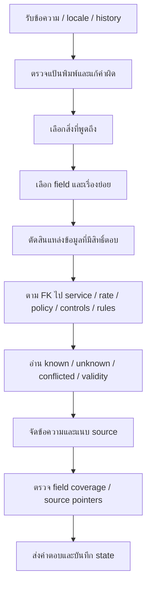

# วิเคราะห์ข้อผิดพลาด R64 แบบละเอียด: ข้อมูลเดิม → Format กลาง → คำตอบไทย/อังกฤษ

วิเคราะห์ผลที่รันจบวันที่ 14 ตุลาคม 2026 โดยอ่านผลเดิมทั้งหมด ไม่เรียกแชทบอทซ้ำ และไม่แก้ฐาน production, expected เดิม, source หรือ log เดิม เอกสารนี้กล่าวถึงโค้ด snapshot ที่ใช้ทดสอบ R64 เท่านั้น ไม่ถือว่าเว็บทุกพอร์ตหรือแพ็กเกจทุกชุดใช้โค้ดเดียวกันจนกว่าจะเทียบเวอร์ชันจริง

## 1. ข้อสรุปที่สำคัญก่อนอ่านรายละเอียด

ปัญหาไม่ได้มีสาเหตุเดียว และไม่ได้แปลว่า “ข้อมูลต้นฉบับไม่มี” ทุกข้อ มีอย่างน้อยห้าชั้นที่ต้องแยก:

1. โปรแกรมล้มก่อนตอบจริง เพราะตัวแปรใน retrieval ไม่ได้กำหนด
2. โปรแกรมเลือกเรื่องผิด เช่น แผนที่ในเกมกลายเป็นแผนที่ศูนย์
3. ย้ายข้อความครบ แต่ย้ายไปอยู่ช่องที่ตัวอ่านใหม่ไม่ใช้ เช่น ปุ่มเกมอยู่ใน `limitations` ขณะที่คำถามขอ `bindings`
4. เลือกชื่อเกม/รายการแข่งถูก แต่เลือกสิ่งที่ต้องอ่านผิด เช่น ถามข้อพิพาท กลับอ่านวันที่และรุ่นเอกสาร
5. เกณฑ์บางข้อผูกกับ category, mode และรหัสหลักฐานของระบบเดิม จึงตัดสินระบบใหม่ตกโดยที่เนื้อหาบางส่วนอาจถูก ต้องตรวจเนื้อหาต่างหาก

ชั้นที่ 5 ไม่ได้อธิบายความผิดทั้งหมด: ยังมีการขาดเนื้อหา ข้อมูลผิดขอบเขต การตอบเป็นภาษาไทยใน English response และการอ่านคนละหัวข้อจริง ห้ามลบ route check แล้วประกาศว่าระบบถูกทั้งหมด

## 2. คำศัพท์ในรายงาน

| คำ | ความหมายในระบบนี้ |
|---|---|
| entity / record | สิ่งที่ผู้ใช้พูดถึง เช่น เกม CS2, PC, กลุ่มบุคคลทั่วไป |
| field | ข้อมูลที่ต้องอ่าน เช่น ราคา วิธีเล่น ปุ่ม เงื่อนไข |
| facet | เรื่องย่อยของกฎ เช่น การหยุดเกม การประท้วง แผนที่ |
| projection | เลือกว่าจะแสดงช่องใดจาก record และรายการที่เกี่ยวข้อง |
| obligation | ช่องที่แผนตอบต้องครอบคลุมพร้อมสถานะและหลักฐาน |
| contract | เงื่อนไขของ test เช่น ต้องมีข้อความนี้ ห้ามมีข้อความนั้น ต้องอ้างกฎชุดนี้ |
| protocol | category/intent/mode ตามชื่อที่ตัวทดสอบคาด |
| semantic correctness | ตอบเรื่องที่ผู้ใช้หมายถึงจริง ครบข้อและไม่เปลี่ยนเงื่อนไข |
| transport_ok | ได้รับ response จากโมเดล ไม่ได้ยืนยันว่าโมเดลเลือกข้อมูลถูก |

## 3. ฐานหลักฐานและระดับความมั่นใจ

| รอบ | คำขอ | เกณฑ์ | ผ่านstrict | failureไม่ซ้ำตามคำขอ |
|---|---:|---:|---:|---:|
| legacy_offline | 20,554 | 55,811 | 42,410 (76.0%) | 5,848 |
| common_offline | 20,554 | 55,811 | 16,998 (30.5%) | 14,651 |
| legacy_llm | 20,554 | 55,811 | 42,601 (76.3%) | 5,689 |
| common_llm | 20,554 | 55,811 | 12,517 (22.4%) | 16,124 |

ผลทั้งหมด82,216คำขอ/223,244เกณฑ์ ถูกทำดัชนีจากrawเดิมครบ รักษาfirst-result precedenceเหมือนR64; duplicateattemptsไม่ได้แทนผลผิดเดิมด้วยผลใหม่

คะแนนแยกภาษา (เป็นstrict compatibility รวมroute/mode; autoจากexceptionยังรวมในคะแนนรวม):

| รอบ | ไทย | อังกฤษ | รวม |
|---|---:|---:|---:|
| legacy_offline | 70.7% | 82.4% | 76.0% |
| common_offline | 29.4% | 31.7% | 30.5% |
| legacy_llm | 70.7% | 83.1% | 76.3% |
| common_llm | 22.4% | 22.5% | 22.4% |

Content contractในคู่ที่ทั้งสองformatตรวจได้ (ไม่รวมหลายexception; รวมnegative-onlyด้วย):

| รอบ | denominatorคู่ | เดิม | กลาง |
|---|---:|---:|---:|
| offline | 32,826 | 96.0% | 63.0% |
| llm | 32,834 | 96.0% | 67.3% |

ข้อสรุปแต่ละชนิดใช้หลักฐานต่างกัน:

- **ยืนยันจาก log + code:** ชื่อตัวแปรที่ล้ม, field ที่เลือก, source ID, response จริง, validation error
- **ยืนยันจาก source snapshot:** ช่อง unknown/conflicted, ข้อความที่เก็บอยู่คนละ field, วันที่สิ้นสุดที่ source ระบุ
- **ข้ออนุมานที่ต้องตรวจต่อ:** เหตุที่ LLM เชื่อมถ้อยคำหนึ่งไปยัง field หนึ่ง เรามี proposal และแผนที่เลือก แต่ไม่มีความน่าจะเป็น token ภายในโมเดล จึงห้ามแต่งว่าโมเดลเลือกเพราะ “คะแนน 95%”
- **ข้อเท็จจริงที่เจ้าของยังไม่ยืนยัน:** นโยบายที่ต้นฉบับเว้นว่าง หรือการต่ออายุอัตราค่าบริการ
- **ข้อที่ test นี้วัดไม่ได้:** ความถูกต้องของรายการจองลูกค้าจริง, ความจุ production, SLA ของเครื่องที่ย้ายไป

ทุก failure ในชุดนี้อยู่ในทะเบียนท้ายรายงาน แต่อ่านทุก record ด้วยสคริปต์ไม่เท่ากับมนุษย์ตรวจความหมายทุกคำตอบ รายงานแสดงตัวอย่างที่ตรวจเชื่อมกับ code/source พร้อมแยกส่วนที่ยังต้องตรวจเชิงความหมาย

## 4. คะแนนตกจากอะไรบ้าง

| รอบ | เกณฑ์ที่ตก | protocolอย่างเดียว | protocol/outcomeอย่างเดียว | เนื้อหา/source/language/validation/อื่น |
|---|---:|---:|---:|---:|
| legacy_offline | 13,401 | 4,539 | 6,157 | 1,341 |
| common_offline | 38,813 | 8,038 | 21,776 | 15,091 |
| legacy_llm | 13,210 | 4,375 | 5,968 | 1,326 |
| common_llm | 43,294 | 23,348 | 27,894 | 13,983 |

หนึ่งคำขออาจอยู่หลาย corpus และถูกตรวจหลายเกณฑ์ จึงมี failure events มากกว่าจำนวนคำถาม ห้ามบวก “missing content + validation + language” แล้วเรียกผลรวมว่าจำนวนผู้ใช้ที่ได้รับคำตอบผิดไม่ซ้ำ

`protocol_only` หมายถึง log บันทึก failure เฉพาะ protocol ไม่ได้แปลว่าคำตอบผ่านการตรวจความหมายครบ เพราะบาง test ไม่มี positive content assertion ตั้งแต่ต้น

ผล R64 เดิมจัด native error ที่เขียนว่า `route expected ...` ต่างจาก `route:...` ทำให้บางข้อถูกนับใน content_failures ทั้งที่เป็น route เรื่องนี้เป็นข้อบกพร่องของการจัดหมวดรายงานด้วย R65 จัดหมวดข้อความเหล่านี้ใหม่ในฐานวิเคราะห์แยก แต่เก็บคะแนนและ raw grade เดิมไว้ทั้งหมด

## 5. ทำไมข้อมูลครบแต่ยังตอบผิด: Flow ที่เกิดขึ้นจริง

การมีข้อมูลที่ขั้น G ไม่รับรองว่าขั้น C–F จะเดินไปถึงข้อมูลนั้น การมี source ที่ H ก็ไม่รับรองว่าข้อมูลนั้นตอบ field/facet ที่ผู้ใช้ขอ การผ่าน validator ที่ I ก็ไม่รับรองว่าความหมายที่ D ตีความถูก

ปัญหาปัจจุบันเกิดที่หลายจุดพร้อมกัน: guard ก่อนเลือกเกม, aliases ที่ชนกัน, planner ที่เลือก field ได้แต่ไม่มีตัวเลือก facet, FK ที่ต่อไปยังราคาหรือ service ไม่ครบ, สถานะ unknown จากการย้าย, การจัดข้อความที่ส่ง metadata เกินจำเป็น และตัวทดสอบที่ผูกกับชื่อระบบเดิม

## 6. P0: Retrieval ล้มก่อนตอบ — `ownership_blocked`

**อาการ:** คำถามไปถึง `retrieve_curated` แล้วเกิด NameError ไม่มีคำตอบจริงให้ตรวจ เคสนี้ต้องนับเป็นการประมวลผลล้ม ไม่ใช่ “โมเดลตอบผิด” หรือ “ไม่พบข้อมูล”

**สาเหตุที่ยืนยัน:** `retrieval.py:900` ใส่ `ownership_blocked` ลง metadata ของ trace แต่ตัวแปรนี้กำหนดที่บรรทัด 679 ในอีกฟังก์ชันหนึ่ง ตัวแปร local ของฟังก์ชันหนึ่งใช้ในอีกฟังก์ชันไม่ได้

| รอบ | exception/watchdog จำนวนคำขอ |
|---|---|
| legacy_offline | NameError:name 'ownership_blocked' is not defined=2,696 |
| common_offline | NameError:name 'ownership_blocked' is not defined=833; backend_wall_watchdog_20s=33 |
| legacy_llm | NameError:name 'ownership_blocked' is not defined=2,692; harness_timeout_30s=2 |
| common_llm | NameError:name 'ownership_blocked' is not defined=644; harness_timeout_30s=18 |

**ควรเกิดอะไร:** คืนผล retrieval พร้อม audit ของสิทธิ์ source ที่ถูกคำนวณใน branch นี้ หากไม่มี hit ต้องคืนผลว่างที่ถูกต้อง หากมี hit ต้องยังตรวจว่าข้อมูลเดิมถูกถอน/ถูกแทนด้วยข้อมูลใหม่หรือไม่

**แนวทางแก้:** ตรวจ call ของ `guard_hits` และการจัดอันดับใน `retrieve_curated` ให้ทำ ownership filtering ในขอบเขตฟังก์ชันนี้ แล้วส่งตัวแปรที่มีอยู่จริง ห้ามแก้เพียงตั้ง `ownership_blocked=[]` หรือจับ exception แล้วส่งคำตอบเก่าโดยไม่ตรวจ ownership เพราะจะเสี่ยงนำข้อมูลที่เปลี่ยนราคา/ถูกถอนกลับมาตอบ

**ขอบเขต:** การแก้จุดนี้จะหยุดการล้มของ branch นี้ แต่ยังไม่รับรองว่าอันดับ retrieval และคำตอบหลังจากนั้นถูก ต้องทดสอบ positive/negative target, no-hit, withdrawn field และ common-owned field ที่เกี่ยวข้อง

## 7. P0: Guard ของข้อมูลศูนย์แย่งคำถามการแข่งขัน

**ตัวอย่างจริง:** “Counter-Strike 2 แข่งจริง กฎเกี่ยวกับแผนที่และการเลือกแผนที่ เป็นแบบไหน” ระบบเดิมตอบลิงก์ Google Maps ของศูนย์ ใน `pipeline:user_service_facts`

**สาเหตุใน code:** `user_service_facts.py` มีกติกายกเว้นการแข่งขันและแผนที่เกม แต่รับคำว่า `cs2`, `valorant`, `เกม`, `ตอนแข่ง`, `กติกา` บางรูปแบบ คำเต็ม `Counter-Strike 2` และวลี `แข่งจริง` ในตัวอย่างไม่เข้าเงื่อนไขยกเว้น จึงไปเข้าเงื่อนไขกว้าง `แผนที่` และเลือก claim `map`

**ควรตอบ:** กติกาการเลือกแผนที่ของรายการ CS2 ที่อ้างในคำถาม พร้อมข้อย่อยและ source ของกฎฉบับนั้น ไม่ใช่ตำแหน่งศูนย์ ต้องดึงข้อความจากกฎที่มีอยู่ ไม่แต่งรายการแผนที่/ขั้นตอน veto ใหม่จากความรู้ทั่วไป

**คะแนนที่เห็น:** source ของลิงก์แผนที่อาจเป็น source ที่ยืนยันจริง แต่ยืนยันเรื่องตำแหน่งศูนย์ ไม่ได้ยืนยันเรื่องแผนที่แข่งขัน คะแนน guard ที่สูงเป็นค่าที่ code กำหนดจาก pattern match ไม่ใช่คะแนนความถูกต้องของเจตนา

**แนวทางแก้:** ให้การแข่งขันที่ระบุ game/event เป็นขอบเขตของคำถามก่อนประเมินคำหลายความหมาย และใช้ entity resolver กลางสำหรับชื่อเต็ม/ชื่อย่อ/ชื่อที่พิมพ์ผิด แยก `studio_map` จาก `competition_map` ไม่เพิ่ม alias แค่ประโยคที่พลาดแล้วปล่อย guard เดิมแย่งคำถามรูปแบบอื่นต่อ

**คำที่มีความเสี่ยงแบบเดียวกัน:** สมาชิกศูนย์/สมาชิกทีม, ปุ่มเริ่ม/เริ่มใช้งาน, floor ชั้นอาคาร/ราคาต่ำสุด, resolution จอ/การแก้ข้อพิพาท, time เวลาเปิด/เวลาวางระเบิด ต้องพิจารณาคำและเป้าหมายร่วมกัน

## 8. P0: เลือกชื่อถูกแต่เลือกสิ่งที่ถามผิด

**ตัวอย่างจริง:** ถามเรื่องการแก้ข้อพิพาท TEKKEN 8 ได้ `competition_dates`, `coverage`, `supersedes_id` และตอบว่าข้อมูลวันแข่ง/เอกสาร/ฉบับก่อนหน้ายังไม่ยืนยัน

record ของรายการแข่งถูก แต่ field ทั้งสามไม่ตอบข้อพิพาท การผ่าน JSON/schema ตรวจได้เพียงว่า key เป็น key ที่ระบบอนุญาต จึงไม่รับรองว่าควรเลือก key นั้นสำหรับคำถามนี้

`semantic_guard` มี branch ชื่อ `schema_only_unverified_intent` และ `read_contract` ระบุ `semantic_correctness_verified=False` อย่างชัดเจน สำหรับคำถามที่ไม่เข้า typed cue ที่รู้จัก ระบบยังยอมรับ proposal ที่ schema ถูกได้ ไม่มี oracle ตรวจความหมายว่าข้อพิพาทต้องอ่าน clause เรื่องผู้ตัดสิน/การประท้วง

**ควรตอบ:** เลือกข้อความกฎเรื่องการแก้ข้อพิพาทที่อยู่ใน source ฉบับ TEKKEN นั้น และรักษาผู้มีอำนาจตัดสิน เงื่อนไข/ขั้นตอน/กำหนดเวลาเท่าที่ source ระบุ หากหัวข้อนั้นไม่มีใน source ให้บอกช่องว่างเฉพาะข้อ ห้ามแทนด้วย metadata ของเอกสาร

**แนวทางแก้:** แผนต้องบรรจุเป้าหมาย + ขอบเขต + topic/facet + ข้อที่ต้องครอบคลุม + source evidence และมี semantic coverage check โดยไม่ใช้ LLM ตัวเดิมเพียงตัดสินคำตอบของตัวเอง เลือก field จาก schema เป็นขั้นหนึ่งของการอ่าน ไม่ใช่ขั้นสุดท้ายของการตีความ

**สิ่งที่ไม่ควรทำ:** เปิดให้ LLM เขียนคำตอบทุกข้อจากความจำ หรือลด confidence แล้วส่งคำตอบผิดเรื่องเดิม การเลือก field ต้องถูกก่อนปรับถ้อยคำ

## 9. Format กลางยังไม่มี facet/dependency ที่ใช้ตอบกฎเฉพาะเรื่อง

กฎที่ย้ายมี 104 section แต่ `facet`, `depends_on_ids`, `completeness` เป็น unknown ทั้ง 104 รายการ ข้อความและ heading ถูกเก็บครบ แต่ตัวอ่านไม่รู้ว่า section ใดเป็นข้อหลัก ข้อยกเว้น ขั้นตอน หรืออำนาจตัดสินที่ต้องอ่านร่วมกัน

ใน `answer.py` เมื่อเลือก competition และต้องการ `text` ระบบตามลูก `competition_rule` ทุก section ของรายการนั้น จึงเกิดคำตอบยาวทั้งเอกสารสำหรับคำถามเฉพาะเรื่อง ไม่ใช่การจัดอันดับ clause ที่เกี่ยวข้อง

ลำดับ section ใช้ `str(section_number)` ในการ sort ทำให้ `1,10,11,...,2` เป็นไปได้ พบลักษณะลำดับนี้ในคำตอบจริงด้วย จึงไม่ได้รักษาลำดับการอ่านเชิงตัวเลขหรือ hierarchy ของต้นฉบับ

**ผลที่ตามมา:** เงื่อนไขที่ต้องการถูกฝังในข้อความยาว; รวมความสว่างจอในคำถามเรื่องข้อพิพาท; test ที่ห้ามข้อมูลไม่เกี่ยวข้องตก; metadata unknown ซ้ำมาก; source ID เปลี่ยนจน source alignment เก่าตก

**แนวทางแก้:** ใช้โครงสร้างกฎเดิมและ fact/section metadata ที่มีอยู่สร้าง facet และ dependency พร้อม lineage หากข้อมูลนี้เป็นเพียงการจัดหมวดโดยระบบ ให้ระบุว่า derived พร้อมเหตุผล/หลักฐาน อย่าระบุเป็นนโยบายใหม่ที่เจ้าของรับรอง แยก “กฎทั้งหมด” จาก “กฎหัวข้อหนึ่ง” และอ่านข้อยกเว้นที่เกี่ยวกับหัวข้อนั้นให้ครบ

การถามกฎทั้งหมดต้องแสดงทุกส่วนที่เกี่ยวข้องและลำดับถูก การถามเฉพาะหัวข้อไม่ต้องส่งทั้งเอกสารเพื่อให้ keyword ของ test ปรากฏ

## 10. ปุ่มเกม: ย้ายข้อความครบแต่ตัวอ่านหาอีกช่อง

ทั้ง 38 `control_set` มี `bindings=unknown`; ปุ่มและคำอธิบายเดิมถูกเก็บแบบข้อความใน `limitations` ตัวแปลง R63 บอกเหตุผลตรง ๆ ว่าไม่ได้เดา gesture/context เป็น press ทั้งหมด นี่เป็นการรักษาต้นฉบับที่ระมัดระวัง แต่ยังไม่ใช่การย้ายที่พร้อมให้ตัวอ่านใหม่ตอบทุกคำถามปุ่ม

**ทำไมผิด:** ผู้ใช้ขอปุ่ม → query plan ขอ `bindings` → field เป็น unknown → ข้อความเก่าที่มีปุ่มอยู่ใน `limitations` ไม่ถูก projection ไปตอบ หรือถูกปะปนกับคำถามคนละ scope

**ควรตอบ:** ปุ่ม/action/description/section/platform ที่มีในต้นฉบับนั้น พร้อมระบุเฉพาะส่วนที่ source ไม่บอก ห้ามแปล gesture ที่ไม่ทราบเป็น “กดครั้งเดียว” หรือย้ายปุ่ม PC ไปตอบ PS5

**แนวทางแก้:** ทำ adapter ที่อ่าน source control row เดิมได้ หรือเปลี่ยน schema ให้ subfield ที่ไม่ทราบเป็น unknown ได้โดยยังอ่าน button/action ที่ known ไม่ต้องทำให้ทั้งชุดปุ่มเป็น unknown เพราะ gesture หนึ่งส่วนไม่ครบ เก็บต้นฉบับและบริบทของคำสั่งที่ต้องกดพร้อมกัน/ค้าง/ทำในสถานการณ์เฉพาะ

**ข้อควรแยก:** `game controls` เป็นหมวดคำตอบจริง แต่ GT บางชุดคาด category `games` จึงมี route-only failures จำนวนมาก ข้อนี้ต้องตรวจแยกจากการขาดปุ่มจริง

## 11. Aliases และ record หลายประเภทชนกัน

ตัวอย่าง “What is the price of Counter-Strike 2?” เลือกทั้ง game, competition, control_set และ availability records ที่มีชื่อ/alias เกมร่วมกัน แล้วพยายามอ่านราคาในหลาย scope จึงแสดง `No confirmed price in this scope` ซ้ำ และ `missing_requested_field:amount_minor`

`named()` ใช้ exact alias แล้วคืนได้หลาย record ที่ชื่อไม่ถูกตัดด้วย nested-shorter rule ก่อนรู้ว่าคำถามขอราคา การพบชื่อเหมือนกันไม่ได้แปลว่าทุกชนิด record เป็นเป้าหมายหลักของคำถามนี้

**แนวทางแก้:** resolve game identity หนึ่งชุด แล้วให้ operation กำหนดเส้นทาง เช่น price → offered game_service → service → audience rate; rules → competition → rule clauses; controls → control_set ของ platform นั้น อย่าใช้ record ที่ alias ตรงทุกตัวเป็น primary target เท่ากันทั้งหมด

ต้องตรวจเส้นเชื่อมในข้อมูลจริงก่อนสร้างชื่อซ้ำหรือเดา FK จาก string ผล FK valid รับรองว่าอ้าง ID ที่มีอยู่ ไม่ได้รับรองว่าอ้าง service/physical pool/เกมภาคที่ถูก

ตรวจ graph ของ CS2 จริงแล้ว: game_detail_cs2 มี game_service links ไป availability_pc_01_02 และ availability_pc_03_10 แต่ service ทั้งสองไม่มี rate ที่ใช้ service_id เดียวกันเลย (0 rate ทั้งคู่) จึงอ่านราคาไม่ได้แม้มีตารางราคา PC อยู่ในฐาน นี่เป็นช่องว่างความหมายของเส้นเชื่อม billing service กับ booking service ต้องทำ mapping จาก source/logicเดิม ไม่ผูกทุก service ที่ชื่อมี PC เข้าราคาเดียวโดยเดา

### 11.1 รายการเกม โซน อุปกรณ์ และชื่อภาค

คำถามต่อเนื่องจาก “PS5 มีเกมกี่เกม” → “แล้วมีเกมอะไรบ้าง” formatกลางตอบรายการgame48 recordsทั้งหมด ไม่คงfilter PS5 รายการมีทั้งชื่อรวมครอบครัวเกม ชื่อที่เขียนต่างกัน และเกมที่มีเอกสารแข่งขัน จึงไม่ใช่การนับเกมที่เสนอให้เล่นบนserviceนั้นโดยอัตโนมัติ

ต้องแยก game identity, game family, description record, edition/version, game_service offered และ installed_resource_ids ให้ชัด การมีข้อมูลกฎของ RoV ไม่รับรองว่าศูนย์ติดตั้งให้เล่น และคำอธิบายรวม The Last of Us Part I/Part II ไม่ควรถูกนับเป็นเกมเพิ่มหนึ่งรายการโดยไม่ระบุบทบาทของrecord

คำถาม “PC มีอะไรบ้าง” → “อุปกรณ์” อาจหมายถึงสเปก/เมาส์/คีย์บอร์ด/จอของPC ไม่ใช่รายชื่อทุกresourceของศูนย์ การตามคำกว้างโดยไม่มีoperationและhistoryทำให้เลือกresourceแทนequipment_modelได้

จำนวนคนเล่นพร้อมกัน/ความจุแพ็กเกจ/ที่นั่งพัก/จำนวนคนที่เล่นสลับกันเป็นคนละเรื่อง ต้องตอบจากfield/sourceที่ตรง และคงคำถามที่เจ้าของยังไม่ได้ตอบเป็นunknown ไม่ใช้players_maxของเกมแทนจำนวนผู้จองที่ศูนย์อนุญาต

## 12. ราคา กลุ่มผู้ใช้ ระยะเวลา และการเหมา

ราคา 18 rate มี amount/currency/duration/persons/service/audience แต่ `calculation_rule`, `unit`, `tax_note` เป็น unknown ทั้งชุด ตัวแปลงตั้งใจไม่อนุมาน linear rate การมีราคาต่อแพ็กเกจไม่ได้รับรองว่าคูณเวลาแบบใดก็ได้หรือคิดต่อคนเสมอ

ตัวอย่าง “General Adult เล่น PC 30 นาที เสียกี่บาท” เลือก audience เป็น primary จึงดึงราคาในกลุ่มนี้ได้หลายบริการ ไม่ได้จำกัดเฉพาะ PC ตามที่ผู้ใช้ถาม นี่เป็นการเสีย service filter ขณะ strip aliases/สร้างแผน อ่าน `related_rates` ของ audience จะครอบคลุมทุกบริการในกลุ่มนั้นหากไม่มี filter ที่ใช้งานจริง

บางคำตอบบอกอัตราไม่ current เพราะ source เดิมระบุสิ้นสุดวันที่ 2026-03-31 ต้องแยกสองปัญหา:

- **ข้อมูลวันมีผล:** ถ้า source สิ้นสุดแล้วและยังไม่มีหลักฐานต่ออายุ การไม่รับรองราคาปัจจุบันเป็นข้อจำกัดจริง ไม่ใช่หลักฐานว่าโปรแกรมควรฝืนตอบจำนวนเงินเดิม
- **การแสดงอัตราที่บันทึกไว้:** ระบบเดิมแสดงตัวเลขพร้อมคำเตือน “recorded rates”; ระบบกลางอาจแจ้ง not current ทั้งหมด GT ที่คาดตัวเลขอย่างเดียวจึงไม่ตัดสินความปลอดภัยหรือความถูกต้องของราคาปัจจุบันได้ครบ

**ควรตอบ:** ระบุบริการ/ความจุ/กลุ่ม/จำนวนแพ็กเกจ/เวลาที่เล่นและเวลาที่ถูกจองให้ตรง แล้วใช้สูตรที่ source หรือนโยบายยืนยัน ถ้าขาดกลุ่ม ให้แสดงทุกกลุ่มที่เกี่ยวข้องหรือถามกลุ่มตามเจตนาเดิม ถ้าผู้ใช้ตอบชื่อกลุ่มในเทิร์นถัดไป ต้องใช้ service และ duration เดิม

นโยบาย VR 30 นาทีใช้ช่องเต็มชั่วโมง และ 12:00–13:00 ไม่เปิดจอง ผู้ใช้ยืนยันแล้วในประวัติ ไม่ต้องให้เจ้าของยืนยันใหม่เพียงเพราะ migration field ยัง unknown

การเหมาต้องใช้ข้อมูล Excel ที่ผู้ใช้ให้: ครึ่งวัน/เต็มวัน, อุปกรณ์และจำนวน, ราคา, เงื่อนไข/หมายเหตุ แยกจาก hourly rate ไม่รวมกลุ่มบุคคลหรืออัตราต่าง service เป็น “ราคาเดียว” โดยไม่มี source

คำถามงบต้องบอกตัวเลือกตามราคาและข้อจำกัดที่คำนวณได้จริง ไม่ทำให้ “อยู่ในงบ” กลายเป็น “เครื่องว่าง” และแยกเงินในเกม CS2 ออกจากงบเข้าใช้บริการ

## 13. ตารางเวลา เปิดพื้นที่/เปิดจอง/Maintenance/วันปิดพิเศษ

schedule 7 records มี timezone unknown ทั้ง 7; maintenance_periods unknown ทั้ง 7; open/bookable periods conflicted อย่างละ 5 records ตัวแปลงเห็นเวลาใน Dashboard และ chat calendar ไม่เหมือนกันแล้วใส่ conflicted โดยยังไม่ได้พิสูจน์ว่าทั้งสอง field มีความหมายเดียวกัน

ต้องตรวจว่าแต่ละ source บอก “เปิดพื้นที่”, “ช่วงจอง”, “เวลาที่มี slot” หรือ “ช่วง Maintenance” ก่อนเรียกเป็นความขัดแย้งเชิงนโยบาย วันหนึ่งเปิดพื้นที่ได้แต่เปิดจองบางช่วง หรือ Maintenance เฉพาะโซนได้

**ควรตอบ:** ช่วงจองต้องเว้นพักเที่ยงตามที่ยืนยันแล้ว; Maintenance ต้องมีขอบเขตที่ source ระบุ; วันปิดพิเศษใช้วันที่/สาขา/เวลาไทยและช่วงมีผล ตอบสิ่งที่ยืนยันได้เฉพาะวันนั้น ไม่ใช้เพียง weekly hours ยืนยันว่าเปิดในวันหยุดพิเศษ

timezone อ่านได้จากโค้ด/แหล่งเวลาที่ใช้ Asia/Bangkok อยู่แล้ว งาน mapping นี้ทำเองได้โดยอ้าง source ไม่จำเป็นต้องถามเจ้าของว่าอยู่ timezone ใด

หากยังพิสูจน์ไม่ได้ว่า open_periods สองแหล่งหมายถึงอย่างเดียวกัน ต้องบอกว่าเป็นช่องว่างการตีความ field และเสนอคำถามเจ้าของที่เฉพาะเจาะจง ไม่ขอให้เขาตัดสินจาก raw array ที่ไม่ได้อธิบาย

## 14. Booking และคำถามว่าง/ถูกจอง

R64 corpus sweep บังคับ Booking adapter ให้ unavailable ทั้งสอง format เพื่อไม่อ้างความถูกต้องของข้อมูลจองจริงโดยไม่มี oracle ของแต่ละเคส การตอบ unavailable ในรอบนี้จึงเป็นผลจาก fixture ไม่ใช่การพิสูจน์ว่า WordPress ปิดจริงในขณะนั้น

ต้องแยกอย่างน้อยสี่สถานะ: เชื่อม API ไม่ได้, เชื่อมได้แต่ข้อมูล/ช่วงเวลายังไม่ครบ, เชื่อมและ parse ได้, ตอบว่าง/ถูกจองตรง oracle จริง การผ่านขั้นหนึ่งไม่รับรองขั้นถัดไป

**คำถามกว้าง:** PC/Nintendo/Cockpit ว่างไหมต้องสรุป free/total และสถานะทุกเครื่องตามช่วงนั้น ถ้าถามว่ามีอุปกรณ์อะไรว่างให้เล่น ต้องแสดงเฉพาะที่ว่างตามเวลา ไม่ใช้ game catalog หรือราคาแทนสถานะ

**ตัวแปรที่ต้องรักษา:** date, timezone, interval, resource IDs, physical pool, duration rounding และ maintenance/closure scope อย่าสับสน availability ของ game title กับเครื่องจริง

ความถูกต้อง live ที่ผู้ใช้เคยยืนยันยังเป็นหลักฐานคนละชุดกับ R64 นี้ ไม่ต้องกล่าวว่าผู้ใช้ยืนยันผิด และไม่ต้องขอให้เขาเก็บข้อมูลจริงซ้ำเพียงเพื่ออธิบายคะแนน unavailable fixture

## 15. ภาษาอังกฤษและการแปล

| kind | localized slotที่value.enว่าง |
|---|---:|
| game | 144 |
| policy | 1 |
| rental_package | 24 |
| resource | 14 |
| faq | 281 |
| competition | 4 |
| competition_rule | 208 |
| person | 75 |
| equipment_model | 32 |
| closure | 3 |
| audience | 1 |
| schedule | 4 |

| รอบcommon | responseอังกฤษที่มีmarker [Thai source] |
|---|---:|
| common_offline | 3,928 |
| common_llm | 4,613 |

จำนวนmarkerเป็นการสังเกตรูปแบบข้อความ ไม่ใช่จำนวนคำตอบที่แปลผิดทั้งหมด ต้องตรวจproper names/ต้นฉบับที่เป็นอังกฤษ/การมีThai proseแยก

ปัญหามีทั้ง source language, label, value, rendering และ validator ไม่ใช่การแปลเพียงชั้นเดียว:

1. plan เลือก field ถูก แต่ value.en ว่าง → formatter ส่ง `[Thai source]` และต้นฉบับ
2. official game title เป็นตัวอักษรอังกฤษอยู่ใน value.th → อาจมี marker แต่ไม่มี Thai prose นี่เป็นปัญหาการจัดภาษา/metadata ไม่เท่ากับความหมายแปลผิด
3. ไทยในชื่อบุคคล/คำอ้าง source อาจเป็น proper noun → ต้องตรวจ detector แยกจากประโยคไทยที่เป็นคำตอบหลัก
4. ผู้ใช้เลือก English แต่ข้อความ uncertainty/conditions ยังคงไทย → เป็นข้อผิดพลาดการ localize จริง
5. การเลือก field/topic ผิดแปลเป็นอังกฤษได้ดี ก็ยังเป็นคำตอบผิดเรื่อง

การเพิ่ม LLM ใน R64 ใช้เลือก record/field ไม่ได้แปล value.en ทุก field ให้อัตโนมัติ จึงไม่ควรคาดว่าเปิด LLM แล้ว 791 ช่องจะถูกเติมเอง

การแปลต้องรักษาจำนวน หน่วย ช่วงเวลา only/except/must/not เงื่อนไขท้ายข้อ และชื่อเกม/ภาค ไม่เพิ่มนโยบายที่ไม่มี แปลได้เองจาก source ที่มี แต่สถานะ translation ต้องแยกจาก owner-reviewed fact

## 16. บทสนทนาสองเทิร์นและ state

| รอบprotocolถูก | pass/24turn | failedturn |
|---|---:|---|
| legacy | 22/24 | S9T2: สรุปคือทำยังไง; S11T2: แล้วแต่ละหมวดมีใครบ้าง |
| common | 13/24 | S1T2: ปุ่ม; S2T2: ปุ่มเร่งเครื่องกดอะไร; S3T2: ราคา; S4T2: เกม; S6T2: อุปกรณ์; S7T2: จอง; S8T2: แล้วจะเล่นต้องทำไง; S9T2: สรุปคือทำยังไง; S10T2: แล้วมีเกมอะไรบ้าง; S11T2: แล้วแต่ละหมวดมีใครบ้าง; S12T2: จองเครื่องยังไง |

รอบแรกของตัวทดสอบ HTTP ใช้ session ID สั้นกว่าที่ API ยอมรับ จึงได้ session ใหม่ทุกเทิร์น ตัวเลข17/24และ15/24รอบนั้นใช้พิสูจน์ว่าโปรแกรมลืม history ไม่ได้ รอบที่ใช้ protocol ถูกส่ง ID ที่ถูกต้องและ `last_seen_response_id` แล้วจึงใช้เป็นหลักฐานการสนทนา

ต้องตรวจ state หลายชั้น: active task, target, offered choices, requested fields, service/audience/duration, response ที่ผู้ใช้ได้รับจริง และ task ที่ค้าง ไม่ใช่เพียงเติมข้อความเก่าทั้งหมดเข้า prompt

**ควรเกิดอะไร:** “ราคา…” → ถามเลือกบริการ → “PC” ต้องกลับไปตอบราคา PC พร้อมกลุ่มเดิม; “เกมนี้เล่นยังไง” → “ปุ่ม” ต้องใช้เกมและ platform เดิม; เปลี่ยนเรื่องใหม่ต้องไม่ลากข้อมูลเก่าที่ขัดกันไปตอบ

`common_read/knowledge` เป็น route ใหม่ที่ state processor เดิมอาจไม่ได้จัดเป็น task ชนิดเดิมทุกกรณี แต่ห้ามสรุปว่าทั้งหมดเกิดจาก route โดยไม่มี trace ของเทิร์นนั้น ภาคผนวกเก็บ state ที่คืนจริงให้ตรวจได้

ตรวจfailureจริงแล้วมีfalse-negativeแบบliteralในlegacyด้วย: คำตอบ “สรุปคือทำยังไง” แสดงขั้นตอนจองครบ แต่testต้องการคำว่า “ขั้นตอนจอง” ขณะที่คำตอบเขียน “ขั้นตอนโดยสรุป” ต้องจัดเป็นการพลาดถ้อยคำที่GTกำหนดก่อน ไม่สรุปว่าไม่มีขั้นตอนหรือhistoryหายทั้งหมด

commonมีหนึ่งเทิร์นเป็นHTTP409ที่ตัวทดสอบเก็บเพียงHTTPErrorและไม่ได้เก็บresponse body จึงยังไม่ทราบสาเหตุconflictที่แน่ชัด เทิร์นนี้ไม่มีคำตอบให้ตัดสินความหมาย ต้องตรวจserver/store/transportเพิ่มเติม ไม่ปนเป็นความผิดของเนื้อหาปุ่มเกม

## 17. คำถามหลายเรื่อง การตอบครบ และข้อมูล unknown

การตรวจ coverage ปัจจุบันรับรองว่า field ที่แผนเลือกมี obligation/source pointer ไม่ได้รับรองว่าแผนเลือกครบทุกเรื่องที่คนถาม เพราะ read_contract สร้างจาก requested_fields เดิม ถ้า planner เลือกผิดทั้งชุด validator ก็อาจผ่านได้

คำถาม “ราคา + วิธีจอง + หลักฐานตอนมา” ต้องมีข้อย่อยทั้งสาม และรักษาบริการ/กลุ่มเดียวกัน การส่งข้อมูลจำนวนมากของ record ไม่เท่ากับตอบครบ; การถามเลือกใหม่ทั้งประโยคทั้งที่รู้สองข้อแล้วก็ไม่เหมาะ ควรตอบส่วนที่รู้และถามเฉพาะช่องที่ขาด

unknown ต้องแยกความหมาย: เจ้าของยังไม่ยืนยัน, mapping ยังไม่เสร็จ, source ไม่กล่าวถึง, ถูกถอน, source ขัดกัน, field ไม่รองรับ และ field หมดอายุ หากใช้คำว่า “ยังไม่มีข้อมูล” เหมือนกันทั้งหมด ผู้ใช้และผู้ดูแลจะไม่รู้ว่าต้องกรอกเพิ่ม แก้ converter หรือแก้ตัวอ่าน

unknown มีได้อย่างถูกต้อง ห้ามเติมนโยบายเองเพื่อทำ test ให้ผ่าน แต่ unknown ของ gesture หนึ่งจุดไม่ควรทำให้ปุ่มและคำอธิบายที่มี source หายไปทั้งหมด

## 18. การพิมพ์ผิด พิมพ์เบิ้ล และภาษาแป้นพิมพ์

ขั้นแก้คำผิดช่วยได้เมื่อการตีความ domain/operation หลังแก้ยังถูก ถ้าแก้ชื่อเกมถูกแล้ว reader ยังเลือก metadata แทนกฎ ก็ไม่ควรเพิ่ม alias อีกโดยคิดว่าจะแก้เหตุที่แท้จริง

threshold ที่ใช้จริงมีหลายตัวและหน้าที่ต่างกัน:

- SequenceMatcher ของชื่อ: รับคะแนน ≥0.88 และ margin ≥0.06 ระหว่างผู้สมัคร
- keyboard-aware candidates: edit cost ≤2, similarity ≥0.82, margin ≥0.08 และ max_work18,000
- entity search แบบ trigrams: overlap อย่างน้อย3, score≥0.16, คืนสูงสุด8 candidate และให้โมเดลเลือก index

max_work ที่หมดจะคืนไม่มี candidate เพื่อไม่อ้าง uniqueness จากการค้นไม่ครบ เป็น safety decision แต่เมื่อ records/aliases มากขึ้น อาจค้นไม่ทันและลด recall ต้องใช้ index และคัด candidate ก่อน ไม่เพิ่มงานค้นครบทุก substring ไปเรื่อย ๆ

คำไทยไม่แยกคำด้วย space เสมอ คำอย่าง “เหมา” ใน “เหมาะ” หรือคำสั้นที่อยู่ข้ามรอยต่อคำต้องตรวจบริบท อย่าทำ keyword match แล้วถือเป็น intent แน่นอน รหัสเครื่อง เลขภาค จำนวนคน วันเวลา จำนวนเงิน และคำปฏิเสธต้องคงไว้เมื่อแก้ข้อความ

guard500เคสตรวจ layout/repeat detection ไม่ได้รับรองว่าตอบคำถาม typos ถูกทุกข้อ repeat471/500ใน policy ปัจจุบันต่างจาก historical block prototype ต้องแยกการตรวจพบจากการเลือกว่าจะ block หรือให้ถามต่อ

## 19. คำตอบยาว เกินเรื่อง และรูปแบบที่อ่านยาก

| รอบ | >2,000ตัวอักษร | >10,000ตัวอักษร |
|---|---:|---:|
| legacy_offline | 60 | 0 |
| common_offline | 1,144 | 827 |
| legacy_llm | 60 | 0 |
| common_llm | 1,677 | 1,189 |

เหตุที่ยาวมากส่วนหนึ่งคือการอ่านทุก competition_rule ลูกจากการขอ text แล้วแสดง heading/section/facet/completeness/source markers ซ้ำ ๆ ไม่ใช่ผู้ใช้ขอข้อมูลทั่วไป500คำหรือขอทั้งเอกสารเสมอ

**ควรตอบ:** ชื่อหัวข้อ + ใจความ + รายละเอียด/ข้อยกเว้นที่เกี่ยวข้อง + source ระบุชัด ถ้าถามทั้งหมดให้เรียงตามส่วนและรักษารายการครบ หากถามข้อเดียวให้รักษาขอบเขตข้อนั้นก่อน จำกัดข้อความด้วยความเกี่ยวข้องไม่ใช่ตัดทิ้งตามจำนวนตัวอักษรจนกฎท้ายข้อหาย

ชื่อ field ภายใน เช่น `amount minor`, `supersedes id`, `unsupported_scope` ไม่ควรเป็นคำอธิบายหลักให้ผู้ใช้ บอกเป็นภาษาใช้งานว่า “ยังเลือกอัตราของบริการนี้ไม่ได้” หรือ “ต้องทราบกลุ่มผู้ใช้” โดยเก็บ technical reason ใน log

## 20. Confidence และการให้คะแนนเลือกคำตอบ

ใน common `finish` กำหนด confidence0.8 สำหรับ answer/list และ0สำหรับ response บางชนิด พร้อมระบุ `confidence_calibrated=False` ดังนั้น0.8ไม่ใช่ความน่าจะเป็น80%ว่าข้อเท็จจริง/เจตนาถูก

retrieval แบบเดิมเพิ่ม score จาก token overlap, priority และ target/topic boosts เช่น +8/+18 ตาม branch แล้ว cap confidence ค่าหนึ่ง เป็นคะแนนจัดอันดับเฉพาะกติกานั้น ไม่ใช่การประเมินความถูกต้องจากเจ้าของ

entity trigrams คิดน้ำหนักกรัมที่พบในเอกสารน้อยกว่ากรัมทั่วไป แต่ไม่รู้ด้วยตัวเองว่า Counter-Strike 2 price ต้องไป service rate หรือว่า money ใน CS2 คือเงินเริ่มเกม หาก candidate ที่ถูกไม่เข้า top8 โมเดลก็เลือกจากข้อมูลผิดชุด

ไม่มี log probability ของ token ของโมเดลในผล R64 จึงอธิบายได้ว่าระบบ **เลือกอะไร, ใช้ threshold/gate อะไร, อะไรผ่าน/ตก** แต่ไม่อ้างได้ว่าความคิดภายในโมเดลมีโอกาสเลือก field นั้นกี่เปอร์เซ็นต์

ต้องใช้การวัด calibration จาก case ที่มี oracle จริงหากจะให้ confidence เป็นค่าที่ผู้ใช้เชื่อถือได้ และแยก target confidence, field coverage, source status, temporal validity, language และ execution status ไม่รวมเป็นเลขเดียวโดยไม่มีคำอธิบาย

## 21. เปิด LLM แล้วทำไม strict score ลด

Common strict: ปิดLLM16,998pass → เปิดLLM12,517pass; มีเกณฑ์ที่เคยผ่านแล้วตก4,830 และเคยตกแล้วผ่าน349; net-4,481
ในเกณฑ์ที่regressมี3,832ข้อที่failureเฉพาะprotocolหลังเปิดLLM ที่เหลือยังต้องแยกoutcome/source/content/validation ไม่เหมาว่าเป็นsemanticregressionทั้งหมด

| common planner audit event | จำนวน |
|---|---:|
| attempted | 7,596 |
| transport_ok | 7,453 |
| schema_accepted | 7,140 |
| final_plan_accepted | 7,127 |
| error:TimeoutError | 142 |
| error:HTTPError | 1 |
| gate:circuit breaker cooldown active | 1,121 |

responseที่semantic_statusเป็นschema_only_unverified_intentจริง6,782 คำขอ; มีconfidence0.8และcontract/source/gatefailure3,357คำขอ ตัวเลขเหล่านี้ไม่เท่ากับจำนวนข้อเท็จจริงที่พิสูจน์ว่าเท็จโดยมนุษย์

LLM ช่วยลดการถามกลับในหลายเคส จึงทำให้คำตอบใหม่ใช้ route knowledge ซึ่ง GT เดิมไม่ยอมรับ บางคะแนนลดจึงเป็น protocol incompatibility ในขณะเดียวกันมี proposal ที่ schema ผ่านแต่ field ผิดจริง และ validation บางประเภทเพิ่มขึ้น ต้องไม่สรุปว่าเปิด LLM แล้วแย่ทั้งหมด หรือว่า LLM แก้ทุกอย่างแล้วเพียง scorer ผิด

transport_ok, schema_accepted, final_plan_accepted และ correct answer เป็นคนละขั้น ข้อสุดท้ายยังต้องใช้ source/clause/semantic contract ไม่ใช่ยืนยันจาก HTTP200 หรือ JSON parse ผ่าน

## 22. ข้อบกพร่องและข้อจำกัดของตัวประเมิน

| ชนิดoracleต่อหนึ่งรอบ | จำนวนgrade | ความหมาย |
|---|---:|---|
| positive_text_or_clause | 24,909 | มีrequiredข้อความหรือclause/qualitygate |
| route_outcome_only | 20,884 | ไม่มีpositive/negative content assertionที่adapterใช้งาน |
| evidence_id_only | 2,830 | ใช้IDหลักฐานเป็นเกณฑ์ ไม่ตรวจข้อความanswerครบทุกข้อ |
| negative_only | 7,188 | ห้ามข้อความบางอย่าง ยังไม่พิสูจน์ว่าตอบเนื้อหาครบ |

| รอบ | strictpassแต่strong_outcome diagnosticเป็นfalse |
|---|---:|
| legacy_offline | 4,668 |
| common_offline | 1,814 |
| legacy_llm | 4,681 |
| common_llm | 1,269 |

จึงต้องตรวจoutcomeclassifierและการนำdiagnosticไปใช้ร่วมกัน ตัวเลขนี้ไม่ใช่จำนวนfalsepositiveเชิงความหมายที่ยืนยันแล้วทั้งหมด

ตรวจแยกตาม expected vocabulary เพิ่มแล้ว: ใน legacy_offline 4,668 diagnostic ที่เป็น false แต่ strict ผ่าน แบ่งเป็น answer_available 2,295, localization_pending 1,298, route_only 757, live_lookup_required 314 และ clarification_required 4 ตัว `status_matches` รองรับ answer_available อยู่แล้ว จึงไม่ควรสรุปว่าเกิดจากการใช้คำว่า answer แทน answer_available; แต่ไม่รองรับ route_only และ classifier ยังผูกกับ mode whitelist ต้องตรวจ branch/outcome จริงทีละกลุ่มก่อนเปลี่ยนคะแนน รายละเอียดครบทั้งสี่รอบอยู่ใน [STORAGE_AND_OUTCOME_AUDIT.json](C:/Users/Chokhun/Documents/Codex/2026-09-25/psu-esports-studio-phuket-chatbot-c-2/r65_detailed_failure_analysis_20261014/STORAGE_AND_OUTCOME_AUDIT.json)

1. category/mode check บางข้อใช้ชื่อเก่าทั้งที่ reader ใหม่ตั้งชื่อ knowledge/common_read ต้องตรวจ content แยก และเปลี่ยนเกณฑ์ใหม่แบบมี version ไม่ทับ gold เก่า
2. native route/outcome/latency ใช้รูปแบบข้อความต่างจาก adapter จึงเคยถูกจัดหมวด content ผิดบางส่วน
3. `strong_outcome_matches` เป็น diagnostic ที่เก็บไว้แต่ไม่ใช้ตัดสิน pass ใน adapter บาง branch ตัว outcome classifier ยังใช้ whitelist mode เดิม และอาจคืน unknown สำหรับ common mode; การไม่ผ่าน diagnostic นี้ยังไม่พิสูจน์ว่าคำตอบผิดจริง
4. source evidence test ผูกกับ ID เดิมที่ migrate เปลี่ยนชื่อ แต่การเปลี่ยน ID ยังต้องพิสูจน์ lineage/source/locator เดียวกัน ห้ามยอมรับเพียงว่า source ID คนละชื่อจึง “คงถูก”
5. keyword contract ตรวจ substring ไม่ตรวจความสัมพันธ์ คำปฏิเสธ ข้อกำหนดต่อคน/ต่อแพ็กเกจ หรือการอยู่ใน scope ที่ถูก ถ้าส่งกฎทั้งเล่ม keyword อาจผ่านแต่คำตอบยังเกินเรื่อง
6. negative-only contract รับรองว่าห้ามพูดอะไรบางอย่าง ไม่ได้รับรองว่าได้ตอบสิ่งที่ผู้ใช้ต้องการแล้ว
7. exception ไม่มีคำตอบให้ตรวจ แต่ R64 content-only denominator ไม่รวมหลาย exception จึงต้องแสดง execution failures แยก ห้ามใช้ content-only percentage แทนอัตราสำเร็จทั้งระบบ
8. ไม่ freeze logical clock ทุกกรณี; รันข้าม13–14ตุลาคม คำถาม “วันนี้/พรุ่งนี้” และ validity บางข้ออาจเปลี่ยน ต้องใช้ reference date ที่เหมาะสมในการประเมินครั้งถัดไป
9. corpus sweep เปิด rag_fallback=True; HTTP suiteใช้falseและปิดworker supervisor ต้องบอก config ไม่ถือเป็นผล launcher production ทุกกรณี
10. earliest result ต่อ key ถูกเก็บเป็นผลหลัก แม้มีการเปลี่ยนวิธีคำนวณ evaluator ภายหลัง จึงเป็น evidence รวมหลาย attempt/เวอร์ชันตัวทดสอบ ต้องใช้ provenance ก่อนเทียบเวลา

## 23. ความปลอดภัยและขอบเขตคำถามร้านเกม

ผู้ใช้กำหนดให้ตอบครอบคลุมร้านเกมและข้อมูลที่ให้ ไม่ต้องตอบไก่กับไข่/อาหารเย็น/เรื่องทั่วไปทุกอย่าง บาง corpus เก่ามีคำถามความรู้ทั่วไปหรือคำตอบที่เคยเปิด LLM กว้างกว่า scope ปัจจุบัน การปฏิเสธคำถามนั้นไม่ควรถูกแก้ด้วยการเปิดตอบนอกขอบเขตเพื่อให้คะแนนดีขึ้น

เรื่องที่เกี่ยวกับร้านเกมแต่ source ไม่ยืนยัน เช่น compensation, refund exception, game account lending, installing mods ต้องแยกจาก off-topic โปรแกรมควรระบุช่องว่างที่เกี่ยวข้องและช่องทางถามเจ้าหน้าที่ ไม่สร้างนโยบายจากความรู้ทั่วไปของร้านเกมอื่น

ข้อมูลใหม่ที่ผู้ดูแลกรอกต้องเป็นข้อมูลอ้างอิง ไม่ใช่คำสั่งให้เปลี่ยน policy ของระบบ sourceที่บอกให้ ignore rules หรือเปลี่ยนเวลารันไม่ใช่การอนุมัติของมนุษย์ในแชทนี้

## 24. Native tests, smoke, guard และ HTTP: ทุกผลในชุดนี้

| รูปแบบ | functionsรัน | failureevents | errorevents | functionsที่มีeventผิด |
|---|---:|---:|---:|---:|
| legacy | 899 | 23 | 46 | 55 |
| common | 899 | 246 | 9 | 134 |

ภาคผนวก native แสดงครบทุก failure/error event พร้อมชื่อ function และ source log; smoke แสดงทุก script รวม passed/failed/deferred HTTP; guard แสดงทุกเคสที่ mismatch จากpolicyปัจจุบัน พร้อม expected/action/flag; HTTP แสดงทุกเทิร์นที่ไม่ผ่านของรอบ protocol ถูก

missing-reference-fixture4ข้อของ legacy ได้ copy fixture เดิมเข้า stage แล้ว rerunผ่าน4/4 เป็นการแก้ environment ไม่ใช่แก้คำตอบ ข้อ Temp PermissionError ของรอบแรกและ socket10013 เป็นหลักฐานสภาพแวดล้อม แยกจาก source/intent failure ไม่ใช้เป็นคะแนนระบบสุดท้าย

concurrent bilingual smoke10คำขอ timeout15sขณะรันงานใหญ่หลายชุด ยังไม่รับรองเพดานผู้ใช้หรือการรั่วภาษา ไม่เอาผลนี้ไปกล่าวว่าศูนย์ใช้พร้อมกันได้เพียงจำนวนหนึ่งโดยไม่มีการทดสอบ load ที่ควบคุม

บาง unit assertion เก่าห้าม `amount_minor` ใน scope เกม แต่ `allowed_schema` รุ่นปัจจุบันอนุญาต related price แล้ว ต้องตรวจเจตนา test และ source contract ใหม่ก่อนถือเป็น product regression อย่าลบ semantic/source safeguards เพียงเพื่อผ่าน assertion เก่า

### 24.1 ข้อผิดพลาดของชุดทดสอบและตัวติดตามที่ต้องแยกจากproduct

- stageรอบแรกคัดไฟล์knowledgeไม่ครบจนapp/knowledgeหาย ต่อมาซ่อมจากsourceจริง ใช้SOURCE_MANIFEST_REPAIREDเป็นหลัก ไม่ใช้ImportErrorของstageที่ไม่ครบอธิบายchatbot
- unittest Temp/state pathโดนsandboxปฏิเสธ จึงรันtemp_fixedด้วยพื้นที่stateแยก; เก็บผลแรกไว้ แต่ใช้899functionsที่รันจบเป็นหลัก
- test HTMLขาดreferencefixture4ข้อ; rerun4/4ผ่านหลังcopyต้นฉบับ ไม่แก้คำตอบหรือexpectedของproduct
- HTTPsession IDไม่ผ่านvalidationในรอบแรก; รอบถัดมามีsocket10013จากenvironment; รอบprotocol_networkจึงเป็นข้อมูลหลัก
- supervisorเคยอ่านprocesshandleไม่ได้ในsandboxแล้วตีว่าprocessหยุด จึงเปิดrecoveryซ้ำชั่วคราว ภายหลังหยุดเฉพาะprocessที่เปิดเองและแก้การตรวจสิทธิ์ logยังอยู่ครบ; deduplicatefirst-resultตามkeyช่วยไม่ให้เพิ่มจำนวนcoverage แต่การรันซ้อนชั่วคราวอาจกระทบtiming/circuit จึงไม่ใช้ผลนี้เป็นSLA
- การสุ่มตัวอย่างด้วยkeywordไม่ใช่semanticlabel เช่น moneyในCS2กับงบเล่น หรือเหมาในเหมาะ ต้องใช้source/expecteddomainและmanualreviewประกอบ; casebookระบุชัดว่าtopicเป็นกลุ่มคำสำคัญ ไม่ใช่golddomain

### 24.2 ทำไมผลรอบก่อนผ่านแล้วรอบนี้ตกมาก

R62รายงานsemantic_release_final148/148จากfactsสมมุติ720รายการ มีqueryไทย74/อังกฤษ74 และOWNER_HTTP48/48แบบcanonicalfieldquestions สิ่งนี้พิสูจน์ความสามารถบางเส้นทางของschema/readerกับfixturesที่กรอกfieldไว้ ไม่รับรองการย้ายlegacydataที่ยังมีbindings/facet/calculation_ruleunknown

R63การรักษาข้อความและsourcepointer4922/4922เป็นคนละgateกับการตอบnaturalquestions ตัวverifyยังตรวจด้วยว่าbindingsต้องเป็นNoneเพื่อไม่fabricategesture ดังนั้นการผ่านgateนั้นกับการที่readerอ่านbindingsแล้วไม่พบข้อมูลเกิดพร้อมกันได้

R64จึงพบsemanticparityที่ยังไม่มีครบก่อนactivation การแก้ต้องมีgateข้อมูลย้าย→คำถามจริง→fieldที่ใช้→คำตอบ ไม่สรุปว่า148/148หรือ4922/4922เป็นaccuracyทั้งหมด และไม่เอาfixtureสมมุติไปกรอกเป็นfactsของศูนย์

## 25. Performance และข้อจำกัดของการรัน

ในผลหลักมี watchdog ของ evaluator และ timeoutของโมเดล ไม่ใช่ทั้งหมดเป็น runtime exception ของโค้ดผลิตจริง แยก backend wall watchdog20s, harness30s, request deadline, client timeout15s, model TimeoutError, model-health cooldown และ socketpermission

optimizationใน evaluatorใช้upper bound/cacheที่รักษา candidate ที่ถึงthreshold แต่เวลาที่ลดลงอาจเปลี่ยนว่าคำถามทัน global deadline หรือไม่ จึงพิสูจน์ candidate equivalence แล้วก็ยังไม่รับรอง full response/latency equivalence

ก่อนรับรอง production latency ต้องใช้ code/config/DBเดียวกัน, model warm state ที่ระบุ, ไม่มี background suiteแย่งทรัพยากร, reference dateคงที่ และเก็บqueue/model/lookup/render timesแยก การอ่าน raw corpusหลังรันเพื่อวิเคราะห์ไม่ใช่การทดสอบตอบอีกครั้ง

## 26. Source ownership, approval และความเสี่ยงตอนย้าย production

R64 ใช้ `EVAL_DRAFT_ONLY` เป็น virtual read view ของ draft582 heads ไม่มี approve/publishจริง แม้บาง metadata ของ readerเขียน `common_approved=True` หรือ `common_published` ตามโค้ด reader ก็ไม่ใช่หลักฐานว่าผู้ดูแลอนุมัติข้อมูลนั้นจริง

ข้อมูลที่ย้ายยังไม่สมบูรณ์แบบใช้งานทุก field แต่ common readerอาจอ้างความเป็นเจ้าของ fieldนั้นแล้วไม่ให้ legacyตอบต่อ ต้องแยก unknown ที่เจ้าของตั้งใจให้ไม่รับรองจาก unknown ที่ converterยังทำไม่เสร็จ

**แนวทางช่วงเปลี่ยนผ่าน:** ให้ field ที่แปลงและตรวจ parityแล้วเป็น sourceหลัก; field migration_pending ใช้ legacy sourceเดียวกันที่ยัง currentและไม่ได้ถูกถอนเป็น adapterชั่วคราว; unknown/withdrawn/conflictedที่เจ้าของหรือsourceระบุจริงต้องไม่คืนข้อมูลเก่าขัดคำสั่งนี้ การ fallbackไม่ใช่การฟื้นข้อมูลที่ถอนแล้ว

ฐาน schema valid, FK valid, hashesครบ และข้อความpreserved เป็นเงื่อนไขจำเป็น แต่ยังขาดการตรวจว่า question → record → field → value → answer เหมือนเดิมตามความหมายที่ต้องการ

แพ็กเกจที่แจกต้องระบุ code/DB/release/model/confighash และมี rollbackไปข้อมูลเดิมได้ ข้อมูลเดิมกับ logต้องยังอยู่ ไม่สรุปว่า zipที่เคยแจกทุกไฟล์ได้รับการแก้ตาม snapshotนี้แล้ว

## 27. ลำดับแก้ที่แนะนำ พร้อมเงื่อนไขตรวจ

| ลำดับ | งาน | ใช้ข้อมูลเดิมทำเองได้หรือไม่ | เกณฑ์จบ |
|---|---|---|---|
| P0-1 | แก้ NameErrorและownershipfilterในretrieval | ได้ | ไม่มีexceptionในbranch; withdrawn/updated sourceไม่หลุดกลับ |
| P0-2 | แก้ domain scope arbitration ก่อน service facts | ได้ | ชื่อเต็ม/ย่อ/typoของเกมไม่ถูก map/contact/membershipศูนย์แย่ง |
| P0-3 | แผนตอบที่เลือกfacetและsourceclauseได้ | ได้โดยอ้างrulebookเดิม | dispute/map/pause/penaltyตอบข้อเกี่ยวข้องครบและไม่ผิดเกม |
| P0-4 | adapterปุ่มจากlimitations/legacy rows | ได้; unknown gestureยังคงunknown | button/action/platformมีในsourceต้องไม่หาย; ไม่เดาpress/hold |
| P1-1 | service+audience+duration filtersและratejoins | ได้ส่วนtechnical | ไม่รวมทุกบริการเมื่อถามPC; ไม่คูณราคาเกินsourceสูตร |
| P1-2 | English fieldsจากsourceและtranslationledger | ได้ | เนื้อหาและnegationเท่ากัน; proper namesไม่ถูกนับเป็นproseผิดโดยอัตโนมัติ |
| P1-3 | open/bookable/maintenance/closure mapping | ได้สำหรับpolicyที่ยืนยันแล้ว | ขอบเวลา/วันปิด/เวลาไทยถูก; รายการconflictมีเหตุผลfieldscopeชัด |
| P1-4 | context/stateของcommon intents | ได้ | ชื่อสั้น/ราคา/ปุ่ม/จองตอบจากtaskเดิมได้และเปลี่ยนเรื่องได้ |
| P1-5 | partial/unknown responseและUIformat | ได้ | ตอบส่วนknownและถามเฉพาะส่วนขาด; ไม่แสดงfieldภายในแทนคำอธิบาย |
| P2-1 | scorerที่แยกprotocol/content/source/semantic | ได้; เก็บgoldเดิม | ทั้งrawscoreและcontentauditอ่านได้; ไม่เพิ่มคะแนนจากnegative-onlyโดยเรียกว่าถูกครบ |
| P2-2 | index/candidate retrievalและdeadline | ได้ | timeลดโดยไม่เปลี่ยนtarget/numeric edition/negative scope; วัดlatencyใหม่ต่างหาก |
| P2-3 | release/package parityและrollback | ได้ | ใช้DB/releaseที่ตรวจแล้วจริง มี manifest และข้อมูลเดิมเก็บอยู่ |

ไม่ควรเริ่มด้วยการรันfull20,554คำถามซ้ำทันทีโดยโค้ดยังไม่เปลี่ยน หรือเพิ่มaliasทุกคำถามที่พลาด ควรแก้สาเหตุร่วมหนึ่งชั้น แล้วรันcaseที่เกี่ยวข้องหลายรูปแบบ ไทย/อังกฤษ/context/negative/cross-domain และทำparityก่อน full gateครั้งถัดไป

## 28. สิ่งที่ต้องถามเจ้าของอย่างเจาะจง และสิ่งที่ไม่ต้องถามซ้ำ

**ถามเมื่อไม่มีหลักฐานปัจจุบันจริง:**

- อัตรารายแพ็กเกจในภาพที่ระบุถึง2026-03-31ได้รับการต่ออายุหรือแทนด้วยตารางใด? ขอฉบับ/วันเริ่ม/วันสิ้นสุด และผลต่อรายการเดิม ไม่ถามเพียง “ราคาถูกไหม”
- ถ้าต้นทางบอกเปิดพื้นที่พักเที่ยงและอีกต้นทางบอกไม่มีslot เจ้าของอนุญาตให้อยู่พื้นที่/นั่งดูในช่วงนั้นไหม? เรื่องการจอง12:00–13:00ไม่ต้องถามซ้ำเพราะยืนยันแล้ว
- “จองผิดวันและจ่ายแล้วเปลี่ยนวันได้” กับ “เลื่อนแทนคืนเงินไม่ได้” ใช้กรณีใด ช่องทางใด และเงื่อนไข/สิทธิ์ใด? ถ้าต้องตอบขยายสองข้อที่มีอยู่ ต้องมีหลักฐาน exceptionก่อน
- compensation/refund/specialclosureที่คำตอบเดิมยังเว้นว่าง: ขอเหตุการณ์ที่ครอบคลุม วิธีแจ้ง ช่องทางและสิทธิ์ที่ยืนยัน ไม่อ้างกฎทั่วไปแทนกรณีเฉพาะ

**ทำเองจากหลักฐานเดิม:** bugprogram, mappingEnglish, parsingtimezone, preservedbuttons, game/serviceFKที่มีsource, facetจากmetadataเดิม, IDlineage, contextstate, scorerclassification และรูปแบบข้อความ

**ไม่ต้องขอซ้ำ:** VR30นาทีใช้ช่องเต็มชั่วโมง; 12:00–13:00ไม่เปิดจอง; การเชื่อมWordPress/ความถูกต้องliveที่ผู้ใช้เคยตรวจเป็นหลักฐานเดิมคนละชุดกับfixtureR64

## 29. จุดที่ทำให้คำตอบ “ดูเหมือนดี” แต่ยังผิด

- Sourceถูกแต่ใช้ตอบคนละเรื่อง (GoogleMaps vs CS2map)
- IDเกมถูกแต่fieldผิด (Tekken dispute vs competition_dates)
- ข้อความครบในarchiveแต่fieldที่readerอ่านunknown (controls)
- JSON/schemaผ่านแต่semantic_statusยังunverified
- confidence0.8เพราะโค้ดกำหนด ไม่ใช่มีหลักฐาน80%ว่าถูก
- มีkeywordครบเพราะส่งทั้งเล่ม แต่ขาดการเลือกส่วนที่ผู้ใช้ต้องการ
- API200/transport_oktrueแต่schemaหรือfieldchoiceผิด
- บอกunknownทุกข้อในรูปแบบanswerทั้งที่ยังไม่ได้ตอบเนื้อหาที่ถาม
- categoryเปลี่ยนจึงtestตก แม้เนื้อหาบางส่วนถูก; อีกด้านไม่ควรถือว่าroute-onlypassพิสูจน์เนื้อหาถูก

## 30. วิธีใช้ชุดเอกสารนี้

| เอกสาร/ข้อมูล | ใช้ทำอะไร |
|---|---|
| [ALL_CORPUS_INDEX.md](C:/Users/Chokhun/Documents/Codex/2026-09-25/psu-esports-studio-phuket-chatbot-c-2/r65_detailed_failure_analysis_20261014/ALL_CORPUS_INDEX.md) | ทุกcorpusและตัวอย่างexpected/actual/plan |
| [QUESTION_ANSWER_TRACE_CASEBOOK.md](C:/Users/Chokhun/Documents/Codex/2026-09-25/psu-esports-studio-phuket-chatbot-c-2/r65_detailed_failure_analysis_20261014/QUESTION_ANSWER_TRACE_CASEBOOK.md) | ตัวอย่าง84รายการพร้อมtrace/คะแนน/field |
| [NATIVE_ALL_FAILURE_EVENTS.md](C:/Users/Chokhun/Documents/Codex/2026-09-25/psu-esports-studio-phuket-chatbot-c-2/r65_detailed_failure_analysis_20261014/NATIVE_ALL_FAILURE_EVENTS.md) | unit324failure/erroreventsทั้งหมด |
| [SMOKE_ALL_RESULTS.md](C:/Users/Chokhun/Documents/Codex/2026-09-25/psu-esports-studio-phuket-chatbot-c-2/r65_detailed_failure_analysis_20261014/SMOKE_ALL_RESULTS.md) | smoke170รายการทั้งสองformat |
| [HTTP_FAILED_TURNS.md](C:/Users/Chokhun/Documents/Codex/2026-09-25/psu-esports-studio-phuket-chatbot-c-2/r65_detailed_failure_analysis_20261014/HTTP_FAILED_TURNS.md) | actualHTTPที่ไม่ผ่านทั้งหมด |
| [INPUT_GUARD_CASES_REVIEWED.md](C:/Users/Chokhun/Documents/Codex/2026-09-25/psu-esports-studio-phuket-chatbot-c-2/r65_detailed_failure_analysis_20261014/INPUT_GUARD_CASES_REVIEWED.md) | guardmismatchและlabel/action |
| [METRICS.json](C:/Users/Chokhun/Documents/Codex/2026-09-25/psu-esports-studio-phuket-chatbot-c-2/r65_detailed_failure_analysis_20261014/METRICS.json) / [EXTRA_METRICS.json](C:/Users/Chokhun/Documents/Codex/2026-09-25/psu-esports-studio-phuket-chatbot-c-2/r65_detailed_failure_analysis_20261014/EXTRA_METRICS.json) / [OBSERVATIONS.json](C:/Users/Chokhun/Documents/Codex/2026-09-25/psu-esports-studio-phuket-chatbot-c-2/r65_detailed_failure_analysis_20261014/OBSERVATIONS.json) | จำนวนที่ใช้วิเคราะห์และdiagnostic |
| [evidence.sqlite](C:/Users/Chokhun/Documents/Codex/2026-09-25/psu-esports-studio-phuket-chatbot-c-2/r65_detailed_failure_analysis_20261014/evidence.sqlite) | rawresponseเต็มแบบcompressed + ทุกexpected/grade/sourcepointer |
| [legacy_offline.md](C:/Users/Chokhun/Documents/Codex/2026-09-25/psu-esports-studio-phuket-chatbot-c-2/r65_detailed_failure_analysis_20261014/all_failed_requests/legacy_offline.md) | ทุกคำขอที่มีfailureในรอบนี้ |
| [common_offline.md](C:/Users/Chokhun/Documents/Codex/2026-09-25/psu-esports-studio-phuket-chatbot-c-2/r65_detailed_failure_analysis_20261014/all_failed_requests/common_offline.md) | ทุกคำขอที่มีfailureในรอบนี้ |
| [legacy_llm.md](C:/Users/Chokhun/Documents/Codex/2026-09-25/psu-esports-studio-phuket-chatbot-c-2/r65_detailed_failure_analysis_20261014/all_failed_requests/legacy_llm.md) | ทุกคำขอที่มีfailureในรอบนี้ |
| [common_llm.md](C:/Users/Chokhun/Documents/Codex/2026-09-25/psu-esports-studio-phuket-chatbot-c-2/r65_detailed_failure_analysis_20261014/all_failed_requests/common_llm.md) | ทุกคำขอที่มีfailureในรอบนี้ |

รายงานนี้เป็นการวิเคราะห์ ไม่มีการปรับproductionหรือแก้goldเดิม แผนแก้ในข้อ27คือข้อเสนอที่เชื่อมกับหลักฐาน หากลงมือในรอบถัดไปควรเก็บbefore/afterแต่ละชั้นและไม่เรียกว่าพร้อมproductionจากการแก้exceptionหรือschemaอย่างเดียว

## 31. ภาคผนวกเพิ่มเติมและผลตรวจทานเอกสาร

[ทุกkind/fieldstatusและgraphราคาที่ขาด](C:/Users/Chokhun/Documents/Codex/2026-09-25/psu-esports-studio-phuket-chatbot-c-2/r65_detailed_failure_analysis_20261014/FORMAT_DATA_MAPPING_AUDIT.md)

[failure reasonทุกชนิด](C:/Users/Chokhun/Documents/Codex/2026-09-25/psu-esports-studio-phuket-chatbot-c-2/r65_detailed_failure_analysis_20261014/ALL_FAILURE_REASON_TYPES.md)

[จุดในcodeที่ยืนยันสาเหตุ](C:/Users/Chokhun/Documents/Codex/2026-09-25/psu-esports-studio-phuket-chatbot-c-2/r65_detailed_failure_analysis_20261014/SOURCE_CODE_INDEX.md)

[ผลตรวจความครบและการรักษาไฟล์ต้นทาง](C:/Users/Chokhun/Documents/Codex/2026-09-25/psu-esports-studio-phuket-chatbot-c-2/r65_detailed_failure_analysis_20261014/REPORT_VERIFICATION.json)
