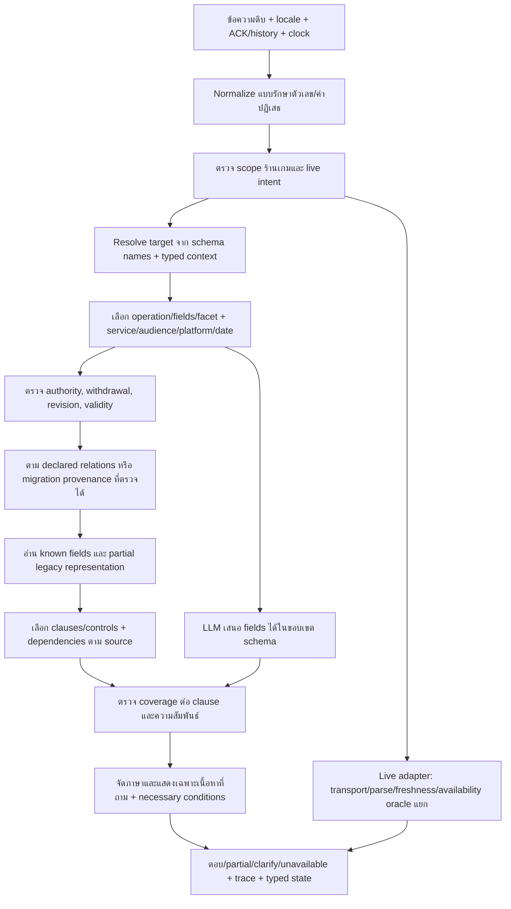

# R66 — Flow แก้ Format กลางครบหมวด

## เป้าหมายและข้อจำกัด

ตอบเฉพาะบริการศูนย์/ร้านเกมจากข้อมูลที่ให้ ทั้งไทย/อังกฤษ ข้อมูลเก่าใน Format กลางและข้อมูลเพิ่มใหม่ใช้ตัวอ่านเดียวกัน ทดสอบเฉพาะ common ปิด/เปิด LLM ไม่รัน legacy arm ไม่แก้นโยบายที่ไม่ยืนยัน ไม่ publish draft ไม่ upgrade การแปลเป็น owner-reviewed ไม่ทับ log หรือไฟล์ต้นฉบับ

## หลักฐานและงานวิจัยที่ใช้

- [RAT-SQL](https://aclanthology.org/2020.acl-main.677/): alignment คำถามกับช่องและความสัมพันธ์ schema; ประยุกต์ใช้ graph ที่ประกาศ ไม่เดา FK จากชื่อเหมือนกัน ไม่ได้อ้างว่าใช้โมเดล RAT-SQL
- [CANARD](https://aclanthology.org/D19-1605/): คำถามต่อเนื่องต้อง resolve บริบทก่อนค้น; ใช้ typed state ที่เก็บ target/scope/needs ไม่เก็บคำตอบเป็นข้อเท็จจริง
- [Lost in the Middle](https://aclanthology.org/2024.tacl-1.9/): บริบทยาวไม่ได้รับรองอ่านข้อมูลสำคัญได้; เลือกกฎเฉพาะหัวข้อพร้อม dependencies และลำดับ ห้ามส่งทั้งเล่มเพียงเพื่อผ่าน keyword
- [RAGAs](https://aclanthology.org/2024.eacl-demo.16/): แยก retrieval/context/answer quality; ในระบบนี้ใช้ oracle จาก source และ clause contracts ไม่ให้ LLM judge ของตัวเองเป็น gold

เครื่องมือ agent_search ของ paper-search-pro ใช้ไม่ได้ใน runtime นี้เพราะขาด pyalex จึงตรวจเอกสารต้นทางผ่าน web search แทน เป็น targeted engineering research ไม่อ้างเป็น systematic literature review

## Flow รับและตอบคำถาม

## วิธีแก้และ acceptance gate แยกหมวด

| หมวดปัญหา | วิธีแก้ | Gate ที่ต้องเห็น |
|---|---|---|
| Execution / ownership | guard_hits ใน retrieval branch ที่ใช้งานจริง; audit จำนวน blocked; ห้ามกลืน NameErrorหรือถอน filter | no-hit/withdrawn/owned-field ไม่ล้มและไม่คืน stale facts |
| Target collision | operation-first: game identity → controls/rules/rates; audience เป็น filter; หลาย record ชื่อเดียวไม่ใช่ primary ทุกตัว | ราคา CS2 ไม่ใช้ competition/control เป็นราคา |
| Field / intent | typed strong needs มาก่อน schema-only proposal; metadata ไม่แทน user need; proposal ที่ไม่ตรวจ relevance ต้อง clarify | disputes ไม่ตอบ dates; compound ครบ known clauses |
| Competition | facet derived จาก headings/text และ source tags; local relevance selection+dependency; numeric section ordering | เฉพาะเรื่องไม่ทั้งเล่ม; all ครบ; ไม่ข้ามเกม |
| Controls | เพิ่ม representation rows ที่เก็บ button/action/description/section พร้อม gesture unknown เฉพาะช่อง; ไม่เดา press; adapter อ่าน limitations ที่มี provenance | ปุ่ม known ยังตอบได้; platformผิดไม่ยืมชุดPC |
| Games/catalog | offered game_service เป็นฐานรายการ; filter service/platform; แยก family/edition/competitive-only | PS5 list ไม่รวม PC-only หรือ RoV เพราะมีrulebook |
| Equipment/resources | specifications/usage จาก equipment_model, resource identity/live แยก; exact source zone metadata สำหรับ migration only | ขอ PC specs ไม่คืนเครื่องทุกโซน |
| Rate | service+audience เป็น intersect filters; explicit billing relation; expired rates เป็น historical ไม่current; calculation unknown ห้ามคูณ | PC+General Adult ไม่แสดงทุกservice; ชี้expiredจริง |
| Rental/budget | half/full period, included equipment, audience, persons, notes; งบใช้ formula knownเท่านั้น; แยกavailable | budgetไม่อ้างเครื่องว่าง; ไม่รวมทุกgroupราคาเดียว |
| Calendar | timezoneจากหลักฐาน; bookable/area hoursแยก; special closure override; query dateไม่ใช้nowกรองอนาคต | 12–13no booking, maintenance, boundaries TH/EN |
| Booking | defer commonเฉพาะ live; declared physical resource/pool; unknown transportไม่อ้างfree | fixture oracle overlap/VR round/status counts |
| Localization | existing ENก่อน; proper Latin titleไม่ติด Thai marker; missing translationเป็นexplicit pending; offline review artifacts; numeric/negation/units invariant | ENไม่อ้าง reviewedเอง; no inventedpolicy |
| Dialogue | typed state พร้อม scopesและrequested fields; bare device/audience/ทั้งหมดสืบ pendingtask; new topic clear | price→PC, PS5→games, controls→button, group→members |
| Compound/all | coverageต่อ clause; partialตอบส่วนknown+clarifyเฉพาะส่วนขาด; allขยายcontentไม่internalmetadata | missing field ไม่ผ่านเป็นcomplete |
| Typo/layout | bounded unique candidates, numeric protection, repeat recovery; namescacheตามrelease; ไม่globalstripduplicates | cockpik/typosไม่เปลี่ยนPC1เป็นPC2 |
| Rendering/long | natural labels; allmetadataเฉพาะผู้ใช้ขอ; unknownที่ไม่ถามไม่spam; ruleorderจากsource occurrence | answer scopeครบ, ไม่truncateexceptions |
| Validation/confidence | separate execution/schema/coverage/source/time/locale; response unknownไม่เรียกanswered; uncalibratedไม่แปลเป็นprobability | malformed/unsupported/missingไม่ผ่านschemaเป็นcorrect |
| Evaluator | new semantic adapter version; preservelegacyGT; protocol mismatchแยกcontent; exceptionในdenominator; fixedclock+configs | coverageต่อarmและผลLLMtransportแยก |
| Runtime/performance | memoized normalized alias by names/release + upper boundpruning; boundedmodel queue/deadline; fallbackไม่stale | no overlappingtestarm; timeoutรายงานจริง |
| Owner/provenance/release | migrationใหม่versionแยก, sourcepointersตรง, no guessedprice/date/policy; publishgateคงไว้ | draftไม่ตอบproductionก่อนอนุมัติ |

## ตรวจทานและปรับ Flow รอบ 1 — อธิบายข้อมูลครบกับอ่านไม่ได้

พบข้อบกพร่องในร่าง: การเติม bindings ด้วย press จะสร้างข้อเท็จจริง; เปลี่ยน unknown เป็น knownทั้งชุดไม่ปลอดภัย; กฎทั้งหมดกับกฎเรื่องเดียวต้องแยก

ปรับ: partial representation แยก gesture unknown, preserve raw source; topic selection derived ไม่ใช่นโยบาย; unstructured text fallback เฉพาะ mappingที่มีsource และไม่ใช้เก่าทับwithdrawn

## ตรวจทานและปรับ Flow รอบ 2 — ขอบเขตและบทสนทนา

พบข้อบกพร่องในร่าง: การเลือก audienceแล้วลืม service; all games นับcompetition-only; whole-record validity ทำให้ fieldอื่นหายเพราะ optionalFKเก่า; closureอนาคตถูกnowfilter; historyสืบราคาไปถามเกม

ปรับ: intersectscopes; offeredcatalogเท่านั้น; validityตามfieldที่อ่านและrequiredpath; date-specificclosure; explicitoperationreplace และ shortselectorinherit แยก newtopic

## ตรวจทานและปรับ Flow รอบ 3 — การพิสูจน์และส่งใช้จริง

พบข้อบกพร่องในร่าง: keyword passไม่พิสูจน์semantics; fixturesไม่ใช่live; draftmigrationไม่ใช่release; modelenabledไม่แปลว่าทุกข้อcalled; logเก่าห้ามoverwrite

ปรับ: regression/source-oracleต่อหมวด พร้อม negativecounterexamplesและnew-record fixtures; fixedclock, serializedcommonoff/on; reportexecution+content+protocol+time+locale+transport; optimisticcompareก่อนdeployโค้ด; productiondataไม่activate; ownerquestionsเฉพาะfactsunknownจริง

## ลำดับลงมือและการทดสอบ

1. สำรอง live code+manifest+DB แบบ read-only backup ลง R66 ใหม่ ตรวจ Git และ source parity ก่อนแก้
2. แก้ execution/ownership, partial controls, relations/selection, rules/fields, dialogue, language/rendering, validator/performance ตามลำดับ
3. migration enrichment เป็น candidateใหม่พร้อม lineage; schema validate ทุกrecordและauditoriginalpreservation
4. tests common off/on: focused actual failuresหลายคำถาม+counterexamples, allcatalognewrecordfixtures, conversationprotocol, booking controlledoracle, modelproposalnegative/success/timeout
5. อ่านfailedcasesและปรับflow/codeเฉพาะcauseที่พิสูจน์ แล้วrerunaffectedtests; ไม่ rerun armเดิม
6. commonใหญ่ทั้ง20,554requestsหากsmallgatesยังมีcriticalfailureไม่เริ่มfull; fixedclock/reference_date; resultsappend-onlyและcheckpoint resume; ดึงR64 baselineจากlogsไม่เรียกlegacyใหม่
7. deploy code ที่ตรวจแล้วด้วยbeforehash compareและbackup เก็บcandidatedataเป็นdraft; สรุปสิ่งที่ทำ/ผล/ยังไม่verified/คำถามownerและrollbackpath

## คำถามเจ้าของที่แก้ด้วยโค้ดไม่ได้

- hourlyratesที่หมดอายุ31มีนาคม2026: ฉบับใหม่/วันเริ่มมีผลและกลุ่มที่อนุมัติคืออะไร (ไม่ยืดอายุเอง)
- หากarea opening09–12,13–18กับsourceอื่นไม่ตรง: sourceใดเป็นเวลาเปิดพื้นที่จริง และsourceใดเป็นเวลาเปิดจอง (12–13ไม่จองยืนยันแล้ว)
- account lending, compensation, mods, minors และrefundexceptionsที่ไม่มีคำตอบ: แต่ละpolicyอนุญาต/ห้าม/เงื่อนไขอะไร ไม่ใช้ร้านอื่นเป็นgold
- ambiguitybillingที่ไม่พิสูจน์จากsource: machinegroupsกับpricingserviceใดเป็นกลุ่มเดียวกัน; mappingที่มีหลักฐานทำเองก่อนถาม

## สถานะงาน

เอกสารนี้เป็น Flow ที่ผ่านการตรวจแบบ reasoning3รอบก่อนimplementation การทดสอบต้องบันทึกผลจริงหลังลงมือ ไม่ถือว่าทบทวนเอกสารคือระบบผ่านแล้ว

## Inventory ทุกหมวด schema (รวมหมวดที่ R63 ไม่มีrecords)

### center

แบบฟอร์ม: ข้อมูลศูนย์

name | operator | description | address | building | floor | map_url | timezone

Gate: validate field/source/FK/unknown/withdrawal/locale/validity ตามชนิดข้อมูล; new-record fixture มี target ที่ไม่อยู่ในข้อมูลศูนย์จริง; ห้ามเติม facts เพื่อให้ผ่าน

### contact

แบบฟอร์ม: ติดต่อ

channel | value | purpose | office_hours

Gate: validate field/source/FK/unknown/withdrawal/locale/validity ตามชนิดข้อมูล; new-record fixture มี target ที่ไม่อยู่ในข้อมูลศูนย์จริง; ห้ามเติม facts เพื่อให้ผ่าน

### facility

แบบฟอร์ม: สิ่งอำนวยความสะดวก

name | location | usage_conditions | accessibility

Gate: validate field/source/FK/unknown/withdrawal/locale/validity ตามชนิดข้อมูล; new-record fixture มี target ที่ไม่อยู่ในข้อมูลศูนย์จริง; ห้ามเติม facts เพื่อให้ผ่าน

### zone

แบบฟอร์ม: โซนบริการ

name | description | location | room_seats

Gate: validate field/source/FK/unknown/withdrawal/locale/validity ตามชนิดข้อมูล; new-record fixture มี target ที่ไม่อยู่ในข้อมูลศูนย์จริง; ห้ามเติม facts เพื่อให้ผ่าน

### equipment_model

แบบฟอร์ม: รุ่นและสเปกอุปกรณ์

name | device_type | specifications | usage

Gate: validate field/source/FK/unknown/withdrawal/locale/validity ตามชนิดข้อมูล; new-record fixture มี target ที่ไม่อยู่ในข้อมูลศูนย์จริง; ห้ามเติม facts เพื่อให้ผ่าน

### resource

แบบฟอร์ม: เครื่องหรือทรัพยากรจริง

name | zone_id | equipment_model_ids | capacity_persons | physical_pool_key | operational_status

Gate: validate field/source/FK/unknown/withdrawal/locale/validity ตามชนิดข้อมูล; new-record fixture มี target ที่ไม่อยู่ในข้อมูลศูนย์จริง; ห้ามเติม facts เพื่อให้ผ่าน

### service

แบบฟอร์ม: รายการที่เลือกในระบบจอง

name | resource_ids | platform | session_minutes | occupancy_minutes | capacity_min | capacity_max | booking_product_key

Gate: validate field/source/FK/unknown/withdrawal/locale/validity ตามชนิดข้อมูล; new-record fixture มี target ที่ไม่อยู่ในข้อมูลศูนย์จริง; ห้ามเติม facts เพื่อให้ผ่าน

### game

แบบฟอร์ม: ข้อมูลเกม

title | edition | genre | summary | how_to_play | publisher_url | supported_platforms | age_rating

Gate: validate field/source/FK/unknown/withdrawal/locale/validity ตามชนิดข้อมูล; new-record fixture มี target ที่ไม่อยู่ในข้อมูลศูนย์จริง; ห้ามเติม facts เพื่อให้ผ่าน

### game_service

แบบฟอร์ม: เกมที่ศูนย์มีให้เล่นจริง

game_id | service_id | offered | installed_resource_ids | game_version | account_policy_id

Gate: validate field/source/FK/unknown/withdrawal/locale/validity ตามชนิดข้อมูล; new-record fixture มี target ที่ไม่อยู่ในข้อมูลศูนย์จริง; ห้ามเติม facts เพื่อให้ผ่าน

### game_mode

แบบฟอร์ม: รูปแบบเล่นและเล่นกับเพื่อน

game_id | mode_name | platform | players_min | players_max | network_requirement | studio_supported

Gate: validate field/source/FK/unknown/withdrawal/locale/validity ตามชนิดข้อมูล; new-record fixture มี target ที่ไม่อยู่ในข้อมูลศูนย์จริง; ห้ามเติม facts เพื่อให้ผ่าน

### control_set

แบบฟอร์ม: วิธีเล่นและปุ่ม

game_id | platform | input_device | preset | game_version | bindings | limitations

Gate: validate field/source/FK/unknown/withdrawal/locale/validity ตามชนิดข้อมูล; new-record fixture มี target ที่ไม่อยู่ในข้อมูลศูนย์จริง; ห้ามเติม facts เพื่อให้ผ่าน

### audience

แบบฟอร์ม: กลุ่มผู้ใช้

name | eligibility | required_proofs

Gate: validate field/source/FK/unknown/withdrawal/locale/validity ตามชนิดข้อมูล; new-record fixture มี target ที่ไม่อยู่ในข้อมูลศูนย์จริง; ห้ามเติม facts เพื่อให้ผ่าน

### rate

แบบฟอร์ม: ราคาต่อบริการ

service_id | audience_id | amount_minor | currency | unit | duration_minutes | persons_min | persons_max | calculation_rule | tax_note

Gate: validate field/source/FK/unknown/withdrawal/locale/validity ตามชนิดข้อมูล; new-record fixture มี target ที่ไม่อยู่ในข้อมูลศูนย์จริง; ห้ามเติม facts เพื่อให้ผ่าน

### rental_package

แบบฟอร์ม: ราคาเหมาโซน/ห้อง

name | zone_ids | audience_id | period_label | duration_minutes | amount_minor | currency | equipment_included | room_seats | terms

Gate: validate field/source/FK/unknown/withdrawal/locale/validity ตามชนิดข้อมูล; new-record fixture มี target ที่ไม่อยู่ในข้อมูลศูนย์จริง; ห้ามเติม facts เพื่อให้ผ่าน

### schedule

แบบฟอร์ม: ตารางบริการ

timezone | zone_ids | weekday | open_periods | bookable_periods | maintenance_periods | reason

Gate: validate field/source/FK/unknown/withdrawal/locale/validity ตามชนิดข้อมูล; new-record fixture มี target ที่ไม่อยู่ในข้อมูลศูนย์จริง; ห้ามเติม facts เพื่อให้ผ่าน

### closure

แบบฟอร์ม: วันปิด/ข้อยกเว้น

local_date | zone_ids | state | open_periods | bookable_periods | reason | resolution_policy_id

Gate: validate field/source/FK/unknown/withdrawal/locale/validity ตามชนิดข้อมูล; new-record fixture มี target ที่ไม่อยู่ในข้อมูลศูนย์จริง; ห้ามเติม facts เพื่อให้ผ่าน

### policy

แบบฟอร์ม: นโยบายและกฎศูนย์

topic | subject | decision | conditions_all | exceptions | consequence | details | procedure_id

Gate: validate field/source/FK/unknown/withdrawal/locale/validity ตามชนิดข้อมูล; new-record fixture มี target ที่ไม่อยู่ในข้อมูลศูนย์จริง; ห้ามเติม facts เพื่อให้ผ่าน

### procedure

แบบฟอร์ม: ขั้นตอนจอง/จ่าย/เช็กอิน/แก้ปัญหา

topic | preconditions | steps | required_documents | deadline_minutes | outcome

Gate: validate field/source/FK/unknown/withdrawal/locale/validity ตามชนิดข้อมูล; new-record fixture มี target ที่ไม่อยู่ในข้อมูลศูนย์จริง; ห้ามเติม facts เพื่อให้ผ่าน

### competition

แบบฟอร์ม: รายการแข่งขันและฉบับกติกา

game_id | event_name | division | rulebook_release | competition_dates | coverage | supersedes_id

Gate: validate field/source/FK/unknown/withdrawal/locale/validity ตามชนิดข้อมูล; new-record fixture มี target ที่ไม่อยู่ในข้อมูลศูนย์จริง; ห้ามเติม facts เพื่อให้ผ่าน

### competition_rule

แบบฟอร์ม: ข้อกติกาการแข่งขัน

competition_id | section_number | facet | heading | text | depends_on_ids | completeness

Gate: validate field/source/FK/unknown/withdrawal/locale/validity ตามชนิดข้อมูล; new-record fixture มี target ที่ไม่อยู่ในข้อมูลศูนย์จริง; ห้ามเติม facts เพื่อให้ผ่าน

### news

แบบฟอร์ม: ข่าว/กิจกรรม/ประกาศ/โปรโมชัน

title | body | event_start | event_end | audience_ids | contact_id | registration_url

Gate: validate field/source/FK/unknown/withdrawal/locale/validity ตามชนิดข้อมูล; new-record fixture มี target ที่ไม่อยู่ในข้อมูลศูนย์จริง; ห้ามเติม facts เพื่อให้ผ่าน

### person

แบบฟอร์ม: บุคลากร/ทีมที่เปิดเผยได้

display_name | role | team | public_contact_id | public_scope

Gate: validate field/source/FK/unknown/withdrawal/locale/validity ตามชนิดข้อมูล; new-record fixture มี target ที่ไม่อยู่ในข้อมูลศูนย์จริง; ห้ามเติม facts เพื่อให้ผ่าน

### faq

แบบฟอร์ม: คำถามเสริมและเอกสารทั่วไปของศูนย์

question | answer | related_ids | topic | scope_note

Gate: validate field/source/FK/unknown/withdrawal/locale/validity ตามชนิดข้อมูล; new-record fixture มี target ที่ไม่อยู่ในข้อมูลศูนย์จริง; ห้ามเติม facts เพื่อให้ผ่าน

### live_binding

แบบฟอร์ม: การเชื่อมสถานะสด

service_id | provider | external_resource_key | physical_pool_key | status_mapping | timezone | freshness_policy

Gate: validate field/source/FK/unknown/withdrawal/locale/validity ตามชนิดข้อมูล; new-record fixture มี target ที่ไม่อยู่ในข้อมูลศูนย์จริง; ห้ามเติม facts เพื่อให้ผ่าน

