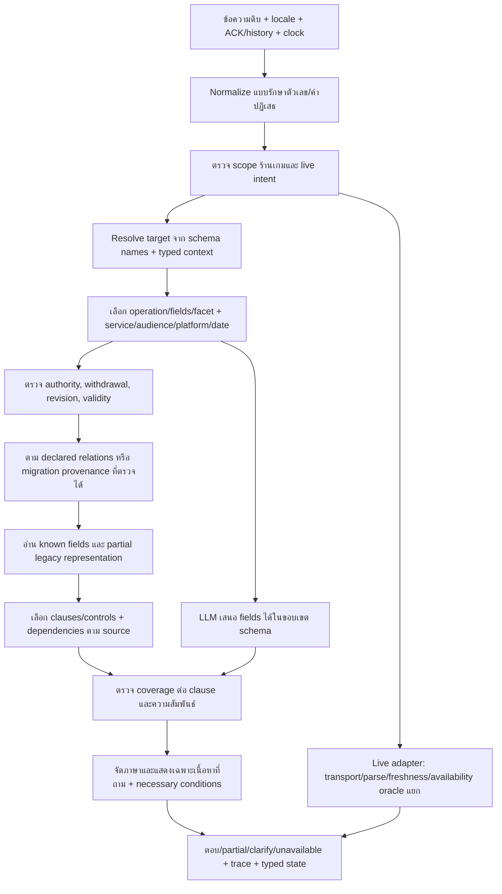

# R66 — Flow แก้ Format กลางครบหมวด

## เป้าหมายและข้อจำกัด

ตอบเฉพาะบริการศูนย์/ร้านเกมจากข้อมูลที่ให้ ทั้งไทย/อังกฤษ ข้อมูลเก่าใน Format กลางและข้อมูลเพิ่มใหม่ใช้ตัวอ่านเดียวกัน ทดสอบเฉพาะ common ปิด/เปิด LLM ไม่รัน legacy arm ไม่แก้นโยบายที่ไม่ยืนยัน ไม่ publish draft ไม่ upgrade การแปลเป็น owner-reviewed ไม่ทับ log หรือไฟล์ต้นฉบับ

## หลักฐานและงานวิจัยที่ใช้

- [RAT-SQL](https://aclanthology.org/2020.acl-main.677/): alignment คำถามกับช่องและความสัมพันธ์ schema; ประยุกต์ใช้ graph ที่ประกาศ ไม่เดา FK จากชื่อเหมือนกัน ไม่ได้อ้างว่าใช้โมเดล RAT-SQL
- [CANARD](https://aclanthology.org/D19-1605/): คำถามต่อเนื่องต้อง resolve บริบทก่อนค้น; ใช้ typed state ที่เก็บ target/scope/needs ไม่เก็บคำตอบเป็นข้อเท็จจริง
- [Lost in the Middle](https://aclanthology.org/2024.tacl-1.9/): บริบทยาวไม่ได้รับรองอ่านข้อมูลสำคัญได้; เลือกกฎเฉพาะหัวข้อพร้อม dependencies และลำดับ ห้ามส่งทั้งเล่มเพียงเพื่อผ่าน keyword
- [RAGAs](https://aclanthology.org/2024.eacl-demo.16/): แยก retrieval/context/answer quality; ในระบบนี้ใช้ oracle จาก source และ clause contracts ไม่ให้ LLM judge ของตัวเองเป็น gold

เครื่องมือ agent_search ของ paper-search-pro ใช้ไม่ได้ใน runtime นี้เพราะขาด pyalex จึงตรวจเอกสารต้นทางผ่าน web search แทน เป็น targeted engineering research ไม่อ้างเป็น systematic literature review

## Flow รับและตอบคำถาม

## วิธีแก้และ acceptance gate แยกหมวด

| หมวดปัญหา | วิธีแก้ | Gate ที่ต้องเห็น |
|---|---|---|
| Execution / ownership | guard_hits ใน retrieval branch ที่ใช้งานจริง; audit จำนวน blocked; ห้ามกลืน NameErrorหรือถอน filter | no-hit/withdrawn/owned-field ไม่ล้มและไม่คืน stale facts |
| Target collision | operation-first: game identity → controls/rules/rates; audience เป็น filter; หลาย record ชื่อเดียวไม่ใช่ primary ทุกตัว | ราคา CS2 ไม่ใช้ competition/control เป็นราคา |
| Field / intent | typed strong needs มาก่อน schema-only proposal; metadata ไม่แทน user need; proposal ที่ไม่ตรวจ relevance ต้อง clarify | disputes ไม่ตอบ dates; compound ครบ known clauses |
| Competition | facet derived จาก headings/text และ source tags; local relevance selection+dependency; numeric section ordering | เฉพาะเรื่องไม่ทั้งเล่ม; all ครบ; ไม่ข้ามเกม |
| Controls | เพิ่ม representation rows ที่เก็บ button/action/description/section พร้อม gesture unknown เฉพาะช่อง; ไม่เดา press; adapter อ่าน limitations ที่มี provenance | ปุ่ม known ยังตอบได้; platformผิดไม่ยืมชุดPC |
| Games/catalog | offered game_service เป็นฐานรายการ; filter service/platform; แยก family/edition/competitive-only | PS5 list ไม่รวม PC-only หรือ RoV เพราะมีrulebook |
| Equipment/resources | specifications/usage จาก equipment_model, resource identity/live แยก; exact source zone metadata สำหรับ migration only | ขอ PC specs ไม่คืนเครื่องทุกโซน |
| Rate | service+audience เป็น intersect filters; explicit billing relation; expired rates เป็น historical ไม่current; calculation unknown ห้ามคูณ | PC+General Adult ไม่แสดงทุกservice; ชี้expiredจริง |
| Rental/budget | half/full period, included equipment, audience, persons, notes; งบใช้ formula knownเท่านั้น; แยกavailable | budgetไม่อ้างเครื่องว่าง; ไม่รวมทุกgroupราคาเดียว |
| Calendar | timezoneจากหลักฐาน; bookable/area hoursแยก; special closure override; query dateไม่ใช้nowกรองอนาคต | 12–13no booking, maintenance, boundaries TH/EN |
| Booking | defer commonเฉพาะ live; declared physical resource/pool; unknown transportไม่อ้างfree | fixture oracle overlap/VR round/status counts |
| Localization | existing ENก่อน; proper Latin titleไม่ติด Thai marker; missing translationเป็นexplicit pending; offline review artifacts; numeric/negation/units invariant | ENไม่อ้าง reviewedเอง; no inventedpolicy |
| Dialogue | typed state พร้อม scopesและrequested fields; bare device/audience/ทั้งหมดสืบ pendingtask; new topic clear | price→PC, PS5→games, controls→button, group→members |
| Compound/all | coverageต่อ clause; partialตอบส่วนknown+clarifyเฉพาะส่วนขาด; allขยายcontentไม่internalmetadata | missing field ไม่ผ่านเป็นcomplete |
| Typo/layout | bounded unique candidates, numeric protection, repeat recovery; namescacheตามrelease; ไม่globalstripduplicates | cockpik/typosไม่เปลี่ยนPC1เป็นPC2 |
| Rendering/long | natural labels; allmetadataเฉพาะผู้ใช้ขอ; unknownที่ไม่ถามไม่spam; ruleorderจากsource occurrence | answer scopeครบ, ไม่truncateexceptions |
| Validation/confidence | separate execution/schema/coverage/source/time/locale; response unknownไม่เรียกanswered; uncalibratedไม่แปลเป็นprobability | malformed/unsupported/missingไม่ผ่านschemaเป็นcorrect |
| Evaluator | new semantic adapter version; preservelegacyGT; protocol mismatchแยกcontent; exceptionในdenominator; fixedclock+configs | coverageต่อarmและผลLLMtransportแยก |
| Runtime/performance | memoized normalized alias by names/release + upper boundpruning; boundedmodel queue/deadline; fallbackไม่stale | no overlappingtestarm; timeoutรายงานจริง |
| Owner/provenance/release | migrationใหม่versionแยก, sourcepointersตรง, no guessedprice/date/policy; publishgateคงไว้ | draftไม่ตอบproductionก่อนอนุมัติ |

## ตรวจทานและปรับ Flow รอบ 1 — อธิบายข้อมูลครบกับอ่านไม่ได้

พบข้อบกพร่องในร่าง: การเติม bindings ด้วย press จะสร้างข้อเท็จจริง; เปลี่ยน unknown เป็น knownทั้งชุดไม่ปลอดภัย; กฎทั้งหมดกับกฎเรื่องเดียวต้องแยก

ปรับ: partial representation แยก gesture unknown, preserve raw source; topic selection derived ไม่ใช่นโยบาย; unstructured text fallback เฉพาะ mappingที่มีsource และไม่ใช้เก่าทับwithdrawn

## ตรวจทานและปรับ Flow รอบ 2 — ขอบเขตและบทสนทนา

พบข้อบกพร่องในร่าง: การเลือก audienceแล้วลืม service; all games นับcompetition-only; whole-record validity ทำให้ fieldอื่นหายเพราะ optionalFKเก่า; closureอนาคตถูกnowfilter; historyสืบราคาไปถามเกม

ปรับ: intersectscopes; offeredcatalogเท่านั้น; validityตามfieldที่อ่านและrequiredpath; date-specificclosure; explicitoperationreplace และ shortselectorinherit แยก newtopic

## ตรวจทานและปรับ Flow รอบ 3 — การพิสูจน์และส่งใช้จริง

พบข้อบกพร่องในร่าง: keyword passไม่พิสูจน์semantics; fixturesไม่ใช่live; draftmigrationไม่ใช่release; modelenabledไม่แปลว่าทุกข้อcalled; logเก่าห้ามoverwrite

ปรับ: regression/source-oracleต่อหมวด พร้อม negativecounterexamplesและnew-record fixtures; fixedclock, serializedcommonoff/on; reportexecution+content+protocol+time+locale+transport; optimisticcompareก่อนdeployโค้ด; productiondataไม่activate; ownerquestionsเฉพาะfactsunknownจริง

## ลำดับลงมือและการทดสอบ

1. สำรอง live code+manifest+DB แบบ read-only backup ลง R66 ใหม่ ตรวจ Git และ source parity ก่อนแก้
2. แก้ execution/ownership, partial controls, relations/selection, rules/fields, dialogue, language/rendering, validator/performance ตามลำดับ
3. migration enrichment เป็น candidateใหม่พร้อม lineage; schema validate ทุกrecordและauditoriginalpreservation
4. tests common off/on: focused actual failuresหลายคำถาม+counterexamples, allcatalognewrecordfixtures, conversationprotocol, booking controlledoracle, modelproposalnegative/success/timeout
5. อ่านfailedcasesและปรับflow/codeเฉพาะcauseที่พิสูจน์ แล้วrerunaffectedtests; ไม่ rerun armเดิม
6. commonใหญ่ทั้ง20,554requestsหากsmallgatesยังมีcriticalfailureไม่เริ่มfull; fixedclock/reference_date; resultsappend-onlyและcheckpoint resume; ดึงR64 baselineจากlogsไม่เรียกlegacyใหม่
7. deploy code ที่ตรวจแล้วด้วยbeforehash compareและbackup เก็บcandidatedataเป็นdraft; สรุปสิ่งที่ทำ/ผล/ยังไม่verified/คำถามownerและrollbackpath

## คำถามเจ้าของที่แก้ด้วยโค้ดไม่ได้

- hourlyratesที่หมดอายุ31มีนาคม2026: ฉบับใหม่/วันเริ่มมีผลและกลุ่มที่อนุมัติคืออะไร (ไม่ยืดอายุเอง)
- หากarea opening09–12,13–18กับsourceอื่นไม่ตรง: sourceใดเป็นเวลาเปิดพื้นที่จริง และsourceใดเป็นเวลาเปิดจอง (12–13ไม่จองยืนยันแล้ว)
- account lending, compensation, mods, minors และrefundexceptionsที่ไม่มีคำตอบ: แต่ละpolicyอนุญาต/ห้าม/เงื่อนไขอะไร ไม่ใช้ร้านอื่นเป็นgold
- ambiguitybillingที่ไม่พิสูจน์จากsource: machinegroupsกับpricingserviceใดเป็นกลุ่มเดียวกัน; mappingที่มีหลักฐานทำเองก่อนถาม

## สถานะงาน

เอกสารนี้เป็น Flow ที่ผ่านการตรวจแบบ reasoning3รอบก่อนimplementation การทดสอบต้องบันทึกผลจริงหลังลงมือ ไม่ถือว่าทบทวนเอกสารคือระบบผ่านแล้ว

## Inventory ทุกหมวด schema (รวมหมวดที่ R63 ไม่มีrecords)

### center

แบบฟอร์ม: ข้อมูลศูนย์

name | operator | description | address | building | floor | map_url | timezone

Gate: validate field/source/FK/unknown/withdrawal/locale/validity ตามชนิดข้อมูล; new-record fixture มี target ที่ไม่อยู่ในข้อมูลศูนย์จริง; ห้ามเติม facts เพื่อให้ผ่าน

### contact

แบบฟอร์ม: ติดต่อ

channel | value | purpose | office_hours

Gate: validate field/source/FK/unknown/withdrawal/locale/validity ตามชนิดข้อมูล; new-record fixture มี target ที่ไม่อยู่ในข้อมูลศูนย์จริง; ห้ามเติม facts เพื่อให้ผ่าน

### facility

แบบฟอร์ม: สิ่งอำนวยความสะดวก

name | location | usage_conditions | accessibility

Gate: validate field/source/FK/unknown/withdrawal/locale/validity ตามชนิดข้อมูล; new-record fixture มี target ที่ไม่อยู่ในข้อมูลศูนย์จริง; ห้ามเติม facts เพื่อให้ผ่าน

### zone

แบบฟอร์ม: โซนบริการ

name | description | location | room_seats

Gate: validate field/source/FK/unknown/withdrawal/locale/validity ตามชนิดข้อมูล; new-record fixture มี target ที่ไม่อยู่ในข้อมูลศูนย์จริง; ห้ามเติม facts เพื่อให้ผ่าน

### equipment_model

แบบฟอร์ม: รุ่นและสเปกอุปกรณ์

name | device_type | specifications | usage

Gate: validate field/source/FK/unknown/withdrawal/locale/validity ตามชนิดข้อมูล; new-record fixture มี target ที่ไม่อยู่ในข้อมูลศูนย์จริง; ห้ามเติม facts เพื่อให้ผ่าน

### resource

แบบฟอร์ม: เครื่องหรือทรัพยากรจริง

name | zone_id | equipment_model_ids | capacity_persons | physical_pool_key | operational_status

Gate: validate field/source/FK/unknown/withdrawal/locale/validity ตามชนิดข้อมูล; new-record fixture มี target ที่ไม่อยู่ในข้อมูลศูนย์จริง; ห้ามเติม facts เพื่อให้ผ่าน

### service

แบบฟอร์ม: รายการที่เลือกในระบบจอง

name | resource_ids | platform | session_minutes | occupancy_minutes | capacity_min | capacity_max | booking_product_key

Gate: validate field/source/FK/unknown/withdrawal/locale/validity ตามชนิดข้อมูล; new-record fixture มี target ที่ไม่อยู่ในข้อมูลศูนย์จริง; ห้ามเติม facts เพื่อให้ผ่าน

### game

แบบฟอร์ม: ข้อมูลเกม

title | edition | genre | summary | how_to_play | publisher_url | supported_platforms | age_rating

Gate: validate field/source/FK/unknown/withdrawal/locale/validity ตามชนิดข้อมูล; new-record fixture มี target ที่ไม่อยู่ในข้อมูลศูนย์จริง; ห้ามเติม facts เพื่อให้ผ่าน

### game_service

แบบฟอร์ม: เกมที่ศูนย์มีให้เล่นจริง

game_id | service_id | offered | installed_resource_ids | game_version | account_policy_id

Gate: validate field/source/FK/unknown/withdrawal/locale/validity ตามชนิดข้อมูล; new-record fixture มี target ที่ไม่อยู่ในข้อมูลศูนย์จริง; ห้ามเติม facts เพื่อให้ผ่าน

### game_mode

แบบฟอร์ม: รูปแบบเล่นและเล่นกับเพื่อน

game_id | mode_name | platform | players_min | players_max | network_requirement | studio_supported

Gate: validate field/source/FK/unknown/withdrawal/locale/validity ตามชนิดข้อมูล; new-record fixture มี target ที่ไม่อยู่ในข้อมูลศูนย์จริง; ห้ามเติม facts เพื่อให้ผ่าน

### control_set

แบบฟอร์ม: วิธีเล่นและปุ่ม

game_id | platform | input_device | preset | game_version | bindings | limitations

Gate: validate field/source/FK/unknown/withdrawal/locale/validity ตามชนิดข้อมูล; new-record fixture มี target ที่ไม่อยู่ในข้อมูลศูนย์จริง; ห้ามเติม facts เพื่อให้ผ่าน

### audience

แบบฟอร์ม: กลุ่มผู้ใช้

name | eligibility | required_proofs

Gate: validate field/source/FK/unknown/withdrawal/locale/validity ตามชนิดข้อมูล; new-record fixture มี target ที่ไม่อยู่ในข้อมูลศูนย์จริง; ห้ามเติม facts เพื่อให้ผ่าน

### rate

แบบฟอร์ม: ราคาต่อบริการ

service_id | audience_id | amount_minor | currency | unit | duration_minutes | persons_min | persons_max | calculation_rule | tax_note

Gate: validate field/source/FK/unknown/withdrawal/locale/validity ตามชนิดข้อมูล; new-record fixture มี target ที่ไม่อยู่ในข้อมูลศูนย์จริง; ห้ามเติม facts เพื่อให้ผ่าน

### rental_package

แบบฟอร์ม: ราคาเหมาโซน/ห้อง

name | zone_ids | audience_id | period_label | duration_minutes | amount_minor | currency | equipment_included | room_seats | terms

Gate: validate field/source/FK/unknown/withdrawal/locale/validity ตามชนิดข้อมูล; new-record fixture มี target ที่ไม่อยู่ในข้อมูลศูนย์จริง; ห้ามเติม facts เพื่อให้ผ่าน

### schedule

แบบฟอร์ม: ตารางบริการ

timezone | zone_ids | weekday | open_periods | bookable_periods | maintenance_periods | reason

Gate: validate field/source/FK/unknown/withdrawal/locale/validity ตามชนิดข้อมูล; new-record fixture มี target ที่ไม่อยู่ในข้อมูลศูนย์จริง; ห้ามเติม facts เพื่อให้ผ่าน

### closure

แบบฟอร์ม: วันปิด/ข้อยกเว้น

local_date | zone_ids | state | open_periods | bookable_periods | reason | resolution_policy_id

Gate: validate field/source/FK/unknown/withdrawal/locale/validity ตามชนิดข้อมูล; new-record fixture มี target ที่ไม่อยู่ในข้อมูลศูนย์จริง; ห้ามเติม facts เพื่อให้ผ่าน

### policy

แบบฟอร์ม: นโยบายและกฎศูนย์

topic | subject | decision | conditions_all | exceptions | consequence | details | procedure_id

Gate: validate field/source/FK/unknown/withdrawal/locale/validity ตามชนิดข้อมูล; new-record fixture มี target ที่ไม่อยู่ในข้อมูลศูนย์จริง; ห้ามเติม facts เพื่อให้ผ่าน

### procedure

แบบฟอร์ม: ขั้นตอนจอง/จ่าย/เช็กอิน/แก้ปัญหา

topic | preconditions | steps | required_documents | deadline_minutes | outcome

Gate: validate field/source/FK/unknown/withdrawal/locale/validity ตามชนิดข้อมูล; new-record fixture มี target ที่ไม่อยู่ในข้อมูลศูนย์จริง; ห้ามเติม facts เพื่อให้ผ่าน

### competition

แบบฟอร์ม: รายการแข่งขันและฉบับกติกา

game_id | event_name | division | rulebook_release | competition_dates | coverage | supersedes_id

Gate: validate field/source/FK/unknown/withdrawal/locale/validity ตามชนิดข้อมูล; new-record fixture มี target ที่ไม่อยู่ในข้อมูลศูนย์จริง; ห้ามเติม facts เพื่อให้ผ่าน

### competition_rule

แบบฟอร์ม: ข้อกติกาการแข่งขัน

competition_id | section_number | facet | heading | text | depends_on_ids | completeness

Gate: validate field/source/FK/unknown/withdrawal/locale/validity ตามชนิดข้อมูล; new-record fixture มี target ที่ไม่อยู่ในข้อมูลศูนย์จริง; ห้ามเติม facts เพื่อให้ผ่าน

### news

แบบฟอร์ม: ข่าว/กิจกรรม/ประกาศ/โปรโมชัน

title | body | event_start | event_end | audience_ids | contact_id | registration_url

Gate: validate field/source/FK/unknown/withdrawal/locale/validity ตามชนิดข้อมูล; new-record fixture มี target ที่ไม่อยู่ในข้อมูลศูนย์จริง; ห้ามเติม facts เพื่อให้ผ่าน

### person

แบบฟอร์ม: บุคลากร/ทีมที่เปิดเผยได้

display_name | role | team | public_contact_id | public_scope

Gate: validate field/source/FK/unknown/withdrawal/locale/validity ตามชนิดข้อมูล; new-record fixture มี target ที่ไม่อยู่ในข้อมูลศูนย์จริง; ห้ามเติม facts เพื่อให้ผ่าน

### faq

แบบฟอร์ม: คำถามเสริมและเอกสารทั่วไปของศูนย์

question | answer | related_ids | topic | scope_note

Gate: validate field/source/FK/unknown/withdrawal/locale/validity ตามชนิดข้อมูล; new-record fixture มี target ที่ไม่อยู่ในข้อมูลศูนย์จริง; ห้ามเติม facts เพื่อให้ผ่าน

### live_binding

แบบฟอร์ม: การเชื่อมสถานะสด

service_id | provider | external_resource_key | physical_pool_key | status_mapping | timezone | freshness_policy

Gate: validate field/source/FK/unknown/withdrawal/locale/validity ตามชนิดข้อมูล; new-record fixture มี target ที่ไม่อยู่ในข้อมูลศูนย์จริง; ห้ามเติม facts เพื่อให้ผ่าน

## ผลจากลูป implementation ที่นำกลับมาปรับ Flow

### ลูป A — แก้ source graph และ projection

ปุ่มมีข้อมูลแต่ representation ไม่ครบ → partial adapter โดยไม่แต่ง gesture; ชื่อเกมชนชุดปุ่ม → operation/role-first; รายการเกมต้องใช้ offered relations; ต้นฉบับ PC price มีอยู่นอก content JSON → เพิ่ม source recovery จาก calculator/source_registry ไม่ถามเจ้าของเรื่องตัวเลขซ้ำ

### ลูป B — negative tests และข้อมูลที่ถูกถอน

canonical all-details ของชุดปุ่มต้องไม่ถูกเปลี่ยนเป็นข้อมูลเกม; scope search ต้องไม่อ่าน record ที่ถูกถอน; optional supersedes/account policy ที่หมดอายุไม่ทำให้ fact อิสระหมดอายุ; อ้างอิงที่หมดอายุเองยังไม่ถูกแสดงเป็น current

### ลูป C — แปลและคำถามต่อเนื่องจริง

JSON/literal invariant ไม่พอ ต้องตรวจ semantic mistranslations แยก; source Thai + evidence ต้องอยู่ครบ; ไม่แต่ง official names; “ต่อการจอง” ไม่แปลงเป็น “ต่อวัน”; หลังตอบเว็บต้องปล่อย session lock ก่อน delivery bookkeeping

### ลูป D — schema/calculator/compatibility

ceil-session เป็นกฎคำนวณที่ต้องเก็บได้ใน schema; ตัวเลขจาก source ไม่เท่ากับเวลามีผล; สูตร unknown ไม่คูณ; prototype new-kind fixture ต้องผ่านพร้อม native withdrawal guards; old schema-only mock tests ที่สวน semantic safety เก็บเป็น contract mismatch ไม่แก้ gold ให้ผ่าน

## ลำดับนำไปใช้งานจริง

1. ใช้ source ที่มีหลักฐานเป็นร่าง และเก็บ source snapshots/record IDs เดิมไว้ การแก้ข้อมูลใช้ revision ใหม่
2. เกมเชื่อม game_service→service→resource; ราคาเชื่อม service+audience; controls ระบุ game+platform+preset; rules ระบุ competition+release+facet+dependencies; live mapping มี provider/resource/pool/freshness แยก
3. known/unknown/not_applicable/conflicted ต้องสะท้อนต้นฉบับ; ห้ามกรอกวันมีผลหรืออัตราเพื่อให้ validation ผ่าน
4. แปลเป็น proposal ตรวจ literals/negations/exceptions/names และสถานะ agent_translated; ไม่มีการอ้างว่า owner-reviewed เอง
5. validate draft, publication, source authority, references, withdrawal, locality, time; review เฉพาะสิ่งที่หลักฐานยังไม่ยืนยัน ไม่ถามซ้ำเรื่อง 12–13 หรือสถานะจริงที่ผู้ใช้ยืนยันแล้ว
6. ทดสอบ positive/negative/หลายคำขอ/สองรอบสนทนา/typos/วันขอบเขต ทั้ง OFF/ON บน snapshot เดียวกัน แล้วอ่านคำตอบจริงพร้อม decision_artifact ไม่ใช้คะแนนอย่างเดียว
7. เมื่อนำ code กลับโปรเจกต์ เปรียบเทียบ original SHA สำรองก่อนแก้ ไม่ย้าย draft DB หรือแก้ approvals อัตโนมัติ; portable package เป็นอีก deployment surface ต้องตรวจ version ก่อนใช้
8. หลังมีข้อมูลใหม่ ให้ใช้กติกาและตัวอ่านกลาง ไม่เพิ่มคำตอบ hard-coded ต่อชื่อเกม/อุปกรณ์/ราคาที่เพิ่ม

## สิ่งที่เอกสารนี้ไม่รับรอง

สามรอบตรวจ Flow เป็น reasoning reviews ไม่ใช่ผลทดสอบ; fixture ใหม่ครบ 24 หมวดเป็นการพิสูจน์ canonical schema reading ไม่ใช่ทุก paraphrase; English proposals ครบช่องไม่ใช่ semantic approval; การเปิด LLM ไม่แปลว่าทุกข้อเรียกโมเดล; ข้อมูล draft ไม่ใช่ production release

# ลูป E — แก้ช่องว่างที่ยังมี source อยู่หลัง final11

## หลักฐานที่ต้องใช้ก่อนแก้

`AUDIT_final11/ALL_FAILED_GRADES.json`: แยกคำแปล/ถ้อยคำที่เทียบไม่ตรง อัตราหมดอายุ และปัญหาการอ่านข้อมูลจริง ไม่เปลี่ยน gold เพื่อให้ผ่าน

1. ที่ตั้ง: center.address unknown แต่เจ้าของเคยให้ที่อยู่ครบและมี FAQ location เดิม ต้องกู้ source/pointer มาเป็นร่าง ไม่ให้โมเดลตั้งที่อยู่
2. policy/ค่าปรับ: ชื่ออุปกรณ์ต้องเป็น scope ไม่ใช่ตัวบังคับให้เลือกเฉพาะ service fields ค้น policy/FAQ topic ที่มีหลักฐานตรงเรื่องและใช้ source priority เดิม ไม่เปลี่ยนตัวเลข/เงื่อนไข
3. FAQ ที่เลือกด้วยชื่อ/หัวข้อได้แล้ว: ถ้าผู้ใช้ขอเนื้อหา ไม่ควรถามว่าอยากได้ field ไหน; metadata ที่ไม่รู้ไม่เพิ่มเอง; explicit metadata request ยังต้องรายงานขาด
4. คำถามจอง: แยก “ต้องจองไหม/ไม่จองได้ไหม” จาก “จองขั้นตอนอย่างไร” โดยอ่าน FAQ ที่ตรง operation จากข้อมูลเดิม
5. อุปกรณ์: family label ที่มีในชื่อ เช่นส่วนก่อนคำว่า รุ่น แยกจาก model suffix ได้ โดยไม่เพิ่มชื่อรุ่น/นโยบายเอง
6. แพลตฟอร์มราคา: ใช้ equivalence เดียวกับ control presets เช่น PS5 กับ PlayStation 5 และคง PS4 แยก ไม่ให้ราคาหายเพราะรูปแบบข้อความ
7. เกมรายเครื่อง: ตรวจ service/resource/game relation และ source เดิมก่อน หาก source ไม่ยืนยัน negative ให้ตอบเฉพาะที่ยืนยันและระบุช่องว่าง ไม่ใช้ absence เป็น not-installed โดยเดา

## ตรวจทานรอบ 1 — ป้องกัน scope เปลี่ยนเป็น facts

การค้น topic policy ไม่ให้ชื่อบริการบังคับโทษทุกเกม; source ต้องระบุเงื่อนไขความเสียหายเอง; กติกาแข่งและกฎการใช้ศูนย์แยก ไม่ใช้ penalty ธรรมดาทับเกม

## ตรวจทานรอบ 2 — FAQ default ต้องไม่กลบ explicit detail

default answer ใช้เมื่อจับ FAQ ได้ชัดและไม่ได้ถาม field อื่น ไม่ใช้เมื่อ target fuzzy เสี่ยง หรือมีหลาย FAQ ไม่ตรงกัน การถาม scope/เงื่อนไขที่ไม่รู้ยัง partial/clarify

## ตรวจทานรอบ 3 — กู้ source ไม่ใช่แก้ owner policy

เก็บ DB ก่อนแก้และ append revisions มี original evidence refs; unknown address กู้ข้อความเดิม; unknown validity คง unknown; game/resource negative ที่ไม่มีหลักฐานยังไม่ยืนยัน; rerun common OFF/ON และ source-based regressions ไม่รัน legacy

# ลูป F — ให้ข้อมูลใหม่ตอบได้เมื่อคำถามระบุอุปกรณ์เดิม

ปัญหาเชิงโครงสร้าง: หากคำถามมีชื่อเครื่อง ตัวอ่านอาจหยุดที่ service/resource แม้เรื่องที่ถามอยู่ใน policy/FAQ/procedure ใหม่ การเพิ่มคำตอบเจาะจงรายหัวข้ออย่างเดียวไม่แก้เรื่องนี้

## Flow

1. Resolve เครื่อง/เกมตามเดิม หากถาม live หรือ schema field ที่ target เป็นเจ้าของ ให้ใช้เส้นทางนั้น ไม่ใช้ FAQ หลบ unknown/withdrawal/validity
2. เมื่อ target เดิมไม่มี attribute ที่ถาม ค้นบทความที่มี scope ยืนยัน: FAQ.related_ids, policy.conditions_all ที่อ้าง ID หรือ global ที่ประกาศชัด, procedure.preconditions และชื่อ scope ที่ไม่ขัดกัน
3. ตาม declared graph ไป service/resource/zone/model; ไม่เดา FK จากชื่อคล้าย และไม่ยอมให้ scoped source ของเครื่องอื่นข้ามมา
4. ถ้ามี candidate เดียวที่ topic ตรงชัด ใช้ deterministic retrieval; ถ้าไม่ชัด เปิด LLM เลือกได้เฉพาะ candidate IDs ที่ผ่าน scope guard แล้ว
5. ตรวจ topic หลังตัดชื่อ target ออกจากคำถามด้วย เพื่อไม่ให้แค่คำว่า PC ทำให้ policy ทุกเรื่องถูกเลือก
6. อ่าน answer ของ FAQ, decision/details/conditions/exceptions ของ policy หรือ steps/preconditions/documents ของ procedure จาก source; ไม่มี facts ที่โมเดลสร้าง

## ทบทวน 1

ห้าม scalar price ไม่มี target เลือก damage FAQ; ห้าม secondary topic lookup หลบ field ที่เจ้าของระบุ unknown หรือถอนแล้ว ข้อมูลราคา/live/control/rule ใช้เส้นทางเฉพาะก่อน

## ทบทวน 2

scope ของ policy ที่ประกาศเครื่องอื่นต้องถูกกรองก่อน model แม้ชื่อ topic คล้ายกัน คำหัวข้อที่เหลือหลังตัดชื่อเครื่องต้องยังตรง source ไม่ใช้ชื่อเครื่องเป็นหลักฐานว่าเจตนาถูก

## ทบทวน 3

ทดสอบข้อมูลจำลองแยกจาก production โดยใส่ FAQ/policy ใหม่ที่เกี่ยวกับเครื่องเดิม และให้เครื่องอีกตัวมีคำตอบตรงข้าม ตรวจ OFF/ON, paraphrases, unsupported topic และหลายภาษา ไม่ถือ canonical all-details 480 ข้อเป็นหลักฐานว่าคำถามเกี่ยวกับข้อมูลใหม่ได้ทุกแบบ

## ผลตรวจ implementation ที่นำกลับมาปรับ Flow

1. Resource ที่ใช้ร่วมกันไม่ใช่หลักฐานให้ FAQ ของ service พี่น้องใช้แทนกันได้ Reverse resource→service ทำเฉพาะ resource ที่ผู้ใช้ resolve ตั้งต้น ไม่ทำหลังเดินจาก service ลง resource
2. Procedure.preconditions เป็น typed conditions เช่นเดียวกับ policy.conditions_all ต้องตรวจ service_id/resource_id/zone_id/game_id/equipment_model_id และ operator ก่อนเข้าตัวเลือก ไม่ใช่เช็กแค่ known เงื่อนไขอื่นยังแสดงให้ผู้ใช้เห็น ไม่อนุมานว่าผู้ใช้ผ่านเงื่อนไข
3. Root หมดอายุหรือ field ที่ root เป็นเจ้าของแต่ unknown ยังห้ามใช้ secondary lookup กลบช่องว่าง
4. Negative/positive ของ procedure สองบริการใช้หัวข้อเดียวกันและขั้นตอนคนละแบบ ต้องเลือกตาม root ในทั้ง OFF/ON; เก็บ final12 ที่หยุดไว้และเริ่ม manifest ใหม่หลังแก้

# ลูป G — กลุ่มผู้ใช้และนโยบายที่ไม่มีหลักฐาน

## หลักฐาน

คำถาม “เล่น PC 2 ชั่วโมง บุคคลทั่วไปกี่บาท” คืนทั้งกลุ่ม General Adult/PSU Alumni and General Student/PSU Student and Staff แม้ยอด 140 ของกลุ่มที่ถามมีอยู่ สาเหตุ name.th ของ audience ใน R63 เป็นชื่ออังกฤษและ aliases ว่าง ตัวกรอง rate ทำงานเมื่อ resolve audience ได้ แต่ input ไทยไม่ได้ระบุ ID กลุ่ม

คำถามอายุเด็กและยืมกลับบ้านยังได้ตัวเลือก service fields ซึ่งไม่ได้ช่วยตอบข้อสงสัย ผู้ใช้ต้องได้คำตอบว่าขาดนโยบายเรื่องนั้น มิใช่ชวนเลือก platform/เวลาเล่นแทน

## Flow

1. Resolve audience จากชื่อ/aliases ที่ owner กรอกก่อน ตามด้วย bilingual semantic concepts ของชื่อกลุ่มที่มีอยู่เท่านั้น ไม่สร้าง audience ใหม่ ไม่ฝังราคา/ID/สิทธิ์
2. เฉพาะกลุ่มที่ผู้ใช้ระบุชัด เช่นบุคคลทั่วไป→กลุ่มชื่อ General Adult ถ้ามีใน source; “คนนอก/ไม่ใช่นักศึกษา” ยังไม่พอแยก adult/student จึงไม่ให้สิทธิ์ราคากลุ่มใดโดยเดา
3. กรอง rates ด้วย audience IDs ที่ resolve ได้และคง source/validity gate; สำหรับ budget ห้ามนำเรตราคาของอีกกลุ่มมาแสดงเป็นราคาของผู้ถาม
4. Policy question ที่ไม่มี source ตรงหลังค้นแล้ว ให้ระบุ unknown policy พร้อม scope/หัวข้อ แทน service-field picker; ถ้า source มีคำตอบตรงต้องตอบก่อน fallback

## ตรวจทานรอบ 1

ห้าม negative affiliation เช่นไม่ใช่นักศึกษา/ไม่ใช่บุคลากร กลายเป็น positive selector; ห้ามคนนอกทุกคนถูกตั้งเป็น General Adult; ไม่เพิ่มสิทธิ์หรือส่วนลด

## ตรวจทานรอบ 2

source สามารถตั้ง ID อะไรก็ได้ การจับคู่ใช้ชื่อ/semantics ไม่ตรวจชื่อ ID; กลุ่มที่ไม่มีใน catalog ต้องไม่ถูกสร้าง; ถ้ากลุ่มชื่อคล้ายหลายตัวต้องยังไม่เลือกอันเดียวโดยเดา

## ตรวจทานรอบ 3

ทดสอบไทย/อังกฤษ, คนทั่วไป/ศิษย์เก่า/PSU staff, คนนอกไม่ทราบกลุ่ม, negation, synthetic unrelated group, known damage/booking policies ต้องไม่ถูก unknown fallback แย่ง และ scope ของ unknown policy ต้องไม่กลบราคา/live/rules

เริ่มใช้หลัง final13 จบและเก็บ manifest เดิมแล้วเท่านั้น รอบยืนยันถัดไปต้องสร้าง app manifest และ snapshots ใหม่

# ลูป H — แก้ validation regressions จาก final13

## หลักฐานและสาเหตุ

AUDIT_final13: 7 requests ต่อ flag ถูก validation ปฏิเสธ รากเหตุสองกลุ่มคือ policy priority ถูกวางก่อน competition context และ FAQ ที่จับชื่อได้ตอบ answer แล้ว แต่ generic question tails ยังถูกนับเป็น unresolved intent

RESIDUAL_READER หลังเปิด LLM ยังพบคำถามที่ตั้งถูกเลือก FAQ ติดต่อ เพราะ semantic candidate ทำงานก่อน typed center.address discovery ทั้งที่มี source ที่อยู่ครบ

## Flow และทบทวน 3 รอบ

### รอบ 1 — อย่าลด validation เพื่อให้ผ่าน

ย้าย policy priority หลัง competition resolution รักษาข้อมูลกฎและ facets เดิม; เลือก center.address ก่อน model เมื่อคำถามสถานที่ระบุศูนย์ชัดและไม่ได้ถามติดต่อ; source ยังต้องผ่าน validity/withdrawal และ field authority

### รอบ 2 — FAQ ต้องแยก topic กับ boilerplate

Default FAQ answer รับได้เมื่อ tail หลัง exact alias เหลือเพียงรูปประโยคคำถาม/คำสุภาพ ไม่ยอมรับเนื้อหาใหม่ที่ขอเพิ่ม เช่น scope หรือ compensation; cancellation ต้องเลือก cancel/edit source จริง แทน booking steps ที่ชื่อสั้นชนกัน และคงเงื่อนไขของต้นฉบับในข้อความ

### รอบ 3 — positive/negative และ model-on

เพิ่มเคส match policy ต้องได้กติกา, ที่อยู่เปิด/ปิด LLM, ยกเลิก/ของหาย/เบอร์แบบพิมพ์ต่างกัน รวม negative ที่ FAQ ถูกถามเนื้อหาเพิ่มแล้วต้องยังไม่รับเป็นครบ; ไม่ rewrite grader เดิม ไม่ตัด validation errors จาก denominator; rerun common OFF/ON กับ snapshot ใหม่

ระหว่างอ่าน source พบคำแปลคำถามเจ้าของผิดตามบริบท: เครื่อง→flight และศูนย์→zero ต้องแก้เฉพาะ generated English เป็น draft revision โดยเก็บ Thai/evidence เดิม ตรวจคำถามเจ้าของที่มีอยู่ทั้งหมดแล้ว แยก agent review จากเจ้าของอนุมัติ

# ลูป I — ข้อกำหนดราคาในบทสนทนาต่อเนื่อง

## หลักฐาน

หลังถามบุคคลทั่วไป PC 2 ชั่วโมง ถาม “แล้ว 1 ชั่วโมงล่ะ” ยังคำนวณ 70 ได้แต่ validation บอก unresolved_query_clause ส่วน “ถ้าเป็นศิษย์เก่าล่ะ” ได้ None เพราะชื่อ audience ภาษาไทย resolve เฉพาะ price operation ที่ explicit ไม่มี context ของราคาเข้ามาช่วย

## Flow และทบทวน

### รอบ 1

เก็บ duration constraint จาก requested_minutes ที่ consistent ของแผนคำนวณ ไม่เก็บยอดรวม/ราคาเป็น facts สำหรับตอบครั้งถัดไป ผู้ใช้เปลี่ยน duration ต้องชนะค่าเก่า; เปลี่ยน audience ต้องคง service และ duration ที่ถามไว้ แล้วอ่าน rate ใหม่

### รอบ 2

รับ bare audience follow-up เฉพาะหลัง amount_minor และรูปประโยคเลือกกลุ่มสั้น ไม่มีเจตนาใหม่แทรก; ความเป็นคนนอกหรือการปฏิเสธกลุ่มไม่ถือว่าได้อีกกลุ่มอัตโนมัติ; ไม่เอา duration ข้ามไปเรื่องเปิด-ปิด/live/เกม/นโยบาย

### รอบ 3

state เก็บ constraints แบบชนิดข้อมูลและขอบเขตจำกัด; single duration เท่านั้น; inherited constraint มี trace; explicit quantities และ semantic clauses อื่นไม่ถูกตัดทิ้ง; validity/withdrawal/calculation_rule ของ rate ยังตรวจทุกครั้ง ตรวจ TH/EN, เปลี่ยนกลุ่ม/เวลา, เปลี่ยนเรื่อง และ extra clause ที่ไม่ควรถูกยอมรับเป็น selection

เก็บ final14 ที่หยุดเพราะพบข้อนี้แยก ไม่อ้างเป็น complete OFF/ON ไม่มีการแก้ app ระหว่าง matrix ทำงาน

## ผลจาก implementation

- state เก็บเฉพาะ duration_minutes ที่ผู้ใช้ขอและมีค่าเดียว ขอบเขต 1–1440 นาที ไม่เก็บยอดเงินเดิมเป็นข้อเท็จจริง
- short audience/quantity follow-up มี query interpretation แยกจากข้อความดิบ; audit ระบุ inherited_constraints; explicit quantity ใหม่ชนะค่าเดิม
- Thai/English 3-turn tests เปลี่ยน General Adult→alumni→duration ใหม่ และมี negative new-topic/extra-clause
- พบ Owner preview JS ประกอบ state เองจน scope/operation/duration หาย จึงเพิ่ม common_read_state ใน preview API และให้ browser ใช้ state จาก backend เดียวกับ Chatbot ตรวจ actual HTTP ทั้งสองภาษาโดยไม่เขียน approvals

# ลูป J — เปรียบเทียบราคาให้ครบ operands

## หลักฐาน

final15 OFF มี validation rejected 1 request: “Do guests pay the same rate as PSU students?” ตัว resolver จับ PSU students ได้ แต่ guests ยังไม่บอกว่าเป็นนักเรียน/ศิษย์เก่าหรือ General Adult และไม่มีบริการ จึงหลุดไปตอบเรต PSU หลายเครื่องพร้อม unresolved clause ไม่ใช่การเปรียบเทียบที่ผู้ใช้ถาม

## Flow และทบทวน 3 รอบ

### รอบ 1

ราคา + same/different/compare ต้องมีอย่างน้อยสองกลุ่มและ scope บริการ หากขาดให้ถามส่วนที่ขาด ไม่เลือกเรตของ operand ฝั่งเดียวมาตอบเป็นผลเปรียบเทียบ และไม่ตั้ง visitors เป็น General Adult

### รอบ 2

อ่าน rates ตาม declared service/audience เช่นเดิม เปรียบเทียบได้เมื่อแต่ละกลุ่มมี current known-validity rate เดียวและฐานหน่วย/ระยะเวลา/จำนวนคน/สกุลเงิน/สูตรเหมือนกัน ไม่เปรียบเทียบ 30 นาทีต่อคนกับ 60 นาทีทั้งเครื่องหรือข้ามอัตราหมดอายุ

### รอบ 3

เก็บ raw final15 ที่หยุดตามเหตุผลแยก เพิ่ม tests ไทย/อังกฤษเรื่อง missing audience/service, current equal/different, unknown/expired validity และ incompatible unit; ไม่ลด validation gate หรือเขียนราคาทับเพื่อให้ผ่าน; reader ยังแสดง source-backed rates ตามจริงและผลที่เทียบไม่ได้เป็น partial

## ผลทบทวนระหว่าง implementation

เปรียบเทียบมีทั้งสองกลุ่มในบริการเดียวและสองบริการสำหรับกลุ่มเดียว จึงต้องเก็บ axis และ operands ใน typed state หากถามส่วนที่ขาด ผู้ใช้ตอบแค่ PC/ชื่อกลุ่มแล้วต้องเติม slot ได้ ไม่สูญเสียอีกฝั่งหรือเดา visitors เป็น General Adult

พบชื่อ target สองตัวหายเหลือหนึ่งเพราะ named() ใช้ alias ที่ไม่ปรากฏในคำถามมาตรวจ nested match: สองบริการมี platform alias PC ร่วมกัน แต่คำถามระบุชื่อสองบริการคนละตำแหน่ง จึงแก้ให้ suppress เฉพาะ span ที่ปรากฏจริงและถูกชื่อยาวกว่าครอบอยู่ ทดสอบทั้ง shared unobserved alias และ PC ที่อยู่ใน Gaming PC จริง

# ลูป K — ลำดับ intent ที่คำเดียวมีหลายหน้าที่

## หลักฐานที่ตรวจซ้ำจากคำตอบจริง

1. “ถ้าทำ PS5 เสียหาย ต้องเสียค่าปรับกี่บาท” และ English “how much is the fine” ได้ตารางค่าบริการแทนค่าปรับ เพราะ price cue มาก่อน damage policy
2. “How do I cancel a paid booking?” ได้กำหนดชำระเงิน 10 นาที เพราะ paid ถูกจับก่อน cancel action
3. “Is PC #03 available for Warzone today at 15:00?” ได้ข้อมูล installed games พร้อมข้อความว่าไม่ใช่ booking คำตอบไม่ได้อ้างว่าว่างแต่ยังไม่ตอบเวลาที่ถาม เพราะ live regex รับ available ตามด้วยเวลาโดยตรง และ presence reader จบก่อน live adapter

## ทบทวน 1 — ความหมายก่อนคำร่วม

damage + fine/pay เป็น policy; หาก target เป็นอุปกรณ์จริงให้เงินที่ถามเกี่ยวกับความเสียหายได้มาก่อนราคาใช้บริการ ไม่เปลี่ยน game damage/กฎแข่งให้เป็นนโยบายศูนย์; cancelled automatically due to unpaid กับผู้ใช้ต้องการ cancel เป็นคนละเจตนา

## ทบทวน 2 — เวลาและแหล่งข้อมูลสด

availability + explicit temporal cue แม้มีชื่อเกมคั่น ต้องไป live adapter ก่อน installation facts; static “does PC have Warzone installed” ยังใช้ source installation graph แยกจาก booking; อย่าสร้างสถานะว่างเมื่อ API unavailable

## ทบทวน 3 — ตรวจย้อนและสถานะร่าง

ทดสอบ TH/EN, damage fine vs normal hourly price vs competition penalties, manual paid cancellation vs payment timeout, timed availability vs static installation และ source-unavailable pipeline ใช้ fixture เดิม ไม่มีการเก็บ real booking oracle ใหม่; trace label ต้องไม่เรียกร่างหรือ synthetic view ว่า approved

เพิ่มเฉพาะ semantic priority และตรวจเงื่อนไข ไม่มีการเปลี่ยนนโยบาย ตัวเลข หรือ approvals งานรอบนี้แก้ technical route ได้ ส่วนข้อมูลที่ไม่ทราบยังรายงาน unknown

# ลูป L — ตรวจเนื้อหาที่คำแปลเดิมตกหล่น

## หลักฐาน

อ่าน raw content failures ของ final16 พบ FAQ ความเสียหายภาษาอังกฤษไม่มีช่วง 100–500 และ 500–2,000 บาท ทั้งที่ต้นฉบับไทยระบุ และมี English natural FAQ อีก record ซึ่งเก็บครบ ตรวจ numeric differences ทั้ง candidate พบ 13 ช่อง: 6 ช่องเป็น one/four/09:00 ซึ่งไม่ใช่ความหมายผิด; 1 ช่องค่าปรับตกหล่นจริง; 6 ช่อง controls มีคอลัมน์คำอธิบายไทยแต่ English ว่าง

ขยายตรวจเฉพาะคอลัมน์นั้นพบ 36 control records / 390 rows ไม่ใช่ 390 ข้อเท็จจริงใหม่ บางแถวไม่มีตัวเลขจึงไม่ถูก numeric guard จับ ต้องแยกการรักษาตัวเลขจากการรักษาข้อความครบ แหล่งเดิมและค่าไทยยังอยู่ในฐานข้อมูล

## ทบทวน 1 — แก้เฉพาะที่พิสูจน์ได้

FAQ: สร้าง revision และ derived source ใหม่ แปลช่วงความเสียหายครบจากไทยโดยเทียบ English natural FAQ; ไม่เปลี่ยนตัวเลขหรือนโยบาย ไม่อนุมัติแทนเจ้าของ

Controls: ห้ามเดาคำอธิบายที่หายจากป้ายปุ่ม การเพิ่ม fallback ต้องเทียบป้ายปุ่มและจำนวนแถวตรงกันก่อน จึงนำคำอธิบายไทยแถวนั้นมาแสดงพร้อมป้าย Translation pending; การกู้ข้อความไทยไม่ใช่การแปลสำเร็จ

## ทบทวน 2 — ความครบกับการเลือกเฉพาะที่ถาม

กู้คอลัมน์ก่อน projection แต่หลังตรวจว่าตารางจัดแนวได้ ปุ่มที่มีเครื่องหมาย / + # ต้องไม่ถูกแก้ การเลือกเฉพาะ A/R3/Jump ต้องไม่ลากทุกแถวมาตอบ หากเลือกแถวที่แปลครบอยู่แล้วต้องไม่ติด partial ของแถวอื่น ข้อมูล structured bindings รุ่นใหม่ไม่ใช้ adapter นี้

## ทบทวน 3 — ความซื่อสัตย์ของผลและการย้อนกลับ

บันทึก localization_gaps และ partial response เมื่อคำตอบที่แสดงมีคอลัมน์ค้างแปล รักษา original values และ evidence; ไม่อ้างว่า English notes ทั้ง 390 แถวผ่าน semantic review เก็บรายการไว้สำหรับงานแปลต่อ กรองเครื่องหมาย regex .* ใน FAQ caption เฉพาะการแสดงผล ไม่เปลี่ยนชื่อเกมหรือ source

หยุด runner final17 ที่ระบุ PID/child ของงานนี้ก่อนแก้ไฟล์ เก็บ log เดิมพร้อมเหตุผล เริ่มรอบยืนยันใหม่หลังแก้ครบ ตรวจทั้ง OFF/ON และ release preservation audit ใหม่ ไม่รัน legacy

# ลูป M — เติม English control notes จาก source เดิม

## ทบทวน 1: ขอบเขตข้อมูล

390 rows / 36 records ใน CONTROL_NOTE_OMISSIONS.json ต้องแปลเฉพาะคอลัมน์ note ไทยซึ่ง EN ว่าง รักษา game/platform/button/action เดิม ไม่แก้ mechanics จากความรู้ภายนอก ไม่เปลี่ยนนโยบาย ไม่ทำ source ที่ไม่ทราบ gesture ให้กลายเป็น gesture ที่ทราบ

## ทบทวน 2: ขั้นตอนและผลที่ตรวจได้

หลัง final18 รันครบจึงเริ่ม local model แบบ serialized เพื่อไม่แย่งกับแขน ON บันทึกทุก transport/schema/validation failure และคำแปลที่รับ ตรวจ literal digits/URLs/negations/exceptions ต่อ note แล้วตรวจ output เป็นภาษาอังกฤษจริง แยก machine draft จาก semantic review; เตรียม proposals แยกไฟล์ก่อนแตะ DB

อ่านคำแปลที่มี risk: ตัวเลข/คำห้าม/gesture/context และคำเฉพาะ เทียบไทย ห้ามเลือกหรือบิดคำแปลให้ตรง gold เพียงเพื่อเพิ่มคะแนน หากแปลไม่ได้คง fallback ไทยพร้อม pending ซึ่งลูป L รองรับแล้ว

## ทบทวน 3: revision, preservation และยืนยันใหม่

การเติม note ไม่ใช่การอนุมัติภาษาอังกฤษ บันทึก derived source และ revision ใหม่ โดยเก็บ original sources/revisions ทุกแถว ปรับ preservation audit ให้รายงานการเปลี่ยน EN อย่างเจาะจงจาก manifest ที่ตรวจ hash/old/new ตรงกัน ไม่ยกเว้นทั้งภาษา

หลัง apply หยุดแก้ข้อมูลแล้วเปิด final19 common OFF/ON บน snapshot ใหม่ ทดสอบทั้งข้อมูลที่แปลแล้วและ fallback สำหรับข้อมูลเดิมที่ยังมี note ว่าง; final18 ยังเก็บเป็นผลก่อนเติม EN notes ห้ามอ้างว่า final18 ทดสอบข้อมูลรอบ M แล้ว

# ลูป N — ใช้ trace แก้ timeout ที่ยังพบ

## หลักฐานรอบ final18

matrix ON มี 3 transport timeouts: esports learning, คำไร้ความหมาย asdfghjkl ที่มีคำเกริ่นไทย, และ personal laptop/power outlet คำถามสุดท้ายมี source ตรงกันสองรายการอยู่จริงว่าใช้ปลั๊กไฟอุปกรณ์ส่วนตัวต้องขออนุญาตก่อน (ข้อ 4.8) แต่ไปเสียเวลากับ model selector

## ทบทวน 1 — ไม่เอา success ของ API มาแทนคำตอบถูก

หัวข้อปลั๊กไฟใช้ semantic operation/policy และเลือก FAQ จาก heading/topic ที่มี source จริง เหมือน damage policy ไม่ฝังคำตอบหรือเลขข้อใน routing ขอบเขตการแข่งขันยังอยู่ใน rules path ไม่ทำ keyboard/mouse permission เหมารวมเป็น power policy

## ทบทวน 2 — เงื่อนไขที่ตรวจอยู่แล้วควรเกิดก่อนเรียก model

selector ปัจจุบันตรวจ independent topic alignment หลังได้ indices; ถ้าไม่มี candidate ใดผ่านเงื่อนไขนั้นตั้งแต่ต้น ไม่ควรเรียก model ให้เสีย deadline ตรวจล่วงหน้าเฉพาะกรณีไม่มี candidate ที่มี anchor เลย เมื่อยังมี anchor ให้กระบวนการเดิมตรวจทุก index ต่อ ไม่ลด semantic guard หรือยกระดับ raw ranking score เป็น confidence

## ทบทวน 3 — ตรวจ negative และขอบเขตเดิม

ทดสอบ permission ไทย/อังกฤษหลายรูป, personal laptop vs device peripherals vs competition, ไม่มี source ต้องไม่สร้างกฎขึ้นเอง และใช้ mock ยืนยันข้อความไร้ topic anchor ไม่เรียก network model ตรวจ actual pipeline ของ esports learning อีกครั้งโดยไม่มีการไปแต่ง source ใหม่

ลงมือหลัง final18 code freeze จบเท่านั้น; ทดสอบรวมกับร่างคำแปล M ใน final19 OFF/ON ไม่เรียกแขน legacy ใหม่

# ลูป O — Return-equipment policy และการทบทวนข้อสันนิษฐานจาก IDs

**แนวทาง underscore ด้านล่างไม่ได้ใช้:** การทดลอง IMPORTED_FAQ_TITLES_1.json ไม่ผ่าน และตรวจ raw record แล้วพบว่า return_equipment_games เป็นส่วนของ record_id ไม่ใช่ FAQ.question ได้ย้อนเฉพาะโค้ดทดลองนั้นออก เก็บผลทดลองไว้ ไม่อ้างว่าปรับ title normalization สำเร็จ

## หลักฐาน

final19 มี model timeout กับ What is the studio policy for return equipment games? ตอนแรกเข้าใจจาก ID ว่าเป็นหัวข้อ underscore แต่ตรวจจริงพบหัวข้อ Return equipment and game discs กับคำตอบคืนอุปกรณ์หลังใช้ ดังนั้นปัญหาคือ policy topic selection ยังไม่มีความหมายเรื่องคืนอุปกรณ์ ไม่ใช่การแทน underscore

## ทบทวน 1

ขยายเฉพาะชื่อที่มาจาก FAQ.question ของ source จริง เมื่อเป็น Latin underscore-separated topic tokens ให้รับช่องว่างแทน underscore ไม่อ่าน record_id มาเป็นคำตอบ ไม่เพิ่มชื่อเกม/ราคาหรือ alias เจาะคำถาม ไม่แก้ source strings

## ทบทวน 2

คงขอบเขตตัวเลข/คำ ไม่เปลี่ยน PC99 เป็น PC9 และไม่ทำ underscore conversion ให้ IDs ทุก kind ถอน record แล้วต้องไม่กลับเข้ามา รักษา ambiguity ถ้าหัวข้อชนกัน ไม่ force เลือกตัวแรก

## ทบทวน 3

ทดสอบคำถามจริงที่ timeout แบบห้าม network model, กรอบคำถาม policy และ negative ใหม่ การตอบยังอ่าน answer/evidence จาก source เดิม ใช้ final20 OFF/ON ตรวจ app/data frozen ใหม่ทั้งหมด ไม่เปลี่ยนผล final19 เดิม

## Flow ที่นำไปใช้จริง — ทบทวนจาก source

### รอบ 1 — แยกความหมาย return

return/returning + equipment/controllers/game discs ในคำถาม policy หมายถึงนโยบายคืนอุปกรณ์ ต้องไม่จับ refund เป็นหัวข้อนี้ และไม่เปลี่ยน tournament rules เป็นนโยบายศูนย์

### รอบ 2 — เลือกหัวข้อจากข้อมูลจริง

ใช้ FAQ.question ที่มี Return equipment/คืนอุปกรณ์ ไม่อ่าน record_id เป็นชื่อหรือคำตอบ ไม่ฝังคำตอบ after use หรือเลขกฎใน router ข้อความตอบมาจาก field.answer และ evidence เดิม ถ้าไม่มีหัวข้อ source ที่ตรงให้คง fallback

### รอบ 3 — ตรวจ negative และรูปประโยค

ทดสอบ policy for return equipment games, policy on returning equipment and game discs, นโยบายการคืนอุปกรณ์และแผ่นเกม โดยห้าม network call รวม refund, competition, ไม่มี source, ID ที่มีข้อความแต่หัวข้อไม่ตรง และ policy ปลั๊กไฟ ต้องไม่ปะปนกัน RETURN_POLICY tests 6 กรณีต่อ flag

## งานวิจัยที่เสริมหลังตรวจผลจริง

- [CheckList — Ribeiro et al., ACL 2020](https://aclanthology.org/2020.acl-main.442/): ใช้แนวคิด behavioral testing จัดเคสความสามารถพื้นฐาน/การเปลี่ยนรูปคำถามที่ไม่ควรเปลี่ยนคำตอบ/การเปลี่ยน scope ที่ควรเปลี่ยนคำตอบ ตัวอย่างเพิ่ม FAQ สองเครื่องที่คำถามเหมือนกันแต่คำตอบตรงข้าม แล้วสลับเครื่อง ตรวจว่าไม่ข้ามข้อมูล ไม่ได้ใช้คะแนนรวมเป็นตัวรับรองทุกพฤติกรรม
- [Experts, Errors, and Context — Freitag et al., TACL 2021](https://aclanthology.org/2021.tacl-1.87/): ใช้แนวคิด explicit error analysis และ document context ในการทบทวนคำแปล แยกกลับขั้วความหมาย/ตัดเงื่อนไข/ชื่อและตำแหน่ง แทนการดูตัวเลขและ string match อย่างเดียว งานนี้เป็น agent source review ไม่ใช่การประเมิน MQM โดยนักแปลมืออาชีพ และ paper ไม่ได้พิสูจน์ข้อผิดพลาดภาษาไทยของระบบเราโดยตรง

## ลูป E — source ที่มีอยู่แต่เส้นทางอ่านพลาด

กู้ที่อยู่จาก owner FAQ มาสู่ center.address ด้วย evidence เดิม; แก้คำแปล Kathu ที่เคยเป็น Kata Noi; แยก damage/payment/booking-required topics จากชนิดบริการ; ให้ equipment family ใช้ชื่อก่อนรุ่นจาก source; เทียบชื่อแพลตฟอร์มก่อนกรอง rate; game installation ตรวจ declared IDs โดยไม่อนุมานว่าไม่ได้ติดตั้งจากการไม่พบชื่อ; กฎทีม/forfeit/protest เลือก clause ที่เกี่ยวข้อง; indestructible เทียบทั้ง Thai และ original English ก่อนแก้ generated EN

## ลูป F — เพิ่มข้อมูลใหม่ได้โดยไม่เขียนคำตอบเจาะรายการ

อ่าน FAQ.related_ids/policy.conditions_all/procedure.preconditions เพื่อกรอง scope ก่อนค้น topic; strip ชื่ออุปกรณ์แล้วต้องยังมีหลักฐานตรงหัวข้อ; ไม่หลบ unknown/withdrawn/expired field; live/ราคา/controls/rules ยังใช้เส้นทางเฉพาะ พบระหว่างทดสอบว่าการ reverse graph จาก resource ร่วมอาจดึงอีกบริการเข้ามา จึงจำกัด reverse resource→service เฉพาะ resource ที่ผู้ใช้ระบุตั้งต้น ไม่เดินข้ามไปบริการพี่น้อง

เคสข้อมูลใหม่เป็น synthetic temporary DB แยกจาก production มี FAQ คำถามเดียวกันแต่สองเครื่องตอบตรงข้าม, policy เงื่อนไขรายบริการ, procedure ขั้นตอนใหม่, root ที่หมดอายุ, unknown field, unknown PC number, live และ off-topic; ผ่าน OFF/ON ก็ไม่เท่ากับรับรอง paraphrases ทุกแบบ
