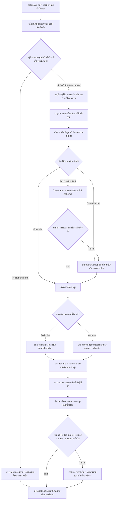

# Flow แก้ปัญหา Format กลางหลังผล R70 — R71

วันที่: 16 ตุลาคม 2026  
สถานะ: แผนก่อนลงมือ — ยังไม่ได้แก้โค้ดธุรกิจหรือรันทดสอบคำถามใหม่ในรอบนี้

## 1. เป้าหมายของงาน

ให้แชทตอบความต้องการของผู้ใช้จากข้อมูลศูนย์ที่มีอยู่ได้ครบขึ้น ทั้งไทย อังกฤษ คำถามหลายสำนวน พิมพ์ผิด และถามต่อ พร้อมรองรับการเพิ่ม/แก้ข้อมูลผ่าน Format กลางโดยไม่ต้องเพิ่มเงื่อนไขจับคำถามทีละรายการ

คำว่า “ตอบดีขึ้น” ในแผนนี้ต้องดูอย่างน้อยสี่อย่างร่วมกัน:

1. เลือกเรื่องและรายการถูก เช่น วิธีจ่าย ไม่เลือกเส้นตายชำระแทน
2. ตอบส่วนที่ผู้ใช้ขอครบ รวมเงื่อนไขสำคัญและข้อยกเว้นที่มีหลักฐาน
3. ระบุข้อมูลที่ยังไม่ทราบ/หมดช่วงมีผล/ขัดกันตามจริง
4. ใช้งานได้เมื่อข้อมูลใหม่ถูกเพิ่มหรือข้อมูลเดิมเปลี่ยน โดยไม่ตอบค่าที่เก็บในประวัติเก่าแทนค่าปัจจุบัน

ขอบเขตเนื้อหาคือ PSU Esports Studio - Phuket เกม อุปกรณ์ การใช้บริการ การจอง ราคา กฎศูนย์ และการแข่งขันตามข้อมูลที่มี ส่วนคำถามทั่วไปนอกขอบเขต เช่น เมนูอาหารเย็นหรือผลกีฬา ไม่ต้องขยายระบบให้ตอบได้

### ข้อกำหนดที่ใช้ตลอดแผน

- ใช้ข้อเท็จจริงจาก Format กลางของ snapshot ที่เลือก และตัวเชื่อมข้อมูลสดที่มีหน้าที่ตรงกัน เมื่อค้นไม่พบต้องเก็บเหตุผล ไม่ย้อนกลับไปตอบจาก FAQ/ราคา/RAG ฐานเดิมอย่างเงียบ ๆ
- ใช้ตัวช่วยทั่วไปของโค้ดเดิมได้ เช่น ตรวจภาษาและสะกดผิด โดยไม่ดึงคำตอบธุรกิจจากอีกฐานมาปิดช่องว่างของฐานกลาง
- แยกเรื่องนอกขอบเขตออกจากเรื่องของศูนย์ที่ยังไม่มีข้อเท็จจริง เช่น การติดตั้ง mod เป็นเรื่องเกี่ยวกับการใช้ศูนย์ที่อาจต้องตอบว่ายังไม่ยืนยัน
- การเพิ่มชื่อเรียกเป็นส่วนประกอบของการระบุตัวตน ไม่ใช้ alias รายประโยคเป็นกลไกหลักในการแก้ปัญหา

## 2. หลักฐานตั้งต้นและวิธีอ่านคะแนน

หลักฐานที่ใช้:

- [รายงาน R70](C:/Users/Chokhun/Documents/Codex/2026-09-25/psu-esports-studio-phuket-chatbot-c-2/r70_half_common_llm_20261016/REPORT_FINAL_TH.md)
- [ผลรวมแบบแยกประเภท](C:/Users/Chokhun/Documents/Codex/2026-09-25/psu-esports-studio-phuket-chatbot-c-2/r70_half_common_llm_20261016/ANALYSIS_FINAL.json)
- [กรณีที่ตรวจย้อนกับฐานแล้ว](C:/Users/Chokhun/Documents/Codex/2026-09-25/psu-esports-studio-phuket-chatbot-c-2/r70_half_common_llm_20261016/VERIFIED_FAILURE_ANALYSIS_R70_TH.md)
- [คำถาม คำตอบ แผน และแหล่งข้อมูลตัวอย่าง](C:/Users/Chokhun/Documents/Codex/2026-09-25/psu-esports-studio-phuket-chatbot-c-2/r70_half_common_llm_20261016/FAILURE_SAMPLES_FINAL.json)
- [การตรวจ candidate ของคำถามกฎศูนย์](C:/Users/Chokhun/Documents/Codex/2026-09-25/psu-esports-studio-phuket-chatbot-c-2/r70_half_common_llm_20261016/EXISTING_FAILURE_RETRIEVAL_INSPECTION.json)

| สิ่งที่ R70 ยืนยันได้ | จำนวน/สถานะ | ผลต่อแผน |
|---|---:|---|
| คำถามที่รัน | 10,277 | ใช้ผลเดิมวิเคราะห์ก่อนเลือกข้อทดสอบเฉพาะจุด |
| เกณฑ์ทั้งหมดที่ผูกกับคำถาม | 27,923 | แยกหน่วยคำถามออกจากหน่วยเกณฑ์ |
| ผ่านทุกเกณฑ์ของคำถามนั้น | 848/10,277 | ยังรวมข้อกำหนดจากรูปแบบเก่า จึงไม่ใช่คะแนนเนื้อหาล้วน |
| คำถามที่มีข้อความบังคับและผ่านครบ | 2,843/4,455 = 63.82% | เป็นตัวชี้วัดที่มีประโยชน์ แต่ไม่ครอบคลุมทุกคำถาม |
| ไม่ผ่านเฉพาะ protocol | 14,935 เกณฑ์ | ต้องแก้ความเข้ากันได้ของการวัด แยกจากแก้เนื้อหา |
| HTTP ไปโมเดล | 253 ครั้ง สำเร็จ 0 | ยังพิสูจน์ผลของ LLM ที่ทำงานจริงไม่ได้ |
| model schema accepted | 0 | ยังไม่มีหลักฐานว่าโมเดลเสนอแผนถูก/ผิดในรอบนี้ |
| คำตอบขอรายละเอียด | 3,261 คำถาม | ต้องแยกถามเพิ่มโดยจำเป็นออกจากค้นข้อมูลที่มีไม่เจอ |
| not_current | 574 คำถาม | ตรวจว่าเป็นการกันข้อมูลหมดอายุที่ถูกต้อง หรือเลือกช่วงเวลาผิด |
| live unavailable | 534 คำถาม | เป็นผลภายใต้ fixture ไม่ใช่จำนวนสถานะจองจริงผิด |
| อังกฤษที่มีอักขระไทย | 508 คำถาม | เป็น flags รวมชื่อเฉพาะ หน่วย และข้อความสถานะ ไม่ใช่ 508 คำแปลผิด |
| exception / คำตอบว่าง | 0 / 0 | ความเสถียรของรอบนี้ผ่าน ไม่ได้แปลว่าเลือกคำตอบถูกทุกข้อ |

เปอร์เซ็นต์ผ่าน literal ไม่ใช่ความถูกต้องทุกประโยค ส่วนคะแนน protocol ไม่ผ่านไม่ได้พิสูจน์ว่าเนื้อหาผิดเอง ประเภทข้อผิดพลาดหนึ่งเกณฑ์อาจซ้อนหลายประเภท จึงห้ามบวกจำนวนประเภทแล้วเรียกว่าเป็นจำนวนคำถามผิด

## 3. สาเหตุหลักและลำดับความสำคัญ

| กลุ่ม | สิ่งที่พบ | สาเหตุที่ยืนยันแล้ว/ยังต้องตรวจ | แนวทางหลัก |
|---|---|---|---|
| P0 การวัดผล | คำตอบอาหาร/เครื่องดื่มตรง แต่ชื่อ route ต่าง | เกณฑ์ยังคาด category แบบเดิม | เก็บคะแนนเดิม และเพิ่มตัวตรวจ semantic task/source ที่เป็นอิสระ |
| P0 โมเดล | ON แต่ transport ไม่ผ่าน | มีข้อจำกัด socket; ยังไม่ใช่หลักฐานว่าโมเดลช้าหรือไม่เก่ง | ตรวจ runtime/endpoint/สิทธิ์/actual generation แยกกัน |
| P0 ข้อมูลหมดอายุและนโยบาย | ราคาเก่าถูกปฏิเสธ; ข้อความบางนโยบายต่างภาษาไม่ตรง | บางส่วนเป็นช่องว่างข้อเท็จจริงที่ระบบห้ามเดา | คงการกันข้อมูลเก่า ปรับการเลือกวันและข้อความอธิบาย; แยกคำถามเจ้าของ |
| P1 ตัวตนข้อมูล | Ragnarök เลือกระเบียน genre=unknown ขณะที่อีกระเบียนมี genre | ข้อมูลกระจายตามชื่อ/รหัสจากหลายต้นทาง | เชื่อมตัวตนด้วยหลักฐานก่อนรวมอ่านรายช่อง |
| P1 ความต้องการ | How do I pay เลือก FAQ 10 นาที | หัวข้อใกล้กันถูกใช้แทนกัน และการตรวจครอบคลุมยังไม่พอ | กำหนดสิ่งที่คำตอบต้องตอบก่อนเลือกระเบียน |
| P1 การค้น | ถามกฎศูนย์พร้อมคำเกริ่น ไม่เจอ FAQ ที่มี | candidate มีแต่เกม/การชำระ; FAQ เป้าหมายไม่เข้า candidate | ค้นจากคำขอจริง ชนิดข้อมูล และหัวข้อร่วมกัน |
| P1 หลายส่วน/ทั้งหมวด | คำถามผสมหรือสรุปกฎเลือกบางส่วน | ต้องตรวจเพิ่มรายกรณีตาม trace | ทำรายการสิ่งที่ต้องตอบและสถานะครอบคลุมแต่ละส่วน |
| P1 กติกาการแข่งขัน | บางข้อไม่เจอ topic; source ID ไม่ตรงตัวตรวจเก่า | มีทั้งการเลือกข้อกฎและการเทียบรหัสหลักฐาน | ล็อกเกม/ฉบับกฎ และเชื่อม lineage ของหลักฐาน |
| P2 ภาษาและรูปแบบ | retry สองภาษา; ชื่อบริการ EN มีหน่วยไทย | template และช่อง localized text ยังไม่สม่ำเสมอ | เลือกข้อความตาม locale และตรวจชื่อเฉพาะแยกจากประโยค |
| P2 ประวัติ/ข้อมูลแก้ใหม่ | R70 ทุกคำถามเริ่ม history ว่าง | ยังไม่มีผลรอบใหญ่รับรองการถามต่อ | ตรวจ state, การเปลี่ยนหัวข้อ และ epoch หลังแก้ข้อมูล |

P0 ของการวัดผลต้องทำก่อนใช้คะแนนตัดสินการแก้ ส่วนงานแก้คำตอบที่มีผลต่อผู้ใช้จริงให้เริ่มจากตัวตนข้อมูล ความต้องการของคำถาม และการค้น ไม่ต้องรอให้ทุกนโยบายได้รับคำตอบจากเจ้าของก่อนจึงเริ่มงานเทคนิค

## 4. Flow เป้าหมายเมื่อระบบทำงานจริง



คำถามเดียวอาจมีทั้งข้อเท็จจริงและสถานะสด ต้องแยกแต่ละส่วนแล้วรวมผล ไม่บังคับคำถามผสมทั้งประโยคให้เป็นเส้นทางเดียว

---

## Step S00 — เก็บจุดตั้งต้นและเตรียมพื้นที่แก้

**เป้าหมาย:** เปรียบเทียบการเปลี่ยนแปลงได้ และไม่ทับงานเดิม

### ขั้นตอน

1. ตรวจสถานะปัจจุบันของโฟลเดอร์ R69 อีกครั้งก่อนลงมือจริง อย่าใช้ hash เก่าตัดสินว่าข้อมูลปัจจุบันยังเหมือนเดิมเสมอ
2. เก็บ hash ของโค้ด ฐานข้อมูล registry การตั้งค่า และตัวทดสอบ พร้อมวันที่และ build ID
3. ถ้ามีงานที่ยังไม่บันทึกใน Git ให้บันทึกรายชื่อไว้และคงไฟล์นั้น ห้าม reset/clean/stash โดยอัตโนมัติ
4. สร้างพื้นที่ working แยกจาก R69 และ R70 แล้วสำรอง SQLite ด้วยกลไก backup ที่สอดคล้องกัน ไม่คัดไฟล์ฐานระหว่างมี WAL โดยละ sidecar
5. รันโดยใช้ฐานและ log ในพื้นที่ใหม่ทุกครั้ง ชื่อผลต้องมีรอบ/เวลา ไม่ใช้ชื่อไฟล์เดิมทับผลเก่า
6. เก็บแผนย้อนกลับ: โค้ดรุ่นใดอ่าน schema รุ่นใดได้ ฐานตั้งต้นอยู่ไหน และหยุด/เปิดกลับรุ่นเดิมอย่างไร

**ผลส่งมอบ:** baseline manifest, config manifest, สำเนาทำงาน และรายการไฟล์ที่ต้องรักษา

**ผ่านเมื่อ:** สำเนาเทียบเนื้อหาทุกตารางตรงกับฐานที่เลือก และมีวิธีย้อนกลับโดยไม่ทำลาย revision ใหม่ของเจ้าของ

## Step S01 — ทำทะเบียนข้อผิดพลาดและแก้การอ่านคะแนน

**เป้าหมาย:** ระบุว่าต้องแก้อะไรจริงก่อนใช้คะแนนเป็นเป้าหมาย

### ขั้นตอน

1. อ่านผล R70 เดิม ไม่รันคำถามเดิมทั้งหมดซ้ำเพื่อค้นสาเหตุ
2. หนึ่งแถวในทะเบียนปัญหาต้องเก็บ request key, คำถาม/locale, คำตอบจริง, expected ที่อ้างแหล่งได้, record/field/revision, trace และเหตุผลที่ไม่ผ่าน
3. แยกอย่างน้อย: protocol, outcome, evidence identifier, เนื้อหาขาด/เกิน/ผิด, วันที่และความถูกต้องปัจจุบัน, ภาษา, model transport, performance และข้อผิดพลาดของ grader
4. กำหนดสถานะของสาเหตุ: ตรวจยืนยันแล้ว / มีหลักฐานสนับสนุนแต่ยังไม่ยืนยัน / ต้องใช้ข้อมูลเพิ่ม ห้ามยกระดับข้อสันนิษฐานเป็นสาเหตุจริง
5. สำหรับ protocol สร้างผลตรวจเสริมจาก task ที่ทำจริง ชนิดข้อมูล และหลักฐานที่เลือก โดยไม่อ่าน expected category มาเป็นคำตอบของตัวตรวจ
6. สำหรับ source ID สร้างแผนผัง common record → field → source locator → ต้นทางเดิม ตรวจข้อความ/เวอร์ชันประกอบ ไม่ปลอม hit ID ให้เหมือนรหัสที่ oracle คาด
7. คงคะแนนดั้งเดิมทุกตัว เพิ่มคะแนนเสริมแยกชื่อและ version ให้เห็นผลทั้งสองชุด
8. เกณฑ์ข้อความต้องตรวจตัวเลข หน่วย เงื่อนไข และขอบเขต ห้ามผ่านเพียงมีชื่อเกมหรือไม่มีคำว่า Local LLM
9. ข้อที่คาดราคาเก่าหรือคาดคำตอบนอกขอบเขตปัจจุบันให้ติดป้าย oracle ต้องตรวจ เทียบหลักฐานก่อนเปลี่ยน expected และเก็บเหตุผลของการแก้ oracle

**ผลส่งมอบ:** issue ledger, taxonomy, แผนผัง provenance และ test contract version ใหม่ที่อยู่แยกจากเกณฑ์เดิม

**ผ่านเมื่อ:** แยกกรณีเครื่องดื่มที่ผิดเฉพาะชื่อ route ออกจากกรณีวิธีจ่ายที่เลือกข้อมูลผิดได้ และทุกการปรับ expected มีหลักฐานตรวจย้อน

## Step S02 — ตรวจการเชื่อมต่อและการใช้ LLM จริง

**เป้าหมาย:** แยกโมเดลไม่พร้อมออกจากความผิดพลาดของการค้น/แผน/คำตอบ

### ขั้นตอน

1. ตรวจค่า runtime จริง: endpoint, ชื่อโมเดล, model gate, จำนวนงานร่วมกัน, timeout และเหตุผลของ circuit breaker
2. แยกผลทีละชั้น: process/runtime มีอยู่ → endpoint เข้าถึงได้ → โมเดลที่ต้องใช้มีอยู่ → generate สำเร็จ → ได้ JSON ตาม schema → เลือก task ถูก → คำตอบครบ
3. บันทึก error code และเวลาที่ใช้จริง เช่น WinError 10013 เป็นข้อจำกัดสิทธิ์ ไม่สรุปว่าโมเดลช้าเพราะข้อความ retry พูดว่าไม่ทัน
4. หากต้องขอสิทธิ์ ให้ขอผ่านกลไกสิทธิ์ของระบบ ห้ามสร้าง scheduled task หรือใช้ช่องทางอื่นเพื่อหลบข้อจำกัด
5. ถ้ายังเข้าถึงไม่ได้ ให้ระบุ blocked สำหรับการรับรอง LLM จริง และทำขั้นที่ไม่พึ่งโมเดลต่อได้
6. เมื่อเข้าถึงได้ ตรวจ actual generation ที่ใช้ในงานจริง ทั้งการเลือก entity และ field ภาษาไทย/อังกฤษ ไม่ใช้เพียง GET health หรือคำทักทายเป็นหลักฐานว่าเข้าใจคำถามถูก
7. ใช้การยอมรับงานโมเดลร่วมกันตามขีดจำกัดเดิม ปรับ concurrency จากผลวัดภายหลัง ไม่เพิ่มจำนวนเรียกเพื่อแก้ socket denial
8. รักษาโหมด ON ของชุดทดสอบนี้ กรณีจำลอง transport ล้มเหลวให้ระบุว่า ON-with-transport-failure และไม่นับเป็น inference สำเร็จ

**ผลส่งมอบ:** health report ที่แยกชั้น และผล actual entity/field selection เมื่อทำได้

**ผ่านเมื่อ:** มีหลักฐาน actual generation และ schema ผ่านสำหรับเส้นทางที่ใช้จริง หาก transport ยังถูกบล็อก ห้ามปิดรายการนี้ว่าเสร็จ

## Step S03 — เก็บเหตุผลการตัดสินใจให้ครบทุกทางออก

**เป้าหมาย:** ไม่ทำให้เหตุผลหายเมื่อ CommonAnswerer คืน None หรือขอรายละเอียด

### ขั้นตอน

1. เก็บ original question, search variants, request needs, entity candidates, topic candidates, filters และเหตุผลที่คัดทิ้ง
2. เก็บ candidate ที่ถูกต้องหลุดที่จุดใด: ไม่ถูกสร้าง / อันดับต่ำ / ถูกตัดด้วย scope / โมเดลไม่พร้อม / โมเดลเลือกผิด / แผนถูกปฏิเสธ / renderer ทำตก
3. เก็บ model attempt, transport, parsing, schema และ semantic guard แยกกัน การไม่มี audit ต้องไม่ถูกตีความว่าโมเดลเลือกถูก
4. แยกผลตรวจ structure_valid, evidence_valid, task_coverage และ answer_outcome ออกจากกัน คำตอบขอรายละเอียดอาจมีโครงสร้างถูก แต่ยังไม่ใช่ task ที่ตอบครบ
5. บันทึก source ID, locator, revision/hash, query time, release/epoch และสถานะร่างของคำตอบ
6. ใช้ reason code เช่น no_candidate, entity_ambiguous, fact_unknown, fact_expired, policy_conflict, model_unavailable, unsupported_scope และ partial_coverage
7. อย่าแสดงข้อความภายใน เช่น schema key, trace หรือคะแนน candidate บนหน้าแชทปกติ ใช้ข้อความที่ผู้ใช้เข้าใจตาม locale
8. คะแนน lexical/อันดับไม่ใช่โอกาสตอบถูก ต้องระบุเป็นคะแนนที่ยังไม่ calibrate ไม่แสดง 0.8 เป็นความถูกต้อง 80%

**ผลส่งมอบ:** diagnostic contract และตัวอย่าง trace สำหรับ answer/partial/clarification/unknown/retry/unavailable

**ผ่านเมื่อ:** กรณี “กฎศูนย์” ระบุได้ว่า FAQ เป้าหมายไม่เข้า candidate แม้ไม่มีการเรียก LLM และไม่สูญเสียเหตุผลเมื่อคืน None

## Step S04 — ทำให้ข้อมูลกลางบอกความหมายของข้อมูลได้

**เป้าหมาย:** เพิ่มข้อมูลใหม่แล้วค้นและเลือกช่องได้โดยไม่เพิ่ม code branch ตามรหัสรายการ

### ขั้นตอน

1. ตรวจ 24 หมวดของ registry และ 21 หมวดที่มีข้อมูลจริง แยกข้อมูลข้อเท็จจริงออกจาก metadata สำหรับค้น
2. ชื่อแสดงและคำถามตัวอย่างต้องเป็นภาษาคน เช่น “กฎทั่วไปในการใช้ศูนย์” รหัส studio_rules_summary คงเป็นรหัสภายใน ไม่ใช้แทนชื่อแสดงหลัก
3. กำหนด semantic role ของข้อมูลที่ต้องแยก เช่น วิธีชำระ/บัญชี/เส้นตายชำระ/จำนวน session/การจอง/เช็กอิน โดยอิงช่อง schema และ intent metadata เดิม
4. เก็บ role/scope/relations ในรูปแบบที่มี version และที่มาของการอนุมาน ไม่ทำเป็นรายการคำถามเฉพาะหลายร้อยประโยค
5. metadata ที่สร้างด้วย LLM เป็นข้อเสนอ ต้องผ่าน validation; ห้ามสร้างค่าราคา นโยบาย วันที่ หรือความเข้ากันได้ของอุปกรณ์เพิ่มตาม metadata
6. เจ้าของเห็นแบบฟอร์มชื่อหมวด ช่องข้อมูล ตัวอย่าง และตัวเลือกอ่านรู้เรื่อง รหัสรายการสร้างให้อัตโนมัติและคงเดิมเมื่อแก้ข้อมูล
7. การเพิ่ม field/metadata ต้องปรับ registry, template, validator, owner form, reader และ release builder ให้ตรง schema version เดียวกัน
8. ข้อมูลเดิมย้ายด้วย revision ใหม่และ lineage ไม่เขียนทับ immutable sources หรือทำให้ agent translation กลายเป็น owner-reviewed
9. หมวดที่ยังไม่มีข้อมูลจริง เช่น game_mode/news/live_binding ให้คงว่าง ตัวอย่างฝึกกรอกอยู่ในฐาน fixture แยก
10. การเพิ่มเกมต้องแยกข้อมูลตัวเกมจากการให้บริการจริง หากเจ้าของระบุเฉพาะเกมรองรับ PS5 ยังห้ามสร้าง game_service ว่าศูนย์ติดตั้งหรือเปิดให้เล่นแล้ว ฟอร์มต้องอธิบายข้อมูลสองส่วนนี้

**ผลส่งมอบ:** แผนที่ schema → ความหมาย → คำอธิบายช่อง → relations และแผน migration ที่ตรวจย้อนทุกค่าได้

**ผ่านเมื่อ:** เพิ่ม FAQ ใหม่ที่มีชื่อ/คำอธิบาย/คำตอบ/หัวข้อครบแล้วอ่านได้ โดยไม่ต้องเพิ่มรหัส FAQ นั้นใน router

## Step S05 — เชื่อมตัวตนของระเบียนก่อนอ่านรวม

**เป้าหมาย:** เลือกข้อมูลของสิ่งเดียวกันจากหลายต้นทาง โดยคงคนละภาค/คนละรุ่น/คนละแพลตฟอร์มแยกกัน

### ขั้นตอน

1. สำรวจ entity ซ้ำหรือข้อมูลกระจายจากทุก kind ที่เกี่ยวข้อง โดยเริ่มจากตัวอย่าง Ragnarök/Ragnarok และ FAQ ชำระเงิน
2. สร้าง proposal ที่แสดงรหัสเดิม ชื่อ ต้นทาง edition/platform รุ่น วันที่ และความสัมพันธ์กับบริการ ไม่ตัดสินจากความคล้ายของชื่ออย่างเดียว
3. จัดเป็น same-entity ที่มีหลักฐาน / ชื่อใกล้กันแต่คนละรายการ / ยังไม่แน่ใจ
4. เริ่มด้วย manifest ความสัมพันธ์ที่มี version/hash และหลักฐาน ไม่ลบระเบียนหรือเปลี่ยน stable ID ของเจ้าของ
5. การอ่านรวมต้องเลือกเป็นราย field พร้อม origin_record_id/revision ไม่เอาค่าของทุกระเบียนมาผสมจนข้อเท็จจริงขัดกันถูกซ่อน
6. ค่าที่มีหลักฐานและอยู่ใน scope/ช่วงเวลาตรงกันจึงอ่านผ่านตัวตนเดียวกันได้ ถ้ามี known สองค่าต่างกัน ให้แสดง conflict หรือขอข้อมูล ไม่เลือกค่าที่ช่วยให้ข้อสอบผ่าน
7. เมื่อใช้ manifest ใน release ต้องเก็บความสัมพันธ์ไว้ใน release นั้นและตรวจ hash กับ snapshot ไม่ใช้แผนผังเก่าครอบฐานที่เจ้าของแก้ใหม่
8. การทำ Unicode normalization ต้องรักษาตัวเลข รุ่น ภาค และเครื่องหมายที่มีความหมาย ห้ามลบสระ/วรรณยุกต์ไทยทั่วข้อความหรือรวมทุกชื่อที่สะกดคล้ายกัน
9. ตรวจรายการเกมที่ให้บริการ game_service และตัวเลือกจองด้วย ไม่ให้การเชื่อมตัวตนทำให้เกิดการประกาศว่าเกมที่มีข้อมูลเท่ากับเกมที่ติดตั้ง/ว่างจริง
10. ตรวจลำดับอำนาจของ field ก่อนอ่านรวม ค่า unknown ที่เกิดจากการย้ายไม่ครบต่างจากการที่เจ้าของถอน/ไม่รับรองค่านั้นในฉบับใหม่ หากไม่รู้เหตุผลของ unknown ต้องไม่ใช้ known จากแหล่งเก่ามาทับเงียบ ๆ ให้เก็บเป็นกรณีตรวจเพิ่ม
11. การแก้ข้อมูลใหม่ของเจ้าของ การถอน และความขัดกันต้องมีผลตาม profile/release ที่ใช้ แหล่งที่สังเกตทีหลังไม่เท่ากับมีอำนาจหรือมีผลปัจจุบันมากกว่าเสมอ จึงห้ามใช้กฎ latest-write-wins ทั่วทั้งฐาน

**ผลส่งมอบ:** identity proposals, accepted links พร้อม lineage, conflicts และรายงานผลต่อการค้น/รายการที่ให้บริการ

**ผ่านเมื่อ:** ถ้ามีหลักฐานว่า Ragnarök/Ragnarok เป็นเกมเดียวกัน คำถาม genre อ่าน Action-Adventure จากระเบียนต้นทางที่ระบุได้ และการถามภาค/แพลตฟอร์มอื่นไม่ถูกลากมารวม

## Step S06 — ระบุสิ่งที่ผู้ใช้ขอก่อนเลือกคำตอบ

**เป้าหมาย:** ไม่ให้ FAQ ที่พบเป็นตัวกำหนดความหมายของคำถามย้อนหลัง

### โครงสร้างที่เสนอ — ยังไม่ใช่ schema ที่ติดตั้งแล้ว

```json
{
  "needs": [
    {
      "id": "n1",
      "source_span": "How do I pay for my booking?",
      "operation": "payment_method",
      "entity_constraints": {"venue": "psu_phuket"},
      "required_information": ["payment_channel", "account_details", "slip_submission"],
      "scope": "requested_topic",
      "resolution": "supported"
    }
  ],
  "excluded_operations": [],
  "unresolved_spans": []
}
```

ชื่อ payment_channel/account_details เป็นความหมายเชิงงานที่ต้อง map ไปยังช่องหรือ FAQ ที่มีจริง ไม่สมมุติว่าฐานปัจจุบันมี field เหล่านี้ครบแล้ว

### ขั้นตอน

1. เก็บข้อความต้นฉบับเสมอ สร้างข้อความสำหรับค้นแยกออกมา
   - ก่อนค้น ให้แยกคำขอนอกขอบเขตที่ชัดเจนออกจากคำถามของศูนย์ที่ข้อมูลยังไม่ทราบ
   - ตัวอย่าง ตารางผล NBA เป็นคนละงานกับถามว่ามีเกม NBA 2K ให้เล่นหรือไม่ ต้องไม่ห้ามด้วยคำว่า NBA เพียงคำเดียว
2. แยกคำเกริ่นและคำสุภาพเฉพาะที่ไม่เปลี่ยนความหมาย โดยคงคำปฏิเสธ ตัวเลข หน่วย วันที่ เงื่อนไข และชื่ออุปกรณ์
3. การแก้พิมพ์ผิดสร้างเป็น query variant ที่มีเหตุผลและขอบเขต ไม่เขียนทับคำถามเดิมหรือแก้ราคา/วันที่/PC1 เป็น PC2
4. แยก operation, entities, attributes, conditions และ scope ว่าถามเฉพาะเรื่อง/ขอสรุป/ขอทั้งหมด
5. แยกหลายความต้องการและส่วนที่ผู้ใช้บอกว่าไม่ต้องการ ต้องเก็บ source span ของแต่ละ need
6. ตัวอย่าง “จ่ายยังไง” ต้องการวิธีชำระ ส่วน “จ่ายภายในกี่นาที” ต้องการ deadline; “จ่ายยังไงและภายในกี่นาที” ต้องได้ทั้งสองส่วน
7. “How many sessions can one booking include?” ต้องระบุว่าถาม quota ไม่ใช้ขั้นตอนจองแทนเพียงเพราะมีคำ booking
8. ถาม “มีเกมอะไร” ต้องเป็นรายการเกมที่ศูนย์ให้บริการ ถาม “เกมรองรับอะไร” เป็น platform support และถาม “ตอนนี้ว่างไหม” เป็น live state
9. ถ้าคำว่า free หรือคำสั้นอื่นตีความได้หลายเรื่อง ให้ใช้บริบทที่เข้ากันได้ หรือถามแยกความหมายโดยไม่เดา
10. เมื่อยังมี unresolved need ให้คงไว้ในแผน ห้ามลบทิ้งเพราะตัว parser รู้จักอีกส่วนหนึ่งมากกว่า

**ผลส่งมอบ:** request-needs contract ที่สร้างก่อน content selection และตัวเชื่อมไป schema จริง

**ผ่านเมื่อ:** เปลี่ยนสำนวน/สลับลำดับ/เพิ่มคำเกริ่นแล้ว needs ที่สำคัญยังเหมือนเดิม และเพิ่มคำปฏิเสธหรือเปลี่ยนเลขแล้วแผนเปลี่ยนตามความหมายจริง

## Step S07 — ปรับการค้นและจัดอันดับ candidate

**เป้าหมาย:** ให้ข้อมูลที่ตอบได้เข้า candidate ก่อนให้ตัวเลือกหรือ LLM ตัดสินใจ

### ขั้นตอน

1. สร้างดัชนีจากชื่อภาษาคน หัวข้อ semantic role ช่องข้อมูล และ relations เก็บต้นฉบับเต็มไว้สำหรับตอบ
2. ใช้ทั้งคำถามต้นฉบับและข้อความคำขอที่ตัดคำเกริ่นอย่างตรวจสอบได้ ไม่ทิ้งทางค้นเดิมทั้งหมด
3. ค้นหลายทาง: exact entity ที่ยืนยันแล้ว, topic/role/field ที่ตรง, คำและคำใกล้เคียง และ character grams สำหรับสะกดผิด
4. รวม candidate ด้วย stable identity และเก็บคะแนน/เหตุผลแต่ละทาง ไม่ให้ข้อความเกมยาวที่บังเอิญมีคำเกริ่นแย่ง FAQ หัวข้อที่ตรง
5. แยก candidate ของ entity, topic และ field การไม่รู้ชื่อ entity ไม่ควรทำให้คำถาม “กฎศูนย์มีอะไรบ้าง” หาเนื้อหาไม่ได้
6. จัดสรร candidate ให้ทุก need มีโอกาสได้หลักฐาน ไม่จำกัด top-k เดียวของทั้งประโยคจนคำถามส่วนหลังหาย
7. รักษา topic guard ที่กันข้อมูลไม่เกี่ยวข้อง ปรับคุณภาพ candidate ก่อนพิจารณาผ่อน guard
8. หาก candidate ถูกต้องไม่เข้า ให้แก้ index/query/scope ก่อน ไม่แก้ด้วย prompt ที่สั่งให้โมเดลตอบจาก candidate ที่ไม่มีคำตอบ
9. พิจารณาการค้นเชิงความหมายเพิ่มเติมเมื่อวิธีข้างต้นยังมีช่องว่างและเข้าถึง embedding runtime ได้ วัดผลเพิ่มจริงและมีทางทำงานเมื่อโมเดลไม่พร้อม ไม่บังคับติดตั้งโมเดลใหม่เป็นขั้นแรก
10. ทุกการแก้เพิ่มชื่อเรียกต้องมีตัวตนที่ตรวจได้ การเพิ่ม alias รายประโยคไม่ใช่แนวทางหลักของขั้นนี้
11. ตรวจการตัดข้อความใน index และข้อความที่ส่งให้โมเดล ตัวค้นเดิมมีการจำกัดความยาวข้อความ จึงต้องมีกรณีที่คำตอบ/เงื่อนไขอยู่ท้าย field ยาว ใช้ field chunks และ excerpt ที่เกี่ยวข้อง แทนการอ่านเฉพาะหัวข้อความ แล้วประกอบคำตอบจาก source เต็ม
12. วัดว่า target เข้า candidate ภายใต้งบจำนวน/เวลาเท่าไร พร้อมวัดการเลือกข้อมูลไม่เกี่ยวข้อง การส่งทั้ง 602 รายการให้โมเดลไม่ถือเป็นการแก้ retrieval ที่ผ่านเกณฑ์ของขั้นนี้

**ผลส่งมอบ:** candidate traces แยก need, retrieval fixture และผลวัด target-in-candidates

**ผ่านเมื่อ:** FAQ กฎศูนย์และข้อมูลบัญชีเข้า candidate ที่ตรวจต่อได้ในคำถามตัวอย่าง พร้อมมี negative cases ที่เกม/กฎคนละเรื่องยังถูกคัดออก

## Step S08 — ให้ LLM เสนอแผน และตรวจว่าตอบสิ่งที่ถามจริง

**เป้าหมาย:** ใช้โมเดลช่วยเข้าใจสำนวน โดยยังอ่านข้อเท็จจริงจากฐานที่มีหลักฐาน

### ขั้นตอน

1. เมื่อ typed plan ชัดเจน ใช้การอ่านตรงได้ โดยยังคง flag LLM เป็น ON ไม่จำเป็นต้องให้ทุกคำถามเรียกโมเดล
2. เมื่อมีความกำกวม ส่งเฉพาะ needs, schema descriptions, candidate IDs, role/scope และข้อความที่จำเป็นให้โมเดล
3. โมเดลเสนอ record/field/ความสัมพันธ์หรือขอ clarification ได้ ไม่ส่ง SQL ไม่อนุมัติข้อมูล และไม่สร้างค่าราคา/นโยบายเอง
4. ตรวจ shape, IDs, field kinds, references, limits และการไม่มีค่าที่แต่งขึ้นก่อน
5. ตรวจ semantic compatibility ต่อ: payment_method ไม่ถูกแทนด้วย payment_deadline; live availability ไม่ถูกแทนด้วยจำนวนเครื่อง; venue game availability ไม่ถูกแทนด้วย platform support
6. อย่าใช้เพียง “schema ผ่าน” เป็น proof ว่าเข้าใจคำถามถูก และอย่าใช้คำตอบที่เลือกแล้วสร้าง needs กลับมาเพื่อให้ดูว่าครบ
7. สำหรับสำนวนใหม่ที่ typed parser ยังไม่รู้จัก ให้เก็บเป็น model-proposed พร้อมหลักฐาน source span และตรวจความหมายกับ capabilities ของ candidate อย่าอัตโนมัติตัด field ที่ถูกทิ้งเพียงเพราะไม่มีคำตรงใน parser เดิม
8. ถ้าตรวจยังไม่พอ ให้ถามชี้แจงเฉพาะส่วนที่กำกวม ไม่ขยายทุกคำถามให้ตอบกว้างหรืออนุญาต all_fields โดยไม่ร้องขอ
9. จำกัดจำนวน attempt และงบเวลารวม ไม่วนเรียกโมเดลหลายรอบเพื่อให้ได้คำตอบที่ grader ยอมรับ
10. ถ้าโมเดลไม่พร้อม ให้แยกข้อความ “ยังตีความส่วนนี้ไม่ได้” จาก “ข้อมูลนี้ไม่มี” และยังตอบ need อื่นที่ยืนยันได้อย่างชัดเจนได้

**ผลส่งมอบ:** validated plan พร้อมรายการ needs ที่ตอบได้/ยังไม่ชัด และเหตุผลของแผนที่ถูกปฏิเสธ

**ผ่านเมื่อ:** แผนที่เลือก deadline อย่างเดียวในคำถามวิธีจ่ายถูกปฏิเสธว่าไม่ครบ และแผนใหม่ที่ตรง schema แต่คนละเกม/คนละกลุ่มราคาถูกกันไว้

## Step S09 — ตรวจเวลา ราคา ความขัดกัน และแหล่งสถานะสด

**เป้าหมาย:** ไม่แก้คะแนนด้วยการนำข้อมูลที่ยังยืนยันปัจจุบันไม่ได้มาตอบเป็นข้อเท็จจริงปัจจุบัน

### ขั้นตอน

1. แยกเวลาที่ผู้ใช้ถาม วันมีผลของข้อมูล เวลาที่จับ source และเวลาที่ดึงสถานะสดออกจากกัน
2. ราคาเลือกตามบริการ/อุปกรณ์ กลุ่มผู้ใช้ ระยะเวลา แพ็กเกจ และช่วงมีผล หากขาดเงื่อนไข ให้ถามเพิ่มหรือแสดงตัวเลือกที่ระบุขอบเขตครบตามคำขอ
3. หากขอ “ทั้งหมด” ให้แสดงรายการกลุ่ม/บริการที่มีข้อมูล พร้อมสถานะของรายการที่ยังยืนยันไม่ได้ ไม่เดาว่าผู้ใช้ทุกคนเป็น General Adult
4. คำนวณจากหน่วยที่มีจริง รักษาสตางค์/บาทและจำนวนรอบ ห้ามตั้งครึ่งวัน=4 ชั่วโมง เต็มวัน=8 ชั่วโมงจากชื่อแพ็กเกจ
5. ราคาหมดอายุแล้วห้ามขยายวันสิ้นสุดเอง ค่า validity=unknown ไม่ใช่หลักฐานว่ามีผลตลอดไป
6. คำถามราคาปัจจุบันที่ข้อมูลหมดอายุให้แจ้งกระชับครั้งเดียว ไม่เทรายการราคาหมดอายุจำนวนมากเป็นคำตอบหลัก หากผู้ใช้ขอตารางเก่าให้ระบุช่วงเวลาของตารางนั้นชัดเจน
7. คำถามวันหยุดที่ไม่ได้ระบุวัน ให้แยกกฎทั่วไปกับวันปิดเฉพาะวันที่ หากจำเป็นให้ถามวันที่ก่อน ห้ามนำ closure เดือนกรกฎาคมมาแทนวันหยุดทุกวัน
8. รักษาข้อที่ผู้ใช้ยืนยันแล้ว: พักเที่ยง 12:00–13:00 ไม่เปิดให้จอง และ VR 30 นาทีใช้ช่วงชั่วโมงเต็มสำหรับการกันช่อง/แสดงสถานะ ส่วนการคิดค่าบริการใช้หน่วยและอัตราที่มีหลักฐานแยกต่างหาก ไม่ต้องขออนุมัตินโยบายที่ยืนยันนี้ซ้ำ
9. สถานะว่าง/ถูกจองใช้ adapter สด โดยมี resource IDs และเวลาเทียบที่พิสูจน์ได้ unknown ต้องเป็น unknown ไม่กลายเป็นว่างหรือไม่ว่างโดยปริยาย
10. แสดง count ที่มีความหมาย: ว่าง/ทรัพยากรทั้งหมดที่ยืนยันได้ และระบุ unknown หากบางเครื่องไม่มีข้อมูล อย่าใช้ capacity จำนวนผู้เล่นเป็นจำนวนเครื่อง
11. ถ้ามีคำถามผสมราคาและสถานะ ตอบราคา/ข้อจำกัดจากฐาน และสถานะจาก API พร้อม provenance คนละส่วน
12. นโยบายที่ขัดกันให้แยก variant/เงื่อนไข รอข้อเท็จจริงเพิ่ม ไม่เลือกคำตอบจากคนละภาษาเพียงเพราะเป็นภาษาที่ผู้ใช้ถาม

**ผลส่งมอบ:** temporal/source decision และรายการ facts ที่ต้องการคำยืนยันเพิ่มเติม

**ผ่านเมื่อ:** ไม่ตอบราคาเก่าเป็นราคาปัจจุบัน การถามวันที่เจาะจงอ่านข้อมูลวันที่ถูก การดึงสดล้มเหลวไม่สร้างคำตอบว่าว่าง และคงกฎพักเที่ยง/VR ที่ยืนยันแล้ว

## Step S10 — ประกอบคำตอบให้ครบ รวมการแข่งขันและคำขอทั้งหมด

**เป้าหมาย:** ให้ความครบตรวจได้เป็นส่วน ๆ ก่อนส่งข้อความ

### ขั้นตอนทั่วไป

1. สร้าง coverage ledger: need → record/field/revision → evidence → สิ่งที่จะตอบ → สถานะ
2. สถานะต้องแยก resolved_known, unknown, expired, conflict, live_unavailable, ambiguous และ unsupported_scope
3. ส่วนที่ known ต้องมีคำตอบจริง ส่วนที่ unknown ต้องบอกขอบเขตที่ไม่ทราบ ไม่ใช้ประโยคกว้างเดียวแทนคำถามทุกส่วน
4. ตรวจว่าเนื้อหาที่เพิ่มเป็น necessary context หรือผู้ใช้ขอ ไม่แทรกขั้นตอนจองทั้งหมดเมื่อถามเพียงจำนวน session
5. หากมีข้อจำกัด/ข้อยกเว้นที่ทำให้ความหมายเปลี่ยน ต้องติดมากับข้อหลัก เช่น เวลา เงื่อนไขโทษ แพลตฟอร์ม หรือกลุ่มผู้ใช้
6. ข้อมูลที่เป็นข้อเท็จจริงในคำตอบต้องโยงกลับสู่ field/source ได้ ไม่ใช้การอ้างแหล่งท้ายข้อความก้อนเดียวกลบประโยคที่ไม่มีหลักฐาน

### กติกาการแข่งขัน

7. ระบุเกม และฉบับกติกา/รายการแข่งขันก่อนเลือกข้อย่อย หากมีหลายฉบับที่ขัดกันและเลือกไม่ได้ ให้ถามฉบับที่ต้องการ
8. แยกการถาม overview, facet เฉพาะ, ข้อความเต็ม และ metadata เช่นชื่อเอกสาร ห้ามเขียนทับ field ที่ผู้ใช้ขอด้วย rule text เสมอ
9. การถามเฉพาะเรื่องให้ค้นทั้งหัวข้อและเนื้อหาข้อกฎ ไม่ยึดชื่อหัวข้อเพียงอย่างเดียว
10. การถามกฎทั้งหมดให้กำหนด expected clause set จากฉบับที่เลือก แล้วตรวจว่าตอบครบในขอบเขตข้อมูลที่มีจริง
11. ฐานมี 104 competition_rule และ fact cards 166 รายการยังไม่ได้พิสูจน์ว่าเป็นข้อกฎที่ขาด ห้ามนำทั้งหมดมาเพิ่มเป็น facts เพื่อให้ grader เจอ ID
12. TXT ต้นฉบับภายนอกบางไฟล์เคยหาไม่พบ จึงต้องใช้คำว่า “กฎที่มีอยู่ในฐาน/ฉบับที่บันทึก” ตามขอบเขตที่ตรวจได้ ไม่รับรองว่าครบทุกบรรทัดของเอกสารที่ยังไม่มีให้เทียบ

### คำขอทั้งหมดและหลายส่วน

13. “ทั้งหมด” ต้องผูกกับ scope ที่กำลังคุย เช่น ราคาทุกบริการของบุคคลภายนอก ไม่ขยายเป็นข้อมูลทุกหมวดของศูนย์
14. ถ้าข้อความยาวเกินขีดจำกัด แบ่งเป็นตอนที่มีจำนวนรายการรวม/รายการที่แสดง/รายการที่เหลือ และ token สำหรับอ่านต่อซึ่งผูกกับ session และ snapshot
15. ห้ามตัดเงียบด้วย ellipsis หรือประกาศว่าครบทั้งที่ยังมี remaining items หากข้อมูลเปลี่ยนระหว่างอ่านต่อ ให้แจ้งและเริ่มชุดข้อมูลใหม่ที่สอดคล้องกัน
16. ย่อหรือสรุปได้ตามคำขอ แต่ข้อความที่เป็นเงื่อนไขสำคัญต้องไม่หาย และต้องแยกการสรุปจากการขอข้อความเต็ม

**ผลส่งมอบ:** answer plan, coverage ledger และคำตอบที่อ้างอิงตรวจได้

**ผ่านเมื่อ:** วิธีจ่ายมีส่วนช่องทาง/บัญชี/สลิปตามฐาน กฎไม่ปนเกมอื่น คำถามสองเรื่องมีคำตอบหรือเหตุผลของทั้งสองส่วน และ “ทั้งหมด” ไม่มีรายการตกโดยไม่แจ้ง

## Step S11 — ทำคำตอบไทย/อังกฤษและข้อความสถานะให้สม่ำเสมอ

**เป้าหมาย:** ภาษาไม่เปลี่ยน facts และข้อความภายในไม่ปนออกมาผิดภาษา

### ขั้นตอน

1. แยกข้อความระบบที่ควบคุมได้ เช่น retry, unknown, expired, unavailable, clarification และรายการอ่านต่อ ออกจากข้อความข้อมูลของเจ้าของ
2. เลือก template ตาม locale ทุกทางออก ไม่ส่งประโยคไทย/อังกฤษคู่กันเมื่อผู้ใช้เลือกภาษาเดียว
3. ตรวจช่องชื่อและหน่วยภาษาอังกฤษ เช่น 30 นาที/1 ชั่วโมง ให้มีข้อความ EN ที่เหมาะสม โดยคงค่า duration และราคาเดิม
4. เก็บ official proper names ไว้ตามหลักฐาน อนุญาตเป็นราย field/รายการ ไม่ทำ allowlist คำไทยกว้างจนประโยคผิดภาษาเล็ดลอด
5. คำแปลข้อมูลใหม่เป็นร่าง ตรวจตัวเลข หน่วย เวลา คำปฏิเสธ เงื่อนไขข้อยกเว้น และ source hash ถ้าข้อมูลต้นทางเปลี่ยนต้องทำเครื่องหมายคำแปล stale
6. ข้อความต้นทางไทย/อังกฤษขัดกันต้องแสดง conflict ตาม S09 การแปลไม่ใช่วิธีเลือกนโยบาย
7. รูปแบบตอบใช้หัวข้อ ตาราง หรือ bullet ตามข้อมูล เปรียบเทียบหลายบริการต้องเห็นว่าแต่ละแถวเป็นอะไร ไม่แสดง schema keys เป็นข้อความอธิบายหลัก
8. ตัวตรวจภาษาแยกอักษรไทยในชื่อเฉพาะออกจากประโยค/หน่วยที่ยังไม่ได้แปล พร้อมตัวอย่างตรวจย้อน ไม่เปลี่ยนทุก flag ให้ผ่านด้วย allowlist ทั้งคำตอบ

**ผลส่งมอบ:** localized templates, label repairs แบบมี revision และผลตรวจภาษาแยกประเภท

**ผ่านเมื่อ:** retry ภาษาอังกฤษไม่มีประโยคไทยปน หน่วยของชื่อบริการอ่านได้เป็นอังกฤษ และชื่อกิจกรรมต้นฉบับไม่ถูกแปลแต่งขึ้นเอง

## Step S12 — ประวัติถามต่อและข้อมูลที่เพิ่ม/แก้ใหม่

**เป้าหมาย:** รับคำตอบสั้นต่อเนื่องได้ โดยไม่ลากบริบทผิดเรื่องหรือค่ารุ่นเก่ามาตอบ

### ขั้นตอน

1. เก็บ state ฝั่งเซิร์ฟเวอร์เฉพาะสิ่งจำเป็น: entity, needs, scope, audience, duration/date, pending choices, epoch และ outcome
2. คำตอบสั้น เช่น PC, PS5 หรือทั้งหมด ต้องอ่าน pending question ก่อน ไม่ให้ router ตีความคำเดี่ยวเป็นคำถามใหม่โดยไม่มีบริบท
3. การเปลี่ยนอุปกรณ์คง field/กลุ่มผู้ใช้/ระยะเวลาได้เฉพาะที่เข้ากันได้ การเปลี่ยนหัวข้อชัดเจนต้องไม่สืบต่อกฎการแข่งขันหรือบัญชีเงินจากเรื่องก่อน
4. การเลือกตัวเลือกต้องมาจากชุดที่เซิร์ฟเวอร์เพิ่งเสนอ ไม่ยอมให้ client ส่ง field authority หรือ source ID มายืนยันเอง
5. เมื่อ epoch/revision เปลี่ยน ให้ resolve กับ snapshot ใหม่ตาม profile: preview อ่านหัวฉบับล่าสุด ส่วน production อ่าน approved release ที่ใช้งานอยู่ คงเพียงความต้องการของผู้ใช้ ไม่ใช้ค่าราคาหรือคำตอบเดิมเป็น source และการ save draft ต้องไม่ทำให้ production หันไปอ่าน draft heads
6. ข้อมูลเดิมที่ถูกถอนต้องไม่กลับมาจากประวัติหรือ index เก่า
7. การเพิ่มข้อมูลผ่านฟอร์มต้อง validate และเพิ่ม revision/epoch; ดัชนีค้น ความสัมพันธ์ และคำแปลต้องติด version ที่สอดคล้องกัน
8. เก็บ draft preview กับ published chat แยกชัด การบันทึกร่างเปลี่ยนผลหน้า preview ได้ แต่ห้ามทำให้หน้า production เปลี่ยนก่อนการเผยแพร่จริง

**ผลส่งมอบ:** state contract, invalidation rules และชุดบทสนทนาสั้นที่ตรวจผลได้

**ผ่านเมื่อ:** ราคาอุปกรณ์ → ระบุกลุ่ม → เลือก PC / ทั้งหมด ตอบตามบริบทได้; แก้ข้อมูลแล้วถามซ้ำอ่าน revision ใหม่ และเปลี่ยนเรื่องไม่ค้างบริบทเดิม

## Step S13 — ทดสอบเป็นรอบเล็กและพิสูจน์การใช้กับคำถามใหม่

**เป้าหมาย:** ปรับแต่ละชั้นแล้วรู้ว่าสาเหตุใดดีขึ้น พร้อมคุมการตอบเกินหลักฐาน

### ชั้นทดสอบที่เสนอ

| ชั้น | ขนาดเริ่มต้นที่เสนอ | ใช้ตัดสินอะไร |
|---|---:|---|
| A ข้อที่พบสาเหตุแล้ว | ประมาณ 40–80 กรณี | แก้สาเหตุหลักได้จริงทั้งบวกและลบ |
| B คำถามข้ามหมวด/พิมพ์ผิด/ถามหลายส่วน | ประมาณ 160–240 กรณี | ใช้กลไกร่วมกันได้ ไม่พังหมวดอื่น |
| C holdout ที่ไม่ได้ใช้ปรับโค้ด | อย่างน้อย 80 กรณี | ไม่ผ่านเพียงเพราะจำรูปประโยคพัฒนา |
| D โมเดลที่เคยถูกบล็อก | จาก MODEL_RETEST_JOBS_FINAL 303 คำถาม | ประเมินส่วนที่ transport/gate เคยไม่พร้อม |

จำนวนเหล่านี้เป็นแผนเริ่มต้น ไม่ใช่ผลที่รันแล้ว ชุดมีโอกาสซ้ำกัน ต้องทำ union ตาม request key และรายงานจำนวนจริง ห้ามบวกขนาดแล้วประกาศจำนวนคำถามอิสระ

### ขั้นตอนในแต่ละรอบ

1. เลือกปัญหาหนึ่งกลไกและบันทึกสมมติฐานก่อนแก้ เช่น candidate ไม่พบ FAQ หรือใช้ payment_deadline แทน payment_method
2. กำหนด expected จาก source/field/เงื่อนไขที่ตรวจได้ ไม่สร้าง expected ด้วยคำตอบของระบบตัวที่กำลังทดสอบเอง
3. เพิ่มคู่ positive/negative เช่น จ่ายยังไง vs จ่ายภายในกี่นาที, เกมเดียวกันชื่อสะกดต่าง vs คนละภาค, ว่าง vs ไม่มีข้อมูลสด
4. ทำ clean/noisy pair ที่รักษาเป้าหมาย แยกการเบิ้ล ขาด สลับ ใกล้แป้น ช่องว่าง สระ/วรรณยุกต์ และผิดหลายจุด รวมอังกฤษที่มีคำเกริ่น/สำนวนต่างกัน
5. มีคู่ที่ตั้งใจเปลี่ยนความหมายด้วย เช่น เปลี่ยนเลขเครื่อง จำนวนชั่วโมง คำปฏิเสธ หรือแพลตฟอร์ม เพื่อพิสูจน์ว่า normalizer ไม่แก้ผิดจนเป้าหมายกลายเป็นเรื่องเดิม
6. แยก development/holdout ตามต้นตระกูลคำถาม ไม่เอา clean ไปพัฒนาแล้วเอา noisy ของประโยคเดียวกันมาอ้างว่าเป็น holdout อิสระ
7. ใช้คำถามจากส่วนที่ยังไม่ใช้ปรับโค้ด หรือชุดใหม่ที่ผูกกับ source จริง ถ้าไม่มี metadata ตระกูลที่เชื่อถือได้ ให้ระบุข้อจำกัดการแบ่งชุด
8. เปิด LLM ทั้ง baseline common และ candidate common สำหรับการเปรียบเทียบที่ต้องใช้โมเดล คง clock/source/runtime ให้ตรงกัน ไม่รัน Format เดิมหรือแขน OFF ในงานชุดนี้
9. อย่าเทียบ R70 ที่โมเดลไม่พร้อมกับ candidate ที่โมเดลพร้อมแล้วสรุปว่าทั้งหมดดีขึ้นเพราะโค้ด ต้องมี paired subset ภายใต้สภาพแวดล้อมเดียวกันเมื่อจะวัดผลของโค้ด
10. ตรวจ retrieval target, entity/field plan, coverage, source support, outcome, ภาษา และเวลาต่อ stage แยกจากคะแนนรวม
11. เคส unknown/expired/conflict มี expected ที่เหมาะสม การปฏิเสธอย่างถูกต้องต้องผ่าน ไม่บังคับให้ตอบค่าที่ไม่มีหลักฐานเพื่อเพิ่มคะแนน
12. หากมี regression ในกลุ่มที่เกี่ยวข้อง ให้แก้สาเหตุก่อนขยายชุด ไม่รันใหญ่ทุกครั้งโดยไม่มีสมมติฐาน
13. จบรอบด้วยตารางก่อน/หลังบน request keys เดียวกัน ระบุสิ่งที่ดีขึ้น ไม่เปลี่ยน และแย่ลง พร้อม trace ของข้อที่ยังผิด

### ประตูผ่าน

- เคสแกนหลักที่มีคำตอบตรวจยืนยันและ contract ชัดเจนต้องผ่านครบในชุดนั้น ไม่ใช้คำว่า 100% ของทุกคำถามในโลก
- ต้องไม่เกิด regression ที่ให้ราคา นโยบาย ตัวตน หรือสถานะสดผิดข้อเท็จจริงในชุดตรวจ
- กรณีจริงของ R70 ได้แก่ วิธีจ่าย / quota / studio rules / ตัวตนเกม ต้องดีขึ้นด้วยกลไกที่ใช้ร่วมกัน ไม่เพิ่ม branch ตามประโยคตัวอย่าง
- เมื่อโมเดลยังไม่พร้อม ให้แยกงานที่ตรวจผ่านแบบอ่านตรงออกจากงานที่ยังรับรองไม่ได้ ห้ามเขียนว่า LLM ผ่านทั้งหมด
- ไม่มี threshold ความแม่นยำหรือ SLA production ที่อ้างว่าพิสูจน์แล้วในแผนนี้ เป้าหมายตัวเลขเพิ่มเติมต้องตกลงและกำหนดก่อนเปิด holdout
- หยุดขยายการทดสอบเมื่อข้อเสี่ยงที่กำหนดผ่านแล้ว เก็บข้อคงเหลือให้ชัด ไม่วนรันชุดใหญ่โดยไม่เพิ่มหลักฐาน

## Step S14 — เตรียมเผยแพร่จริงหลังผ่านเกณฑ์

**เป้าหมาย:** เจ้าของเพิ่มข้อมูลได้ง่าย และผู้ใช้ได้รับข้อมูลชุดที่ตั้งใจเผยแพร่จริง

### ขั้นตอน

1. ยืนยัน code/schema/identity/index/release เป็นรุ่นที่เข้ากันได้ เก็บ build และ hashes ที่ใช้ทดสอบ
2. แยกหน้าทดลองร่างจากหน้าสาธารณะที่อ่าน immutable approved release การบันทึกร่างไม่เท่ากับเผยแพร่
3. ตรวจคำถามเจ้าของในหัวข้อ 6 แล้วอนุมัติ/เผยแพร่เฉพาะข้อที่ได้รับคำยืนยันจริง ไม่สร้าง approvals อัตโนมัติเพียงเพราะ test ผ่าน
4. เปิดหน้าเว็บจริง ตรวจ browser → queue → API → worker → model/DB/live adapter → response → history → shutdown โดยระบุผลแต่ละช่วง
5. ตรวจ WordPress ในการติดตั้งใหม่กับรายการที่รู้ผล เป็นการตรวจการเชื่อมต่อของระบบใหม่ ไม่ขอให้ผู้ใช้ยืนยันนโยบายสถานะเดิมซ้ำ
6. ตรวจเครื่อง/บริการโมเดลที่ต้องใช้และกรณีล้มเหลวก่อนส่งแพ็กเกจ ระบุส่วนที่รวมอยู่และส่วนที่ต้องมีในเครื่องปลายทางอย่างชัดเจน
7. สำรองฐานและ release พร้อมวิธีกู้คืน ทดสอบ rollback ในสำเนา ไม่ลบ revision ใหม่ของเจ้าของ
8. ทดลองการเพิ่ม/แก้ข้อมูลจริงในฐานแยกตามฟอร์ม แล้วถามทั้งสองภาษาและคำถามต่อ โดยไม่แก้ router เพิ่มตามรายการนั้น
9. ค่อยประเมิน latency ของการใช้งานจริงหลังโมเดลพร้อม แยก cold/warm และงานค้นข้อมูล/โมเดล/จองสด ไม่ใช้เวลารวม grader ใน R70 เป็น SLA ของผู้ใช้
10. รายงานรายการที่ผ่านอัตโนมัติ รายการที่ตรวจผ่าน browser/API จริง รายการที่เจ้าของรับรอง และข้อจำกัดที่คงอยู่แยกกัน

**ผ่านเมื่อ:** ทุกเส้นทางที่ประกาศพร้อมใช้มีหลักฐานในเครื่องปลายทาง และไม่อ้างว่าข้อมูลที่ยังไม่ทราบได้รับอนุมัติแล้ว

---

## 5. ลำดับนำไปทำจริงเป็นชุดงาน

| ชุดงาน | ทำอะไร | ต้องรออะไร | ทำต่อได้เมื่อโมเดลยังถูกบล็อกหรือไม่ |
|---|---|---|---|
| 1 วัดผลและเห็นสาเหตุ | S00, S01, S03 และตรวจ S02 | หลักฐาน R70/สถานะเครื่อง | ได้ ยกเว้นการรับรอง actual inference |
| 2 ทำข้อมูลให้ค้นและอ่านร่วมกันได้ | S04, S05 | mapping ที่มีหลักฐาน | ได้; ตัวตนไม่ชัดให้คง unresolved |
| 3 เข้าใจคำขอและค้น | S06, S07 | semantic roles/identity | ได้ในส่วนอ่านตรง; ห้ามรับรองผลโมเดล |
| 4 แผนและความครบ | S08, ส่วนทั่วไปของ S10 | request-needs contract และ candidate | ทำโครงสร้าง/ตรวจแผนได้; actual semantic selection ต้องตรวจเมื่อโมเดลพร้อม |
| 5 แก้รายหมวด/ภาษา | S09, การแข่งขันใน S10, S11 | หลักฐานแต่ละหมวด | ได้เท่าที่ข้อมูลรองรับ; ห้ามเดานโยบายที่ขาด |
| 6 ถามต่อ/ข้อมูลใหม่ | S12 | แผนและ coverage ที่คงที่ | ได้ใน fixture แยก และแยกผล ON ที่ใช้โมเดลจริง |
| 7 ตรวจรอบเล็กและเผยแพร่ | S13, S14 | ประตูผ่านและข้อมูลเจ้าของ | ส่วนที่ถูกบล็อกต้องแสดงสถานะค้าง ไม่เปิด production แทนการตรวจ |

S13 ใช้กำกับทุกชุดงาน ไม่รอแก้ทุกหมวดเสร็จแล้วจึงเริ่มตรวจ การเรียงชุดงานไม่ได้หมายความว่าต้องพักงานข้อมูลทั้งหมดเมื่อเครือข่ายโมเดลยังไม่พร้อม

## 6. งานที่ทำเองได้และสิ่งที่ไม่ควรสรุปแทนเจ้าของ

### ทำเองจากหลักฐานที่มี

- แยกคะแนนและข้อผิดพลาดจากผล R70; ทำ lineage และเกณฑ์ข้อความที่ตรวจข้อเท็จจริงได้
- ปรับ diagnostic, localized templates, semantic metadata, candidate retrieval และการตรวจ coverage
- เชื่อม identity ที่พิสูจน์ด้วยต้นทางได้ และเก็บกรณียังไม่ชัดแยกไว้
- ปรับการอ่านเวลา/สถานะ unknown และการอธิบายโดยไม่เปลี่ยนวันมีผล
- สร้างชุดทดสอบแยกและตรวจการเพิ่ม/แก้ข้อมูล การถามต่อ และการเก็บ revision

### ต้องใช้ข้อเท็จจริงหรือคำตัดสินของศูนย์

ไม่ถามข้อที่ผู้ใช้ยืนยันแล้ว เช่น พักเที่ยงหรือ VR ซ้ำ คำถามที่ยังต้องได้ข้อมูลมีดังนี้:

1. ราคา PS5/Switch/Cockpit/VR หลัง 31 มีนาคม 2026 ใช้ตารางใด และมีผลเริ่ม/สิ้นสุดเมื่อใด?
2. ราคา PC ที่ยืนยันตัวเลขแล้วมีผลช่วงใด โดยไม่ขอให้ยืนยันตัวเลขซ้ำทั้งชุด?
3. แพ็กเกจครึ่งวัน/เต็มวันครอบคลุมเวลาและระยะเวลาเท่าไร มีผลช่วงใด?
4. ช่วงเปิดพื้นที่ศูนย์กับช่วงจองเล่นได้ต่างกันอย่างไร โดยเฉพาะหลัง 16:00 ถึง 18:00?
5. เปลี่ยนวันเมื่อจ่ายแล้วกับไม่ให้เลื่อนแทนคืนเงิน ใช้กับสถานการณ์ใดบ้าง?
6. ความรับผิดอุปกรณ์เสียหายใช้ทุกกรณีหรือเฉพาะใช้ผิดวิธี/ประมาท รวมเครื่องเสียเองตามปกติหรือไม่?
7. นโยบายอายุ/ผู้ปกครอง บัญชีเกม ติดตั้งเกม/mod มาสาย ต่อเวลา เครื่องขัดข้อง และถ่ายทำ/สตรีมที่ยังไม่ยืนยัน มีเงื่อนไขใด?
8. ผังปุ่ม Delta Force PS5 และ Pokémon Champions Switch ของเวอร์ชัน/แพลตฟอร์ม/preset ที่ติดตั้งจริงมีหลักฐานใด?

อ้างอิง [รายการข้อมูลที่ยังต้องการจากเจ้าของ](C:/Users/Chokhun/Documents/Codex/2026-09-25/psu-esports-studio-phuket-chatbot-c-2/PSU_Esports_Chat_New_R69/docs/OWNER_CONFIRMATION_REQUIRED_R67_TH.md) การทำงานเทคนิคที่ไม่ขึ้นกับคำตอบเหล่านี้ทำต่อได้

## 7. จุดแก้ที่คาดว่าจะเกี่ยวข้องในโค้ดปัจจุบัน

ตารางนี้เป็นแผนตำแหน่งแก้ ยังไม่มีการแก้ไฟล์เหล่านี้ในรอบจัดทำ Flow

| ส่วน | ไฟล์อ้างอิงปัจจุบัน | เรื่องที่จะตรวจ/แก้ |
|---|---|---|
| dispatcher | [migrated_chat.py](C:/Users/Chokhun/Documents/Codex/2026-09-25/psu-esports-studio-phuket-chatbot-c-2/PSU_Esports_Chat_New_R69/system/app/pipeline/migrated_chat.py) | trace ทางออก, ภาษา, outcome และ partial coverage |
| reader | [answer.py](C:/Users/Chokhun/Documents/Codex/2026-09-25/psu-esports-studio-phuket-chatbot-c-2/PSU_Esports_Chat_New_R69/system/app/knowledge/common/answer.py) | entity/field selection, temporal scope, composition, candidate diagnostics |
| needs | [read_contract.py](C:/Users/Chokhun/Documents/Codex/2026-09-25/psu-esports-studio-phuket-chatbot-c-2/PSU_Esports_Chat_New_R69/system/app/knowledge/common/read_contract.py) | เปลี่ยนจากวินิจฉัย selected fields เป็นสิ่งที่ต้องตอบก่อน selection |
| language of request | [query_contract.py](C:/Users/Chokhun/Documents/Codex/2026-09-25/psu-esports-studio-phuket-chatbot-c-2/PSU_Esports_Chat_New_R69/system/app/knowledge/common/query_contract.py) | need/scope/negation/compound queries |
| topic and rules | [query_scope.py](C:/Users/Chokhun/Documents/Codex/2026-09-25/psu-esports-studio-phuket-chatbot-c-2/PSU_Esports_Chat_New_R69/system/app/knowledge/common/query_scope.py) | operation_faqs, rule_selection, calendar_ids, offered_games |
| FAQ semantics | [faq_topics.py](C:/Users/Chokhun/Documents/Codex/2026-09-25/psu-esports-studio-phuket-chatbot-c-2/PSU_Esports_Chat_New_R69/system/app/knowledge/common/faq_topics.py) | แยกบทบาทข้อมูล เช่นวิธีจ่าย/เส้นตาย/จำนวน session |
| retrieval | [entity_search.py](C:/Users/Chokhun/Documents/Codex/2026-09-25/psu-esports-studio-phuket-chatbot-c-2/PSU_Esports_Chat_New_R69/system/app/knowledge/common/entity_search.py) | candidate จากคำขอจริงและ topic anchor |
| planner | [planner.py](C:/Users/Chokhun/Documents/Codex/2026-09-25/psu-esports-studio-phuket-chatbot-c-2/PSU_Esports_Chat_New_R69/system/app/knowledge/common/planner.py) | allowed schema, semantic compatibility, bounded attempts |
| joins | [relations.py](C:/Users/Chokhun/Documents/Codex/2026-09-25/psu-esports-studio-phuket-chatbot-c-2/PSU_Esports_Chat_New_R69/system/app/knowledge/common/relations.py) | อ่าน field ผ่าน identity/relations พร้อม origin และข้อจำกัด |
| composition | [composition.py](C:/Users/Chokhun/Documents/Codex/2026-09-25/psu-esports-studio-phuket-chatbot-c-2/PSU_Esports_Chat_New_R69/system/app/knowledge/common/composition.py) | coverage ledger และตอบหลายส่วน |
| rendering | [rendering.py](C:/Users/Chokhun/Documents/Codex/2026-09-25/psu-esports-studio-phuket-chatbot-c-2/PSU_Esports_Chat_New_R69/system/app/knowledge/common/rendering.py), [semantics.py](C:/Users/Chokhun/Documents/Codex/2026-09-25/psu-esports-studio-phuket-chatbot-c-2/PSU_Esports_Chat_New_R69/system/app/knowledge/common/semantics.py) | locale, labels, หน่วย, รูปแบบ และการอ่านต่อ |
| dialogue | [dialogue.py](C:/Users/Chokhun/Documents/Codex/2026-09-25/psu-esports-studio-phuket-chatbot-c-2/PSU_Esports_Chat_New_R69/system/app/knowledge/common/dialogue.py) | pending selection, inheritance และ epoch |
| editor/store | [owner_server.py](C:/Users/Chokhun/Documents/Codex/2026-09-25/psu-esports-studio-phuket-chatbot-c-2/PSU_Esports_Chat_New_R69/system/app/knowledge/common/owner_server.py), [store.py](C:/Users/Chokhun/Documents/Codex/2026-09-25/psu-esports-studio-phuket-chatbot-c-2/PSU_Esports_Chat_New_R69/system/app/knowledge/common/store.py), [registry.py](C:/Users/Chokhun/Documents/Codex/2026-09-25/psu-esports-studio-phuket-chatbot-c-2/PSU_Esports_Chat_New_R69/system/app/knowledge/common/registry.py) | schema migration, metadata/identity version, revision และ release validation |

## 8. เงื่อนไขการถือว่างานเสร็จ

- ทุก issue มีสถานะและหลักฐานก่อน/หลัง ไม่ปิดด้วยการลบ oracle ที่ไม่ผ่าน
- การแก้ที่อ้างว่าทำแล้วต้องผ่านชุดตรวจที่กำหนดและมี holdout ที่ไม่ได้ใช้ปรับกฎ
- ไม่มีข้อมูลใหม่ที่เดานโยบาย วันมีผล รุ่นเกม หรือสถานะสดขึ้นมาเอง
- การเพิ่ม/แก้ข้อมูลในฟอร์มทำให้ระบบอ่าน revision ที่ถูกต้องได้โดยไม่เพิ่ม case code
- ข้อจำกัด model/browser/WordPress ต้องมีผลตรวจจริงก่อนรับรองเส้นทางนั้น
- เจ้าของรับรองเฉพาะข้อเท็จจริงที่ยังต้องตัดสินใจ และการตรวจอัตโนมัติไม่ถูกแปลงเป็น owner approval
- ก่อน production มี release ที่เลือกชัด สถานะร่างแยกจากเผยแพร่ และย้อนกลับได้

**ลำดับเริ่มต้นที่เสนอ:** S00 → S01/S03 และวินิจฉัย S02 → S04/S05 → S06/S07 → S08/S10 → S09/S11 → S12 → S13/S14 โดยใช้ S13 ตรวจเฉพาะส่วนที่เปลี่ยนตลอดทุกช่วง
