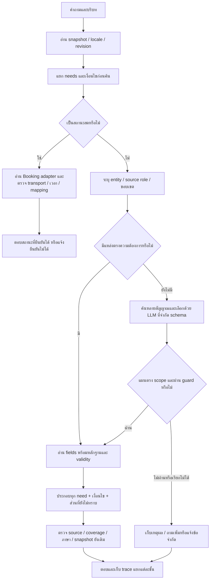

# Flow ปรับปรุงและลงมือแก้ R72

วันที่ 16 ตุลาคม 2026 — ใช้ R71 เป็นฐาน ตรวจซ้ำกับโค้ดและผล R70 แล้วเริ่มทำในสำเนา R72

## เป้าหมายและขอบเขต

ให้คำตอบตรงความต้องการจากข้อมูลกลางเดิมที่ย้ายมาครบตามหลักฐาน แยกวิธี/เวลา/จำนวน/ขอบเขตให้ได้ ถามหลายส่วนต้องติดตามแต่ละส่วน ข้อมูลที่ยังไม่ยืนยันต้องไม่ถูกแทนด้วยเรื่องใกล้เคียง ทดสอบเฉพาะ format กลาง เปิด LLM ทุกคำถาม ไม่รันชุดใหญ่หรือแขน legacy ซ้ำ

ฐาน R69 และผล R70/R71 เก็บไว้ การแก้รอบนี้อยู่ใน `r72_flow_implementation_20261016/system` เท่านั้น ฐานข้อมูลจริงและสำเนาฐาน 602 รายการไม่แก้ราคา นโยบาย validity หรือ approval โดยเดา

เอกสารนี้เป็น Flow ที่ใช้ทำงานจริง สถานะสำเร็จของแต่ละส่วนให้อ่านคู่กับรายงานผล R72 ห้ามตีความรายการที่วางแผนไว้ว่าเสร็จแล้วทั้งหมด

## ตรวจ Flow สามรอบและสิ่งที่แก้

### รอบทบทวน 1: ห้ามตรวจความครบจากสิ่งที่เลือกมาแล้วเพียงอย่างเดียว

ปัญหา: validator เดิมเห็นว่า FAQ มีคำตอบและหลักฐานก็ผ่าน แม้เลือก deadline มาแทน payment method การสร้าง needs จาก requested_fields หลังเลือก FAQ จึงตรวจเจอแค่โครงสร้าง ไม่ตรวจว่าตรงงาน

ปรับ: วิเคราะห์ request roles ก่อนค้น เก็บต้นฉบับและขอบเขตไว้ เลือกแหล่งข้อมูลต่อ role โดยใช้ intent metadata ไม่ใช้ record ID หรือคำตอบตายตัว แล้วรายงาน source rendering แยกจาก human intent verification

เกณฑ์: คำถาม how/when/how many และคำถามผสม ต้องมี facts ตรงแต่ละเรื่องจริง ไม่ผ่านเพียงเจอคำว่า payment/booking

### รอบทบทวน 2: เงื่อนไขและการปฏิเสธต้องไม่เปลี่ยนความหมาย

คาดว่าจะผิด: “ถ้าไม่จ่ายจะเป็นยังไง” มีคำว่า “ยังไง” แต่ไม่ได้ถามวิธีจ่าย; “ไม่เอาเลขบัญชี” ไม่ใช่คำขอบัญชี; คำถามจ่ายของการแข่งขันไม่ใช่ค่าจองศูนย์; จำนวนรอบต่อวันไม่ใช่ต่อการจอง

ปรับ: แยก consequence/time จาก method; mask เฉพาะข้อความปฏิเสธหัวข้อ ไม่ลบเงื่อนไขไม่ชำระ; กัน competition scope; ต่อวันต้องแจ้งว่ามีแค่ข้อมูลต่อการจอง; cash/card/บัญชีคนอื่นห้ามถือว่าถูกอนุญาตจากข้อมูลโอนทั่วไป

เกณฑ์: มีคู่ลบที่ห้ามแสดงบัญชีเมื่อไม่ได้ถามบัญชี และห้ามยืนยันช่องทางชำระที่ source ไม่ได้ระบุ

### รอบทบทวน 3: ความเสี่ยงจากข้อมูลใหม่/เปลี่ยนข้อมูลและการค้น

คาดว่าจะผิด: FAQ ที่ไม่มี role หายจากการค้น; field ช่วงท้ายถูกตัด; ข้อมูลหลายส่วนเหลือแค่ชิ้นแรก; ชื่อเกมมีเครื่องหมายแล้วดึงระเบียนว่าง; ข้อมูลใหม่ทำให้ identity link เดิมไม่ถูกต้อง; เรียกโมเดลไม่ได้แต่คะแนนดูเหมือนผ่านจริง

ปรับ: แยกเส้นทาง semantic role ที่พิสูจน์ได้ออกจาก retrieval ทั่วไป ปรับ retrieval ให้สแกน field เต็มแต่จำกัดข้อความเข้าโมเดลเป็นช่วงที่เกี่ยวข้อง เชื่อมตัวตนเฉพาะคู่ที่ตรวจหลักฐานแล้วและล็อก hash ของระเบียนทั้งคู่ ห้าม fuzzy merge; แยก model transport/schema/selection/content และแยก validation โครงสร้างจาก task coverage

เกณฑ์: เปลี่ยน revision/ถอนรายการแล้ว link ต้องหยุดเอง; คู่ภาค/edition อื่นห้ามเชื่อม; tail fixture ต้องค้นพบโดยไม่ส่งทั้งฐานเข้า prompt; ไม่อ้าง model generation ผ่านจาก fixture หรือ transport failure

## Flow หลัก

## ขั้นตอนลงมือและเกณฑ์ปิด

### 00 เก็บ baseline

1. สำเนา code R69 และ backup SQLite ผ่าน SQLite API
2. สร้าง manifest ของต้นทาง เก็บ hash ของฐานและ seed
3. log และผลแต่ละรอบใช้โฟลเดอร์ใหม่แบบห้ามทับ
4. ทดสอบก่อนแก้ด้วยคำถามชุดเดียวกับหลังแก้ บันทึกคำตอบเต็มและ trace

### 01 ตรวจ model path

1. คง allow_llm=True และ environment ON
2. แยกคำถามที่ตอบจาก fields โดยไม่จำเป็นต้องเรียกโมเดล กับคำถามที่พยายามเรียกจริง
3. ถ้า network ของเครื่องมือถูกจำกัด ขอสิทธิ์ผ่านระบบ ไม่ย้ายไปเรียกผ่านช่องทางอื่นเพื่อหลบสิทธิ์
4. ถ้ายังไม่ได้สิทธิ์ ให้ทำงานอ่าน/แก้/ทดสอบภายในต่อ และระบุข้อจำกัด ห้ามอ้าง model inference ผ่าน

### 02 แยกความต้องการก่อนเลือก source

ข้อมูล need อย่างน้อย: role, scope, qualifiers, topic ที่ผู้ใช้ไม่ต้องการ และสถานะว่าความหมายยังไม่ได้ผ่านมนุษย์

เริ่มจากปัญหาที่พิสูจน์ใน R70: payment_method, payment_deadline, booking_quota, studio_rules ไม่ใส่เลขบัญชี จำนวนรอบ หรือนโยบายใน router ค่าทั้งหมดอ่านจาก source fields

คำถามใหม่ที่ไม่อยู่ใน grammar เหล่านี้ต้องใช้ reader/retrieval เดิมภายใต้ guard และเก็บเหตุผลการตก ไม่ใช่ฝืนจัดเข้า role ใกล้เคียง

### 03 เลือก source ต่อ need และตรวจ missing

1. ใช้ FAQ intent_key ที่ตรง role; เลือกแยกต่อ role ไม่ใช้การตัดเหลือ FAQ แรกสำหรับทั้งประโยค
2. ใช้ภาษาที่มีใน record นั้นและลำดับ provenance เดิม
3. ถ้า role ไม่มี source ให้ระบุ missing; ไม่เรียกหัวข้อใกล้เคียงมาแทน
4. ถ้าระเบียนหลายชิ้นขัดแย้ง ต้องแสดง/ส่งให้ตรวจ ไม่ตัดสินด้วยความยาวคำตอบหรือความใหม่ของไฟล์เพียงอย่างเดียว

### 04 ป้องกัน scope และตอบครบ

1. วิธีชำระรวมบัญชีและสลิปตามที่ source ระบุ; deadline ตอบเวลาและผลกรณีไม่ทันตาม source
2. หลาย roles ต้องประกอบครบและมี task_coverage แยก
3. “ต่อวัน” มีแค่ source ต่อการจอง ต้องระบุข้อจำกัดนั้น
4. cash/card/สิทธิ์จ่ายแทนต้องไม่ถูกสรุปจาก general transfer method
5. เนื้อหาที่ยังตอบไม่ได้ต้องปรากฏใน output หรือ coverage ไม่ตกเงียบ
6. สถานะ source_answer_rendered หมายถึงแสดงข้อมูลที่มี ไม่ใช่รับรองความเข้าใจ user ทุกสถานการณ์

### 05 ค้นข้อมูลให้เจอโดยรักษา precision

1. เก็บ original query; query variant ลบได้เฉพาะคำเกริ่นที่ระบุรูปแบบชัดเจน
2. index ทุก known field ที่เกี่ยวข้อง ไม่ตัด 1,800 ตัวแรกก่อนค้น
3. เลือกข้อความจาก field/หน้าต่างที่เกี่ยวข้องโดยมี budget ต่อ candidate
4. คง independent topic guard และ schema bounds ของโมเดล
5. ตรวจ tail fixture, คำเกริ่น, คำเหมือนทั่วไป, record คนละหัวข้อ และตัวเลข

### 06 แก้ identity และ temporal เฉพาะที่มีหลักฐาน

1. ชื่อมี accent ไม่ใช่เหตุผลให้ merge ทั้งฐาน
2. คู่ stub/detail ที่ตรวจได้ให้ใช้ link อ่านเฉพาะ fields ที่ตรวจหลักฐาน พร้อม hash guard และ audit
3. ถ้า source เปลี่ยน/ถอน/ไม่ตรง hash ให้หยุด link จนตรวจใหม่
4. วันหยุดทั่วไปที่ไม่ระบุวันต้องไม่ list วันปิดเก่าราวกับเป็นนโยบายปัจจุบัน
5. ไม่ขยายราคาหมดอายุ ไม่เดาระยะเหมาครึ่งวัน ไม่เปลี่ยนเวลาพักเที่ยงหรือกฎ VR ที่ยืนยันแล้ว

### 07 ภาษาและ trace

1. retry/unavailable ใช้ locale ที่เลือกจริง
2. แปลเฉพาะหน่วยมาตรฐานในชื่อบริการเมื่อยืนยันได้ ไม่แปลชื่อเกม/งานโดยเดา
3. แม้ reader คืน None ต้องเหลือ request_needs/named_scope/unresolved_scope และ entity selector audit
4. อย่าแปลง transport failure เป็น no_data หรือ content success

### 08 ทดสอบและปรับตามหลักฐาน

1. ชุดเจาะจงก่อน/หลัง matched conditions ไทย/อังกฤษ แยก method/deadline/quota/rules/compound/negative
2. ตรวจ held-out phrasing ที่เขียนไว้ก่อนแก้ และเก็บผลก่อนปรับซ้ำ
3. เก็บทุก failure พร้อมคำถาม/คำตอบ/เหตุเลือก/ส่วนที่ควรตอบ/สาเหตุ/วิธีแก้
4. เพิ่ม risk fixtures ของ missing source, source update, identity invalidation, retrieval tail และ compound ต่างหัวข้อ
5. เรียก actual HTTP handler ใน memory ของแชทด้วย LLM ON เพื่อตรวจบริบทสองรอบ ราคา กฎ เกม และ live fixture
6. สิ่งนี้ไม่ใช่ browser/network/real WordPress occupancy หรือผล model inference; แยกข้อจำกัดในรายงาน
7. หยุดเพิ่ม test เมื่อความเสี่ยงของส่วนที่แก้มีหลักฐานพอ ไม่เริ่ม full suite ที่ผู้ใช้ไม่ได้ขอ

### 09 ส่งมอบและ rollback

1. เก็บรายงานผล ตัวเลขต่อภาษา และ unresolved งานแยก
2. ทำ launcher ของสำเนา R72 ใช้ runtime ที่มีใน R69 ไม่เพิ่มข้อมูลตัวอย่างเข้าฐานจริง
3. เก็บ R69 ให้เปิดกลับได้; เปลี่ยนแค่ทางลัดไปชุดเดิมก็ rollback ได้
4. ยังเป็น draft preview; เผยแพร่จริงต้องผ่าน model/browser/live/owner checks ตามขอบเขตที่ยังขาด

## สิ่งที่พบเพิ่มเมื่อลงมือจริง และปรับ Flow แล้ว

1. รอบแรก 42/43: “ถ้าไม่จ่าย…จะเป็นยังไง” เป็น consequence ไม่ใช่ method ต้องตรวจความสัมพันธ์ของคำ ไม่ใช่เจอ “ยังไง” ที่ใดก็ได้
2. ชุดคำถามเพิ่มเติม: “when I paid the wrong amount” เป็นเงื่อนไข ไม่ใช่กำหนดชำระ; “How long does a bank transfer take to arrive?” เป็นเวลาประมวลผล ไม่ใช่เวลาที่ต้องจ่าย จึงเพิ่ม exception scope และจำกัดรูปประโยค deadline
3. ตรวจคำตอบด้วยตาแล้วพบว่าแค่กันคำว่า “10 minutes” ยังไม่พอ คำถามโอนยอดผิดยังถูกตอบขั้นตอนจองแทน เกิดจาก paid ไม่อยู่ในตัวกัน booking steps จึงกัน exception ก่อนเลือก procedure ทั่วไปด้วย
4. คำถามต่อเนื่อง “And when?” / “แล้วเมื่อไหร่” ต้องสืบทอดเฉพาะหัวข้อชำระจาก server state แล้วเลือก source deadline ใหม่ ไม่คัดลอกคำตอบบัญชีเก่า
5. Fixture missing source ต้องตรวจทั้งกรณีไม่มีเลยและหายหนึ่ง role ในคำถามผสม ผลต้องเป็น clarification/partial พร้อมระบุส่วนที่หาย
6. เกณฑ์คำตอบต้องรองรับคำเทียบเท่า “หน้าตึก 5” กับ “อาคาร 5” พร้อมหลักฐาน ไม่เปลี่ยนผล raw ย้อนหลัง และไม่แก้ข้อมูลจริงเพื่อให้ผ่านคำ literal

จากนี้ก่อนปิด defect ต้องอ่านคำตอบเต็มของกรณีที่ผ่านเฉพาะ forbidden contract ด้วย เพราะการไม่ตอบแบบเดิมที่ผิดไม่ได้พิสูจน์ว่าคำตอบใหม่ตรงงานแล้ว

## ขอบเขตที่ยังต้องติดตามจาก R71

Flow นี้ไม่ได้ยกเลิก S04–S14: แบบกรอก metadata ทุกหมวด, generic new-topic paraphrase, semantic planner ที่ครอบคลุม field ใหม่, conflict resolution ทุกชนิด, pagination กฎครบชุด, locale audit ทุกแถว และ production release gate ยังต้องติดตามตามหลักฐานแต่ละงาน ห้ามอ้างว่าแก้ทุก R70 failure จากชุดเจาะจงชุดเดียว

## หลักฐานที่ต้องมีตอนปิดรอบ

- `BASELINE_MANIFEST.json`: ต้นทางและ hash
- `SOURCE_INSPECTION.json`: facts/intent และ stub/detail ที่อ่านจริง
- `results/*/ANSWERS.jsonl`: คำถาม คำตอบเต็ม trace และข้อผิดพลาด
- `results/*/SUMMARY.json`: ผลแต่ละรอบไม่ทับกัน
- `REPORT_R72_TH.md`: ผลสุดท้าย สาเหตุที่ยังผิด งานที่เสร็จและที่ยังไม่เสร็จ
