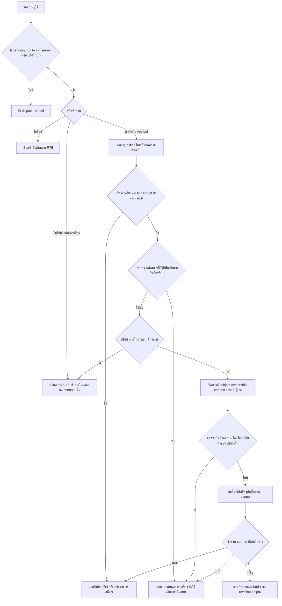

# R77: Flow คำยืนยันที่เพิ่มเงื่อนไข ไทย/อังกฤษ

## 1. ปัญหาและเป้าหมาย

เมื่อระบบถามว่าหมายถึงหัวข้ออุปกรณ์ส่วนตัวหรือไม่ ผู้ใช้อาจตอบ `ใช่ แต่เป็นของศูนย์` หรือ `Yes, but it is for a tournament.` คำว่าใช่ไม่ได้ยืนยันว่าเงื่อนไขของหัวข้อเดิมยังครบ การเลือก source ต้องพิจารณาส่วนหลังด้วย

R76 รองรับการปฏิเสธพร้อมถามใหม่ แต่ยังไม่มีเส้นทางเฉพาะนี้ ผล baseline บน 8 สัญญาเรื่อง qualification ไม่ผ่าน 8 ข้อ ส่วนใหญ่เป็น retry/clarification ไม่ตรงความต้องการ ไม่ใช่หลักฐานว่าแต่งนโยบายผิด 8 ครั้ง

เป้าหมาย R77: ใช้ scope จาก format กลาง เลือก source ปัจจุบันเมื่อเข้าเงื่อนไขครบ หรือระบุว่ายังยืนยันไม่ได้ รักษาประวัติที่เชื่อถือได้ ไม่อ่านข้อเท็จจริงจากข้อความที่ assistant เคยพิมพ์

## 2. ขอบเขต format ที่ใช้จริง

ใช้ optional `fields.query_profile` ที่มีอยู่ใน FAQ, policy, procedure:

| ช่อง | หน้าที่ | ตัวอย่าง |
|---|---|---|
| task | ประเภทงาน | permission / correction |
| subjects | วัตถุที่นโยบายครอบคลุม มี th/en | keyboard / คีย์บอร์ด |
| ownership | ขอบเขตเจ้าของ | personal / any |
| context | ขอบเขตการใช้ | studio / competition |

ค่าที่อ่านจากข้อความอาจเป็น ownership=studio แต่ schema ปัจจุบันเก็บ personal/any เท่านั้น จึงไม่อ้างว่ามีช่อง studio-only ใน format แล้ว การเพิ่ม studio-only และข้อจำกัดชนิดอื่นเป็นงานต่อ

โปรไฟล์ช่วยเลือกข้อมูล ไม่ใช่นโยบาย คำตอบยังมาจาก answer หรือ decision/details/conditions/exceptions หรือ steps/preconditions ใน source ที่มีหลักฐาน

ฐานจริงมี query_profile ที่ known อยู่ 2 รายการ ไม่ใช่ทุกหมวดมี metadata นี้แล้ว ข้อมูลตัวอย่างเพิ่มเฉพาะฐานแยกใน verification

## 3. Flow รับข้อความ

### ขั้นที่ 1 — ตรวจ state

- ใช้ latest assistant state schema_version=1 ที่ delivery_status เป็น server_written/client_acknowledged
- client-only/undelivered state ไม่ใช้เปิดเส้นทางนี้
- pending ต้องมีหัวข้อเดียวก่อนใช้ qualifier ขยาย scope ไม่เลือกตัวแรกของเมนูหลายข้อโดยเดา
- ตรวจ record ว่ายังไม่ถอน ยัง effective และ fingerprint ของ kind+query_profile ไม่เปลี่ยน
- ถ้าเปลี่ยนเฉพาะคำตอบ ให้ใช้ revision ใหม่ ถ้าเปลี่ยน scope ต้องระบุหัวข้อใหม่

### ขั้นที่ 2 — จำแนกคำตอบแบบมีขอบเขต

- รับรูปแบบ `ใช่ แต่…`, `ถูกต้อง แต่…`, `Yes, but…`, `Yes, however…` และ connectors ที่กำหนดใน qualified_reply.py
- เก็บ qualifier ต้นฉบับใน artifact; normalize เฉพาะส่วนวิเคราะห์
- `ใช่` ล้วนยังทำงานแบบเดิม
- รูปสะกดผิดของคำยืนยัน รูปสำนวนทุกชนิด และ fragment หลังเมนูชนิดอื่นยังไม่ถือว่าครอบคลุม

### ขั้นที่ 3 — แยก unknown กับคำถามใหม่

- อายุ/ผู้ปกครอง เงินเกิน/ขาด/ผ่อน ใช้สถานะ unknown เดิม ไม่มีการแต่งนโยบายเพิ่ม
- ถ้าเป็นคำถามใหม่ เช่น `Yes, but how do I pay for my booking?` ใช้ dispatcher เดิมกับคำถามใหม่ และ context barrier เดิมของ R76
- คำถามถัดไป `And when?` ต้องยึดเรื่องชำระเงินใหม่
- การจำแนกนี้เป็น bounded heuristic ไม่รับรองข้อความหลายเจตนาทุกแบบ

### ขั้นที่ 4 — ตรวจ qualifier ทุกส่วน

1. อ่าน ownership/context ที่เป็นบวกและปฏิเสธแยกกัน
2. ชื่อ subject อ่านจากโปรไฟล์ชนิด task เดียวกัน ไม่เขียน ID หรือชื่อรายการจริงลง router
3. ใช้ภาษาแป้น/ไวยากรณ์เท่าที่กำหนด ไม่ลบตัวเลข ข้อปฏิเสธ หรือคุณสมบัติที่ยังตีความไม่ได้
4. `not mine` อย่างเดียวปฏิเสธ personal แต่ไม่ได้ยืนยัน studio จึงยังตอบไม่ได้
5. `not mine; it belongs to the studio` มีค่าทดแทนชัดเจน
6. `not a tournament, regular use` และ `ไม่ได้ใช้แข่ง แต่เล่นทั่วไป` อ่านเป็น context=studio และ negative competition
7. ownership สองค่าในข้อความเดียว เช่น mine and studio's ต้องถามเพิ่ม
8. `my wireless keyboard` ต้องเหลือ wireless เป็นเงื่อนไขที่ยังไม่ครอบคลุม ห้ามลบทิ้งระหว่างอ่านคำว่า my

### ขั้นที่ 5 — เลือกและตอบจาก source

- task/context ต้องตรง ownership ต้องตรงหรือ source ระบุ any
- source ต้องครอบคลุม subjects ทั้งหมดที่เลือก ไม่เลือกเพียงอันแรก ถ้า qualifier ไม่ระบุ subject ให้คงชุดของหัวข้อเดิม
- ได้ source เดียว ใช้ method=qualified_declared_profile และ DEFAULT_FIELDS เดิม ไม่ให้โมเดลแต่ง facts หรือเลือกตัดเงื่อนไขออก
- ได้หลาย source ให้ clarification ไม่ตัดสินด้วย retrieval score
- ไม่มี source สำหรับแข่งขัน ให้ถามเกม/รายการแข่งขัน ไม่ใช้อุปกรณ์ส่วนตัวของการใช้บริการทั่วไปแทน
- ไม่มีข้อมูลรองรับอื่น ให้ unconfirmed และไม่มี factual hits จากหัวข้อเดิม
- unresolved ต้องปิด pending เดิมและเก็บ declined IDs เพื่อไม่ให้ตอบ yes รอบถัดไปแล้วคืนกฎเดิมที่ไม่ครอบคลุม

## 4. การตรวจทานและปรับ Flow 3 รอบในงานนี้

| รอบ | จุดเสี่ยงที่ตรวจ | สิ่งที่ปรับ/ยืนยัน | หลักฐาน |
|---|---|---|---|
| 1 | yes ถูกอ่านเป็นการยืนยันทั้งหมด หรือหลุดไปค้นคำถามเดี่ยว | แยก qualifier ก่อน bare confirmation, แยก unknown/new request/scope | baseline01 และ qualified01: 8 qualification contracts 0/8 → 8/8; รอบแรกทั้งหมด 34/34 |
| 2 | ปฏิเสธ scope แล้วสืบทอดค่าที่ถูกปฏิเสธ | แยก negative slot, เพิ่ม not a/not for a/ไม่ได้ใช้, ตรวจ conflicting/uncovered | qualified02: 41/41 |
| 3 | คำขยายถูกกลืน, source เปลี่ยน/ถอน, state เดิมหลุดกลับมา | เอา wireless/gaming ออกจาก ownership prefix ที่กลืนคำขยาย; ตรวจ revision/withdraw/fingerprint/barrier และ regression เดิม | qualified02 + regression01 + scope01 + rephrase_regression01; DELIVERY_QA_FINAL |

รอบเหล่านี้เป็นการตรวจ/แก้เฉพาะ flow ไม่ใช่การปรับโมเดล 3 รอบหรือ full test 3 รอบ

## 5. เกณฑ์ปิดงานรอบนี้

- เคสไทย/อังกฤษของ qualifier และคำปฏิเสธผ่านสัญญาที่กำหนด
- ข้อมูลใหม่ใน fixture ตอบได้โดยไม่เพิ่ม record ID ใน router; แก้ข้อมูลอ่านค่าล่าสุด; ถอนแล้วไม่คืนกฎผิด scope
- ชุด source เดิม 43/43, scope 50/50, rejection repair 34/34 ไม่ถอย
- ตรวจการเก็บฐานจริง 602 heads, approvals=0, ทุก logical table/hash เท่า R76; source 1,425 ไฟล์เดิมไม่เปลี่ยน
- แยกผล fixture/handler ใน memory ออกจาก model transport และ browser/TCP จริง

## 6. งานที่ยังไม่ครอบคลุม

semantic subject definition, typed properties เช่น wireless, หลายเจตนา/หลายเงื่อนไข, typo ของคำตอบสั้น, qualification หลัง selection ชนิดอื่น, profile coverage ทุกหมวด, retrieval เมื่อข้อมูลโต และการเรียกโมเดลจริง ดู NEXT_STEPS_R77_TH.md
