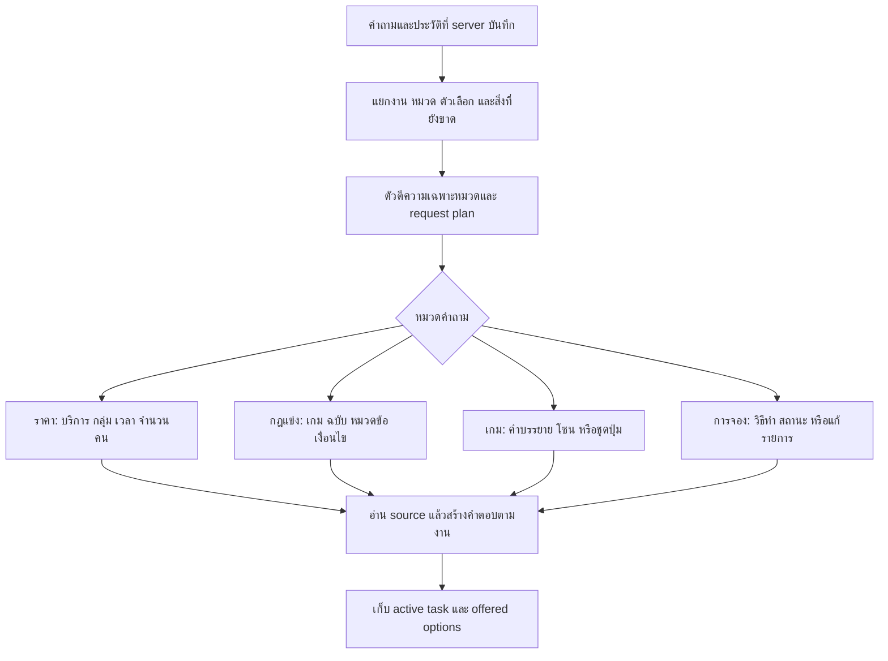
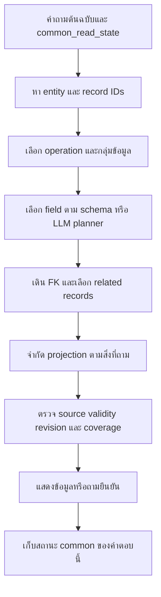
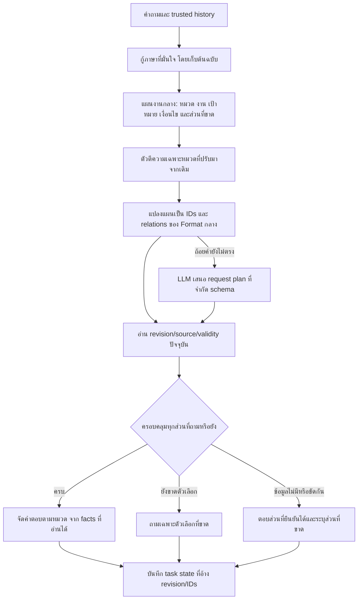

# R85 วิเคราะห์ Flow เดิมกับ Format กลางจากโค้ดและผลที่บันทึกไว้

## คำตอบสั้น

วิเคราะห์เทียบได้ และหลักฐานชี้ว่าการเปลี่ยนครั้งนี้เปลี่ยนทั้งโครงข้อมูลและเครื่องยนต์อ่านคำถาม ไม่ได้เปลี่ยนแค่ที่เก็บข้อมูล เดิมมีตัวจัดการเฉพาะหมวดที่พัฒนาสะสมไว้ ส่วนใหม่พยายามเลือก record → field → related records → projection ผ่านตัวอ่านกลาง ความสามารถตีความ/บริบทเดิมจึงไม่ได้ตามข้อมูลมาทั้งหมด

สาเหตุหลักมีทั้งข้อมูลที่เคยย้ายไม่ครบ การไม่ได้ใช้ตัวตีความเดิม การเลือก record/field ผิด การสืบความสัมพันธ์ผิดขอบเขต ความจำคนละรูปแบบ และเกณฑ์ตรวจที่ผูกกับรูปแบบเก่า ข้อมูลอยู่ในฐานจึงยังไม่พอ ต้องมีเส้นทางเลือกและอ่านตรงสิ่งที่ถามด้วย

## ขอบเขตหลักฐาน ไม่เอาผลเก่ามาเรียกเป็นคะแนนปัจจุบัน

- R64: เปรียบเทียบคำถามเดียวกันที่บันทึกไว้ 20,554 unique requests/55,811 grades ต่อแขน ทั้ง legacy/common และ OFF/ON เป็น snapshot ข้อมูล R63 จำนวน 582 รายการ
- R85 นี้อ่านผล R64/R65 และโค้ดที่ติดตั้งล่าสุดหลัง R84 พร้อมตรวจข้อมูลปัจจุบัน ไม่รันคำถามใหม่ ไม่เรียก LLM ไม่รัน full test และไม่เปลี่ยนโค้ด/ข้อมูลใช้งาน
- ตัวอย่าง 10 คู่ในรายงานเป็นคำถามที่ผลเก่า legacy ผ่านและ common ไม่ผ่านตาม evaluator จึงต้องวิเคราะห์ซ้ำว่าผิดเนื้อหาจริง หรือเพียง source/route/text compatibility ไม่เหมารวมว่าทั้ง 10 คู่ตอบผิดสาระ
- R84 26/26 บนเว็บจริงเป็นชุดเฉพาะจุดคนละชุดกับ R64 ไม่ใช้แทนคะแนนครบ 20,554 ข้อของระบบปัจจุบัน

## 1. โค้ดยืนยันว่าทั้งสองโหมดใช้เส้นทางต่างกัน

### 1.1 โหมดปัจจุบันเข้าตัวอ่านใหม่แล้ว return

[engine: migrated_chat_enabled แล้ว return migrated_answer](C:/Users/Chokhun/Documents/Codex/2026-09-25/psu-esports-studio-phuket-chatbot-c-2/r78_web_session_check_20261016/system/app/pipeline/engine.py:882)
เมื่อ profile เป็น r69-migration-preview จะเข้าฟังก์ชัน migrated_chat.answer ก่อนตัวจัดการราคาเหมาและตัวจัดการหมวดเดิมด้านล่าง ไม่มีการนำ facts เก่ามาตอบเมื่อ common miss ซึ่งช่วยแยกข้อมูลใหม่จากข้อมูลเดิม แต่การตีความเดิมที่อยู่ด้านล่างก็ไม่ได้ถูกใช้โดยอัตโนมัติ

### 1.2 เว็บปิด request_plan เดิมสำหรับโหมดใหม่โดยเจตนา

[server: ใช้ original question และ request_plan=None](C:/Users/Chokhun/Documents/Codex/2026-09-25/psu-esports-studio-phuket-chatbot-c-2/r78_web_session_check_20261016/system/app/web_api/server.py:660)
โหมดเดิมใช้ parent_typed_request_plan และ resolved_query ที่สืบบริบทมาแล้ว ส่วนโหมดใหม่ส่งคำถามต้นฉบับกับ server history ไปให้ common_read_state ตัดสินใหม่ จึงไม่ใช่ว่าเว็บไม่ส่งประวัติทั้งหมด แต่เป็นคนละตัวตีความประวัติ ความสามารถที่ยังไม่มีใน common state จึงไม่ตามมาเพียงเพราะข้อมูล source เดิมอยู่ครบ

### 1.3 R64 ยังไม่ใช่ migrated dispatcher ตัวปัจจุบัน

[R64 engine: common answer แซงก่อน specialized routes](C:/Users/Chokhun/Documents/Codex/2026-09-25/psu-esports-studio-phuket-chatbot-c-2/r64_full_comparison_20261013/system/app/pipeline/engine.py:883)
R64 ใช้ common hook ก่อน route เดิม ถ้า common เลือกคำตอบผิดแต่ผ่าน validation และคืน result มา engine ก็ return ก่อนถึงตัวจัดการเฉพาะหมวด ส่วนปัจจุบันแยก migrated dispatcher ทั้งเส้นทางแล้ว สองรุ่นมีรายละเอียดต่างกัน ไม่เอา early return รุ่นใหม่ไปอ้างว่าเป็นโค้ดเดียวกับทุก failure ใน R64

## 2. Flow เดิมทำอะไรได้มากกว่าการเปิดไฟล์หาเนื้อหา



ตัวอย่างราคาเหมาเดิมมี plan แยก targets/groups/periods/asks, scoped_requests ต่อเงื่อนไข, exclusions และการถามต่อ ไม่ได้อาศัยว่าข้อความไหนเหมือนกันที่สุดเพียงอย่างเดียว ตัวอย่าง “PC เต็มวันภายนอก และ VR ครึ่งวันภายใน” ต้องเป็น 2 ชุดเงื่อนไข ไม่ทำทุกโซน × ทุกกลุ่ม × ทุกช่วงวัน

[zone_rental: ตัวตีความและ renderer เดิม](C:/Users/Chokhun/Documents/Codex/2026-09-25/psu-esports-studio-phuket-chatbot-c-2/r78_web_session_check_20261016/system/app/pipeline/zone_rental.py:142)
[task_memory: เก็บ task/operation/targets/options/rental_plan](C:/Users/Chokhun/Documents/Codex/2026-09-25/psu-esports-studio-phuket-chatbot-c-2/r78_web_session_check_20261016/system/app/session/task_memory.py:13)

## 3. Flow ใหม่เพิ่มจุดที่ต้องเลือกให้ถูกหลายชั้น



ถ้าชั้นแรกเลือก FAQ จองแทนกติกา RoV การเลือก field=answer ในชั้นถัดไปอาจถูก schema ทุกประการ แต่จะตอบผิดเรื่อง ถ้าเลือก CS2 ถูกแต่ขยายกฎลูกทั้งหมด ก็อาจตอบยาว 22,902 ตัวอักษรทั้งที่ขอข้อประท้วงเพียงข้อเดียว ถ้าเลือกเกมได้แต่เลือกเฉพาะ game_id ก็จะตอบเพียงชื่อเกม

การผ่าน schema/source validation บอกว่าอ่าน field ที่อนุญาตและมีหลักฐานได้ ไม่รับประกันว่าสิ่งนั้นตรงเจตนาของผู้ใช้ คะแนน confidence ของ route เดิมและ common จึงไม่ใช่ความน่าจะเป็นความถูกต้องที่สอบเทียบแล้ว

## 4. ประเภทสาเหตุ และหลักฐานที่ชี้ไปแต่ละชั้น

| ประเภท | ทำไมเดิมตอบได้ | ทำไมกลางพลาด | สถานะหลัง R84 |
|---|---|---|---|
| ย้ายเนื้อหาไม่ถึงช่องที่ใช้ตอบ | handler เดิมอ่านไฟล์ curated/raw ตรง | ปุ่มเคยอยู่ใน limitations แต่ bindings ว่าง; บางคำบรรยายถูกตัดก่อนย้าย | R67/R68 เติมแล้วหลายส่วน ปัจจุบันมี 43 ชุดปุ่ม/448 binding rows และ 104 rule facets known |
| ย้ายข้อมูลแต่ไม่ได้ใช้ parser เดิม | มี resolver เฉพาะราคา/เหมา/แข่ง/ปุ่ม | ชุดใหม่ต้องตัดสิน operation/record/field ใหม่ | ยังเป็นความต่างเชิงสถาปัตยกรรม ต้องย้าย behavior ผ่าน adapter |
| ดึง record ผิด | route จำกัดพื้นที่ค้นตามหมวด | candidate คล้ายคำว่า “สรุป” ไปหยิบสรุปจองแทน RoV | มี typed scopes และ guard เพิ่มแล้ว แต่ไม่ได้ full rerun ปัจจุบัน |
| เลือก field ผิดหรือไม่ครบ | handler รู้ว่า “คืออะไร” ต้องบรรยายและวิธีเล่น | ส่งเฉพาะชื่อเกม หรือถาม field ที่ root ไม่มี | มี query contract/projection/relations เพิ่ม ต้องพิสูจน์ด้วยคู่เดิม |
| กฎลูกและขอบเขตย่อย | ใช้ facet + clause source | เลือกเอกสารถูกแต่รวมทุก section | reader ปัจจุบันมี rule_selection/facet/lexical sections แล้ว ไม่สรุปว่าทุกคำถามหายผิด |
| บริบทการถามต่อ | เก็บงาน กลุ่ม เวลา ตัวเลือก และแกนที่เลือก | state ใหม่เก็บ IDs/fields และกติกาสืบคนละชุด | R75–R84 แก้หลายทาง ผลเฉพาะจุดผ่าน ไม่ใช่ parity ทุกบทสนทนา |
| จำนวนหรือกลุ่มของราคา | ราคาเหมาเดิมแยก group/period เป็นข้อมูลใน plan | ภาษาอังกฤษ singular/group noun หรือ how much priority ทำ scope ผิด | R84 แก้ 3 จุดและเว็บ 6 คำถามราคาเหมาในชุด 26 ผ่าน |
| Unknown กับ interpretation ปะปน | domain handler รู้ว่าข้อมูลส่วนไหนมี | เลือกไม่ถูกอาจแจ้งคล้ายไม่มีข้อมูล | ต้องแยก scope_unresolved, fact_unknown, model_failure, expired ชัดเจน |
| LLM เป็นคอขวดเพิ่ม | คำถามที่ resolver ตรงตอบจาก source โดยตรง | คำถามตรง ๆ กลับต้องเลือก record/field ผ่านโมเดล | R83 ลด protocol/candidate; ไม่ได้พิสูจน์ความเร็วทุกเส้นทาง |
| ภาษาที่ใช้ตอบและ label | แม่แบบเดิมเป็นภาษาคนเฉพาะงาน | บาง field label เป็นคำสอนกรอก/ชื่อ schema และ EN เคยหาย | R67/R68 แปล/จัดช่องเพิ่ม; audit ตอนนี้ตรวจ top-level localized fields ไม่ใช่ human translation certification |
| เกณฑ์ตรวจ | expected ผูก route/source IDs เก่า | common ใช้ knowledge/common_read และ source IDs ใหม่ | ต้องเทียบเนื้อหาแยก compatibility และไม่เปลี่ยน expected แบบไม่มีหลักฐาน |
| วันที่มีผล | เดิมอาจแสดงราคาที่บันทึกพร้อมหมายเหตุหมดอายุ | common ระงับการยืนยันราคาเมื่อเลย validity | ต้องแยกความต่างตามนโยบายวันมีผลจาก retrieval bug ห้ามเติมวันมีผลเพื่อให้คะแนนผ่าน |

## 5. ข้อมูลเคยย้ายไม่ครบจริง แต่ไม่ควรสรุปว่าย้ายเพิ่มอย่างเดียวจะแก้หมด

R67 พบปุ่มควบคุมที่เก็บผิดรูปแบบและกู้แหล่งก่อน canonical เพิ่ม R68 พบคำบรรยาย raw ที่ยาวกว่าฉบับกลาง 23 รายการ และชื่อเรียกเกมที่ไม่ได้ตามฐานมา จึงมีความผิดพลาดของ migration จริง ไม่ใช่ข้อมูลครบทุกช่องมาตั้งแต่ต้น

Audit ฐานที่ติดตั้งหลัง R84 ในรอบนี้อ่านแบบ read-only ได้:
- 602 records, 43 control sets, 448 binding rows
- competition_rule facet: {'known': 104}
- 2 records มี query_profile ที่ known จาก FAQ/policy/procedure รวม 194 records
- localized field ที่มี th แต่ไม่มี en ที่ระดับ field value: 0 ช่อง (ไม่ใช่การตรวจ recursive ทุก text leaf หรือคุณภาพการแปลโดยคน)
- DB SHA256: `4bffab309215faca927e5ef8477944659558f3bcfe7b8e1c0faccad12953cd0d`

ตัวเลขนี้ยืนยันสถานะโครงข้อมูลในขอบเขตที่ตรวจ ไม่เท่ากับ 602/602 ตอบคำถามทุกรูปแบบ และ query_profile มีเพียง 2 records ก็ไม่ได้แปลว่าอีก 192 รายการตอบไม่ได้เลย เพราะยังมี exact/typed readers แต่มันชี้ว่ากลไก task+subject ที่เพิ่มใหม่ยังไม่ได้เป็น capability ทั่วไปทุกหมวด

## 6. คู่คำถามจาก log เดิมที่ชี้สาเหตุได้ชัด

### ROV สรุปกติกาสั้นๆ

ประเภท: **ผิด record/ข้ามหมวดจริง**

เดิมจัดเป็นกติกา RoV และสรุป source ของการแข่งขัน ใหม่เลือก FAQ สรุปจอง แม้ validation ผ่าน เป็นปัญหาการเลือก record ไม่ใช่ RoV source ไม่มี

สถานะปัจจุบันที่พิสูจน์ได้: ปัจจุบันมี competition scope/rule_selection แล้ว ยังไม่ได้รันคู่ R64 นี้ใหม่ใน R85

Legacy mode: `pipeline:competition_rule_overview_source`; Common R64 mode: `pipeline:common_answer`

คำตอบเดิม:

> สรุปกติกา Arena of Valor (RoV) บางประเด็นจากเอกสารที่มี:
> รายการ: Blueket Games 2025 ประเภททีมชาย
> 
> **รูปแบบการแข่งขัน**
> •    เวลา 8.40-10.00 รอบ 5 ทีม แข่งแบบ Single Elimination BO3
> •    เวลา 10.00-11.30 รอบรองชนะเลิศ คู่ที่ 1 แข่งแบบ Single Elimination BO3
> 
> **คุณสมบัติและการลงทะเบียน**
> •    6.1.3.ห้ามทีมผู้เข้าแข่งขันทุกทีมอนุญาตให้บุคคลอื่นที่ไม่ได้อยู่ในรายชื่อผู้เข้าแข่งขันในทีมของตนตามที่ได้ลงทะเบียนไว้เข้าแข่งขันโดยเด็ดขาด หากพบว่ามีชื่อผู้เข้าแข่งขันไม่ตรงตามที่ลงทะเบียนไว้ ให้ทำการบันทึกภาพหลักฐานและยุติการแข่งขันในทันที แต่หากมีการแข่งขันจนจบเกม จะถือว่าทั้งสองทีมยินยอมให้เกิดการแข่งขันขึ้น ทางทีมงานจะไม่รับฟังข้อโต้แย้งใด ๆ ทั้งสิ้น
> 
> **อุปกรณ์การแข่งขัน**
> •    5.3. ไม่อนุญาตให้ใช้ Tablet หรือ iPad รวมถึงอุปกรณ์อื่นใดที่มิใช่โทรศัพท์มือถือ (Mobile Phone) ในการแข่งขัน หากตรวจสอบพบ ทีมงานจะตัดสิทธิ์ทันที
> 
> **การหยุดเกมและเวลานอก**
> •    4.3.1.ในกรณีที่มีผู้เข้าแข่งขันหลุดออกจากเกม ให้ทำการหยุดเกมชั่วคราว โดยแต่ละทีมสามารถกดหยุดเกมได้ทีมละ 5 ครั้ง ครั้งละไม่เกิน 1 นาที ถ้าหากเกินเวลาดังกล่าว อีกทีมสามารถกด Resume ได้ทันทีและทำการแข่งขันต่อตามปกติ
> •    4.3.5.หากพบหลักฐานว่าผู้เข้าแข่งขันคนใดเจตนากดหยุดเกม ไม่ว่าจะในจังหวะสำคัญ หรือเพื่อการก่อกวน ปรับแพ้ในเกมที่พบการกระทำผิดในทันที และตัดสิทธิ์ทีมผู้เข้าแข่งขันดังกล่าวออกจากการแข่งขันทันที
> •    4.5.6.1. ผู้เข้าแข่งขันอาจหยุดพักเกมการแข่งขันได้ภายหลังจากเกิดเหตุการณ์ใดเหตุการณ์หนึ่งดังต่อไปนี้ โดยผู้เข้าแข่งขันดังกล่าวจะต้องส่ง

คำตอบ Format กลางใน R64:

> **จองล่วงหน้า.*เช็คอิน.*ยกเลิก**
> • คำตอบพร้อมหลักฐานของศูนย์: สรุปสั้นๆ: ต้องจองล่วงหน้าอย่างน้อย 1 ชั่วโมง, เช็คอินได้ล่วงหน้าสูงสุด 30 นาทีและต้องเช็คอินก่อนเริ่มรอบ, หากต้องยกเลิกหรือแก้ไขการจองควรดำเนินการล่วงหน้าอย่างน้อย 1 ชั่วโมง [S1]
> • ขอบเขตคำตอบและข้อจำกัด: ยังไม่มีข้อมูลยืนยัน

Common plan:
```json
{
  "record_ids": [
    "migrated_faq_rule_reservation_quick_summary"
  ],
  "requested_fields": [
    "answer",
    "scope_note"
  ],
  "method": "published_semantic_candidates",
  "operation": null,
  "semantic_review_needed": true,
  "semantic_plan_accepted": false
}
```

ตัวอย่างเกณฑ์ที่ไม่ผ่าน:

- route:knowledge expected:['competition_rules']
- missing all alternatives: ['ROV', 'กติกา', 'แข่งขัน', 'ยังไม่พบ']

หลักฐานคู่: key `c3d18fcf8bfd49617031552acce0ce34c758229e4ab9cb022eda66fcb32e3922` ใน PAIRED_CASE_EVIDENCE.json เก็บ answer/trace/plan/grades เต็มทั้งสองข้าง; ต้น log: `model_matrix\common_RESULTS.jsonl.gz:632`

### กติกา CS2 เรื่องการประท้วงและข้อพิพาท ว่าอย่างไร

ประเภท: **ขอบเขตใหญ่เกิน + source identity compatibility**

เดิมเลือกข้อประท้วงตรง ๆ 236 ตัวอักษร ใหม่เลือก parent CS2 แต่คืนข้อความกฎ 22,902 ตัวอักษร เกณฑ์เก่ายังจับ ID ต่างรูปแบบด้วย จึงต้องแยกการเลือก clause/verbosity จริงออกจากชื่อ ID

สถานะปัจจุบันที่พิสูจน์ได้: ปัจจุบัน facets known104 และเลือก sections ได้ตามโค้ด ต้องตรวจ scope ด้วย clause IDs ไม่ใช้ความยาวอย่างเดียว

Legacy mode: `pipeline:competition_rule_detail_source`; Common R64 mode: `pipeline:common_answer`

คำตอบเดิม:

> คำตอบ: 2. การประท้วง ต้องยื่นเรื่องภายใน 15 นาทีหลังจากจบแมตช์ โดยกัปตันทีมหรือโค้ชเท่านั้น
> 
> อ้างอิงจากกติกา: Counter-Strike 2 / PSU Phuket CS2 2026 Tournament
> แหล่งข้อมูล: local://competition_rules/competition_rules_cs2_psu_phuket_2026

คำตอบ Format กลางใน R64 (แสดงต้น 1,400 ตัวอักษรจาก 22902):

> **ภาพรวมเอกสาร**
> • หมวดของกติกาข้อนี้: ยังไม่มีข้อมูลยืนยัน
> • หัวข้อกติกา: ภาพรวมเอกสาร [S1]
> • ข้อความกติกาเต็ม รวมเงื่อนไขท้ายข้อ: กฎระเบียบและรูปแบบการแข่งขัน Counter-Strike 2 [S2]
> • เลขข้อจากเอกสารเดิม: 1 [S3]
> • ข้อความข้อนี้ครบหรือถูกตัด: ยังไม่มีข้อมูลยืนยัน
> 
> **6. ข้อจำกัด**
> • หมวดของกติกาข้อนี้: ยังไม่มีข้อมูลยืนยัน
> • หัวข้อกติกา: 6. ข้อจำกัด [S4]
> • ข้อความกติกาเต็ม รวมเงื่อนไขท้ายข้อ: 6. ข้อจำกัด [S5]
> • เลขข้อจากเอกสารเดิม: 10 [S6]
> • ข้อความข้อนี้ครบหรือถูกตัด: ยังไม่มีข้อมูลยืนยัน
> 
> **1. ต้องไม่มีการเปลี่ยนแปลงสมาชิกในทีมตลอดระยะเวลาการแข่งขัน**
> • หมวดของกติกาข้อนี้: ยังไม่มีข้อมูลยืนยัน
> • หัวข้อกติกา: 1. ต้องไม่มีการเปลี่ยนแปลงสมาชิกในทีมตลอดระยะเวลาการแข่งขัน [S7]
> • ข้อความกติกาเต็ม รวมเงื่อนไขท้ายข้อ: 1. ต้องไม่มีการเปลี่ยนแปลงสมาชิกในทีมตลอดระยะเวลาการแข่งขัน [S8]
> • เลขข้อจากเอกสารเดิม: 11 [S9]
> • ข้อความข้อนี้ครบหรือถูกตัด: ยังไม่มีข้อมูลยืนยัน
> 
> **2. ไม่อนุญาตให้ลงทะเบียนผู้เล่น หลังจากปิดรับสมัคร**
> • หมวดของกติกาข้อนี้: ยังไม่มีข้อมูลยืนยัน
> • หัวข้อกติกา: 2. ไม่อนุญาตให้ลงทะเบียนผู้เล่น หลังจากปิดรับสมัคร [S10]
> • ข้อความกติกาเต็ม รวมเงื่อนไขท้ายข้อ: 2. ไม่อนุญาตให้ลงทะเบียนผู้เล่น หลังจากปิดรับสมัคร [S11]
> • เลขข้อจากเอกสารเดิม: 12 [S12]
> • ข้อความข้อนี้ครบหรือถูกตัด: ยังไม่มีข้อมูลยืนยัน
> 
> **3. หากสมาชิกคนใดถอนตัว ทีมอาจถูกตัดสิทธิ์**
> • หมวดของกติกาข้อนี้: ยังไม่มีข้อมูลยืนยัน
> • หัวข้อกติกา: 3. หากสมาชิกคนใดถอนตัว ทีมอาจถูกตัดสิทธิ์ [S13]
> • ข้อความกติกาเต็ม รวมเงื่อนไ

Common plan:
```json
{
  "record_ids": [
    "competition_competition_rules_cs2_psu_phuket_2026"
  ],
  "requested_fields": [
    "facet",
    "heading",
    "text"
  ],
  "method": "bounded_llm_schema_fields",
  "operation": null,
  "semantic_review_needed": true,
  "semantic_plan_accepted": true
}
```

ตัวอย่างเกณฑ์ที่ไม่ผ่าน:

- route expected ['competition_rules'], got knowledge
- missing rulebook target(s): ['competition_rules_cs2_psu_phuket_2026']
- retrieval evidence did not match the allowed canonical fact/rule IDs
- route:knowledge expected:['competition_rules']

หลักฐานคู่: key `b5f7868f6c248900a96caef02c4d9798948aef63ff0b2acc9e40150f24699fef` ใน PAIRED_CASE_EVIDENCE.json เก็บ answer/trace/plan/grades เต็มทั้งสองข้าง; ต้น log: `model_matrix_cached\common_RESULTS.jsonl.gz:492`

### Mario Party Superstars ปุ่มเล่นบอร์ดและมินิเกมด้วยปุ่มกดอะไร

ประเภท: **เก็บปุ่มคนละช่อง/reader ไม่อ่านช่องเดิม**

bindings ที่ reader ขอเคย unknown ทั้งที่เดิมอ่านรายการปุ่มจาก source อีกโครงสร้างได้

สถานะปัจจุบันที่พิสูจน์ได้: R67 ย้ายปุ่มเป็น bindings; ปัจจุบัน448 rows แต่ผลของคำถามนี้ใน runtime ล่าสุดยังไม่ได้รันใหม่ใน R85

Legacy mode: `pipeline:structured_game_controls`; Common R64 mode: `pipeline:common_answer`

คำตอบเดิม:

> Mario Party Superstars มีข้อมูลปุ่มควบคุมดังนี้:
> Nintendo Switch
> •    Button controls: เล่นบอร์ดและมินิเกมด้วยปุ่ม - แหล่งทางการยืนยันว่า 100 มินิเกมรองรับ button controls และเล่นได้ด้วย Joy-Con หรือ Nintendo Switch Pro Controller
> •    Single Joy-Con / Joy-Con grip / Pro Controller: รูปแบบคอนโทรลเลอร์ที่รองรับ - สามารถเล่นด้วย Joy-Con เดี่ยว, Joy-Con grip, Nintendo Switch Pro Controller หรือ Nintendo Switch Lite ตามข้อมูล Play Nintendo
> แหล่งข้อมูล: https://play.nintendo.com/news-tips/game-releases/mario-party-superstars-game-announcement/

คำตอบ Format กลางใน R64:

> **มาริโอ้ปาร์ตี้**
> • ปุ่มควบคุม: เพิ่มทีละปุ่มหรือชุดปุ่ม: ยังไม่มีข้อมูลยืนยัน
> • แพลตฟอร์ม เช่น PC หรือ PS5: Nintendo Switch [S1]
> • อุปกรณ์ควบคุม: ยังไม่มีข้อมูลยืนยัน
> • ชื่อชุดปุ่ม เช่น default: ยังไม่มีข้อมูลยืนยัน

Common plan:
```json
{
  "record_ids": [
    "game_detail_mario_party",
    "availability_nintendo_1_2",
    "availability_nintendo_1_4",
    "controls_nintendo_mario_party_superstars"
  ],
  "requested_fields": [
    "bindings"
  ],
  "method": "exact",
  "operation": null,
  "semantic_review_needed": false,
  "semantic_plan_accepted": false
}
```

ตัวอย่างเกณฑ์ที่ไม่ผ่าน:

- route:knowledge expected:['games']
- missing all alternatives: ['Button controls', 'เล่นบอร์ดและมินิเกมด้วยปุ่ม']

หลักฐานคู่: key `409b95184862113c90e7e99bff4584d634e275bcf2af848c9f6397dd7acfacb7` ใน PAIRED_CASE_EVIDENCE.json เก็บ answer/trace/plan/grades เต็มทั้งสองข้าง; ต้น log: `model_matrix_memo_counter\common_RESULTS.jsonl.gz:8115`

### นักศึกษา PSU เล่น Nintendo Switch ราคาเท่าไหร่

ประเภท: **การตีความกลุ่ม/เส้นทางต้องเรียกโมเดลและ retry**

เดิมอ่าน service+audience แล้วตอบแพ็กเกจตรง ใหม่ common_retry จึงไม่มีราคา การไม่ตอบเป็น execution/selection failure ไม่ได้พิสูจน์ว่าราคาไม่มี

สถานะปัจจุบันที่พิสูจน์ได้: R84 แก้กลุ่มหน่วยงานของราคาเหมา ไม่ใช่หลักฐานว่าคำถามนักศึกษา PSU รายชั่วโมงทุกข้อหายผิด

Legacy mode: `pipeline:structured_service_fee_conversation`; Common R64 mode: `pipeline:common_retry`

คำตอบเดิม:

> ราคาค่าบริการตามแพ็กเกจที่บันทึกไว้:
> 
> Nintendo Switch — 60 นาที/แพ็กเกจ (1-2 คน)
> •    นักศึกษา/นักเรียน/บุคลากร PSU (PSU Student and Staff): 0 บาท/แพ็กเกจ
> 
> Nintendo Switch — 60 นาที/แพ็กเกจ (3-4 คน)
> •    นักศึกษา/นักเรียน/บุคลากร PSU (PSU Student and Staff): 0 บาท/แพ็กเกจ
> ตารางต้นฉบับระบุมีผลถึง 2026-03-31 ยังไม่ยืนยันการต่ออายุสำหรับวันที่ต้องการ ตัวเลขด้านบนเป็นอัตราที่บันทึกไว้ครับ
> แหล่งข้อมูล: https://esports.computing.psu.ac.th/wp-content/uploads/2026/01/PSU-Esports-Studio-phuket-SERVICE-FEE-2026.png

คำตอบ Format กลางใน R64:

> ระบบยังเลือกข้อมูลให้คำถามนี้ไม่ทัน กรุณาลองอีกครั้ง / The model could not select the relevant data in time; please retry.

Common plan:
```json
{
  "record_ids": null,
  "requested_fields": null,
  "method": null,
  "operation": null,
  "semantic_review_needed": null,
  "semantic_plan_accepted": null
}
```

ตัวอย่างเกณฑ์ที่ไม่ผ่าน:

- quality_score_or_required_gate_failed
- Nintendo Switch
- PSU Student and Staff
- 0 บาท
- route:knowledge expected:['service_fee']
- intent:common_read expected:service_fee_query

หลักฐานคู่: key `50b511eb7bab6b00caadaa326829717c36afeecf5d08f8f789a1d8cbb41c746b` ใน PAIRED_CASE_EVIDENCE.json เก็บ answer/trace/plan/grades เต็มทั้งสองข้าง; ต้น log: `model_matrix\common_RESULTS.jsonl.gz:2`

### General Adult เล่น VR 1 ชั่วโมงกี่บาท

ประเภท: **ไม่ควรเรียกเป็น price retrieval bug โดยอัตโนมัติ**

เดิมแสดงราคาแพ็กเกจ 1,050 พร้อมเตือนวันมีผลหมดแล้ว ใหม่ไม่ยืนยันราคาเพราะ validity ทั้งสองตอบภายใต้ข้อจำกัดเวลา แต่เกณฑ์เดิมต้องมีบาท/จำนวนเงินจึงตก

สถานะปัจจุบันที่พิสูจน์ได้: ต้องกำหนดการตอบราคาประวัติเทียบราคาปัจจุบันแยกกัน ไม่ต่ออายุราคาเอง

Legacy mode: `pipeline:structured_service_fee_conversation`; Common R64 mode: `pipeline:common_answer`

คำตอบเดิม:

> ราคาค่าบริการตามแพ็กเกจที่บันทึกไว้:
> 
> VR — 60 นาที/แพ็กเกจ (1-5 คน)
> ระยะเวลาที่ถาม 60 นาที (1 ชั่วโมง) คิดเป็น 1 session (แพ็กเกจ)
> •    บุคคลทั่วไป (General Adult): 1,050 บาท/แพ็กเกจ
> ตารางต้นฉบับระบุมีผลถึง 2026-03-31 ยังไม่ยืนยันการต่ออายุสำหรับวันที่ต้องการ ตัวเลขด้านบนเป็นอัตราที่บันทึกไว้ครับ
> แหล่งข้อมูล: https://esports.computing.psu.ac.th/wp-content/uploads/2026/01/PSU-Esports-Studio-phuket-SERVICE-FEE-2026.png

คำตอบ Format กลางใน R64:

> **ค่าบริการ**
> ข้อมูลรุ่นนี้หรือรายการที่อ้างอิงยังไม่ถึงวันมีผลหรือหมดอายุแล้ว จึงยังยืนยันข้อมูลปัจจุบันไม่ได้
> 
> **ค่าบริการ**
> ข้อมูลรุ่นนี้หรือรายการที่อ้างอิงยังไม่ถึงวันมีผลหรือหมดอายุแล้ว จึงยังยืนยันข้อมูลปัจจุบันไม่ได้
> 
> **ค่าบริการ**
> ข้อมูลรุ่นนี้หรือรายการที่อ้างอิงยังไม่ถึงวันมีผลหรือหมดอายุแล้ว จึงยังยืนยันข้อมูลปัจจุบันไม่ได้
> 
> **ค่าบริการ**
> ข้อมูลรุ่นนี้หรือรายการที่อ้างอิงยังไม่ถึงวันมีผลหรือหมดอายุแล้ว จึงยังยืนยันข้อมูลปัจจุบันไม่ได้
> 
> **ค่าบริการ**
> ข้อมูลรุ่นนี้หรือรายการที่อ้างอิงยังไม่ถึงวันมีผลหรือหมดอายุแล้ว จึงยังยืนยันข้อมูลปัจจุบันไม่ได้
> 
> **ค่าบริการ**
> ข้อมูลรุ่นนี้หรือรายการที่อ้างอิงยังไม่ถึงวันมีผลหรือหมดอายุแล้ว จึงยังยืนยันข้อมูลปัจจุบันไม่ได้
> 
> amount_minor: หัวข้อนี้อยู่นอกขอบเขตรายการที่เลือก กรุณาระบุบริการหรือรายการที่เกี่ยวข้อง

Common plan:
```json
{
  "record_ids": [
    "audience_general_adult"
  ],
  "requested_fields": [
    "amount_minor"
  ],
  "method": "exact",
  "operation": null,
  "semantic_review_needed": false,
  "semantic_plan_accepted": false
}
```

ตัวอย่างเกณฑ์ที่ไม่ผ่าน:

- route:knowledge expected:['service_fee']
- missing all alternatives: ['บาท', 'ต่างกัน', 'ฟรี', '0 บาท']

หลักฐานคู่: key `dbda06de43cf51b76a922aaa1ee2e86deb601ee1bd51f804b0eee0435b0a564d` ใน PAIRED_CASE_EVIDENCE.json เก็บ answer/trace/plan/grades เต็มทั้งสองข้าง; ต้น log: `model_matrix\common_RESULTS.jsonl.gz:82`

### ขอสอบถามหน่อยครับ ถ้าไปช้าจะเป็นอะไรไหม

ประเภท: **ความหมายใกล้คำว่า penalty แต่คนละสถานการณ์**

ไปสายควรดู check-in/no-show ใหม่เลือกละเมิดร้ายแรง/ระงับถาวร เป็น factual relevance failure แม้ข้อความนั้นเป็น source จริง

สถานะปัจจุบันที่พิสูจน์ได้: มี typed FAQ/procedure roles เพิ่มแล้ว ไม่อ้างว่าคำถามเดิมรันทวนครั้งนี้

Legacy mode: `pipeline:structured_reservation_fact`; Common R64 mode: `pipeline:common_answer`

คำตอบเดิม:

> ถ้าไม่เช็คอินก่อนเวลาเริ่มต้นของรอบ ระบบจะยกเลิกการจองทันที และไม่มีการคืนเงิน
> แหล่งข้อมูล: https://esports.computing.psu.ac.th/

คำตอบ Format กลางใน R64:

> **Reservation Penalty - ระงับสิทธิ์ถาวร**
> • คำตอบพร้อมหลักฐานของศูนย์: ในกรณีที่ผู้ใช้งานกระทำการละเมิดกฎอย่างร้ายแรง หรือมีการละเมิดซ้ำหลายครั้ง เช่น การทำลายทรัพย์สินหรือพฤติกรรมที่เป็นภัยต่อความปลอดภัยของผู้อื่น ผู้ใช้งานอาจถูกระงับสิทธิ์การใช้งานถาวร [S1]
> • ขอบเขตคำตอบและข้อจำกัด: ยังไม่มีข้อมูลยืนยัน

Common plan:
```json
{
  "record_ids": [
    "migrated_faq_curated_penalty_permanent_suspension"
  ],
  "requested_fields": [
    "answer",
    "scope_note"
  ],
  "method": "published_semantic_candidates",
  "operation": null,
  "semantic_review_needed": true,
  "semantic_plan_accepted": false
}
```

ตัวอย่างเกณฑ์ที่ไม่ผ่าน:

- route:knowledge expected:['reservation']
- missing all alternatives: ['จอง', 'เช็คอิน', 'ชำระ', 'session', 'ยกเลิก']

หลักฐานคู่: key `591b2bee8f8b4c67f3e37efc6742a2bed443d924b362d59d8d1a77d4aea4b547` ใน PAIRED_CASE_EVIDENCE.json เก็บ answer/trace/plan/grades เต็มทั้งสองข้าง; ต้น log: `model_matrix_memo_counter\common_RESULTS.jsonl.gz:5449`

### Animal Crossing: New Horizons คือเกมอะไร

ประเภท: **เลือก field ผิด/คำตอบหายสาระ**

เดิมให้คำบรรยายเกม ใหม่อ่านเพียง game_id แล้วแสดงชื่อ Animal Crossing จึงไม่ตอบว่าเกมอะไร

สถานะปัจจุบันที่พิสูจน์ได้: R67/R68 คืนคำบรรยายและความสัมพันธ์ ไม่ใช้จำนวน record แทนการตรวจ answer projection

Legacy mode: `pipeline:structured_game_detail`; Common R64 mode: `pipeline:common_answer`

คำตอบเดิม:

> Animal Crossing: New Horizons: Animal Crossing: New Horizons คือเกมใช้ชีวิตบนเกาะ ผู้เล่นตกแต่งบ้าน เก็บของ สร้างพื้นที่ และพูดคุยกับชาวเกาะ
> แนวเกม: เกม Life Simulation
> วิธีเล่นโดยสรุป: เล่นแบบสบาย ๆ โดยเก็บทรัพยากร ตกปลา จับแมลง ตกแต่งเกาะ และทำกิจกรรมประจำวัน
> เล่นได้ที่: Nintendo Switch Zone
> แหล่งข้อมูล: https://esports.phuket.psu.ac.th/Services/our-games

คำตอบ Format กลางใน R64:

> **แอนิมอลครอสซิง**
> • เลือกเกมที่เกี่ยวข้อง: Animal Crossing: New Horizons [S1]

Common plan:
```json
{
  "record_ids": [
    "availability_nintendo_1_2",
    "availability_nintendo_1_4",
    "controls_nintendo_animal_crossing_new_horizons"
  ],
  "requested_fields": [
    "game_id"
  ],
  "method": "bounded_llm_schema_fields",
  "operation": null,
  "semantic_review_needed": true,
  "semantic_plan_accepted": true
}
```

ตัวอย่างเกณฑ์ที่ไม่ผ่าน:

- route:knowledge expected:['games']
- missing all alternatives: ['Animal Crossing: New Horizons คือเกมใช้ชีวิตบนเกาะ ผู้เล่นตกแต่งบ้าน เก็บของ สร้างพื้นที่ และพูดคุยกับชาวเกาะ']

หลักฐานคู่: key `6e1b7e05542fce698ea7aad0dd226b48e5818b3f59ac4033f7fc6b620a9d3194` ใน PAIRED_CASE_EVIDENCE.json เก็บ answer/trace/plan/grades เต็มทั้งสองข้าง; ต้น log: `model_matrix_memo_counter\common_RESULTS.jsonl.gz:7107`

### Cockpit มีพวงมาลัยอะไร

ประเภท: **สาระใกล้เคียง แต่รูปแบบ/contract ยังต่าง**

ใหม่มีชื่อรุ่น Logitech และ usage จริง พร้อม specs quantity/zone จึงไม่ควรประกาศว่าคำถามนี้ไม่รู้ข้อมูลทั้งหมด failure มี route/intent และ quality contract ปะปน ส่วนที่เห็นชัดคือ label และ None ภายใน

สถานะปัจจุบันที่พิสูจน์ได้: device_type/specs ถูกเติมภายหลัง การประเมินต้องตรวจ substantive fields แยกการแสดงผล

Legacy mode: `pipeline:structured_equipment_item`; Common R64 mode: `pipeline:common_answer`

คำตอบเดิม:

> Logitech G923 TRUEFORCE Racing Wheel: ชุดพวงมาลัยแข่งรถสำหรับเล่นเกมขับรถใน Cockpit Zone
> จำนวน: 2 Units with Driving Force Shifter
> อยู่ที่: Cockpit Zone
> ใช้สำหรับ:
> •    เล่น Gran Turismo 7 ร่วมกับชุด Cockpit และ TV 65 นิ้ว
> แหล่งข้อมูล: https://esports.phuket.psu.ac.th/home

คำตอบ Format กลางใน R64:

> **Logitech G923 TRUEFORCE Racing Wheel**
> • ประเภทอุปกรณ์: ยังไม่มีข้อมูลยืนยัน
> • สเปกทีละค่า พร้อมหน่วย/รุ่น: • key: zone; unit: None; value: Cockpit Zone
> • key: quantity; unit: None; value: 2 Units with Driving Force Shifter [S1]
> • วิธีใช้อุปกรณ์/ข้อควรทราบจากแหล่งข้อมูล: ชุดพวงมาลัยแข่งรถสำหรับเล่นเกมขับรถใน Cockpit Zone
> จอง Cockpit Zone แล้วใช้พวงมาลัย เหยียบคันเร่งและเบรก และควบคุมรถตามเกมที่ศูนย์จัดไว้
> เล่น Gran Turismo 7 ร่วมกับชุด Cockpit และ TV 65 นิ้ว [S2]

Common plan:
```json
{
  "record_ids": [
    "equipment_logitech_g923"
  ],
  "requested_fields": [
    "device_type",
    "specifications",
    "usage"
  ],
  "method": "bounded_llm_schema_fields",
  "operation": null,
  "semantic_review_needed": true,
  "semantic_plan_accepted": true
}
```

ตัวอย่างเกณฑ์ที่ไม่ผ่าน:

- quality_score_or_required_gate_failed
- route:knowledge expected:['equipment']
- intent:common_read expected:list
- intent:common_read expected:equipment_item_lookup

หลักฐานคู่: key `5b886d61edcf917718ab054c81ebe0deac13ef1576075e8a9fc7f703cd5081d4` ใน PAIRED_CASE_EVIDENCE.json เก็บ answer/trace/plan/grades เต็มทั้งสองข้าง; ต้น log: `model_matrix\common_RESULTS.jsonl.gz:20`

### Nintendo Switch Zone มีอุปกรณ์อะไรบ้าง

ประเภท: **เลือกชนิด/root และเดินความสัมพันธ์ไม่ครบ**

เดิมเลือกอุปกรณ์ตามโซน ใหม่ได้ zone/service IDs แต่ขอ equipment_model_ids ที่ root นั้นไม่ได้ตอบตาม fieldplan จึงคืน out-of-scope ทั้งที่ equipment source มี

สถานะปัจจุบันที่พิสูจน์ได้: ปัจจุบัน relations รองรับ service→resource→equipment และ source zone grouping ต้องตรวจผลกับขอบเขตที่ถาม

Legacy mode: `pipeline:structured_equipment_catalog`; Common R64 mode: `pipeline:common_partial_answer`

คำตอบเดิม:

> อุปกรณ์ใน Nintendo Switch Zone:
> Nintendo Switch Zone
> •    Nintendo Switch OLED (1 Unit)
> •    TV 86 นิ้ว (1 Unit)
> •    Sofa 2 seats (2 Sets)
> แหล่งข้อมูล: https://esports.phuket.psu.ac.th/home

คำตอบ Format กลางใน R64:

> equipment_model_ids: หัวข้อนี้อยู่นอกขอบเขตรายการที่เลือก กรุณาระบุบริการหรือรายการที่เกี่ยวข้อง

Common plan:
```json
{
  "record_ids": [
    "zone_nintendo",
    "availability_nintendo_1_2",
    "availability_nintendo_1_4"
  ],
  "requested_fields": [
    "equipment_model_ids"
  ],
  "method": "bounded_llm_schema_fields",
  "operation": null,
  "semantic_review_needed": true,
  "semantic_plan_accepted": true
}
```

ตัวอย่างเกณฑ์ที่ไม่ผ่าน:

- route:knowledge expected:['equipment']
- missing all alternatives: ['Nintendo Switch Zone', 'อุปกรณ์']
- validation_rejected

หลักฐานคู่: key `9201b84e6f1696f544c0e08172c6a0ebce88d3dfa5164cf8c33d2c47442443e7` ใน PAIRED_CASE_EVIDENCE.json เก็บ answer/trace/plan/grades เต็มทั้งสองข้าง; ต้น log: `model_matrix\common_RESULTS.jsonl.gz:429`

### ช่วยตอบจากข้อมูลที่ยืนยันได้หน่อย: ช่วงเช้าวันจันทร์เปิดไหม

ประเภท: **เกณฑ์คำตอบและถ้อยคำไม่ตรง ไม่ใช่พิสูจน์เวลาผิด**

ทั้งสองบอกจันทร์ช่วงเช้าเป็น Maintenance ใหม่ใช้เล่นไม่ได้/ไม่ใช่ Open for Service และมีหัวข้อ regex เหตุผล missing alternatives เป็นเงื่อนไขข้อความอ่อน ไม่ควรนับเป็นเวลาเปิดผิดทันที

สถานะปัจจุบันที่พิสูจน์ได้: R80 compact day opening และ presentation ถูกแก้แล้ว ต้องแยก weekday period จากสถานะวันนี้ และตรวจ date/timezone ในชุดของมัน

Legacy mode: `pipeline:structured_schedule`; Common R64 mode: `pipeline:common_answer`

คำตอบเดิม:

> วันจันทร์ Morning เล่นไม่ได้/ปิด/ไม่เปิดให้จองเล่น เพราะ 09:00-12:00 เป็น Maintenance*
> 
> รายละเอียดจากตาราง:
> •    วันจันทร์: Morning 09:00-12:00 = maintenance, Afternoon 13:00-16:00 = open
> แหล่งข้อมูล: https://esports.computing.psu.ac.th/

คำตอบ Format กลางใน R64:

> **จันทร์.*9\s*โมง**
> • คำตอบพร้อมหลักฐานของศูนย์: วันจันทร์ช่วง Morning 09:00–12:00 เป็น Maintenance* ไม่ใช่ช่วง Open for Service ดังนั้นช่วง 9 โมงเช้าวันจันทร์ยังเล่นไม่ได้ [S1]
> • ขอบเขตคำตอบและข้อจำกัด: ยังไม่มีข้อมูลยืนยัน

Common plan:
```json
{
  "record_ids": [
    "migrated_faq_rule_schedule_monday_morning_specific"
  ],
  "requested_fields": [
    "answer",
    "scope_note"
  ],
  "method": "published_semantic_candidates",
  "operation": null,
  "semantic_review_needed": false,
  "semantic_plan_accepted": false
}
```

ตัวอย่างเกณฑ์ที่ไม่ผ่าน:

- route:knowledge expected:['schedule']
- missing all alternatives: ['เปิด', 'ปิด', 'จอง', 'ยกเลิก', 'นาที', 'อาหาร', 'ปรับ', 'กติกา']

หลักฐานคู่: key `dd0f2ba1cef6d36751c223437bea240599d44985c42d352d9ec7d90012908314` ใน PAIRED_CASE_EVIDENCE.json เก็บ answer/trace/plan/grades เต็มทั้งสองข้าง; ต้น log: `model_matrix_memo_counter\common_RESULTS.jsonl.gz:6315`

## 7. ตัวอย่างล่าสุดที่ยืนยันว่าข้อมูลครบก็ยังพลาดได้

R84 ก่อนแก้มีราคาเหมาใน DB ครบ 24 รายการและจำนวนเงินตรง workbook แล้ว แต่ 3 คำถามยังเลือก scope ผิด:
- How much is half-day PS5 zone rental for an internal organization? ถูกจัดเป็น price รายชั่วโมงแทน rental
- Full-day PC zone rental for an external organization เลือกทั้ง external และ internal เพราะรูปคำ audience ไม่ตรง
- เหมาทุกโซนเต็มวันหน่วยงานภายนอก เลือกแพ็กเกจแยกทุกโซน แทน package All Zones หนึ่งชุด

หลังแก้ operation priority/audience grammar/bundle scope คำถามเหล่านี้ผ่านโดย DB hash ไม่เปลี่ยน นี่เป็นหลักฐานตรงว่า reader/flow เป็นสาเหตุได้โดยไม่ต้องเพิ่มข้อมูลราคาอีก
[รายงานและหลักฐาน R84](C:/Users/Chokhun/Documents/Codex/2026-09-25/psu-esports-studio-phuket-chatbot-c-2/r84_correction_scope_rental_20261017/REPORT_R84_TH.md)

## 8. จุดเสี่ยงที่ยังอ่านพบจาก flow ปัจจุบัน

### P0 สำหรับเป้าหมาย “เพิ่มข้อมูลแล้วตอบได้” — known-unknown guard ต้องตรวจข้อมูลปัจจุบันด้วย

[unconfirmed_request.topic: รายการหัวข้อที่ตอบว่ายังไม่ยืนยัน](C:/Users/Chokhun/Documents/Codex/2026-09-25/psu-esports-studio-phuket-chatbot-c-2/r78_web_session_check_20261016/system/app/knowledge/common/unconfirmed_request.py:4)
[answer: เรียก unconfirmed ก่อน semantic selector เมื่อไม่มี ids](C:/Users/Chokhun/Documents/Codex/2026-09-25/psu-esports-studio-phuket-chatbot-c-2/r78_web_session_check_20261016/system/app/knowledge/common/answer.py:457)
รอบ R84 ป้องกันยอดเงินผิด/เอกสารตัวตนผิดไปเลือก FAQ สลิปหรือรายการเอกสารเช็กอินได้จริง แต่หัวข้อ unknown เหล่านี้ยังมาจาก logic ภาษาที่เขียนไว้ในโค้ด ถ้าเจ้าของเติมวิธีแก้ที่มีหลักฐานภายหลัง และถ้อยคำใหม่ยังไม่ match record ก่อน gate นี้ ระบบมีความเสี่ยงบอกว่ายังไม่ยืนยันก่อน semantic retrieval ได้อ่านข้อมูลใหม่นั้น

นี่เป็น risk จากลำดับโค้ด ไม่ใช่ผลทดสอบเพิ่ม policy ใหม่ของหัวข้อนี้ในรอบ R85 ต้องแก้ให้ known/unknown มาจาก source coverage และสถานะ field ณ revision ปัจจุบัน พร้อม conflict/validity gates ใช้ grammar เพื่อระบุหัวข้อได้ แต่ไม่ใช้ grammar ตัดสินว่าข้อมูลนั้นไม่มีตลอดไป

### P1 — Semantic selection ยังทำงานหลายขั้น

[planner.semantic_guard: ปฏิเสธเมื่อไม่มี strong typed need](C:/Users/Chokhun/Documents/Codex/2026-09-25/psu-esports-studio-phuket-chatbot-c-2/r78_web_session_check_20261016/system/app/knowledge/common/planner.py:54)
ถ้อยคำที่เป็นภาษาคนแต่ไม่ตรง typed field grammar อาจเลือก entity ได้แล้ว แต่ fieldplan ไม่ถูกยอมรับ การเพิ่ม alias หรือเพิ่ม text ใน FAQ อย่างเดียวไม่แก้จุดนี้ ต้องมี request-level contract ที่แยกสิ่งที่ถามและตรวจ coverage จาก record/relations

### P1 — บริบทใหม่ไม่ได้เป็นสำเนาความสามารถเก่า

[common dialogue: state มี ids/fields/scope/operation/constraints](C:/Users/Chokhun/Documents/Codex/2026-09-25/psu-esports-studio-phuket-chatbot-c-2/r78_web_session_check_20261016/system/app/knowledge/common/dialogue.py:4)
มี common_read_state และ server history จริง จึงไม่ควรสรุปว่า “ไม่มีความจำ” แต่ยังต้องเทียบ operation scopes, offered options, exclusions และการกลับมางานเดิมกับ task_memory รุ่นเก่าเป็นราย capability

### P1 — การกู้คำผิดเดิมบางส่วนอยู่หลัง migrated return

[engine: intent cue preflight รุ่นเดิมอยู่ด้านล่าง return](C:/Users/Chokhun/Documents/Codex/2026-09-25/psu-esports-studio-phuket-chatbot-c-2/r78_web_session_check_20261016/system/app/pipeline/engine.py:1034)
ตัวอ่านกลางมี recovery ของชื่อและ schema language ของตัวเองแล้ว จึงไม่ได้ไม่มี typo support ทั้งหมด แต่เส้นทาง intent-cue repair เดิมที่อยู่ด้านล่างไม่ได้ถูกรันโดยอัตโนมัติ ต้องแยก recovery ที่แก้ภาษาทั่วไปได้จาก recovery ที่ผูกคำตอบหรือ alias เฉพาะรายการ ก่อนนำกลับมาใช้ร่วมกัน

## 9. แนวทางที่ควรทำต่อจากบทเรียนของ Flow เดิม

เป้าหมายคือ **รักษาความสามารถตีความที่เคยทำได้ แล้วให้อ่าน facts จาก Format กลางทุกครั้ง** ต้องแยก parser/การคำนวณ/การจัดคำตอบออกจากไฟล์ facts เก่าที่ handler เดิมผูกไว้ ไม่เปิด fallback ไปอ่านราคา/นโยบายคนละ revision แบบเงียบ ๆ

### Flow เสนอ



### ลำดับลงมือที่เหมาะสม

1. ทำ capability matrix เดิม→กลาง: ราคา/เหมา, กฎแข่ง, ปุ่ม, รายชื่อเกม, ข้อมูลศูนย์, จอง/แก้รายการ และบทสนทนา ระบุ parser, source fields, links, rendering, pending state ของแต่ละงาน
2. ทำ common-data adapters ให้ behavior เดิมอ่าน DB กลางได้โดยตรง โดยย้ายเฉพาะ interpretation/calculation/projection และ source provenance ต้องออกจาก DB กลาง ห้ามเรียก load_zone_rental_data หรือ FAQ เก่าเป็น facts ทางลัด
3. เริ่มราคาเหมาและคำถามต่อเนื่อง เพราะมี plan เดิมที่ชัดและ source oracle 24 ช่องอยู่แล้ว จากนั้นกฎแข่ง (facet/clause) และปุ่มเกม (action/binding/summary)
4. เปลี่ยน unknown gating ให้ดู records/fields ที่มีจริง ณ revision ปัจจุบันก่อนปิด semantic lookup เพื่อให้ข้อมูลใหม่ตอบได้จริง
5. ใช้ request contract เดียวตลอด record/field/relations/projection เช่น game=CS2, operation=rules, facet=protest_dispute ไม่ปล่อยให้ field planner เปลี่ยน game/task ระหว่างทาง
6. แยก factual renderer ของหมวดจากชื่อ schema/คำสอนกรอกข้อมูล คำถามกว้างคืนครบตามขอบเขตที่ขอ คำถามเฉพาะไม่แถมทุก child
7. ทำ paired regression จาก log เดิมเฉพาะกรณี legacy ผ่านและ common พลาด ตรวจคำตอบ/เงื่อนไข/source fields ไม่บังคับชื่อ route เก่าทุกจุด และแยกกรณี expired policy ที่การไม่ยืนยันอาจถูกต้อง
8. ทดสอบข้อมูลใหม่/แก้ราคา/ถอน record ในฐานทดลองแยกด้วย parser เดียวกัน ต้องไม่แก้ router รายชื่อเกมหรือราคาเพื่อให้ผ่าน
9. เทสเฉพาะจุดก่อนเทสใหญ่ตามที่ผู้ใช้พักไว้ ไม่รัน full corpus จากการวิเคราะห์ครั้งนี้

## 10. สิ่งที่ไม่ควรใช้เป็นทางแก้หลัก

- เพิ่มข้อมูลซ้ำลง FAQ เพื่อเลี่ยง relation ที่ตัวอ่านยังไม่รองรับ จะทำให้แหล่งจริงและ revision ตีกัน
- คืน fallback ไปอ่านข้อความชุดเก่าเมื่อข้อมูลใหม่อ่านไม่ออก เพราะราคา/กฎที่เจ้าของแก้ใน Format กลางอาจถูกทับด้วยคำตอบเก่า
- บังคับ LLM เรียบเรียงทุกคำถามเมื่อ metadata/typed resolver ตอบได้ตรงอยู่แล้ว
- เอา HTTP 200, JSON ถูก schema, confidence .99 หรือจำนวน records เป็นหลักฐานว่าคำตอบถูก
- ขยาย/ลดเกณฑ์คะแนนตามคำตอบที่ได้ โดยไม่กลับไปตรวจ source, วันที่มีผล และขอบเขตที่ผู้ใช้ถาม

## หลักฐานหลัก

[R64 full comparison](C:/Users/Chokhun/Documents/Codex/2026-09-25/psu-esports-studio-phuket-chatbot-c-2/r64_full_comparison_20261013/FINAL_FULL_TEST_REPORT.md)
[R64 paired counts](C:/Users/Chokhun/Documents/Codex/2026-09-25/psu-esports-studio-phuket-chatbot-c-2/r64_full_comparison_20261013/PAIRED_COMPARISON.json)
[R67 migration parity](C:/Users/Chokhun/Documents/Codex/2026-09-25/psu-esports-studio-phuket-chatbot-c-2/r67_migration_parity_20261015/FINAL_REPORT_R67_TH.md)
[R68 raw source completion](C:/Users/Chokhun/Documents/Codex/2026-09-25/psu-esports-studio-phuket-chatbot-c-2/r68_source_completion_20261016/FINAL_REPORT_R68_TH.md)
[R73 metadata scope](C:/Users/Chokhun/Documents/Codex/2026-09-25/psu-esports-studio-phuket-chatbot-c-2/r73_scope_completion_20261016/REPORT_R73_TH.md)
[R84 latest focused behavior](C:/Users/Chokhun/Documents/Codex/2026-09-25/psu-esports-studio-phuket-chatbot-c-2/r84_correction_scope_rental_20261017/REPORT_R84_TH.md)
- PAIRED_CASE_EVIDENCE.json: 10 คู่พร้อม trace/plan/grades/source-file-line เต็มจาก evidence.sqlite แบบ read-only
- CURRENT_DATA_AUDIT.json: โครงข้อมูลปัจจุบันที่อ่านจริง ไม่ใช่รายงานจำนวน prepared records

ข้อสรุป: การย้าย facts กับการรักษา behavior ต้องตรวจคนละบัญชี การทำ Format กลางให้ใช้งานได้ควรย้ายความสามารถของตัวตีความและตัวจัดคำตอบเดิมมาครอบการอ่านข้อมูลกลางด้วย ข้อมูลใหม่จึงได้รับประโยชน์จาก behavior เดิมโดยไม่ต้องเพิ่ม handler รายรายการ
