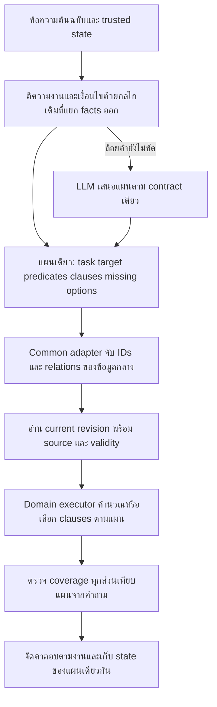

# R86 ทำไม Flow เดิมกับ Flow กลางจึงทำงานไม่เหมือนกัน

## ข้อสรุปที่ลึกกว่ารอบก่อน

การย้ายรอบนี้ทำสองงานพร้อมกัน: เปลี่ยนที่เก็บข้อเท็จจริง และเปลี่ยนวิธีตีความ/ดำเนินงานของคำถาม ในโค้ดปัจจุบันไม่ได้มี adapter ที่นำแผนงานเดิมไปดำเนินการกับข้อมูลกลางตลอดเส้นทาง แต่ส่งคำถามกลับเข้าเครื่องยนต์อ่านข้อมูลชุดใหม่ให้ตีความอีกครั้ง

การย้ายข้อมูลให้ตรง schema จึงไม่เท่ากับย้ายความสามารถตอบคำถามให้เท่าเดิม ความสามารถเดิมอยู่ใน parser, rule matcher, ลำดับความสำคัญ, การคำนวณ, state, การเลือกข้อความย่อย และ renderer ด้วย

รอบนี้เป็นการอ่านโค้ดและหลักฐานเดิมเพิ่มเติม ไม่ได้รัน chatbot/LLM หรือทดสอบใหญ่ ไม่ได้แก้โค้ด/ฐานข้อมูลใช้งาน ผลเก่า R64 ไม่ใช่คะแนนของ R84 ปัจจุบัน

## 1. เหตุผลเชิงออกแบบที่อ่านได้จากโค้ด กับผลที่ไม่ได้ย้ายตามมา

| การตัดสินใจที่เห็นในโค้ด | สิ่งที่ได้ | ส่วนที่ต้องเชื่อมเพิ่มจึงจะรักษาพฤติกรรมเดิม |
|---|---|---|
| โหมดใหม่อ่านเฉพาะฐานกลาง ไม่ fallback facts เก่า | การแก้ราคา/ถอนข้อมูลในกลางไม่ควรถูกข้อมูลเก่าทับ | ต้องแยก parser เดิมออกจากแหล่งข้อมูลเก่า แล้วให้ parser ใช้ฐานกลาง |
| ใช้ schema เดียวกับฟอร์มเจ้าของและตัวอ่าน | เพิ่ม/แก้รายการได้ด้วยโครงสร้างเดียว | ต้องแปลงคำถามภาษาคนเป็นงานและเงื่อนไข ไม่ใช่เลือก field อย่างเดียว |
| ใช้ common_read_state แทน request_plan เดิม | เก็บ IDs/fields และอ้างข้อมูลปัจจุบันได้ | ต้องรักษาความหมายของ pending slot, ตัวเลือก, การแทนค่า, การยกเว้น และคำถามหลายเงื่อนไข |
| จำกัด LLM ให้เลือก IDs/fields แทนสร้าง facts | คุม source และลดการแต่งข้อมูล | ต้องตรวจว่าแผนที่เลือกตอบทุกส่วนของคำถามจริง |
| แยก view เป็น migration preview | ทดลองข้อมูลโดยไม่สร้าง owner approval/release | การเปิด preview หรือมีข้อมูลครบไม่ใช่ behavioral parity หรือ production readiness |

ตารางนี้อธิบายการตัดสินใจที่พบ ไม่ใช่การอ้างว่าทราบเจตนาของผู้เขียนในอดีตทุกคน และไม่ใช่เหตุผลให้ยกเลิก source/revision/validity guards

## 2. จุดแยกจริงมีสองชั้นก่อนถึงคำตอบ

### 2.1 ชั้นเว็บทิ้งแผนเดิม แล้วส่งคำถามต้นฉบับให้ตัวใหม่

ใน `server.py` เมื่อเปิด migrated profile:

```python
resolved = ResolvedQuestion(question, question, False,
    reason='migrated_common_server_history')
request_plan = None
```

ก่อนเข้าโหมดนี้ parent server อาจมี `turn['plan']` ที่ตีความไว้แล้ว แต่โหมดใหม่ไม่ใช้แผนนั้น โดยให้ตัวอ่านกลางดู server history เอง ข้อความต้นฉบับและประวัติยังอยู่ จึงไม่ใช่ความหมายหายจาก raw history ทั้งหมด สิ่งที่ไม่ได้ส่งต่อคือผลการตีความที่เคยจัดรูปให้เรียบร้อยแล้ว

ตัวอ่านกลางจึงต้องทำงานที่ตัวเก่าเคยทำสำเร็จซ้ำ หากมี branch ใดตีความต่างกัน คำถามเดียวกันก็เดินคนละทาง

### 2.2 ชั้น engine จบที่ตัวอ่านใหม่ ก่อนตัวเฉพาะหมวดเดิม

ใน `engine.py`:

```python
if migrated_chat_enabled():
    return migrated_answer(question, locale=resolved_locale,
        history=recent_history, allow_llm=...)
```

ฟังก์ชันนี้ไม่ได้รับ `request_plan` เป็น argument แล้วตัวจัดการราคาเหมา, dialogue clarification, intent-cue recovery และเส้นทาง specialized อื่นที่อยู่ด้านล่างก็ไม่ถูกรันต่อโดยอัตโนมัติ

**จึงมีความต่างสองระดับ: แผนเก่าไม่ถูกใช้ และ executor เก่าก็ไม่ถูกใช้** การคัดลอกไฟล์ facts มาอย่างเดียวแก้สองจุดนี้ไม่ได้

ข้อควรแยก: R64 ในอดีตใช้ `try_common_answer` แล้ว return เมื่อมี result; R69+ ใช้ isolated migrated dispatcher โดยตรง ไม่ใช่ engine รุ่นเดียวกันทุกบรรทัด แต่ทั้งสองมีกรณีที่ common result ทำให้ specialized route ด้านล่างไม่ได้ทำงาน

## 3. สาเหตุใหม่ที่ตรวจพบ: คัดลอกรูปแบบกฎมา แต่ไม่ได้รักษาวิธีประมวลผล

### เดิม pattern เป็นคำสั่งจับข้อความ

`app/rules/matcher.py` เรียงกฎตาม priority, จำกัด category ตามงานที่เลือก และ compile pattern เป็น regular expression แล้วใช้ `compiled.search(query)`

ตัวอย่าง pattern เดิม:

```text
จอง.*กี่ชั่วโมง
maximum.*sessions
reserve.*advance
```

`.*` หมายถึงยอมให้มีข้อความอื่นคั่นอยู่ เช่น “ต้องจองล่วงหน้ากี่ชั่วโมง” ไม่จำเป็นต้องมีตัวอักษร `.*` ในคำถาม

### กลางเก็บสิ่งเดียวกันเป็น alias ซึ่งเป็นชื่อข้อความ

MigratedView นำ aliases/title มารวมเป็น names ส่วน `answer.named()` ตรวจว่า alias เป็น substring ในคำถามก่อน และ escape ด้วย `re.escape()` ดังนั้น path นี้ไม่ได้รัน regex เดิม

ในเชิงกลไก:

```text
old regex search("จอง.*กี่ชั่วโมง", "ต้องจองล่วงหน้ากี่ชั่วโมง")
    → รูปแบบนี้จับข้อความได้

new literal-name lookup("จอง.*กี่ชั่วโมง", "ต้องจองล่วงหน้ากี่ชั่วโมง")
    → คำถามไม่มีตัวอักษร .* จึงไม่เป็น exact alias
```

นี่เป็นคำอธิบายความหมายของ operator จากโค้ด ไม่ใช่ผลรัน chatbot ใหม่

### จำนวนที่อ่านพบในฐานปัจจุบัน

ตรวจ FAQ aliases ที่มีสัญลักษณ์บ่งชี้ regex เช่น `.*`, `\s`, `(?:`, `^`, `$` พบ **61 records / 308 alias entries** รายการเต็มอยู่ใน PATTERN_SEMANTICS_AUDIT.json

ตัวเลขนี้เป็นการตรวจรูปแบบตาม syntax ไม่ใช่จำนวนคำถามที่ล้ม และไม่ใช่จำนวนกฎที่ไม่มีทางถูกเลือก เพราะบางรายการอาจถูกเลือกผ่าน exact alias อื่น, intent_key, typed role หรือ semantic retrieval ได้อยู่

ผลกระทบที่อนุมานได้: เส้นทางที่เดิมจับได้ตรงและเร็ว อาจหลุดไป fuzzy/LLM หรือชน FAQ อื่นแทน นอกจากนี้ priority/category ของ RuleMatcher เดิมก็ไม่ใช่กติกาจัดอันดับเดียวกับคะแนน character overlap ของ entity_search

### แนวทางที่เหมาะกับ Format กลาง

- แยก “ชื่อเรียกของสิ่งนั้น” ออกจาก “รูปแบบบอกเจตนาคำถาม” ให้ชัด
- ย้ายความหมายของกฎเดิมเป็น task/subject/scope/conditions หรือใช้ตัวตีความที่แยกออกจาก facts
- ไม่บังคับให้เจ้าของเขียน regex และไม่ compile alias ทุกช่องเป็น regex โดยอัตโนมัติ เพราะชื่อที่มีสัญลักษณ์กับกฎประมวลผลคนละความหมาย และ regex ที่ไม่จำกัดมีความเสี่ยงด้านเวลา/ความกำกวม

## 4. แบบจำลองกลางที่ใหม่ใช้ยังไม่ได้แทนความหมายงานเดิมครบ

### ตัวอย่างราคาเหมาเดิม

ตัวจัดการเดิมเก็บ:

```json
{
  "schema_type": "zone_rental_v1",
  "targets": ["pc"],
  "groups": ["external"],
  "periods": ["full_day"],
  "asks": ["rates"],
  "unresolved_targets": [],
  "scoped_requests": []
}
```

ในคำถามผสม `scoped_requests` ผูกแต่ละ target เข้ากับ group/period ของตัวเอง ไม่ใช่ถือว่าทุก group ใช้กับทุก target และมีการยกเว้น/การเลือกต่อ/ถามว่าอุปกรณ์รวมอะไร/จำนวนที่นั่ง/นิยามครึ่งวันแยกจากราคาด้วย

### ตัวอ่านใหม่เน้นแผนอ่านข้อมูล

แผนใหม่มี record_ids, operation, requested_fields, scope_ids, projection และข้อมูลขยายตามแต่ละกรณี ซึ่งช่วยควบคุมการอ่านได้ แต่ไม่ใช่ตัวแทนของกติกา execute งานเดิมทุกแบบโดยอัตโนมัติ

ตัวอย่างความต่างของความหมาย:

| สิ่งที่ผู้ใช้สื่อ | ต้องรักษาอะไร | การมีเพียง IDs/fields ยังไม่พิสูจน์อะไร |
|---|---|---|
| “PC เต็มวันภายนอก และ VR ครึ่งวันภายใน” | สอง tuple เงื่อนไขแยกกัน | ไม่ควรทำ Cartesian product ของอุปกรณ์/กลุ่ม/ช่วงวัน |
| “แล้วครึ่งวันล่ะ” | เปลี่ยนเฉพาะ period ของงานเหมาเดิม | ต้องคง target และ audience ที่ถามไว้ ไม่ขยายขอบเขต |
| “ทั้งหมด” | แกนของตัวเลือกที่เพิ่งเสนอ | ทั้งหมดของบริการ/กลุ่ม/ปุ่ม/ขั้นตอน ไม่ใช่ทุก record ในฐาน |
| “ไม่เอา VR” | การลบ target และขอบเขตเดิม | รายการสิ่งที่พบในประโยคไม่บอกว่าสิ่งไหนถูกปฏิเสธ |
| “กฎนี้ตอนแข่งล่ะ” | เปลี่ยน context studio→competition | คำว่า keyboard เหมือนกันไม่ทำให้นโยบายสองบริบทใช้แทนกันได้ |

ตารางเป็น requirements ของ behavior ไม่ใช่ผลทดสอบว่าทุกรายการในรุ่นล่าสุดยังล้ม ตัวใหม่มี composition/price comparison/qualified reply หลายส่วนแล้ว แต่แต่ละส่วนเพิ่มเป็นกลไกแยกกัน จึงต้องตรวจว่าประกอบกันโดยใช้ความหมายเดียวกัน

จุดเสี่ยงเฉพาะที่อ่านพบ: `state_from_answer()` มี constraints.duration_minutes จาก price calculation แต่ยังไม่มี rental scope object ที่เทียบเท่า `zone_rental_v1` ทั้งชุด ส่วน `rental_ids()` สร้าง zone/audience จาก root kinds บางชนิด จึงต้องตรวจการถามต่อที่ state เก็บ rental_package IDs กับการรักษา scope_ids ให้ครบก่อนอ้าง parity กับ rental follow-up เดิม ข้อนี้เป็น static risk ยังไม่ใช่ผลรันเคสใหม่

## 5. ลำดับ “เลือกสิ่งที่ถาม” ต่างกัน ทำให้ผิดตั้งแต่ต้นทาง

เดิม specialized handlers มีกรอบงานก่อนค้น เช่น “กติกาเกมไหน → หมวดข้อไหน → ข้อใดในเอกสารนั้น” ส่วน common reader มีหลายจุดเริ่มจากชื่อ/record แล้วจึงเลือก operation/field/children โดยมี typed roles เพิ่มมาช่วยภายหลัง

เมื่อ candidate ขั้นแรกผิด การเลือก field ถัดไปอาจถูก schema แต่ตอบคนละเรื่องได้

หลักฐานจาก R64 ที่จับคู่คำถามเดียวกัน:

1. “ROV สรุปกติกาสั้นๆ” เดิมเลือกกติกา RoV กลางเลือก `migrated_faq_rule_reservation_quick_summary` และ field answer ของ FAQ จอง
2. “กติกา CS2 เรื่องการประท้วงและข้อพิพาท ว่าอย่างไร” เลือก CS2 parent ได้ แต่การขยาย children กว้างเกิน ข้อความกลาง 22,902 ตัวอักษร ขณะที่เดิมเลือกข้อประท้วง 236 ตัวอักษร
3. “Animal Crossing: New Horizons คือเกมอะไร” เดิมให้คำบรรยาย กลางเลือกเพียงข้อมูลชื่อเกม จึงตอบไม่ครบความต้องการ

สามกรณีนี้ล้มคนละชั้น: record, child/facet scope, field projection จึงไม่ควรแก้ทั้งหมดด้วยเพิ่ม top-k หรือเพิ่ม alias อย่างเดียว

## 6. กลางไม่ได้ใช้ทุกข้อมูลที่ถูกเก็บเป็น candidate โดยอัตโนมัติ

MigratedView สร้าง text_index/reverse_refs จากข้อมูล แต่เส้นทางอ่านจริงยังขึ้นกับแต่ละ resolver/relations/whitelist เช่น `entity_search.KINDS` ไม่รวมทุก kind และการค้น unnamed ใช้ character trigrams กับ threshold/candidate budget ก่อนให้โมเดลเลือก indices

ไม่ได้แปลว่า kind ที่ไม่อยู่ใน KINDS ตอบไม่ได้ เพราะมี path แบบ named, typed scope และ relation โดยเฉพาะ แต่แปลว่า “มีข้อความอยู่ในฐาน/มี text_index” ไม่รับประกันว่าแต่ละคำถามจะพามาถึงข้อความนั้น

ในทางกลับกัน การเพิ่ม top-k อย่างเดียวอาจทำให้มีตัวเลือกผิดหมวดมากขึ้น โมเดลช้าขึ้น และความเสี่ยงเลือกผิดเพิ่ม โดยไม่แก้ task/scope contract

## 7. Validation ใหม่กับความถูกต้องต่อคำถามเป็นคนละเกณฑ์

ตัวอย่างวงจรที่ต้องระวัง:

```text
planner เลือก field X
→ สร้าง read needs สำหรับ X
→ อ่าน X มี source ถูกต้อง
→ ตรวจว่าคืน X ครบ
```

ถ้า X ไม่ใช่สิ่งที่ผู้ใช้ถาม การตรวจวงจรนี้เพียงอย่างเดียวก็ยังไม่พิสูจน์คำตอบถูก

`read_contract.build_needs()` สร้างรายการจาก requested fields และระบุ semantic_correctness_verified=False ส่วน `finish()` ตรวจ fields/evidence/coverage ที่รู้แล้ว และประกาศ validation_scope ว่าไม่ใช่ human intent correctness

รุ่นปัจจุบันมี semantic_guard/typed needs/role coverage ช่วยมากกว่ารุ่น R64 แต่ข้อความยืนยันใน trace ก็ยังไม่ใช่ผลตรวจเจตนาโดยอิสระทุกคำถาม ต้องมี expected task/target/constraints ที่อิงคำถามก่อน แล้วเทียบกับแผน execute และคำตอบ

ความต่างที่อาจพบจึงมีทั้ง:

- อ่าน source ถูก แต่ตอบผิดหัวข้อ
- เลือกหัวข้อถูก แต่เงื่อนไข/จำนวนรายการไม่ครบ
- ตอบสาระถูก แต่ชื่อ route/source ID/ข้อความไม่ตรง evaluator เดิม
- ไม่มีคำตอบเพราะโมเดลหมดเวลา
- ระงับราคาที่หมดอายุอย่างถูกต้อง แม้ตัวทดสอบเก่าคาดว่าจะเห็นตัวเลข

ห้ามรวมเหตุการณ์เหล่านี้เป็น accuracy สาเหตุเดียว

## 8. “ข้อมูลไม่มี” กับ “ระบบยังหาไม่เจอ” ยังเสี่ยงถูกสรุปใกล้กัน

ข้อมูล unknown ตาม source, การตีความไม่ออก, การเลือก source ไม่สำเร็จ, และข้อมูลหมดอายุ ต้องเป็นสถานะต่างกัน

ใน R84 มี guard ของหัวข้อที่ยังไม่มีวิธียืนยัน เช่นยอดเงินผิด/เอกสารตัวตนผิด เพื่อกันไปเลือก FAQ สลิปที่ไม่ตรงเรื่อง แต่ gate นี้ยังอิงรายการหัวข้อในโค้ด หากเจ้าของเพิ่มคำตอบในอนาคตแล้วข้อความยังไม่ match record ก่อนถึง gate มีความเสี่ยงที่ระบบแจ้ง unconfirmed ก่อน semantic lookup จะค้น source ใหม่

ต้องแก้โดยตรวจ field/source coverage ณ revision ปัจจุบัน ไม่ตีความคำว่า “เป็นหัวข้อนี้” ให้เท่ากับ “ข้อมูลหัวข้อนี้ไม่มีเสมอ” นี่เป็นผลข้างเคียงเชิงโครงสร้างที่ต้องแก้เพื่อเป้าหมายเพิ่มข้อมูลได้เอง ไม่ควรแก้ด้วยเพิ่มข้อยกเว้นทีละ FAQ

## 9. ทำไมคะแนนผ่านชุดเล็กหรือ data migration audit ยังไม่พิสูจน์ Flow เท่ากัน

แต่ละ gate พิสูจน์คนละอย่าง:

| สิ่งที่ตรวจ | พิสูจน์ได้ | ยังพิสูจน์ไม่ได้ |
|---|---|---|
| schema/FK/source hash | เก็บข้อมูลในรูปแบบและความสัมพันธ์ที่อนุญาต | คำถามแต่ละแบบเลือกสิ่งนี้ได้ |
| คัดข้อความ/คำแปลครบ | payload ที่ต้องอ่านมีอยู่ | parser ใช้ช่องที่ตรงกับคำถาม |
| เปิด LLM flag | อนุญาตเรียกโมเดล | ทุกคำถามเกิด inference และตีความถูก |
| model generation/JSON ผ่าน | transport และ output protocol ใช้ได้ | record/field/scope ที่เลือกถูก |
| focused 26/26 | ผ่านเป้าหมาย 26 เทิร์นที่กำหนด | behavioral parity ทุกหมวด/ข้อมูลใหม่ |
| legacy route strings เท่ากัน | ความเข้ากันได้กับ interface เก่า | เนื้อหาและเงื่อนไขตรงผู้ใช้ทุกส่วน |

ช่วง migration ที่ผ่านมาเน้น data/schema/source correctness หลายจุด แล้วค่อยเสริม behavior reader ทีละชั้น จึงเกิดช่องว่างระหว่าง “ย้ายข้อมูลผ่าน” กับ “ตอบได้เหมือนเดิม” การไม่ตรวจบัญชีสองส่วนนี้พร้อมกันเป็นช่องว่างของกระบวนการย้ายด้วย

## 10. รูปแบบ Flow ที่ควรทำให้เหมือนกันจริง

ต้องรักษา contract ของงานตั้งแต่ต้นจนจบ แล้วเปลี่ยน facts provider ให้เป็น Format กลาง



### สิ่งที่ควรเท่ากันกับเดิม

- เจตนางาน/หัวข้อและสิ่งที่ถาม
- ขอบเขตอุปกรณ์ เกม คน กลุ่มผู้ใช้ และวันเวลา
- การผูกเงื่อนไขต่อแต่ละ clause และการยกเว้น
- สิ่งที่สืบได้จากคำถามก่อนหน้า และสิ่งที่ต้องถามเพิ่ม
- การเลือกเฉพาะข้อมูลย่อยและการให้ครบเมื่อผู้ใช้ขอทั้งหมดในขอบเขตนั้น

### สิ่งที่เปลี่ยนได้โดยมีเหตุผล

- ID/ชื่อ route ภายในและแหล่งเก็บข้อมูล
- การจัดรูปแบบให้อ่านง่ายขึ้น
- คำตอบที่ข้อมูล revision ใหม่เปลี่ยนจริง
- การแจ้งหมดอายุ/ขัดแย้ง/ยังไม่ทราบเมื่อมีหลักฐานรองรับ

### ลำดับแก้ที่ตามสาเหตุ

1. กำหนด request contract เดียวและชั้น adapter แทนให้ตัวใหม่เริ่มตีความจากศูนย์ทุกครั้ง
2. แยก alias ชื่อออกจาก legacy pattern semantics และ priority/context โดยแปลงเป็นความหมายงานที่รองรับข้อมูลใหม่ได้
3. ย้าย parser/executor/renderer ของหมวดเดิมที่มี source oracle ชัด โดยอ่าน facts จาก common เท่านั้น เริ่มราคาเหมาและ follow-up
4. รวม state ให้เก็บงาน/เงื่อนไข/ตัวเลือกได้ครบ ไม่ผูกแค่ผลการอ่าน fields ล่าสุด
5. ให้ unknown gate ตรวจ source ปัจจุบัน และแยกหาไม่เจอจากข้อมูลไม่มี
6. ตรวจ behavioral pairs เดิมจาก log และข้อมูลใหม่ในฐานทดลอง แยกคะแนนเนื้อหา/รูปแบบ/transport ไม่ใช้ source count แทน correctness

รอบวิเคราะห์นี้ยังไม่เริ่มแก้สถาปัตยกรรมข้างต้น และยังไม่รันเทสใหญ่

## หลักฐานและไฟล์อ้างอิง

- [จุดเปลี่ยน dispatcher ใน engine](C:/Users/Chokhun/Documents/Codex/2026-09-25/psu-esports-studio-phuket-chatbot-c-2/r78_web_session_check_20261016/system/app/pipeline/engine.py:881)
- [server ไม่ใช้ request_plan เดิมในโหมดใหม่](C:/Users/Chokhun/Documents/Codex/2026-09-25/psu-esports-studio-phuket-chatbot-c-2/r78_web_session_check_20261016/system/app/web_api/server.py:655)
- [RuleMatcher เดิม compile patterns/priority/category](C:/Users/Chokhun/Documents/Codex/2026-09-25/psu-esports-studio-phuket-chatbot-c-2/r78_web_session_check_20261016/system/app/rules/matcher.py)
- [common named lookup](C:/Users/Chokhun/Documents/Codex/2026-09-25/psu-esports-studio-phuket-chatbot-c-2/r78_web_session_check_20261016/system/app/knowledge/common/answer.py:89)
- [common dialogue state](C:/Users/Chokhun/Documents/Codex/2026-09-25/psu-esports-studio-phuket-chatbot-c-2/r78_web_session_check_20261016/system/app/knowledge/common/dialogue.py)
- [rental plan เดิมและ scoped_requests](C:/Users/Chokhun/Documents/Codex/2026-09-25/psu-esports-studio-phuket-chatbot-c-2/r78_web_session_check_20261016/system/app/pipeline/zone_rental.py)
- [read contract](C:/Users/Chokhun/Documents/Codex/2026-09-25/psu-esports-studio-phuket-chatbot-c-2/r78_web_session_check_20261016/system/app/knowledge/common/read_contract.py)
- [PATTERN_SEMANTICS_AUDIT.json](C:/Users/Chokhun/Documents/Codex/2026-09-25/psu-esports-studio-phuket-chatbot-c-2/r86_flow_semantic_contract_audit_20261017/PATTERN_SEMANTICS_AUDIT.json)
- [R85 คำถามคู่เดิม 10 คู่พร้อม trace และสถานะปัจจุบัน](C:/Users/Chokhun/Documents/Codex/2026-09-25/psu-esports-studio-phuket-chatbot-c-2/r85_legacy_common_flow_audit_20261017/LEGACY_VS_COMMON_FLOW_ANALYSIS_TH.md)

ข้อสรุปสุดท้าย: สอง Flow ต่างกันเพราะสิ่งที่ถูกส่งต่อ เป้าหมายการวางแผน วิธีจับกฎ state และเกณฑ์ความสำเร็จต่างกัน การเปลี่ยน Format กลางไม่ได้บังคับให้ทิ้งพฤติกรรมเดิมทั้งหมด แต่การเชื่อมพฤติกรรมเดิมกับ facts กลางยังทำไม่ครบ จึงต้องแก้ที่ contract และ adapter รวมถึงสัญญาณตีความที่สูญความหมาย ไม่ใช่เติมข้อมูลหรือเพิ่มคำถามตัวอย่างอย่างเดียว
