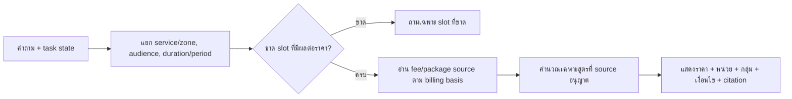
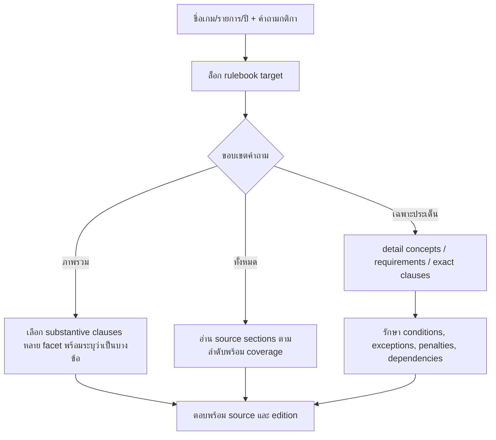

# Full Flow ระบบเดิม — as built ใน snapshot ที่เคยทดสอบ R64

## 0. เอกสารนี้อธิบายอะไร

อธิบายเส้นทางจริงของโค้ด `r64_full_comparison_20261013/system` ซึ่งใช้เป็นฐาน legacy ON ที่นำมาเทียบ R88 ไม่ใช่การอ้างว่าโครงการ Downloads ปัจจุบันยังเหมือน snapshot ทุกบรรทัด ไม่รันระบบเดิมใหม่และไม่คัดลอกคำตอบเก่ามาแทน facts ของข้อมูลกลาง

Flow เป็นต้นไม้ของทางออกที่มีลำดับความสำคัญ ไม่ใช่รายการที่ทุกคำถามต้องผ่านครบ หาก typed handler ตอบได้ก่อน จะไม่เดินถึง retrieval/LLM ส่วนขั้นเว็บต้องแยกจาก batch evaluator ที่เรียก engine ตรง

## 1. แผนภาพรวมตั้งแต่ input ถึง output

```mermaid
flowchart TD
 A["ผู้ใช้พิมพ์ในเว็บ"] --> B["API: ตรวจ payload, locale, input guard"]
 B --> X{"ต้องหยุดที่ guard หรือ replay เดิม?"}
 X -- "ใช่" --> O["ส่งผลที่ถูกต้องตามชนิด พร้อม log/state"]
 X -- "ไม่" --> S["ล็อก session, รับ acknowledge, begin turn/idempotency"]
 S --> T["Typed request plan หรือ context resolver เดิม"]
 T --> W["Admission / worker / request deadline"]
 W --> E["Engine: studio scope / creation-translation boundary"]
 E --> F{"Typed fast exit: ราคาเหมา, navigation, resume, missing slot"}
 F -- "ตอบได้" --> V["Final answer/source/language/task contract validation"]
 F -- "ยังไม่ได้" --> Q["Intent-cue recovery, typed fee, budget, compound plan"]
 Q --> Z{"หลายคำถาม?"}
 Z -- "ใช่" --> K["รักษา subject/dependency แล้วตอบแต่ละ task"]
 Z -- "ไม่" --> P["Single: owner facts / game guard / preprocess recovery"]
 K --> P
 P --> I["Entities + route variants + routing priority"]
 I --> H{"Protected/bilingual/competition/live handler ตอบได้?"}
 H -- "ได้" --> V
 H -- "ไม่ได้" --> J["Freshness, boundary, universal intent, target locks"]
 J --> U["Tool routing + ambiguity + question frame"]
 U --> N["Capability candidates: score, margin, preconditions"]
 N --> R{"Structured หรือ deterministic tool?"}
 R -- "มีคำตอบ" --> V
 R -- "ไม่มี" --> G["Competition fact cards / curated / hybrid retrieval"]
 G --> Y{"มีหลักฐานพอ?"}
 Y -- "พอ" --> V
 Y -- "ไม่พอ" --> LL["Scoped LLM / vector / RAG fallback ตาม flag และ deadline"]
 LL --> V
 V --> VV{"ผ่าน contract?"}
 VV -- "ไม่ผ่าน" --> NO["Safe no-answer + rejected draft diagnostics"]
 VV -- "ผ่าน" --> O
 NO --> O
 O --> END["Commit state, JSON sources/trace, async log, frontend แสดงผล"]
```

หมายเหตุ: แผนภาพรวมขั้นตอนที่มีหน้าที่ใกล้กัน ไม่ใช่ลำดับ return ทุกบรรทัด โดยเฉพาะ retrieval/LLM มี branch พิเศษที่แทรกก่อนหรือหลังกัน ดูลำดับละเอียดในข้อ 8 ส่วน engine เดิมมี optional common/canonical checkpoints ด้วย แต่แขน legacy ที่เก็บผลไม่ได้หมายถึง current migrated dispatcher; การมีโค้ด checkpoint ไม่ใช่หลักฐานว่ามีการใช้ common facts ในทุกคำถาม

## 2. ชั้นข้อมูลที่ระบบเดิมใช้อยู่

| ประเภท | แหล่ง/ตัวอ่านหลัก | สิ่งที่ระบบต้องเลือกให้ถูก |
|---|---|---|
| กฎศูนย์/FAQ/ช่องทางติดต่อ | rules, owner service facts, static-domain และ curated sources | intent, เงื่อนไข, สิทธิ์/ขอบเขต ไม่ใช่แค่คำที่เหมือนกัน |
| ราคาใช้บริการ | service fee calculator + structured price facts | บริการ, กลุ่มผู้ใช้, หน่วยราคา, ระยะเวลา, เงื่อนไขต้นฉบับ |
| ราคาเหมา | zone_rental parser + package source | โซน, ภายใน/ภายนอก, ครึ่งวัน/เต็มวัน แบบ tuple ต่อ clause |
| เกม/อุปกรณ์/บุคลากร | structured resolver, fact composer, curated/canonical information | entity/edition, field, จำนวน/ความหมายของที่นั่ง, ความสัมพันธ์ |
| วิธีเล่น/ปุ่ม | game-control parser + source mappings + partial-control caveats | เกม/แพลตฟอร์ม/โหมด/action และข้อจำกัดการตรวจปุ่ม |
| กติกาแข่ง | locked rulebook registry + source sections/fact cards/detail predicates | เกม/รายการ/ปี, facet, proposition และเงื่อนไขเต็ม |
| ตารางบริการ | service calendar + source schedule/closures | วัน/เขตเวลา, เปิด, จองได้, Maintenance, วันปิดพิเศษ |
| สถานะจองสด | live booking adapter: dashboard หรือ WordPress ตาม config | วันที่, ช่วงเวลา, หมวด/หมายเลขเครื่อง, occupancy snapshot |
| ความรู้ที่ค้นไม่ตรง | curated lexical/hybrid/vector หรือ scoped LLM ตาม gate | มี studio anchor, ownership/source authority และ validation |

ข้อมูลเดิมจึงไม่ได้อยู่ในไฟล์เดียว และ parser/renderer หลายหมวดรู้โครง source ของตัวเอง การย้ายเฉพาะค่าข้อมูลไม่เท่ากับย้ายความสามารถอ่านข้อมูลเหล่านี้

## 3. Web/API/session layer

1. Frontend ส่ง question, locale, client_session_id, client_turn_id และการ acknowledge คำตอบก่อนหน้าเมื่อมี
2. API ตรวจขนาด/รูป payload, input quality, ภาษา และ admission ก่อนทำงานหนัก
3. ต่อ session มี lock; turn เดิมกับ fingerprint เดิม replay ได้โดยไม่เรียกตอบซ้ำ ส่วน turn ID ชนกันแต่ payload ต่างกันเป็น conflict
4. ประวัติที่เชื่อถือได้มาจาก conversation store และ delivery/acknowledge ไม่ถือทุกข้อความจาก client เป็น server state โดยอัตโนมัติ
5. typed task memory แยกราคา/เหมา/การเลือกตัวเลือก/การกลับไป task เดิม หากไม่มี typed plan จึงใช้ context resolver
6. worker supervisor/job queue เป็นชั้นตาม config: busy, pending, restarting และ timeout เป็น response type แยกจากคำตอบข้อมูล
7. หลังตอบ เก็บ actual task contract และ state เฉพาะสิ่งที่ส่งจริง ไม่ใช่ทุกสิ่งที่ assistant เคยเสนอเป็นตัวเลือก
8. API แสดง answer, source list, mode/trace/debug ตามการตั้งค่า และบันทึก log แบบ async

**ห้ามตีความ** API200 = เนื้อหาถูก; replay สำเร็จ = อัปเดต facts แล้ว; มี history = ทุก task จะสืบต่อถูก

## 4. Engine entry: ลำดับที่มีสิทธิ์จบก่อน

| ลำดับ | ขั้น | เงื่อนไข/สัญญาที่รักษา | ทางออก |
|---|---|---|---|
| L01 | locale + deadline + booking snapshot context | ภาษาและกรอบเวลาคำขอเดียวกัน | context สำหรับขั้นถัดไป |
| L02 | studio scope / creation / translation boundary | ไม่ขยายบอตเป็นผู้ตอบทุกเรื่อง | scoped refusal |
| L03 | optional knowledge checkpoint | ต้องตรง profile/ฐานที่อนุญาต | answer หรือส่งต่อ |
| L04 | affirmative request focus | ทิ้งเฉพาะ task ที่ผู้ใช้ปฏิเสธอย่างชัดเจน | active question |
| L05 | zone rental plan | รักษา zone/audience/period และ tuple ของคำถามผสม | source-backed package answer/clarification |
| L06 | dialogue state clarification/navigation/resume/selection | “ทั้งหมด”, “อันแรก”, “กลับไป” ต้องมีแกนที่ยืนยันได้ | typed clarification หรือ resume |
| L07 | unsupported numbered game/edition/control target | ไม่เดารุ่น/เกมที่ไม่มีหลักฐาน | explicit unsupported/no-answer |
| L08 | generic control missing game | “ปุ่มยิงกดอะไร” ยังขาดชื่อเกม | ขอชื่อเกม ไม่ดึงปุ่มเกมอื่น |
| L09 | intent-cue recovery + source operation splitter | แก้ cue และรักษาหลาย operation ของ subject เดียว | clauses/tasks |
| L10 | budget + typed fee conversation | จำนวนเงิน/กลุ่ม/เวลาไม่สลับ slot | calculator/targeted clarification |
| L11 | optional canonical knowledge | เปิดตาม flag และช่วงภาษาที่รองรับ | source answer หรือส่งต่อ |
| L12 | compound complexity/query planner | กติกาเกมเดียวไม่แตก “conduct and etiquette” เป็นคนละเกม | single หรือ multi task |

## 5. การแก้คำผิดและ routing ของ single-question path

คำถามบางชนิดตอบจาก fast facts/guard ก่อน preprocessing ได้ หากยังไม่ได้ จึงเข้า preprocessing ดังนี้

1. ตัด conversational preface ที่ไม่เปลี่ยนสาระ โดยเก็บ raw input ไว้
2. ฟื้นชื่อเกมแข่งขันที่มี registry และรูปอักษร `เเ` → `แ`
3. keyboard-neighbor recovery
4. Thai transposition recovery
5. multi-error phrase recovery
6. intent-cue recovery
7. game-title variants เฉพาะบริบทที่เข้าเงื่อนไข พร้อมป้องกันการเปลี่ยน verified service label เป็นชื่อเกม
8. เก็บ variants ไม่เกิน 8 รูป; รักษา explicit competition target และตัวเลข/edition ไม่ให้ recovery เปลี่ยนเกมที่ผู้ใช้ระบุ
9. extract_entities → route_intent → routing_priority_policy
10. ประเมิน variant เมื่อ route ยังอ่อน; เทียบ route candidate ตาม threshold/margin ของโค้ด ไม่ใช่เลือกคำตอบที่คะแนน factual สูงกว่า

**จุดเด่น:** recovery มีหลาย error channel และเป็นระดับ task cue ไม่ได้มีแค่ alias ชื่อเกม

**ความเสี่ยง:** recovery อาจแปลงเจตนาหรือเกมถ้าขาด anchor protection; การเพิ่ม alias อย่างเดียวไม่แก้การรักษา negation, จำนวน, subject หรือหลาย task

## 6. ชั้นเลือกตัวตอบ: rule, intent, frame และ capability ไม่ใช่ชั้นเดียวกัน

### 6.1 RuleMatcher

โหลด trusted rules, compile pattern แล้วเรียง priority สูงก่อน Pattern ที่ match ระบุ category/intent และ source/answer ของ rules เดิม English ไม่ fallback ไป Thai prose โดยเงียบ หากไม่มี English ที่ใช้ได้จะเข้าทางปลอดภัยของ bilingual path

คะแนน priority เป็นลำดับกฎ ไม่ใช่ probability ว่าข้อมูลถูก การมี regex ตรงก็ยังต้องผ่าน source/answer contract

### 6.2 Protected handlers และ target locking

มีการตอบ owner facts, social/identity, protected intents, bilingual English, competition catalog/overview/detail และ live booking ก่อนตัวเลือกทั่วไปบางชั้น แต่ละ branch อาจ return ได้ทันที

ชื่อเกม/รายการที่ระบุชัดถูก lock เพื่อไม่ให้ universal intent หรือ tool router เปลี่ยนเป็นเกมที่คำคล้ายกว่า หาก target ไม่อยู่ในข้อมูลต้องแจ้งไม่ยืนยัน ไม่ดึงกติกา VALORANT มาตอบแทนเกมอื่น

### 6.3 Universal intent → tool routing → ambiguity → question frame

ใช้ domain/operation/target/เงื่อนไขเพื่อ refine route; semantic lock และ game lock ต้องคงอยู่ ต่อด้วย freshness/boundary/ambiguity checks ก่อนเรียก tool ตัวใด ไม่ใช่ให้ LLM เลือกแล้วเชื่อทันที

### 6.4 Capability scoring

ความสามารถ candidate มี base score, bonus/penalty ตาม route, intent, tool decision และ question frame จากนั้น normalize score ด้วย `/1.80` และ clamp ไม่เกิน `.999`

- ไม่มี candidate ที่รับได้ → ไม่อนุญาต execution
- score ต่ำกว่า `.45` → abstain
- margin ต่ำกว่า `.035`, action ต่างกันและ operation ยัง unknown → review_required
- margin ต่ำแต่ action เหมือนกัน/รู้ operation อาจยังอนุญาต execution

ตัวเลขนี้เป็น **ranking heuristic** ไม่ใช่การวัดว่าคำตอบมีโอกาสถูกกี่เปอร์เซ็นต์ ต้องอ่าน reasons, preconditions และ source ต่อ

## 7. Domain subflows

### 7.1 ราคาใช้บริการและราคาเหมา

half-day/full-day ไม่เท่ากับจำนวนชั่วโมงจนกว่าจะมี source; จำนวนที่นั่งไม่ใช่จำนวนผู้เล่นพร้อมกันโดยอัตโนมัติ; ราคา VR30 นาทีไม่ใช่สิทธิ์ให้ slot อีกครึ่งชั่วโมงว่างให้คนอื่นจอง การกันชั่วโมงเต็มเป็น occupancy policy อีกชั้น

**ข้อจำกัดเดิมที่ต้องคงไว้ในการเทียบ:** บาง renderer อ่านตารางราคาเดิมได้ตรงตาม oracle แต่ไม่ได้มี validity behavior เท่ากับข้อมูลกลางปัจจุบัน การตอบตัวเลขได้จึงไม่ยืนยันว่าเป็นราคาปัจจุบัน

### 7.2 เกม/อุปกรณ์/ปุ่ม

entity resolver → exact/ambiguous/unknown target → structured game/equipment fact → requested operation (overview/list/how-to/controls) → source control/action rows → partial-data warning → citations

หากไม่มีชื่อเกมใน control request ต้องขอชื่อเกม; ถ้าเป็นรายชื่อเกมในโซนต้องไม่ตีความ “เล่นได้ไหม” เป็น live vacancy โดยอัตโนมัติ; ถ้า source ปุ่มยังไม่ตรวจจริงต้องบอกสถานะนั้น

### 7.3 กติกาแข่งขัน

“ประท้วง” ต่างจาก “ใช้ภาษาอะไรในการประท้วง”; “จำนวนผู้เล่นในเกม” ต่างจาก roster/substitute; “เวลานอก” ต่างจาก technical pause ต้องไม่ใช้ clause ของอีก proposition มาแทน

### 7.4 ตารางและสถานะจอง

คำถามเปิด/ปิดรายวันใช้ calendar/closures และเขตเวลาไทย ส่วนเครื่องว่างตามเวลาใช้ live adapter

- `dashboard` mode: อ่าน local status service ที่ต้องพร้อมทำงาน
- `wordpress` mode: ดึง source ผ่าน WordPress adapter ตาม config ไม่ใช่กดเปิด batch ใหม่ทุกคำถาม
- อุปกรณ์ทั้งหมวด: เลือก family แล้วสรุปว่างกี่เครื่องจากทั้งหมด พร้อมรายเครื่องตามคำถาม
- ถาม “มีอะไร **ว่าง** ให้เล่น”: ไม่แสดงเครื่องที่ไม่ว่างปนเป็นรายการว่าง
- ยืนยัน transport/schema ≠ ยืนยัน occupancy; ต้องมี known-result fixture หรือ ground truth แยก
- VR30 นาทีอาจกัน occupancy เต็มชั่วโมงตามนโยบายที่ผู้ใช้ยืนยัน ห้ามนำกฎนี้ไปเปลี่ยนราคาเอง

### 7.5 FAQ/นโยบาย/ขั้นตอน

ตรวจ source ownership และ qualification ก่อนตอบ เช่น สลิปผิด/หลักฐานตัวตนผิด/ยอดชำระผิด เป็นคนละ task แม้มีคำว่า “หลักฐาน/ผิด/แก้” ร่วมกัน หาก source ครอบคลุมเพียงพื้นที่รับประทานอาหาร ต้องไม่ขยายเป็นทุกเงื่อนไขการนำอาหารจากภายนอก

## 8. Retrieval และ LLM fallback

เมื่อ structured/deterministic ไม่ตอบ จะพิจารณา fact cards/curated/hybrid ตาม route และ target; ใช้ vector/RAG/scoped general LLM เมื่อ flags, studio anchor, evidence และ deadline อนุญาต

ลำดับที่ละเอียดกว่าภาพรวม ต้องอ่านเป็น branch ที่มีเงื่อนไข ไม่ใช่ทุกข้อทำเสมอ:

| ตำแหน่งใน engine snapshot | ขั้น | เงื่อนไขสำคัญ / ทางออก |
|---|---|---|
| ก่อน deterministic บางเส้นทาง ราวบรรทัด 3404 | game-control vector-first | ต้องเป็นโจทย์ปุ่มที่เข้าเงื่อนไข; รับคำตอบที่ score ≥ .68 |
| ราว 3449–3504 | deterministic และ guarded vector override | บางผล unknown-game อาจเปิดให้ vector ที่ผ่าน guard มาแทน ไม่ใช่ให้ทุกคำตอบถูก rewrite |
| ราว 3558–3715 | competition fact cards / targeted curated | ต้องรักษา target และ coverage; direct answer บางทางใช้ threshold .65 |
| 3773 เป็นต้นไป | guarded hybrid retrieval | รับ direct hybrid answer เมื่อ score ≥ .68; บาง hits ถูกเก็บไว้ reuse |
| ราว 3897 | general anchored semantic retrieval | เฉพาะขอบเขต/anchor ที่ตรวจได้ |
| ราว 4017 | experimental fallback ของ general route | อาจจบคำถามก่อน final curated/vector ด้านล่างเมื่อเข้าเงื่อนไข |
| 4084–4098 | final curated retrieval/direct answer | direct answer ≥ .65 แล้วผ่าน source/output validation |
| 4114–4141 | final guarded vector direct | reuse hybrid hits ได้; direct answer ≥ .68 |
| ราว 4168 | final experimental fallback | ต้องเปิด flag และมีเงื่อนไขรองรับ |
| ราว 4224 | final no-answer | ไม่สร้างข้อเท็จจริงที่ไม่มีหลักฐาน |

คะแนนแต่ละชนิดเปรียบกันข้ามตัวอ่านไม่ได้ และ threshold ผ่านไม่ได้รับประกันว่าเลือก proposition/เงื่อนไขตรงโจทย์ ต้องตรวจ evidence กับ task ต่อ

LLM ON จึงไม่ได้บังคับทุกคำถามให้ generate คำตอบ และไม่ใช่เหตุผลให้ปิด safety/ownership checks หากหาข้อมูลไม่ได้ ทางสุดท้ายยังเป็น no-answer/clarification พร้อมร่องรอยเหตุที่เลือก

## 9. Validation และ output contract

`_build_result` รวม validation จากตัวตอบ กับ source/language checks เพิ่ม หากไม่ผ่าน hard veto จะเปลี่ยนเป็น safe no-answer, ล้าง hits และบันทึก rejected mode/route/errors

**จุดที่อ่านผลผิดได้:** final `validation.ok=True` อาจหมายถึง “คำตอบปฏิเสธที่ปลอดภัยผ่านแล้ว” หลัง veto ไม่ได้หมายถึง draft ก่อนหน้าถูกต้อง ต้องอ่าน warnings, rejected errors และ task_answer_contract ด้วย

decision_artifact และ trace เก็บ route, intent, selected capability, source/evidence, coverage, timing และ fallback; server commit เฉพาะผลที่ส่งจริงแล้วจึงส่งให้ frontend

## 10. การเพิ่ม/แก้ข้อมูลในระบบเดิม

1. ระบุ authoritative source และหมวดที่เกี่ยวข้อง
2. แก้ rules/structured facts/curated/canonical data ตาม provider นั้น ไม่มีกติกากลางเดียวครอบคลุมทุก provider
3. หากมีตารางหรือ index/cache ให้ rebuild/invalidate ตามตัวอ่าน
4. ตรวจ parser/renderer ว่ารองรับ field, new entity, edition และ relationship ใหม่หรือไม่
5. ทดสอบโจทย์เดิมและโจทย์ของข้อมูลใหม่ พร้อม provenance และ validity

ข้อดีคือ interpreter/renderer เฉพาะหมวดพัฒนาสะสมมามาก แต่การดูแลข้อมูลหลายโครงและ vocab/source-specific code มีต้นทุนสูง ไม่ควรนำไฟล์คำตอบเดิมมาทับข้อมูลกลางเพื่อให้คะแนนกลับมา

## 11. ปัญหาที่พิสูจน์แล้วใน snapshot เดิม

- legacy ON มี 2,694 execution exceptions: **2,692 เป็น NameError `ownership_blocked`**, อีก 2 เป็น harness timeout30s; ชื่อแปรถูกใช้ใน retrieve_curated แต่ assignment ที่พบอยู่ใน function อื่น จึงไม่ควรคัดลอก retrieval เก่าทั้งชุดมาใช้
- คะแนน strict อิง schema/route เดิม จึงได้เปรียบด้าน protocol โดยธรรมชาติ
- ตัวตรวจข้อความอาจให้ผ่านเพียงคำจำเป็นบางคำ แม้คำตอบไม่ครอบคลุมทุกข้อจริง
- การอ่านตารางเดิมได้ไม่รับรอง current validity, ขอบเขตนโยบายใหม่ หรือการตรวจแปลโดยเจ้าของ
- fallback หลายชั้นและ source หลายแบบทำให้รักษา task/ownership/ภาษาให้สม่ำเสมอยาก

ข้อมูลคะแนนและความผิดพลาดทั้งหมดดูเอกสารวิเคราะห์คู่กัน ไม่สรุปว่าเดิมถูกทุกข้อจากคะแนน 94.41%

## 12. จุดอ้างอิงโค้ดที่ตรวจ

- [app/web_api/server.py :: do_POST](C:/Users/Chokhun/Documents/Codex/2026-09-25/psu-esports-studio-phuket-chatbot-c-2/r64_full_comparison_20261013/system/app/web_api/server.py:470)
- [app/pipeline/engine.py :: answer](C:/Users/Chokhun/Documents/Codex/2026-09-25/psu-esports-studio-phuket-chatbot-c-2/r64_full_comparison_20261013/system/app/pipeline/engine.py:839)
- [app/pipeline/engine.py :: _answer_single](C:/Users/Chokhun/Documents/Codex/2026-09-25/psu-esports-studio-phuket-chatbot-c-2/r64_full_comparison_20261013/system/app/pipeline/engine.py:1555)
- [app/pipeline/engine.py :: _answer_multi](C:/Users/Chokhun/Documents/Codex/2026-09-25/psu-esports-studio-phuket-chatbot-c-2/r64_full_comparison_20261013/system/app/pipeline/engine.py:1182)
- [app/pipeline/preprocess.py :: preprocess_input](C:/Users/Chokhun/Documents/Codex/2026-09-25/psu-esports-studio-phuket-chatbot-c-2/r64_full_comparison_20261013/system/app/pipeline/preprocess.py:120)
- [app/rules/matcher.py :: RuleMatcher](C:/Users/Chokhun/Documents/Codex/2026-09-25/psu-esports-studio-phuket-chatbot-c-2/r64_full_comparison_20261013/system/app/rules/matcher.py:14)
- [app/pipeline/capability_registry.py :: build_candidate_decisions](C:/Users/Chokhun/Documents/Codex/2026-09-25/psu-esports-studio-phuket-chatbot-c-2/r64_full_comparison_20261013/system/app/pipeline/capability_registry.py:224)
- [app/pipeline/engine.py :: _handlers_for_route](C:/Users/Chokhun/Documents/Codex/2026-09-25/psu-esports-studio-phuket-chatbot-c-2/r64_full_comparison_20261013/system/app/pipeline/engine.py:4476)
- [app/pipeline/engine.py :: _build_result](C:/Users/Chokhun/Documents/Codex/2026-09-25/psu-esports-studio-phuket-chatbot-c-2/r64_full_comparison_20261013/system/app/pipeline/engine.py:4499)
- [app/pipeline/retrieval.py :: retrieve_curated](C:/Users/Chokhun/Documents/Codex/2026-09-25/psu-esports-studio-phuket-chatbot-c-2/r64_full_comparison_20261013/system/app/pipeline/retrieval.py:696)
- [app/session/context_resolver.py :: resolve_question_with_context](C:/Users/Chokhun/Documents/Codex/2026-09-25/psu-esports-studio-phuket-chatbot-c-2/r64_full_comparison_20261013/system/app/session/context_resolver.py:872)
